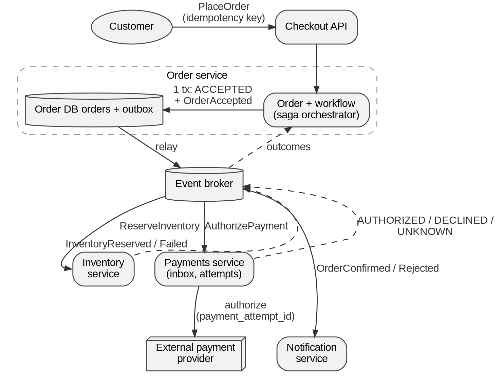

# Appendix A — Worked Architecture Cases

## A.1 Reference Design: Resilient Checkout with External Payment

**Context and scope.** The system accepts an order, reserves inventory, authorizes payment and notifies the customer. Actors are the customer, checkout API, Order service (including the order workflow), Inventory service, Payments service, external payment provider and Notification service. One authoritative order database and an event broker are assumed; specific cloud products are intentionally left open. The integration sequence is defined in 6.7.1.

{#fig-a-1 width="100%"}

**Architecturally significant requirements (illustrative).** 500 order submissions per second at peak; p99 order acknowledgment within 2 seconds; acknowledged orders are durable; no duplicate charge for a given `payment_attempt_id`; a broker outage loses no committed order event.

**Design and transaction boundaries.** Order writes the order as ACCEPTED and an OrderAccepted outbox row in one transaction (6.3.1); the relay publishes at least once. Order, Inventory and Payments are separate consistency boundaries coordinated by an orchestrated saga with durable state. Payments records an inbox entry in the same transaction as the local state change, calls the provider with `payment_attempt_id` as idempotency key and records the provider reference.

**Failure scenarios.**

- *Broker unavailable:* committed outbox rows accumulate; checkout keeps acknowledging durable orders until storage or backlog limits are reached, then sheds load.
- *Relay crash after publish:* duplicate events are expected and suppressed by consumer inboxes.
- *Provider timeout:* the outcome is UNKNOWN; the order stays PAYMENT\_PENDING and reconciliation queries provider status before any new attempt.
- *Payment declined:* the inventory reservation is released and the order becomes REJECTED.
- *Failure after authorization* (for example, fulfillment cannot proceed): the authorization is voided as a new business action; if funds were already captured, a refund is issued. Neither is a distributed rollback.

**Alternatives and decision.** Synchronous payment inside the checkout request reduces workflow complexity but couples customer latency and availability to the provider and cannot meet the 2-second budget during provider degradation. Two-phase commit is generally unavailable and unsuitable across an external provider. The asynchronous workflow is chosen because the product can expose a pending state and reconciliation is operated; the ADR records this product assumption and the conditions that would reverse it. An orchestrator is preferred over choreography because compensation logic is material.

**Verification plan.** Test duplicate and reordered events, relay crash windows, provider timeout after a successful charge, delayed provider callbacks, inventory failure, poison messages, key rotation and regional failover. Validate invariants against the provider’s records, not only local counters. Monitor queue age, stuck workflows, duplicate suppression, reconciliation backlog and p99 acknowledgment latency.

## A.2 Multi-Region SaaS Resilience

**Scenario.** A B2B SaaS platform serves regulated tenants across regions with defined RTO/RPO, tenant isolation and auditability requirements.

**Design.** Separate the control plane (tenant management, configuration) from the data plane (tenant workloads) where appropriate (7.7.4); define tenant-specific data placement for residency; provision with infrastructure as code; automate recovery procedures. Choose active-passive or active-active per capability according to write-consistency needs and cost (8.2.2).

**Trade-offs.** Active-active improves regional continuity but complicates writes, identity, replication and failover; active-passive simplifies consistency at the cost of recovery delay.

**Verification.** Regional failover and restore drills, tenant-isolation tests, secret rotation and load shedding, with RTO and RPO measured rather than asserted. Appendix A.7 develops the tenancy design for a similar product.

## A.3 Streaming Telemetry Platform

**Scenario.** Millions of devices emit measurements; consumers need near-real-time alerting and historical replay.

**Design.** Partitioned durable event streams with schema-evolution rules, consumer groups and bounded retention; separate hot storage for alerting from analytical storage for history. Choose partition keys by ordering needs and skew risk (6.1.6).

**Trade-offs.** Direct synchronous ingestion is simpler at low volume but absorbs bursts poorly; streaming decouples producers and consumers at the cost of operational effort and eventual consistency.

**Verification.** Load-test hot partitions, backpressure, reprocessing, poison messages, schema compatibility and end-to-end lag SLOs.

## A.4 Interface Control Document: Example Clauses

| Clause | Content |
| :--- | :--- |
| Interface | PAYMENT-AUTH-v1: Payments service → external payment provider |
| Contract | POST /authorizations; the OpenAPI specification is the authoritative schema; amounts are integers in minor units; currencies use ISO 4217 codes |
| Identity and authorization | Mutual authentication and scoped service authorization; credentials rotate without downtime; access limited to authorization and status inquiry |
| Idempotency | `payment_attempt_id` is sent as the provider idempotency key; a repeated key with a conflicting payload is rejected or escalated per the provider contract |
| Timeouts and unknown outcomes | A network timeout does not imply decline; the caller queries authorization status before any new attempt |
| Correlation and observability | Every request carries `traceparent` and a non-sensitive correlation identifier; payment card data is never logged |
| Versioning and change control | Backward-compatible changes require passing consumer contract tests; breaking changes require a new major version and an agreed migration window |
| Ownership and escalation | Each party names an operational owner, support window, incident escalation path and change-notification channel |

: Interface control document: example clauses

## A.5 Architecture Decision Record: Example

| Field | Content |
| :--- | :--- |
| Title | ADR-021 — Publish order events using a transactional outbox |
| Status | Accepted; review after 90 days of production telemetry |
| Context | Order state is stored in a relational database; downstream processing uses an asynchronous broker. A direct dual write can leave the two inconsistent. |
| Options | (1) Commit to the database, then publish to the broker; (2) transactional outbox with polling relay; (3) outbox relayed by change data capture |
| Decision | Option 2: write business state and an outbox envelope atomically; publish with a monitored relay. Consumers must be idempotent. |
| Consequences | Additional outbox storage, relay operation, backlog monitoring and duplicate handling. Delivery remains at least once; effectively-once business effects require consumer controls. |
| Acceptance | No committed event lost across relay crash points; stable business outcomes under duplicate delivery |
| Review trigger | Outbox age persistently exceeds its objective, or event volume makes polling cost unacceptable (then reconsider option 3) |

: Architecture decision record: worked example

## A.6 Legacy ERP Integration through an Integration Platform

**Scenario.** A distributor runs an on-premises ERP whose only supported interfaces are a nightly flat-file export and a vendor message adapter. A new online store must submit orders in near real time, two logistics partners must exchange shipment updates, and the ERP remains the system of record for inventory and invoices for at least three more years.

**Design.** The selection follows Section 6.6.6. An iPaaS already licensed by the company handles partner connectivity and format mapping, with mappings kept in version control and promoted through environments. Business rules remain with their owners, and an order service owns the order lifecycle. A dedicated adapter with an anti-corruption layer (6.6.5) encapsulates the ERP's message format and is the only component permitted to call it. Orders are accepted into the order service's store and published through an outbox (6.3.1), so that the store stays available when the ERP is down. The adapter applies a rate limit agreed with the ERP team and writes idempotently using the order identifier. A nightly reconciliation compares order and invoice totals between the two systems and reports each difference with an owner (5.3.6). Partner credentials sit in a managed store and each partner flow has its own identity.

**Trade-offs.** The iPaaS gives quick delivery of standard connectors, at the cost of per-transaction pricing and platform-specific mappings, so the ERP adapter and the canonical order contract stay outside it to limit lock-in (16.2.4). Asynchronous submission keeps the store available but makes stock figures approximate; the store displays availability bands and treats the ERP's confirmation as final. The file interface stays in use for reference data, whose daily freshness has been accepted by the business.

**Verification.** Tests cover duplicate delivery to the adapter, an ERP outage of several hours followed by a controlled drain within the rate limit, a mapping change promoted through environments, and a partner sending a malformed document to the dead-letter path. Reconciliation runs in the parallel period before cut-over, and the exit plan is exercised by exporting all mappings and interface definitions.

## A.7 Multi-Tenant SaaS: End-to-End Design

**Scenario.** A B2B case-management product serves about 800 tenants. Most are small; about twenty are regulated customers with contractual data-location and isolation terms. The company needs self-service onboarding, a margin it can measure per tier and single-tenant recovery.

**Design.** The tenancy model is decided per layer (7.7.1) and recorded with the schema in Appendix B.14. Stateless compute is pooled for all tenants. Standard tenants share a database with row-level policies, and regulated tenants have dedicated databases and keys in the required region, on separate deployment stamps. A verified application-tenant context comes from the identity token and a tenant registry, and it is carried through requests, events and background jobs (7.7.2). Quotas per tier apply at the entry point and on report generation, and heavy exports run on a separate worker pool (7.7.3). A control plane performs onboarding as a resumable workflow, holds tenant configuration as versioned data and meters consumption per tenant (7.7.4). Changes roll out by rings, beginning with internal tenants and ending with regulated stamps. Each stamp is sized to a tested maximum and acts as a fault-isolation cell (8.2.1).

**Trade-offs.** Pooling keeps the unit cost low, at the price of continuous proof of isolation and more complex single-tenant recovery, which uses point-in-time extraction into a side store. Separate stamps give regulated tenants a boundary that is simple to demonstrate, and add fleet operations that their pricing tier must cover. One release for all tenants limits commercial customization, and declared feature options replace per-tenant code branches.

**Verification.** Automated tests attempt cross-tenant access through the API, event consumers, the search index and exports. A load test drives one tenant beyond its quota and confirms that the others stay within their objectives. A quarterly exercise restores one tenant and records the measured time, and a tenant is offboarded end to end with deletion evidence. The control plane is taken down while tenant traffic continues, and a report shows the cost per tenant and per tier.
