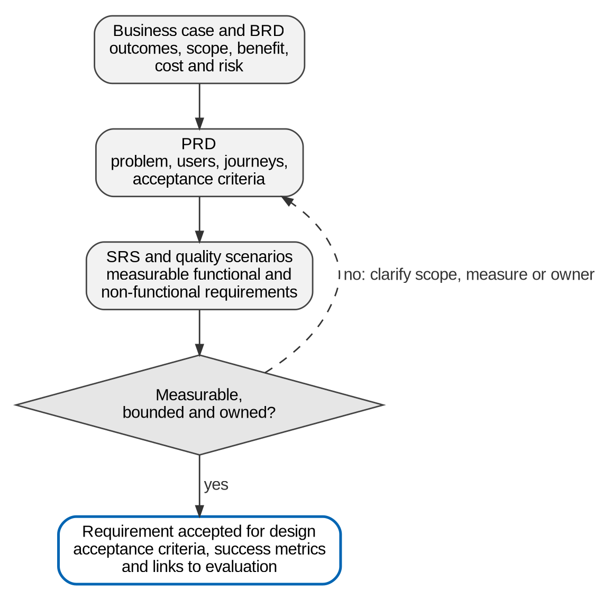

# Appendix C — Enterprise, Product and Engineering Artifacts

This appendix holds the enterprise, product and engineering artifacts that surround a solution: the business case, the product requirements, the detailed design, and the test and operational evidence. They belong to roles outside the architecture practice — a sponsor, a product manager, an engineering lead, a service owner — and the solution architect consumes them and must agree with them. Chapter 7 covers the artifacts the solution architect owns and keeps current.

## C.1 Enterprise Context Artifacts

PLACEHOLDER-C1

### C.1.1 Architecture Vision

PLACEHOLDER-C11

### C.1.2 Architecture Principles

PLACEHOLDER-C12

### C.1.3 Business Capability Map

PLACEHOLDER-C13

### C.1.4 Architecture Roadmap

PLACEHOLDER-C14

### C.1.5 Architecture Contract and Statement of Architecture Work

PLACEHOLDER-C15

### C.1.6 Application Portfolio

PLACEHOLDER-C16

## C.2 Product and Engineering Artifacts

Requirements artifacts record what the solution must achieve and how success will be recognized. Their audience includes the business as well as the delivery teams, which makes clarity and testability their dominant quality criteria.

{#fig-c-1 width="100%"}

### C.2.1 BRD and Business Case

**Definition.** A Business Requirements Document (BRD) captures business outcomes, scope, stakeholders, benefits and constraints, while the business case compares expected value, cost, alternatives and risk over a stated time horizon.

**Purpose.** Together they justify the investment and define what “success” means in business terms. They inform the funding decision, the scope boundary and the benefit that later architecture trade-offs are measured against, and they give the architect the change drivers that a modernization or sourcing decision must serve.

**What it includes.** Quantified benefits separated from assumptions, a named decision owner, the alternatives considered and the consequence of not proceeding (Table C.1). A BRD that dictates implementation prematurely restricts viable designs; the document should state the outcome and the constraints, not choose the technology. The fiche gives the minimum content and the quality test for both the requirement document and the business case; attach the case as an annex when the funding decision and the requirement document are separate.

| Field | Content |
| :--- | :--- |
| Purpose | Justify the investment and fix the business outcome, scope and benefit |
| Audience | Sponsor, finance, steering group, architecture and delivery leads |
| Owner | Business sponsor; the architect advises and reviews feasibility |
| Mandatory when | New investment, significant scope change or a regulated commitment |
| Minimum content | Outcomes, scope, stakeholders, quantified benefits, costs, alternatives, risks, constraints, decision owner |
| Quality criteria | Benefits quantified and dated; assumptions separated from facts; cost horizon stated; alternatives compared; scope exclusions explicit |
| Related artifacts | PRD (C.2.2), quality scenarios (7.2), ADRs funding architectural constraints, review record (7.5.4) |
| Example | Checkout replacement: 18-month horizon, cost per order reduced by a stated amount, provider fees and migration cost included, do-nothing option priced |

: Artifact fiche: BRD and business case

**Why it is needed.** A business case that counts only build cost, or a BRD whose benefits are adjectives, cannot support a later trade-off: every option appears equally justified and the cheapest-looking one wins. The evidence is a funded decision whose benefit, cost and risk assumptions can be re-read when the architecture changes, and a scope statement that names what is excluded.

### C.2.2 PRD

**Definition.** The Product Requirements Document (PRD) specifies the product problem, target users, journeys, functional requirements with acceptance criteria, success metrics, priorities, accessibility needs, assumptions and exclusions.

**Purpose.** The PRD connects business intent to something a design and a test can act on. It informs journey design, prioritization and acceptance, and it is the artifact product, engineering and design use to agree what is in scope before architecture commits to a shape.

**What it includes.** User journeys with acceptance criteria, prioritized functional requirements, success metrics, accessibility and localization needs, dependencies, assumptions and explicit exclusions (Table C.2). It links to, rather than restates, the quality scenarios that make non-functional requirements measurable.

| Field | Content |
| :--- | :--- |
| Purpose | Define the product problem, users, journeys and acceptance criteria |
| Audience | Product, engineering, design, QA, business owners |
| Owner | Product manager; engineering and design contribute |
| Mandatory when | A new product capability or a material change to an existing journey |
| Minimum content | Problem, users and jobs, journeys, functional requirements with acceptance criteria, success metrics, priorities, accessibility, assumptions, exclusions |
| Quality criteria | Every requirement has an acceptance criterion; scope boundaries explicit; priorities justified; metrics measurable and owned |
| Related artifacts | BRD (C.2.1), quality scenarios (7.2), HLD (7.3.1), test strategy (C.2.4) |
| Example | Payment confirmation: journeys for pay-now and pay-later, acceptance criteria for pending state, metric for confirmation conversion |

: Artifact fiche: PRD

**Why it is needed.** Unbounded scope and ambiguous acceptance criteria cause architecture churn: design starts, the requirement moves, and the work is re-planned instead of reviewed. A PRD without exclusions invites every stakeholder to assume their need is included. The evidence is a requirement set where each item can be accepted or rejected by a test, and a scope boundary the sponsor has seen.

### C.2.3 LLD / TDD — Low-Level or Technical Design Document

**Definition.** The Low-Level Design (LLD), also called Technical Design Document (TDD), details modules, interfaces, schemas, algorithms, state transitions, error handling, concurrency, idempotency, observability, configuration and rollout.

**Purpose.** The LLD turns an approved high-level design into something an engineer can implement and a reviewer can check for failure behavior. It informs implementation sequencing, test design and operational readiness, and it records the decisions that are too local for an ADR but too consequential to leave in a code review comment.

**What it includes.** Component responsibilities and sequence flows, data schemas and state transitions, failure modes with timeouts, retries and idempotency, deployment configuration and secret handling, test strategy and observability instrumentation, and migration, rollout and rollback (Table C.3). The acronym TDD also means Test-Driven Development, so expand it on first use.

| Field | Content |
| :--- | :--- |
| Purpose | Make the implementation plan reviewable, especially its failure behavior |
| Audience | Implementing engineers, reviewers, QA, operations |
| Owner | Lead engineer for the component |
| Mandatory when | The component is complex, stateful, concurrent or carries material failure risk |
| Minimum content | Responsibilities, sequence flows, schemas and states, error and timeout behavior, retries and idempotency, configuration and secrets, tests, observability, rollout and rollback |
| Quality criteria | Every external call has a timeout and an unknown-outcome path; state transitions enumerated; duplicates and ordering handled; rollback stated |
| Related artifacts | HLD (7.3.1), ADR (7.3.2), ICD and schemas (7.4.1), threat model (7.4.3), tests (C.2.4) |
| Example | Payment-attempt state machine with idempotency key, provider timeout path and reconciliation job |

: Artifact fiche: LLD / TDD

**Why it is needed.** Over-detailed design too early constrains discovery, and undocumented complexity slows review: a reviewer cannot see the failure paths in a diagram that only shows the happy path. The evidence is a document in which each external dependency has a defined timeout, each state has an exit, and the rollback is described in operational terms.

### C.2.4 Test and Verification Artifacts

**Definition.** Test and verification artifacts are the test strategy, plans, acceptance criteria, performance baselines, resilience reports and fitness functions that provide evidence that the design meets its requirements.

**Purpose.** They inform release decisions and architecture reviews by showing which claims have been demonstrated and under what conditions. They also inform design: a requirement that cannot be tested cheaply is a signal that the architecture is hard to verify.

**What it includes.** A strategy that maps priority quality scenarios to test types and gates, test data and environments, performance and resilience baselines with workload and limits, and fitness functions that run continuously (Table C.4). Each test records the version, environment, workload and result so that a green result can be reproduced.

| Field | Content |
| :--- | :--- |
| Purpose | Demonstrate that functional and quality requirements are met, and at what cost |
| Audience | Engineering, QA, architecture review, release approval, operations |
| Owner | QA lead with engineering; the architect owns the scenario-to-test mapping |
| Mandatory when | Every release with quality obligations, and every architecture review claiming a quality attribute |
| Minimum content | Scope, levels and portfolio shape, scenario-to-test map, environments and data, tooling and automation, gates and exit criteria, non-functional and security testing, responsibilities, reporting |
| Quality criteria | Every priority scenario has a test; pass criteria numeric; workload and failure conditions realistic; results reproducible; limitations stated |
| Related artifacts | Quality scenarios (7.2), ADRs (7.3.2), ICD (7.4.1), SLOs (C.2.5) |
| Example | Checkout: load at 500 submissions/s, duplicate-event injection, provider-timeout test and a fitness function for contract compatibility |

: Artifact fiche: test strategy and verification reports

**Why it is needed.** Green unit tests do not establish end-to-end reliability, and a benchmark under ideal conditions does not establish resilience. Test evidence without workload, environment and limits is not evidence, because nobody can tell what was actually demonstrated. The evidence is a strategy with a scenario-to-test map, and reports that name the version, conditions, results and unverified claims.

### C.2.5 Operational Artifacts

**Definition.** Operational artifacts are the runbooks, playbooks, SLOs, dashboards, alert catalogs, deployment and rollback plans, DR plans and support handover material that define how the service is operated; Chapters 14 and 15 own the practices they encode.

**Purpose.** They inform the operating team’s ability to detect, diagnose, recover and change the service without the architects present. They also inform design: a service that cannot be described in a runbook is usually a service whose failure behavior is not understood.

**What it includes.** Runbooks for routine and failure procedures, SLOs with error budgets, dashboards and alerts with owners, deployment and rollback steps, DR assumptions and tested recovery times, and the support handover record (Table C.5). The operations team accepts the artifacts before first production use, not after.

| Field | Content |
| :--- | :--- |
| Purpose | Make the service operable, recoverable and supportable by a named team |
| Audience | On-call engineers, SRE, support, incident management |
| Owner | Service owner, with SRE for SLOs and recovery |
| Mandatory when | Before first production use, and whenever a failure mode or dependency changes |
| Minimum content | Runbook procedures, escalation, SLOs and error budget, dashboards and alerts, deploy and rollback, backup and restore, RTO/RPO, DR exercise record, known failure modes |
| Quality criteria | Every alert names an action; recovery steps tested; SLO measures a user outcome; RTO/RPO demonstrated rather than asserted; on-call can execute without the author |
| Related artifacts | HLD (7.3.1), design failure modes (C.2.3), test reports (C.2.4), review record (7.5.4) |
| Example | Payment service runbook: provider-degradation procedure, pending-payment reconciliation query, restore drill result and error-budget policy |

: Artifact fiche: runbook, SLOs and DR plan

**Why it is needed.** A technically complete application is not ready for production without them: incident response becomes improvisation, and recovery objectives remain claims. Runbooks written by the author and never exercised fail at the moment they are needed. The evidence is a runbook exercised by someone other than its author, an SLO measured from a user-visible signal, and a restore or failover result with a measured time.
