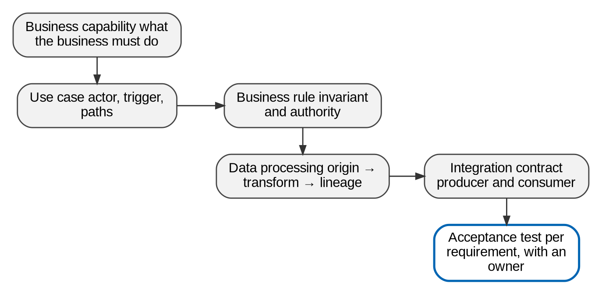
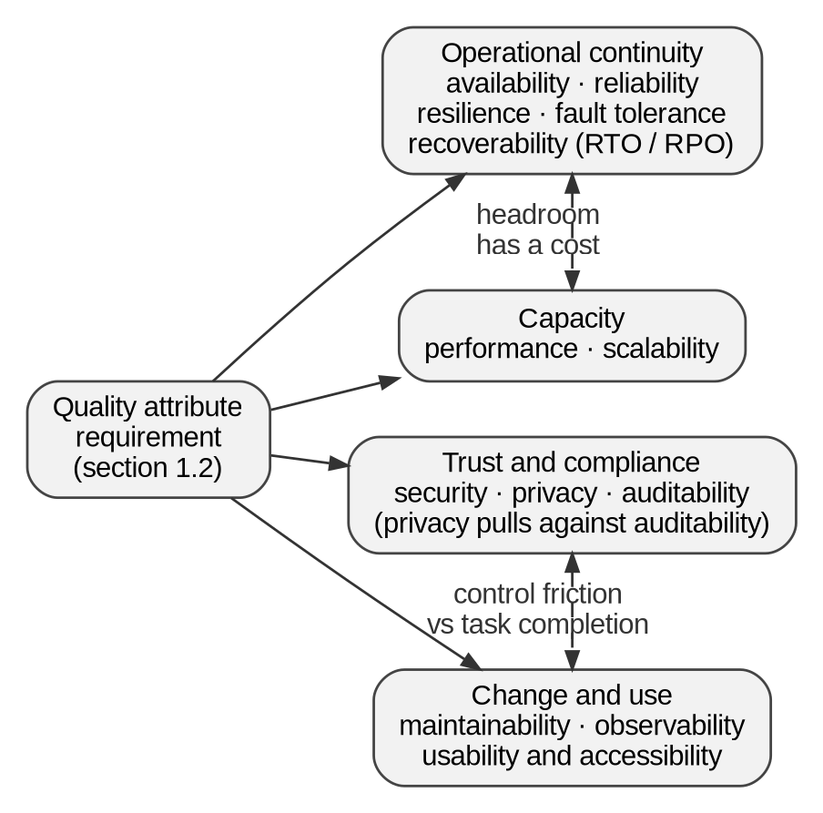
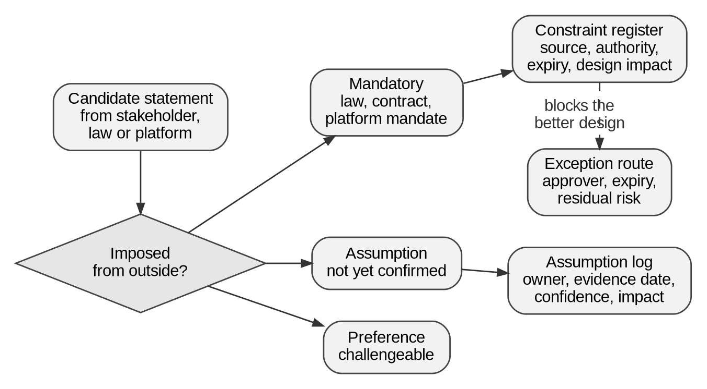
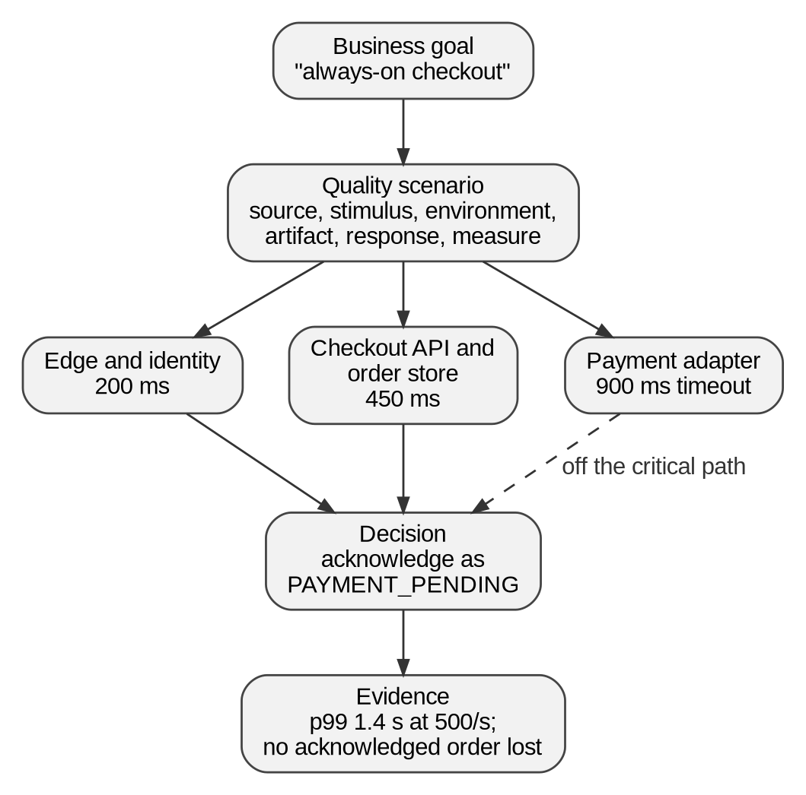
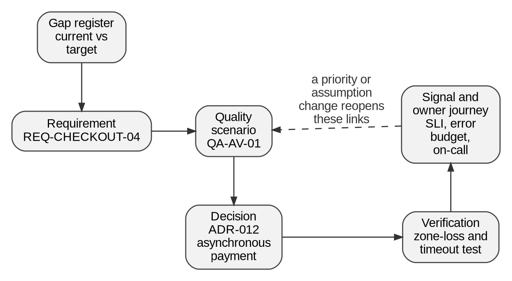

# 1. Architecture Requirements

Requirements are the inputs that justify every architectural decision. A Solutions Architect must separate business outcomes, functional behavior, quality attributes and hard constraints, then identify which of them are architecturally significant.

A requirement is **architecturally significant** (an ASR) when it constrains a structural decision or creates a measurable quality obligation. “The platform must be scalable” is not testable. A useful requirement names the source, stimulus, environment, affected artifact, expected response and measurement — for example, checkout must accept 500 order submissions per second at seasonal peak with 99% of acknowledgments returned within 2 seconds. The architect must also state the measurement boundary and how timeouts, errors and cold starts are counted.

Quality goals frequently conflict and must be reviewed jointly with product, engineering, security and operations. Synchronous payment confirmation gives the customer immediate certainty but couples checkout to provider latency; an asynchronous pending state reduces coupling at the cost of a more complex customer journey. Making such conflicts explicit is a core architecture responsibility.

::: {.callout-note appearance="simple" icon=false title="When to Use This Chapter"}
- Turning a business request, constraint or quality goal into measurable requirements.
- Reviewing whether an architecturally significant requirement is testable and traceable to decisions and tests.
- Preparing a quality attribute workshop or an architecture review where scenarios must be elicited and prioritized.
- Deciding whether a statement is a requirement, a constraint or an assumption that still needs evidence.
:::

::: {.callout-tip appearance="simple" icon=false title="Key Takeaway"}
Architecture quality is bounded by the quality of its requirements. A requirement earns its place only when it names the outcome, the conditions, the measure and the evidence; everything else is an assumption to validate or a constraint to record.
:::

## 1.1 Functional Requirements

Functional requirements describe the business behavior and information flows the solution must support. Capture capabilities, interactions, business rules, data processing and integration obligations separately, so that each can be traced to an accountable owner and an observable acceptance test.

Separating them is not bookkeeping. A capability survives a replatforming, a use case survives a channel change, a rule survives both, and an integration contract usually outlives the systems that first implemented it. Each category also has its own review question, its own change rate and its own evidence; Figure 1.1 shows how the categories connect into a single acceptance chain.

{#fig-1-1 width="100%"}

The table below states the question each category answers and the evidence that shows a requirement in that category has been accepted.

| Category | Question it answers | Evidence of acceptance |
| :--- | :--- | :--- |
| Business capability | What must the organization be able to do, whatever system supports it? | Capability map with named owners and affected channels |
| Use case | How does an actor reach a goal, including the paths where it fails? | Walkthrough of main and alternative paths with resulting states |
| Business rule | Which invariant must always hold, and who owns it? | Rule test at the enforcement boundary, including negative cases |
| Data processing | Where does each dataset come from, become what, and go to? | Flow record with lineage plus a reconciliation check |
| Integration | What is promised between a producer and a consumer? | Contract test plus timeout, retry and duplicate evidence |

: Functional requirement categories and the evidence each produces

### 1.1.1 Business Capabilities

**Definition.** A business capability is a stable statement of what the organization must be able to do, expressed independently of the applications, teams or technologies that currently deliver it.

**Purpose.** Capabilities set the scope of the solution and the boundary of domain ownership. They tell the architect which business responsibilities the design must serve, where several products already implement the same outcome, and which part of the organization will own the result after delivery. Because a capability outlives any single application, it is the most stable anchor for investment and decomposition decisions.

**What it includes.** A capability map at two or three levels — portfolio, business area and a workable level — with each entry carrying a plain definition, an accountable owner, the channels that expose it, the applications that support it today and its health. For the reference checkout, *order capture*, *payment*, *fulfillment* and *returns* are capabilities, while the storefront application is one implementation of the first two. Record the pain points raised by capability owners; that evidence is where the current-state gap analysis later starts (1.5.1).

**Why it is needed.** Without a capability map, requirements arrive system by system and the same outcome is built twice under different names. The consequences are fragmented ownership, duplicated business rules and a decomposition that follows the organization chart instead of the business. The map is only real when every architecturally significant requirement names the capability it serves and every capability names one accountable owner; a diagram nobody updates is a liability, not evidence.

### 1.1.2 Use Cases

**Definition.** A use case describes how an actor — a person, another system or an external party — interacts with the solution to reach a goal, including the paths where that goal is not reached.

**Purpose.** Use cases convert a capability into interactions that can be walked, estimated and tested. They expose the trigger, the information the actor must supply and the steps that must complete before the business outcome exists, which makes them an acceptance vehicle rather than a description of screens.

**What it includes.** The actor and its goal, the trigger, preconditions, the main success path, alternative and exception paths, postconditions that state what is durable when the flow ends, and the business rules invoked at each step. For the reference checkout the main path is short — submit an order, receive a stable order identifier — while the exception paths carry most of the architectural weight: a payment-provider timeout, a retried submission that reuses an idempotency key, an order accepted but not yet paid. Name the state the business entity is left in after each failure; “error shown to user” is not a postcondition.

**Why it is needed.** Designs built from the happy path alone fail on the paths nobody specified. Missing exception paths become unbounded retries, duplicate orders or orders stranded between states, and each of those is discovered by customers rather than by tests. Evidence that the use cases are complete: every exception path has a defined resulting state and at least one test that reproduces it. Do not let a use case degenerate into a screen sequence; if the narrative names widgets but never names the business outcome, the requirement is still missing.

### 1.1.3 Business Rules

**Definition.** A business rule is a policy, condition, calculation or invariant that governs how the business operates and must hold wherever breaking it would have a material consequence.

**Purpose.** Rules keep the meaning of the business explicit and testable. They tell the architect where an invariant must be enforced, how strong the consistency requirement is and which part of the business may change it — exactly the information a service boundary or transaction boundary decision needs.

**What it includes.** The rule in business language, the authority that owns it, the scope or consistency boundary within which it must always hold, the enforcement point, the effective date and the test that proves it. Distinguish invariants that must never be violated — a payment capture may not exceed its authorized amount, an order identifier is unique — from calculations that must be correct at a point in time, such as tax or shipping cost. Rules that change on a business calendar, such as promotional caps or seasonal surcharges, need versioning and an effective date rather than a code change.

**Why it is needed.** Rules spread across user interfaces, services and batch jobs drift apart, and the same order is validated differently on each channel. When enforcement lives in the wrong layer, a new channel silently bypasses the rule and the damage appears in financial reconciliation weeks later. Evidence of a sound rule set: each invariant has a negative test at its enforcement boundary, the owning authority is named, and no material rule is enforced only in a client application.

### 1.1.4 Data Processing Requirements

**Definition.** A data processing requirement states how a dataset is originated, transformed, stored, moved and retired, and which business outcome depends on each of those steps.

**Purpose.** These requirements fix the origin, destination, transformation and lineage of every material dataset the solution touches. They let the architect decide where data is authoritative, where it is copied, which transformations are reversible and which consumer will break when an upstream schema changes. Without that record, storage and integration decisions are taken on volume estimates alone.

**What it includes.** For each dataset: its **origin** — the system of record, event or file that creates it; its **destination** — where it is persisted and who reads it; the **transformation** applied — validation, enrichment, aggregation, de-identification, currency or unit conversion; and its **lineage**, the ordered chain of steps from origin to each consumer with the identifier that lets a record be followed end to end. Add cadence, ordering guarantees, replay boundaries, retention and legal hold. Table 1.2 is the minimum record, and it is written per dataset rather than per pipeline.

| Field | What it must state | Checkout example |
| :--- | :--- | :--- |
| Origin | System of record and the event that creates the record | Checkout API, order-submitted event |
| Destination | Stores and consumers that read the record | Order store, fulfillment, analytics |
| Transformation | Validation, enrichment and de-identification applied | Schema validation; card data replaced by a token |
| Lineage | Ordered step chain and the correlation identifier | `orderId` carried from API to warehouse |
| Cadence and recovery | Batch or streaming, replay window, reconciliation | Streaming with 7-day replay, daily reconciliation |

: Minimum data-flow record for each material dataset

Batch and streaming are execution models with different latency and recovery characteristics. Specify poison-record handling, replay boundaries and reconciliation so that a failed pipeline cannot silently lose or duplicate business effects. Data flows are covered in 5.2.3, pipelines in 5.2.6 and lineage in 5.3.5; the dynamic views that keep a flow diagram readable are in 13.2.1; the durable data artifacts that carry these requirements into delivery are in 17.4.2.

**Why it is needed.** Datasets without a stated transformation and lineage cannot be reconciled, and records that cannot be reconciled cannot be trusted in a financial or regulatory process. The usual failures are silent: a currency conversion applied twice, a de-identification step skipped on one path, a schema change that breaks a consumer nobody listed. Evidence: every material dataset has a flow record, a reconciliation check compares source and destination totals, and a lineage query can answer where a single order’s amount came from without reading application code.

### 1.1.5 Integration Requirements

**Definition.** An integration requirement defines a promise between a producer and a consumer: what is exchanged, under which conditions, and what happens when the exchange fails.

**Purpose.** Integration requirements allocate ownership and failure semantics across a boundary that no single team controls. They decide whether an interaction needs an immediate answer or can be asynchronous, and they give each side a contract it can test without deploying the other.

**What it includes.** Owners on both sides, transport and protocol, authentication and authorization, schema and versioning rules, latency and throughput expectations, timeout and retry behavior, ordering and delivery guarantees, idempotency, failure handling and the reconciliation path. State the direction of the dependency and what the caller does while waiting. For the reference checkout the payment integration states a 900 ms timeout, two retries with backoff, duplicate detection on the provider reference and an explicit pending state when the provider does not answer.

**Why it is needed.** Vague integrations produce retries that duplicate orders, timeouts that leave the business state unknown and schema changes that break consumers nobody listed. A retry policy cannot substitute for idempotency, and a schema cannot define operational recovery; both must be stated separately. Evidence: a contract test runs against both sides, duplicate and out-of-order delivery are demonstrated, and the reconciliation job reports zero unresolved differences. Chapter 6 covers the mechanisms and their trade-offs.

**Example.** In the reference checkout, “place an order” is one use case traced across all five categories. The capability is *order capture*; the main path ends with a durable order in state ACCEPTED; the invariant is that one idempotency key creates at most one order; the data flow originates at the Checkout API, replaces card data with a token and lands in the order store with `orderId` as the lineage key; and the payment integration states a 900 ms timeout, two bounded retries and duplicate detection on the provider reference. Each of the five statements has an owner and a test, and none of them describes a screen.

::: {.callout-warning appearance="simple" icon=false title="Common Pitfall"}
Writing functional requirements as interface descriptions — “the system shall display an order summary page.” This hides the business rule, the data obligation and the failure path behind a screen layout, so invariants end up enforced in the presentation layer and integration behavior is discovered during construction. Avoid it by restating each requirement in the language of its category: which capability, which use case path, which invariant, which dataset, which contract — and accept it only when it names an owner and a test.
:::

::: {.callout-important appearance="simple" icon=false title="Decision & Trade-off"}
How much structure a functional requirement needs before design starts.

| Option | Choose when | Consequences |
| :--- | :--- | :--- |
| Capability and outcome statement only | Scope is still being negotiated and a delivery team will elaborate it | Fast to agree; invariants and failure paths surface during construction, when they are expensive |
| Use case with explicit exception paths | Behavior crosses systems or money, or an audit trail is required | Moderate effort; makes failure handling, state transitions and acceptance tests reviewable |
| Executable acceptance specification | The flow is high volume, regulated or changes often | Highest upfront cost; needs test data and tooling, and decays unless it runs in continuous integration |
:::

## 1.2 Quality Attribute Requirements

Quality attributes constrain how the solution behaves under specified conditions. Express each significant attribute as a measurable scenario (see 1.4); adjectives such as fast, secure or highly available are not evidence. The attributes below are frequently confused. Figure 1.2 groups them into the four families an architect reviews together, because they compete for the same budget.

{#fig-1-2 width="100%"}

The table states the question each attribute answers and the measure that makes it testable in a review.

| Attribute | Question it answers | Typical measure |
| :--- | :--- | :--- |
| Availability | Can users use the function when they need it? | Successful-request ratio over a defined window |
| Reliability | Does the system produce correct outcomes over time? | Successful transaction rate; integrity violations |
| Resilience | How does the system behave and recover when something fails? | Degraded-mode behavior; time to restore normal service |
| Fault tolerance | Does a specific function continue despite a specific component failure? | Continuity and correctness during injected fault |
| Performance | How quickly and efficiently does it respond under a stated workload? | Latency percentiles, throughput, saturation |
| Scalability | How does capacity change as demand grows? | Throughput and cost per transaction at increasing load |
| Recoverability | How quickly and with how much data loss is service restored after a disaster? | Measured RTO and RPO |
| Security | Does the system protect data and functions against identified threats? | Control coverage; vulnerability and incident metrics |
| Privacy | Is personal data limited to its stated purpose and removed when that purpose ends? | Data inventory coverage; deletion and access-request handling time |
| Auditability | Can a reviewer reconstruct who did what, when and under which authority? | Transactions reconstructable from the audit trail alone; tamper evidence |
| Maintainability | How safely and quickly can the system change? | Change lead time; defect and rework rate; coupling |
| Observability | Can operators understand behavior and diagnose failures? | Signal coverage; time to detect and recover |
| Usability and accessibility | Can intended users complete their tasks, including with assistive technology? | Task success; WCAG 2.2 conformance where applicable |

: Quality attributes and the question each one answers

ISO/IEC 25010:2023 groups availability, fault tolerance and recoverability as sub-characteristics of reliability. This handbook separates them because they drive different decisions, but state the mapping when a standard taxonomy is required. Privacy and auditability are separated for the same reason: one limits how long data is kept, the other requires that some records survive long enough to be examined, and a single “compliance” label hides that conflict.

Chapter 19 (19.1.4) extends this attribute set with AI-specific measures such as task quality, groundedness, safety, cost per outcome and freshness.

### 1.2.1 Availability

**Definition.** Availability is the proportion of a defined observation window during which a service can fulfill its promised function.

**Purpose.** Availability sets the user-visible promise the solution is built and operated against. It drives redundancy, maintenance policy, dependency tolerance and the error budget that decides how fast the team may change the system. Because every increment of availability has a cost, the target must be chosen from the business consequence of downtime, not from an industry habit.

**What it includes.** The user-visible boundary, the measurement method, the observation window and any excluded maintenance periods. Choose explicitly between **time-based** availability, the fraction of the window in which the service is usable, and **request-based** availability, the fraction of valid requests that meet the stated response within the window. For the reference checkout the objective is request-based: the fraction of valid checkout requests that return a durable `order_id` within 2 seconds, over a rolling 28-day window. Mixing the two in one objective produces disputes no measurement can settle. Include how dependencies are counted, because a healthy front end behind an unavailable payment provider is not an available checkout.

**Why it is needed.** Redundant instances and multi-zone placement mitigate some failure modes, but shared dependencies and operational changes can still make the end-to-end capability unavailable. Without a boundary and a window, component uptime dashboards report success while customers cannot complete a journey, and the first honest measurement arrives during an incident. Evidence: a journey-level service indicator, a synthetic probe from outside the platform, and a monthly report of achieved availability against the objective.

### 1.2.2 Reliability

**Definition.** Reliability is the ability to perform intended functions correctly and consistently over time, including data integrity and the completion of accepted work.

**Purpose.** Reliability answers a different question from availability: not whether the service responds, but whether what it returned was right. It governs the invariants that keep the business consistent — money moved once, orders counted once, totals that reconcile — and it justifies the reconciliation and fault-injection work that availability targets never fund.

**What it includes.** Successful-transaction rates, integrity invariants stated as testable conditions, duplicate and out-of-order handling, and the reconciliation that compares the system of record with its downstream copies. For the reference checkout the invariant is exact: no acknowledged order is lost and no order is charged twice, whatever the retry pattern.

**Why it is needed.** A service can be reachable yet unreliable when it returns incorrect totals or loses acknowledged orders. These defects are invisible to uptime monitoring and surface as customer complaints or accounting differences, long after the cause. Evidence: production telemetry on transaction outcomes, reconciliation reports with zero unexplained differences, and fault-injection tests that check correctness, not just liveness, while a dependency is degraded.

### 1.2.3 Resilience

**Definition.** Resilience is the ability to absorb disruption — network failures, unavailable dependencies, timeouts, instance loss, poison messages and traffic spikes — while preserving essential functions and recovering predictably.

**Purpose.** Resilience decides what the solution does in the seconds and minutes after something breaks. It converts a list of dependencies into explicit behavior: which functions continue, which degrade, which are refused, and how the system returns to normal without a manual restart.

**What it includes.** A dependency inventory with the failure mode of each, the fallback for each critical function, bounded retries with deadlines, backoff and retry budgets, circuit breaking, queueing, load shedding and the signals that make degradation visible to operators. Decide in advance whether checkout should reject new orders or accept them into a pending state when the payment provider is unavailable.

**Why it is needed.** Unbounded retries amplify an outage rather than recover from it, and a service that queues without limit converts a dependency failure into a memory exhaustion event. Without agreed degradation, engineers improvise under pressure and the recovery path is tested for the first time in production. Evidence: the degradation behavior is documented and demonstrated, retry budgets are enforced in configuration, and a dependency-failure drill shows which functions survived.

### 1.2.4 Fault Tolerance

**Definition.** Fault tolerance keeps a defined function operating despite a specific component failure.

**Purpose.** Fault tolerance makes a narrow, checkable claim: this function, that fault, no interruption of service. It forces the architect to state the fault model explicitly instead of promising resilience in general, and it prevents redundancy spending that protects against the wrong failure.

**What it includes.** The named function, the named fault, the redundancy mechanism, the detection mechanism and the failover behavior visible to users. An instance, a replica and an availability zone fail in materially different ways: an instance loss may be invisible to the load balancer, while a zone loss removes several replicas at once and can take a shared dependency with it.

**Why it is needed.** Claimed tolerance that has never been exercised is an assumption, and the difference is discovered during the incident it was meant to prevent. A component may fail over correctly while the function still fails, because the surviving replica cannot reach its database or holds a stale cache. Evidence: the component is removed under realistic load and both continuity and correctness are observed, with the result recorded against the specific fault it covers.

### 1.2.5 Performance

**Definition.** Performance requirements describe observable behavior under a specified workload.

**Purpose.** Performance turns “fast” into a testable statement about a named operation at a named load. It tells the architect where the latency budget is spent, which dependency may sit on the critical path and when caching, batching or asynchronous processing is justified rather than habitual.

**What it includes.** The operation, arrival rate, concurrency, payload distribution, dataset size, dependency latency and the percentile target. For the reference checkout: 99% of order submissions acknowledged within 2 seconds at 500 submissions per second, with correct order states. A separate batch requirement might state that a defined input file is processed within five minutes. State whether the measurement includes client network time and how warm-up and cold starts are treated.

**Why it is needed.** Average latency hides tail behavior, and a mean that looks healthy can conceal a second of delay for the slowest percent. Throughput, latency, resource saturation and queue age must be read together: adding workers may raise throughput while a database lock remains the real bottleneck. Choosing caching, query optimization, asynchronous work or connection pooling before identifying the bottleneck adds consistency or operational trade-offs without fixing the problem. Evidence: a load test reproducing the stated workload, with percentile results and the bottleneck named.

### 1.2.6 Scalability

**Definition.** Scalability is the ability to sustain a higher workload by adding resources or by changing how work and data are partitioned.

**Purpose.** Scalability decides how the solution responds to growth and to peaks, and at what cost per transaction. It exposes the shared state that limits each scaling approach, which is the constraint that eventually forces a redesign rather than a larger instance.

**What it includes.** The scaling dimension — requests, concurrent users, data volume or tenants; the mechanism — vertical, horizontal or partitioned; the unit of partitioning and the routing that follows from it; and the measured cost curve. Vertical scaling increases capacity within a node but meets hardware limits and may require downtime. Horizontal scaling adds instances, provided that state, coordination and downstream dependencies permit parallelism. Partitioning distributes data or processing but introduces routing, rebalancing and cross-partition consistency concerns.

**Why it is needed.** A design that scales in one dimension often fails in another, and the failure appears at the worst moment — the seasonal peak the target was written for. Without a measured curve, capacity planning becomes a guess and the shared bottleneck is found by users. Evidence: load is increased while throughput, tail latency, saturation and cost per completed transaction are tracked, and the shared state that limits each approach is named.

### 1.2.7 Security

**Definition.** Security requirements protect specific assets against defined threats.

**Purpose.** Security states which assets matter, who may act on them and which threats are in scope, so that controls can be chosen and defended rather than adopted by fashion. It also fixes the trust boundaries that every other view of the architecture must respect.

**What it includes.** The protected assets — data, functions and identities; the actors and their privileges; the trust boundaries between them; the sensitive fields and privileged operations; and the confidentiality, integrity and availability obligations attached to each asset. Confidentiality restricts disclosure, integrity protects against unauthorized or accidental change, and availability preserves access to essential functions; name which of the three a requirement is really about.

**Why it is needed.** A design is not validated by citing a framework. Controls chosen without an asset and threat model protect the wrong thing, and the gaps appear as findings in the first penetration test or, worse, in an incident report. Evidence: denied unauthorized access is demonstrated, secrets rotate on a schedule, privileged actions leave an audit trail, and an incident response path has been exercised. Chapter 10 covers mechanisms and threat modeling.

### 1.2.8 Maintainability

**Definition.** Maintainability is the cost, risk and lead time of making a correct change.

**Purpose.** Maintainability makes the long-term cost of the architecture reviewable before it is incurred. It governs how safely the team can add a provider, change a rule or retire a component, and it is the attribute most often claimed and least often measured.

**What it includes.** Modifiability — cohesive modules with controlled dependencies; testability — seams that isolate behavior so it can be verified without the whole system; deployability — automated, reversible releases; and operability — diagnostics and documented recovery. Record the ownership boundaries that determine who must be consulted for a change, because an unowned module is not maintainable whatever its internal structure.

**Why it is needed.** Architectures become expensive at the second and third change, not the first, and the cost is paid as coordination rather than code. A named pattern is not proof of maintainability: a layered diagram can hide a shared database that every change must touch. Evidence: a representative change — for example, adding a second payment provider — is executed or walked through, and the components, contracts, tests and teams that had to change are recorded.

### 1.2.9 Observability

**Definition.** Observability is the ability to infer a system’s internal behavior from the signals it emits.

**Purpose.** Observability lets operators and engineers answer questions the designers did not anticipate, which is exactly the situation during an incident. It converts the quality attributes above from intentions into measurements, and it supplies the evidence that availability, performance and reliability claims are being met.

**What it includes.** Metrics for rates, errors, latency and saturation; structured logs for contextual events; traces that connect work across services and messages; and the identifiers and vocabulary shared between them. An operator must be able to follow one order from acceptance through payment and fulfillment without exposing personal data, which means correlation identifiers are separated from customer data by design.

**Why it is needed.** A system that emits volume without shared identifiers produces dashboards nobody can join, and an on-call engineer reconstructs a timeline by hand while customers wait. Signals also become a privacy liability when payloads are logged wholesale. Evidence: an on-call engineer diagnoses a deliberately injected failure within an agreed time using only the telemetry, and a review confirms that sensitive fields are excluded. Chapter 11 covers service indicators and objectives.

### 1.2.10 Recoverability

**Definition.** Recoverability describes how service and data are restored after a disruptive event.

**Purpose.** Recoverability states what the business will accept after a disaster and what the team must therefore be able to do. It converts recovery from an operational hope into a requirement with two numbers and a rehearsal schedule.

**What it includes.** The **Recovery Time Objective (RTO)**, the maximum acceptable time to restore service, and the **Recovery Point Objective (RPO)**, the maximum acceptable data loss measured as time before the disruption. Add the scope of recovery — which functions and datasets are restored first — the dependency order, and the credential and configuration restoration that are usually forgotten in plans.

**Why it is needed.** RTO and RPO are business requirements, not properties delivered by a backup product, and backups are not proof of recovery. A restore that takes longer than the business can tolerate, or one that recovers data but not the credentials to use it, is a failed recovery discovered at the worst possible time. Evidence: a timed restore and failover exercise that includes data integrity checks, dependent services and credential restoration, with the measured result recorded against both objectives. Chapter 8 covers recovery topologies.

### 1.2.11 Usability and Accessibility

**Definition.** Usability describes how effectively a target user completes a defined task; accessibility describes whether people with different abilities can use the experience at all.

**Purpose.** These attributes connect the architecture to the people who depend on it. They set the interaction, content and error-handling constraints that a design must satisfy, and they make exclusion visible before launch rather than after a complaint or a legal review.

**What it includes.** The user population and its range of abilities, the critical journeys, the supported assistive technologies, browsers and input methods, and measurable acceptance criteria — for example keyboard-only checkout, validation errors announced correctly by a screen reader, and completion-rate thresholds from user testing.

**Why it is needed.** Accessibility is a design constraint across interaction, content and error handling, not a final audit. Retrofitting it usually means reworking components and flows that were built around a pointer and a large screen. Where obligations apply, use WCAG 2.2 Level AA and EN 301 549 as measurable baselines, and test keyboard-only use, screen-reader announcements, zoom and reflow, contrast and error recovery. Automated checks are necessary but insufficient; validate representative journeys with assistive technology and real users. Evidence: automated scan results, manual test scripts, assistive-technology results and representative user testing, each with defects and owners, kept in the definition of done and in regression checks.

### 1.2.12 Privacy

**Definition.** Privacy is the quality attribute that keeps personal data limited to the purpose for which it was collected and removes it when that purpose ends.

**Purpose.** Privacy constrains what the solution may collect, how long it may keep it, where it may process it and who may see it. It informs data-model, retention, telemetry and vendor decisions, and it is the attribute that most often conflicts with auditability, observability and analytics, because those attributes want to keep data that privacy wants to minimize.

**What it includes.** A data inventory naming the personal data categories, the purpose and lawful basis for each, the systems of record and copies, retention and deletion rules, residency constraints, consent or preference state and how it propagates to downstream consumers, and the handling of access, correction and erasure requests. Cover derived and observational data as well: a trace identifier may be personal data when it can be re-linked, and request payloads in logs are a common leak.

**Why it is needed.** Personal data accumulates by default: a copy for testing, a payload in a log, a cache that outlives the deletion job. Each copy widens the exposure and makes an erasure request harder to honor, and the failure is discovered when a regulator, a customer or an auditor asks for evidence. Evidence: every personal data element has a purpose and a retention rule, a deletion run is measured and can be shown to reach every copy, access requests are handled within the committed time, and telemetry has been reviewed for personal data.

### 1.2.13 Auditability

**Definition.** Auditability is the quality attribute that lets a reviewer reconstruct who did what, when and under which authority, from records the system keeps.

**Purpose.** Auditability supports investigation, dispute resolution and regulatory evidence. It tells the architect which events must be recorded, how durable and how tamper-evident those records must be, and how long they must survive — decisions that are cheap during design and expensive to retrofit.

**What it includes.** The events in scope, the actor, the action, the target, the timestamp with its clock source, the authority or approval under which the action happened, and the before and after state where relevant. Include privileged and administrative actions, configuration changes, approvals and data exports, not only customer transactions. Specify where the record is written, whether it is append-only, how tampering would be detected, who may read it, and the retention period that the governing obligation requires.

**Why it is needed.** Diagnostic logs are not an audit trail: they are sampled, rotated and mutable, and they usually omit the authority behind an action. When a dispute or an investigation arrives, the organization discovers that the decisive event was never recorded or has already expired. Auditability also pulls against privacy, so the retention rules for the two attributes must be reconciled explicitly rather than by whichever team owns the log store. Evidence: a sample transaction is reconstructed from the audit trail alone within an agreed time, tamper detection is demonstrated, and retention matches the stated obligation (see 1.3.3 and 10.7.2).

**Example.** The reference checkout carries a small, explicit attribute set. Availability is 99.9% of valid checkout requests returning a durable `order_id` within 2 seconds over a rolling 28-day window, measured at the edge; performance is p99 acknowledgment within 2 seconds at 500 submissions per second; reliability is zero lost or double-charged acknowledged orders; privacy limits payment data to a token and a retention period; auditability records every order state transition with actor and authority for the period the obligation requires. The numbers are illustrative, but each one names a boundary and a measurement, and each is reviewed together with the others.

::: {.callout-warning appearance="simple" icon=false title="Common Pitfall"}
Optimizing one attribute locally and declaring victory. A cache that fixes tail latency can serve a stale price, a log pipeline that improves diagnosis can copy personal data into a second system, and an aggressive retention policy that satisfies privacy can delete the evidence an audit needs. The consequence is a shifted cost that no single dashboard shows. Avoid it by reviewing the attribute set as a whole: when one attribute improves, state which other attribute now carries the consequence and who accepted it.
:::

::: {.callout-important appearance="simple" icon=false title="Decision & Trade-off"}
How to resolve competing quality attributes before design commits to one.

| Option | Choose when | Consequences |
| :--- | :--- | :--- |
| Optimize each attribute against its own target | Attributes are largely independent and the system is small | Simple to govern; hides the coupling, and the first conflict appears as a regression in production |
| Rank scenarios and allocate a shared budget | Several attributes compete for latency, cost or data retention | Explicit and reviewable; requires a workshop and a named owner for each trade-off |
| Adopt platform defaults and revisit after launch | The attribute is not architecturally significant yet | Low upfront cost; the default becomes the requirement by accident and is hard to reverse |
:::

## 1.3 Architecture Constraints

Constraints restrict the set of feasible designs regardless of preference. For each constraint record its source, authority, validity period, design impact and the role able to approve an exception. Distinguish mandatory obligations from assumptions, which must be confirmed, and from preferences, which can be challenged. Figure 1.3 shows the classification that separates them.

{#fig-1-3 width="100%"}

The table lists the fields that make a constraint reviewable; a statement that cannot fill them is not yet a constraint.

| Field | What it records |
| :--- | :--- |
| Statement | The restriction in specific, testable language |
| Source and authority | Who imposes it, and the document, contract or decision that grants the authority |
| Validity | Start date, review date and expiry, where the obligation is time-bound |
| Design impact | The options it removes and the cost of designing within it |
| Exception route | The role able to approve a deviation, and the residual risk that must be accepted |

: Constraint register fields

**Constraints versus assumptions.** Constraints are imposed conditions, such as a regulator-approved region or a mandatory identity provider. Assumptions are propositions that require confirmation; treating them as facts hides risk. Maintain an assumption log with owner, evidence date, confidence and impact if false, and reassess at major milestones.

### 1.3.1 Technology Constraints

**Definition.** A technology constraint is a mandated runtime, language, platform or standard that the solution must use or must avoid.

**Purpose.** Technology constraints fix part of the design space before alternatives are compared. Recording them with an authority and an expiry keeps a temporary mandate from hardening into a permanent assumption, and it lets the architect separate a genuine obligation from a team habit.

**What it includes.** The mandate, its issuing authority, its support lifecycle and end-of-support date, the integration implications for nearby systems, and the migration cost if it is later lifted. An inherited platform restriction may be a deliberate architecture risk that someone accepted years ago; state that explicitly rather than treating the mandate as neutral.

**Why it is needed.** Mandates that nobody owns are never revisited, and the solution inherits an unsupported runtime with no route out. Conversely, treating a preference as a mandate blocks a better option and makes the decision look technical when it is organizational. Evidence: each mandate names its authority and review date, the support position is confirmed, and every design alternative that the constraint removed is recorded with its cost.

### 1.3.2 Infrastructure Constraints

**Definition.** Infrastructure constraints are the fixed facts of region, network topology, connectivity, hosting model and operational ownership.

**Purpose.** These constraints determine what can physically be deployed and who can operate it. They shape trust boundaries, latency between components and the availability that is even achievable.

**What it includes.** Approved regions and their data-residency implications, address ranges and routing, private connectivity, ingress and egress paths, quotas and platform limits, the hosting model and the team that owns the platform. Shared-platform dependencies deserve their own entry: a mandated network appliance or central gateway can cap throughput for every solution behind it.

**Why it is needed.** A topology that ignores routing and quotas is not deployable, however clean it looks on a diagram. The failures are concrete — a subnet with no route to a payment provider, a quota that blocks the peak-load design, a firewall rule that makes an approved pattern impossible. Evidence: address ranges, routes, private connectivity and quotas are verified with the platform owner, and the constraints appear on the deployment and trust-boundary views.

### 1.3.3 Regulatory and Compliance Constraints

**Definition.** A regulatory or compliance constraint is a legal, regulatory or contractual obligation translated into an obligation the system must satisfy.

**Purpose.** These constraints define the outcomes the solution must be able to evidence — retention, deletion, residency, audit trails, evidence preservation — and the accountability that follows a failure. They are non-negotiable in a way that technical preferences are not.

**What it includes.** The obligation and its jurisdiction, the interpretation that applies to this solution, the accountable control owner, the evidence that demonstrates compliance and the review cadence. Data residency, retention periods, deletion on request, record keeping for audits (4.9) and audit trails (10.7.2) are the obligations most likely to shape architecture.

**Why it is needed.** A diagram alone does not establish compliance, and an interpretation made by the delivery team is not a legal position. When the obligation is recorded only as a sentence in a design document, the evidence is assembled after the request arrives, from whatever data happens to exist. Evidence: legal and compliance stakeholders have validated the interpretation, each obligation maps to a control with an owner, and the evidence is produced on demand rather than reconstructed.

### 1.3.4 Organizational Constraints

**Definition.** Organizational constraints are the approved services, delivery capabilities, skills, support coverage and internal control processes that the solution must work within.

**Purpose.** They connect the architecture to the organization that must build and run it. A design that the operating team cannot sustain is not a design; it is a plan for an outage with a delayed start.

**What it includes.** The approved service catalogue, the delivery skills available, support hours and escalation paths, procurement and vendor onboarding processes, and the internal controls that releases must pass. Where a standard process prevents a better option, record the exception route and its business consequence.

**Why it is needed.** Ignoring organizational capacity produces architectures that are technically sound and operationally abandoned, and bypassing governance produces a solution that cannot be supported or audited. Evidence: the operating team has reviewed the design, the required skills exist or a hiring and training plan is committed, and every exception to the standard process is recorded with an owner and a business consequence.

### 1.3.5 Budget and Cost Constraints

**Definition.** A budget constraint is a cost limit with a time horizon and a demand model.

**Purpose.** Cost limits narrow the design space more often than any technical constraint, and they must be expressed in a way that can be compared across alternatives. The purpose is to make the trade-off explicit: what is being bought, over which period, at which demand.

**What it includes.** Initial implementation, recurring consumption, licensing, operational labor and the capacity reserved for recovery. Separate the one-off from the recurring, and state the demand assumptions that drive the recurring figure. Compare alternatives with sensitivity analysis, because the ranking often changes when demand is half or double the estimate.

**Why it is needed.** A lower infrastructure bill frequently shifts substantial cost to engineering operations, and a cost target set without a demand model is satisfied by under-provisioning that the first peak exposes. Evidence: each alternative is costed with the same workload assumptions, the sensitivity range is recorded, and the total cost of ownership including operational labor is compared (see 16.2).

### 1.3.6 Legacy Constraints

**Definition.** Legacy constraints are the systems and interfaces that cannot be changed immediately.

**Purpose.** They define what the new design must tolerate rather than control. Recording them prevents the architecture from assuming capabilities — retries, idempotency, schema versioning — that a legacy endpoint has never supported.

**What it includes.** Throughput and availability characteristics, data semantics and known defects, release cadence, ownership, supported integration styles and the contractual or vendor limits on change. Include the decommissioning intent and its date, if one exists.

**Why it is needed.** Assuming that a legacy endpoint behaves like a modern service produces duplicate writes, silent data loss and integrations that fail under retry. The cost of these assumptions lands on the new system, which must then compensate for a capability it cannot rely on. Evidence: the legacy behavior is characterized by measurement rather than documentation alone, and the new design protects itself with an anti-corruption layer and a staged migration plan (see 16.1).

### 1.3.7 Delivery Constraints

**Definition.** Delivery constraints are the milestones, staffing, skills, procurement lead times and change windows that shape when parts of the solution can exist.

**Purpose.** They sequence the design without silently redefining its quality or security obligations. A date is a constraint on delivery; it is not a reason to lower a measurable objective without the same authority that set it.

**What it includes.** Fixed dates and their drivers, team capacity and availability, procurement and approval lead times, change freezes and the environments available for testing. Where a deadline forces a reduced scope, separate a minimum safe release from deferred enhancements and record the temporary risk with an owner and an expiry date.

**Why it is needed.** Unstated delivery pressure is absorbed invisibly, usually by cutting testing, accessibility work or operational readiness — the costs that appear months later. Conversely, treating every deadline as immovable prevents the sequencing that would deliver the same outcome safely. Evidence: the plan names the constraints it is built around, every deferred item has an owner and a date, and any temporary risk acceptance is recorded with its expiry.

**Example.** The reference checkout is constrained to a regulator-approved region, a mandated identity provider and an approved payment vendor list. Each is entered in the constraint register with its authority and review date. When the team proposes a cheaper provider outside the list, the constraint — not the team’s preference — settles the decision, and the only remaining route is a time-boxed exception approved by the control owner.

::: {.callout-warning appearance="simple" icon=false title="Common Pitfall"}
Recording a team preference as a constraint. “We only run this database here” or “that cloud is not allowed” is often a habit presented as an obligation, and once written into the constraint register it stops being questioned. The consequence is a narrowed option space, higher cost and a decision that nobody can revisit because no authority was ever named. Avoid it by demanding a source, an authority and an expiry for every constraint, and by keeping everything else in a separate preference list that can be challenged in design review.
:::

::: {.callout-important appearance="simple" icon=false title="Decision & Trade-off"}
What to do when a constraint blocks the better design.

| Option | Choose when | Consequences |
| :--- | :--- | :--- |
| Design within the constraint | The obligation is legal, contractual or safety-related, or the cost of compliance is acceptable | Predictable approval; may force a weaker technical option and a higher run cost |
| Time-boxed exception with a named risk owner | The constraint is real but the impact is disproportionate, and the deviation can be contained | Preserves the better design; requires monitoring, an expiry date and an owner who accepts the residual risk |
| Escalate to change the constraint | The constraint is outdated, misapplied or owned by a role that can revise it | Removes the restriction permanently; takes time and may fail, so do not schedule the delivery around it |
:::

## 1.4 Quality Attribute Scenarios and Budgets

A **quality attribute scenario** makes a requirement testable by specifying six parts: source of stimulus, stimulus, environment, affected artifact, response and response measure. The scenario is the unit of review, because it can be traced to a test and to a decision; Figure 1.4 shows how one goal becomes an evidence-backed design choice.

{#fig-1-4 width="100%"}

The table applies the six parts to the reference checkout; the numbers are illustrative and belong to the acceptance test rather than to the diagram.

| Part | Value |
| :--- | :--- |
| Source | Customer browser |
| Stimulus | Valid order submission |
| Environment | Peak load of 500 submissions/s; payment provider timing out |
| Artifact | Checkout API and Order service |
| Response | Order durably recorded and acknowledged as ACCEPTED, or explicitly rejected |
| Response measure | 99% acknowledged within 2 s; zero acknowledged orders lost |

: The six parts of a quality attribute scenario, applied to the reference checkout

Distinguish accepted, paid and fulfilled states: a quick HTTP response is not evidence that a business transaction completed.

### 1.4.1 Quality Attribute Workshops (QAW)

**Definition.** A **Quality Attribute Workshop (QAW)** is a structured elicitation and prioritization method in which the people who own the business drivers agree the scenarios that will drive the architecture.

**Purpose.** A QAW exists to discover which quality scenarios matter and who must agree them, before design work fixes priorities by accident. It is a method for reaching a decision, not a scoring ceremony, and its output is a small set of measurable scenarios with owners and rationale.

**What it includes.** Business, product, architecture, engineering, security and operations participants; a review of business drivers; a brainstorm of quality attribute scenarios; consolidation of duplicates; and explicit prioritization of the scenarios that will shape the design. Keep the group small enough to decide, and record rejected and deferred scenarios so they are not silently reintroduced later.

**Why it is needed.** Use a QAW when the quality goals are vague, contested or incomplete; when a new solution has no shared definition of “good”; or before a design or evaluation review. Without one, the loudest stakeholder sets the priorities implicitly and the conflicts surface during implementation. The workshop complements the scenario template above: the template makes one scenario precise, while the workshop decides which scenarios deserve that precision. Evidence: an agreed, prioritized scenario list with owners, and a record of what was rejected and why. The Software Engineering Institute’s QAW method is a recognized reference for the technique.

**Example.** In the reference checkout the team first wrote “the checkout must always be available.” A workshop replaced it with a journey-level scenario at 99.9% over 28 days, plus a latency scenario and a provider-timeout scenario, each with an owner. The latency budget in Table 1.6 then showed that a synchronous payment call with a 3-second timeout could not fit inside a 2-second target, which produced the asynchronous confirmation decision and its test.

### 1.4.2 Latency, Availability and Error Budgets

**Definition.** A latency budget allocates an end-to-end response objective across the segments a request traverses; an error budget is the unreliability a service-level objective permits over its window, whether that objective is availability, latency or quality.

**Purpose.** Budgets turn a scenario into numbers a design and a test can meet. They show which segment has to shrink before the target is missed, and make the latency and availability trade-off explicit: a timeout above its allocation consumes the whole budget.

**What it includes.** The end-to-end objective, the segments it crosses and a share of the target for each, plus the headroom that absorbs retries, garbage collection and dependency jitter. The shares stay illustrative until a measurement replaces them. Convert the thresholds into rates: a p99 objective tolerates 1% of acknowledgments above the threshold, and a 99.9% availability objective that counts only durable acknowledgments within it tolerates 0.1%. The table shows an allocation for the reference checkout.

| Segment | Budget at p99 | Note |
| :--- | :--- | :--- |
| Edge, TLS and identity | 200 ms | Measured outside the platform, includes token validation |
| Checkout API and validation | 250 ms | Business rules and idempotency check |
| Order store write | 200 ms | Durable acknowledgment is part of the target |
| Headroom | 1,350 ms | Absorbs retries, garbage collection and dependency jitter |
| Payment adapter | 900 ms timeout | Off the critical path; failure produces PAYMENT\_PENDING |

: Illustrative latency budget for the 2-second acknowledgment

The error budget follows from the availability objective, and the policy for spending it is owned by 11.2.2.

**Why it is needed.** A target that cannot be allocated is a wish. Without the allocation each team optimizes its own segment and the objective is missed by the sum of small indulgences; without the error budget, every release argues about reliability from opinion. Evidence that the budget is real is a share per segment with an owner, a measured p99 against each share, and a recorded decision when the budget is exhausted.

::: {.callout-warning appearance="simple" icon=false title="Common Pitfall"}
Accepting “highly available” as a requirement. It is untestable, it can justify unlimited spending, and every stakeholder believes they agreed to a different number. Replace it with a measurable quality scenario: name the user-visible boundary, workload, observation window, target and exclusions, then link it to a test and an owner. If the value genuinely cannot be established yet, record it as an assumption with an owner and an expiry date instead of a requirement.
:::

::: {.callout-important appearance="simple" icon=false title="Decision & Trade-off"}
A quality goal is often stated as an adjective. Decide how to treat it before it drives a design.

| Option | Choose when | Consequences |
| :--- | :--- | :--- |
| Measurable scenario with target | The goal affects a structural decision or creates a quality obligation | Requires workload, boundary, measure and evidence; enables test and trade-off |
| Assumption with owner and expiry | The value cannot be established yet | Needs a validation spike; becomes a risk if treated as fact |
| Constraint with source | A law, contract or platform mandate fixes the value | Narrows the option space; record authority and review trigger |
:::

## 1.5 Requirement Traceability

Record each significant requirement with an identifier, stakeholder, rationale, priority, acceptance method and source. Link it to the decisions and tests that satisfy it — for example, REQ-CHECKOUT-04 → quality scenario → ADR → performance test → dashboard → operational owner. When an assumption or priority changes, the links show which decisions must be revisited, preventing silent architectural drift. Figure 1.5 shows the chain and its maintenance loop; Chapter 17 describes the full artifact chain.

{#fig-1-5 width="100%"}

The table shows what each field of the record holds and how it reads for one checkout requirement.

| Field | What it records | Checkout example |
| :--- | :--- | :--- |
| Identifier and source | Stable ID plus the stakeholder or document it came from | REQ-CHECKOUT-04, operations review |
| Scenario | The measurable quality scenario that makes it testable | QA-AV-01, 99.9% of valid requests within 2 s over 28 days |
| Decision | The ADR that responds to it, with alternatives considered | ADR-012, asynchronous payment confirmation |
| Verification | Test, analysis or inspection that demonstrates the response | Zone-loss and provider-timeout injection |
| Signal and owner | The production measure and the role accountable for it | Journey SLI and error budget; on-call lead |

: Fields of a traceability record

### 1.5.1 From Current State to Requirements

**Definition.** The step from current state to requirements is the conversion of observed shortfall into measurable, owned obligations rather than a list of wishes.

**Purpose.** This step grounds the requirement set in evidence. It replaces a blank-page discussion with a documented baseline, a gap register and a decision about which gaps become requirements now, which are deferred and which are rejected.

**What it includes.** A **current-state baseline** — the capabilities affected, applications and interfaces involved, data owners and stores, volumes and service levels, known incidents and pain points, constraints and assumptions. The baseline is solution-scoped; it does not replace an enterprise architecture repository. Then a **gap register**, where each gap states the desired outcome, the current shortfall, the affected users or quality attributes, the owner, the consequence of leaving it open and the validation approach. Record evidence dates and confidence, and distinguish observed facts from stakeholder perceptions.

**Why it is needed.** Gaps become requirements only when they are measurable and traceable; “modernize the platform” is a strategy, not a requirement. Without the baseline, the gap is asserted from memory and the resulting requirement cannot be verified when it is delivered. Use a time-boxed spike where feasibility is uncertain, and carry the evidence into the requirement and the ADR rather than stating a conclusion. The same baseline supports **handover and post-deployment review**: it records which assumptions and gaps the design depends on, what evidence the operating team will receive and which outcome will be reviewed after release. Evidence: each requirement in scope traces back to a gap entry, and each gap entry names the evidence that closed it.

**Example.** For the reference checkout, illustrative baseline figures show 1,200 orders per minute at the previous peak, a payment provider whose p99 is 1.8 seconds and a manual reconciliation that runs weekly. The gap register records the seasonal target of 500 submissions per second, the reconciliation delay and the missing journey-level measurement. Only the first two become requirements for this release; the reconciliation change is deferred with an owner, a date and the risk of leaving it open recorded in the traceability record.

### 1.5.2 Traceability Matrix and Change Impact

**Definition.** A traceability matrix is the cross-reference of requirements, decisions, views, tests and operational signals, and change impact is the set of artifacts that must be re-checked when one of them changes.

**Purpose.** The matrix turns the record into an answerable question: when a requirement, constraint or priority changes, which decisions, contracts and tests inherit the change? It also gives a reviewer a finite list to check instead of a dependency graph to rebuild under time pressure.

**What it includes.** One row per requirement and one column per artifact type, filled with identifiers rather than copies of content, and a state per cell — proposed, accepted, verified or retired. Generate the matrix from version-controlled artifacts where possible; a hand-maintained copy is stale within a release. Change impact then runs in three steps: mark the changed identifier, walk its row and its column, and list every artifact whose content depends on it, naming the decisions to revisit, the contracts to renegotiate, the tests to rewrite and the dashboards and runbooks to update. The verification column names the test or exercise, the dataset, the threshold and the accountable owner that demonstrate the response, so the evidence travels with the link instead of living in a sentence of the HLD.

**Why it is needed.** Without the matrix the question is answered by searching repositories, tickets and memory, and the answer is only as good as the last person who remembers what depends on what. It pays for itself when it answers faster than that search: which decisions, contracts and tests inherit this change, and which of them were re-checked. Evidence that it works is a simulated change to one priority scenario after which every affected artifact is named, and a review record showing that each was re-checked or explicitly left unchanged.

::: {.callout-warning appearance="simple" icon=false title="Common Pitfall"}
Building the traceability matrix once, at design time, and then treating it as complete. Links age faster than documents: an ADR is superseded, a test is renamed, an owner changes team, and the matrix still points at them. The consequence is worse than having no matrix, because reviewers trust it. Avoid it by generating the links from version-controlled artifacts where possible, by reviewing the chain at each milestone, and by deleting links that cannot be verified rather than keeping them for appearance.
:::

::: {.callout-important appearance="simple" icon=false title="Decision & Trade-off"}
How to keep requirement links alive for the life of the solution.

| Option | Choose when | Consequences |
| :--- | :--- | :--- |
| Identifier links in a requirements tool | The organization already runs one, and requirements change frequently | Queryable impact analysis; needs disciplined entry and a license for every contributor |
| Links between records in version control | Decisions, tests and requirements live in the same repository as the code | Reviewable in pull requests and diffable; weaker reporting and no automatic impact query |
| Narrative references only | The solution is small, short-lived or early in discovery | Almost no maintenance cost; links decay quickly and cannot be verified at review |
:::

## 1.6 Worked Example: Turning “Always-On Checkout” into an Acceptance Contract

*In practice:* This example turns an ambiguous “always-on” request into a measurable acceptance contract and shows which decisions and evidence follow from it.

A stakeholder asks for an “always-on checkout.” The architect identifies the critical journey — submit an order and receive a stable order identifier — and defines availability at that boundary rather than inferring it from component uptime. The team agrees a request-based objective — 99.9% of valid checkout requests returning a durable order identifier within 2 seconds over a rolling 28-day window — measured by edge telemetry plus a synthetic probe, with an explicit planned-maintenance policy. Latency budgets are allocated across the edge, Order service, order store and payment adapter.

Because a provider outage would otherwise consume the whole budget, the team decides that payment confirmation is asynchronous: the customer receives an acknowledged order in PAYMENT\_PENDING rather than a false success or a timeout. The design is tested under zone loss and provider timeouts.

**Deliverables:** quality scenario QA-AV-01; ADR for asynchronous confirmation; journey-level SLI; fault-injection report; monthly error-budget review.

::: {.callout-note .review appearance="minimal" icon=false title="Architecture Review Checklist — Requirements"}

☐  Is each ASR expressed as a measurable scenario with a stated workload, boundary and percentile?

☐  Are hard constraints separated from assumptions and preferences, each with a source and owner?

☐  Are conflicting quality goals prioritized explicitly?

☐  Does every significant requirement link to at least one decision and one verification method?
:::

## 1.7 Further Reading

- Bass, Clements and Kazman (2021), *Software Architecture in Practice* — quality attribute scenarios and architecturally significant requirements.
- ISO/IEC 25010:2023 — product quality model and quality characteristics.
- ISO/IEC/IEEE 29148:2018 — requirements engineering processes and requirement quality.
- Software Engineering Institute (2003), *Quality Attribute Workshops (QAW)*, CMU/SEI-2003-TR-016 — scenario elicitation and prioritization.
- W3C (2023), *WCAG 2.2* — measurable accessibility criteria.
