# 2. Architecture Principles

An architecture principle expresses a durable preference for making decisions; it is not an unconditional implementation rule. “Prefer independently deployable business capabilities” is useful only with a rationale, a scope of applicability, observable consequences and a route for justified exceptions. Independent deployment may suit rapidly evolving payment integrations and be wasteful for a small internal workflow owned by one team.

Principles must be evaluated together. Data minimization can conflict with comprehensive observability; the right outcome is privacy-aware structured telemetry with explicit retention and access control, not the abandonment of either principle. A principle without an operational test tends to become decorative text.

::: {.callout-note appearance="simple" icon=false title="When to Use This Chapter"}
- Establishing, revising or retiring architecture principles for a team or organization.
- Resolving a conflict between principles, standards or delivery pressures.
- Reviewing whether a principle has a rationale, observable consequences, an owner and an exception route.
- Onboarding teams to a principle-based decision model before they make local architecture choices.
:::

::: {.callout-tip appearance="simple" icon=false title="Key Takeaway"}
A principle is a durable decision preference with a rationale, observable consequences and an exception route. Without those, it is a slogan: teams either ignore it or escalate every case.
:::

## 2.1 Purpose and Anatomy of a Principle

**Definition.** A principle is a durable preference for making decisions that applies across many cases without prescribing a single implementation.

**Purpose.** Principles make decisions consistent across teams without requiring central approval of each one. They tell an architect which way to lean when two defensible options exist, and they carry the reasoning to teams that were not in the room when it was agreed. A principle also frames escalation: when a team departs from it, the departure becomes a decision with an owner rather than an accident.

**What it includes.** A usable principle states six things: the statement, the rationale, the implications including their cost, the guardrails that make adherence measurable, the exception conditions and approver, and the owner who revises or retires it. Principles are one instrument among four. A policy is an enforceable organizational rule, a standard specifies an approved way of meeting a policy, and a guideline is non-binding advice. “Single writer for authoritative business state” is a principle, “no cross-domain database writes” is a policy, and approved API and event contract conventions are standards. Table 2.1 gives the test for each element.

**Why it is needed.** A principle without guardrails cannot be enforced, one without an exception route is bypassed, and one without an owner decays silently. The visible failure is a register of aspirational statements that teams ignore while escalating every real case. Evidence that a principle works: teams cite it in their own decision records, guardrail results exist for the current period, and exceptions are counted rather than concealed. Test a draft against at least two plausible decisions before publishing it; if teams cannot apply it consistently, or exceptions become the normal path, revise it.

| Element | Question it must answer | Evidence that it exists |
| :--- | :--- | :--- |
| Statement | What is preferred, in one scoped sentence? | Published text with an explicit applicability range |
| Rationale | Which business or technical outcome does it serve? | Link to the outcome, risk or cost it protects |
| Implications | What must teams do differently, and at what cost? | Design review questions; cost accepted in a business case |
| Guardrails | How is adherence measured? | Automated check, dashboard or review question with a result |
| Exception conditions | Who may approve a deviation, and until when? | Exception register entry with approver and expiry |
| Owner | Who revises or retires it? | Named role in the principle register |

: Anatomy of a principle: the test and the evidence

Figure 2.1 turns that anatomy into a sequence of artifacts: each element produces a distinct piece of evidence, so the table can be checked against a trail rather than a promise.

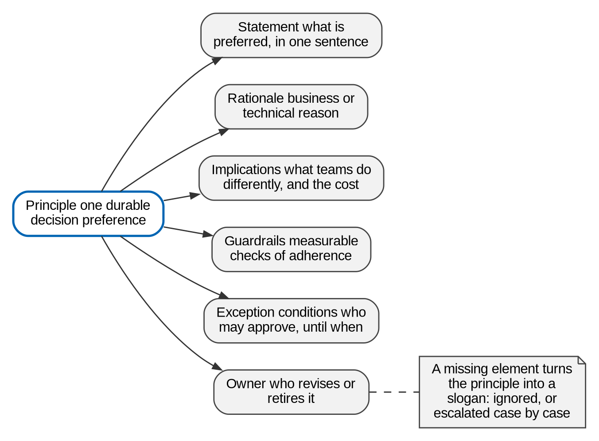{#fig-2-1 width="100%"}

**Example.** Each principle in the reference checkout names an owner and at least one guardrail. The principle “every money-moving operation is idempotent” points to a contract review question and a duplicate-delivery test, so a reviewer can see adherence without asking the team.

::: {.callout-warning appearance="simple" icon=false title="Common Pitfall"}
Publishing principles as adjectives — “secure”, “scalable”, “cloud-first” — with no rationale or guardrail. Each review then argues from taste, and the register becomes a list nobody can apply. Rewrite each entry as a preference with a scope, a measurable check and a named exception approver before it is published.
:::

::: {.callout-important appearance="simple" icon=false title="Decision & Trade-off"}
A principle costs effort to write and maintain, so decide how much structure each one earns.

| Option | Choose when | Consequences |
| :--- | :--- | :--- |
| Full anatomy for every principle | Several teams depend on the same principle | Slow to publish and review; consistent, enforceable decisions |
| Full anatomy for binding principles, one-line guidance elsewhere | Most decisions are local and cheap to reverse | Fast; guidance drifts without a review route |
| No published principles, rely on review | One delivery team, few reusable decisions | Lowest overhead; decisions do not compound across teams |
:::

## 2.2 Business Alignment

**Definition.** Business alignment is the property that each material design decision can be traced to a business outcome and to an indicator that would show whether the outcome moved.

**Purpose.** Alignment decides where architecture effort goes and how it is defended. It converts “we need a new platform” into a claim that a named outcome and indicator will improve, and it lets a reviewer challenge work that has no plausible route to value. It also legitimizes work that reduces risk rather than raising revenue, provided the risk is named and owned.

**What it includes.** A chain from capability to outcome to indicator, with a baseline taken before the change (Table 2.2). The capability is what the organization does, the outcome is the change in the business, and the indicator is how that change is observed. The chain includes the owner of the indicator and the decision the indicator informs, which keeps the map connected to funding rather than to a slide.

**Why it is needed.** Without the chain, investment is justified by analogy, vendor pressure or seniority, and platforms accumulate because they are fashionable. With it, a reviewer asks which indicator should move and by how much, and can stop work that cannot answer. The cost of skipping the step is discovered late, when a platform must be defended on cost alone. **Evidence.** Every material capability maps to a named outcome and indicator; infrastructure changes with no plausible contribution to an outcome are challenged.

| Capability | Outcome | Indicator | Architecture decision it informs |
| :--- | :--- | :--- | :--- |
| Checkout | Fewer abandoned baskets | Conversion rate; p95 submit latency | Invest in latency, or in recovery from payment failures |
| Settlement | Faster access to cash | Settlement cycle time; value settled per day | Batch or near-real-time settlement |
| Fraud control | Fewer fraudulent losses without blocking good customers | Fraud rate; false-positive rate | Whether the fraud check must be synchronous |
| Operations | Lower cost to serve | Cost per transaction; incident minutes | Degree of automation and managed services |

: Outcome and indicator chain for four checkout capabilities

The same chain appears in Figure 2.2, which marks the point where the investment decision is tested; a capability with no indicator that can move stops there.

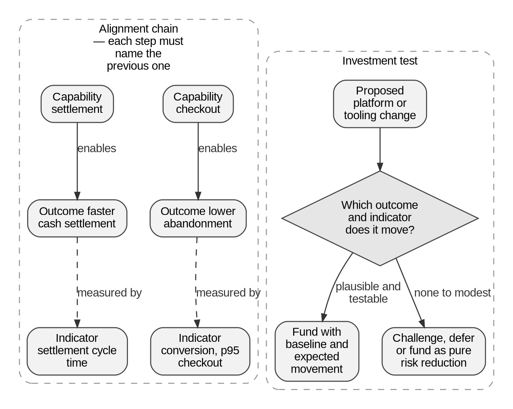{#fig-2-2 width="100%"}

**Example.** The reference checkout justifies its two-second latency budget by the measured drop in conversion above that threshold, and it justifies the synchronous fraud check by fraud loss rather than by latency. Both decisions name an indicator and an owner.

::: {.callout-warning appearance="simple" icon=false title="Common Pitfall"}
Building a capability map once, for a funding deck, and never updating it. The map then describes last year’s priorities and gives reviewers a false sense of traceability. Keep the map small and attach it to the decision record: every significant decision names the outcome and indicator it expects to move.
:::

::: {.callout-important appearance="simple" icon=false title="Decision & Trade-off"}
Not every justified change has a revenue indicator; decide what evidence a business case must carry.

| Option | Choose when | Consequences |
| :--- | :--- | :--- |
| Outcome with baseline and target | The change claims a business benefit | Needs measurement skill and time; decisions are defensible |
| Named risk reduction with a risk owner | The change prevents a loss that is hard to quantify | Residual risk must be accepted explicitly and revisited |
| Bounded experiment with a stop rule | The outcome is uncertain and the cost is small | Cheap learning; must stop when the rule triggers |
:::

## 2.3 Simplicity and Sustainability

**Definition.** Simplicity is the property of a design whose structure is no more complex than the quality attributes it must satisfy require.

**Purpose.** Simplicity keeps lifetime cost low: less to build, less to operate, fewer failure modes to diagnose and fewer components to migrate. It informs the choice between a module and a service, between a managed service and a self-hosted platform, and between configuration and code. Sustainability adds the ability to keep the system running with skills the organization can hire and retain.

**What it includes.** The comparison of the least complex design that meets the stated quality attributes against the more distributed alternative, over the expected lifetime and including operations, security and incident recovery. Complexity is justified when its benefit exceeds delivery, support and migration cost. A distributed service boundary is not automatically better than a module: independent deployment must offset network failures, telemetry and data coordination. Table 2.3 lists the dimensions the comparison must cover.

**Why it is needed.** Complexity arrives one justified exception at a time and is almost never removed. Each added boundary raises the cost of every later change and the number of places an incident can start, and that cost is paid by people who were not present when the exception was granted. **Evidence.** The simplest viable design was compared with the more distributed alternative on effort, failure modes, operational skills and expected change frequency, and the comparison is recorded.

| Dimension | Question | Evidence |
| :--- | :--- | :--- |
| Delivery | How much more work before the first useful release? | Milestone comparison for both options |
| Operations | Who runs it at 3 a.m., with which runbooks? | On-call rota, runbook count, monitoring scope |
| Failure modes | Which new partial-failure states appear? | Failure-mode list and tested degradation behavior |
| Skills | Can the current team diagnose it under pressure? | Named skills, training plan or hiring need |
| Migration | What does it cost to reverse the choice? | Estimated effort and data-migration risk |

: Complexity cost dimensions for the comparison

Figure 2.3 applies those dimensions to the common fork between a modular monolith and separate services, so the comparison ends in a deployment choice rather than a score.

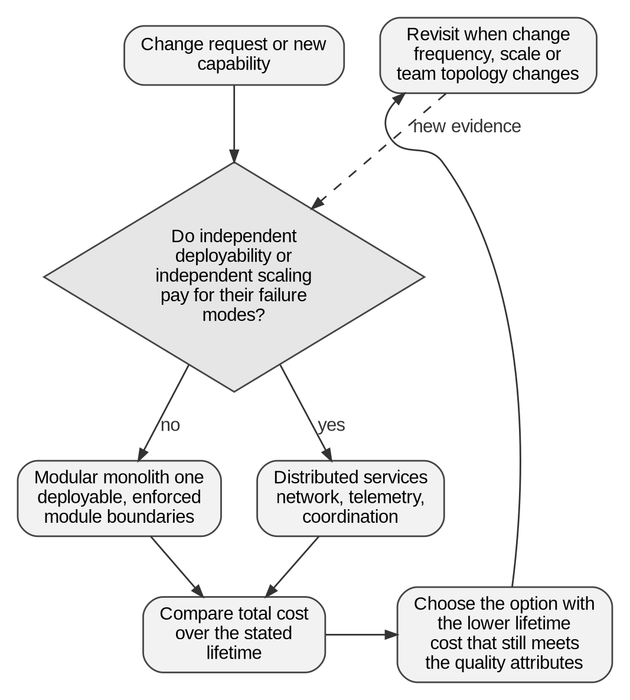{#fig-2-3 width="100%"}

**Example.** The checkout keeps orders and pricing in one deployable until the pricing team needs an independent release cadence. The comparison records the operational saving against the loss of independent scaling, so a later split is a decision with evidence rather than a fashion.

::: {.callout-warning appearance="simple" icon=false title="Common Pitfall"}
Choosing a service per team because the organization chart changed. The result is a distributed system with the coupling of a monolith: every change still needs several releases, and failures now cross a network. Start from the quality attributes and the change frequency, and split only where independent deployment pays for its cost.
:::

::: {.callout-important appearance="simple" icon=false title="Decision & Trade-off"}
Decide how much structural complexity the next two years of change justify.

| Option | Choose when | Consequences |
| :--- | :--- | :--- |
| Modular monolith with enforced boundaries | Change frequency is shared and one team owns the deployable | Cheapest to operate; boundaries need automated enforcement |
| Coarse services per capability | One capability needs its own release or scaling profile | Adds network failure modes, telemetry and coordination |
| Extract a service later, behind an existing module boundary | Contention is expected but not yet demonstrated | Needs disciplined starting boundaries; deferral hides the cost |
:::

## 2.4 Modularity and Separation of Concerns

**Definition.** Modularity is the property that lets one part of a system change without forcing a change in the parts that depend on it.

**Purpose.** Modularity makes change local and reviewable. It informs how code, teams and data are divided, how interfaces are versioned, and which dependencies are allowed to point in which direction. Separation of concerns assigns each responsibility to one module so that a policy change — a pricing rule, a tax rule, a refund condition — has one place to live.

**What it includes.** Components organized around cohesive responsibilities, an explicit dependency direction, a narrow published contract and hidden data and implementation. A module is a boundary, not a project folder: splitting code into projects without controlling dependencies does not establish modularity. Table 2.4 gives the signals that distinguish a real boundary from a diagram.

**Why it is needed.** Without boundaries, a change to one business rule requires reading and retesting everything that shares the database or the model, and no one can say what a change will break. The consequence is a release that only a few people dare to make. **Evidence.** Dependency analysis and a representative change request show that a module can evolve without modifying unrelated domains.

| Signal | Healthy | Warning |
| :--- | :--- | :--- |
| Dependency direction | Contracts point one way; no cycles | Modules call each other’s internals |
| Change impact | One module plus its own tests | A change requires edits in three modules |
| Data access | Each module reads and writes through its own store | Shared tables with several writers |
| Release coupling | A module's change ships without coordinated changes in other modules | Every change needs a coordinated release |
| Test surface | Module tests run without the whole system | Tests need the full environment |

: Signals of healthy and unhealthy module boundaries

Figure 2.4 shows the dependency direction the signals imply: a boundary is healthy when calls cross it through a published contract and no consumer reaches into the module’s internals.

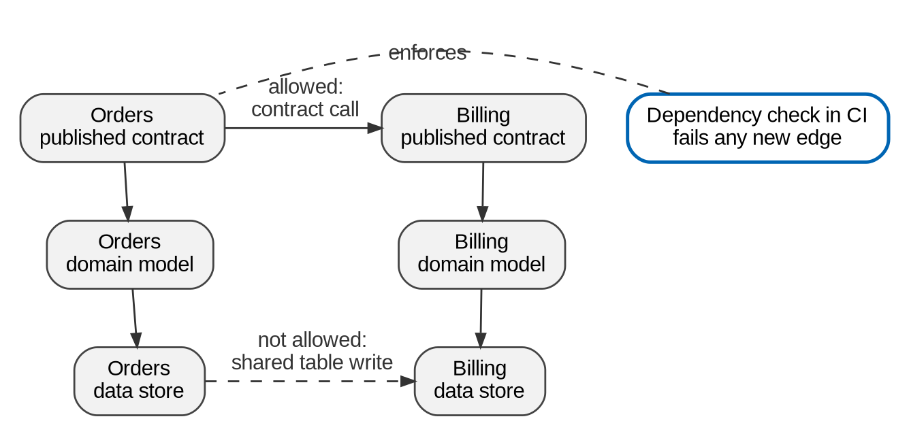{#fig-2-4 width="100%"}

**Example.** Checkout calls the billing contract to request an invoice; no checkout code reads or writes billing tables. When the invoice format changes, checkout is unaffected because the change is behind the contract.

::: {.callout-warning appearance="simple" icon=false title="Common Pitfall"}
A “common” library that every module edits becomes a shared release dependency, and the boundaries disappear while the deployment diagram still shows separate boxes. Keep shared code to stable utilities, and move business rules into the module that owns them.
:::

::: {.callout-important appearance="simple" icon=false title="Decision & Trade-off"}
Boundaries decay unless something enforces them; choose the enforcement that matches the team’s size.

| Option | Choose when | Consequences |
| :--- | :--- | :--- |
| Convention and review | Small team, few modules, short feedback loop | Nearly free; decays as the team grows or turnover rises |
| Automated dependency checks in CI | Several modules or teams share a codebase | Needs maintained rules; build failures become the teacher |
| Separate deployables per module | Independent release or scaling is really required | Network, telemetry and coordination cost per boundary |
:::

## 2.5 Data Ownership

**Definition.** Data ownership assigns one accountable authority for the meaning and mutation of each business fact.

**Purpose.** Ownership answers two questions that otherwise surface during an incident: who may change this value, and who decides what it means. It informs the data model, the integration style and the access model, and it sets the boundary within which autonomy is real rather than nominal.

**What it includes.** An owning domain that is the only writer of its authoritative state, consumers that use published APIs, events or governed data products, and copies whose freshness, reconciliation and permitted uses are documented (see 9.3). Ownership covers the interpretation as well as the storage: two services that disagree about what “settled” means have a semantics problem even if only one writes the column. Table 2.5 shows the ownership pattern for four data sets in the checkout scenario.

**Why it is needed.** Shared write access produces conflicting updates, unclear accountability and reconciliation work that nobody owns. The failure is quiet until an audit or a customer dispute asks which value is correct. **Evidence.** Mutation paths and access grants show that only the owning domain changes its authoritative data, and every copy has a stated freshness expectation.

| Data | Accountable owner | Consumer access path | Freshness expectation |
| :--- | :--- | :--- | :--- |
| Order state | Order service | Published API and events | Seconds |
| Customer profile | Customer service | API and governed data product | Minutes |
| Payment instrument token | Payments service | Token reference only; no card data | Immediate |
| Currency and tax reference data | Platform team | Versioned replicated table | Daily, with a version stamp |

: Ownership and consumer access for four data sets

Figure 2.5 traces ownership from the authoritative writer to the published copy and its consumers, where stale replicas and unowned caches become visible.

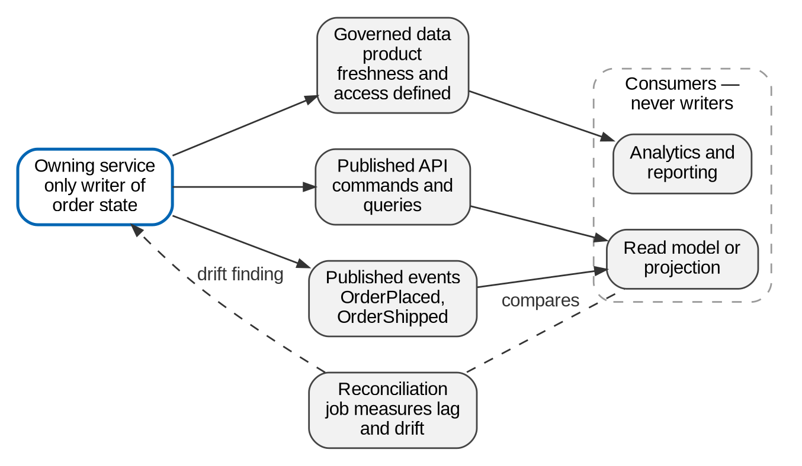{#fig-2-5 width="100%"}

**Example.** Checkout validates the price through the pricing API. It may cache the result for a stated interval, and the cache documents its staleness and the reconciliation that repairs drift; it never writes the pricing table.

::: {.callout-warning appearance="simple" icon=false title="Common Pitfall"}
Declaring “the data warehouse is read-only” while analysts correct records there and the corrections are loaded back into production. Two writers now exist and neither reconciles. Route corrections through the owning service as commands, and keep analytical stores strictly derived.
:::

::: {.callout-important appearance="simple" icon=false title="Decision & Trade-off"}
Ownership can be enforced at different strengths; choose one deliberately.

| Option | Choose when | Consequences |
| :--- | :--- | :--- |
| One owning service per fact, writes only through its API | Several teams consume the same fact | Clear accountability; the owner becomes a dependency to fund |
| Shared schema with per-table ownership and grants | A legacy platform cannot be split yet | Cheap transition; grants drift without review |
| Domain-owned data product with a published contract | Analytics and operations need the same fact | Needs contract and quality discipline; best for regulated data |
:::

## 2.6 Integration by Contract

**Definition.** Integration by contract means two components interact only through an interface whose behavior, failure modes and compatibility rules are stated and tested.

**Purpose.** A contract lets two teams change independently. It defines what the caller may rely on, what the provider promises under failure, and how a change is introduced without a coordinated release. It informs the choice between synchronous and asynchronous interaction and between commands and events.

**What it includes.** Use synchronous calls when the caller needs an immediate answer and asynchronous messaging when buffering or temporal decoupling is valuable. Distinguish commands, which request work, from events, which report facts. The contract covers version compatibility, authentication, failure semantics, idempotency and consumer migration; choosing a protocol alone does not make an integration reliable (see Chapter 10). Table 2.6 lists the facets a review must find.

**Why it is needed.** Unstated assumptions are the usual cause of integration incidents: the caller assumed an ordered stream, the provider assumed one consumer, nobody agreed what happens on redelivery. The consequence appears as duplicate payments or lost notifications after a routine deploy. **Evidence.** Contracts, retry boundaries and consumer idempotency are specified, and duplicate-delivery and dependency-outage tests pass.

| Facet | Question it must answer | Evidence |
| :--- | :--- | :--- |
| Versioning | How is a breaking change introduced? | Versioning policy and a compatibility test |
| Authentication | Which identity calls, with which scope? | Credential type, rotation, scope list |
| Failure semantics | What does the caller see on timeout or rejection? | Documented error model and tested behavior |
| Idempotency | What happens on duplicate delivery? | Idempotency key and a duplicate test |
| Migration | How does a consumer move to the next version? | Deprecation window and migration notice |

: Facets of an integration contract

Figure 2.6 turns the contract facets into a choice: the interaction’s latency, failure and replay needs decide whether the contract is synchronous or event-based.

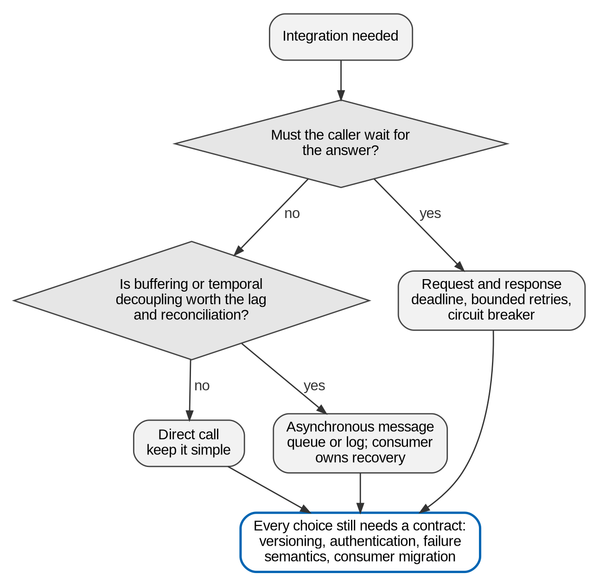{#fig-2-6 width="100%"}

**Example.** Checkout waits for the fraud decision because the customer cannot proceed without it, and receives the settlement result as an event. Both interactions have a stated contract; neither relies on the database of the other service.

::: {.callout-warning appearance="simple" icon=false title="Common Pitfall"}
Calling a protocol choice a contract: “we use REST, so it is decoupled”. The wire format is agreed, but ordering, duplicate behavior and breaking-change rules are not, so the first provider deploy becomes a joint release. Write the failure and versioning clauses, and test them.
:::

::: {.callout-important appearance="simple" icon=false title="Decision & Trade-off"}
The interaction style drives most of the operational cost; decide it explicitly.

| Option | Choose when | Consequences |
| :--- | :--- | :--- |
| Synchronous request and response | The caller cannot continue without the answer | Simple to reason about; runtime coupling and cascading failure |
| Asynchronous message or event | Buffering, fan-out or temporal decoupling is valuable | Consumer owns recovery; lag, ordering and duplicates must be handled |
| Batch file exchange | Volumes are large and latency of hours is acceptable | Simple operations; coarse error handling and late discovery |
:::

## 2.7 Security by Design

**Definition.** Security by design means trust boundaries, identities and authorization are part of the architecture, decided with the same rigor as any other quality attribute.

**Purpose.** Security by design puts the control where the asset is, so a compromise of one layer does not expose the next. It informs where authentication terminates, where authorization is evaluated, which identity a service uses to reach a data store, and how secrets are delivered. It also sets the threat model that later testing verifies.

**What it includes.** Least privilege and explicit trust boundaries at every externally reachable interface and sensitive data store, authentication of each identity and authorization of each operation in the service that owns the resource. Secrets are held in a managed store and rotated, and privileged access is separated from ordinary traffic (see Chapter 13). Table 2.7 states where each control is enforced.

**Why it is needed.** Controls added after the design are usually applied at the wrong layer: a gateway that authenticates but does not authorize, or a service account that can write every table. The consequence is a single forgotten endpoint that bypasses the model. **Evidence.** Authorization at the owning service, least-privilege identities, protected secrets, and a threat-model test across each critical trust boundary.

| Control | Enforced at | Evidence |
| :--- | :--- | :--- |
| Authentication | Edge, with short-lived tokens | Token lifetime and validation test |
| Authorization | The service that owns the resource | Deny test for a foreign tenant |
| Service-to-service identity | Workload identity, scoped per store | Grant list and rotation record |
| Secret handling | Managed secret store | No secret in code, config or logs |
| Boundary validation | Every crossing of a trust boundary | Threat-model test per boundary |

: Controls and where they are enforced

Figure 2.7 places those controls on the trust boundaries they protect, so the enforcement column can be checked against the path a request actually takes.

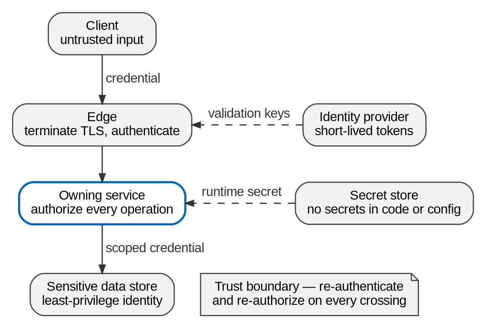{#fig-2-7 width="100%"}

**Example.** A partner calls the checkout API with a scoped token. The edge validates the token, and the Order service re-checks that the partner may act for that merchant before reading the order; the gateway decision alone is not trusted.

::: {.callout-warning appearance="simple" icon=false title="Common Pitfall"}
Authorizing only in the user interface or the gateway. Every internal caller, background job and support tool then reaches the service with implicit trust, and one misconfigured route exposes other tenants’ data. Authorize in the owning service, and test the deny path, not only the allow path.
:::

::: {.callout-important appearance="simple" icon=false title="Decision & Trade-off"}
Where authorization lives determines how much duplication the team carries.

| Option | Choose when | Consequences |
| :--- | :--- | :--- |
| Authorize in each owning service | Resources have owners and several entry points | Duplicated policy code; correct under every path |
| Central policy engine called by services | Many services share complex, audited rules | One policy to change; a runtime dependency on every request |
| Authorize at the gateway only | A single public entry point and coarse rules | Cheap; internal callers bypass it, so it is rarely sufficient |
:::

## 2.8 Privacy by Design

**Definition.** Privacy by design treats the protection of personal data as a design constraint applied at every stage of the data lifecycle, not as a compliance check before launch.

**Purpose.** It shapes the data model, the flows, the retention schedule and the access model while those are still cheap to change. It informs whether a field is collected at all, where it may be stored, who may read it, how long it exists and how a deletion request can be honored. It is distinct from security: a system can be secure and still collect more personal data than any purpose requires.

**What it includes.** A stated purpose and lawful basis for each personal data set, collection limited to the fields that purpose needs, purpose limitation in use, retention with a justified schedule, verifiable deletion or anonymization, a controlled path for data-subject requests, and processor and transfer terms. It also includes the evidence: a data protection impact assessment where risk is high, a record of processing and a data inventory (see 13.9; retention and deletion mechanics are in 9.2.4). Table 2.8 states the question each lifecycle stage must answer.

**Why it is needed.** Personal data that is never collected cannot leak, be subpoenaed or be retained by mistake. The consequence of skipping the design step is a breach with an unnecessarily large blast radius and a deletion request that cannot be satisfied because copies exist in logs, backups and analytics extracts. **Evidence.** Each data set has a purpose, a retention period, a deletion test and a named privacy owner.

| Stage | Question it must answer | Evidence |
| :--- | :--- | :--- |
| Collect | Which purpose justifies each field, and on what basis? | Data inventory with purpose and lawful basis |
| Use | Is the data used only for the stated purpose? | Access model and purpose tags |
| Share | Which processors and regions are involved, under what terms? | Transfer register and contract clauses |
| Retain | How long, and why that long? | Retention schedule with justification |
| Delete | Is deletion verifiable across replicas and backups? | Deletion test and log |
| Request | Can access, correction and erasure be served? | Request log and measured response time |

: Privacy questions at each lifecycle stage

Figure 2.8 follows personal data through the lifecycle stages in the table, marking the control that applies at collection, use, retention and deletion.

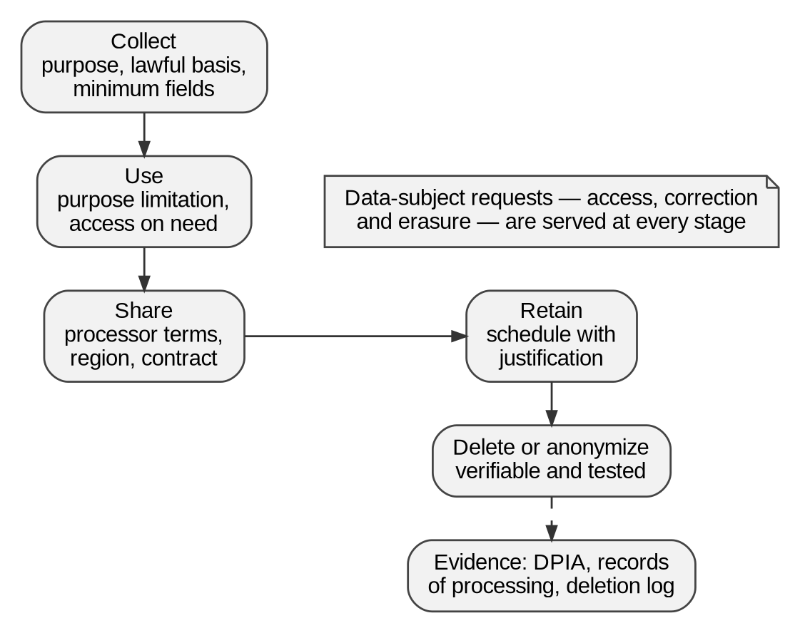{#fig-2-8 width="100%"}

**Example.** Checkout collects the delivery address and contact details because the order cannot be fulfilled without them, and never stores the card number: the payment provider returns a token. Support staff see a masked address until a case is opened, and the access is logged.

::: {.callout-warning appearance="simple" icon=false title="Common Pitfall"}
Logging full request payloads for debugging convenience. Personal data then spreads into logs, traces and a third-party observability platform, outside the retention and deletion controls of the system that owns it. Redact at the source and record identifiers instead of content.
:::

::: {.callout-important appearance="simple" icon=false title="Decision & Trade-off"}
Privacy controls restrict what the system can do; choose the strength deliberately.

| Option | Choose when | Consequences |
| :--- | :--- | :--- |
| Collect only the fields the journey needs | Almost always; this is the default | Some personalization and analytics are lost |
| Pseudonymize and separate identifiers | Analysis or support needs records without identity | Extra mapping store to protect and govern |
| Retain full data under strict access control | A legal or safety obligation requires it | Largest blast radius; needs the strongest audit and retention evidence |
:::

## 2.9 Resilience and Reliability

**Definition.** Resilience is the ability to absorb dependency failures and recover predictably, while reliability is the ability to produce correct business outcomes over time.

**Purpose.** Resilience keeps a partial failure from becoming a full outage, and reliability keeps the business result correct while that happens. Together they inform timeout budgets, retry policy, isolation, queue design and the degradation a customer actually sees.

**What it includes.** Deadlines derived from the caller’s budget, bounded retries with backoff, isolation between workloads, and safe degradation with a defined fallback. Reliability adds idempotency, duplicate handling, poison-message handling and reconciliation, because a consumer must survive delays and redelivery. Reliability means correct business outcomes, not just successful HTTP responses. Table 2.9 states the expected behavior for the common failure modes.

**Why it is needed.** Retry without idempotency creates duplicate financial effects, and unbounded retries turn a slow dependency into an outage. A service that returns 200 while losing an accepted order is unreliable in the way that matters most. **Evidence.** Injected timeouts and duplicate messages produce bounded retries, safe degradation, correct business state and actionable alerts.

| Failure mode | Expected behavior | Evidence |
| :--- | :--- | :--- |
| Dependency timeout | Fail within the caller’s deadline, then degrade | Latency test with an injected delay |
| Duplicate delivery | Same business effect once, keyed by idempotency | Duplicate-message test |
| Poison message | Isolated with its payload, owner notified | Dead-letter entry and alert |
| Dependency outage | Breaker opens; fallback path serves | Chaos test with the dependency stopped |
| Partial write | Compensation or reconciliation repairs state | Reconciled totals after injection |

: Failure modes and expected behavior

Figure 2.9 follows each failure mode to its recovery path, showing where a bounded retry, a pending state or a compensating action ends the branch.

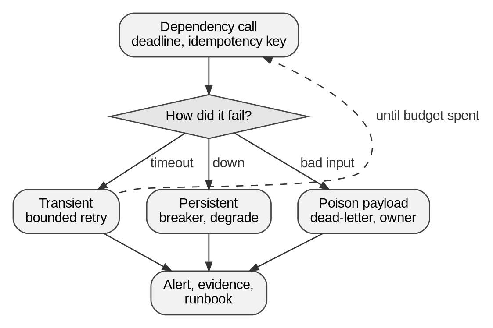{#fig-2-9 width="100%"}

**Example.** When the payment provider times out during checkout, the order is recorded as pending with an idempotency key, the customer sees a status page rather than an error, and the eventual provider callback completes or reverses the payment exactly once.

::: {.callout-warning appearance="simple" icon=false title="Common Pitfall"}
Adding retries to fix a flaky dependency without a deadline or an idempotency key. Latency multiplies, the dependency receives more load exactly when it is struggling, and retried payments are charged twice. Bound the retry by the caller’s remaining budget and make the operation idempotent first.
:::

::: {.callout-important appearance="simple" icon=false title="Decision & Trade-off"}
How a system fails is a design decision with a customer-visible consequence.

| Option | Choose when | Consequences |
| :--- | :--- | :--- |
| Fail fast and reject | The result cannot be approximated safely | Clear semantics; the customer retries or leaves |
| Degrade with a fallback | A stale or partial answer is acceptable and stated | Availability preserved; staleness must be visible and bounded |
| Queue the work and replay | The action must eventually happen | Requires idempotency, ordering rules and monitoring of queue age |
:::

## 2.10 Scalability and Performance

**Definition.** Scalability is the ability to sustain growth in demand by adding resources or changing partitioning; performance is the latency and throughput observed under a stated workload.

**Purpose.** These attributes decide when a system needs a different mechanism rather than more of the same one. They inform capacity planning, the choice between vertical and horizontal scaling, and whether caching, asynchronous work or partitioning is justified.

**What it includes.** A demand model and explicit latency objectives defined before any scaling mechanism is selected, then measurement of throughput, p95/p99 latency and saturation under realistic traffic rather than extrapolation from instance counts. Caching and horizontal scaling add invalidation, shared-state or cost trade-offs that require explicit acceptance. Table 2.10 states what each mechanism buys and what it costs.

**Why it is needed.** Averages hide the tail, and tail latency is what customers and timeouts experience. Without a stated objective, capacity is argued from impressions and the first real spike settles the question. **Evidence.** Realistic concurrency and growth tests report percentiles, throughput, queue age and saturation, together with the headroom the design assumes.

| Mechanism | Buys | Costs |
| :--- | :--- | :--- |
| Vertical scaling | Simplicity; no distribution | Hardware ceiling; often a restart to change size |
| Horizontal scaling | Throughput from more instances | Requires statelessness or shared-state design |
| Caching | Lower latency and load | Invalidation, staleness and a new failure mode |
| Queue and asynchronous work | Absorbs bursts | Lag, ordering and duplicate handling |
| Partitioning | Growth beyond one node | Routing, rebalancing and cross-partition consistency |

: What each scaling mechanism buys and costs

Figure 2.10 connects the demand model to the mechanism that answers it, so a scaling choice can be traced to the measurement that justified it.

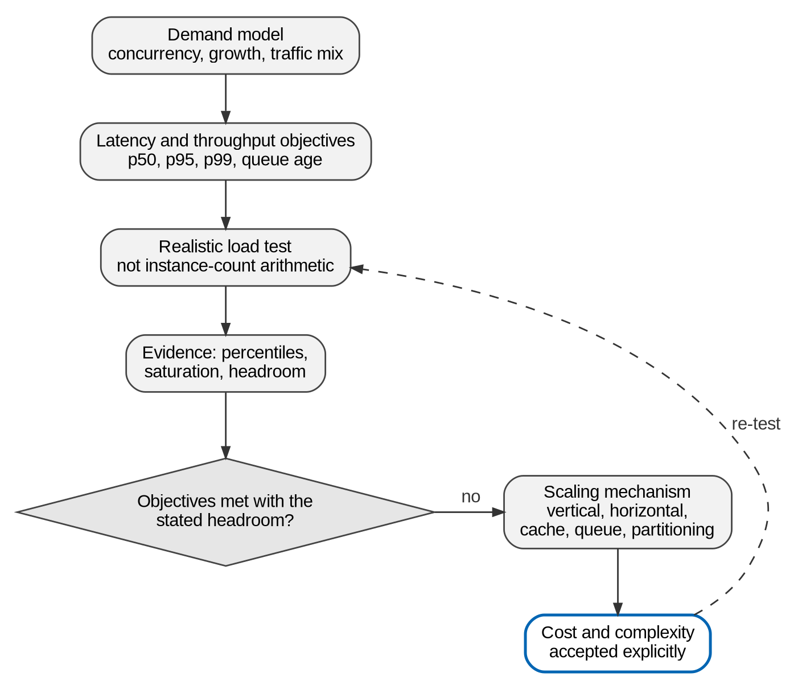{#fig-2-10 width="100%"}

**Example.** Checkout targets 99% of order submissions acknowledged within two seconds at 500 submissions per second. A load test at that rate shows the database write as the saturation point, so the first change is query and index work, not more application instances.

::: {.callout-warning appearance="simple" icon=false title="Common Pitfall"}
Extrapolating capacity from instance count or from average latency. Both hide the shared bottleneck — a lock, a connection pool, a single queue — that appears only under concurrent load. Measure at the target percentile with realistic data volume, and report saturation alongside latency.
:::

::: {.callout-important appearance="simple" icon=false title="Decision & Trade-off"}
Scaling options differ in cost and reversibility; decide with measurement, not preference.

| Option | Choose when | Consequences |
| :--- | :--- | :--- |
| Scale up | The workload is modest and state is hard to distribute | Simple; a ceiling and often downtime to resize |
| Scale out | The workload is parallel and the service can be stateless | Needs load balancing and shared-state handling |
| Reduce work: cache or defer | The bottleneck is repeated or non-urgent work | Adds invalidation or lag; correctness must tolerate it |
:::

## 2.11 Observability

**Definition.** Observability is the property that lets an operator answer, without shipping code, why a specific request or business transaction behaved as it did.

**Purpose.** Observability shortens diagnosis and turns an incident into evidence. It informs instrumentation scope, what context crosses an asynchronous boundary, which alerts exist and who acts on them. It also bounds what may be recorded, because telemetry is a copy of production data.

**What it includes.** Correlated logs, metrics and traces, with context propagated through queues and scheduled jobs, so one business transaction can be followed across synchronous and asynchronous boundaries. Alerts correspond to actionable symptoms, each with an owner and a runbook. Redaction is applied at export, and sensitive fields are excluded rather than filtered downstream (see Chapter 14). Table 2.11 states the minimum for a critical journey.

**Why it is needed.** Without correlated context, an incident is reconstructed by guessing and by reading code at the worst possible time. The consequence is long diagnosis, repeated incidents and alerts nobody trusts. **Evidence.** One business transaction can be traced across synchronous and asynchronous boundaries, with redaction applied and diagnosis time measured.

| Signal | Question it answers | Minimum for a critical journey |
| :--- | :--- | :--- |
| Trace | Where did this transaction spend its time? | One trace per journey across sync and async hops |
| Metrics | Is the journey healthy now, and since when? | Error rate, p95 latency and queue age per step |
| Logs | What exactly happened in this case? | Structured, correlated, redacted and retained briefly |
| Alert | Who must act, and with what instructions? | Symptom-based alert with owner and runbook link |
| Business counter | Did the business outcome happen? | Orders completed, payments settled, refunds issued |

: Signals for one critical journey

Figure 2.11 shows why the journey signals need trace context: the same request crosses synchronous and asynchronous boundaries, and a broken propagation leaves the signal stranded on one side.

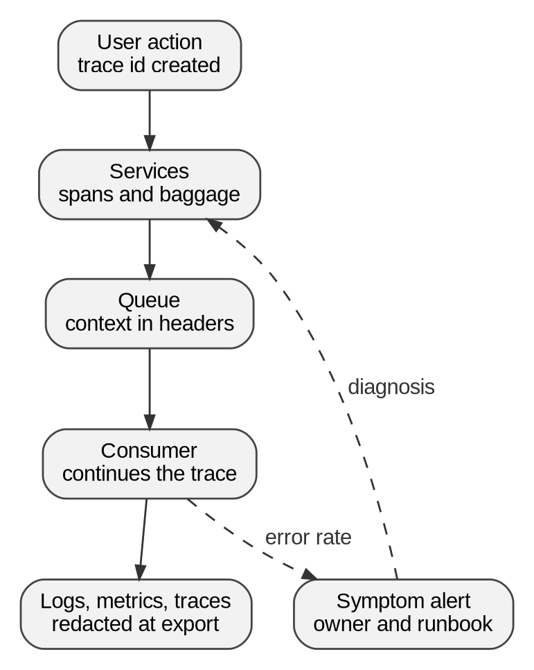{#fig-2-11 width="100%"}

**Example.** A customer reports a missing confirmation. The support engineer follows one trace from the API through the queue to the notification consumer, sees the poison message in the dead-letter queue and links it to the runbook, without reading application code.

::: {.callout-warning appearance="simple" icon=false title="Common Pitfall"}
Instrumenting infrastructure and calling it observability: CPU dashboards for every host, no business transaction that can be followed end to end. Alerts then fire on causes rather than symptoms and pages go to a team that cannot act. Instrument the journey first, then the infrastructure beneath it.
:::

::: {.callout-important appearance="simple" icon=false title="Decision & Trade-off"}
Instrumentation scope is a cost and privacy decision as well as a technical one.

| Option | Choose when | Consequences |
| :--- | :--- | :--- |
| Journey-based instrumentation | A few critical flows carry most business risk | Focused and affordable; gaps for rare paths |
| Platform default for every service | Many teams, shared standards required | Uniform coverage; volume and cost grow without curation |
| Vendor agent with automatic tracing | Speed matters more than control | Fast to adopt; data residency and cost need review |
:::

## 2.12 Evolvability and Maintainability

**Definition.** Evolvability is the ability to change a system’s structure and suppliers without a rewrite; maintainability is the ability to make ordinary changes safely and at predictable cost.

**Purpose.** These attributes determine whether the architecture can absorb a new provider, a schema change or a team split without a coordinated release across the estate. They inform where boundaries are drawn, how contracts evolve and which tests must exist before change is allowed.

**What it includes.** Replaceable boundaries, backward-compatible contracts and automated tests that allow change without coordinated releases. Domain policies stay independent of infrastructure frameworks, and supplier-specific code sits behind an adapter (Figure 2.12). Table 2.12 lists the change scenarios a design should rehearse, because each one exposes a different coupling.

**Why it is needed.** A system that cannot replace a supplier is negotiating from weakness at renewal, and a framework upgrade that reaches into domain code becomes a project rather than a task. The cost appears years after the decision that created it. **Evidence.** A simulated provider replacement or schema evolution shows how many components and coordinated deployments are required.

| Scenario | What should be true | Evidence |
| :--- | :--- | :--- |
| Replace a provider | One adapter changes; domain code does not | Rehearsal result and component count |
| Evolve a schema | Consumers on the old version keep working | Compatibility test and deprecation window |
| Upgrade a framework | No domain rule changes | Change scope confined to infrastructure code |
| Split a team | Each team owns a deployable and its contract | Ownership map and release record |

: Change scenarios and the evidence they should produce

Figure 2.12 narrows the change scenarios to the provider boundary, where a port and an adapter make a replacement testable before the contract is signed.

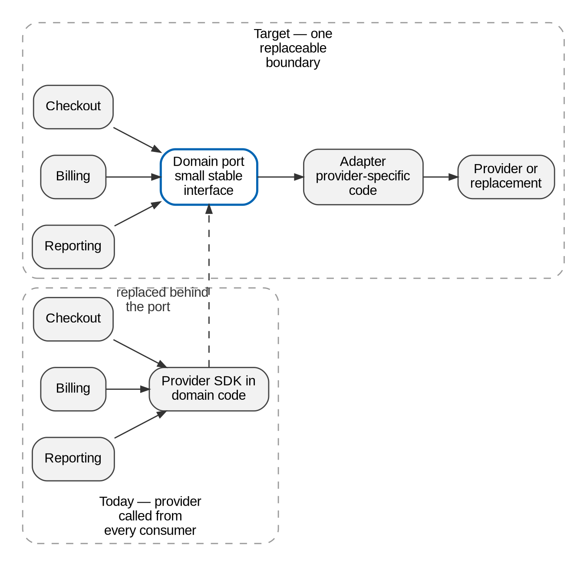{#fig-2-12 width="100%"}

**Example.** The checkout calls a payment port rather than a provider SDK. A contract test runs against both the current adapter and a candidate replacement, so the replacement estimate is measured rather than assumed.

::: {.callout-warning appearance="simple" icon=false title="Common Pitfall"}
Letting a vendor SDK shape the domain model because it was quickest at the start. Every consumer now depends on the vendor’s vocabulary, and replacement becomes a rewrite. Keep a small domain port and confine provider types to the adapter.
:::

::: {.callout-important appearance="simple" icon=false title="Decision & Trade-off"}
Isolation costs code now and saves migration later; pick the level the risk justifies.

| Option | Choose when | Consequences |
| :--- | :--- | :--- |
| Domain port with an adapter | The supplier may change, or the contract is volatile | Extra mapping code; replacement is bounded |
| Shared client library owned by the platform | Many teams use the same supplier identically | Consistent behavior; still couples everyone to one version |
| Call the SDK directly from domain code | The dependency is trivial and permanent | Least code now; the highest future migration cost |
:::

## 2.13 Standardization and Reuse

**Definition.** Standardization is the adoption of one approved way to satisfy a recurring concern; reuse is the use of an existing asset instead of building a new one.

**Purpose.** Standardization reduces repeated security and operational work, and it makes review predictable because the approved path is known. Reuse lowers cost when the reused asset genuinely fits. Both inform platform investment and the default choices a team makes without escalation.

**What it includes.** Standardized cross-cutting concerns — identity, telemetry, deployment, contract conventions — where shared tooling reduces risk, and reuse that does not force unrelated domains into a shared release cycle. A paved road makes the secure path the easiest one while preserving an evidence-based route for unusual requirements (Figure 2.13). Table 2.13 pairs each default with its exception route.

**Why it is needed.** Without defaults, every team solves identity and telemetry again, each with its own gaps, and reviewers cannot tell a deliberate deviation from an omission. With defaults that cannot be questioned, unusual requirements are forced into a bad fit and worked around silently. **Evidence.** Platform defaults remove repeated security and operations work without coupling release cadences, and exceptions have owners and expiry dates.

| Concern | Default | Exception route |
| :--- | :--- | :--- |
| Identity | Organization identity provider, short-lived tokens | Documented federation case with a security review |
| Telemetry | Shared collector, standard schema, redaction rules | Additional signal with a named cost owner |
| Deployment | Standard pipeline with policy checks | Manual approval with a stated reason and expiry |
| Contracts | Approved schema and versioning conventions | Compatibility case reviewed by consumers |

: Paved-road defaults and their exception routes

Figure 2.13 shows the paved road as a default with an evidence-based exit: teams follow the template until a named exception is approved, and the exception route is part of the path rather than an afterthought.

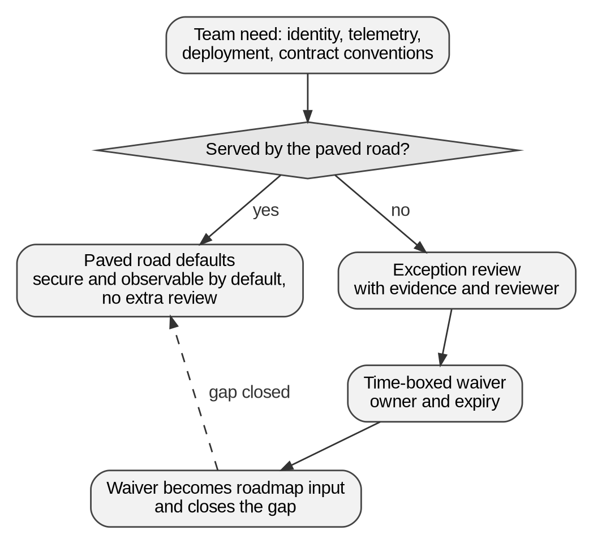{#fig-2-13 width="100%"}

**Example.** A new checkout service takes the platform template for identity, telemetry and deployment and needs no security review for those concerns. Its non-standard use of a second message broker goes through exception review, and the gap becomes a roadmap item.

::: {.callout-warning appearance="simple" icon=false title="Common Pitfall"}
Reuse enforced through a shared release train: every team adopts the shared component, and every team now releases together. Reuse has traded an independent cost for a coordination cost that is larger. Reuse code, contracts or templates, but keep release cadences separate.
:::

::: {.callout-important appearance="simple" icon=false title="Decision & Trade-off"}
Standardization trades local fit for consistency; choose the balance deliberately.

| Option | Choose when | Consequences |
| :--- | :--- | :--- |
| Central platform, mandated | A regulated control must be uniform | Strong compliance; slow response to local needs |
| Paved road with a documented exception route | Most needs are common, some are not | Consistent defaults; exceptions need review capacity |
| Team autonomy with published guidance | Domains are genuinely different | Fast locally; duplication and uneven control coverage |
:::

## 2.14 Accountability and Auditability

**Definition.** Accountability names the person or role answerable for a principle, decision or control and assigns each significant decision to a role with the context to make it; auditability makes the evidence of that responsibility retrievable after the fact.

**Purpose.** Together they close the loop that the other principles open. Accountable decision-making locates decisions where knowledge exists and keeps them reviewable; an owner with retrievable evidence turns a guardrail, a decision or an exception into something that can be reviewed, defended and learned from. They inform who may approve a design, when consultation is required, the register design, the retention of decision records and the review cadence. They are the principle that keeps the other principles from being applied by default or by seniority.

**What it includes.** Decisions made at the lowest level with the necessary context and accountability, with significant decisions recorded together with their rationale (see Chapter 3), and escalation reserved for cross-boundary, irreversible or high-risk choices (see Chapter 4). Table 2.14 sets out the classes and their records. A named accountable owner — a role, not a team — for each principle, exception, significant decision and control; a control that is enforced somewhere observable; evidence that survives staff changes and is retrievable in a review; and a periodic audit or sample that tests the evidence rather than the intention. Approved exceptions carry an owner and an expiry, recurring exceptions are reviewed as evidence about the principle itself, findings receive a remediation owner and a due date, and an exception expires unless it is renewed with evidence (see 4.9). Table 2.15 lists the objects and their review cadence.

**Why it is needed.** Decisions made by nobody in particular cannot be revisited, defended or reversed, and the same debate returns with every new team. Without an owner and retrievable evidence, an organization can hold every principle and still be unable to show that any was applied; the first external audit or serious incident exposes the gap. The cost is invisible until an audit or an incident asks who accepted the risk. Recurring findings point at a poorly scoped principle rather than at individual teams. **Evidence.** A sample of decisions, principles and exceptions shows a named owner, an accessible ADR where the decision is significant, a proportionate review route, retrievable evidence and a closed review, and expired exceptions are actually removed.

| Decision class | Decider | Record |
| :--- | :--- | :--- |
| Local and reversible within one release | The owning team | Short note in the backlog or pull request |
| Cross-domain or budget-affecting | The affected owners together | ADR with options, consequences and consulted parties |
| Irreversible or high-risk | Focused review; a named risk owner accepts | ADR plus risk acceptance with conditions and expiry |

: Decision classes, deciders and records

Chapter 19 (19.5.6) applies accountable decision-making to AI systems, where model choice, human oversight and tool permissions need explicit owners. Figure 2.14 routes a decision by its reversibility and impact, so the class in the table also sets how much review the choice needs.

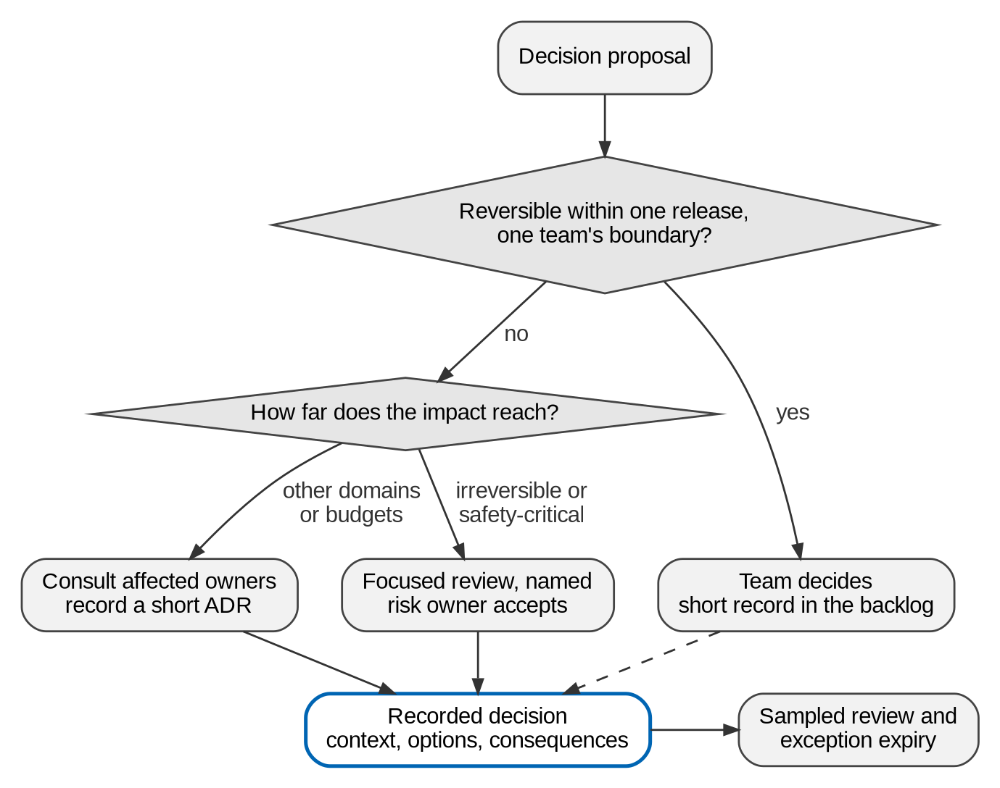{#fig-2-14 width="100%"}

The same owners keep the evidence current. Table 2.15 lists each accountability object with the evidence it leaves and the review that tests it.

| Object | Accountable owner | Evidence retained | Review cadence |
| :--- | :--- | :--- | :--- |
| Principle | Named architect role | Published text, guardrail results | Annual, or on recurring exception |
| Exception | The approver who granted it | Entry with scope, compensating control and expiry | At expiry, mandatory |
| Significant decision | The decider | ADR with options and consequences | Sampled each quarter |
| Control | The control owner | Automated check output and its history | Continuous, with periodic sampling |
| Finding | The remediation owner | Ticket, due date and closure evidence | Until closed |

: Accountability objects, evidence and review cadence

Figure 2.15 links each accountability object to the evidence it leaves and the review that keeps it current, which is how the cadence in the table becomes an operating loop.

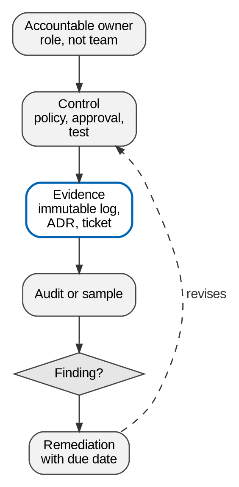{#fig-2-15 width="100%"}

**Example.** The checkout team chooses its own caching strategy and records it in the pull request. The decision to call the fraud provider synchronously crosses a domain boundary and carries financial risk, so it becomes an ADR with a named risk owner. The payments exception for the legacy billing writer names an approver, a compensating reconciliation and a fixed expiry date; when the date passes, the register marks it expired and the next review must either close it or renew it with fresh evidence.

::: {.callout-warning appearance="simple" icon=false title="Common Pitfall"}
Recording only the outcome of a decision, not the alternatives or the assumption that made it correct. Six months later nobody can tell whether the assumption still holds, so the decision is either defended blindly or reversed by accident. Naming a team as the owner has the same effect: nobody is accountable when the team reorganizes, and evidence kept only in chat history disappears with the channel. Record options, the deciding assumption and the signal that would reopen the decision; name a role, store the evidence where a reviewer can retrieve it, and test retrieval as part of the audit.
:::

::: {.callout-important appearance="simple" icon=false title="Decision & Trade-off"}
Evidence costs effort to produce and keep; decide what must be retained.

| Option | Choose when | Consequences |
| :--- | :--- | :--- |
| Record every decision with full evidence | The domain is regulated or safety-relevant | Highest assurance; heavy process and storage cost |
| Record significant decisions, sample the rest | Most organizations with several teams | Reasonable cost; needs a defined sampling rule |
| Rely on tickets and chat history | One team, short-lived systems | Cheapest; evidence is usually unrecoverable when needed |
:::

## 2.15 Managing Principle Conflicts

**Definition.** A principle conflict exists when two principles that are both accepted point to different designs for the same decision.

**Purpose.** Conflicts are normal in a mature principle set, and pretending otherwise forces teams either to break a principle quietly or to escalate everything. Handling conflicts explicitly keeps principles usable: the architect names the tension, identifies the dominant business concern and selects a bounded compromise.

**What it includes.** The identification of which principles are in tension for this specific decision, the business concern that dominates, and a recorded resolution with measurable limits and a reassessment trigger. Loose coupling can increase latency and eventual-consistency complexity; strict consistency can reduce availability during network partitions; least privilege adds operational friction. The architect exposes the conflict rather than declaring one principle universally superior. Table 2.16 lists the recurring conflicts and the guardrail that keeps each resolution honest.

**Why it is needed.** Unmanaged conflicts produce two failures: principles that are quietly ignored, and decisions that stall in escalation. Neither is visible in a principle register, and both corrode trust in the whole set. **Evidence.** Each resolved conflict is recorded with the dominant concern, the measurable limit and the signal that would reopen the decision.

| Conflict | Typical resolution | Guardrail |
| :--- | :--- | :--- |
| Loose coupling versus immediate consistency | Accept eventual consistency only where staleness is bounded and visible | Maximum staleness and reconciliation lag |
| Least privilege versus operability | Grant time-bound, audited access rather than standing access | Standing-privilege count and access review results |
| Observability versus data minimization | Structured telemetry with redaction and retention limits | Sensitive-field scan and retention compliance |
| Standardization versus team autonomy | Paved road with a documented exception route | Exception rate per concern |

: Recurring principle conflicts and their guardrails

Figure 2.16 turns the recurring conflicts into a resolution path: name the competing principles, weigh the evidence for each, and record which one yields and why.

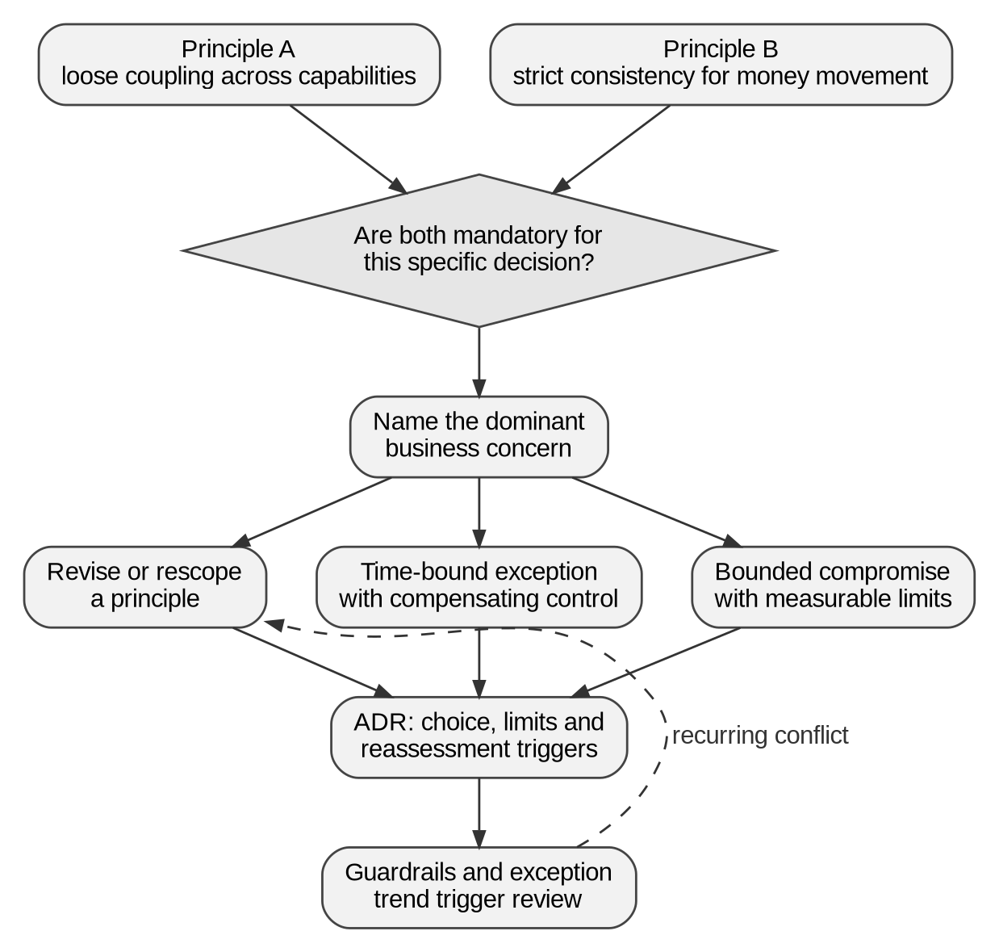{#fig-2-16 width="100%"}

**Example.** “Prefer asynchronous integration across autonomous capabilities” is sound, but a synchronous fraud check remains appropriate when the customer cannot proceed without an immediate result. Similarly, customer lookup can use a synchronous query to the source of record (fresh data, runtime coupling) or an event-fed projection (autonomy, but staleness and reconciliation). Record the chosen trade-off in an ADR, with the monitoring signals that would trigger reassessment.

::: {.callout-warning appearance="simple" icon=false title="Common Pitfall"}
Publishing “prefer asynchronous integration” without an exception route. The payments team must escalate a justified synchronous fraud check, delivery slows, and the principle loses credibility with every team that hits the same wall. Give each principle a named exception authority and a guardrail that shows when an exception is legitimate.
:::

::: {.callout-important appearance="simple" icon=false title="Decision & Trade-off"}
When principles conflict, decide how the conflict will be resolved and recorded.

| Option | Choose when | Consequences |
| :--- | :--- | :--- |
| Revise the principle | The conflict shows the principle is too absolute or poorly scoped | Restores consistency; requires consultation and a new rationale |
| Time-bound exception | One case has a justified, reversible deviation | Needs an owner, expiry, compensating control and evidence |
| Bounded design compromise | Both outcomes are mandatory and can be satisfied within limits | More design and test effort; requires measurable guardrails |
:::

## 2.16 Worked Example: Principles for a Payments Platform

*In practice:* This example shows how principles are applied, tested and reconciled with time-limited exceptions in a payments platform.

A payments team publishes the three principles in Table 2.17.

| Principle | Rationale | Guardrail |
| :--- | :--- | :--- |
| Single writer for authoritative state | Prevents conflicting updates and unclear accountability for money movements | Database access policy allows writes only from the owning service; dependency check in CI |
| Every money-moving operation is idempotent | Retries and redelivery are normal; duplicates cause financial loss | Contract review requires an idempotency key; duplicate-delivery test in the pipeline |
| Prefer asynchronous integration across domains | Isolates checkout from provider latency and outages | ADR required for any new synchronous cross-domain call |

: Principles for the payments platform

During a migration, the legacy billing system must keep writing to a shared table for six months, which breaks the first principle. Rather than ignoring the principle or blocking the migration, the team records a time-limited exception: the legacy writer is allowed until a fixed date, a nightly reconciliation compares both systems, and the exception expires automatically in the governance register unless renewed with evidence. The synchronous fraud check remains a documented exception to the third principle, because the customer cannot proceed without its result.

**Evidence.** Published principles with owners; guardrail results; exception register entries with expiry dates.

::: {.callout-note .review appearance="minimal" icon=false title="Architecture Review Checklist — Principles"}

☐  Does each principle have a rationale, implications, measurable guardrails, exceptions and an owner?

☐  Are principles distinguished from policies, standards and guidelines?

☐  Are approved exceptions time-limited and tracked?

☐  Have recurring exceptions prompted a revision of the principle?
:::

## 2.17 Further Reading

- The Open Group (2022), *The TOGAF Standard* — structure of architecture principles (statement, rationale, implications).
- Hohpe (2020), *The Software Architect Elevator* — principles, decisions and organizational context.
- Richards and Ford (2025), *Fundamentals of Software Architecture* — architecture characteristics and trade-offs.
