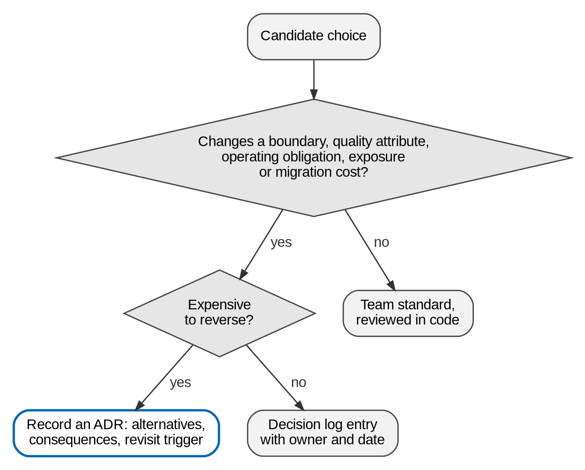
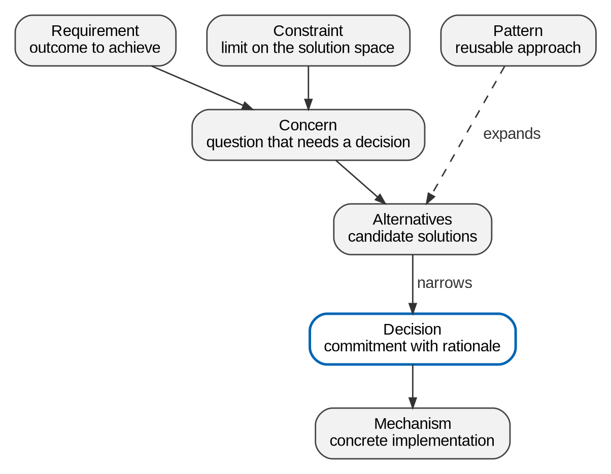
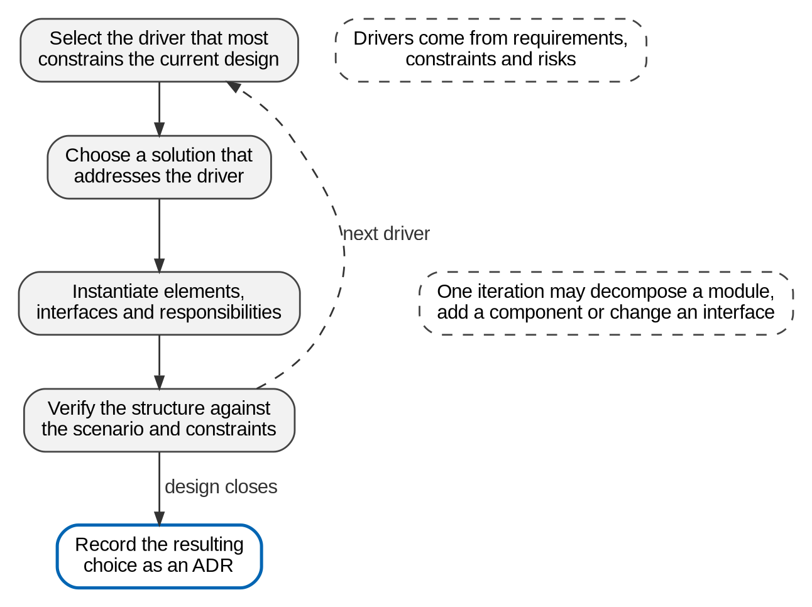
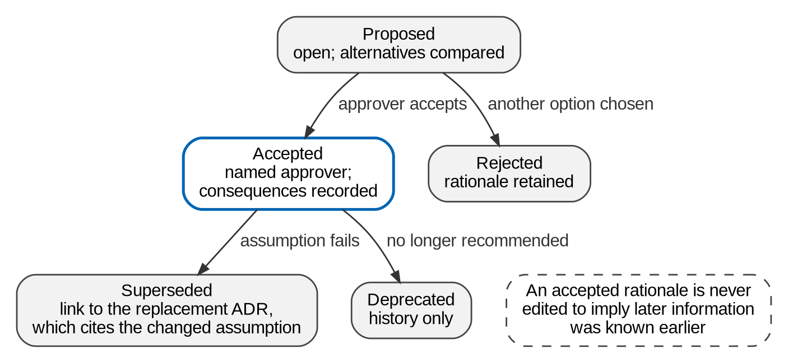
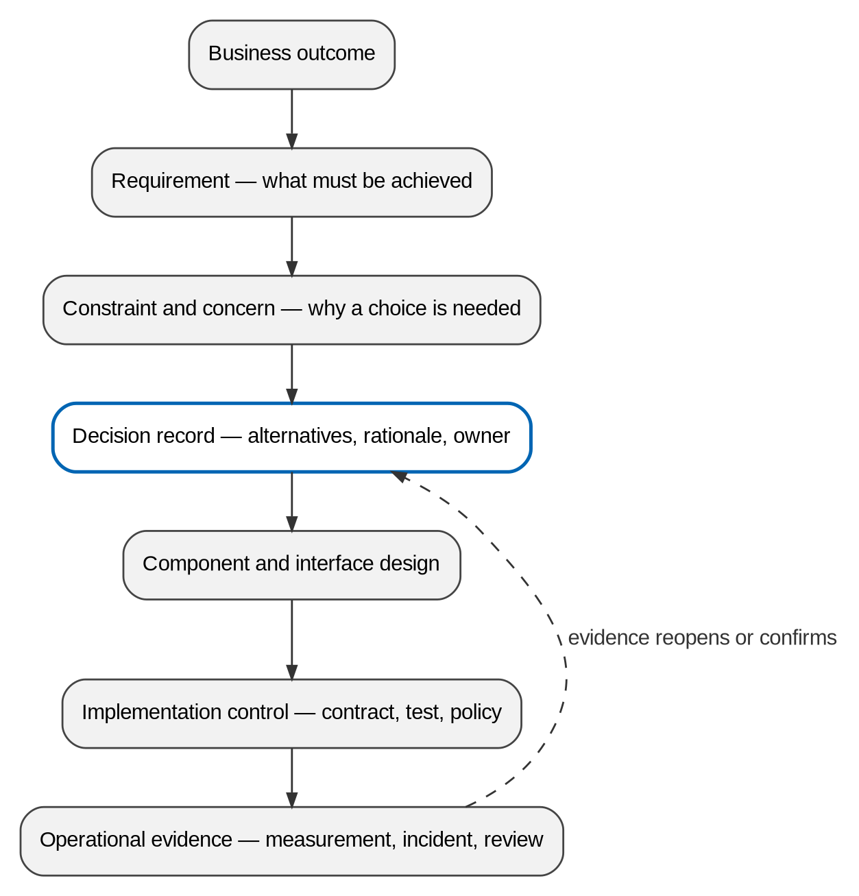

# 3. Architecture Decisions

An architecture decision is a deliberate choice between alternatives that has a significant and lasting effect on a system’s structure, quality attributes, operating obligations or cost. It answers the question: given our requirements and constraints, which approach will we take, and what are we accepting in return?

A decision record preserves the causal link between a requirement and the resulting design. Without it, a future maintainer sees a queue, a module boundary or a regional replica without knowing which constraint made it necessary, and cannot tell an intentional compromise from accidental complexity.

::: {.callout-note appearance="simple" icon=false title="When to Use This Chapter"}
- Deciding whether a choice is architecturally significant enough to record.
- Comparing alternatives against explicit criteria and consequences.
- Writing, reviewing or superseding an Architecture Decision Record.
- Designing a system from quality attributes before deciding on a structure.
:::

::: {.callout-tip appearance="simple" icon=false title="Key Takeaway"}
A decision is durable only when its alternatives, criteria, consequences and revisit trigger travel with it. The ADR is the evidence of that reasoning, not the ceremony around it.
:::

## 3.1 Architectural Significance

**Definition.** Architectural significance is the threshold that decides whether a choice must be explained by the architecture or can be settled inside normal engineering judgment. An **architecturally significant requirement (ASR)** is a requirement that clears this threshold.

**Purpose.** Significance screening sends analysis effort to the choices that constrain everything built afterwards, and protects review capacity for them. A significant decision changes a system boundary, a quality attribute, an operational responsibility, a security exposure or a migration cost. The screen exists so that the decisions that matter arrive at review with attention, evidence and an owner instead of being discovered later inside a pull request.

**What it includes.** Two tests applied together: impact and reversibility. Table 3.1 lists the impact signals and the minimum record each one requires. Reversibility then scales the effort: a library choice may be locally reversible, while data partition keys, public API semantics and tenancy boundaries are expensive to unwind.

| Signal | Question to ask | Minimum record |
| :--- | :--- | :--- |
| Boundary | Does it move data or responsibility between teams or systems? | ADR with ownership and interface consequences |
| Quality attribute | Does it trade latency, availability, consistency, security or cost? | ADR with the scenario and the measured threshold |
| Operating obligation | Does it add runbooks, on-call scope, patching or capacity work? | ADR naming the operating owner and the recurring cost |
| Exposure | Does it change who can reach data or how it is protected? | ADR with the threat considered and the control evidence |
| Migration cost | Would reversing it require data movement, a contract change or a re-platform? | ADR with an exit path and an explicit review trigger |

: Significance signals and the record they require

**Create an ADR** for choices with cross-team impact, a difficult migration path, material security or reliability implications, substantial cost or a contested trade-off. Routine naming, local refactoring and formatting conventions belong in code review or team standards. The threshold is impact, not technology: a small configuration change warrants an ADR if it changes durability, customer data exposure or operational responsibility.

{#fig-3-1 width="100%"}

**Why it is needed.** Without the screen, two failures appear at once: significant choices are made implicitly and cannot be found later, while trivial choices generate records that nobody reads. Evidence that the screen works is a decision log in which each entry names the requirement or risk it serves, together with a review record showing that the remaining choices were deliberately left to team standards.

**Example.** In the reference checkout, raising the default retry count on an internal HTTP client is a team standard: local, reversible and owned by the team that maintains the client. Moving order acceptance from a synchronous payment authorization to an asynchronous workflow with a pending state is significant. It changes a customer-visible state model, adds a reconciliation obligation and is expensive to unwind once downstream systems consume the pending state. The first is reviewed in code; the second needs an ADR before implementation starts.

::: {.callout-warning appearance="simple" icon=false title="Common Pitfall"}
Deciding significance by novelty — recording the unfamiliar technology and skipping the boring decision. The record set then fills with tooling choices while tenancy boundaries, retention rules and data ownership stay undocumented. Those are the decisions that cost the most to reverse. Apply the impact and reversibility tests to the consequence of the choice, not to how interesting it is to make it.
:::

::: {.callout-important appearance="simple" icon=false title="Decision & Trade-off"}
Not every choice needs the same record. Decide the record format before writing it.

| Option | Choose when | Consequences |
| :--- | :--- | :--- |
| ADR | The choice is significant, contested or hard to reverse | Durable rationale and evidence; some authoring overhead |
| RFC then ADR | Broad consultation is needed before commitment | Slower, better stakeholder alignment; the RFC is not the decision |
| Lightweight decision log | The choice is local, reversible and low impact | Low overhead; unsuitable for audit-critical or cross-team decisions |
| Team standard or code review note | The choice is a convention inside one team’s ownership | Fastest; invisible to anyone outside the repository |
:::

## 3.2 Decision Inputs and Vocabulary

**Definition.** The inputs of a decision are the requirements, constraints, concerns, patterns and alternatives it is derived from, and precise vocabulary is what keeps them from being mistaken for the decision itself.

**Purpose.** A shared vocabulary lets a reviewer test whether a decision answers the concern and whether the constraint that shaped it is still valid. Each term fails differently, so weakening one quietly weakens the review; defining them stops an architect from presenting a preference as a requirement or a mandate as a choice.

**What it includes.** The seven terms in Table 3.2 and the distinctions that separate them.

| Term | Meaning | Example |
| :--- | :--- | :--- |
| Requirement | An outcome the system must achieve | 99.9% of valid checkout requests acknowledged within 2 s over 28 days |
| Constraint | An externally imposed limit on the solution space | Workloads must run on the approved cloud platform |
| Concern | A design problem or uncertainty needing a decision | Can order acceptance avoid depending on immediate payment confirmation? |
| Alternative | A candidate solution to the concern | Synchronous authorization; asynchronous workflow with pending state |
| Decision | A commitment to one alternative, with rationale | Asynchronous workflow (ADR) |
| Pattern | A reusable approach to a recurring problem | Transactional outbox, circuit breaker, saga |
| Mechanism | The concrete implementation of a decision | Outbox table, relay process, consumer inbox |

: Decision vocabulary

**Requirements versus decisions.** A requirement states what must be achieved; a decision states how. Deploying redundant instances across zones supports an availability requirement, but it still has to be tested against shared dependencies and failover time.

**Constraints versus decisions.** A contractual mandate to use an approved cloud platform is a constraint; choosing a managed service on that platform is still a decision, compared against containers or virtual machines.

**Patterns versus decisions.** Patterns expand the solution space; decisions narrow it. A pattern describes how a circuit breaker generally protects a caller; an ADR records the actual timeout, open-state behavior, fallback and measurement plan for checkout. Selecting a pattern is not evidence that the implementation satisfies a requirement.

{#fig-3-2 width="100%"}

**Why it is needed.** Conflated terms produce decisions that cannot be audited. A constraint written as a decision looks like a choice, so no alternatives are compared and nobody revisits it when the contractual mandate expires. Evidence is an ADR whose context names the requirement and the constraint separately, and whose title names a decision rather than a product.

**Example.** In the reference checkout, a payment provider contract fixes the constraint: card data must stay in the approved region. The concern is whether order acceptance must wait for payment authorization. The alternatives are synchronous authorization, an asynchronous workflow with a pending state, and a deferred capture. The decision selects the asynchronous workflow; the mechanism is an outbox table, a relay process and a consumer inbox. Only the decision is written as an ADR.

::: {.callout-warning appearance="simple" icon=false title="Common Pitfall"}
Recording a constraint as a decision. The ADR reads “we chose the approved cloud platform”, which compared no alternatives and has no trigger for review. When the contract is renegotiated or the platform’s limits change, nobody knows which decisions were downstream of it. Keep constraints in their own register with source, authority and validity date, and let each ADR cite the constraint it works within.
:::

::: {.callout-important appearance="simple" icon=false title="Decision & Trade-off"}
How to treat a platform mandate set by contract or regulation.

| Option | Choose when | Consequences |
| :--- | :--- | :--- |
| Record the mandate as a constraint; choose the mechanism in an ADR | The mandate is contractual and not negotiable | Alternatives are compared inside the allowed space; the ADR can be revisited if the contract changes |
| Record the mandate itself as the decision | The mandate is genuinely the only option and no design choice remains | Minimal analysis; a non-choice consumes review attention and hides the real decisions below it |
| Escalate the mandate for renegotiation before deciding | The mandated platform cannot meet a required quality attribute at acceptable cost | Slower start; may change the constraint rather than design around it |
:::

## 3.3 Evaluating Alternatives

Evaluating alternatives is the comparison of at least two viable options against criteria derived from the requirements, before anyone commits to one of them.

The subsections move from criteria, through trade-offs and the limits of scoring, to an iterative design method that consumes the result. Each produces material that belongs in an ADR rather than in a separate document.

### 3.3.1 Decision Criteria

**Definition.** Decision criteria are the tests, drawn from requirements and constraints, against which every alternative is judged in the same way.

**Purpose.** Criteria turn a concern into an answerable question and make the comparison reviewable. They come from the requirements, not from a preferred technology: eliminating options that violate mandatory constraints first, then comparing the remainder. Giving each material criterion an owner and, where possible, a measurable threshold is what separates an evaluation from an opinion.

**What it includes.** Typical criteria are functional fit, required consistency and delivery semantics, latency and throughput, failure recovery, security, observability, team skills, operational support, cost and reversibility. Table 3.3 shows what a defensible form of each looks like.

| Criterion | Question the criterion answers | Evidence that settles it |
| :--- | :--- | :--- |
| Functional fit | Does the option deliver the required behavior without workarounds? | Scenario walkthrough against the requirement |
| Delivery semantics | Which duplicates, reordering and loss must the design tolerate? | Contract statement plus a duplicate and replay test |
| Latency and throughput | Does the option meet the threshold at peak load? | Benchmark or load test at the stated percentile |
| Failure recovery | What happens to in-flight work when a dependency fails? | Failure-injection result and recovery time |
| Security and exposure | Who can reach the data, and what protects it? | Threat review and control evidence |
| Operating cost | What recurring effort and spend does the option add? | Runbook effort, on-call load and unit cost estimate |
| Reversibility | How expensive is it to choose differently later? | Migration or exit path, with the work it implies |

: Criteria, the question each answers and the evidence it needs

**Why it is needed.** Without common criteria the comparison collapses into preference, and the alternative that loses is the one whose cost was never written down. Criteria chosen after the favorite option emerges are worse than none, because they look objective. Evidence that criteria were real is a matrix completed before the recommendation, with each threshold traceable to a requirement and each screen stated as a mandatory constraint.

**Example (cloud-specific, Azure).** For point-to-point asynchronous file processing, compare Azure Queue Storage, Azure Service Bus and Azure Event Grid. A simple queue may suffice when workers are idempotent and poison messages are handled; Service Bus adds sessions, topics and dead-lettering at higher cost and configuration effort; Event Grid suits fan-out notifications rather than controlled processing of commands. Equivalent comparisons exist on other platforms. There is no universally best product.

### 3.3.2 Trade-offs

**Definition.** A trade-off is the cost accepted in one characteristic in order to improve another.

**Purpose.** Naming the trade-off tells the reader what was prioritized and what was sacrificed, so that the sacrificed quality becomes a managed risk instead of an unstated assumption. Multi-zone deployment reduces exposure to a single-zone failure but adds cost, replication concerns and operational complexity. Synchronous coordination simplifies immediate consistency at the cost of availability and tail latency; asynchronous coordination improves resilience but adds state-management complexity.

**What it includes.** The characteristic that improves, the characteristic that degrades, the size of each effect and who accepts the loss. A trade-off is specific when it names a scenario, a threshold and an owner: for example, accepting up to two seconds of additional order-visible latency in exchange for surviving a payment-provider outage, accepted by the product owner. Where an option improves everything, the evaluation is incomplete or the options are not really alternatives.

**Why it is needed.** The ADR states what is prioritized, what is sacrificed and why the business accepts it. Omit that sentence and the losing characteristic returns as a surprise during an incident or a capacity review, when the team has forgotten it was a deliberate choice. Evidence that a trade-off was recorded is a consequence section that lists at least one negative outcome with its owner, not a list of benefits.

### 3.3.3 Avoiding False Precision

**Definition.** False precision is the appearance of rigor produced by scores whose weights cannot be defended.

**Purpose.** Weighted scoring matrices are useful for structured discussion but can disguise arbitrary weights behind numbers. A total of 7.4 out of 10 implies a resolution the inputs do not have, and it invites the team to argue about the scale instead of the consequence. The purpose of the evaluation is a defensible recommendation, not a decimal.

**What it includes.** A qualitative matrix that exposes assumptions, a sensitivity check, and a time-boxed spike where uncertainty is material. Ask whether a small change in one weight or one assumption would reverse the recommendation; if it would, the decision rests on that assumption and the assumption needs evidence, not a better score. Where the uncertainty is about behavior — latency, throughput, provider limits — run a spike that tests the highest-risk assumption rather than the easiest happy path.

**Why it is needed.** Numbers that nobody can defend survive longer than the reasoning behind them, and a later reader treats the score as evidence. Evidence that precision is honest is a matrix with qualitative ratings, stated weights, a recorded sensitivity result and a spike report attached for the assumption that decided the outcome.

### 3.3.4 Attribute-Driven Design (ADD)

**Definition.** Attribute-Driven Design (ADD) is an iterative design method that selects the quality attribute which most constrains the current design, chooses a structure that satisfies it and verifies the result before moving to the next driver.

**Purpose.** ADD is a design method, not a decision record or an evaluation. Use it when the design is still open and quality attributes must shape the structure, rather than a structure being chosen first and justified afterwards. It works iteratively: select the architecturally significant requirement that most constrains the current design, choose a design solution that addresses it, verify the resulting structure, and repeat.

**What it includes.** The driver-selection, solution, instantiation and verification cycle in Figure 3.3, applied until the significant drivers are satisfied or the remaining risk is accepted. Each iteration may decompose a module, introduce a component or change an interface. A lightweight cycle can be a whiteboard sequence; it needs no separate document.

{#fig-3-3 width="100%"}

**Why it is needed.** Without a driver-driven loop, structure follows the first diagram drawn or the pattern the team already knows, and the quality attribute arrives as a test failure late in delivery. Record the choices it produces as ADRs, and test the resulting architecture with a scenario-based evaluation (6.2.1). Evidence that the loop ran is a design record in which each structural element traces to a named driver and a scenario it was verified against.

**Example.** In the reference checkout the first driver is that order acceptance must survive a payment-provider outage. The iteration adds a pending order state, an outbox and a reconciliation job; a failure-injection test that stops the provider shows orders accepted, queued and later resolved. The next driver, auditability of settlement, splits the reconciliation job into a matcher and an exception queue. Each iteration produces one ADR, not one per diagram.

**Example.** For the payment decision in 3.6, three designs are compared against Table 3.3 before any score: synchronous authorization in the request, asynchronous authorization through an outbox, and a provider-hosted redirect. The outbox wins on availability and adds reconciliation; synchronous authorization wins on simplicity and loses when the provider is slow; the redirect leaves the failure outside the system but depends on the provider interface. The recommendation names the deciding criterion, not a total score.

::: {.callout-warning appearance="simple" icon=false title="Common Pitfall"}
Treating microservices, or any pattern, as a maturity level. Premature distribution converts code dependencies into network failures, increases operational load and makes consistency harder to reason about, and it is usually justified by a criterion nobody wrote down. Start with a modular monolith or the simplest style that meets the drivers, and split only when an ownership, scaling or deployment boundary justifies the distributed cost — then record that boundary as the decision it is.
:::

::: {.callout-important appearance="simple" icon=false title="Decision & Trade-off"}
Match the depth of the evaluation to the cost of being wrong.

| Option | Choose when | Consequences |
| :--- | :--- | :--- |
| Whiteboard comparison against named criteria | One delivery team, reversible choice, consensus already close | Fast and cheap; weak evidence, easy to rationalize a preferred option |
| Qualitative matrix with a sensitivity check | Cross-team choice with material cost or quality impact | Exposes assumptions and weights; still depends on judgment |
| Time-boxed spike or benchmark | One assumption — latency, throughput, provider behavior — decides the outcome | Real evidence; takes effort and the environment may drift from production |
| Formal scenario-based evaluation (ATAM, 19.3.1) | Long-lived, high-cost architecture with many stakeholders | Broad validation and documented risks; weeks of stakeholder time |
:::

## 3.4 Architecture Decision Records

An Architecture Decision Record (ADR) is a short record of one significant decision that states its context, the alternatives considered, the choice, its consequences and the conditions under which it should be revisited.

An ADR is not meeting minutes and not a statement of product preference. It must explain why an option was chosen and what was intentionally traded away. Appendix A.5 contains a complete example; Appendix B contains a template. Chapter 18 (18.4.6) shows how to record model and platform selection, including evaluation evidence and reassessment triggers, as an ADR.

### 3.4.1 ADR Lifecycle

**Definition.** The ADR lifecycle is the set of explicit states a record moves through, each with a named owner and a visible reason for the transition.

**Purpose.** Explicit states keep history honest. A reader must be able to tell whether a decision is still in force, was rejected after comparison, or was replaced because an assumption failed, and the approval boundary must be visible: before acceptance the record can be edited freely, afterwards it may only be superseded. States also stop an accepted record from being quietly turned into a different decision.

**What it includes.** The transitions in Figure 3.4, the record obligations in Table 3.4, and the five states themselves. An ADR moves through **Proposed** while the decision is open; **Accepted** with a named approver; **Rejected** when an option was considered and not selected, with the rationale retained; **Superseded** when a new ADR replaces it, with a link explaining which assumption changed; **Deprecated** when no longer recommended but kept for history. For example, ADR-017 might later supersede ADR-001 with a broker supporting subscriptions when several independent consumers become mandatory. Both remain discoverable, and ADR-017 describes migration sequencing, contract compatibility and operational ownership.

| State | Transition into the state | What the record must carry |
| :--- | :--- | :--- |
| Proposed | An owner opens the record | Owner, the alternatives under comparison and the date the decision is needed |
| Accepted | A named approver commits to one alternative | Approver, date, consequences and review trigger |
| Rejected | A compared option is not selected | The rationale for rejection, kept with the record |
| Superseded | A later ADR replaces this one | A link to the replacement and the assumption that changed |
| Deprecated | The team stops recommending the decision | The reason it is retained and what replaced it, if anything |

: ADR states and what each one must record

The lifecycle in Figure 3.4 makes those states operational: a record moves from proposed to accepted, rejected or superseded, and each transition preserves the earlier rationale.

{#fig-3-4 width="100%"}

**Why it is needed.** Without states, an accepted record and an abandoned idea look identical, and a reader implements a decision the team has already reversed. Never edit the rationale of an accepted ADR to suggest the team anticipated later information: the value of the record is that it shows what was known when the choice was made. Evidence that the lifecycle is maintained is a superseded ADR linked in both directions, with the triggering assumption and its date visible in the replacement.

### 3.4.2 Anatomy of a Usable Record

**Definition.** The anatomy of a usable record is the small set of sections that lets a reader who was not in the room reconstruct the choice and act on it.

**Purpose.** A record that cannot answer “what would make us change this?” becomes archaeology. The fields below keep the ADR short enough to write and complete enough to audit, and they map directly onto the review checklist at the end of the chapter.

**What it includes.** A useful ADR contains:

- Identifier, title, status, date and decision owner.
- Context and decision drivers, including what was unknown at the time.
- Alternatives considered and evaluation criteria.
- The decision and its rationale.
- Positive and negative consequences, including new obligations.
- Links to requirements, interfaces and tests.
- Acceptance evidence and review triggers.

**Why it is needed.** Each missing section removes a question a reviewer would otherwise have to ask. Without drivers the decision looks arbitrary; without alternatives it looks inevitable; without consequences the obligations are discovered during operation; without a trigger nothing reopens it. Evidence that the anatomy is respected is a record a new team member can read in five minutes and then find the test or measurement that supports it.

**Example.** ADR-001 records that incoming files must be processed asynchronously without losing acknowledged work. The team selects a simple point-to-point queue because the workload is point-to-point and the simpler operational model is sufficient; a publish-subscribe broker with independent subscriptions and synchronous request/response processing were rejected. Consequences: consumers must tolerate duplicate delivery and transient failure. Acceptance: restart a worker mid-processing, replay a message and verify that only one business effect is committed. Idempotency is therefore an explicit implementation obligation linked to the interface contract and recovery tests.

::: {.callout-warning appearance="simple" icon=false title="Common Pitfall"}
An ADR that reads like meeting minutes: attendees, discussion and a conclusion, with no alternatives, no consequences and no trigger. A year later the team cannot tell whether the chosen queue was the only option or the cheapest one, so it is neither defended nor revisited. Write the five answers — driver, alternatives, decision, consequences, trigger — and keep the discussion out of the record.
:::

::: {.callout-important appearance="simple" icon=false title="Decision & Trade-off"}
When an accepted decision stops holding, choose how to change the record.

| Option | Choose when | Consequences |
| :--- | :--- | :--- |
| Supersede with a new ADR | An assumption has changed and downstream systems depend on the old rationale | Clean history and a discoverable chain; two records to read |
| Add an addendum to the accepted ADR | The decision stands and only its scope or a local exception changes | Lightweight; the original rationale stays intact |
| Amend while the record is still Proposed | No one has implemented the decision yet | No history cost; invalid once the record is accepted |
| Deprecate without a replacement | The capability is retired and the concern will not return | Least effort; leaves a gap if the concern returns |
:::

## 3.5 Decision Process and Traceability

**Definition.** The decision process is the repeatable sequence from a named concern to recorded, implemented and measured evidence, and traceability is the set of links that sequence leaves behind.

**Purpose.** A repeatable process makes decisions comparable across teams and reviewable by someone who was not present, and traceability answers three questions: why a component exists, what would break if it changed and which evidence supports the original choice. It pays for itself only when every link lives in an artifact that is already maintained for another reason; a second register kept by hand is a cost with no reader.

**What it includes.** Seven steps, applied in order:

::: {.rc2-list-group}
1. Identify the architecture concern.
2. Extract the relevant functional requirements, quality scenarios, constraints and risks.
3. Develop at least two viable alternatives.
4. Evaluate them against the same criteria, testing high-risk assumptions.
5. Record the decision and consequences in an ADR with an owner.
6. Implement the related controls and contracts.
7. Review operational evidence; reopen the decision when an assumption fails.
:::

The chain those steps leave behind is listed in Table 3.5 and shown in Figure 3.5. Each link has a home in an artifact, which is what keeps traceability from becoming a separate document that nobody maintains.

| Link | Carrying artifact | Question it answers |
| :--- | :--- | :--- |
| Outcome → requirement | Requirement with a stable identifier | Which business outcome does this serve? |
| Requirement and constraint → concern | Decision driver section of the ADR | Why is a choice needed at all? |
| Concern → alternatives | Alternatives and criteria section of the ADR | What else was credible, and why did it lose? |
| Decision → structure | Component and interface design, module contract | Where is the decision realized? |
| Structure → control | Test, policy check, schema or contract rule | What stops the decision from eroding? |
| Control → evidence | Metric, incident record or review note | Is the decision still right? |

: Traceability links and the artifact that carries them

Figure 3.5 follows the links end to end, from outcome through decision and test to operational evidence, so a missing link is visible as a break in the chain.

{#fig-3-5 width="100%"}

**Why it is needed.** Without the sequence, decisions are made in a different order on every team: someone proposes a solution before the concern is stated, and the criteria are reverse-engineered to fit. Without the links, a review can only ask whether the design looks reasonable, not whether it follows from a requirement. The quality of a decision is judged by whether it was justified by the evidence available, transparent about uncertainty and designed to be revisited — not by whether it later proves universally optimal. Evidence that the process is working is an ADR whose identifiers appear in the interface document and in the test name that proves the consequences.

**Example.** In the file-settlement case, the ICD defines message identity and retry semantics, the LLD defines consumer idempotency, and a crash-recovery test proves that acknowledged files are processed without duplicated financial effects. A settlement batch fails at 02:00 and the on-call engineer needs to know whether to replay it. The chain answers in minutes: the requirement identifier leads to ADR-001, which accepts duplicate delivery, and to the crash-recovery test that proves only one business effect is committed, so replay is safe. Without the chain the engineer would replay blindly or escalate, and the incident would set the precedent.

::: {.callout-warning appearance="simple" icon=false title="Common Pitfall"}
Keeping traceability in a spreadsheet that a project manager updates by hand. The links rot within a release, the review cites identifiers that no longer exist, and the architecture appears unsupported even where the reasoning was sound. Trace only what a review or an incident actually needs, and carry the identifiers in the artifacts themselves — the ADR, the interface document, the test name — so the links move when the work moves.
:::

::: {.callout-important appearance="simple" icon=false title="Decision & Trade-off"}
Decide how much traceability to maintain before the first review asks for it.

| Option | Choose when | Consequences |
| :--- | :--- | :--- |
| ADR references only: requirement and interface | One team, few external obligations, short-lived system | Low cost; gaps appear as soon as an interface changes hands |
| Full chain per significant decision | Regulated or multi-team system with audit and incident obligations | Auditable and fast to diagnose; maintenance effort grows with every decision |
| Automated links from code, tests and contracts | The toolchain can carry ADR identifiers in commits, test names and schemas | Cheap to keep current; depends on naming discipline that reviewers must enforce |
:::

## 3.6 Worked Example: Modular Monolith before Microservices

*In practice:* This example compares alternatives against explicit criteria and records a decision that preserves the option to distribute later.

A new commerce product has one delivery team, tightly coupled transactions and domain boundaries that are still emerging. The team compares a conventional monolith, a modular monolith with enforced module APIs, and independently deployed services across deployment independence, data consistency, ownership, observability, operational cost and latency.

The modular monolith is chosen: it preserves local transactions and low operational overhead while enforcing domain separation. Microservices would add network failures, distributed tracing and eventual consistency without a current benefit. The ADR defines **extraction triggers** — independently scaling workloads, divergent release cadences, regulatory isolation or ownership by separate teams — and a six-month review date. A dependency test prevents modules from reading each other’s tables.

**Evidence.** Module dependency test results, deployment lead-time trend and transaction behavior tests.

::: {.callout-note .review appearance="minimal" icon=false title="Architecture Review Checklist — Decisions"}

☐  Can the reviewer name the requirement or risk that motivated the decision?

☐  Were at least two credible alternatives evaluated against the same criteria?

☐  Are consequences, owner, status and review triggers recorded?

☐  Is the evidence (spike, test, measurement) attached rather than asserted?
:::

## 3.7 Further Reading

- Nygard (2011), “Documenting Architecture Decisions” — the original lightweight ADR format.
- Ford, Richards, Sadalage and Dehghani (2021), *Software Architecture: The Hard Parts* — trade-off analysis in distributed systems.
- Keeling (2017), *Design It\!* — decision-making activities and design studios.
- Cervantes and Kazman (2016), *Designing Software Architectures: A Practical Approach* — Attribute-Driven Design 3.0, iterative attribute-driven decomposition.
