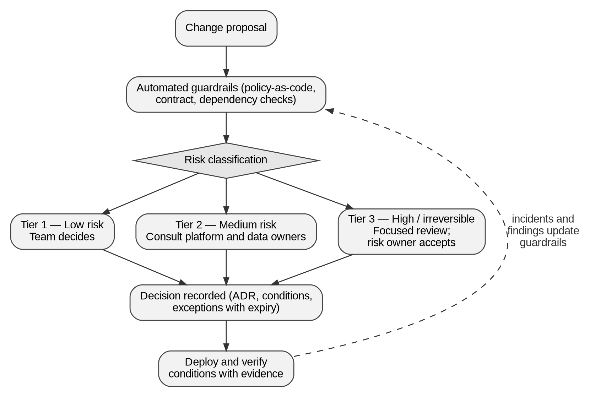
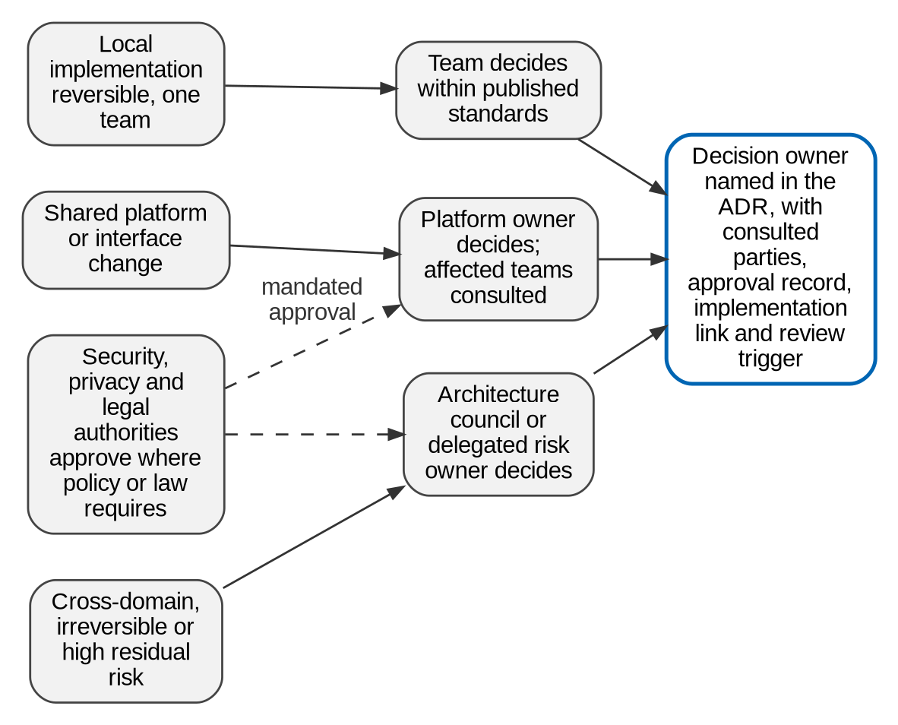
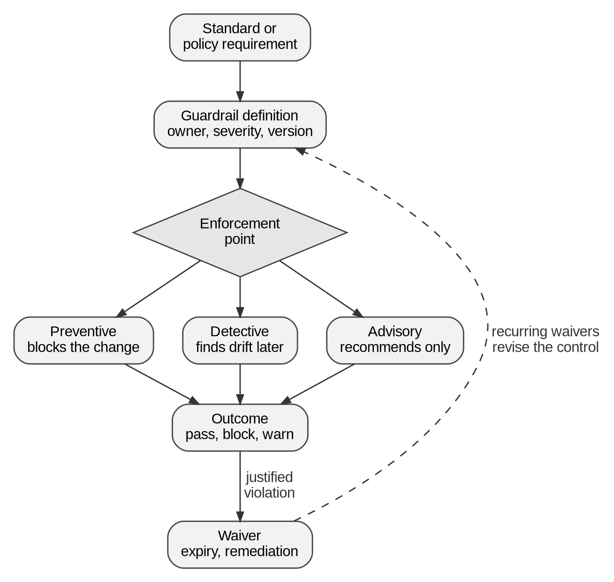
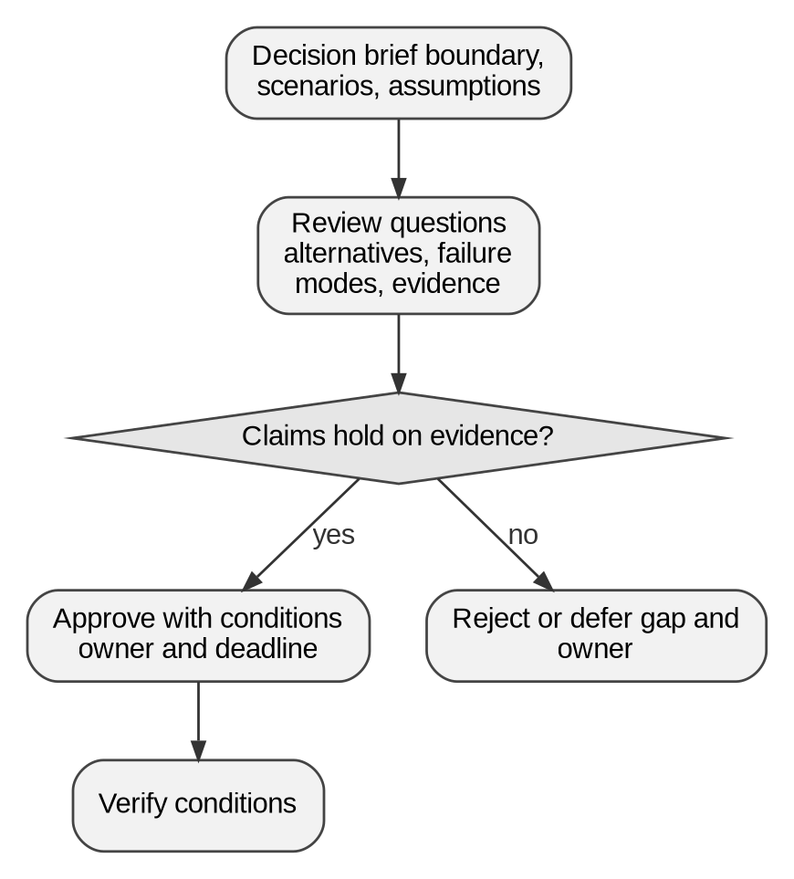
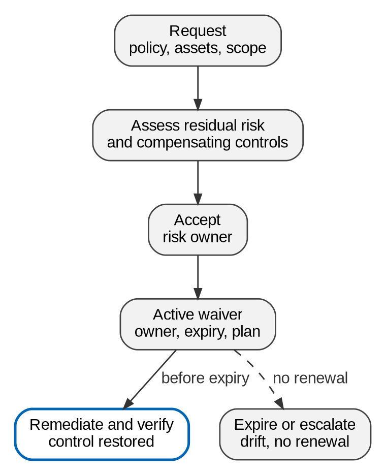
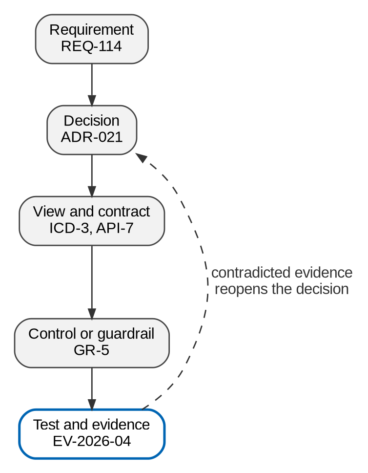
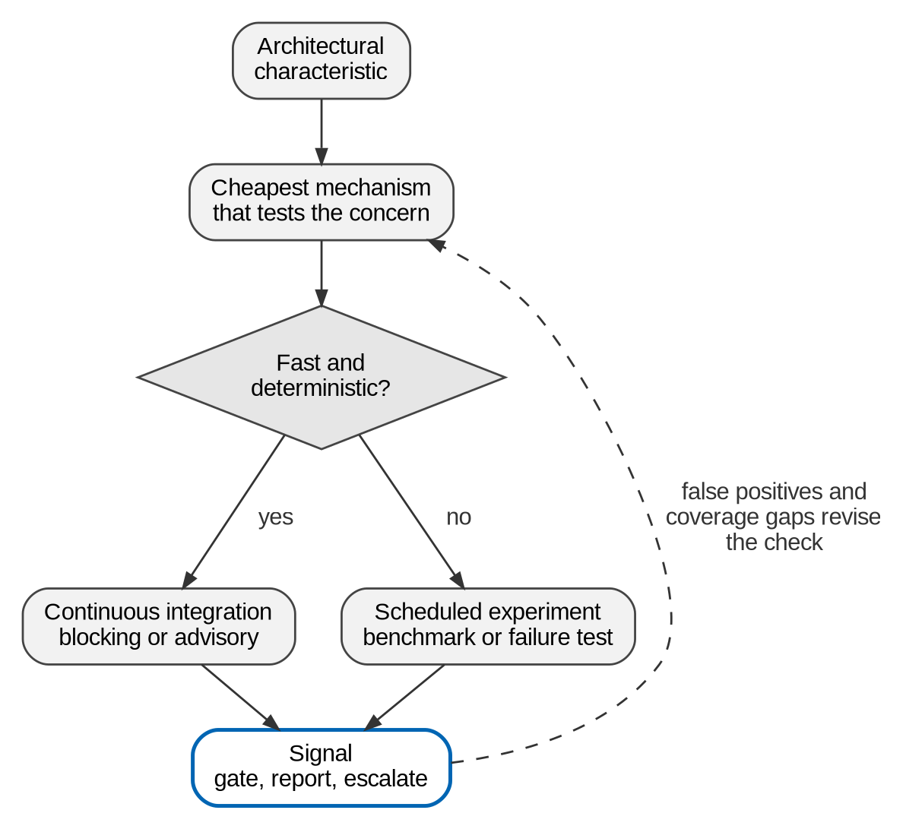
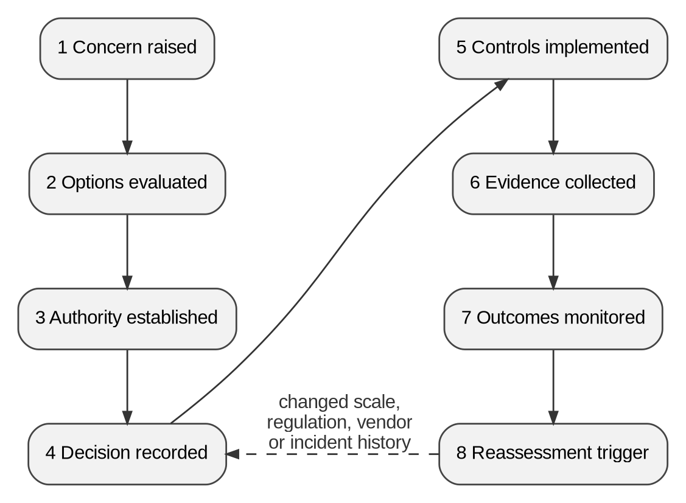
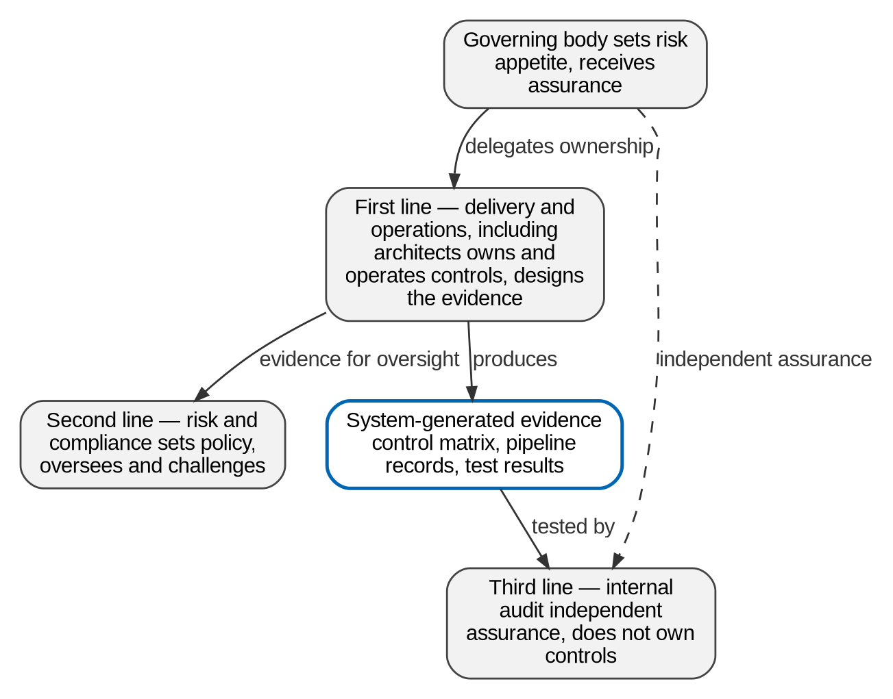
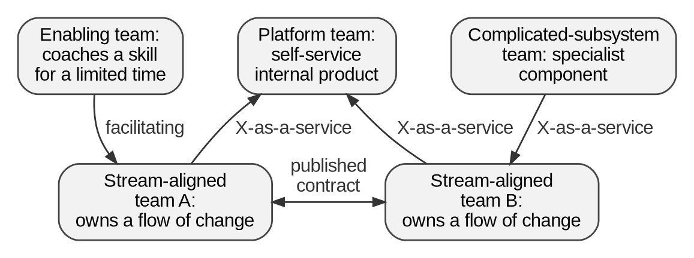

# 4. Architecture Governance

Architecture governance is a system of decision rights, guardrails and feedback — not a committee that approves every change. Teams own routine decisions within published guardrails; high-risk changes, such as public exposure of sensitive data, a new cross-domain dependency or a material resilience exception, trigger a proportionate review. This preserves delivery speed while keeping systemic risk visible.

Automated checks enforce repeatable rules such as encryption settings, approved infrastructure patterns, dependency policies and contract compatibility. Human review concentrates on business trade-offs, domain boundaries, irreversible commitments and risks that automation cannot evaluate.

::: {.callout-note appearance="simple" icon=false title="When to Use This Chapter"}
- Designing decision rights, review tiers and automated guardrails for a solution or delivery organization.
- Preparing for an audit, customer assurance review or regulatory evidence request.
- Handling an exception, a cross-domain conflict or a material residual risk.
- Measuring whether governance is improving decisions rather than adding ceremony.
- Aligning team boundaries, interaction modes and cognitive load with the architecture.
:::

::: {.callout-tip appearance="simple" icon=false title="Key Takeaway"}
Governance is a feedback system that allocates decision rights and produces evidence. If it slows every change without improving risk decisions, or produces no evidence, it is not governing.
:::

## 4.1 Governance Operating Model

An effective model allocates authority according to the scope and reversibility of a change. Product teams decide local implementation within standards; platform owners govern shared runtime capabilities; data and security owners advise on or approve changes affecting enterprise assets; a small architecture council resolves cross-domain conflicts and accepts exceptional residual risk. The model publishes decision classes, accountable roles, escalation triggers and maximum review times.

{#fig-4-1 width="100%"}

Chapter 18 (18.5.6) applies this operating model to AI systems, covering model supply chain, human oversight and high-impact actions.

### 4.1.1 Governance Taxonomy and Translation Chain

**Definition.** Obligations, rules and evidence use overlapping words, and a governance model works only when each class has a defined authority and a visible path into architecture.

**Purpose.** The taxonomy tells an architect which class a statement belongs to, so the right owner interprets it and the right evidence proves it. Chapter 1 owns requirements and constraints, Chapter 2 owns principles, policies, standards and guidelines, and this section covers the remaining classes.

**What it includes.** Twelve classes, each with a typical owner and the evidence it leaves behind.

| Class | What it is | Typical owner and evidence |
| :--- | :--- | :--- |
| Law or regulation | Legally binding instrument with a jurisdiction and effective date | Compliance/legal owner; applicability assessment and evidence |
| Contractual obligation | Binding commitment to a customer, supplier or partner | Contract owner; clause reference, control mapping and attestation |
| Industry standard | Consensus or normative specification, not law by itself | Standard owner; applicability statement and conformance evidence |
| Framework | Structured guidance for organizing work; not automatically binding | Architecture/practice owner; tailoring rationale and outputs |
| Guideline | Recommended practice that may be overridden with a reason | Practice owner; recorded exception and rationale |
| Organizational policy | Internally binding rule approved by the organization | Policy owner; policy reference, control and compliance evidence |
| Internal technical standard | Approved internal pattern, platform or technology rule | Platform/architecture owner; standard version, lint/policy result |
| Procedure | Step-by-step instruction for performing an activity | Process owner; procedure version and execution record |
| Control | Safeguard that prevents, detects or corrects risk | Control owner; control description, test result and evidence |
| Architecture guardrail | Constraint or automated check applied to design decisions | Architecture/platform owner; policy-as-code or review record |
| Exception | Time-bound approval to deviate from a rule or guardrail | Risk owner; scope, compensating control, expiry and remediation |
| Evidence and assurance | Artifact proving a control or obligation was met | Evidence owner; source, period, integrity and retention |

: Governance classes, owners and evidence

Together they form a translation chain. A law, regulation or contract becomes an architectural requirement only after its owner interprets its applicability (Chapter 1, 1.4). The requirement drives a choice recorded as an ADR (Chapter 3), which selects controls and guardrails (4.3); those controls produce verification evidence (4.9), and a justified deviation becomes an exception (4.5). A principle (Chapter 2, 2.1) guides decisions but creates no legal obligation and proves no compliance.

**Why it is needed.** Conflating the classes lets a team cite a principle as if it were a regulation, or claim compliance from a framework that was never tailored. Keep the chain traceable by identifier — requirement → ADR → control or guardrail → test or evidence → exception. A class with no owner or no evidence is a statement of intent rather than governance.

### 4.1.2 Security Program Governance

**Definition.** Architecture governance operates inside a security program, and neither substitutes for the other.

**Purpose.** Name the accountable security leader and the body that sets security policy, then publish the hierarchy from policy to standard to procedure so teams know which document governs a decision. State the organization's risk appetite and who may accept residual risk, because an architecture review that cannot route risk to an accountable owner becomes an advisory opinion.

**What it includes.** Decide how security authority is distributed. A central model gives consistent policy and evidence but can bottleneck delivery; a federated model gives domain teams context but risks divergent interpretation. Most organizations combine a small central policy and assurance function with embedded security architects who advise product teams. Define the interfaces with architecture review (4.4), risk acceptance (4.5), audit (4.9) and supplier assurance (13.8), and record security decisions in the same ADR and exception systems as other architecture decisions.

**Why it is needed.** Without a named authority, security exceptions accumulate as informal team decisions that nobody can evidence. Review the program at the interval set by contract, regulation or risk assessment, and use incidents, audit findings and control failures as inputs. The output is not a policy library but evidence that responsibilities are assigned, decisions are routed and exceptions are visible.

**Evidence.** a security program charter and policy register; a RACI for security roles; a risk-appetite and acceptance statement; the security review route for architecture decisions; and a dated program review record.

**Example.** A stateless internal endpoint using approved identity, logging and network controls proceeds after automated checks. A proposal to replicate customer records across jurisdictions must demonstrate lawful processing, residency boundaries, key management, deletion behavior and operational ownership before approval. Test the model by sampling shipped changes and confirming that each followed the review route its risk tier required.

::: {.callout-warning appearance="simple" icon=false title="Common Pitfall"}
Publishing a governance model that names forums but not decisions. Teams cannot tell whether a change needs review, so they escalate everything to be safe, the council becomes a queue, and real risk competes with routine work for attention. Publish decision classes with accountable roles and maximum review times, then sample shipped changes to confirm routing.
:::

::: {.callout-important appearance="simple" icon=false title="Decision & Trade-off"}
Choose how authority is distributed before deciding who sits on the council.

| Option | Choose when | Consequences |
| :--- | :--- | :--- |
| Central architecture board | The organization is small, regulated or early in its governance maturity | Consistent decisions and evidence; the board becomes the bottleneck as delivery scales |
| Federated domain authority | Domains have mature engineering leadership and clear boundaries | Fast local decisions; divergent interpretation unless standards and sampling are strong |
| Tiered model with published classes | Delivery speed and systemic risk both matter and risk tiers can be defined | Proportionate review with visible escalation; decision classes and tier calibration need maintenance |
:::

## 4.2 Decision Rights and Accountability

**Definition.** Decision rights define who may decide a class of architecture question, who must be consulted and who is accountable for the outcome.

**Purpose.** An ADR explains a choice; it does not confer the right to approve it. Settle the proposer, the accountable owner, the consulted specialists and the implementing team before analysis begins, particularly when the decision crosses organizational boundaries, so that a late veto cannot invalidate work already built.

**What it includes.** The roles above, mapped to decision classes, with the record each decision leaves. Security, privacy and risk authorities keep the approvals mandated by policy or law.

{#fig-4-2 width="100%"}

The table names the accountable role, the parties consulted and the record each class of decision leaves; a class with no accountable role is a gap in the operating model.

| Decision class | Accountable role | Consulted | Minimum record |
| :--- | :--- | :--- | :--- |
| Local, reversible implementation choice | Delivery team lead | Peers as needed | Ticket or code review |
| Shared platform or interface change | Platform owner | Affected teams and operations | ADR and contract note |
| Cross-domain or irreversible commitment | Architecture council or delegated risk owner | Security, data, operations and finance as relevant | ADR with options and residual risk |
| Regulated or high-impact processing | Business or risk owner accountable under policy | Legal, privacy and security | ADR, control mapping and approval record |

: Decision classes and accountable roles

**Why it is needed.** Unclear rights produce two failures: decisions nobody owns, which drift until an incident assigns them, and decisions taken twice, because a reviewer reopens a choice the accountable owner had already settled. A governance audit should find, for each sampled high-impact ADR, the decision owner, consulted parties, approval or exception record, implementation link and review trigger.

**Example.** In a payment integration, the product owner prioritizes customer outcomes, the integration owner selects protocol and retry strategy, and the security authority can reject a design that mishandles credentials. Each role acts within its class, and the ADR names which one decided.

::: {.callout-warning appearance="simple" icon=false title="Common Pitfall"}
Deciding by consensus because no owner was named. Consensus feels safe until the trade-off has to be defended: then nobody can explain the choice, or reverse it when conditions change. Name one accountable owner per decision class in advance, consult explicitly, and record dissent in the ADR rather than resolving it silently.
:::

::: {.callout-important appearance="simple" icon=false title="Decision & Trade-off"}
Choose how accountability attaches to each decision class.

| Option | Choose when | Consequences |
| :--- | :--- | :--- |
| Single accountable owner | One role can weigh the trade-offs and carries the consequence | Clear accountability and fast closure; blind spots when consultation is skipped |
| Consensus among stakeholders | The decision needs shared commitment and no single role holds the trade-off | Broad buy-in; slow, and accountability blurs when consensus fails |
| Delegated authority with escalation triggers | Most decisions are routine and exception conditions can be defined in advance | Speed with a safety valve; stale triggers misroute risk |
:::

## 4.3 Standards and Guardrails

**Definition.** A standard states required or preferred technical behavior; a guardrail is the repeatable, usually automated, control that makes the standard observable in everyday delivery.

**Purpose.** Guardrails turn intent into a check that runs before or shortly after a change, so compliance does not depend on someone remembering a document. They carry the rules that are too mechanical for review and too important to leave to convention.

**What it includes.** Three enforcement styles, one for each moment at which risk can be caught, plus the metadata that keeps a control maintainable.

{#fig-4-3 width="100%"}

The table separates preventive, detective and advisory controls by the question each answers, the mechanism it uses and the way it fails.

| Control type | Question it answers | Typical mechanism | Failure mode |
| :--- | :--- | :--- | :--- |
| Preventive | Can this change exist at all? | Policy-as-code, admission check, approved template | Blocks legitimate work when the rule is blunt |
| Detective | What already exists outside the rule? | Configuration scan, inventory reconciliation | Finds drift days later, after exposure |
| Advisory | Which design is preferred? | Lint warning, review comment, scorecard | Ignored under delivery pressure |

: Guardrail types and their failure modes

Every control also needs an owner, rationale, severity, version and exception process. Publish the test fixture that proves the guardrail catches a violation, measure how often it blocks legitimate work, and define how a time-limited waiver is represented in the pipeline (4.5).

**Why it is needed.** An untested guardrail fails silently: it passes everything, including the change it exists to stop, while the team believes it is covered. A passing configuration scan is not proof that the system is secure — it is evidence about one rule, not about the property. Review false-block rates too, because a gate that stops legitimate work is eventually bypassed rather than fixed.

**Example.** A deployment that would expose an unencrypted public data store is stopped by policy-as-code before it reaches the environment. Days later, a detective control finds a resource created outside infrastructure as code. Neither check proves the system is secure; together they show the rule is enforced and drift is visible.

::: {.callout-warning appearance="simple" icon=false title="Common Pitfall"}
Shipping a guardrail without a violation fixture. The check passes in every pipeline run, so nobody notices that its rule is misconfigured, and the first real violation reaches production. Keep a deliberately failing fixture in the test suite, alert on the guardrail's own error rate, and review blocked legitimate changes as defects in the rule.
:::

::: {.callout-important appearance="simple" icon=false title="Decision & Trade-off"}
Choose how hard a guardrail should push back.

| Option | Choose when | Consequences |
| :--- | :--- | :--- |
| Blocking gate | The rule is deterministic, the evidence is reliable and the risk is material | Consistent enforcement; false positives stop delivery until the rule is fixed |
| Advisory warning | Context matters or the practice is still being adopted | Low friction; easily ignored and produces no assurance |
| Scheduled drift audit | Violations appear after deployment and cannot be blocked cheaply | Finds real drift; detection lags exposure |
:::

## 4.4 Architecture Review and Assurance

**Definition.** Architecture review is a risk-focused examination of whether a design can satisfy its requirements and whether the evidence supports the claims made for it.

**Purpose.** Review concentrates human judgment where automation cannot: business trade-offs, domain boundaries, irreversible commitments and novel risk. It happens before expensive commitments and again when evidence is available, so that approval reflects measured behavior rather than intent.

**What it includes.** Reviewers establish the change boundary, stakeholders, quality scenarios and assumptions, then inspect alternatives, failure modes, ownership and verification evidence. A diagram explains a design; measured latency, a restore exercise or a contract test substantiates it. Give reviewers a short decision brief and the relevant views rather than a duplicate of a long HLD.

{#fig-4-4 width="100%"}

Review is only as strong as the evidence it accepts, and the table contrasts the claims reviewers hear with the evidence that survives scrutiny.

| Claim | Weak evidence | Evidence that survives review |
| :--- | :--- | :--- |
| "It will scale" | Capacity diagram, vendor benchmark | Load test at target volume with bottleneck analysis |
| "It is resilient" | Redundancy diagram | Restore and failover exercise with measured RTO and RPO |
| "It is compatible" | Interface document | Contract test run against the consuming service |
| "It is secure" | Configuration screenshot | Threat model plus a control test and a current scan |
| "It is owned" | Organization chart | Named owner in the runbook and escalation path |

: Claims and the evidence that substantiates them

**Why it is needed.** Approval without follow-up verification is not assurance. Record unresolved questions as conditions with owners and deadlines, then verify them after deployment; a condition nobody closes is an accepted risk with no acceptor. Architecture review approves a design; it does not authorize individual production changes, which is release-time change approval (15.4).

**Example.** For an asynchronous payment workflow, reviewers ask for the state-transition model, duplicate-delivery tests, timeout behavior, reconciliation ownership and incident response evidence. The design may be sound on the diagram; the review is only complete when the tests and the ownership record exist.

::: {.callout-warning appearance="simple" icon=false title="Common Pitfall"}
Reviewing every change or approving none. Excessive ceremony encourages undocumented decisions and late discovery; a rubber stamp provides no assurance. Risk-tier the review, automate the repeatable checks, and reserve human review for trade-offs, irreversibility and evidence that automation cannot evaluate.
:::

::: {.callout-important appearance="simple" icon=false title="Decision & Trade-off"}
Choose the lightest review mechanism that controls the risk of the change.

| Option | Choose when | Consequences |
| :--- | :--- | :--- |
| Automated guardrail | The rule is repeatable and its evidence is machine-checkable | Fast and consistent; blind to context and novel risk |
| Peer or architecture review | Trade-offs, boundaries or irreversible commitments need judgment | Better risk handling; reviewer load and lead time |
| Architecture council or exception | The decision crosses domains or accepts material residual risk | Accountable resolution; slower and more formal |
:::

## 4.5 Exceptions and Risk Acceptance

**Definition.** An exception is an authorized deviation from a control for a bounded scope and period, accepted by the role that policy names.

**Purpose.** Exceptions let delivery continue when a control cannot be met yet without pretending the risk has disappeared. They convert an informal workaround into a recorded, owned and time-bound decision that operations and audit can see.

**What it includes.** A record with the fields below, and a lifecycle that ends in remediation or escalation.

{#fig-4-5 width="100%"}

The table lists the fields an exception record must carry and why each one matters when the waiver is reviewed or expires.

| Field | What it records | Why it matters |
| :--- | :--- | :--- |
| Policy and control | The rule and control being deviated from | Makes the deviation auditable and comparable |
| Scope and assets | Systems, data and environments affected | Bounds the risk and the blast radius |
| Reason | Why the control cannot be met now | Separates a trade-off from neglect |
| Compensating controls | What reduces the risk in the meantime | Keeps residual risk tolerable rather than hidden |
| Residual risk and acceptor | Remaining risk and the role that accepts it | Places accountability with a named authority |
| Expiry and remediation | Deadline and the milestone that removes the need | Prevents a waiver from becoming permanent |

: Exception record fields

The pipeline should recognize the waiver and treat it as expired unless it is renewed after reassessment.

**Why it is needed.** An exception without an owner or expiry is uncontrolled drift: it survives reorganizations, outlives the system it was written for, and is discovered by an auditor rather than by the risk owner. Architects advise on risk; only the role delegated by policy can accept it. Prefer the narrowest scope and a compensating control that reduces exposure rather than merely documenting it.

**Example.** Suppose a partner cannot yet support mutual TLS. A temporary exception might restrict traffic to a private connection, add message-level signing and enhanced monitoring, and require migration by a fixed date. The waiver is valid only while those compensating controls are evidenced and the expiry is enforced.

::: {.callout-warning appearance="simple" icon=false title="Common Pitfall"}
Renewing the same waiver each quarter without remediating it. The register looks tidy, so the residual risk appears managed, while the underlying gap persists indefinitely. Require a remediation milestone with every renewal, report waivers that reach a second term, and escalate them to the risk acceptor instead of renewing automatically.
:::

::: {.callout-important appearance="simple" icon=false title="Decision & Trade-off"}
Choose the response when a control cannot be met.

| Option | Choose when | Consequences |
| :--- | :--- | :--- |
| Deny and require redesign | The control is mandatory and no compensating control reduces the risk | Strongest position; may block a viable partner or delay a launch |
| Time-boxed exception with compensating controls | The gap is temporary and the residual risk is understood | Delivery continues with visible risk; needs active expiry and remediation |
| Change the policy | The rule no longer matches the risk or the technology | Removes recurring waivers; requires a governed policy change, not a local override |
:::

## 4.6 Architecture Repository and Traceability

**Definition.** An architecture repository is the linked record of why a system exists, who owns it, which interfaces it exposes and which evidence supports its important decisions.

**Purpose.** It lets an engineer answer those questions without reconstructing history from chat, and it lets a reviewer or auditor follow one obligation to the artifact that satisfies it.

**What it includes.** Requirements, ADRs, views, contracts, controls, tests and runbooks linked by stable identifiers, stored near the systems they describe and assigned an update owner.

{#fig-4-6 width="100%"}

The table gives the minimum metadata for each object; anything that cannot fill it is not yet a repository entry.

| Object | Minimum metadata | Review trigger |
| :--- | :--- | :--- |
| Requirement | Stable ID, source, owner | Source changes or is reinterpreted |
| Decision (ADR) | ID, status, decision owner, date | Assumption contradicted or context changes |
| View or model | ID, version, scope | System boundary or interface changes |
| Contract | Version, consumer, compatibility rule | Breaking change proposed |
| Control or guardrail | Owner, severity, test fixture | Recurring false positive or violation |
| Test and evidence | Run date, period covered, result | Scheduled re-run or failed check |

: Repository objects and their minimum metadata

**Why it is needed.** A repository without links is a document store: searchable, rarely read and impossible to audit. A periodic sample audit finds broken links and stale owners before an auditor does, and an evidence artifact that contradicts its decision reopens the decision rather than sitting quietly beside it. Chapter 7 describes the artifact chain in full.

**Example.** A payment idempotency requirement links to an ADR choosing the key strategy, the API contract that defines the key, the uniqueness constraint in the data model and a test that replays a request. Following those four links answers why the constraint exists and what would break if it were removed.

::: {.callout-warning appearance="simple" icon=false title="Common Pitfall"}
Storing documents in team folders with no identifiers. Traceability then depends on someone's memory, and an auditor's question becomes a search across drives. Give every object a stable ID and an owner at creation, link it in the same change that creates it, and sample the links periodically rather than at audit time.
:::

::: {.callout-important appearance="simple" icon=false title="Decision & Trade-off"}
Choose how much repository tooling the organization can sustain.

| Option | Choose when | Consequences |
| :--- | :--- | :--- |
| Documents beside the code | The team owns a small system and reads the repository directly | Low tooling cost; cross-system questions are hard to answer |
| Central registry with stable IDs | Several teams must trace obligations across systems | Queryable and auditable; needs curation or it decays |
| Graph or CMDB tooling | Dependencies and ownership change often and are queried at scale | Automated links and impact analysis; integration and data-quality cost |
:::

## 4.7 Architecture Fitness Functions

**Definition.** A fitness function is a repeatable, preferably automated, check of an architectural characteristic.

**Purpose.** It turns an architectural intention — module boundaries, compatibility, latency, recovery — into a signal that runs on a schedule instead of an opinion expressed in a review. The signal tells the team when a design property is degrading, before users do.

**What it includes.** The cheapest mechanism that tests the actual concern: fast deterministic checks in continuous integration, and expensive failure experiments scheduled separately.

{#fig-4-7 width="100%"}

The table matches each mechanism to the property it tests and to the cadence and cost it adds.

| Mechanism | Property it tests | Cadence and cost |
| :--- | :--- | :--- |
| Dependency or architecture rule | Module boundaries and allowed dependencies | Every commit; seconds; low cost |
| Contract test | Request and event compatibility | Every build; minutes; low cost |
| Benchmark | Throughput and latency under load | Per release; hours; medium cost |
| Failure exercise | Recovery behavior and graceful degradation | Scheduled; hours; high cost |
| SLO query | Whether users experience the target | Continuous; low cost; noisy |

: Mechanisms and the properties they test

**Why it is needed.** Each check covers a specific property: a dependency test enforces module boundaries but says nothing about runtime resilience, and an SLO says nothing about contract compatibility. A gap in coverage looks like a green build, which is why the mechanism is chosen for the concern rather than for convenience. Review false positives, coverage and cost before making a check a blocking gate.

**Example.** A checkout uses a replay test to enforce idempotency, a consumer-driven contract test to protect the payment interface, and a dependency rule to keep domain modules from reaching into each other's internals. Each check fails for one reason, and the failure message names the property that broke.

::: {.callout-warning appearance="simple" icon=false title="Common Pitfall"}
Making a noisy check blocking. Teams learn to re-run the pipeline until it passes, and the check stops carrying information about the property. Keep a new check advisory until its false-positive rate is known, then promote it to a gate; delete checks that no longer test a property the architecture claims.
:::

::: {.callout-important appearance="simple" icon=false title="Decision & Trade-off"}
Choose how a fitness function acts on its result.

| Option | Choose when | Consequences |
| :--- | :--- | :--- |
| Blocking gate | The check is deterministic, fast and rarely false | Prevents regressions; an unreliable gate teaches teams to bypass it |
| Advisory report | The property is new, noisy or still being calibrated | Builds a baseline; no enforcement until someone acts on it |
| Scheduled experiment | The property can only be observed under load or failure | Real evidence; infrequent, costly and easy to skip |
:::

## 4.8 Governance Lifecycle and Effectiveness

**Definition.** Governance follows a decision through a lifecycle, from concern raised to outcome monitored, and the lifecycle reopens when its assumptions change.

**Purpose.** The lifecycle makes governance a loop rather than a gate: a decision is finished not when it is approved, but when its controls produce evidence and its outcomes are observed. Changes in scale, regulation, vendor capability or incident history send an accepted decision back for reconsideration.

**What it includes.** Seven stages, from concern raised to outcomes monitored, and the triggers that reopen an accepted decision (Figure 4.8). It also includes the measures that report progress through the loop.

{#fig-4-8 width="100%"}

The table lists the measures that show whether the lifecycle is working, and how each one misleads when read alone.

| Measure | What it reveals | How it misleads |
| :--- | :--- | :--- |
| Review lead time | Whether routing and authority work | A fast review can be a shallow one |
| Exception age | Whether waivers are being closed | A tidy register can hide unrecorded drift |
| Expired waivers | Whether enforcement is real | Low counts may mean weak detection |
| Recurring violations | Whether a guardrail or standard is wrong | Can be blamed on teams instead of design |
| Conditions verified | Whether approval changed anything | Verification of trivia inflates the count |
| Escaped risks | Whether review asked the right questions | Needs a blame-free reporting path |

: Effectiveness measures and how they mislead

**Why it is needed.** A decision that is recorded but never re-examined becomes policy by accident. Close the loop: a production incident revealing unbounded retries should update the relevant ADR, the interface timeout policy, the resilience tests and the guardrail. Requiring another approval meeting without changing an executable control does not close the risk, and counting meetings measures ceremony rather than outcomes.

**Example.** An incident shows retries amplifying load during a downstream slowdown. The team amends the ADR that set the retry policy, adds jitter and a circuit breaker to the interface, introduces a resilience test for the degraded path, and adds a guardrail that rejects unbounded retry configuration. The next review samples the change and finds the evidence.

::: {.callout-warning appearance="simple" icon=false title="Common Pitfall"}
Counting meetings, documents and approvals as evidence of governance. Activity grows while routing stays slow and waivers age, and the reporting hides the risks that never entered the process. Report cycle time, exception age, expired waivers and escaped risks, and review the measures with the people who route the work.
:::

::: {.callout-important appearance="simple" icon=false title="Decision & Trade-off"}
Choose what the governance report measures.

| Option | Choose when | Consequences |
| :--- | :--- | :--- |
| Meeting volume and attendance | Governance reporting is built from calendars and attendance | Easy to produce; rewards ceremony and says nothing about risk |
| Cycle time and exception age | The concern is delivery drag and unclosed risk | Actionable and comparable; misses risks that never entered review |
| Escaped risk and verified conditions | The concern is whether review changes outcomes | Closest to effectiveness; needs blame-free reporting and follow-up |
:::

## 4.9 Audit Readiness and Compliance Evidence

**Definition.** Audit readiness is the ability to evidence, on request, that controls were designed adequately and operated effectively over a stated period.

**Purpose.** Solutions are audited by internal and external auditors, by regulators and by customers with contractual audit rights, often against ISO/IEC 27001 or SOC 2. Architecture determines how expensive and how convincing that evidence is, so auditability is designed with the system.

**What it includes.** Three lines of accountability, a control map, system-generated evidence, continuous compliance and findings. In the Three Lines Model, delivery and operations teams, architects included, own the controls as the first line; risk and compliance set policy and oversight as the second; internal audit provides independent assurance as the third. Architects design controls and their evidence but do not audit their own work.

{#fig-4-9 width="100%"}

**Control mapping.** Map each applicable requirement — regulatory, contractual or from a framework such as ISO/IEC 27001:2022 Annex A — to the control that satisfies it and the evidence it produces. The Statement of Applicability is edition-specific; one control can satisfy several frameworks (template in Appendix B.15).

**Evidence by design.** Prefer evidence systems generate over screenshots collected before an audit.

| Control | Evidence generated by the system |
| :--- | :--- |
| Change management | Pipeline records linking change, review, approval and deployment (15.4) |
| Access management | Identity-provider reports of access reviews and deprovisioning |
| Vulnerability management | Scan results and remediation-time metrics (13.6) |
| Backup and recovery | Restore-test reports with measured RTO and RPO (11.4) |
| Encryption and configuration | Policy-as-code and configuration-scan results over time (4.3) |
| Accountability | Application audit trails (13.7.2) |

: Controls and the evidence systems generate

**Continuous compliance.** Evaluate controls with policy-as-code and configuration monitoring, so drift is detected when it happens, not at the next audit.

**Evidence repository.** Keep evidence with its owner, date, period and retention, in a location auditors can access under control.

**Why it is needed.** Evidence assembled by hand is expensive and easy to challenge; it shows someone could produce a document, not that the control operated. Handle findings as risks with owners, dates and verified closure (4.5); recurring findings indicate a design problem, not a documentation problem.

**Evidence.** a control matrix linking requirements, controls and evidence; automated evidence collection for key controls; a findings register with closure records.

**Example.** A customer audit asks how changes are approved, how access is reviewed and whether backups restore. The pipeline supplies the change records, the identity provider supplies the access reviews, and the restore-test report supplies measured recovery. The evidence exists because the controls run that way, not because a team prepared for the audit.

::: {.callout-warning appearance="simple" icon=false title="Common Pitfall"}
Collecting screenshots in the two weeks before an audit. The pack shows intent on the day it was assembled, misses the rest of the period, and collapses when an auditor asks for the same evidence for an earlier month. Automate evidence for the controls that carry the most assurance weight, and test that collection quarterly.
:::

::: {.callout-important appearance="simple" icon=false title="Decision & Trade-off"}
Choose how much evidence collection to automate.

| Option | Choose when | Consequences |
| :--- | :--- | :--- |
| Manual collection before each audit | Audits are rare, controls change slowly and the organization is small | Low tooling cost; expensive, stale and hard to trust under scrutiny |
| Automate evidence for key controls | Audits recur and a few controls carry most of the assurance weight | Best return for effort; coverage gaps remain visible |
| Continuous compliance for all mapped controls | Regulatory or contractual obligations demand near-real-time assurance | Strongest evidence; significant engineering and ownership commitment |
:::

## 4.10 Teams and Architecture

Team structure constrains architecture as firmly as technology does, and a design that ignores who builds and runs it tends to be reshaped during delivery. This section covers the alignment a solutions architect should check and the constraints to record. Organization design as a whole belongs to leadership and enterprise architecture.

### 4.10.1 Conway's Law and Team Alignment

**Definition.** Conway's law observes that an organization designing a system produces a structure that mirrors its own communication structure (Conway, 1968); the inverse Conway maneuver changes team boundaries deliberately so that the intended architecture becomes the easiest one to build.

**Purpose.** Alignment makes ownership boundaries and system boundaries reinforce each other, so that most changes stay inside one team and cross-team coordination is reserved for published contracts.

**What it includes.** Compare the target decomposition (10.1) with the current team map, and mark each component with several owning teams and each team that owns unrelated components. Use the change history as evidence: components routinely changed together by different teams show a misplaced boundary or a missing contract. For each mismatch, choose whether to move the boundary, move the responsibility between teams, or accept the coordination cost and record it in an ADR. Treat a reorganization as an architectural change, and assess which interfaces, on-call rotations and system knowledge move with it. Where the architect has no authority over team structure, the decision rights (4.2) say who does: state the constraint, make the cost visible and design for the structure that will actually deliver the work.

**Why it is needed.** Service boundaries that cut across teams produce a distributed monolith in practice, because every release needs several teams to coordinate even though the deployment units are separate. The evidence is a component-to-team ownership map, a cross-team change measure taken from version control, and ADRs for the mismatches that were accepted.

### 4.10.2 Team Types and Interaction Modes

**Definition.** Team Topologies (Skelton and Pais, 2019) describes four team types, namely stream-aligned, platform, enabling and complicated-subsystem, and three interaction modes, namely collaboration, X-as-a-service and facilitating.

**Purpose.** A shared vocabulary lets the architect state how teams are expected to work together around each boundary, and shows when a boundary is carrying more interaction than its contract was designed for.

**What it includes.** Table 4.10 relates each team type to what the architecture must provide for it. Assign an interaction mode to each significant dependency between teams. Collaboration suits discovery of a new boundary, is expensive and should be time-limited. X-as-a-service suits a stable boundary, and it needs a documented interface, an objective and a support path (12.3.2). Facilitating is a temporary transfer of skill and ends when the receiving team is independent. Review the modes when the boundary matures: a collaboration that never ends indicates a boundary that was never settled. The model is a reference vocabulary and not a mandated structure, so adapt the names and keep the discipline of an explicit owner and an explicit mode.

| Team type | Responsibility | What the architecture must provide | Warning sign |
| :--- | :--- | :--- | :--- |
| Stream-aligned | End-to-end flow of change for a product, journey or capability | Components it can change, release and operate independently | Most releases wait for another team |
| Platform | Internal self-service capabilities treated as a product | Stable interfaces, objectives and a documented support path | Tickets are the normal way to consume the platform |
| Enabling | Temporary coaching in a skill or practice | An adoption goal and an end date | The team becomes a permanent delivery dependency |
| Complicated-subsystem | A component that needs scarce specialist knowledge | A narrow interface that hides the specialism | Several teams must understand its internals |

: Team types and what the architecture must provide

Figure 4.10 shows a typical arrangement of the team types and the interaction mode on each boundary.

{#fig-4-10 width="100%"}

**Why it is needed.** Dependencies between teams are usually negotiated informally and then discovered during an incident or a delayed release. The evidence is a team interaction map with one mode per significant dependency, an owner for each shared capability and a review date for every time-limited collaboration.

### 4.10.3 Cognitive Load and Developer Experience

**Definition.** Cognitive load is the amount of domain, technology and operational knowledge a team must hold in order to work effectively; developer experience is the ease with which engineers can understand, change, release and operate the system.

**Purpose.** Load is a design constraint because a team has finite capacity. An architecture that exceeds that capacity is delivered slowly and operated poorly, however sound it looks on paper.

**What it includes.** Inventory what each team must know: domains, languages, data stores, runtimes, pipelines and on-call scope. Count each new technology as a recurring cost to the team that runs it, and record that cost with the decision (3.4). Reduce incidental load through platform capabilities and supported default paths (12.4.3), and reduce domain load by narrowing a team's responsibilities. Measure developer experience at the team and system level, using delivery measures such as lead time and change failure rate together with the several dimensions of the SPACE framework (Forsgren et al., 2021): satisfaction and well-being, performance, activity, communication and collaboration, and efficiency and flow. Do not use a single number, and do not rank individuals, because activity counts reward the wrong behavior. Useful signals are the time for a new engineer to reach a first production change, build and test duration, and how often work waits for another team.

**Why it is needed.** Load accumulates one reasonable decision at a time, and its effect appears as slow delivery, fragile on-call and the loss of the few people who understand the system. The evidence is a load review for each team affected by the design, a trend of delivery and developer-experience measures, and an explicit decision to fund any increase in load.

**Example.** A retailer splits checkout into six services owned by three teams, and most releases need all three. The change history shows that pricing and promotions change together, so the two services move to one team and the remaining boundary gets a versioned contract. A platform team publishes the deployment path as a self-service capability, and an enabling team spends one quarter helping the teams adopt contract tests. The time waiting on other teams falls, and the review records the decision to keep a small shared data engineering group as an accepted mismatch.

::: {.callout-warning appearance="simple" icon=false title="Common Pitfall"}
Reorganizing teams around a new architecture diagram without moving ownership of the running system. On-call duties, deployment rights and knowledge stay where they were, and the old structure continues to shape every change. Move the interfaces, operational responsibility and expertise together, and plan the transition as an architectural change.
:::

::: {.callout-important appearance="simple" icon=false title="Decision & Trade-off"}
How should a capability needed by several teams be provided?

| Option | Choose when | Consequences |
| :--- | :--- | :--- |
| Each team builds its own | Needs differ, or few teams need it | Maximum autonomy; duplicated effort and inconsistent controls |
| Shared code with inner-source contribution | The logic is stable and teams can contribute to a library | Reuse without a central service; version drift and coupled upgrades |
| Platform team offering X-as-a-service | Demand is broad and stable enough to justify a product | Lower load on stream-aligned teams; a funded team and a risk of a central bottleneck |
| Temporary enabling team | The gap is a skill rather than a missing capability | Lasting capability in each team; needs an end date and outcome measure |
:::

## 4.11 Worked Example: Risk-Based Review of a Regional Data Replica

*In practice:* This example shows risk-tiered review, conditional approval and evidence for a cross-jurisdiction data replica.

A team proposes a customer-data replica in a second region. Automated policy first checks encryption, tagging, backup and network posture (4.3). Because the proposal crosses a residency boundary, it then enters a focused review with security, privacy, data and operations, using a one-page brief and the data-flow diagram (4.4). The decision is approved conditionally: a deletion-propagation control, a residency test and a named risk owner. Conditions have deadlines and are verified after deployment.

**Evidence.** Policy-check results, residency test, exception register entry and post-deployment verification record.

::: {.callout-note .review appearance="minimal" icon=false title="Architecture Review Checklist — Governance"}

☐  Are decision classes, accountable roles and maximum review times published?

☐  Are repeatable rules automated, leaving human review for consequential trade-offs?

☐  Does every exception have an owner, compensating controls, expiry and remediation plan?

☐  Are approval conditions verified after deployment?

☐  Is there a control matrix with automatically generated evidence, ready for internal, external and customer audits?

☐  Does each component have one owning team, with an interaction mode for each significant team dependency and accepted mismatches recorded?
:::

## 4.12 Further Reading

- Ford, Parsons, Kua and Sadalage (2022), *Building Evolutionary Architectures* — fitness functions and automated governance.
- The Open Group (2022), *The TOGAF Standard* — architecture governance and compliance reviews.
- Hohpe (2020), *The Software Architect Elevator* — governance as an enabler of delivery.
- Conway (1968), “How Do Committees Invent?” — system structure and communication structure.
- Skelton and Pais (2019), *Team Topologies* — team types, interaction modes and cognitive load.
- Forsgren et al. (2021), “The SPACE of Developer Productivity” — dimensions of developer productivity.
- The Institute of Internal Auditors (2020), *The IIA’s Three Lines Model*.
