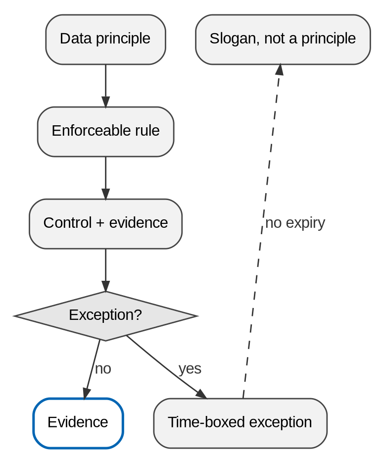
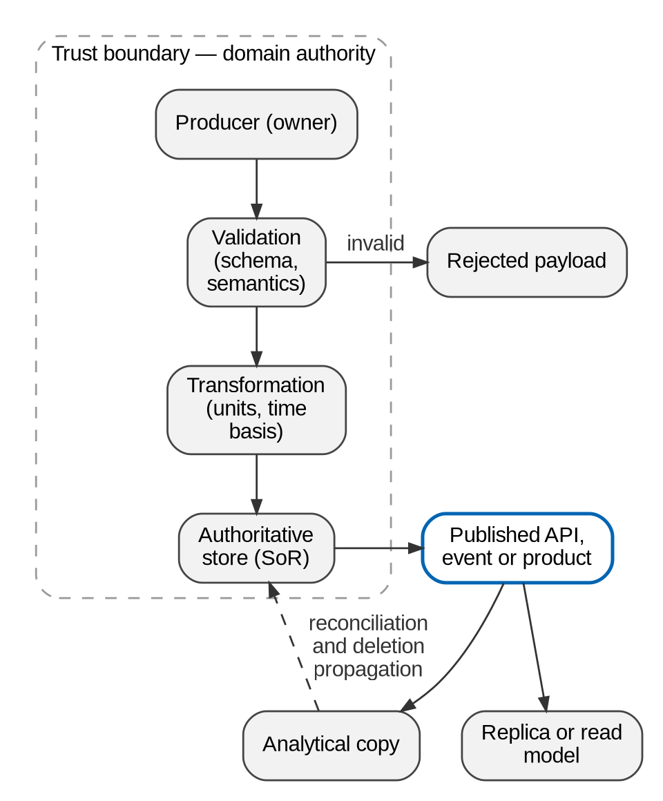
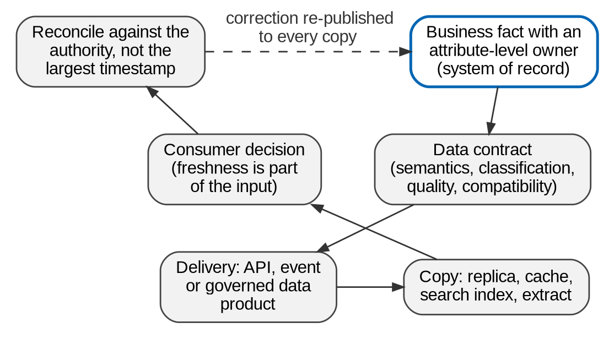
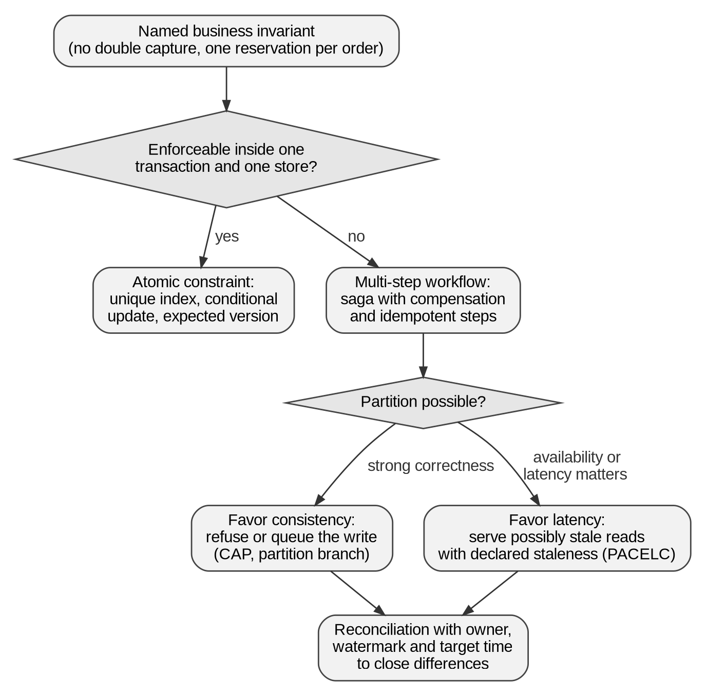

# 5. Data Architecture

Data architecture begins with semantic ownership: which domain is authoritative for a fact, how the fact is identified, and what other domains may infer from it. Sharing a database schema between teams appears efficient but creates hidden coupling in deployment, authorization and evolution. Domain-owned APIs, events and data products make the coupling explicit, at the cost of synchronization and consistency choices.

Consistency requirements are expressed per business invariant. Preventing two captures for one payment may require an idempotency record and a uniqueness constraint; a dashboard may tolerate minutes of delay. A distributed transaction should not be assumed merely because several services take part in a workflow.

::: {.callout-note appearance="simple" icon=false title="When to Use This Chapter"}
- Defining data ownership, contracts and consistency for a solution or domain.
- Choosing storage, replication, partitioning or an isolation level.
- Designing retention, deletion, lineage, audit history or data quality controls.
- Reviewing data risk with security, privacy (9.9) and operations before build or migration.
:::

::: {.callout-tip appearance="simple" icon=false title="Key Takeaway"}
Data architecture is the architecture of authority: who owns each fact, what consistency it needs, and how every copy is governed across its lifecycle. A schema without an owner is a future inconsistency.
:::

## 5.1 Data Principles

**Definition.** Data principles are the small set of enforceable rules that decide who may create a fact, who may read it, how long it is kept and what evidence proves the rule is followed.

**Purpose.** Principles convert architecture intent into criteria that can be applied before a design exists and checked after it ships. They let a reviewer reject a design on a stated ground — two writers for one fact, an unclassified field, a copy with no retention rule — instead of arguing taste, and give delivery teams a predictable answer under delivery pressure.

**What it includes.** A principle is useful only when it names the data it governs, the owner accountable for it and the control that demonstrates compliance. Four areas matter: authority (one accountable writer per fact, replicas disclose provenance and freshness); contract (shared data carries meaning, allowed values, sensitivity, permitted uses and compatibility policy); access (classification drives least privilege); and lifecycle (retention and deletion cover primary stores, replicas, caches, archives and backups). Table 5.1 shows how a principle becomes testable.

| Principle | Enforceable rule | Control and evidence |
| :--- | :--- | :--- |
| One accountable authority | Only the owning system writes the fact; others read through a published interface | Write-path review; single writer per table; reconciliation report |
| Shared data has a contract | Published data carries semantics, classification and compatibility policy | Versioned contract in the repository; contract tests in CI |
| Access follows classification | Access is granted to a classification and a purpose, not to a schema | Access review record; least-privilege policy tests |
| Lifecycle covers every copy | Retention and deletion rules apply per data category, not per system | Lifecycle configuration; deletion-propagation and restore tests |
| Principles are enforced, not declared | Every principle has an owner, a control and an exception process | Exception register with approver, compensating control and expiry |

: From data principle to enforceable control

A **single source of truth** is an authority for a particular fact, not a mandate to keep every fact in one database. For each principle, identify the owner, a measurable control and an exception process. Figure 5.1 shows the path from principle to evidence, including the branch that turns an exception into the new rule.

{#fig-5-1 width="100%"}

**Why it is needed.** Without enforceable principles, data decisions are made case by case by whoever ships first, and the estate accumulates the failures this chapter is written against: dual writes, unclassified copies, exports that never expire and schemas nobody owns. The consequence appears late — in a failed audit, an erasure request that cannot be honored, or two reports that disagree about revenue — when correction is expensive. The evidence is not the document: it is the exception register with expiry dates, the automated checks that block a merge, and the review record showing a principle applied to a named data set.

**Example.** The reference checkout states one authority per fact: Order owns the order lifecycle and `order_id`, Payments owns authorization attempts and charge state, CRM owns customer identity attributes. Each principle is paired with a check — a uniqueness constraint on the idempotency key, a contract test that rejects a breaking field change, a quarterly access review of the customer table — so a reviewer can ask for the evidence instead of the promise.

::: {.callout-warning appearance="simple" icon=false title="Common Pitfall"}
Publishing principles as aspirations — "data is an asset", "we are data-driven" — with no owner, control or exception process. Nobody can be non-compliant with an aspiration, so the document survives while every design decision ignores it. Write each principle as a testable rule over a named data set, attach a control that produces evidence, and route exceptions through an approver with an expiry date.
:::

::: {.callout-important appearance="simple" icon=false title="Decision & Trade-off"}
Decide how a principle will be enforced before publishing it.

| Option | Choose when | Consequences |
| :--- | :--- | :--- |
| Automated gate (contract test, policy-as-code, constraint) | The rule is expressible as a check and the cost of a violation is high | Blocks drift early; requires tooling and a fast pipeline; false positives must have an override path |
| Manual review with named approver | The rule needs judgment, such as classification or permitted use | Flexible; depends on reviewer availability and consistency; leave an audit record |
| Exception register with expiry | A known legacy gap cannot be closed before a deadline | Keeps delivery moving and makes debt visible; an exception without an expiry becomes the new rule |
:::

## 5.2 Data Modeling, Storage and Flows

Modeling, storage and flow decisions are made together: a model that assumes a joinable single database fails when the data is partitioned, and a flow designed for nightly files cannot serve a screen that needs seconds.

### 5.2.1 Data Domains

**Definition.** A data domain groups facts that share business meaning, rules and accountability — for example Customer, Order, Payment, Shipment and Billing.

**Purpose.** Domain boundaries decide where a fact may change and where it may only be copied. They give each model a single owner, keep invariants enforceable inside one boundary, and tell an architect where translation between models is legitimate rather than a defect.

**What it includes.** Validate boundaries against business invariants and team ownership. Payment owns authorization and capture outcomes; Order owns order lifecycle. Copying payment status into an order read model does not transfer authority. Describe each domain with its entities, identifiers, invariants, owner, lifecycle, access rules and published interfaces. A domain map exposes where shared concepts need translation rather than a forced universal model.

**Why it is needed.** Domains drawn by department, by application or by database table produce models that no team can change safely and invariants that span owners. The test of a boundary is practical: a workflow that must stay consistent should complete inside one domain, and a change to the model should require review from one accountable owner. When a workflow crosses domains, the crossing is an explicit contract with its own failure semantics (5.3.3), not a shared table.

### 5.2.2 Data Stores

**Definition.** A data store is the persistence technology chosen for a defined set of access patterns, consistency requirements and lifecycle rules.

**Purpose.** Store selection sets hard limits on what the architecture can guarantee later: which transactions are possible, how a query performs at volume, what isolation the application may assume and what deletion can reach. Choosing from the workload rather than from familiarity keeps those limits visible.

**What it includes.** Choose persistence technology from access patterns and consistency requirements:

| Store type | Typical fit | Caution |
| :--- | :--- | :--- |
| Relational database | Transactions, constraints, relational queries | Scaling writes may require partitioning |
| Document / key-value store | Variable structure, access by key | Limited multi-entity transactions in many products |
| Object storage | Large immutable payloads, archives | Not a query engine |
| Search index | Text and faceted retrieval | Usually a derived projection, not a system of record |
| Warehouse / lake | Analytical processing | Latency; governance of copied data |

: Store types and their fit

Evaluate candidates against read/write rates, query shapes, volume, indexing, isolation, failure recovery, retention, security, skills and cost. A cache or search index is not authoritative unless the architecture explicitly provides that guarantee.

**Why it is needed.** A store that cannot enforce an invariant moves that work into application code, where concurrency and partial failure make it unreliable; a search index treated as a system of record makes freshness and deletion somebody's unowned problem. Record the decision with its rejected alternatives and the measured basis, then confirm it under realistic contention, because benchmark results at low load mislead about write contention, hot keys and recovery time.

### 5.2.3 Data Flows

**Definition.** A data-flow view traces each fact from the producer that creates it, through validation, transformation and storage, to every consumer and every copy.

**Purpose.** This subsection is the owning treatment of data-flow views in this handbook. Its purpose is to make one question answerable for every edge of the estate: where does this fact come from, who owns it at this point, how current is it and what happens when the edge fails? Other chapters reference this view rather than restating it — transport mechanics and delivery guarantees belong to Chapter 6 (6.1.2, 6.3), lineage records belong to 5.3.5, and trust boundaries are assessed with Chapter 9.

**What it includes.** For every edge document protocol, schema, authentication, sensitivity, volume, frequency, latency, error handling and owner, and mark trust boundaries and places where data is copied (Table 5.3). Show how duplicates, out-of-order records, schema changes and rejected payloads are handled. Distinguish the authoritative path from derived copies, and state the freshness each consumer may rely on. Figure 5.2 shows the shape of the view: one producer, one validation gate, one authoritative store, and every copy declared on the way out.

| Attribute | What to record | Failure it prevents |
| :--- | :--- | :--- |
| Contract and schema | Contract version, field semantics, units, time basis | Consumers decoding values that are structurally valid and semantically wrong |
| Trust boundary | Where the edge crosses a domain, network zone or organization | Unauthenticated or over-privileged access assumed to be internal |
| Sensitivity | Classification, permitted use, redaction applied in transit | Sensitive data reaching logs, analytical copies or a lower-classified store |
| Volume, frequency and latency | Expected rates, peak multiples, freshness target | Capacity and freshness assumptions that break on the first peak |
| Duplicate and order behavior | Delivery semantics, deduplication key, late-arrival rule | Double counting and state regressions after redelivery or replay |
| Rejection and quarantine | Validation rules, quarantine location, owner notified | Silent data loss when payloads fail validation |
| Copies | Each derived store, its purpose and its staleness | Copies that escape retention, deletion and quality controls |
| Owner and escalation | Producer owner, consumer owner, incident path | Outages that become ownership disputes |

: Attributes of a data-flow edge

Figure 5.2 shows where validation rejects a record and where accepted data is copied, so the edge attributes in the table can be checked against an actual flow.

{#fig-5-2 width="100%"}

**Why it is needed.** Integration monitoring proves that messages moved, not that the data is right: a flow can be green while a unit changed, a timestamp lost its time zone or a field was silently dropped by a mapping. Without an owned flow view, incident investigation starts by reading code, privacy requests cannot enumerate the copies of a subject's data, and impact analysis for a schema change is guesswork. The evidence is a maintained flow diagram with owners, the attribute record above, and tests that inject a duplicate, a late record and a rejected payload.

### 5.2.4 Data Lifecycle and Retention

**Definition.** The data lifecycle runs from collection through use, sharing and archival to deletion.

**Purpose.** Lifecycle decisions determine how long each category of data exists, in which copies and under which legal basis. They bound legal and cost exposure and make expiry a designed property of the estate rather than an occasional clean-up.

**What it includes.** Retention depends on purpose, regulatory obligation, contractual commitments, business value and legal holds. Distinguish expiry (data reaches the end of its retention period), deletion requests (for example a data subject exercising the right to erasure) and legal holds (deletion suspended because of litigation or investigation). Where a legal obligation to retain conflicts with a deletion request, the legal basis decides, and the decision is documented.

Record retention per category of data, not per system, so that every copy follows the same rule (template in Appendix B.11). A schedule commonly distinguishes:

| Category | Retention driver | Typical approach (illustrative) |
| :--- | :--- | :--- |
| Business records (orders, invoices, contracts) | Tax, commercial and sector regulation | Retained for the statutory period, then archived or deleted |
| Personal data | Purpose limitation and privacy law | Retained only while needed for the stated purpose; deletion propagated to every copy |
| Documents and files (uploads, generated reports, attachments) | Same as the business record they support | Retention class assigned at upload; lifecycle rules applied to the storage |
| Integration and transfer files | Reprocessing and reconciliation needs | Kept in landing and staging areas only until processed and reconciled, then deleted |
| Exports and extracts | Purpose of the export | Short expiry by default; tracked like any other copy |
| Logs and telemetry | Operations and security investigation | Days to months by signal type; sensitive fields redacted at source |
| Audit records | Regulation, contracts, accountability | Where regulation or contract sets a minimum, commonly at least one year; confirm the legal basis and protect against modification (9.7.2) |
| Backups and snapshots | Recovery objectives | Rotated according to the backup policy; restore procedures re-apply deletions |
| Temporary and cache data | Performance | Expires automatically; never the only copy of anything |

: Retention categories and drivers (illustrative periods)

**Why it is needed.** Retention defined per system leaves files, exports, logs and backups outside every rule, so an obligation is met on paper and violated in storage; an unmanaged archive also becomes a cost and discovery problem. The evidence is an approved retention schedule mapped to stores and file locations, lifecycle configuration, and a report showing expired data actually gone.

Privacy obligations that shape retention — data-subject rights, international transfers, DPIA triggers and pseudonymization — are covered in 9.9. Chapter 18 (18.3.7) extends retention to embeddings, indexes, prompts, caches, traces and evaluation data.

### 5.2.5 Files, Deletion and Crypto-Shredding

**Definition.** Deletion is a property of every copy of a fact — files, object versions, archives, indexes and backups — not of the primary row alone.

**Purpose.** This unit covers the copies that outlive the primary record and the mechanics that make erasure provable. It decides how a file is classified at creation, how its versions expire, and how data in immutable storage becomes unreadable when a deletion obligation arrives.

**What it includes.** Files are often the copies that escape retention rules. Assign a classification and retention class as metadata when a file is created; use storage **lifecycle rules** to move files to colder tiers and expire them; remember that **object versioning** keeps deleted or overwritten content as older versions, which must also expire; use **object lock** (write-once storage) where regulation requires immutability, knowing that locked objects cannot be deleted before their retention date; apply legal holds through the storage platform rather than by copying files; and clean up landing zones, staging areas and temporary files on compute nodes after processing. Verify integrity of retained files with checksums.

Deleting the primary row is not deletion: replicas, derived views, search indexes, files, exports, event archives and backups must be covered. Where data cannot be removed from immutable backups, document the delay and ensure that restored data is deleted again before use. **Crypto-shredding** — encrypting each subject’s data with its own key and destroying the key — can make data in immutable stores unreadable.

**Why it is needed.** A deletion request that reaches the database but not the export, the search index or the nightly backup fails in audit and, after a restore, reappears in production. The evidence is lifecycle and object-lock configuration, deletion-propagation tests across copies, and a restore test that confirms deleted records do not reappear.

### 5.2.6 Data Platforms and Pipelines

**Definition.** A data platform is the governed set of stores, catalogues and pipelines that serves analytical work, reporting and model training alongside the operational systems that serve transactions.

**Purpose.** Platform decisions separate what the business runs on from what the business learns from, and they determine whether analytical data is a governed product or an ungoverned copy of the estate. They also set the freshness that reporting and models can honestly claim.

**What it includes.** Operational stores serve transactions and current state; analytical platforms serve reporting, exploration and model training. A warehouse suits governed structured analytics, a lake holds raw or semi-structured data, and a lakehouse combines both; choose from workload, latency, cost, governance and the skills available. A lake without a catalogue, ownership and lifecycle rules becomes an ungoverned copy of the estate, not a platform. Organize a lake in zones with increasing trust, such as raw, validated and published, and use a table format that provides transactional updates and schema evolution when many writers and readers share the data. Separating storage from compute allows each workload to scale independently, at the cost of data-transfer and metadata management.

Pipelines move and transform data through ingestion, validation, transformation, orchestration and publication. Specify batch or streaming behavior, idempotency, replay and backfill, schema evolution, late or duplicate records, and the freshness each consumer needs. Publish data products with an owner and contract rather than letting every consumer copy raw tables. Reuse the data-flow, quality and lineage practices in 5.2.3 and 5.3; the transport mechanics belong to Chapter 6, and platform cost is part of the economics in Chapter 15.

**Why it is needed.** A platform without owners, contracts and lifecycle rules produces the classic failure: several teams build their own extracts of the same source, disagree on definitions, and nobody can say which number is authoritative. Pipelines without idempotency and replay turn a failed night into a manual repair. The evidence is a catalogued platform with an owner per data product, replay and backfill tests, and a stated freshness target measured against the consumers' needs.

**Example.** In the reference checkout, the order flow is authoritative in the operational store, while the analytics team publishes a governed `order_facts` product rebuilt nightly. When a duplicate OrderAccepted event is injected, the projection still shows one order because the pipeline is keyed by `order_id` and version; when the customer exercises erasure, the extract and the analytical copy expire on their own lifecycle rules.

::: {.callout-warning appearance="simple" icon=false title="Common Pitfall"}
Treating the analytical copy as the convenient source of truth: a dashboard queries the warehouse because it is faster, then a business decision depends on data that is hours old, lacks a correction path and never receives deletions. Consumers must know which store is authoritative and what freshness they are reading; analytical copies stay derived, contract-bound and lifecycle-managed.
:::

::: {.callout-important appearance="simple" icon=false title="Decision & Trade-off"}
Choose how consumers reach a domain's data before choosing a platform product.

| Option | Choose when | Consequences |
| :--- | :--- | :--- |
| Published API or event from the owner | Freshness matters and the owner can serve the load | Clear authority and contract; coupling to the owner's availability and latency |
| Governed data product in the platform | Several consumers need the same analytical shape | Reusable and catalogued; freshness and correction must be published |
| Direct read of the owner's tables | A short-lived migration or a single colocated team | Fastest to build; couples schemas and bypasses authorization and lifecycle |
:::

## 5.3 Trusted Data

Trusted data combines accountable authority, unambiguous semantics, explicit contracts, measurable quality and traceable transformation. Consumers must know who owns a fact, what it means, when it was observed, how current it is and how corrections propagate. A schema-valid record is not necessarily semantically correct.

### 5.3.1 Ownership, Systems of Record and Boundaries

**Definition.** A system of record is the system authorized to change a defined set of facts, and its owner is the person accountable for their meaning, quality and lifecycle.

**Purpose.** Ownership turns data quality from everyone's concern into someone's obligation. It settles conflicts deterministically, gives consumers a place to ask questions and a target for corrections, and defines who must approve a change to meaning rather than only to schema.

**What it includes.** Assign a named owner to each authoritative fact and to the system that may change it. Ownership includes validation rules, correction workflow, retention and publication. A system of record is authoritative for defined facts, not necessarily every attribute of an entity: CRM may own legal name while Billing owns invoice status. Document attribute-level ownership where needed.

Copies may exist for performance, resilience or analytics (Figure 5.3), but they carry provenance and staleness expectations; conflicts are resolved against documented authority, not the largest timestamp. Cross-domain reads use a published API, event or governed data product. Direct shared-table access may be justified during a constrained legacy migration, but only as a temporary exception with an exit plan.

{#fig-5-3 width="100%"}

Three ownership models cover most cases, and the choice is worth recording once rather than re-arguing per project. The table states when each applies and what it costs.

| Option | Choose when | Consequences |
| :--- | :--- | :--- |
| One writer with API or events | The domain owns the fact and consumers can accept sync or eventual consistency | Clear authority; integration and contract work |
| Shared schema or database | A small colocated team has strong transactional needs and a short horizon | Fast start; coupling, authorization and evolution risk |
| Event-fed replica or read model | Consumers need local latency or autonomy | Staleness, replay and deletion-propagation obligations |

: Ownership and access models

**Why it is needed.** Sharing a schema or dual-writing to two stores without one authoritative writer creates divergent facts that no report can reconcile, and the divergence is discovered by a customer or an auditor rather than by monitoring. Attribute-level ownership matters because entity-level claims hide the real conflict: two systems both "own the customer" while each owns different fields. The evidence is an ownership map naming the writer per fact or attribute, the freshness each replica publishes, and a reconciliation result that shows divergence being detected and closed.

### 5.3.2 Semantics and Canonical Models

**Definition.** Semantics define what a field means: its units, identifier, time basis, nullability, allowed values and lifecycle.

**Purpose.** Semantics are what allow two systems to exchange data without exchanging assumptions. They make a value interpretable after it has crossed a boundary, which is precisely where local knowledge is lost.

**What it includes.** Specify, for example, whether a timestamp is event time or processing time, whether an amount includes tax, and which identifier remains stable across merges. A canonical model can simplify exchange among many systems, but an enterprise-wide universal schema often creates coordination bottlenecks and hides local meaning. Prefer stable domain contracts with anti-corruption mappings at boundaries.

**Why it is needed.** Structural compatibility is not semantic compatibility: renaming nothing and changing only the unit, the currency, the rounding rule or the time zone breaks consumers while every validator passes. Undefined nullability turns "unknown" into zero in a report. The evidence is a written definition per published field, a mapping table at each boundary that names the source and target semantics, and tests that assert meaning — not only type — on representative historical data.

### 5.3.3 Data Contracts

**Definition.** A data contract is the versioned agreement between a data owner and its consumers covering schema, meaning, quality, freshness, permitted use and compatibility.

**Purpose.** The contract makes the producer's obligations explicit and gives consumers a basis for building without reading the producer's code. It converts a schema change from a surprise into a reviewed, scheduled event with a migration window.

**What it includes.** A data contract combines schema with semantic definitions, owner, classification, quality expectations, freshness, permitted use and compatibility rules. Consumers need to know how fields evolve, which changes are breaking and how long old versions remain supported.

Additive optional fields are usually compatible; renaming an identifier or changing the meaning or unit of an existing field is breaking even when the wire type is unchanged. Automate schema and consumer-contract checks in CI and review semantic changes that validators cannot detect. Event contract mechanics are covered in 6.2.

**Why it is needed.** Without a contract, consumers infer meaning from samples, producers cannot tell who depends on a field, and the first breaking change is discovered in production. Contracts also carry obligations that outlive a request — classification, retention and permitted use — which no schema expresses. The evidence is a versioned contract per published data set, automated compatibility checks in the pipeline, a named consumer list, and a deprecation record showing how the previous version was retired.

### 5.3.4 Data Quality

**Definition.** Data quality is the degree to which data is fit for the decisions and processes that consume it, measured against stated dimensions rather than asserted.

**Purpose.** Quality measures make trust concrete. They tell a consumer what to expect, give an owner a signal before a customer notices, and separate a data defect from an application bug during an incident.

**What it includes.** Measure quality against consumer needs: completeness, validity, uniqueness, accuracy, consistency and timeliness. An analytics feed can be syntactically valid yet unusable if 20% of orders lack a region code. Specify thresholds, detection queries, alert owners, quarantine rules and correction workflows, and monitor quality by source and contract version to catch regressions after deployments.

| Dimension | Question it answers | Example check |
| :--- | :--- | :--- |
| Completeness | Are required values present? | Share of orders with a region code above the agreed threshold |
| Validity | Do values obey the contract? | Schema and enumeration checks at ingestion |
| Uniqueness | Is each fact counted once? | Duplicate `order_id` count after deduplication |
| Accuracy | Does the value match reality? | Sample reconciliation against the provider or source document |
| Consistency | Do related facts agree? | Order total equals the sum of its lines |
| Timeliness | Is the data fresh enough? | Age of the newest record against the published freshness target |

: Quality dimensions and their tests

**Why it is needed.** Undetected quality defects propagate into reports, invoices and models, and the cost of correction grows with every copy. A threshold with an owner also prevents the opposite failure: a dashboard of thousands of alerts that everyone ignores. The evidence is a defined threshold per dimension and consumer, a detection query in the pipeline, a named owner for each alert and a record of quarantined records being resolved.

### 5.3.5 Lineage and Traceability

**Definition.** Lineage records how data moves and transforms from source to consumer, including jobs, versions and owners.

**Purpose.** Lineage answers three operational questions quickly: what is affected if this source changes, where did this number come from, and which copies hold this subject's data. It is the map used during incidents, impact analysis and privacy requests.

**What it includes.** Capture source identifiers, transformation definitions, processing timestamps and correlation or batch identifiers, including corrections, reprocessing and manual imports. Lineage supports incident investigation, impact analysis, privacy requests and confidence in analytics. Distinguish technical lineage (jobs and tables) from business lineage (which report or decision a fact reaches), because reviewers and regulators ask the second.

**Why it is needed.** Without lineage, impact analysis is done by asking around, and a privacy request cannot be answered with confidence. Lineage also exposes the pipelines nobody owns: a transformation with no owner and no tests is where definitions silently diverge. The evidence is a lineage graph that resolves from a published data product back to its sources, including manual imports and corrections, and a recent impact analysis that used it.

### 5.3.6 Consistency, Synchronization and Reconciliation

**Definition.** Consistency is the guarantee a consumer can rely on about how current and how ordered the data it reads is; reconciliation is the process that detects and closes divergence between the authority and its copies.

**Purpose.** Consistency choices decide what the application must handle and what the business is promised. Reconciliation covers the residual cases that no guarantee eliminates — asynchronous workflows, external providers and manual intervention — and assigns them an owner.

**What it includes.** Choose consistency guarantees per invariant. A ledger entry may require an atomic transaction and uniqueness constraint; a search projection may tolerate documented propagation delay. Eventual consistency is a commitment to convergence with observable lag, not permission to ignore divergence. Define conflict resolution, idempotent application, replay and repair, and test delayed, duplicated and out-of-order updates.

Reconciliation compares authoritative records with derived or external state to find missing, duplicated or contradictory facts. It is essential when asynchronous workflows or external providers leave outcomes temporarily unknown. Use stable business identifiers, watermarks and discrepancy categories, with an owner, correction permissions, audit log and target time to close differences.

**Why it is needed.** A stated guarantee that nobody measures is a guess, and an unmeasured divergence becomes an unexplained report. Reconciliation also protects revenue: a provider that charged but never answered leaves an unknown outcome that only comparison can resolve. The evidence is a consistency statement per invariant, lag and divergence dashboards with thresholds, and a reconciliation report that shows discrepancies, owners and time to close.

### 5.3.7 Master Data Management

**Definition.** Master data management (MDM) governs shared reference entities and identity resolution across systems: matching, survivorship rules, stewardship and publication of mastered identifiers.

**Purpose.** MDM gives the organization one defensible answer for entities that many systems describe — customer, product, supplier, location — without centralizing the transactional data those systems own.

**What it includes.** MDM is not a central database owning all transactional data. Define how duplicates are detected, conflicts resolved and merges or splits communicated, and choose between centralized, federated and coexistence models according to organizational accountability.

| Model | How it works | Fits |
| :--- | :--- | :--- |
| Centralized | One hub masters the entity and publishes identifiers to all systems | Strong central stewardship and a small number of source systems |
| Federated | Ownership stays with source systems; a virtual layer matches and publishes identity | Distributed accountability and mature system owners |
| Coexistence | A hub masters selected attributes while source systems keep local ones | Incremental adoption alongside legacy systems that cannot be changed |

: MDM operating models

**Why it is needed.** Without identity resolution, the same customer exists under several identifiers, analytics undercounts, and consent or erasure requests are applied to one record while copies survive. Merge and split events are the subtle part: a downstream system that never learned about a merge keeps transacting against a retired identifier. The evidence is a documented match and survivorship rule, a published identifier, and a tested merge and split notification path.

### 5.3.8 Data Governance

**Definition.** Data governance allocates decision rights and policies for quality, classification, access, contracts and lifecycle.

**Purpose.** Governance is how data decisions get made when several teams are affected: who may approve a new classification, who accepts a retention exception, who arbitrates a definition conflict. Without it, those decisions are made implicitly by whoever changes the schema.

**What it includes.** Owners are accountable for meaning; stewards manage definitions and quality processes; custodians operate technical safeguards; consumers honor access and use constraints. Connect governance to operational controls — contract review, lineage capture, quality dashboards, access recertification, retention evidence and exception tracking.

**Why it is needed.** A governance body that meets without operational controls produces decisions nobody applies; controls without decision rights produce escalations nobody can close. The practical test is whether a contested definition or a retention exception reaches a named decision-maker within an agreed time. The evidence is a decision-rights table, a register of open exceptions with owners, and control results reviewed on a schedule.

### 5.3.9 Data Auditing and Change History

**Definition.** Change history records what a datum contained at a given time and who changed it; access auditing records who read sensitive data.

**Purpose.** Both answer questions that ordinary application logs cannot: reconstruct the state used for a decision, prove that history was not altered, and show who had access to regulated data. They are the evidence base for disputes, audits and investigations.

**What it includes.** Two related needs arise for regulated or critical data, and both complement the application audit trail (9.7.2).

| Mechanism | What it provides | Considerations |
| :--- | :--- | :--- |
| Application audit trail | Business actions with actor and context | Must be designed in; covers only actions through the application |
| History or temporal tables | Every previous version of a row with validity timestamps (system-versioned tables, standardized in SQL:2011) | Native in some databases, triggers or extensions in others; storage grows with change rate |
| Event sourcing | State derived from an immutable sequence of domain events; history is inherent | Significant design complexity; suits domains where history is the core requirement |
| Change data capture to a history store | Change stream copied to an analytical or archive store | Captures data changes without application context unless enriched |
| Ledger tables and verifiable logs | Cryptographic evidence that history has not been altered | For records where tamper evidence is required |
| Database and data-platform audit logs | Access and administrative actions, including privileged database access and queries on sensitive tables | Volume; must be protected and retained like other audit records |

: Mechanisms for history and access evidence

**Bitemporal** models record both when a fact was true in the business (valid time) and when the system recorded it (transaction time); they answer questions such as “what did we believe on 31 March about the customer’s address on 1 March?” — common in finance, insurance and regulatory reporting.

**Why it is needed.** History keeps personal data, so retention and deletion rules (5.2.4, 5.2.5) apply to history tables, event stores and change streams as well, and crypto-shredding can reconcile immutability with erasure. Lineage (5.3.5) complements history by showing how values were derived. The evidence is history and access-audit coverage for regulated datasets, a reconstruction test that retrieves a record’s state at a past date, and retention applied to history stores.

**Example.** A regulator asks why an invoice was credited in March. Billing answers from its temporal table — the invoice state on each date, the actor and the reason — while the access-audit log shows which support users opened the customer record. Neither answer exists in the application log alone, and the reconstructed state is reproducible a year later because the history store follows the same retention schedule as the invoice.

::: {.callout-warning appearance="simple" icon=false title="Common Pitfall"}
Confusing schema validity with trust: a contract test passes, so the data is assumed correct, while units, nullability or survivorship silently changed. Validators check structure; they cannot see meaning. Pair automated checks with a written definition per published field, a representative-data test and a named owner who approves semantic change.
:::

::: {.callout-important appearance="simple" icon=false title="Decision & Trade-off"}
Choose how a consumer will obtain another domain's data.

| Option | Choose when | Consequences |
| :--- | :--- | :--- |
| Synchronous call to the owner | The consumer needs the current value to proceed | Strong freshness; adds a runtime dependency and a failure path |
| Event-fed local replica | The consumer needs autonomy or local latency | Fast and resilient; staleness, replay and deletion propagation |
| Governed data product | Several consumers share the same analytical need | Reusable and catalogued; not suitable for transactional decisions |
:::

## 5.4 Distributed Data Fundamentals

Once data and processing are spread across machines, networks and regions, failure, latency and concurrency become normal conditions rather than exceptions. The concepts below explain why the consistency, integration and resilience choices in this handbook are necessary.

They sit in the data chapter because consistency, replication, partitioning and transaction boundaries are decided primarily as data concerns: they determine which copy may answer a read, what a write must coordinate and how much a failure costs. Communication between services — transport, contracts and their failure semantics — is covered in Chapter 6; how an application is decomposed and where its state lives is covered in Chapter 7.

### 5.4.1 Fallacies of Distributed Computing

**Definition.** The fallacies of distributed computing are assumptions that hold inside one process but not across a network: that the network is reliable, latency is zero, bandwidth is infinite, the network is secure, topology never changes, there is one administrator, transport cost is zero and the network is homogeneous.

**Purpose.** Naming the fallacies gives each one a design obligation, so that a review can ask for the timeout, the latency budget, the payload limit or the encryption decision instead of hoping the team remembered it. They are the cheapest checklist available before a design leaves the whiteboard.

**What it includes.** Each fallacy corresponds to a design obligation, summarized in Table 5.9: timeouts and retries, latency budgets, payload limits, encryption and authentication, service discovery, operational ownership, cost models and interoperable formats. Apply them per hop, not per system: a chain of five services inherits every fallacy five times.

| Fallacy | Design obligation | Evidence |
| :--- | :--- | :--- |
| The network is reliable | Timeouts, retries with backoff, idempotency, failure tests | Fault-injection results and retry budgets |
| Latency is zero | End-to-end deadline and per-hop budget | Measured p95/p99 against the budget |
| Bandwidth is infinite | Payload limits, pagination, streaming for large sets | Load test at realistic payload sizes |
| The network is secure | Encryption in transit, mutual authentication, authorization per request | Configuration review and negative tests |
| Topology does not change | Service discovery, health checks, connection draining | Failover and scale-event tests |
| There is one administrator | Explicit ownership and escalation per component | Runbook with named owners |
| Transport cost is zero | Cost model for egress, cross-zone and cross-region traffic | Cost per transaction at normalized demand |
| The network is homogeneous | Interoperable formats and versioned protocols | Contract tests across heterogeneous clients |

: Fallacies and the obligations they create

**Why it is needed.** Each fallacy that reaches production becomes a specific incident class: a missing timeout becomes thread exhaustion, an unbounded payload becomes an outage during the month-end export, an unowned component becomes an escalation with no responder. The evidence is not the list but its application — a design review that names, for each hop, the timeout, the retry policy and the failure mode.

### 5.4.2 CAP and PACELC

**Definition.** The **CAP theorem** states that when a network partition occurs, a distributed data store must choose between **consistency** (every read sees the latest write, in the strict sense of linearizability) and **availability** (every request to a non-failed node receives a response).

**Purpose.** CAP and PACELC give an architect the vocabulary to state what a system does when the network fails and what it pays when it does not. They turn "we need it fast and correct" into a decision with a named branch.

**What it includes.** CAP is often misquoted as “pick two of three”; partitions cannot be ruled out in practice, so the real choice is what the system does during one. **PACELC** extends the reasoning to normal operation: if there is a Partition, choose between Availability and Consistency; Else, choose between Latency and Consistency. Synchronous coordination across replicas or regions adds latency even when nothing has failed. Systems built on consensus typically favor consistency in both cases, while leaderless, Dynamo-style stores typically favor availability and low latency. Figure 5.4 applies the reasoning to a single invariant.

{#fig-5-4 width="100%"}

**Why it is needed.** Apply the reasoning per business invariant (5.3.6): a payment ledger needs consistency and accepts reduced availability during a partition; a product catalog can serve slightly stale data and stay available. Choosing once for the whole estate forces one of those two to be wrong. The evidence is a recorded decision per invariant, naming the branch taken, the resulting behavior during a partition and the latency accepted in normal operation.

### 5.4.3 Consistency Models

**Definition.** A consistency model is the contract between a data store and its clients describing which values a read may return.

**Purpose.** The model tells application code what it must handle — stale reads, reordering, missing writes — and therefore which user-visible behavior is possible. Choosing it explicitly prevents both unnecessary coordination and silent correctness bugs.

**What it includes.** The common models and their typical uses are summarized in Table 5.10. Weaker models give better availability and latency but push complexity to the application, which must tolerate stale or reordered data. State the model each consumer can rely on, together with the expected staleness.

| Model | Guarantee | Typical use |
| :--- | :--- | :--- |
| Linearizable (strong) | Every operation appears to take effect at a single instant between its start and end; all clients see the same order | Uniqueness constraints, leader election, account balances |
| Causal | Operations that are causally related are seen in the same order by everyone | Comments and replies, collaborative editing |
| Read-your-writes | A client always sees its own previous writes | User profile updates, shopping carts |
| Monotonic reads | A client never sees older data after having seen newer data | Dashboards and timelines served by several replicas |
| Eventual | Replicas converge if updates stop; reads may be stale meanwhile | Search indexes, analytics, caches, read models |

: Consistency models

**Why it is needed.** A consumer built for linearizable reads breaks visibly when it is moved to a replica, and a consumer that only needed eventual consistency pays coordination cost for nothing. The failure is usually a user-visible regression after a routing change, not a design discussion. The evidence is the model stated per consumer, the staleness bound published with the data, and a test that exercises the read path against a lagging replica.

### 5.4.4 Transaction Isolation

**Definition.** Isolation levels define which anomalies concurrent transactions can observe within a single database.

**Purpose.** Isolation is where correctness is decided for the invariants that live in one store. Choosing it explicitly — and testing it under concurrency — is what separates a constraint from a hope.

**What it includes.** The levels and the anomalies they permit are summarized in Table 5.11. Defaults differ by product — PostgreSQL, Oracle and SQL Server default to read committed; MySQL InnoDB defaults to repeatable read — and the same name can mean different guarantees, so verify the behavior of the actual database.

| Isolation level | Prevents | Still allows |
| :--- | :--- | :--- |
| Read uncommitted | — | Dirty reads |
| Read committed | Dirty reads | Non-repeatable reads, lost updates, write skew |
| Repeatable read | Non-repeatable reads | Phantoms (per the SQL standard); behavior varies by product |
| Snapshot isolation | Reads from a consistent snapshot; lost updates in many implementations | Write skew |
| Serializable | All of the above | — (at the cost of more contention or aborted transactions) |

: Isolation levels and permitted anomalies

**Write skew** is the anomaly most often missed: two transactions each read a condition, then write different rows that together break an invariant, such as two operators each removing themselves from an on-call rota that must keep one person.

**Why it is needed.** For the reference checkout, decrementing stock with a read followed by a separate write can oversell under concurrency. Use an atomic conditional update (`UPDATE … SET available = available - 1 WHERE available > 0`), an explicit row lock or serializable isolation for that invariant. The evidence is the isolation level recorded per critical invariant and a concurrency test that reproduces the oversell or write-skew scenario and fails without the chosen control.

### 5.4.5 Replication and Partitioning

**Definition.** Replication keeps copies of data on several nodes for availability, locality and read scale; partitioning splits data across nodes to spread volume and load.

**Purpose.** These two mechanisms decide what a failure costs and how the system grows. Replication sets the achievable recovery point; partitioning sets the ceiling on single-node transactions and the shape of every future query.

**What it includes.** Replication modes and their consequences are summarized in Table 5.12. Synchronous replication avoids data loss on failover at the cost of write latency; asynchronous replication is faster but loses the unreplicated tail, which defines the achievable RPO (1.2.10).

| Mode | How writes are handled | Main consequence |
| :--- | :--- | :--- |
| Single-leader | All writes go to one leader; followers serve reads | Simple; followers may lag and failover must be handled |
| Multi-leader | Several nodes accept writes, typically one per region | Requires conflict detection and resolution |
| Leaderless (quorum) | Clients write to and read from several replicas; with N replicas, W write acknowledgments and R read responses, W + R \> N ensures reads overlap the latest acknowledged write | Tunable consistency and availability; operational complexity in repair |

: Replication modes

**Partitioning** (sharding) splits data across nodes by key, either by hash (even distribution, no range queries) or by range (efficient range queries, risk of hot spots). Choose keys that spread load, keep data that changes together in one partition, and plan for rebalancing. Operations that span partitions lose single-node transactions.

**Why it is needed.** A replication choice made for read scale silently sets the data-loss window, and a partition key chosen for convenience becomes a hot spot under a real traffic pattern. Both are expensive to change later. The evidence is the replication mode and its measured lag, a failover test that records data loss, and a partition-key review against the largest tenants and the dominant query shapes.

### 5.4.6 Time, Ordering and Consensus

**Definition.** Distributed systems have no global clock and no natural total order; ordering must be constructed from sequence numbers, versions or agreement protocols.

**Purpose.** Ordering decides which update wins and which state transition is legal. Getting it wrong produces the quiet failures — a lost update, a regressed state machine, a duplicate posting — that survive every health check.

**What it includes.** Machine clocks drift, so timestamps from different nodes cannot reliably order events, and “last write wins” by timestamp can silently discard updates. Use sequence numbers or versions per entity (6.4.2), logical clocks or version vectors when causal order matters.

**Consensus** protocols such as Raft and Paxos let a group of nodes agree on a value or an ordered log despite failures; they underpin leader election, configuration stores and strongly consistent databases. A majority quorum of 2f + 1 nodes tolerates f failed nodes — three nodes tolerate one failure, five tolerate two. Use proven implementations provided by databases and coordination services; do not implement consensus in application code.

**Why it is needed.** Timestamp ordering looks correct until two updates land in the same millisecond on hosts whose clocks disagree, and the loss is invisible afterwards. Consensus written by hand is a liability: it is correct only under assumptions that are hard to test and easy to break. The evidence is per-entity versioning in the data model, consumer logic that rejects stale updates, and failover tests that show the chosen quorum behavior.

**Example.** During a zone failure in the reference checkout, the payment ledger refuses writes it cannot confirm to a quorum rather than accepting a second capture, and the order workflow keeps the order in PAYMENT\_PENDING until reconciliation resolves the provider's outcome. The catalog, by contrast, serves cached prices with a declared staleness of one minute, because a stale price is recoverable and a blocked catalog is not.

::: {.callout-warning appearance="simple" icon=false title="Common Pitfall"}
Applying one consistency level to the whole estate — usually the strongest available — because "correctness matters". The result is coordination on paths that never needed it, latency budgets that cannot be met, and availability lost for reads that could have been stale. Decide per invariant, record the branch taken, and publish the staleness each consumer may rely on.
:::

::: {.callout-important appearance="simple" icon=false title="Decision & Trade-off"}
Choose the failure behavior of a critical write path before choosing the datastore.

| Option | Choose when | Consequences |
| :--- | :--- | :--- |
| Refuse or queue the write (favor consistency) | A wrong or duplicated fact costs more than a delayed one | Predictable correctness; visible unavailability and a retry or queue design |
| Accept the write locally (favor availability) | The fact is recoverable and merge rules are defined | Continuous service; conflict resolution and user-visible reconciliation |
| Degrade to read-only | Reads must continue while writes wait | Preserves most journeys; needs a queue, backlog limit and drain plan |
:::

## 5.5 Worked Example: Customer Data with Explicit Ownership

*In practice:* This example shows how ownership, data contracts and consistency choices are made explicit for customer data across domains.

A customer profile is edited in CRM, projected into a search index and consumed by Billing. CRM owns identity attributes; Billing owns invoices and payment status. The team publishes a versioned customer contract with field semantics, sensitivity, nullability, change notification and expected propagation delay. Consumers are prohibited from treating the search index as authoritative.

A new optional `preferred_language` field is added compatibly; renaming `customer_id` would require a new contract version and migration window. Deletion requests propagate to every derived store, and reconciliation compares counts and freshness against CRM. For orders, the fulfillment view may lag an address change, so the order retains an immutable address snapshot where legally justified.

| Fact or copy | Authority | Freshness promise | Control that proves it |
| :--- | :--- | :--- | :--- |
| Legal name, contact attributes | CRM | Authoritative | Ownership map; write-path review |
| Invoice and payment status | Billing | Authoritative for its domain | Contract test; ledger reconciliation |
| Search projection | Derived from CRM | Minutes, published to consumers | Projection lag alert; replay test |
| Analytical customer extract | Derived from CRM and Billing | Daily | Lineage record; lifecycle expiry |
| Order address snapshot | Order (immutable copy) | Fixed at order time | Legal basis recorded; retention rule |

: Ownership and control for the customer example

**Evidence.** schema compatibility tests, replay of historical events, projection freshness and divergence dashboard, deletion and restore drill.

::: {.callout-note .review appearance="minimal" icon=false title="Architecture Review Checklist — Data"}

☐  Is there one accountable authority per fact, with replicas’ freshness documented?

☐  Are consistency guarantees chosen per invariant, with reconciliation where state can diverge?

☐  Do data contracts define semantics and compatibility, not only schema?

☐  Does a retention schedule cover every data category, including files, exports, logs and backups?

☐  Does deletion cover replicas, indexes, files, archives and backup restores?

☐  Is change history and access auditing in place for regulated data?

☐  Are the consistency model and isolation level explicit for each critical invariant, and tested under concurrency?
:::

## 5.6 Further Reading

- Kleppmann and Riccomini (2026), *Designing Data-Intensive Applications* — replication, partitioning, consistency and stream processing.
- DAMA International (2017), *DAMA-DMBOK* — data governance, quality, metadata and master data.
- Helland (2007), “Life beyond Distributed Transactions” — entities, idempotence and consistency without distributed transactions.
- Dehghani (2022), *Data Mesh* — domain-owned data products.
- Abadi (2012), “Consistency Tradeoffs in Modern Distributed Database System Design” — PACELC; Berenson et al. (1995), “A Critique of ANSI SQL Isolation Levels”.
- Ongaro and Ousterhout (2014), “In Search of an Understandable Consensus Algorithm” — Raft.
