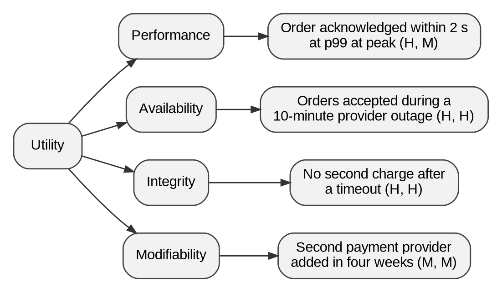
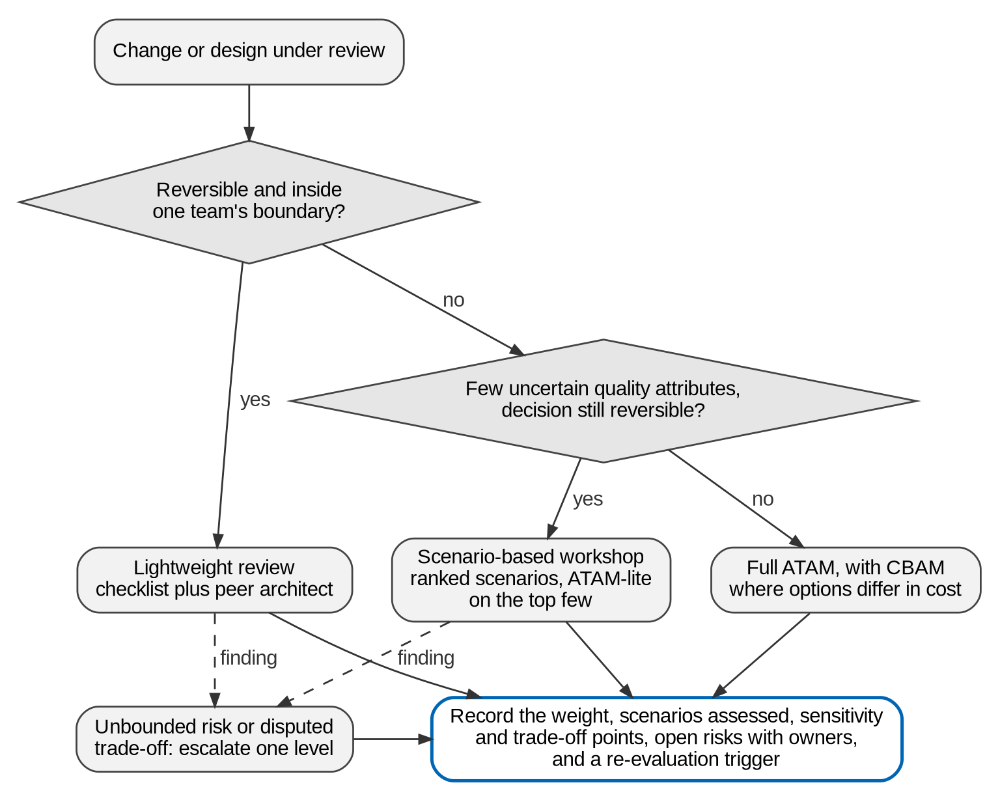
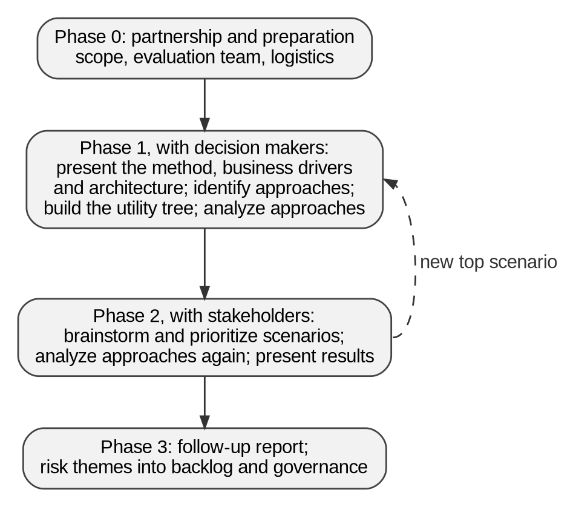
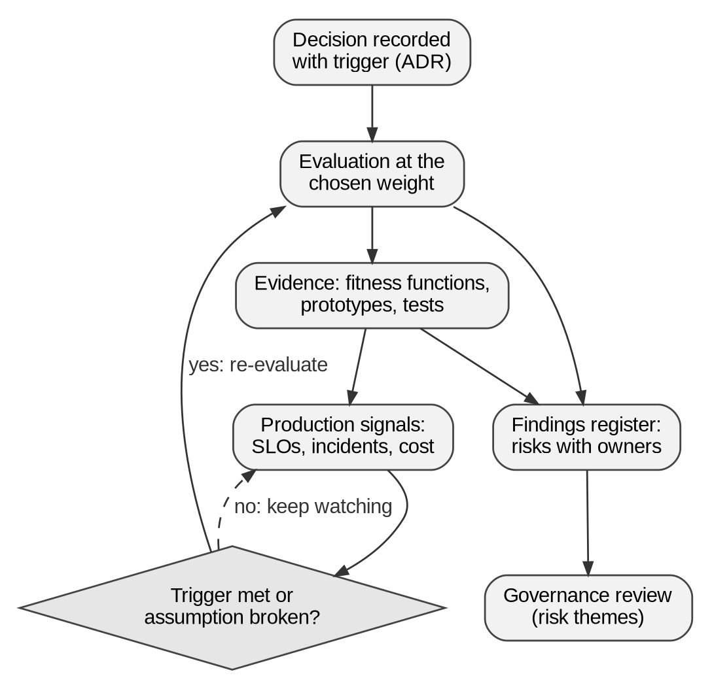

# 6. Architecture Evaluation

Architecture evaluation judges whether a design, or a set of alternatives, can meet its prioritized quality scenarios, and exposes risks and trade-offs while they are still cheap to change. It follows documentation (Chapter 5), which states the intent, and precedes the artifacts chapter (Chapter 7) that catalogs the records a design leaves behind; testing (Chapter 16) demonstrates the built system. This chapter covers the outputs, inputs and weight of an evaluation, scenario-based methods with ATAM in detail, and the evidence and re-evaluation that keep a judgment valid after the review. Section 8.3.5 positions the methods among the other frameworks and methods.

::: {.callout-note appearance="simple" icon=false title="When to Use This Chapter"}
- Deciding whether a design is ready for commitment, and how much evaluation it deserves.
- Preparing, running or reporting an ATAM or a lighter scenario-based review.
- Turning an untested assumption into evidence with a prototype, a benchmark or a fitness function.
- Assessing an existing system before modernization, acquisition or a major change.
:::

::: {.callout-tip appearance="simple" icon=false title="Key Takeaway"}
An evaluation is worth its findings, not its ceremony. Rank the scenarios that matter, choose the weight from the cost of being wrong, record risks, sensitivity points and trade-offs with owners, and re-evaluate when a trigger or a broken assumption shows that the judgment is out of date.
:::

## 6.1 Evaluation Foundations

Validation produces evidence that a design meets its requirements, which is a different activity from reviewing it. The units below define what an evaluation produces, what it needs as input and how much of it a change justifies.

### 6.1.1 Architecture Evaluation

**Definition.** An architecture evaluation compares a design, or its alternatives, against prioritized quality scenarios, risks and constraints to expose where the design is sensitive and where quality attributes trade off.

**Purpose.** Evaluation informs a commitment: whether to proceed, which alternatives to compare, and which risks to fund before the design becomes expensive to change. Scenario-based methods such as ATAM (6.2.1) surface sensitivity and trade-off points that a feature comparison never reaches. Rank the risks, and use a prototype or proof of concept where a ranked risk rests on an untested assumption (6.3.2); vendor feature matrices often miss integration and operational cost.

**What it includes.** Evaluation covers the drivers and prioritized scenarios, the candidate designs, the findings and the evidence behind each judgment. The findings take the four forms in Table 6.1, which most scenario-based methods share, so that results from a short review and a full workshop can be compared. Publish what was assessed: the scenarios, the alternatives compared, the findings, the unresolved risks with owners, and a date or event that triggers re-evaluation. Chapter 19 (19.6.1) extends the same discipline to AI behavior with offline golden-set evaluation and regression gates.

| Finding | Meaning | Checkout example | What follows |
| :--- | :--- | :--- | :--- |
| Risk | A decision that may prevent a scenario from being met | Synchronous authorization turns a provider outage into a checkout outage | Owner and mitigation, or a recorded acceptance |
| Non-risk | A decision judged sound for a scenario, with the assumption it relies on | Passing the attempt identifier as the provider’s idempotency key prevents double charges, if the provider honors it | Assumption confirmed in the interface contract |
| Sensitivity point | A property that depends strongly on one decision | Acknowledgment latency depends on the provider’s p99 | Monitored, and tested at the stated load |
| Trade-off point | A decision that moves several attributes in opposite directions | A shorter payment timeout protects latency but raises the rate of UNKNOWN outcomes | Chosen balance recorded in an ADR |

: Evaluation findings and what follows from each

**Why it is needed.** A recommendation without the assumptions that could invalidate it is incomplete, and the assumptions are the first thing lost when the slide deck is separated from the discussion. Evaluation is also not certification: ATAM does not certify production SLOs, and a design that passes review can still miss its latency or recovery target. The evidence is a review record containing the fields above, an owner and a due date for every open risk, and a measurement or exercise behind the highest-ranked one.

### 6.1.2 Evaluation Inputs: Drivers and the Utility Tree

**Definition.** The inputs of an evaluation are the business drivers, the architecture as described and a ranked set of quality scenarios; a utility tree organizes those scenarios under the quality attributes they refine, each rated by business importance and by difficulty.

**Purpose.** An evaluation is only as good as its scenarios. The utility tree makes the decision makers state which qualities matter most, and it shows the evaluators where to spend their limited time: on scenarios that are both important and hard.

**What it includes.** Start from the business drivers and the quality scenarios already elicited (1.3), and run a Quality Attribute Workshop (1.3.1) where they do not exist yet. Under the root, utility, list the quality attributes, refine each into concerns, and attach concrete scenarios with a stimulus, an environment and a measurable response. Rate each scenario twice, high, medium or low: its importance to the business and the difficulty of achieving it with this architecture. Analyze the scenarios rated high on both first, then those high on one. Figure 6.1 shows a reduced tree for the reference checkout, with importance first and difficulty second. Ask for the architecture in a form the evaluators can analyze — the views from Chapter 5, the main ADRs and the known constraints — and circulate it before the session.

{#fig-6-1 width="100%"}

Each leaf in Figure 6.1 is a scenario that can be walked through the design and judged; a leaf such as “the system shall be fast” cannot.

**Why it is needed.** Without ranking, evaluations spend their time on the scenarios that are easiest to discuss, and the most important, hardest ones get a sentence in the last hour. Unmeasurable scenarios cannot be judged at all. The evidence is a utility tree with ratings agreed by the decision makers, a measurable response for every analyzed scenario and the architecture material circulated before the session.

### 6.1.3 Choosing the Evaluation Weight

**Definition.** Evaluation weight is the effort and stakeholder time a change receives, from a peer review to a full ATAM with CBAM.

**Purpose.** The weight should follow the cost of being wrong, not the size of the project. A reversible change inside one team’s boundary rarely justifies a workshop; a hard-to-reverse decision that binds several organizations justifies days of stakeholder time, because the alternative is discovering the trade-off after the contract is signed.

**What it includes.** The methods have different jobs: a Quality Attribute Workshop (QAW) elicits and prioritizes quality scenarios (1.3.1), Attribute-Driven Design (ADD) uses them to make design decisions (3.3.4), ATAM evaluates a design against them (6.2.1), and the Cost Benefit Analysis Method (CBAM) compares the economics of alternatives (18.2.5). Section 8.3.5 owns the method-to-purpose mapping; this unit decides how much evaluation a change justifies, and Figure 6.2 shows the selection path.

{#fig-6-2 width="100%"}

**Why it is needed.** Over-evaluation consumes stakeholder time, delays reversible changes and teaches teams to avoid the process; under-evaluation lets an unbounded risk pass as a reviewed diagram. Both errors are invisible afterwards unless the weight and its rationale were recorded. The evidence is the chosen weight, the assessed scenarios and the re-evaluation trigger in the review record (4.4), plus the escalation trail whenever a review uncovered something larger than its own scope.

**Example.** Adding a read-only order-history endpoint inside one team was handled as a lightweight review: a checklist, a peer architect and a rollback plan took half a day. Moving payment authorization out of the request path was a different weight entirely — a material change to a cross-team contract with two uncertain quality attributes — so it received a scenario workshop, a load test at 120% of peak and a ten-minute fault injection before the decision was recorded.

::: {.callout-warning appearance="simple" icon=false title="Common Pitfall"}
Treating a reviewed diagram or an approval meeting as validation. A design can pass review while its latency, availability or recovery claims remain untested, and the gap surfaces as a production incident. Link each priority quality scenario to a test, measurement or exercise (16.1.4), and record which claims are still unverified.
:::

::: {.callout-important appearance="simple" icon=false title="Decision & Trade-off"}
The weight of an evaluation should follow the cost of being wrong, not the size of the project.

| Option | Choose when | Consequences |
| :--- | :--- | :--- |
| Lightweight review: checklist and a peer architect | Reversible, low-risk change inside one team’s boundary | Fast and cheap; relies on reviewer experience and misses interactions outside the change |
| Scenario-based workshop on the top scenarios | Material change with a few uncertain quality attributes | Focused evidence in a day or two; covers only the scenarios chosen, so the ranking must be right |
| Full ATAM, with CBAM where options differ in cost | Hard-to-reverse, cross-organization or high-impact architecture | Systematic risks, sensitivity and trade-off points with stakeholder buy-in; takes days of stakeholder time and needs trained facilitation |

Escalate when a review uncovers an unbounded risk or a disputed trade-off; record the chosen weight in the review record (4.4).
:::

## 6.2 Scenario-Based Evaluation Methods

Scenario-based methods judge a design by walking concrete scenarios through it. They differ in depth, in who must attend and in what they leave behind.

### 6.2.1 ATAM Step by Step

**Definition.** The Architecture Tradeoff Analysis Method (ATAM), developed at the Software Engineering Institute, is a structured evaluation in which an evaluation team, the decision makers and the wider stakeholders analyze the architectural approaches of a design against a utility tree and a prioritized set of scenarios.

**Purpose.** ATAM is meant for consequential, hard-to-reverse designs with many stakeholders. It gives them a disciplined way to challenge the design, makes trade-offs explicit before production reveals them, and ends with risk themes tied to the business drivers they threaten, which governance can act on.

**What it includes.** The method runs in phases (Figure 6.3). In Phase 0 the evaluation team and the sponsor agree the scope, participants, logistics and material. Phase 1, with the decision makers, presents the method, the business drivers and the architecture, identifies the architectural approaches in use, builds the utility tree (6.1.2) and analyzes the approaches against the highest-ranked scenarios. Phase 2 brings in the wider stakeholders, who brainstorm and vote on scenarios; highly ranked new scenarios join the tree and are analyzed in the same way, and the team presents its results. Phase 3 delivers the written report and agrees the follow-up. Phases 1 and 2 usually take one or two days each, a few weeks apart. Each analysis records the findings of Table 6.1, and the team groups related risks into risk themes, each stated against the business driver it endangers.

{#fig-6-3 width="100%"}

The dashed line in Figure 6.3 shows that a scenario raised by stakeholders and ranked highly is analyzed with the same steps as the decision makers’ scenarios.

**Why it is needed.** Without the stakeholder phase, the evaluation confirms the scenarios the architects had already considered; without risk themes, the report lists dozens of risks that nobody prioritizes. ATAM reveals architectural uncertainty, but it does not certify production behavior (8.3.1). The evidence is the utility tree, the analyzed scenarios with their findings, risk themes linked to drivers, and a follow-up record showing which risks were mitigated, accepted or turned into ADRs.

### 6.2.2 Choosing Among Evaluation Methods

**Definition.** Lighter scenario-based methods apply the idea behind ATAM — judging a design by walking scenarios through it — with less time, fewer participants or a narrower question.

**Purpose.** Most changes do not justify a full ATAM, but most still benefit from walking their top scenarios through the design. These methods keep the scenario discipline at a cost the change can bear.

**What it includes.** Table 6.2 compares the methods by the doubt each one removes and the time it costs. SAAM focuses on scenario coverage and the impact of change; ARID reviews an intermediate design with its future users, who try to use it for real tasks; a lightweight ATAM keeps the utility tree and the analysis but runs in a few hours with the team and one or two outside evaluators; a tabletop walkthrough takes one critical scenario, such as a regional outage, through the views with the people who would respond. CBAM adds cost and benefit where options differ economically, and fitness functions take over the properties that can be checked automatically. Whatever the method, use the same finding types (Table 6.1), so results from small reviews can be compared and escalated.

| Method | What it optimizes | When to use | Main cost |
| :--- | :--- | :--- | :--- |
| SAAM (Software Architecture Analysis Method; Kazman et al.) | Scenario coverage and change impact | Early or lightweight evaluation; a first cut at scenarios | Workshop time; less attention to trade-offs |
| ATAM | Risks, sensitivity and trade-off points | Consequential, hard-to-reverse design with many stakeholders | Days of stakeholder time and trained facilitation |
| Lightweight ATAM | The top risks and trade-offs on a few scenarios | Material change with a few uncertain quality attributes | Hours of the team plus outside evaluators; a narrower stakeholder view |
| ARID (Active Reviews for Intermediate Designs; Clements) | Review of an incomplete design against scenarios | Mid-design, before all artifacts exist | Requires a concrete partial artifact and focused reviewers |
| Tabletop scenario walkthrough | Response to one critical scenario across views and teams | Before a launch or after a major topology change | Half a day of the responding teams; covers one scenario |
| CBAM (18.2.5) | Economics and benefit per cost | Options differ materially in cost or quality | Utility and cost estimation |
| Lightweight review or checklist | Fast consistency check against known criteria | Reversible, familiar, low-risk change | Misses cross-attribute interactions and novel risk |
| Fitness functions (4.7, 6.3.1) | Continuous structural or quality properties | The property can be automated and must hold on every change | Build and maintenance cost; cannot judge a novel design |

: Architecture evaluation methods compared

**Why it is needed.** Teams that know only the full method either skip evaluation or apply it to everything, and both errors are expensive. The evidence is a recorded method choice with its reason (6.1.3), findings in the shared vocabulary, and an escalation whenever a light method finds a risk it cannot bound.

### 6.2.3 Running an Evaluation

**Definition.** Running an evaluation covers its roles, preparation, conduct and report, which together decide whether its findings are trusted and acted on.

**Purpose.** A sound method run badly produces a meeting, not an evaluation. Independence, preparation and a clear report make the findings credible to the people who must fund the mitigations.

**What it includes.** Separate the roles: a facilitator who runs the session and keeps time, a scribe who records scenarios and findings as stated, evaluators who did not design the architecture, the architect who presents and answers, decision makers who rank the scenarios and own the outcome, and stakeholders who contribute scenarios. Send the architecture material and the draft utility tree in advance, and check that the presenter can explain each approach against a scenario instead of describing components. In the session, time-box each scenario, record findings instead of redesigning the system in the room, and park disputes as trade-off points for the decision makers. The report states the scope, the scenarios and their ranking, the approaches analyzed, the findings and risk themes, the evidence used and the open questions, and it is filed as the architecture review record (7.5.4). The follow-up turns each accepted finding into a backlog item, an ADR or a recorded risk acceptance with an owner and a date (6.3.4).

**Why it is needed.** Evaluations run by the design’s own authors confirm their assumptions, sessions without a scribe leave contradicting memories, and reports without owners are never acted on. The evidence is a participant list that shows independent evaluators, the report filed as a review record, and follow-up items closed or explicitly accepted by their due dates.

**Example.** The payment redesign received a lightweight ATAM: four hours, the checkout and payments leads, an architect from another domain as lead evaluator and the product owner ranking the scenarios. Stakeholder voting added a scenario from customer support — a customer who sees PAYMENT_PENDING for an hour — which became a risk theme on customer trust and led to the delayed-payment notification in 6.4.

::: {.callout-warning appearance="simple" icon=false title="Common Pitfall"}
Turning the evaluation into design by committee. The session drifts into redesigning the system in the room, the loudest participant’s preference becomes the recommendation, and no findings are recorded against scenarios. Keep the facilitator’s role separate from the architect’s, time-box each scenario, record findings rather than solutions, and leave the redesign to the team after the evaluation.
:::

::: {.callout-important appearance="simple" icon=false title="Decision & Trade-off"}
Who evaluates trades independence against context and cost.

| Option | Choose when | Consequences |
| :--- | :--- | :--- |
| Self-assessment by the design team | Reversible change or a well-known pattern | Cheap and fast; blind to the team’s own assumptions |
| Peer evaluators from another team | Material change inside the organization | A fresh view at moderate cost; evaluators need time to learn the context |
| External evaluation team | Hard-to-reverse investment, acquisition, or regulatory or contractual scrutiny | The most independent and credible; expensive, and the findings must be translated into the organization’s backlog |
:::

## 6.3 Evidence and Continuous Evaluation

A review is a judgment at one point in time. Evidence turns its assumptions into measurements, and continuous evaluation keeps the judgment valid while the system and its context change.

### 6.3.1 Architecture Fitness Functions

**Definition.** A fitness function in evaluation is the check 4.7 defines — a repeatable test of an architectural characteristic — used to keep an evaluation finding true after the review.

**Purpose.** This unit does not redefine the term. It decides which findings become automated checks, at which level each check runs, and how its evidence is reviewed next to the rest of the test results.

**What it includes.** The properties selected from accepted decisions and evaluation findings, choosing from the mechanisms in 4.7; the level at which each runs — commit, build, release or scheduled exercise; and the record that proves it ran, with an owner and a defined response. Sensitivity points are good candidates: if acknowledgment latency depends on the provider’s p99, a scheduled check against that budget keeps the finding alive after the session. A property that can only be observed under load or failure belongs in the scheduled exercises of 16.3.1, not in the pipeline.

**Why it is needed.** A fitness function that runs outside the test portfolio is invisible at release: nobody reads its red result next to the failed integration tests, and it is dropped at the first inconvenient failure. The evidence is one report in which architecture checks, contract tests and performance tests are read together, with an owner for every failure.

### 6.3.2 Prototypes, Spikes and Proofs of Concept

**Definition.** A prototype, spike or proof of concept is a time-boxed experiment that answers one architectural question with evidence instead of opinion.

**Purpose.** Evaluations often find that a ranked risk rests on an assumption nobody has tested: that a provider honors idempotency keys, that a database sustains the write rate, or that a product integrates as its documentation claims. A small experiment settles the question before the design depends on it.

**What it includes.** Before starting, state the question, the success and failure criteria, the time box and what will be done with each outcome. Table 6.3 distinguishes the common forms. Test the riskiest assumption under realistic conditions — data volume, failure and security configuration — rather than the happy path a vendor demonstration shows. Record the result as evidence in the ADR or the evaluation record, and discard the code unless the prototype was deliberately built to production standards. For product selection, the proof of concept is part of vendor evaluation (18.2.6).

| Form | Question it answers | Typical time box | Output |
| :--- | :--- | :--- | :--- |
| Spike | Can this technique or library do what we need? | Hours to a few days | Yes or no with notes; code discarded |
| Architecture prototype | Does this structure meet a quality scenario? | One to three weeks | A measurement against the scenario |
| Proof of concept with a product | Does the product meet our criteria in our environment? | Two to six weeks | Scored evidence for the vendor evaluation |
| Benchmark | What load or latency can a component sustain? | Days | A repeatable test and its results |
| Walking skeleton | Does the end-to-end path work through every layer? | One or two iterations | A thin deployable slice kept as the base |

: Experiments that turn assumptions into evidence (time boxes are illustrative)

**Why it is needed.** Without an experiment, a risk is accepted on the strength of a slide, and the assumption fails after integration, when changing course is expensive. Experiments without stated criteria fail differently: they always succeed, because success was never defined, and throwaway code drifts into production. The evidence is a written question with criteria before the experiment, a recorded result linked to the decision, and a decision to discard or harden the code.

### 6.3.3 Evaluating an Existing System

**Definition.** Evaluating an existing system assesses the architecture as built and operated, rather than as designed, against current and expected scenarios.

**Purpose.** Modernization, acquisition, due diligence and recurring incidents all start from the system that exists. Its real structure often differs from its diagrams, and its operating history provides evidence that a new design lacks.

**What it includes.** Recover the architecture from the system: dependency analysis of the code, runtime traces and service maps, deployment and infrastructure definitions, and data stores with their consumers. Compare the recovered structure with the intended one and record the differences. Add evidence that a design review cannot have: incident and problem history (15.3.2), SLO attainment (14.2.1), cost per transaction (18.2.2), change hotspots where code changes often and defects cluster, and the technical-debt register (18.2.1). Then run the same scenario analysis as for a new design, including the scenarios the business expects next. The results feed the modernization options (18.1.1) and the roadmap (18.3.2).

**Why it is needed.** Assessing a legacy system from its old documentation repeats the documentation’s errors and misses the coupling that makes change slow; assessing it from interviews alone records opinions. The evidence is a recovered dependency map with its date and source, a list of differences from the intended architecture, operational measures for the period assessed, and scenario findings in the shared vocabulary.

### 6.3.4 Tracking Findings and Re-evaluation

**Definition.** Findings tracking keeps evaluation results as owned, dated items; re-evaluation repeats the judgment when a trigger shows that it may no longer hold.

**Purpose.** Most of an evaluation’s value is realized after the session, when risks are mitigated or explicitly accepted. Re-evaluation catches the moment when a sound decision becomes unsound because the load, the provider, the regulation or the team changed.

**What it includes.** Record each finding with an identifier, the scenario and driver it affects, an owner, a response — mitigate, accept, transfer or investigate — and a due date, in the risk register that governance already reviews (4.4). Link risks to the ADRs they affect, so a superseded decision carries its risks with it. Define re-evaluation triggers in the record: a measured sensitivity point crossing its threshold, a broken assumption, a new high-priority scenario, a major incident, or a set date for long-lived decisions. Figure 6.4 shows the loop. Measure the practice itself: the share of findings closed by their due date, incidents traced to risks that were found but not treated, and incidents traced to scenarios that nobody evaluated.

{#fig-6-4 width="100%"}

**Why it is needed.** A risk list without owners is a record of what was known before the incident, and decisions without triggers are revisited only after they fail. The evidence is a findings register with owners and dates, triggers recorded in the ADRs, monitoring for the sensitivity points, and re-evaluation records for every trigger that fired.

**Example.** The evaluation of the payment design left three follow-up items: confirm that the provider honors idempotency keys, alert on payment-queue age, and re-evaluate if queue age exceeds five minutes at p99 for a month. A one-week spike against the provider’s sandbox confirmed the first; the second became a fitness function that fails the release if the alert rule is missing; the third is a trigger in the ADR, checked by the monthly SRE review.

::: {.callout-warning appearance="simple" icon=false title="Common Pitfall"}
Treating the evaluation report as the end of the work. The findings are presented, everyone agrees and nothing changes: the mitigations have no owners, the triggers are not monitored, and the next review finds the same risks plus an incident. Put every finding into the register that governance reviews, turn measurable findings into fitness functions or alerts, and record triggers in the decisions they protect.
:::

::: {.callout-important appearance="simple" icon=false title="Decision & Trade-off"}
How evaluation continues after a review trades effort against how quickly a broken assumption is noticed.

| Option | Choose when | Consequences |
| :--- | :--- | :--- |
| Point-in-time evaluation, repeated at major milestones | Stable context and slowly changing load | Cheapest; a broken assumption may go unnoticed until the next milestone |
| Evaluation plus monitored triggers and fitness functions | Consequential decisions running in production | Assumptions are watched continuously; alerts and checks need owners |
| Scheduled periodic re-evaluation, for example yearly | Long-lived platforms, regulated systems and high-impact decisions | Catches slow drift in context; uses stakeholder time even when nothing changed |
:::

## 6.4 Worked Example: Evaluating the Payment Design

*In practice:* This example applies a lightweight ATAM to one decision in the reference checkout: whether payment authorization happens inside the checkout request or after the order is accepted. Figures are illustrative.

**1. Architectural drivers.** Acknowledge an order within 2 seconds at the 99th percentile at 500 submissions per second; never charge a customer twice for one payment attempt; keep checkout available at 99.9% even though the payment provider has variable latency and occasional outages.

**2. Utility tree and quality attribute scenarios.** The decision makers rated the scenarios as in Figure 6.1; the three rated high in importance are analyzed below.

| ID | Scenario | Measure |
| :--- | :--- | :--- |
| QAS-PERF-01 | At peak load a customer submits an order | Durable `order_id` returned within 2 s at p99 |
| QAS-AVL-02 | The payment provider is unavailable for 10 minutes | Orders are still accepted; none is lost; payments complete within 30 minutes of recovery |
| QAS-INT-03 | The provider charges but the response times out | The retry produces no second charge; the attempt resolves to AUTHORIZED or DECLINED |

: Quality attribute scenarios for the payment decision

**3. Candidate designs.** *A* — synchronous authorization inside the checkout request. *B* — accept the order, publish an event through the transactional outbox and authorize asynchronously with a stable `payment_attempt_id` (10.7.1).

**4. Risks, non-risks and sensitivity points.** In *A*, acknowledgment latency is sensitive to the provider’s p99, and a provider outage becomes a checkout outage — a risk against QAS-AVL-02. In *B*, payment completion time is sensitive to consumer concurrency and provider rate limits; the customer sees PAYMENT_PENDING; and UNKNOWN outcomes need reconciliation. Passing the payment attempt identifier as the provider’s idempotency key is a non-risk for QAS-INT-03, provided the provider honors it — an assumption to confirm in the ICD.

**5. Trade-offs.** The payment timeout is a trade-off point: a shorter timeout protects latency in *A* but raises the rate of UNKNOWN outcomes in both designs. Design *B* trades immediate payment confirmation, a user-experience quality, for availability and latency.

**6. Evaluation evidence.** A load test at 120% of peak gives a p99 acknowledgment of 0.4 s for *B* against 2.6 s for *A*. Fault injection that blocks the provider for 10 minutes loses no orders in *B*, and the backlog drains in 7 minutes. Forcing timeouts on 10,000 authorizations produces no duplicate charges.

**7. Decision outcome.** Design *B* is selected and recorded in an ADR, with conditions: reconciliation of UNKNOWN attempts, an alert on payment-queue age and a customer notification when payment is delayed. Re-evaluate if the business requires synchronous payment confirmation or if queue age exceeds 5 minutes at p99 for a month.

**8. Follow-up.** The three conditions and the provider assumption entered the findings register with owners (6.3.4). The risk theme from Phase 2, customer trust while payment is pending, was accepted by the product owner with the notification as its mitigation.

::: {.callout-note .review appearance="minimal" icon=false title="Architecture Review Checklist — Evaluation"}

☐  Is the evaluation weight proportionate to risk, with sensitivity points, trade-offs and re-evaluation triggers recorded?

☐  Are the evaluated scenarios ranked by business importance and difficulty, each with a measurable response?

☐  Were the evaluators independent of the design, and is the report filed as an architecture review record?

☐  Does every ranked risk that rests on an untested assumption have a prototype, benchmark or other evidence?

☐  Does every finding have an owner, a response and a due date, and is each decision’s re-evaluation trigger monitored?
:::

## 6.5 Further Reading

- Kazman, Klein and Clements (2000), *ATAM: Method for Architecture Evaluation* (CMU/SEI-2000-TR-004).
- Clements, Kazman and Klein (2002), *Evaluating Software Architectures: Methods and Case Studies*.
- Barbacci et al. (2003), *Quality Attribute Workshops (QAWs), Third Edition* (CMU/SEI-2003-TR-016); Cervantes and Kazman (2016), *Designing Software Architectures: A Practical Approach* — ADD 3.0.
- Kazman, Bass, Abowd and Webb (1994), “SAAM: A Method for Analyzing the Properties of Software Architectures,” *Proceedings of ICSE 16*.
- Clements (2000), *Active Reviews for Intermediate Designs* (CMU/SEI-2000-TN-009).
- Knodel and Naab (2016), *Pragmatic Evaluation of Software Architectures*.
- Ford, Parsons, Kua and Sadalage (2022), *Building Evolutionary Architectures*, 2nd ed. — fitness functions.
- Bass, Clements and Kazman (2021), *Software Architecture in Practice*, 4th ed.
