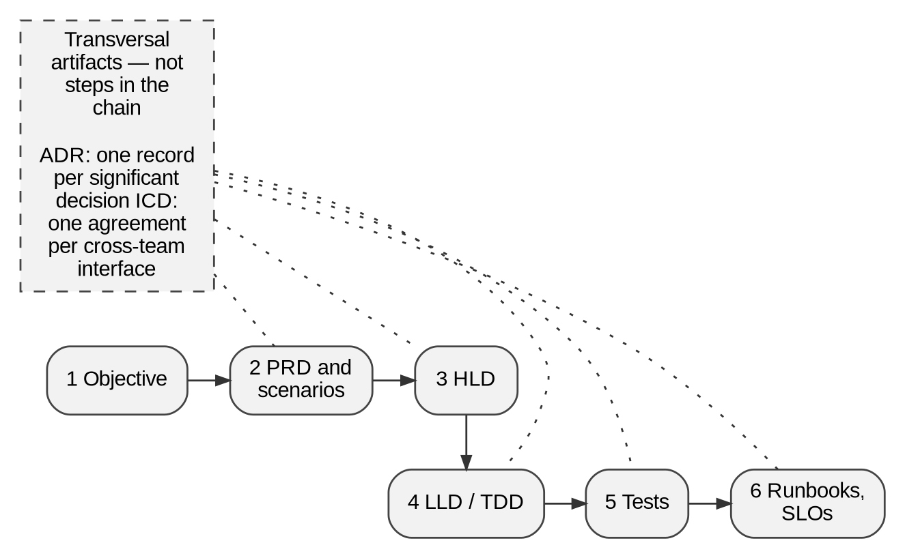
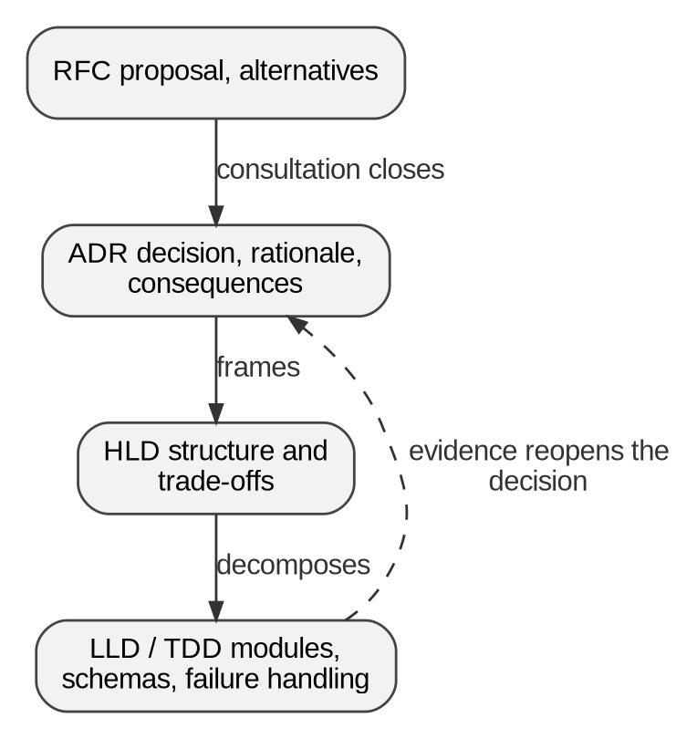
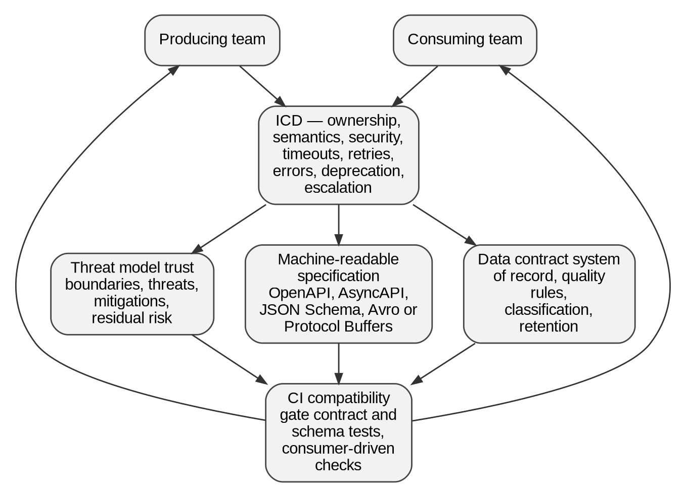
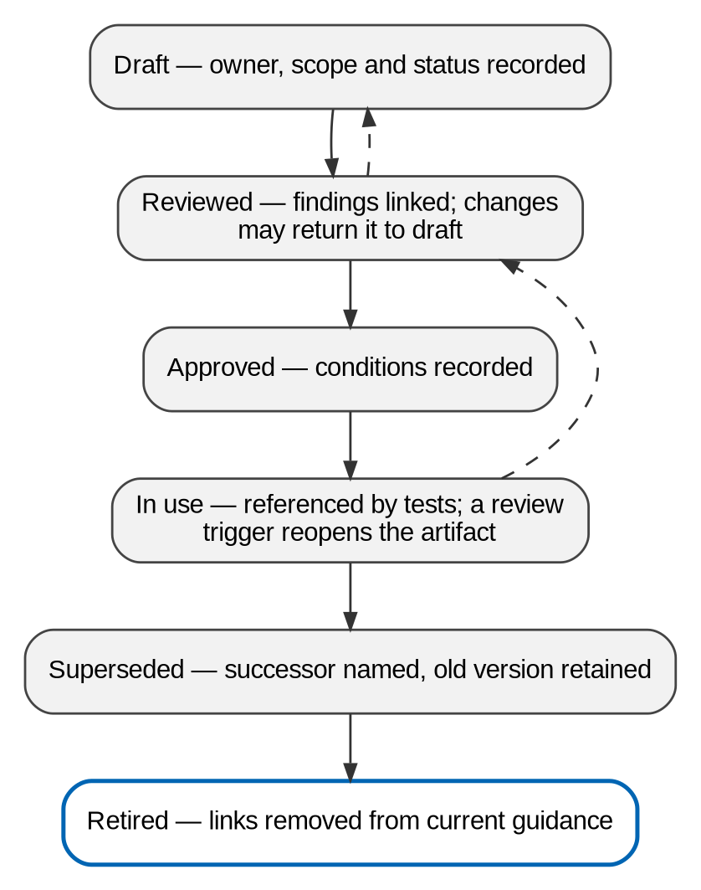

# 7. Solutions Architecture Artifacts

Solutions architecture artifacts record what a solution must achieve, how it is structured and why, how it moves into production and how it recovers. They are living evidence, not approvals in themselves, and they should be right-sized. A low-risk change inside one team may need only tests and a short design note — plus an ADR if it involves an architecturally significant decision — while a cross-organization integration needs an ICD, a migration plan and a readiness review. This chapter covers the artifacts the solution architect owns: it gives each one a fiche that states its audience, owner, mandatory trigger and quality criteria, and shows how they link to the enterprise, product and engineering artifacts described in Appendix C.

::: {.callout-note appearance="simple" icon=false title="When to Use This Chapter"}
- Deciding which artifacts a change, project or integration actually needs.
- Setting up traceability from business objectives to tests and operational evidence.
- Reviewing artifacts for consistency before a governance decision or release.
- Planning a migration, a production readiness review or a recovery commitment.
- Defining the lifecycle, ownership and retirement of living documents.
:::

::: {.callout-tip appearance="simple" icon=false title="Key Takeaway"}
Artifacts are evidence for decisions, not deliverables in themselves. Size them to the risk of the change, link them by identifier instead of copying content, and treat a contradiction between two artifacts as a defect.
:::

## 7.1 Artifact Catalog and Traceability

The catalog is the inventory; traceability is what turns an inventory into evidence. The section defines the chain that carries intent from an objective to production behavior, the transversal artifacts that are written whenever a decision or an interface appears, the catalog of artifacts the solution architect owns, and the inputs and engineering artifacts the architect consumes or links.

### 7.1.1 The Artifact Chain

**Definition.** The artifact chain is the ordered set of artifacts that carries intent from a business objective to operational evidence: objective, requirements and quality scenarios, high-level design, detailed design, tests, and runbooks with telemetry.

**Purpose.** The chain shows what must exist for a claim to be traceable, and in what order the artifacts can be created without guessing. It informs the artifact set for a change, the questions a reviewer asks, and the impact analysis when a requirement or decision changes: everything downstream of the changed link must be re-checked.

**What it includes.** Each link refers to the previous one by identifier rather than copying its content. Two artifacts are transversal rather than sequential: the Architecture Decision Record (ADR) and the Interface Control Document (ICD) are written whenever a significant decision or a cross-team interface arises — during high-level design, detailed design or later — and are referenced by every artifact they constrain (Figure 7.1).

{#fig-7-1 width="100%"}

Table 7.1 makes the chain operational: it states what each link carries forward and the failure that appears when the link is missing or ignored.

| Link | Carries forward | Fails when |
| :--- | :--- | :--- |
| Objective → requirements | Scope, outcome and measurable success | The requirement set does not name the outcome it serves |
| Requirements → design | Priority quality scenarios and constraints | Design decisions answer unstated or unranked needs |
| Design → tests | Structure, interfaces and failure behavior | Tests verify components but not the scenario |
| Tests → operations | Measured limits, failure modes and recovery evidence | Runbooks assert limits that were never measured |
| ADR → every stage | Chosen option, rejected alternatives and consequences | Downstream artifacts contradict the recorded decision |
| ICD → design, tests, operations | Ownership, semantics, timeouts and error behavior | Producer, consumer and tests disagree on the contract |

: Links in the artifact chain and what each one carries

**Why it is needed.** Consistency between artifacts matters as much as their content: an ICD that allows a three-second timeout contradicts an end-to-end requirement of two seconds, and the conflict is a defect even though each document is internally valid. Without identifier links, the same fact is copied into several documents and drifts. The evidence is a sampled end-to-end trace from a priority scenario to the decision, contract, test and operational check that address it. Appendix E lists the main consistency checks.

### 7.1.2 Artifact Catalog

**Definition.** The artifact catalog is the complete list of artifacts a solution may produce, each with an owner, a mandatory trigger and a fiche that defines its content and quality criteria.

**Purpose.** The catalog turns “which documents do we need?” into a decision with criteria. It informs the artifact set chosen at the start of a change, the evidence a review expects for a given risk tier, and the conversation about what will deliberately not be produced.

**What it includes.** Fifteen artifacts across requirements and description, design, decision and evaluation, interfaces, data and security, and transition and assurance (Table 7.2). Each artifact has a fiche later in this chapter with its purpose, audience, owner, mandatory trigger, minimum content, quality criteria, related artifacts and a short example. The enterprise, product and engineering artifacts that the architect consumes or links but does not own are listed in 7.1.3 and described in Appendix C. Chapter 19 extends this set for AI solutions: evaluation reports (19.6.1–19.6.2), release manifests (19.6.3) and the model card and impact assessment named in the artifact list of 19.9 (item 10).

| Artifact | Typical owner | Mandatory when |
| :--- | :--- | :--- |
| SRS and quality scenarios (Table 7.4) | Architect with product and QA | Quality attributes drive design |
| SAD (Table 7.5) | Solutions Architect | A system has an ongoing lifecycle |
| HLD (Table 7.6) | Solutions Architect | Change spans components or teams |
| RFC (Table 7.7) | Proposer | Change is contested or crosses team boundaries |
| ADR (Table 7.8) | Decision owner | Every architecturally significant decision |
| Technology evaluation (Table 7.9) | Solutions Architect | A technology choice affects quality, cost or reversibility |
| TCO (Table 7.10) | Solutions Architect with finance | Alternatives differ materially in lifecycle cost |
| ICD (Table 7.11) | Interface owners on both sides | Interface between teams or organizations |
| API / event specification (Table 7.12) | Producing team | Every published interface |
| Data architecture artifacts (Table 7.13) | Solutions Architect with data owners and stewards | Shared, regulated or replicated data |
| Threat model and risk register (Table 7.14) | Architect with security | New trust boundary or sensitive data |
| Migration and transition plan (Table 7.15) | Solutions Architect with delivery and operations | Authoritative data or a live dependency moves |
| Production readiness review (Table 7.16) | Solutions Architect with the service owner | A new capability or material change enters production |
| Continuity and recovery plan (Table 7.17) | Solutions Architect with capability owners | Loss of a capability has material impact |
| Architecture review record (Table 7.18) | Reviewers and decision owner | Changes in higher risk tiers |

: Artifact catalog, fiche and mandatory trigger

**Why it is needed.** A catalog without triggers produces document theater: everything is requested, nobody reads it, and the artifacts that matter lose credibility with the ones that do not. A catalog without owners produces documents that are accurate on the day they are written and wrong three months later. The evidence is a recorded artifact decision — the set chosen, the risk that justifies it and the artifacts deliberately excluded — plus an owner for each artifact produced.

**Example.** A payments team opening a new capability uses the catalog to select an HLD, an ADR for the asynchronous confirmation decision, an ICD with the provider, a migration plan and a readiness review, and links the PRD, contract tests and runbook that product and engineering own. A later change that adds a field to an internal report selects a contract update and tests only, and records that decision in the change ticket.

### 7.1.3 Inputs and Linked Engineering Artifacts

**Definition.** Inputs are the business, product and enterprise artifacts that constrain a solution; linked engineering artifacts are the detailed design, test and operational records that show how it is built and run. Other roles own them, and the solution architect consumes them and checks that they agree with the architecture.

**Purpose.** The distinction keeps ownership clear. It informs which artifacts the architect must read before design starts, which ones must stay consistent with the SAD and the decision records, and which ones the architect reviews without taking authorship away from their owners.

**What it includes.** Each input or engineering artifact, its relation to the solution architecture and the place where it is described (Table 7.3). Keep the authoritative copy at its source; the SAD (7.2.2) and the decision records carry its identifier, owner and accepted version. The enterprise context fiches are in Appendix C.1 and the product and engineering fiches in Appendix C.2.

| Artifact | Relation | Where it is described |
| :--- | :--- | :--- |
| BRD and business case | Input: business outcomes, scope, constraints, funding assumptions and the consequence of doing nothing | C.2.1; Chapter 1 for requirements |
| PRD | Input: product problem, users, journeys, priorities and acceptance criteria | C.2.2; Chapter 1 for functional requirements |
| Roadmap | Input: capability sequencing, dependencies, investment milestones and planning constraints | C.1.4; 18.3.2 |
| Principles | Input: durable decision preferences, guardrails and the exception route | C.1.2; Chapter 2 |
| Capability map | Input: business responsibilities, scope and accountable owners, independent of the current applications | C.1.3; 1.1.1 |
| Architecture vision | Input: agreed direction, scope, stakeholders and high-level outcomes against which the solution is framed | C.1.1; Chapter 8 |
| Architecture contract | Input: agreed architecture commitments, responsibilities and conformance expectations; distinct from an interface's ICD | C.1.5; Chapter 4 |
| Application portfolio | Input: existing systems, owners, lifecycle and dependencies that constrain reuse, replacement and retirement | C.1.6; 18.1 |
| LLD / TDD | Linked engineering output: component design and failure behavior implementing the HLD, SAD and ADRs | C.2.3 |
| Test strategy | Linked engineering output: verification approach and results for the architecture's priority scenarios | C.2.4; Chapter 16 |
| Runbook and SLOs | Linked engineering outputs: executable response and recovery procedures, service objectives and operational evidence | C.2.5; Chapters 14 and 15 |

: Inputs and linked engineering artifacts

**Why it is needed.** A solution that ignores the roadmap or the application portfolio duplicates a capability or depends on a system that is about to be retired, and an architecture that never checks the LLD or the runbook cannot tell whether its decisions were implemented. The evidence is an artifact record that names each input and linked artifact with its owner and version, and a sampled trace in which the engineering artifacts agree with the decisions they implement.

**Example.** The payments capability takes the PRD's acceptance criteria, the principle that favors reuse before build and the roadmap's retirement date for the legacy gateway as inputs. It links the LLD of the payment-attempt state machine, the contract test report and the runbook as engineering artifacts, each by identifier, and records the accepted version of each one in the SAD.

::: {.callout-warning appearance="simple" icon=false title="Common Pitfall"}
Producing every artifact for every change. Teams spend effort on documents nobody reads, the documents drift from the code, and reviewers lose trust in all of them — including the few that matter. Decide the artifact set by risk at the start of the work (7.1.2), and retire or update an artifact whenever the decision it records changes.
:::

::: {.callout-important appearance="simple" icon=false title="Decision & Trade-off"}
How much design documentation should precede implementation?

| Option | Choose when | Consequences |
| :--- | :--- | :--- |
| Tests and a short design note | Reversible change inside one team’s boundary | Minimal overhead; rationale may be lost if a significant decision was made without an ADR |
| ADRs plus updated views and contracts | A significant decision or an interface change | Durable rationale and compatibility evidence; needs discipline to keep views current |
| Full chain: PRD, HLD, ADRs, ICD, LLD, test strategy, runbook | New capability, cross-organization integration or regulated scope | Complete traceability and audit evidence; slowest to produce, and wasteful if applied to small changes |
:::

## 7.2 Requirements and Description

This section covers what the architecture is evaluated against and what the system currently is: the measurable quality scenarios with their links to tests and monitoring, and the maintained description of the solution. The business and product requirements that feed them are in Appendix C.2.

### 7.2.1 SRS and Quality Attribute Scenarios

**Definition.** A Software Requirements Specification (SRS) states externally observable functional and quality requirements, and quality attribute scenarios make the non-functional ones measurable; the scenario format and its use in prioritization are defined in 1.3.

**Purpose.** The SRS is the requirements artifact the architecture is evaluated against. It informs which quality attributes drive design, which trade-offs are acceptable and which tests must exist before a release, and it gives reviewers a stable definition of “meets the requirement” that is independent of the chosen design.

**What it includes.** Functional requirements at the system boundary, quality attribute scenarios with stimulus, response and measure, constraints, and links to the tests and monitoring that will demonstrate each one (Table 7.4). Numeric thresholds are illustrative until the business and operations owners confirm them.

| Field | Content |
| :--- | :--- |
| Purpose | State externally observable functional and measurable quality requirements |
| Audience | Architect, engineering, QA, operations, security, business owner of each scenario |
| Owner | Architect, with product and QA; each scenario has a named owner |
| Mandatory when | Any quality attribute drives a design decision or a release gate |
| Minimum content | Functional requirements at the boundary; scenarios with source, stimulus, environment, response and measure; constraints; verification links |
| Quality criteria | Measures are numeric and testable; workload and failure conditions stated; priorities agreed; each scenario maps to a test or measurement |
| Related artifacts | PRD (C.2.2), HLD (7.3.1), ADRs (7.3.2), test strategy (C.2.4), SLOs (C.2.5) |
| Example | “Under 500 submissions/s, p99 acknowledgment ≤ 2 s, measured at the edge over a 10-minute window” |

: Artifact fiche: SRS and quality attribute scenarios

**Why it is needed.** A quality requirement such as “must be fast” cannot justify a design, a cost or a test, and it cannot be shown to be met. Scenarios that are measurable but unowned drift when the business changes. The evidence is a scenario set traced to load, security, resilience and recovery tests, with the measured result recorded against each threshold.

**Example.** The checkout capability states five priority scenarios: p99 acknowledgment, durability of an acknowledged order, no duplicate charge for one attempt, no loss of a committed event during a broker outage, and recovery within the stated objective. Each is traced to a test and to the SLO that monitors it in production.

### 7.2.2 Solution Architecture Description (SAD)

**Definition.** A Solution Architecture Description (SAD) is the maintained description of one system, its boundaries, stakeholders, concerns, views and significant decisions. ISO/IEC/IEEE 42010:2022 supplies the architecture-description concepts; arc42 supplies a practical structure, and the C4 model supplies views at appropriate levels of detail. Using those references does not by itself establish conformance to the standard.

**Purpose.** The SAD gives reviewers and delivery teams a current account of the system they must change or operate. It informs impact analysis, onboarding, evaluation and the next design decision without requiring a reader to reconstruct the current system from a succession of project documents.

**SAD versus HLD.** The SAD describes the system and lives on as it evolves; the HLD designs one change, compares its alternatives and identifies the affected boundaries. An accepted change updates the SAD when the implemented state changes, with the HLD and its ADRs retained as the explanation. Mark proposed and implemented states separately rather than presenting an approved proposal as the running system.

**What it includes.** Scope, stakeholders and their concerns, constraints, structural and runtime views, deployment and recovery assumptions, data and interface ownership, priority quality scenarios, ADR links and open risks (Table 7.5). Record the system version or configuration described, the update owner and the change that last verified each affected view. Follow Chapter 5 for C4 (5.1.2), description structure (5.3.1) and arc42 (5.3.2), rather than reproducing those methods here.

| Field | Content |
| :--- | :--- |
| Purpose | Maintain a coherent description of the system across successive changes |
| Audience | Architecture reviewers, delivery teams, operations, security, data and business stakeholders |
| Owner | Solutions Architect; component owners validate the views that describe their systems |
| Mandatory when | A system has an ongoing lifecycle and changes must preserve shared architectural knowledge |
| Minimum content | Scope, stakeholder concerns, constraints, views, quality scenarios, ownership, ADR links, risks, described version and update trigger |
| Quality criteria | Views answer named concerns; states are identified; names and boundaries agree across views; each significant choice links to its ADR; implemented changes update affected content |
| Related artifacts | HLD (7.3.1), ADRs (7.3.2), ICDs (7.4.1), data architecture artifacts (7.4.2), evaluation records (Chapter 6) and linked operational evidence (C.2.5); Chapter 5 |
| Example | Payments SAD: Order and Payments boundaries, asynchronous authorization flow, provider trust boundary and recovery topology, updated after the provider-adapter change |

: Artifact fiche: Solution Architecture Description (SAD)

**Why it is needed.** An archive of HLDs describes changes, not necessarily the system that now exists. Without a maintained description, reviewers combine obsolete views and assume that a proposed migration already happened. The evidence is a versioned SAD whose affected views agree with the implemented state and link to the decisions that explain it.

**Example.** The payments team introduces a second provider. Its HLD compares routing options and defines the migration boundary; the SAD retains the current Order and Payments responsibilities and, after deployment, shows the new adapter and failure path. The old provider remains visible as a retiring dependency until traffic and reconciliation evidence justify removing it.

::: {.callout-warning appearance="simple" icon=false title="Common Pitfall"}
Treating the PRD as the requirements baseline and leaving quality attributes to the architect. The product document describes features, the architecture is then optimized for them, and latency, recovery and privacy arrive as late constraints that force redesign. Write the measurable quality scenarios alongside the functional requirements, with named owners, and gate design entry on both.
:::

::: {.callout-important appearance="simple" icon=false title="Decision & Trade-off"}
How should requirements artifacts be maintained?

| Option | Choose when | Consequences |
| :--- | :--- | :--- |
| One combined requirements document | Small solution, one team, stable scope | Fewer artifacts and faster reading; functional and quality requirements blur and traceability is weak |
| Separate PRD and SRS with linked identifiers | Product and architecture evolve at different speeds | Clear ownership and testable quality requirements; two documents to keep aligned |
| Requirements in the backlog with scenarios in the architecture repository | Continuous delivery with a stable product owner | Requirements stay close to delivery; the architectural view needs a curated index to remain reviewable |
:::

## 7.3 Design, Decision and Evaluation Artifacts

Design artifacts describe the intended structure; decision artifacts explain why it is that structure; evaluation artifacts show that the options behind a decision were compared on a common basis. Separating them keeps the description current while preserving the reasoning that a later change must respect or deliberately overturn.

{#fig-7-2 width="100%"}

### 7.3.1 HLD — High-Level Design

**Definition.** The High-Level Design (HLD) communicates system context, major containers, data stores, integration paths, trust boundaries, deployment topology and quality trade-offs, with references to the principal ADRs.

**Purpose.** The HLD is the shared design artifact for everyone who must agree on the shape of the solution: engineering, operations, security, data and the business. It informs reviews, estimation, interface planning and the deployment model, and it is the artifact a new team member reads to understand how the system fits together.

**What it includes.** Context and container views, trust boundaries, data ownership, priority quality scenarios, deployment and recovery assumptions, principal ADRs, open risks and approval responsibilities (Table 7.6). At handoff to detailed design, each major component has an accountable team, an interface owner and a deployment boundary, and assumptions that must be validated are marked and linked to ADRs or time-boxed spikes.

| Field | Content |
| :--- | :--- |
| Purpose | Describe the system shape, boundaries and trade-offs at a level stakeholders can review |
| Audience | Engineering, operations, security, data, architecture review, delivery management |
| Owner | Solutions Architect |
| Mandatory when | The change spans components, teams or a trust boundary |
| Minimum content | Context and container views, data ownership, integration paths, trust boundaries, deployment and recovery, priority scenarios, principal ADRs, open risks |
| Quality criteria | Every container has a responsibility and an owner; no product list without data flow; trade-offs name the alternative; assumptions marked and owned |
| Related artifacts | Requirements (7.2), ADRs (7.3.2), ICDs (7.4.1), threat model (7.4.3), runbook (C.2.5) |
| Example | Checkout HLD: context and container views, order and payment ownership, async payment path, zone failure assumption, links to three ADRs |

: Artifact fiche: HLD

**Why it is needed.** An HLD that lists cloud products without responsibilities and data flows is not a design; it cannot be reviewed for failure behavior or ownership, and it cannot be used to plan work. A design without trade-offs invites re-litigation of settled decisions in every review. The evidence is a design package in which each component has an owner, each boundary is drawn, and each significant choice points to its ADR.

### 7.3.2 RFC and ADR

**Definition.** A Request for Comments (RFC) solicits structured feedback on a proposal, and an Architecture Decision Record (ADR) records a decision with its context, options and consequences; ADR content and lifecycle are defined in 3.4.

**Purpose.** The pair separates consultation from commitment. The RFC informs a decision that is still open, collecting objections while they can still change the design; the ADR informs everyone who later depends on the choice, preserving why the option was selected and what was traded away.

**What it includes.** An RFC states the problem, the proposed change, alternatives, compatibility and migration impact, security and operational implications, reviewers and open questions (Table 7.7). An ADR states identifier, status, date, decision owner, context and drivers, options with criteria, the decision and rationale, consequences with mitigations, acceptance evidence and review triggers (Table 7.8). As an example template, Markdown Architectural Decision Records (MADR) 4.0.0 can structure an ADR; tailor it to keep the decision owner, alternatives, consequences, confirmation evidence and review trigger required here.

| Field | Content |
| :--- | :--- |
| Purpose | Collect structured feedback before a cross-team or contested change is committed |
| Audience | Peer architects, affected teams, security, operations, platform owners |
| Owner | Proposer; a named reviewer set |
| Mandatory when | The change crosses team boundaries, is contested or is hard to reverse |
| Minimum content | Problem, proposal, alternatives, compatibility and migration impact, security and operational implications, reviewers, open questions, outcome |
| Quality criteria | Options are genuinely comparable; impact on existing consumers stated; comment period and decision date explicit; outcome recorded |
| Related artifacts | ADR (7.3.2), HLD (7.3.1), ICD (7.4.1) |
| Example | RFC for moving payment confirmation to an asynchronous workflow, with three options and a two-week comment window |

: Artifact fiche: RFC

Table 7.8 gives the matching fiche for the ADR, which records the decision that the RFC consultation informed and keeps its rationale after the comment period closes.

| Field | Content |
| :--- | :--- |
| Purpose | Preserve the rationale, alternatives and consequences of one significant decision |
| Audience | Future maintainers, reviewers, governance, dependent teams |
| Owner | Decision owner; the architect usually drafts |
| Mandatory when | A decision is architecturally significant: hard to reverse, cross-cutting, or constraining a quality attribute |
| Minimum content | Identifier and status, date, owner, context and drivers, options and criteria, decision, consequences, acceptance evidence, review triggers |
| Quality criteria | Rejected options and reasons recorded; consequences include the bad ones; review trigger is an event or date, not “periodically” |
| Related artifacts | RFC (7.3.2), HLD (7.3.1), LLD (C.2.3), tests that validate the decision |
| Example | “ADR-014: asynchronous payment confirmation” — context, options, chosen option, pending-state consequence, revisit if provider SLA changes |

: Artifact fiche: ADR

**Why it is needed.** Treating an RFC as an approved decision, or an ADR as meeting minutes, obscures accountability: readers cannot tell whether a choice is open, proposed or binding. An ADR that records only the winner loses the reasoning that would let a successor decide whether the original conditions still hold. The evidence is a decision log in which each significant choice has a status, an owner, the alternatives considered and a review trigger.

**Example.** A team proposes a synchronous payment call in an RFC. Reviewers raise provider degradation and the two-second budget; the RFC closes with the asynchronous option. The ADR records the rejected synchronous option, the pending-state consequence and the trigger — a provider SLA below the target — that would reopen the decision.

### 7.3.3 Technology Evaluation

**Definition.** A Technology Evaluation is the recorded comparison of viable technologies against explicit requirements, constraints, operating obligations and evidence. It supports a decision; it is not a product catalog or a substitute for an ADR.

**Purpose.** The evaluation makes selection reviewable before procurement or implementation commits the solution to a supplier. It distinguishes mandatory disqualifiers from weighted preferences and shows which uncertainty must be tested before the recommendation can be accepted.

**What it includes.** A shortlist and reasons for exclusion, mandatory constraints, a weighted decision matrix, quality criteria derived from the ISO/IEC 25010:2023 product quality model, proof-of-concept results and a recommendation with consequences (Table 7.9). Give every criterion an operational definition, weight, scoring scale, evidence source and confidence. Reject a mandatory failure before scoring; do not let attractive features compensate for a residency or correctness violation. Agree weights before seeing the totals, test whether plausible changes reverse the ranking, and record unknown results as unknown rather than assigning a favorable score. A proof of concept records the product version, configuration, representative workload, failure conditions, result and limitations. Section 3.3 explains comparison and false precision; 18.2.6 covers vendor evaluation, and Appendix B.8 supplies the matrix template.

| Field | Content |
| :--- | :--- |
| Purpose | Recommend a technology through comparable criteria and reproducible evidence |
| Audience | Architecture reviewers, engineering, operations, security, procurement and the decision owner |
| Owner | Solutions Architect; specialists validate their criteria and procurement confirms commercial assumptions |
| Mandatory when | A technology choice materially affects quality, support obligations, sourcing cost or reversibility |
| Minimum content | Candidates, mandatory constraints, weighted criteria and scales, evidence, proof-of-concept configuration and results, sensitivity analysis, recommendation and rejected alternatives |
| Quality criteria | Same criteria and workload for every candidate; mandatory failures cannot be averaged away; scores trace to evidence; uncertainty and ranking sensitivity are visible |
| Related artifacts | Quality scenarios (7.2.1), TCO (7.3.4), ADR (7.3.2), risk register (7.4.3); 3.3, 18.2.6 and Appendix B.8 |
| Example | Compare messaging options for payment authorization using duplicate delivery, provider-outage recovery, support effort and exit constraints |

: Artifact fiche: Technology Evaluation

**Why it is needed.** A matrix completed after the preferred product is known disguises a preference as evidence. A demonstration that never injects a timeout says little about a payments workflow. The evidence is a comparison whose thresholds precede the scores and whose deciding claims can be reproduced in the stated environment.

**Example.** Two messaging candidates satisfy the hosting constraint. The proof of concept stops a consumer after its durable write and before acknowledgment, then redelivers the message. Both avoid a second local payment-state change; one needs additional operational tooling. The recommendation records that cost, the sensitivity of the ranking and the remote provider's separate idempotency obligation in the ADR.

### 7.3.4 Total Cost of Ownership

**Definition.** Total Cost of Ownership (TCO) is the cost of acquiring, changing, operating and leaving a solution over a stated horizon and demand model. It is a comparison model, not a supplier quote or a claim that the least expensive option is the best architecture.

**Purpose.** TCO makes the financial consequences of an architecture choice visible to the person who funds it. It informs build-versus-buy, managed-service, capacity and migration decisions, including costs that move between teams rather than disappear.

**What it includes.** Implementation and integration, migration and parallel operation, infrastructure consumption, licenses and support, staffing and on-call work, security and assurance, recovery capacity, training, decommissioning and exit (Table 7.10). The FinOps Foundation's FinOps Framework is an example operating model for that cost accountability, not a mandatory category list. Use the same horizon, workload, service objectives and cost boundary for all alternatives; separate one-time, recurring and contingent costs. Use ISO 4217 currency codes, such as USD, and record the price date, exchange rate, tax and inflation assumptions.

Record net present value (NPV) from the option's net cash flows, including the initial outlay, with a finance-approved discount rate and explicit timing; OpenStax, *Principles of Finance*, 16.2 explains the method. State the return on investment (ROI) formula, its horizon and its benefit baseline, and never count the same saving twice. Model low, expected and high demand, contractual commitments and the cost of exit: data export, replacement integration and retraining. Sections 18.2.2 and 18.2.5 explain unit economics and cost-benefit comparison.

| Field | Content |
| :--- | :--- |
| Purpose | Compare lifecycle cost and financial consequences on a common basis |
| Audience | Sponsor, finance, procurement, architecture, engineering and operations |
| Owner | Solutions Architect owns the technical cost model; finance validates valuation assumptions and the sponsor accepts the funding decision |
| Mandatory when | Alternatives differ materially in lifecycle cost, commitments, operating labor or exit obligations |
| Minimum content | Horizon, demand and service baseline, cost categories, currency and price date, cash-flow timing, NPV and ROI assumptions, sensitivity, sources and exit cost |
| Quality criteria | Equal comparison boundaries; one-time and recurring costs separated; assumptions dated and owned; no duplicate benefits; discounting explicit; exit and parallel running included |
| Related artifacts | Technology evaluation (7.3.3), business case (C.2.1), ADR (7.3.2), migration and transition plan (7.5.1); 18.2.2 and 18.2.5 |
| Example | Compare managed and self-operated payment messaging over one agreed horizon, including support labor, recovery capacity, parallel running and export costs |

: Artifact fiche: Total Cost of Ownership

**Why it is needed.** A lower consumption bill can conceal additional on-call staffing, and a short horizon can hide the cost of leaving a platform. The evidence is a dated model whose inputs, sensitivities and funding assumptions can be challenged and recalculated.

**Example.** A payments team compares a managed broker with a self-operated alternative. Both estimates include the same peak demand and recovery objective. The apparent infrastructure saving narrows once maintenance and incident coverage are included; the decision records the remaining difference and the demand level at which the ranking changes.

::: {.callout-warning appearance="simple" icon=false title="Common Pitfall"}
Writing the ADR after the work is done, as a summary that justifies what was built. The alternatives are reconstructed from memory, the uncomfortable consequences are omitted, and the record cannot help the next team decide whether the context still applies. Write the ADR when the decision is made, keep it short, and include the consequences that will hurt.
:::

::: {.callout-important appearance="simple" icon=false title="Decision & Trade-off"}
Which design and decision artifacts should a change produce?

| Option | Choose when | Consequences |
| :--- | :--- | :--- |
| ADR plus updated views in the existing description | Incremental change inside an existing architecture | Low effort and continuous rationale; assumes the architecture description is current enough to update |
| HLD, ADR and LLD for the affected area | New component, new integration or a change to failure behavior | Reviewable design and implementation guidance; slower start and a document to maintain |
| RFC, HLD, ADRs and LLD | Contested, cross-team or hard-to-reverse change | Objections surface before commitment and the decision is durable; heaviest process, justified only by coordination risk |
:::

## 7.4 Interface, Data and Security Specifications

These artifacts describe the boundaries where independent teams, systems and trust domains meet, and the data that crosses them. Their quality is measured by whether two parties can work independently and still interoperate, and whether every fact keeps one authority as it moves.

{#fig-7-3 width="100%"}

### 7.4.1 ICD and API/Event Specifications

**Definition.** The Interface Control Document (ICD) is the authoritative agreement on an interface between two parties, and the API or event specification is its machine-readable expression in OpenAPI, AsyncAPI, JSON Schema, Avro or Protocol Buffers; the integration semantics are defined in 10.2.3.

**Purpose.** The ICD informs the commercial and operational relationship between teams or organizations: who owns what, what the other party may rely on, how failures and changes are handled. The machine-readable specification informs tooling — code generation, validation and contract tests — and gives CI something to enforce. Together they let two teams ship independently without a shared integration environment.

**What it includes.** Ownership, business semantics, security, timeouts, retry eligibility, idempotency, versioning, error codes, observability, deprecation and escalation (Table 7.11), with the machine-readable surface linked rather than restated (Table 7.12). A syntactically valid schema does not prove business interoperability; the ICD carries the meaning the schema cannot.

| Field | Content |
| :--- | :--- |
| Purpose | Agree ownership, semantics and failure behavior for an interface between parties |
| Audience | Producer and consumer teams, security, operations, procurement for external parties |
| Owner | Interface owners on both sides, with one named as authoritative |
| Mandatory when | An interface crosses a team, organizational or trust boundary |
| Minimum content | Parties and owners, purpose and interaction, protocol and auth, payload semantics and schema reference, compatibility policy, errors, timeouts, retries, idempotency, service levels, observability, escalation, change control |
| Quality criteria | Both parties have signed the semantics; unknown outcomes defined; compatibility and deprecation rules stated; escalation path tested |
| Related artifacts | API/event specification (7.4.1), data contract (7.4.2), threat model (7.4.3), contract tests (C.2.4) |
| Example | PAYMENT-AUTH-v1 clauses in Appendix A.4, covering idempotency key and unknown-outcome handling |

: Artifact fiche: ICD

Table 7.12 gives the fiche for the machine-readable specification that expresses the ICD, so that tools and pipelines can enforce what the two parties agreed.

| Field | Content |
| :--- | :--- |
| Purpose | Express the interface contract in a form tools and pipelines can enforce |
| Audience | Producer and consumer engineers, API gateway and platform teams |
| Owner | Producing team |
| Mandatory when | An interface is published to another team, a partner or the public |
| Minimum content | Schema, operations or event types, errors, examples, authentication scheme, version; generated or validated in CI |
| Quality criteria | Spec is the single source for generated artifacts; compatibility checks run on every change; examples are executable; breaking change requires a major version |
| Related artifacts | ICD (7.4.1), data contract (7.4.2), contract tests (C.2.4) |
| Example | OpenAPI document for the payment authorization endpoint, validated and contract-tested in the provider pipeline |

: Artifact fiche: API and event specification

**Why it is needed.** Interfaces fail at the semantics, not the syntax: both sides accept the same JSON and disagree about whether a timeout means “declined”, whether retries are safe, or who owns the duplicate. The evidence is a pair of artifacts that agree, a compatibility test that runs on every change, and a negative test showing that an incompatible change is blocked before deployment.

### 7.4.2 Data Architecture Artifacts

**Definition.** Data Architecture Artifacts describe the solution's data domains, authoritative facts, models, stores, movement and lifecycle obligations. They include the existing models, dictionaries, contracts, lineage, classification and retention records, widened to show how those records fit into the whole solution. DAMA International's DAMA-DMBOK, second edition (2017), is a reference for the data-management disciplines; Chapter 9 owns the handbook's data architecture treatment.

**Purpose.** These artifacts make data authority and movement reviewable across the system, rather than leaving them implicit in database schemas. They inform storage and integration choices, transactional boundaries, analytics, privacy, migration and recovery, while leaving the meaning and permitted use of a fact with its accountable data owner.

**What it includes.** Data domains and owners; conceptual, logical and necessary physical models; authoritative attributes and identifiers; store-selection decisions; flows and transformation mappings; data contracts and semantic definitions; quality rules; lineage and derived copies; classification, access, retention and deletion (Table 7.13). Add the consistency and replication assumptions, migration mappings and reconciliation evidence needed to show that the design preserves business invariants. The Solutions Architect owns the integrated architecture package; data owners and stewards approve business meaning, quality and lifecycle rules. Reference their authoritative records rather than duplicating them.

| Field | Content |
| :--- | :--- |
| Purpose | Describe solution data authority, structure, movement and lifecycle obligations coherently |
| Audience | Architecture and data reviewers, delivery teams, integration owners, analytics, operations, privacy and compliance |
| Owner | Solutions Architect owns the integrated package; data owners and stewards validate meaning, quality and lifecycle rules |
| Mandatory when | A solution introduces or changes material data ownership, storage, movement, replication, analytical use or regulated processing |
| Minimum content | Domain and ownership map, models and dictionaries, store decisions, flows and mappings, contracts, classification and access, quality and lineage, consistency, retention and deletion, migration and recovery links |
| Quality criteria | One declared authority per fact; semantics and identifiers agree across boundaries; all copies are accounted for; consistency and lifecycle obligations are explicit; migrations reconcile and restored data honors deletion rules |
| Related artifacts | SAD (7.2.2), ADRs (7.3.2), ICD (7.4.1), data contract (9.3.3), privacy assessment (7.4.3), retention schedule (Appendix B.11), migration and transition plan (7.5.1), continuity and recovery plan (7.5.3); Chapter 9 |
| Example | Payments data package: Order and Payments authorities, stable order and attempt identifiers, order-to-payment flow, provider mapping, reconciliation rules and lifecycle controls for every derived copy |

: Artifact fiche: data architecture artifacts

**Why it is needed.** Individually correct models and dictionaries can still describe an inconsistent system when ownership changes across a flow or a replica escapes deletion. The evidence is a connected data architecture whose owners, contracts, mappings and lineage agree and whose critical invariants survive migration, replay and recovery.

**Example.** Order owns the order lifecycle; Payments owns provider attempts and charge outcomes. The data architecture shows how a provider status becomes an order projection without making that projection authoritative. A migration mapping preserves both identifiers, and the reconciliation report demonstrates that replay creates neither a second attempt nor an untracked copy of personal data.

### 7.4.3 Security and Risk Artifacts

**Definition.** Security and risk artifacts record security reasoning: threat models, trust-boundary diagrams, data protection impact assessments where legally required, risk registers and control mappings, with threats, mitigations, residual risk, owners and verification evidence; Chapter 13 defines the controls.

**Purpose.** They inform which threats are credible, which controls are justified, what risk remains and who accepts it. They give security reviewers a structured basis for challenge and give auditors traceability from a requirement to a control and to evidence that it operates.

**What it includes.** Trust boundaries, threat scenarios with likelihood and impact, controls with owners, residual risk with an accepting owner, and the test or monitoring that demonstrates each control (Table 7.14). Distinguish regulatory obligations from design preferences so that the register does not mix “required by law” with “we would prefer”.

| Field | Content |
| :--- | :--- |
| Purpose | Record credible threats, chosen controls, residual risk and its owner |
| Audience | Security, architecture review, risk and compliance, service owner |
| Owner | Architect with security; residual risk accepted by a named business owner |
| Mandatory when | A new trust boundary, sensitive data, external exposure or a regulated scope |
| Minimum content | Data flow and trust boundaries, threats and attack paths, controls and verification, residual risk and acceptance, review trigger |
| Quality criteria | Threats tied to the actual data flow; every control has evidence; residual risk has an owner and an expiry; assumptions about attacker capability stated |
| Related artifacts | HLD (7.3.1), ICD (7.4.1), test strategy (C.2.4), review record (7.5.4) |
| Example | Payment provider boundary: spoofed callback, replayed authorization and leaked credentials, each with a control and a test |

: Artifact fiche: threat model and risk register

**Why it is needed.** A threat list without a data flow produces generic controls that miss the path an attacker would actually use, and residual risk without an owner is risk accepted by nobody. The evidence is a model whose boundaries match the deployed system, whose controls are verified by tests or monitoring, and whose residual risk has a named owner and a review date.

**Example.** An integration with an external payment provider produces a threat model before implementation. It identifies callback spoofing, replay of an authorization and credential leakage across the boundary; each maps to mutual authentication, idempotency keys and secret rotation, and each has a test in the security suite.

::: {.callout-warning appearance="simple" icon=false title="Common Pitfall"}
Maintaining the ICD as prose while the OpenAPI file evolves independently. The schema changes, the agreement does not, and the two teams discover the divergence during an incident rather than in CI. Link the artifacts explicitly, make the machine-readable specification the source for generated code, and fail the build when the contract tests and the ICD disagree.
:::

::: {.callout-important appearance="simple" icon=false title="Decision & Trade-off"}
Where should the interface contract live?

| Option | Choose when | Consequences |
| :--- | :--- | :--- |
| ICD owned by the producer | One team provides a service to many consumers | Clear accountability and fast change; consumers must negotiate through the producer’s roadmap |
| ICD co-owned with a consumer-driven contract | A few significant consumers with distinct needs | Requirements are explicit and tested both ways; coordination cost and a shared review cadence |
| ICD owned by an integration or platform team | Many consumers, regulated interfaces or a shared gateway | Consistent standards and central enforcement; distance from both business domains and a potential bottleneck |
:::

## 7.5 Transition and Assurance

Approval of a design does not show that the solution can move into production, be operated and recover. This section covers the plan that moves the solution between architectures, the readiness decision before operation, the continuity and recovery commitments, and the record of a review decision.

### 7.5.1 Migration and Transition Plan

**Definition.** A Migration and Transition Plan describes how a solution moves from its current architecture through controlled transition states to its target architecture, including what happens when a step cannot complete safely.

**Purpose.** The plan turns an approved target into a sequence the delivery and operating teams can execute and verify. It informs dependency ordering, funding, data authority, cutover and the decision to stop, roll back or recover forward.

**What it includes.** Baseline and target boundaries, transition states with entry and exit criteria, work packages, dependencies, accountable owners, coexistence costs and retirement criteria (Table 7.15). Each state names its authoritative writer, permitted traffic and temporary interfaces. The cutover plan states the sequence, change window, decision authority, success measures and abort thresholds. The rollback plan identifies the last reversible point and how writes accepted after cutover are preserved or reconciled; where reversal is unsafe, specify recovery forward and obtain explicit acceptance before cutover. Data migration covers mapping, quality checks, initial load, change capture and the reconciliation evidence required before switching authority. Section 18.1 explains the migration techniques.

TOGAF ADM Phase F, Migration Planning (*The TOGAF Standard*, 10th Edition, 2022), links this sequence to enterprise migration planning. As a labeled vendor example, AWS's seven migration strategies, the “7 Rs” (retire, retain, rehost, relocate, repurchase, replatform, refactor), classify an approach; they do not replace transition-state or rollback evidence.

| Field | Content |
| :--- | :--- |
| Purpose | Move between architectures through owned, verifiable transition states |
| Audience | Delivery leads, data owners, operations, security, architecture reviewers and business change owners |
| Owner | Solutions Architect owns transition design; delivery and operations owners approve the executable sequence and the business owner accepts disruption |
| Mandatory when | A change moves authoritative data, replaces a live dependency or requires coexistence between architectures |
| Minimum content | Baseline, target and transition states; dependencies and owners; cutover and abort criteria; data mapping and reconciliation; rollback or recovery-forward path; retirement evidence |
| Quality criteria | Each state has one declared data authority; thresholds and decision rights are explicit; accepted writes survive reversal; rehearsals cover the actual cutover boundary; temporary components have an exit |
| Related artifacts | SAD (7.2.2), HLD (7.3.1), ADRs (7.3.2), TCO (7.3.4), data architecture artifacts (7.4.2), readiness review (7.5.2) and continuity plan (7.5.3); 18.1 |
| Example | Move payment authorization to a new provider by merchant cohort, retaining stable attempt identifiers and reconciling both providers before retiring the old path |

: Artifact fiche: Migration and Transition Plan

**Why it is needed.** A deployment sequence without transition states hides who owns data during coexistence, and a rollback that only redeploys old code can discard or duplicate accepted payments. The evidence is a rehearsed sequence with reconciliation results, named decision authorities and a documented response beyond the point where reversal is safe.

**Example.** The payments team first routes a test cohort to the new adapter while existing attempts finish with their original provider. Before increasing traffic, it checks authorization outcomes and reconciliation backlog. If the abort threshold is crossed, new attempts return to the old route; in-flight attempts retain their identifiers and are resolved against the provider that received them. Retirement waits for the final reconciliation.

### 7.5.2 Production Readiness Review

**Definition.** A Production Readiness Review is the recorded judgment that a specific solution version and deployment scope have the evidence, ownership and accepted residual risk needed to enter or continue production operation.

**Purpose.** The review prevents design approval from being mistaken for operational readiness. It informs a proceed, proceed-with-conditions or hold decision by the authorized owners; it does not itself authorize a production change.

**What it includes.** Criteria agreed before the review, the version and environment assessed, evidence links, findings, conditions, accountable acceptors and sign-off (Table 7.16). Cover priority quality scenarios, capacity, security and privacy, dependency behavior, monitoring and actionable alerts, on-call coverage, support training, cutover and recovery evidence. Each condition names its owner, deadline and consequence if unmet; a condition that must be met before launch remains a blocker until verified. Record who accepts operation, business impact and residual risk under the decision-rights model. Section 15.3.1 describes operational readiness; runbooks and SLOs remain linked engineering artifacts rather than content copied into this record.

Google's “The Evolving SRE Engagement Model” describes a Production Readiness Review in the context of SRE engagement and service takeover. It is a cited practice example, not a requirement to adopt Google's staffing model. As a labeled vendor example, the AWS Well-Architected review process can contribute architecture risks and improvement actions; its findings alone do not establish readiness for this release.

| Field | Content |
| :--- | :--- |
| Purpose | Decide readiness from evidence, named ownership and explicit residual-risk acceptance |
| Audience | Service owner, operations, delivery, business owner, security, privacy and architecture reviewers |
| Owner | Solutions Architect maintains the architecture readiness record; service and risk owners sign within their delegated authority |
| Mandatory when | A new production capability, material change or service takeover changes operating risk |
| Minimum content | Version and scope, readiness criteria, evidence per criterion, findings, conditions and closure evidence, authorized sign-offs, decision and review trigger |
| Quality criteria | Evidence matches the assessed configuration; blockers are not hidden as follow-up work; conditions have owners and deadlines; sign-off names its scope; change approval is separate |
| Related artifacts | Quality scenarios (7.2.1), SAD (7.2.2), migration plan (7.5.1), continuity plan (7.5.3), test reports (C.2.4), runbook and SLOs (C.2.5); 15.3.1 |
| Example | Payment-provider rollout review: duplicate-charge test, peak-load result, provider-timeout reconciliation, recovery rehearsal and staffed escalation path |

: Artifact fiche: Production Readiness Review

**Why it is needed.** A green build does not prove that someone can resolve a pending payment at night. A signature without a version or evidence trail cannot explain what was accepted. The evidence is a readiness decision tied to the deployed scope, with mandatory conditions closed and any residual risk accepted by an authorized owner.

**Example.** The new payments adapter passes contract and load tests, but the provider-timeout alert has no staffed escalation path. The review holds the rollout until the service owner demonstrates the response. It then records readiness for the initial cohort only; expanding traffic requires the capacity and recovery evidence defined for the next state, followed by separate release-time approval.

### 7.5.3 Continuity and Recovery Plan

**Definition.** A Continuity and Recovery Plan records how essential business capabilities continue at an agreed minimum level or are restored after disruption, together with evidence that the chosen recovery strategy works. ISO 22301:2019 provides the business continuity management-system reference; a solution plan alone does not demonstrate conformity with that management-system standard.

**Purpose.** The plan connects business impact to recoverable architecture. It informs recovery investment, dependency order and the decision to operate in a degraded mode, rather than assuming that a backup or a regional replica protects every capability equally.

**What it includes.** Business-impact assumptions validated by the capability owners, time-sensitive dependencies, minimum acceptable service and a recovery time objective (RTO) and recovery point objective (RPO) per capability (Table 7.17). Translate those objectives into data, identity, network, provider and staffing requirements. State the activation authority, recovery strategy, dependency order, communications, alternate processing, reconciliation and return-to-normal criteria. The exercise record identifies the configuration tested, scenario, participants, observed restoration time, data-loss window, integrity result, unmet objectives and corrective actions. Sections 12.4.2–12.4.3 explain recovery and continuity planning. Link to the runbook's executable procedures and to the SLOs (C.2.5); this plan owns the recovery commitments and strategy, not a second copy of either artifact.

| Field | Content |
| :--- | :--- |
| Purpose | Preserve or restore essential capabilities within business-approved disruption limits |
| Audience | Business capability owners, operations, incident leadership, security, data owners and architecture reviewers |
| Owner | Solutions Architect owns the solution recovery design; capability owners approve impact assumptions and objectives, and operations owns execution and exercises |
| Mandatory when | Loss of a capability or its data creates material business, contractual or regulatory impact |
| Minimum content | Impact and minimum service per capability, RTO/RPO, dependency map, recovery strategy, activation and communication authority, runbook links, exercise record and corrective actions |
| Quality criteria | Objectives follow business impact; dependencies and credentials are recoverable; observed time and data loss are recorded; integrity is checked; failed objectives produce owned corrective actions |
| Related artifacts | SAD (7.2.2), quality scenarios (7.2.1), data architecture artifacts (7.4.2), migration plan (7.5.1), readiness review (7.5.2), runbooks and SLOs (C.2.5); 12.4.2–12.4.3 |
| Example | Restore order acceptance and resolve pending payments in dependency order, preserving attempt identifiers and measuring recovery against each capability's objectives |

: Artifact fiche: Continuity and Recovery Plan

**Why it is needed.** A database restore can succeed while checkout remains unavailable because its identity provider or keys cannot be recovered. A technically available service may still be unable to reconcile payments. The evidence is a capability-level exercise showing the time, data loss and business integrity actually achieved, with gaps accepted or remediated explicitly.

**Example.** A recovery exercise removes the primary payments environment. Operations restores the required identities, configuration and data, then resumes order acceptance before processing the authorization backlog. Stable attempt identifiers and provider reconciliation prevent a second charge. The record compares the observed results with each capability's objectives and assigns an owner to the delayed credential-restoration step; the next exercise verifies the correction.

### 7.5.4 Architecture Review Record

**Definition.** An architecture review record is the artifact that documents what a review examined, what it found, which exceptions it accepted and on what conditions the change may proceed.

**Purpose.** The record informs the decision owner, the delivery team and any later auditor. It makes the review reproducible — the scope, the evidence and the findings are all named — and it is the artifact that turns a meeting into an accountable decision (Chapter 4, 4.4).

**What it includes.** Scope and risk tier, requirement and decision inventory, findings by domain, SLO and capacity evidence, exceptions with owners and expiry, the outcome with its conditions and follow-up actions (Table 7.18). The review lead records the outcome; the decision owner signs it.

| Field | Content |
| :--- | :--- |
| Purpose | Evidence an architecture decision with findings, conditions and accepted exceptions |
| Audience | Decision owner, delivery leads, governance, auditors |
| Owner | Reviewers with the decision owner; the review lead records the outcome |
| Mandatory when | The change falls in a risk tier that requires review |
| Minimum content | Scope and risk tier, requirement and decision inventory, findings by domain, SLO and capacity evidence, exceptions with owners and expiry, outcome and conditions, follow-up actions |
| Quality criteria | Findings cite evidence; each exception has an owner and an expiry date; conditions are verifiable; the decision owner signs the outcome |
| Related artifacts | HLD (7.3.1), ADRs (7.3.2), threat model (7.4.3), test reports (C.2.4) |
| Example | Payment capability review: no critical findings, two conditions on reconciliation evidence, one exception expiring after the first quarter |

: Artifact fiche: architecture review record

**Why it is needed.** A review without a record cannot be audited and cannot be appealed: nobody can tell which evidence was considered or which conditions were accepted. The record also protects the reviewers, because it separates a documented condition from an undocumented assumption. The evidence is a signed record whose findings cite artifacts and whose exceptions carry owners and expiry dates.

**Example.** The payment capability review records no critical findings, two conditions on reconciliation evidence and one exception expiring after the first quarter. The decision owner signs it, and the conditions become tracked actions in the delivery plan.

::: {.callout-warning appearance="simple" icon=false title="Common Pitfall"}
Treating design approval as permission to cut over, accept operation and declare recovery proven. A technically successful deployment can still leave two authoritative writers, no owner for an unknown payment outcome and a rollback that loses accepted work. Decide the transition states and acceptance criteria before the move, rehearse cutover and recovery, and record a separate readiness decision with named acceptors and evidence for every blocking criterion. A planned exercise is not a successful exercise.
:::

::: {.callout-important appearance="simple" icon=false title="Decision & Trade-off"}
What evidence justifies moving to the next transition state?

| Option | Choose when | Consequences |
| :--- | :--- | :--- |
| Incremental cohort or capability cutover | Traffic can be partitioned and outcomes reconciled while both paths exist | Limits exposure; adds coexistence cost, routing rules and reconciliation work |
| Rehearsed cutover in an agreed window | The authority boundary cannot be split safely and disruption is acceptable | Shorter coexistence; requires tested abort thresholds, a last reversible point and authorized go/no-go decisions |
| Defer the transition and close a blocking gap | Readiness, data integrity or recovery evidence fails a mandatory criterion | Delays benefit and keeps the old path funded; avoids accepting unowned or unauthorized risk |
:::

## 7.6 Artifact Lifecycle

Every artifact in this chapter, and every linked artifact in Appendix C, moves through the same states. The lifecycle keeps the set trustworthy as the system, its providers and its requirements change.

{#fig-7-4 width="100%"}

**Definition.** The artifact lifecycle is the set of states an artifact passes through — draft, reviewed, approved where required, in use, superseded and retired — together with the owner, location and review trigger that keep it trustworthy.

**Purpose.** The lifecycle informs how a reader knows whether an artifact can be relied on, and how an organization keeps a large document set from becoming a set of contradictory historical layers. It also informs the review process: an artifact whose trigger has fired is stale evidence until it is revisited.

**What it includes.** A status for every artifact, an authoritative location, an owner, review triggers and a successor pointer for superseded versions (Table 7.19). Superseded documents are retained where audit or history requires it, but every current reference must resolve to the current version. Define lightweight schemas (Appendix B) and risk-based minimum evidence; avoid mandatory documents that nobody reads.

| State | Entered when | What must be recorded |
| :--- | :--- | :--- |
| Draft | Work starts | Owner, scope, status, location |
| Reviewed | Reviewers have commented and comments are resolved or deferred | Reviewers, findings, open items |
| Approved | Policy requires approval and the decision owner accepts | Approver, date, conditions |
| In use | Implementation and tests reference the artifact | Current version, links from code and tests |
| Superseded | A newer version or a different artifact replaces it | Successor identifier, effective date |
| Retired | The capability or obligation ends and links are removed | Retention decision and archive location |

: Artifact states, entry criteria and required fields

**Why it is needed.** Document theater produces stale files that no team trusts, and a superseded design that still looks current becomes a source of wrong decisions. The evidence is a catalog in which each artifact has an owner, a status, an authoritative location and a review trigger, and in which a sampled reference resolves to the current version.

**Example.** The payment HLD is superseded when the asynchronous workflow replaces the synchronous design. The new version is approved, the old one is retained with a successor pointer for audit, and the ICD, tests and runbook are updated in the same change so that no current reference points to the retired design.

::: {.callout-warning appearance="simple" icon=false title="Common Pitfall"}
Treating approval as the end of an artifact’s life. The document is signed, filed and never revisited while the system, the provider and the requirements move on; the next review reads a design that no longer exists. Make the review trigger an event — a decision, a dependency change, a failed test — and store the artifact where the people who change the system will see it.
:::

::: {.callout-important appearance="simple" icon=false title="Decision & Trade-off"}
How should artifact status and location be managed?

| Option | Choose when | Consequences |
| :--- | :--- | :--- |
| Artifacts in the code repository, reviewed with the change | Engineering-owned artifacts such as ADRs, ICDs and runbooks | Versioned with the code and visible in review; poor fit for business documents and requires writing discipline |
| A document management system with a catalog | Regulated scope with formal approvals and audit | Controlled versions and access; distance from daily engineering work and risk of becoming a filing cabinet |
| A wiki with a maintained index and owners | Mixed audiences and rapidly evolving content | Easy contribution and linking; weak enforcement, so status and owners must be reviewed explicitly |
:::

## 7.7 Worked Example: Right-Sizing Artifacts for a Payment Capability

*In practice:* This example shows that the same capability needs a full artifact chain at creation and almost none for a later low-risk change.

A new payment capability starts from the PRD, which states outcomes, actors and acceptance conditions, and from the quality scenarios that make them measurable. The HLD defines boundaries and deployment topology, and an ADR records why confirmation is asynchronous; a technology evaluation and a TCO compare the two messaging options behind that decision. An ICD agrees the provider contract, error behavior, authentication and versioning, with OpenAPI as its machine-readable part. Before the first cohort is routed, the migration plan defines the transition states and a production readiness review records the evidence and who accepted it. After deployment the SAD shows the new adapter and its failure path. The LLD of the payment-attempt state machine, the contract tests, the fault-injection report and the runbook are linked engineering artifacts (Appendix C.2).

A later change that only adds a field to an internal report needs none of the new design documents — only a contract update and tests — and the SAD does not change.

::: {.callout-note .review appearance="minimal" icon=false title="Architecture Review Checklist — Artifacts"}

☐  Is the artifact set proportional to the change’s risk and cross-team impact?

☐  Does each artifact have an owner, status, location and review trigger?

☐  Are artifacts linked by identifier rather than duplicated?

☐  Do linked artifacts agree on thresholds, contracts and decisions?

☐  Does the SAD distinguish implemented and proposed states and reflect accepted changes?

☐  Are migration, production readiness and continuity decisions supported by evidence for the same solution version and capability objectives?
:::

## 7.8 Further Reading

- ISO/IEC/IEEE 29148:2018 — requirements engineering processes and information items.
- ISO/IEC/IEEE 42010:2022 — architecture description concepts behind the SAD.
- Clements et al. (2010), *Documenting Software Architectures: Views and Beyond* — documentation packages and views.
- Nygard (2011), “Documenting Architecture Decisions”.
