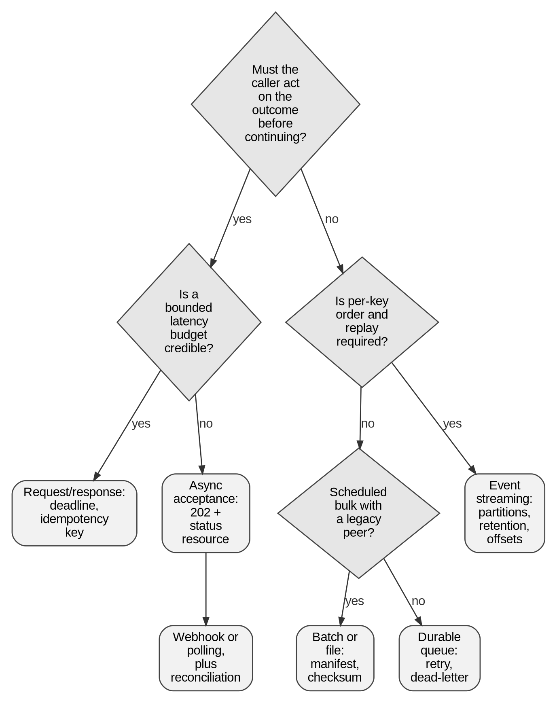
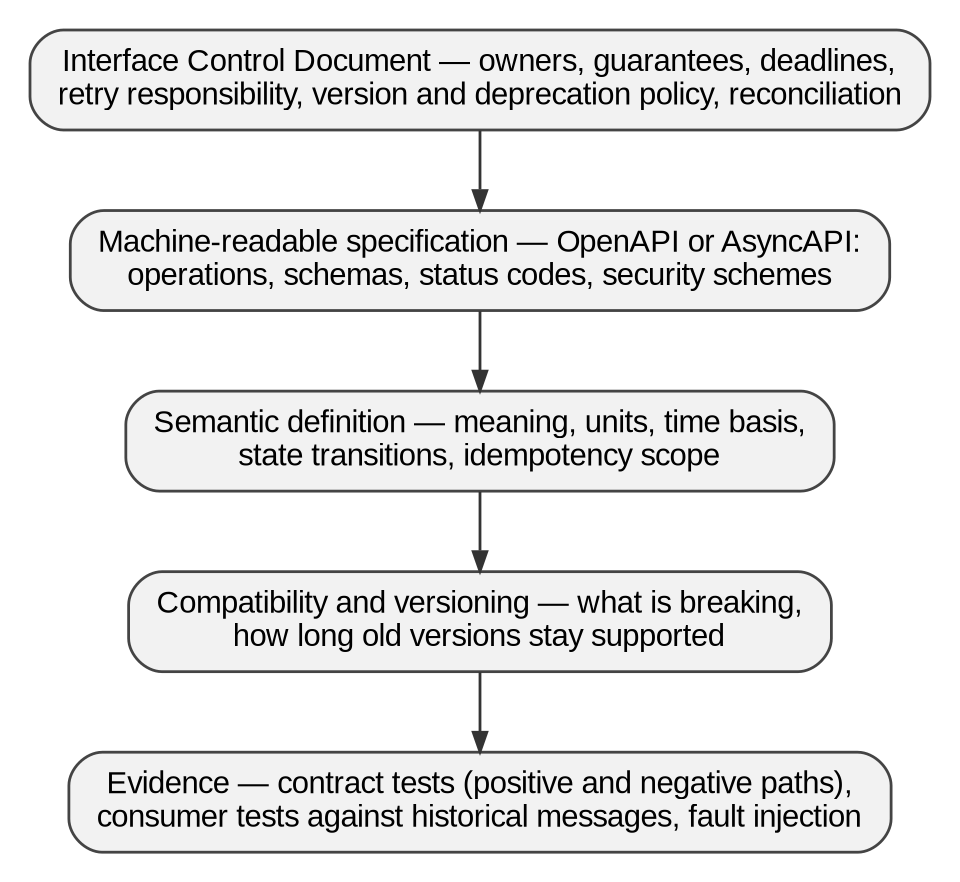
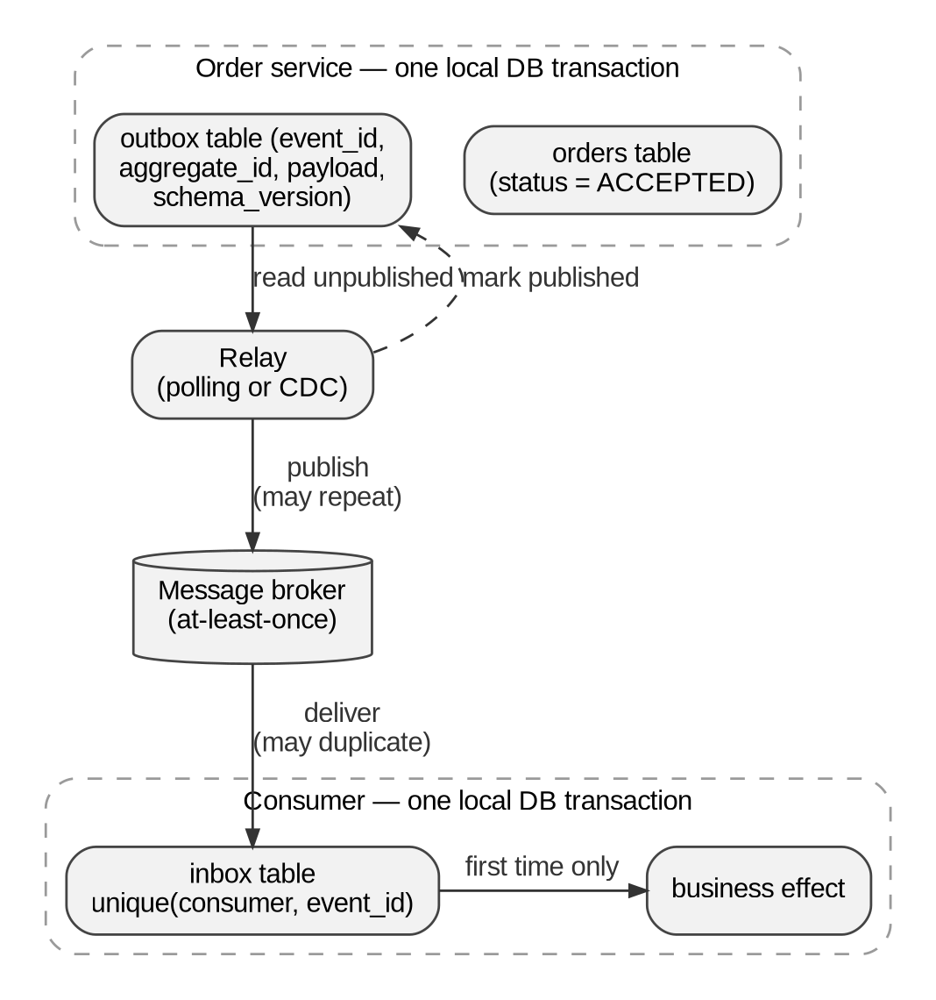
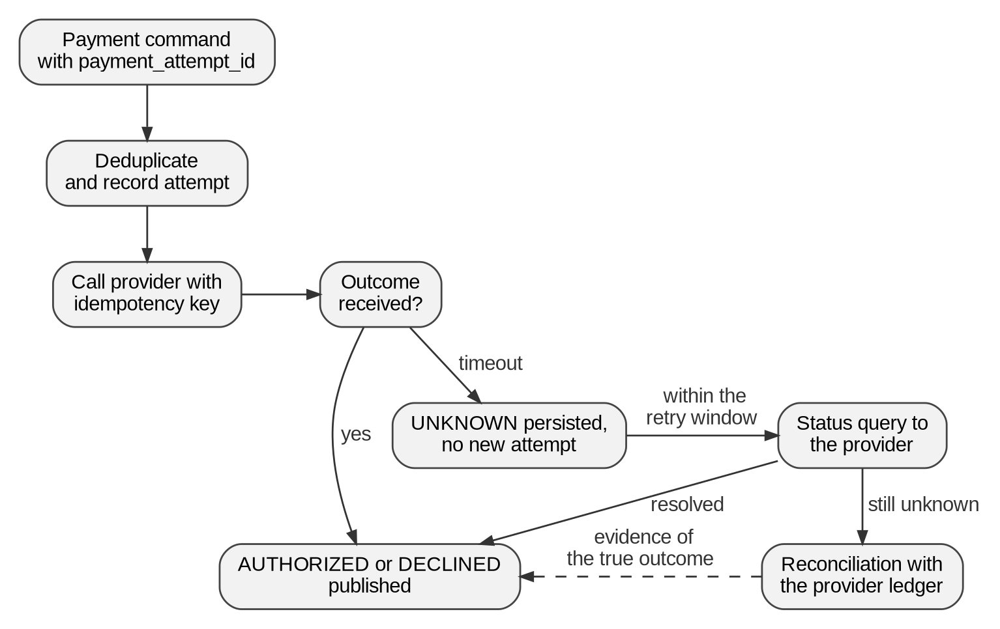
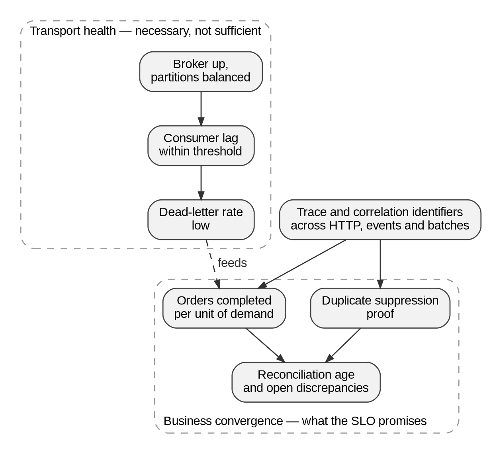
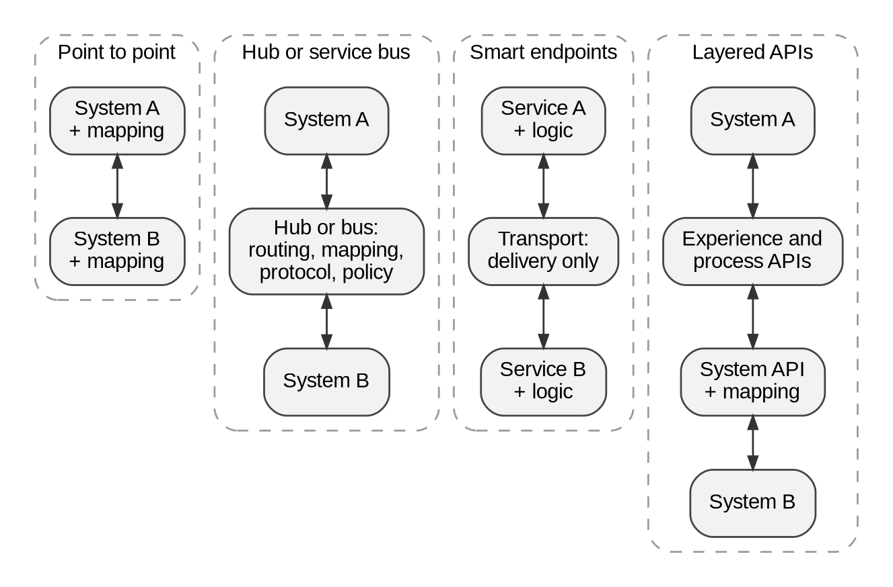
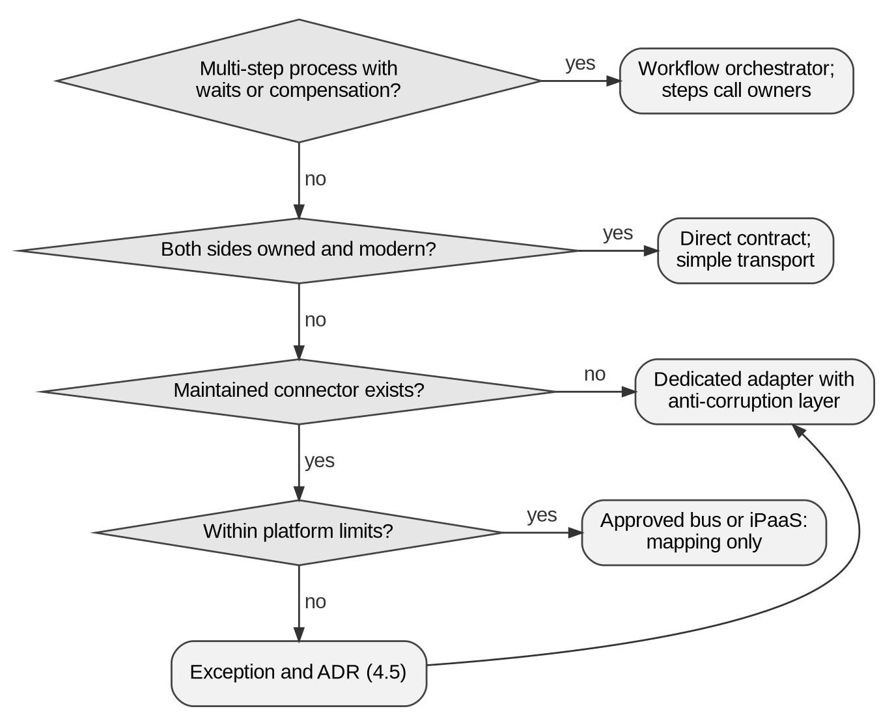

# 9. Integration Architecture

Integration architecture defines the contracts and failure semantics between systems that evolve independently. Its central distinction is between the correctness of a business workflow and the availability of the transport that carries it: a healthy broker does not prove that payments complete, and a successful HTTP call does not prove that a duplicate charge was avoided.

::: {.callout-note appearance="simple" icon=false title="When to Use This Chapter"}
- Defining a contract between teams, systems or organizations.
- Choosing an integration style and its delivery guarantees.
- Designing for duplicate, reordered, late or replayed messages and unknown outcomes.
- Reviewing API lifecycle, idempotency, reconciliation or integration security.
- Choosing an integration platform, workflow orchestrator or legacy connection technique.
- Choosing how a server pushes updates to connected clients.
:::

::: {.callout-tip appearance="simple" icon=false title="Key Takeaway"}
Integration architecture is the architecture of failure semantics. The contract must say who owns each invariant, what happens on duplicate, reorder or timeout, and how an unknown outcome is resolved with evidence.
:::

## 9.1 Integration Foundations and Styles

An integration style is the combination of interaction pattern, transport and failure model chosen for one interface; the foundations are the boundary and ownership decisions that must precede it.

### 9.1.1 Boundaries and Ownership

**Definition.** An integration boundary is the line at which one owner's state stops being authoritative and another owner's responsibility begins.

**Purpose.** Boundaries decide who may change a fact, who answers for it during an incident and who approves a contract change. Drawing them before choosing a protocol prevents the most expensive integration failure: two systems that both believe they own the same state.

**What it includes.** Integration boundaries follow data and process ownership. Before choosing a protocol, identify the producer, consumer, authoritative state, trust boundary and business invariant. An interface is a commitment between owners: it specifies who may invoke it, who may change it and who handles failures.

In the reference checkout, Order owns the order lifecycle and `order_id`; Payments owns authorization attempts, provider transaction identifiers and charge state. Neither mutates the other’s tables, and the interface does not expose either schema. The ICD assigns owners for schema evolution, credentials, incident response and reconciliation, so an outage does not become an ownership dispute.

**Why it is needed.** When the boundary is unclear, every incident starts with a negotiation and every schema change becomes a bilateral release. Ownership also determines the failure budget: the consumer inherits the producer's availability and must design for it. The evidence is an interface inventory that names the authoritative state and both owners per interface, plus an ICD that assigns schema evolution, credentials and reconciliation to named roles.

### 9.1.2 Selecting an Integration Style

**Definition.** The integration style is the interaction pattern chosen for an interface — request/response, durable messaging, event streaming, batch exchange or notification — together with the delivery and failure semantics that come with it.

**Purpose.** The style sets the coupling the solution will live with: whether the caller's availability depends on the callee, whether work can complete later, whether order and replay are available. Choosing it deliberately, against named requirements, is what keeps latency, coupling and failure costs from being discovered in production.

**What it includes.** Table 9.1 summarizes the styles and their main costs; Figure 9.1 shows the selection path.

| Style | Use when | Main cost |
| :--- | :--- | :--- |
| Request/response | The caller needs the outcome before continuing and a bounded latency budget is credible | Availability and latency coupling |
| Durable messaging (queue) | Work can complete later; producer and consumer scale independently | Duplicates, delayed processing, pending states |
| Event streaming | Ordered partitions, retention and replay are explicit requirements | Partitioning, consumer offsets, operational effort |
| Batch / file transfer | Scheduled, auditable bulk exchange, often with legacy systems | Latency; partial-file and reconciliation handling |
| Webhook / polling | Notifying external parties of changes | Endpoint availability, authentication, missed notifications |

: Integration styles and their main cost

Figure 9.1 turns the comparison into a selection path: latency, coupling, replay and consumer autonomy narrow the options before cost decides.

{#fig-9-1 width="100%"}

Record the chosen style in an ADR, state why rejected alternatives fail a named requirement, and validate latency, failure behavior and replay under peak load. The style says how two systems interact; what stands between them is a separate decision (9.6). Chapter 18 (18.2) applies these integration choices to model APIs, retrieval services and agent tool calls.

**Why it is needed.** Style is usually chosen by familiarity: teams that know HTTP build synchronous chains, teams that know a broker publish events for everything. Both choices are defensible somewhere and expensive elsewhere. The evidence is an ADR per material interface comparing at least two styles against the latency budget, the coupling requirement and the failure requirements, plus a peak-load test result for the chosen one.

### 9.1.3 Synchronous APIs and Cascading Failures

**Definition.** A synchronous call is an integration in which the caller blocks until the callee responds, so the caller's availability and latency include the callee's.

**Purpose.** Making the coupling explicit lets the architect decide where a deadline, a fallback or an asynchronous step is required. The goal is not to avoid synchronous calls but to know exactly which user journeys they put at risk.

**What it includes.** Synchronous calls couple the caller’s availability to downstream latency and capacity; a chain of synchronous dependencies multiplies failure probability. Allocate one end-to-end deadline and pass the remaining budget to each downstream call.

Retry only idempotent operations or operations protected by a stable idempotency key. A transport timeout leaves the outcome **unknown**: for payment authorization, persist the attempt identifier and query status before submitting a new attempt, and return a pending state rather than translating every timeout into a decline. A circuit breaker stops repeated calls during a sustained outage but does not resolve an unknown outcome.

**Why it is needed.** Unbounded waits consume threads and connections until the caller fails for reasons unrelated to its own health, and blind retries turn a slow dependency into an outage with multiplied load. The evidence is a stated end-to-end deadline with per-hop budgets, a retry policy limited per request and in aggregate, and a fault-injection result that shows the caller degrading rather than collapsing when a dependency slows down.

### 9.1.4 Asynchronous Messaging and Competing Consumers

**Definition.** Asynchronous messaging places a broker between producer and consumer so that work can be accepted now and completed later, by one or many competing consumers.

**Purpose.** Messaging buys temporal decoupling, buffering and independent scaling. It pays for them with duplicates, delayed processing and pending business states, which must be designed rather than discovered.

**What it includes.** Queues decouple producers from consumer execution, enabling buffering and independent scaling. Most brokers provide at-least-once delivery, so consumers must tolerate duplicates and poison messages. Acknowledge a message only after the required durable work completes, and size visibility timeouts and retry policy accordingly.

The consumer records the `message_id` together with the business effect in one local transaction; where the store cannot do so, document the compensating deduplication and its failure window; on redelivery it finds the identifier and skips the effect. This protects local processing only. A remote side effect such as a provider charge needs a provider-supported idempotency key or a status-reconciliation procedure.

**Why it is needed.** Acknowledging before the work is durable loses messages precisely when the system is under stress, and a visibility timeout shorter than the processing time produces duplicate work that looks like a capacity problem. The evidence is an acknowledgement point documented per consumer, a deduplication record in the same transaction as the state change, and a test that delivers the same message twice and shows one business effect.

### 9.1.5 Events and Commands

**Definition.** An event states a fact that has occurred; a command requests that an action be taken.

**Purpose.** The distinction decides what a consumer may infer. Events describe the past and can be published after the fact; commands address a specific receiver and expect an effect. Mixing them produces consumers that read intentions as facts and producers that cannot say what actually happened.

**What it includes.** An event states a fact that has occurred (OrderAccepted); a command requests an action (AuthorizePayment). Publish an event only after the transaction that makes it true has committed. Consumers must not infer stronger guarantees than the producer offers: OrderAccepted does not mean the payment succeeded.

Each event carries `event_id`, `aggregate_id`, event type, occurrence time, producer, `schema_version` and correlation identifiers. Define the meaning of each status transition in the contract and specify how consumers handle late or out-of-order events.

A command is usually sent point-to-point to one owner, and when the sender needs an answer over messaging, the request-reply pattern adds a reply channel and a correlation identifier. An event is delivered through publish-subscribe to any number of consumers. Decide how much state an event carries. Event notification sends a thin message, so consumers call back for detail, which keeps the event small and couples them to the owner's availability. Event-carried state transfer includes the data consumers need, which removes the call and leaves each consumer holding a copy that can be stale and must follow the data's classification and retention rules.

**Why it is needed.** Publishing before commit advertises a fact that may never exist, and a consumer that treats an event as permission rather than information builds a workflow on a guarantee nobody made. The evidence is the commit point documented per producer, the mandatory event envelope in the contract, and consumer tests against late and out-of-order events that verify the state machine never regresses.

### 9.1.6 Event Streaming, Partitioning and Replay

**Definition.** Event streaming is the durable, ordered-by-partition log of facts that consumers read at their own offsets and can re-read within retention.

**Purpose.** Streaming makes replay a first-class capability: projections can be rebuilt, a new consumer can be backfilled, and an incident can be investigated against the actual sequence of facts. It also fixes the parallelism ceiling at the partition count, which is a design decision rather than an operational detail.

**What it includes.** Event streams preserve order within a partition, not across the whole stream. The partition key determines ordering, parallelism and hotspot risk: partition by `order_id` when per-order ordering matters, and watch for skew when a few keys dominate traffic.

Replay rebuilds projections only if handlers are deterministic and side effects are protected. Compare aggregate version or sequence numbers to reject stale updates. Document retention, lag alerts and a backfill path when a consumer needs history older than retention.

**Why it is needed.** A projection rebuilt from non-deterministic handlers produces a different answer than the original, and a partition key chosen for even distribution can break per-entity ordering. Retention shorter than the recovery need makes replay impossible exactly when it is required. The evidence is the documented partition key and its ordering guarantee, a replay test that rebuilds a projection to the same state, and a retention setting matched to the backfill requirement.

### 9.1.7 Batch and File Integration

**Definition.** Batch integration exchanges data as scheduled, bounded files or extracts rather than as individual requests.

**Purpose.** Batch remains the correct choice for large volumes, auditable periodic exchange and partners who cannot accept real-time calls. Treating it as legacy to be eliminated ignores that it often carries the reconciliation the rest of the estate depends on.

**What it includes.** File exchange remains valid for regulated or legacy environments but still needs a contract: manifest, naming, encoding, schema version, checksum, cut-off time, duplicate detection, partial-file handling and reconciliation totals. Treat received files as untrusted until validated, and publish transport receipt separately from business acceptance. A stable `batch_id` makes reruns repeatable. Other techniques for reaching legacy systems are compared in 9.6.5.

**Why it is needed.** A partial file accepted as complete corrupts downstream balances quietly, and a rerun without a stable identifier duplicates postings. The evidence is a file contract with manifest and checksum, validation before acceptance, reconciliation totals per batch, and a rerun test that produces the same result twice.

### 9.1.8 Webhooks, Callbacks and Polling

**Definition.** Webhooks, callbacks and polling are the three ways a system learns about a change it did not initiate: pushed notification, returned result and periodic query.

**Purpose.** These mechanisms connect to parties whose availability and behavior the solution does not control. The design question is how to make an unreliable notification channel produce a reliable business outcome.

**What it includes.** Webhooks push notifications; polling asks for changes; callbacks return results of an earlier request. A webhook receiver verifies the signature over the raw body and the timestamp, stores the delivery identifier durably, acknowledges promptly and processes asynchronously — sender retries are expected. Polling suits environments that cannot accept inbound calls but needs cursors, rate limits and duplicate detection. Because notifications can be lost, pair either approach with reconciliation.

**Why it is needed.** A receiver that does work inside the request times out, is retried and performs the effect twice; a receiver that trusts the payload without verifying the signature accepts forged state changes. The evidence is signature verification on the raw body, a durable delivery identifier, prompt acknowledgement with asynchronous processing, and a reconciliation job that catches notifications that never arrived.

### 9.1.9 Real-Time Client Communication

**Definition.** Real-time client communication delivers changing server state to a client within a stated freshness objective, either by polling or through a persistent channel on which the server pushes updates; the common mechanisms are short polling, long polling, server-sent events and WebSocket.

**Purpose.** The aim is the simplest mechanism that meets the required freshness and direction of traffic, because long-lived connections change how a service is scaled, secured and released.

**What it includes.** Short polling is simple and stateless, and it suits updates measured in tens of seconds. Long polling reduces empty responses at the cost of held requests. Server-sent events stream one-way updates over HTTP, with reconnection and a last-event identifier defined by the HTML standard, which suits notifications and progress reporting. WebSocket (RFC 6455) provides a two-way channel over one connection and suits collaboration and interactive sessions. Mobile push reaches clients that are not connected, without a delivery guarantee. A connection tier holds connection state and receives updates through a publish-subscribe backbone, so that any node can deliver to any client. Authenticate at connection, re-check authorization when the token expires, validate the origin and limit connections and messages per user. Use heartbeats to detect dead peers, drain connections gracefully during releases and reconnect with randomized backoff. Number the messages so a client can resume, or have it re-read current state on reconnection. Treat the channel as a notification and keep the API as the source of truth (10.6.4).

**Why it is needed.** Long-lived connections fail at release time and on network changes, and a fleet that reconnects at once can overwhelm the service behind it. A connection authorized once can outlive the user's rights. The evidence is a capacity test at target connection counts, a reconnection-storm test, a test of token expiry on an open connection and a measured resume path.

**Example.** The reference checkout accepts PlaceOrder synchronously with a client idempotency key, publishes OrderAccepted through an outbox, and authorizes payment asynchronously. The customer sees a pending state in seconds, the order workflow survives a broker outage, and the provider's webhook is treated as a notification whose truth is confirmed by a status query.

::: {.callout-warning appearance="simple" icon=false title="Common Pitfall"}
Choosing asynchronous messaging to "decouple" without designing the pending state the user will see. The system becomes resilient and the customer sees an order that stays "processing" with no explanation, no timeout and no owner. Decide the user-visible state, the timeout and the reconciliation path together with the transport choice.
:::

::: {.callout-important appearance="simple" icon=false title="Decision & Trade-off"}
Choose how the caller learns the outcome of a request.

| Option | Choose when | Consequences |
| :--- | :--- | :--- |
| Synchronous response within a deadline | The journey cannot continue without the result and the budget is credible | Simplest to reason about; couples availability and latency |
| Accepted with a status resource | The work takes longer than a request should | Decoupled and resilient; the client needs polling, and the server needs a status model |
| Notification plus reconciliation | The outcome arrives from a third party | No open connection; requires idempotent receivers and a reconciliation owner |
:::

## 9.2 Integration Contracts, Compatibility and API Design

A contract is the set of documents and tests that make an interface's behavior reviewable before it is used and verifiable after it changes.

### 9.2.1 API Contracts and OpenAPI

**Definition.** An API contract is the machine-readable and human-readable description of what an interface accepts, returns and guarantees.

**Purpose.** The contract lets a consumer build, mock and test before the producer implements, and lets both parties see a breaking change before it ships. It is also the artifact a reviewer reads instead of the code.

**What it includes.** OpenAPI describes HTTP operations, schemas, status codes and security schemes. It does not define ownership, idempotency semantics, deadlines, state transitions or reconciliation of ambiguous outcomes. For `POST /payments/authorizations`, the contract should also state the idempotency key scope, the possible pending response, retry behavior and stable error codes that separate transport failure from business rejection. Table 9.2 shows which artifact carries which decision; Figure 9.2 shows how they stack.

| Artifact | Decides | Does not decide |
| :--- | :--- | :--- |
| Interface Control Document | Owners, guarantees, deadlines, retry responsibility, deprecation, reconciliation | Field-level structure |
| OpenAPI or AsyncAPI specification | Operations, payload structure, status codes, security schemes | Meaning of a value, idempotency scope |
| Semantic definition | Units, time basis, state transitions, nullability, permitted use | Wire format |
| Compatibility policy | What counts as breaking and how long versions are supported | Consumer adoption |
| Contract and consumer tests | Whether the above still hold after a change | Requirements the tests do not encode |

: What each contract artifact decides

Figure 9.2 shows the same stack as a sequence, from the interface agreement through the machine-readable specification to the generated tests and their evidence.

{#fig-9-2 width="100%"}

Generate contract tests from the specification and include negative paths.

**Why it is needed.** A specification that stops at schema leaves the expensive questions — idempotency, pending states, error semantics — to be discovered by consumers in production. The evidence is a reviewed specification, generated contract tests including negative paths, and a written semantic definition for every field whose meaning is not self-evident.

### 9.2.2 AsyncAPI, Event Schemas and CloudEvents

**Definition.** AsyncAPI and CloudEvents are the machine-readable description and the interoperable envelope for asynchronous interfaces.

**Purpose.** They give events the same reviewability that OpenAPI gives HTTP operations, so that channels, payloads and metadata can be validated and evolved deliberately.

**What it includes.** AsyncAPI describes message channels, operations, payloads and bindings; CloudEvents standardizes interoperable event metadata. Neither defines what an event means. A schema can remain structurally compatible while the meaning of an amount or status changes, so semantic changes need human review and representative consumer tests against historical events.

Payloads need a schema language. JSON Schema validates readable JSON documents. Avro and Protocol Buffers are compact binary formats whose compatibility rules depend on field defaults or field numbers, so never reuse a removed field number. A schema registry can enforce the agreed compatibility mode at publication.

For OrderAccepted the envelope carries `event_id`, `aggregate_id`, `occurred_at`, `schema_version` and the correlation identifier. Adding an optional `delivery_window` field is a MINOR change that an old consumer can ignore; redefining `occurred_at` from occurrence time to publication time is a semantic change that needs a new event type and a replay of historical messages against every consumer.

**Why it is needed.** Event schemas drift faster than API schemas because the consumer is often invisible: nobody sees the failing reader until a projection is wrong. The evidence is a versioned AsyncAPI document per channel, a standard event envelope, and a replay of historical messages against the current consumer as part of the pipeline.

### 9.2.3 Interface Control Document

**Definition.** An Interface Control Document (ICD) is the cross-team operational agreement for an interface.

**Purpose.** The ICD is where the questions a schema cannot answer are settled and signed: who owns what, what is guaranteed, who retries, who reconciles and how the interface is retired. It is the artifact that survives staff changes.

**What it includes.** Its essential clauses: producer and consumer owners; endpoint or topic; payload meaning and identifiers; authentication and authorization; ordering and delivery guarantees; timeout budget; retry responsibility and duplicate behavior; version and deprecation policy; retention; support, escalation and reconciliation. It references the OpenAPI or AsyncAPI specification rather than copying it, to avoid conflicting versions. Both owners approve it, and contract, fault-injection and recovery tests validate it. Appendix A.4 contains example clauses.

**Why it is needed.** Without an ICD, the questions that matter at 3 a.m. — who retries, who reconciles, who is called — are answered by whoever is awake. The evidence is a signed ICD per interface, with both owners named, referencing a versioned specification and the tests that validate it.

### 9.2.4 Versioning and Consumer Compatibility

**Definition.** Compatibility is the property that an existing consumer continues to work unchanged after a producer changes the interface.

**Purpose.** Versioning exists to buy time for consumers to migrate without stopping the producer from evolving. Framing it as compatibility rather than as a number keeps attention on the consumers that must actually survive the change.

**What it includes.** Compatibility is a property observed by consumers, not a version number. Use **expand and contract**: add the new representation, support both, migrate consumers while measuring adoption, then retire the old one after the agreed window. For events, old payloads remain relevant during replay; a breaking semantic change may require a new event type rather than a new optional field.

**Why it is needed.** A producer that removes a field once its own tests pass breaks consumers it never knew about, and a version number in the path creates the illusion that compatibility has been handled. The evidence is a consumer inventory, adoption metrics per version, and a retirement record showing the old representation was removed after usage reached zero or the agreed date passed.

### 9.2.5 API Styles

**Definition.** An API style is the protocol and interaction convention used to expose an interface: REST over HTTP, gRPC, GraphQL, asynchronous events or webhooks.

**Purpose.** Style choice determines tooling, caching, streaming, browser support and how much authorization logic the interface can carry. Choosing per interaction rather than per organization keeps each interface fitted to its consumers.

**What it includes.** Table 9.3 compares the styles. Choose per interaction rather than per organization, and avoid exposing internal service APIs directly to external consumers. A **backend-for-frontend** (BFF) adapts internal APIs to the needs of one client type, such as a mobile application (10.6.2).

| Style | Strengths | Costs | Use when |
| :--- | :--- | :--- | :--- |
| REST over HTTP | Universal tooling, caching, simple for external consumers | Chatty for complex reads; loose conventions without a style guide | Public, partner and most internal APIs |
| gRPC | Efficient binary protocol, strict schemas (Protocol Buffers), streaming | Limited browser support; harder to inspect and cache | High-volume internal service-to-service calls |
| GraphQL | Clients request exactly the data they need; one endpoint for many views | Query cost control, caching and authorization per field are harder | Many client types with differing data needs, often behind a backend-for-frontend |
| Asynchronous / event APIs | Temporal decoupling, fan-out | Eventual consistency, delivery semantics (9.3) | Notifications and workflows that need not complete immediately |
| Webhooks | Push notifications to external parties | Endpoint availability, authentication, retries (9.1.8) | Informing partners of state changes |

: API styles

**Why it is needed.** A style chosen for internal convenience becomes an external commitment the moment a partner integrates, and a GraphQL endpoint exposed without per-field authorization leaks data through the query layer rather than the API layer. The evidence is a recorded choice per interface with the rejected alternative, a published style guide with linting, and authorization tests at the level where the data is selected.

### 9.2.6 Resource and Operation Design

**Definition.** Resource and operation design is the mapping of domain concepts onto interface operations, including their method semantics, concurrency control and long-running behavior.

**Purpose.** Good design makes the interface predictable: the same verb means the same thing everywhere, retries are safe where they should be, and a slow operation does not hold a connection hostage.

**What it includes.** Model resources around domain concepts (`/orders/{orderId}`), not database tables or internal procedures. Use HTTP methods with their defined semantics (RFC 9110): GET retrieves without side effects; PUT replaces and DELETE removes, and both are idempotent; POST creates or triggers processing and is not idempotent by default; PATCH applies a partial update.

- **Idempotency for POST.** Accept a client-supplied idempotency key on operations that create effects, such as placing an order or initiating a payment, and return the original result when the same key is repeated (9.3.2).
- **Optimistic concurrency.** Return an entity tag (`ETag`) and require `If-Match` on updates, so that a client cannot overwrite a change it has not seen; respond `412 Precondition Failed` on conflict.
- **Long-running operations.** Return `202 Accepted` with a link to a status resource rather than holding the connection open; the reference checkout returns an `order_id` whose status moves from ACCEPTED through PAYMENT_PENDING to CONFIRMED or REJECTED.
- **Status codes.** Use them consistently: `201` created, `202` accepted, `400` invalid request, `401` not authenticated, `403` not permitted, `404` not found, `409` state conflict, `422` semantically invalid, `429` rate-limited (with `Retry-After`), `5xx` server failure.

**Why it is needed.** An interface that maps tables exposes the schema as a public contract, and a POST without an idempotency key makes the client responsible for a duplicate the server could have prevented. The evidence is a reviewed resource model, idempotency keys on every effect-creating operation, `ETag` handling on updates, and negative tests for conflict and validation paths.

### 9.2.7 Errors, Pagination and Filtering

**Definition.** Error, pagination and filtering conventions decide how a consumer distinguishes a failure it can retry from one it cannot, and how it walks a large result set safely.

**Purpose.** Consistent conventions let client code be written once, make incidents diagnosable from a single error payload and keep large collections from becoming a performance and correctness problem.

**What it includes.** Return errors in a consistent, machine-readable format. RFC 9457 (*Problem Details for HTTP APIs*) defines a standard JSON structure with a type, title, status, detail and instance; add a stable application error code and the correlation identifier, and never include stack traces or sensitive data.

Paginate every collection. **Cursor-based** pagination (an opaque token pointing to the next page) is stable under concurrent inserts and efficient on large datasets; **offset-based** pagination is simpler but skips or repeats items when data changes and becomes slow at deep offsets. Define maximum page sizes, consistent filter and sort parameters, and whether responses can return a subset of fields.

**Why it is needed.** A consumer that cannot tell a business rejection from a transport failure retries the rejection until it becomes an incident, and offset pagination silently duplicates rows during a month-end import. The evidence is a single error schema in use across the estate, a stable error-code catalog, and pagination tests that insert rows while paging.

### 9.2.8 API Lifecycle and Governance

**Definition.** API lifecycle and governance is the set of practices that keep interfaces discoverable, consistent and retirable over their whole life.

**Purpose.** Governance makes the estate legible: a consumer can find the API, its owner and its status, and a producer can see who still uses a version before retiring it.

**What it includes.**

- **API-first design.** Write and review the specification (OpenAPI or AsyncAPI) before implementation, so that consumers can review and mock it early.
- **Style guide and linting.** Adopt a published style guide — the Microsoft REST API Guidelines and Google’s API Improvement Proposals (AIP) are widely used references — and enforce it with automated linting in CI.
- **Catalog and portal.** Register every API with owner, consumers, documentation, classification and lifecycle status.
- **Gateway.** Centralize authentication, rate limiting, quotas and request logging at the API gateway, while authorization stays in the owning service (13.5.6). Section 11.2.3 distinguishes the gateway from load balancers and reverse proxies.
- **Versioning.** Prefer evolving one version compatibly (9.2.4). When a breaking change is unavoidable, introduce a new major version — commonly in the path (`/v2/`), alternatively in a header or media type — and run both during a migration window.
- **Deprecation.** Announce deprecation in documentation and in responses, using the `Deprecation` (RFC 9745) and `Sunset` (RFC 8594) headers, monitor remaining usage per consumer, and retire the version only when usage has stopped or the agreed date has passed.

**Why it is needed.** Without a catalog and usage metrics, retirement is a guess and shadow consumers keep a version alive forever; without linting, every team invents its own error format. The evidence is reviewed specifications, linting results, catalog entries with owners, contract tests, and usage metrics for deprecated versions.

**Example.** When the checkout API adds an optional `delivery_window` field, the producer publishes it as an additive change, runs both representations through expand and contract, and monitors adoption per consumer. Renaming `order_id` is rejected at review because the ICD classifies identifier changes as breaking; the alternative is a new major version with a migration window and a published sunset date.

::: {.callout-warning appearance="simple" icon=false title="Common Pitfall"}
Treating the OpenAPI document as the whole contract. Ownership, idempotency scope, pending responses, retry responsibility and reconciliation live nowhere in the schema, so each consumer guesses and the guesses diverge. Keep the specification, and add the ICD and the semantic definition next to it.
:::

::: {.callout-important appearance="simple" icon=false title="Decision & Trade-off"}
Choose how a breaking change will be delivered.

| Option | Choose when | Consequences |
| :--- | :--- | :--- |
| Compatible evolution (expand and contract) | The change can be expressed additively | No consumer deadline pressure; two representations to maintain for a while |
| New major version running in parallel | The change cannot be made additive | Clean semantics; two versions to operate, monitor and retire |
| New event type or resource | The meaning of the existing one changes | Explicit contract; consumers must migrate rather than silently misread |
:::

## 9.3 Reliable Delivery and Distributed Consistency

Reliable delivery is achieved by protecting two separate things: the publication of a fact after it is committed, and the application of that fact exactly once to business state.

### 9.3.1 Transactional Outbox

**Definition.** The transactional outbox is a pattern that makes publishing a fact atomic with the local transaction that created it.

**Purpose.** It removes the dual-write problem: a database update and a broker publish cannot both be guaranteed by a single commit, so the outbox records the intent to publish inside the transaction and lets a relay publish it afterwards.

**What it includes.** Updating a database and publishing to a broker are two separate writes; a crash between them leaves the systems inconsistent (the dual-write problem). The transactional outbox writes the business change and an outbox row in one local transaction; a relay — by polling or change data capture — publishes the row and records progress.

{#fig-9-3 width="100%"}

If the relay crashes after the broker accepts a message but before recording progress, it publishes again. The outbox therefore guarantees that committed events are eventually published at least once; it does not provide exactly-once end-to-end processing.

**Why it is needed.** Without the outbox, a commit that succeeds while the publish fails leaves a fact nobody downstream ever learns, and the gap is invisible until a reconciliation runs. Test by killing the relay before and after publication and verifying eventual delivery and consumer idempotency. The evidence is the outbox table in the same transaction as the state change, a relay with recorded progress, and the two kill-point tests.

### 9.3.2 Inbox, Idempotency and Delivery Semantics

**Definition.** Delivery semantics describe what the transport guarantees about message delivery; idempotency is what makes the business effect survive those semantics.

**Purpose.** Separating transport from business effect is what allows a system built on at-least-once delivery to behave, from the customer's point of view, as if each fact were applied once.

**What it includes.** Delivery semantics describe transport (at most once, at least once); business effects are made effectively once by idempotency. A consumer-side unique constraint on (`consumer_name`, `event_id`), written in the same transaction as the state change, prevents duplicate local handling. A payment request uses a stable `payment_attempt_id` as the provider idempotency key.

| Guarantee | What the transport provides | What the application must add |
| :--- | :--- | :--- |
| At most once | No redelivery; loss is possible | Detection of missing facts, usually reconciliation |
| At least once | No loss; duplicates are possible | Deduplication by message or event identifier |
| Effectively once (business) | Nothing, by itself | Idempotency key, unique constraint and a defined response for a repeated key |
| Exactly once within a broker | Transactional or idempotent produce and consume with atomic offset commit inside one broker boundary | Protection for every external side effect outside that boundary |

: Transport semantics and where the business effect is protected

Define the idempotency scope, key retention, and behavior when the same key arrives with a different payload (reject or escalate). Inject duplicate, concurrent and delayed deliveries and verify a single ledger posting. Some brokers offer transactional or exactly-once features within their own boundary; these do not extend to external side effects.

**Why it is needed.** The common failure is a system that claims exactly-once because the broker advertises it, while the provider charge outside the broker is duplicated on retry. Key retention matters too: an idempotency record that expires before a late retry allows the same effect twice. The evidence is a documented key scope and retention, a unique constraint in the same transaction, and duplicate, concurrent and delayed delivery tests.

**Example.** The order workflow consumes OrderAccepted twice after a broker redelivery. The consumer finds `event_id` in its inbox table, skips the state change, and returns the same result; the inventory reservation is attempted once. The provider charge, outside that boundary, is protected separately by `payment_attempt_id`.

::: {.callout-warning appearance="simple" icon=false title="Common Pitfall"}
Treating a broker’s at-least-once delivery as end-to-end exactly-once. A timeout after a successful remote side effect leaves an unknown outcome; blind retries duplicate the effect. Make local handling idempotent, query the remote status where possible, and reconcile before retrying.
:::

::: {.callout-important appearance="simple" icon=false title="Decision & Trade-off"}
Choose where duplicate protection lives.

| Option | Choose when | Consequences |
| :--- | :--- | :--- |
| Consumer inbox with a unique constraint | The effect is local to one store | Strong and cheap; needs the record in the same transaction |
| Provider or remote idempotency key | The side effect is outside your boundary | Provider-dependent; scope and retention must be verified |
| Status query before retry | The outcome may already have happened | Safe; adds a call and a state to persist |
:::

## 9.4 Resilience, Ordering and Recovery

Resilience controls bound the impact of a failing dependency; ordering and recovery decide how the workflow returns to a correct state afterwards.

### 9.4.1 Timeouts, Retries, Circuit Breakers and Backpressure

**Definition.** These are the runtime controls that bound waiting, limit repeated calls and shed load before the system collapses.

**Purpose.** Each control addresses one failure mode, and none of them is safe in isolation. Composing them against a single deadline and capacity model is what keeps a degraded dependency from becoming an outage.

**What it includes.** Timeouts bound waiting; retries handle transient faults; circuit breakers stop calls to a persistently failing dependency; bulkheads isolate resources; backpressure prevents overload (Table 9.5). Compose them against one deadline and capacity model: retries respect the original deadline, use exponential backoff with jitter, and are limited both per request and in aggregate (a retry budget).

| Control | Failure mode it addresses | Cost if misconfigured |
| :--- | :--- | :--- |
| Timeout | A dependency that never answers | Too long exhausts threads; too short converts slow responses into errors |
| Retry with backoff and jitter | A transient fault | Amplifies load; duplicates non-idempotent effects |
| Circuit breaker | A persistently failing dependency | Fast failure; must not be mistaken for resolving unknown outcomes |
| Bulkhead | One workload exhausting shared resources | Capacity stranded when the bulkhead is idle |
| Backpressure and queue limits | Overload arriving faster than capacity | Rejections and dropped work unless the producer handles them |

: Resilience controls by failure mode

Apply backpressure before queues grow without bound, and isolate critical payment calls from analytics workloads.

**Why it is needed.** Individually reasonable settings multiply: three retries at two levels turn one call into nine, and a retry budget without jitter synchronizes clients into bursts. Load and chaos tests should measure p99 latency, request amplification, queue age and rejection rates. The evidence is a documented deadline, retry budget and backpressure threshold per critical path, plus the test results that show them behaving together.

### 9.4.2 Ordering, Causality and Concurrent Updates

**Definition.** Ordering is the guarantee that updates are applied in an order consistent with causality; concurrency control is what protects an invariant when they are not.

**Purpose.** Order decides which of two competing updates wins and whether a state machine can regress. Making it explicit lets consumers reject stale data instead of corrupting state with it.

**What it includes.** Order is usually guaranteed only within a key or partition, and delivery order need not match business causality. Clocks on different machines do not establish total order (8.4.6). Use per-aggregate sequence numbers or optimistic concurrency with an expected version, define how consumers reject stale updates, and quarantine gaps where applying out-of-order events would violate an invariant.

**Why it is needed.** A consumer that applies whatever arrives last produces a state that depends on network timing, and the corruption is only visible in aggregate reports. Tests should reorder and duplicate events and verify that state machines never regress. The evidence is a version or sequence number in the contract, rejection logic in the consumer, and reordering tests that fail when the check is removed.

### 9.4.3 Sagas, Orchestration and Compensation

**Definition.** A saga coordinates a business workflow across independently committed local transactions, using compensating actions instead of distributed transactions.

**Purpose.** Sagas let a workflow span several owners without holding locks across them. They also make the intermediate states visible, so the business must decide what a partial outcome means.

**What it includes.** **Orchestration** centralizes state and transitions, making progress visible; **choreography** distributes reactions, increasing autonomy but making tracing harder. Prefer orchestration when compensation logic is material.

A compensation is a new business action, not a rollback: releasing an inventory reservation or voiding an authorization creates new records, and refunding a captured payment may incur fees and cannot erase the original charge. Persist saga state, timeouts and retries, and define human escalation for steps that cannot be safely compensated. A saga does not provide distributed ACID isolation; intermediate states are visible.

**Why it is needed.** Treating compensation as a rollback hides that money moved and a customer may have seen a confirmation; treating a saga as atomic hides that other readers can observe partial state. The evidence is a persisted saga state with timeouts, a defined compensation per step including its cost, and an escalation path for steps that cannot be compensated.

### 9.4.4 Dead-Letter Queues and Reconciliation

**Definition.** A dead-letter queue holds messages that repeatedly failed, and reconciliation compares business state with the sources of truth to find what the transport never fixed.

**Purpose.** Together they close the gap between "the message was delivered" and "the business outcome happened". The dead-letter queue preserves the evidence; reconciliation decides what is true.

**What it includes.** A dead-letter queue isolates repeatedly failing messages for investigation; it is not a terminal business state. Capture the original message, failure reason, attempt history and correlation ID; separate transient failures from permanent schema or business errors; define who may replay and ensure replay goes through deduplication. Reconciliation independently compares orders, the payment ledger and provider records to detect missing or ambiguous outcomes. Track the age of the oldest unresolved item.

{#fig-9-4 width="100%"}

**Why it is needed.** A dead-letter queue nobody drains is a silent data loss with a dashboard, and reconciliation without an owner produces a report nobody closes. The age of the oldest unresolved item is the metric that makes the backlog visible. The evidence is a drained queue with a named owner, replay that passes deduplication, and a reconciliation report with discrepancy categories and a target time to close.

**Example.** A provider timeout leaves an authorization unknown. The workflow persists PAYMENT_PENDING with the attempt identifier, queries status within the retry window, and only if the answer is still unknown hands the case to reconciliation against the provider ledger. No second attempt is submitted, and the customer sees a pending order rather than a false decline.

::: {.callout-warning appearance="simple" icon=false title="Common Pitfall"}
Converting every timeout into a failure. A timeout after a successful remote effect becomes a decline for the customer and a duplicate charge on retry. Model the unknown state explicitly, persist the attempt, and resolve it by querying or reconciling before deciding.
:::

::: {.callout-important appearance="simple" icon=false title="Decision & Trade-off"}
When the outcome of a remote call is unknown, decide how the workflow recovers.

| Option | Choose when | Consequences |
| :--- | :--- | :--- |
| Blind retry | The operation is idempotent and the failure is unambiguously transient | Simple; duplicates or duplicate side effects otherwise |
| Status query then reconcile | The remote side effect may have succeeded | Extra state and runbook; resolves the unknown safely |
| Fail and compensate | The business can reverse or abort without customer harm | Compensation is a new business action and may have cost |
:::

## 9.5 Integration Security and Observability

**Definition.** Integration security protects each crossing of a trust boundary; integration observability shows whether business state converges across those crossings.

**Purpose.** Every integration is both an attack surface and a place where correctness can silently degrade. Treating security and observability together keeps the two questions aligned: who may make this call, and did the business outcome actually happen.

**What it includes.** Every integration crosses a trust boundary. Use workload identities, scoped tokens, encrypted transport, secret rotation and audit trails. Service authentication does not prove permission to access a particular customer or order; enforce object-level authorization and verify event provenance where appropriate. Exercise token expiry, revoked credentials, replayed webhooks and cross-tenant access attempts (see Chapter 13).

Integration observability must show whether business state converges. Measure delivery lag, consumer backlog, duplicate suppression, dead-letter rate, reconciliation age and successful business completion separately (Table 9.6). Propagate `traceparent` and correlation identifiers across HTTP calls, events and batches without logging sensitive payment data. A broker availability SLO does not prove payment-completion reliability.

| Signal | What it proves | What it cannot prove |
| :--- | :--- | :--- |
| Broker availability, partition balance | The transport is running | That any business fact was published |
| Consumer lag and backlog age | Consumers are keeping up | That the handled facts were correct |
| Duplicate suppression count | The inbox is doing its job | That a remote effect was not duplicated |
| Dead-letter rate and age | Failures are visible | That failures are being resolved |
| Reconciliation age and open discrepancies | Business state is being compared | That discrepancies are closed on time |
| Completed business outcomes per unit of demand | The workflow delivers | Where a specific case is stuck |

: Transport health and business convergence signals

Figure 9.5 separates the two views the table brings together: transport health shows whether messages move, while business convergence shows whether the outcomes they carry are correct.

{#fig-9-5 width="100%"}

**Why it is needed.** A team that monitors only the broker will report a healthy integration while orders sit unresolved, and a team that monitors only business outcomes will not know why. The security side has the same shape: a gateway that authenticates every call does not stop one tenant reading another's order. The evidence is an SLO stated on a business outcome, dashboards that separate transport from convergence, traces that follow a case end to end, and authorization tests that attempt cross-tenant access.

**Example.** During a broker upgrade the transport dashboard stays green while reconciliation age climbs: messages are delivered but one consumer rejects a new enum value. The convergence dashboard raises the incident, the dead-letter queue provides the evidence, and replay after the fix passes through deduplication.

::: {.callout-warning appearance="simple" icon=false title="Common Pitfall"}
Monitoring the broker and calling it integration reliability. Delivery metrics prove that bytes moved; they say nothing about duplicate charges, unresolved pending orders or a consumer that rejects a new field. State the SLO on a business outcome and keep transport metrics as the diagnostic layer beneath it.
:::

::: {.callout-important appearance="simple" icon=false title="Decision & Trade-off"}
Choose where authorization is enforced on an integration.

| Option | Choose when | Consequences |
| :--- | :--- | :--- |
| At the gateway only | Coarse, uniform controls such as authentication and rate limits | Simple and central; cannot decide per object or per tenant |
| In the owning service | The decision depends on the resource or the data | Correct and auditable; must be implemented consistently by every service |
| Gateway plus service | Both coarse and object-level controls are needed | Defense in depth; two policy surfaces to keep aligned |
:::

## 9.6 Integration Platforms and Legacy Connectivity

Sections 9.1 to 9.5 decide how two systems interact and what their contract guarantees. This section addresses a separate decision: what, if anything, sits between them. Mediation can be a library, a broker, a service bus, a managed integration platform or a workflow engine, and each option moves routing, transformation, ownership and failure to a different place. Which platforms an organization standardizes on is an enterprise architecture decision; this section covers how a solution uses that standard, questions it or requests an exception (4.5). Products appear only as labeled examples. Their categories overlap and change, so confirm current capabilities at selection time.

### 9.6.1 Mediation Topologies

**Definition.** A mediation topology is the arrangement of connections and intermediaries through which systems exchange data; it determines where routing, transformation and policy live.

**Purpose.** The topology decides who must change when a system is added, replaced or fails. Naming it separates two questions that are often merged: the integration style (9.1.2), which describes how a pair of systems interacts, and the mediation topology, which describes what stands between them. A queue can be used point to point or behind a bus, and the coupling differs.

**What it includes.** Table 9.7 compares the common topologies, and Figure 9.6 shows where logic sits in each. Connection count matters less than it first appears: full point-to-point connectivity among 12 systems is 66 links in theory, but real estates are sparse, and a hub that removes links can add a shared dependency that is harder to change than the links were. Most estates mix topologies, so state the topology per interface class rather than for the whole solution.

| Topology | Where logic lives | Fits when | Main cost |
| :--- | :--- | :--- | :--- |
| Point to point | In the two endpoints | Few, stable interfaces with clear owners | Duplicated mapping and policy as the number of interfaces grows |
| Hub and spoke | In a central broker or integration hub | Many systems exchange the same data and one team can own the mappings | Central change queue and a shared failure domain |
| Service bus | In shared middleware: routing, transformation, protocol mediation | Heterogeneous packaged and legacy protocols must be normalized | Logic accumulates in the bus; release coupling across flows |
| Smart endpoints, simple transport | In the owning services; the transport only delivers | Teams own their services and can absorb integration logic | Repeated cross-cutting work unless a platform supplies it |
| Layered APIs | In system, process and experience API layers | Reusable system access justifies the extra layers | Added hops, latency budget and layers that may only pass data through |

: Mediation topologies compared

Figure 9.6 places the same two systems in each topology, so the difference that matters is visible: which box must change when a mapping does.

{#fig-9-6 width="100%"}

**Why it is needed.** Topology is often inherited rather than chosen, so a team discovers it only when a change request queues behind another team, or when one middleware restart stops unrelated flows. Lewis and Fowler's phrase "smart endpoints and dumb pipes" was a reaction to that accumulation, not a claim that intermediaries are wrong. The evidence is an interface inventory that names the intermediary and the owner of each mapping, and a blast-radius statement for every shared component.

### 9.6.2 Enterprise Service Bus and Message-Oriented Middleware

**Definition.** Message-oriented middleware provides reliable asynchronous transport between applications; an enterprise service bus (ESB) adds routing, transformation, protocol mediation and policy enforcement as shared infrastructure.

**Purpose.** A bus earns its place when applications speak protocols and formats they cannot change, so normalization has to happen outside them. It gives one place to enforce transport policy and one operational view of many flows, which is valuable in estates dominated by packaged applications and long-lived systems.

**What it includes.** Keep in the bus what is about connectivity: content-based routing on declared fields, protocol bridging, format transformation, transport security and throttling. Keep out of it what is about the business: pricing, eligibility, state transitions and any decision that a domain owner should be able to change alone. A shared runtime also shares risk, so state how flows are isolated, how one is deployed without restarting the others and how capacity is divided. A canonical model on the bus reduces mapping count only if its semantics are owned and governed (8.3.2); otherwise it becomes a schema that every team must negotiate. Oracle Service Bus and IBM App Connect Enterprise, the successor to IBM Integration Bus, are examples of products in this category.

**Why it is needed.** Business rules placed in a bus are invisible to the domain team, hard to test outside the platform and tied to the bus release calendar, so the integration layer becomes the system nobody can replace. The evidence is a flow inventory with a named owner per flow, a review rule that rejects domain decisions in mediation logic, an automated test suite for each mapping, and an SLO and failure analysis for the bus as a shared dependency.

### 9.6.3 Integration Platform as a Service and Low-Code Automation

**Definition.** An integration platform as a service (iPaaS) is a provider-managed platform for building, running and monitoring integration flows with prebuilt connectors and mappings; low-code automation exposes similar capabilities through visual tools to a wider group of authors.

**Purpose.** These platforms shorten delivery when the systems are SaaS or packaged applications with maintained connectors, and when the value lies in connecting them rather than in the connection itself. The architecture question is what the speed costs later: in semantics, lifecycle, data exposure and exit.

**What it includes.** Evaluate a connector by the operations it covers, its bulk and rate-limit behavior, how it reports partial failure and who maintains it when the far-end API changes. Do not assume delivery semantics; establish the platform's defaults for retry, ordering and duplicates and design idempotency accordingly (9.3.2). Decide where the runtime executes, because a hybrid agent inside the network is also a privileged component at a trust boundary. Establish where payloads are processed and retained, including run history and error logs, since these can create an unplanned copy or transfer of personal data (13.9.5). Require a software lifecycle: flows stored in a reviewable form, separate environments, automated tests and controlled promotion (15.1.4). Model licensing at peak against its actual metric, such as connections, messages, flows or environments (17.2.3). Where non-specialists build flows, bound what they may touch: approved connectors, no restricted data without review, a named owner and a retirement date. Boomi and MuleSoft Anypoint Platform are examples of products in this space.

**Why it is needed.** A flow that nobody can diff, test or promote is production code without engineering controls, and it usually surfaces during an incident or an audit. A connector also inherits an API contract the team did not write. The evidence is a flow in version control with a passing test run, a connector assessment, a data-handling record for run history, and a cost model at projected peak.

### 9.6.4 Serverless Functions and Workflow Orchestration

**Definition.** A function is short-lived compute started by an event; a workflow orchestrator is a service that persists the state of a multi-step process and drives its steps, waits, retries and compensations.

**Purpose.** Cloud integrations often combine functions, orchestrators and connectors, and treating them as interchangeable hides what each one is responsible for. Separating compute, durable state and connectivity makes it clear which component must survive a restart, which one owns the process and which one only moves data.

**What it includes.** Use a function for one reaction or transformation that can be retried safely (10.1.3). When a process spans several steps, waits on a party or needs compensation, put its progress in an orchestrator rather than in a chain of functions that call each other. The engine replaces hand-built status tables, but not the semantics: a saga still needs compensations (9.4.3), and engine-level retries do not make a remote side effect idempotent. The orchestrator owns control flow; the invariant stays with the owning service, which may still refuse a transition (10.2.2). Plan how instances already running behave when the definition changes, and check duration, payload, concurrency and per-transition cost limits. As labeled examples, AWS Lambda is compute rather than an integration product; AWS Step Functions is a state-machine orchestrator whose standard workflows run for up to one year and express workflows for up to five minutes at the time of writing; and Azure Logic Apps combines workflows with managed connectors, so it should be assessed against this unit and Section 9.6.3 together.

**Why it is needed.** Function chains lose their place on partial failure and leave no single record of where a case stands. Orchestrators fail differently: a definition change can strand long-running instances, and a pay-per-transition model can make a chatty workflow expensive. The evidence is a process definition with timeouts per step, a compensation test, a tested version-migration path for in-flight instances, a trace that follows a case through every step and a cost estimate at peak.

### 9.6.5 Legacy Connectivity

**Definition.** Legacy connectivity is the set of techniques that let modern components exchange data with systems that cannot be changed economically or whose interfaces predate modern contracts.

**Purpose.** The objective is to obtain the data or behavior without importing the legacy system's model, batch calendar or failure behavior into everything that touches it. The technique also sets how much of the legacy system's internals the solution becomes coupled to, which shapes every later modernization step (17.1).

**What it includes.** Table 9.8 lists the candidate techniques. First eliminate any that cannot meet the interface's direction, latency, volume and semantics, the capacity of the legacy runtime and any partner contract; then compare the remainder on coupling, supportability and cost. A supported API may be the wrong path for a large nightly extract, and a supported batch interface is not wrong merely because an API exists. Direct database access and screen automation remain fallbacks, used only when no supported path meets the requirements. Place an anti-corruption layer between the legacy model and the new one, so that translation has one owner (17.1.2). Plan for constraints these systems commonly impose: batch windows and cut-off times, limited transaction capacity that can carry a real cost per call, character encodings and numeric formats that need explicit conversion, and interfaces that are undocumented or have behavior that only the code records.

| Technique | Use when | Main risk |
| :--- | :--- | :--- |
| Supported API or vendor adapter | The system or its vendor exposes a maintained interface | Capacity and licensing of the legacy runtime |
| Message queue bridge | The system already exchanges messages | Ordering and poison messages; encoding conversion |
| File or batch exchange (9.1.7) | Bulk, scheduled and auditable exchange is acceptable | Latency; partial files; reconciliation |
| B2B messaging (EDI over AS2 or a network provider) | Trading partners require ANSI X12 or UN/EDIFACT | Transport receipt mistaken for business acceptance |
| Change data capture (8.3.9) | Consumers need a read-only stream of changes | Row changes lack business meaning; coupling to the schema |
| Direct database read | No other read path exists and the schema is stable | Undeclared schema contract; load on the source |
| Screen automation (RPA) | The user interface is the only available interface | Breaks on any screen change; credentials and auditability |

: Legacy connectivity techniques compared

Never write directly to a legacy database unless its owner approves it and the application's own validation is reproduced, because the rules that protect its data usually live in code the write bypasses.

**Why it is needed.** Direct coupling makes the legacy schema a public contract nobody signed, and it blocks the modernization it was meant to enable. In B2B exchange, a technical acknowledgment such as an AS2 message disposition notification proves receipt, not that the partner accepted the business document. The evidence is an ICD for each legacy interface, even where the far end cannot sign one (9.2.3), a named owner for the translation layer, capacity measured against the legacy runtime and a reconciliation report across the boundary.

### 9.6.6 Selecting and Exiting an Integration Platform

**Definition.** Platform selection is the solution-level decision about which mediation capability carries each class of interface, including what it would cost to leave.

**Purpose.** A platform decision outlives the project that makes it, so the record must show why the option fits these interfaces and how they would move if the platform stopped fitting. Starting with the organization's approved platforms avoids an unnecessary new runtime, and an evidenced exception remains available when the standard does not meet a requirement (4.3, 4.5).

**What it includes.** Figure 9.7 gives the selection path and Table 9.9 the questions that distinguish candidates. Record the decision in an ADR per interface class. Keep portable assets outside the platform where possible: OpenAPI or AsyncAPI contracts (9.2), mapping specifications and golden test messages. These make an exit a re-implementation against known behavior instead of an archaeology exercise (17.2.4). Migrate off a platform one interface at a time with a routing façade, a parallel run and reconciliation of both paths (17.1.2), and retire each flow explicitly so the old runtime actually shrinks.

{#fig-9-7 width="100%"}

Table 9.9 turns the path into assessment questions; each answer should be supported by a test, a measurement or a contract term.

| Criterion | Question to answer | Evidence |
| :--- | :--- | :--- |
| Fit to systems | Which required operations do the connectors or adapters actually cover? | Connector assessment against the ICD |
| Delivery semantics | What are the defaults for retry, ordering, duplicates and partial failure? | Fault-injection results |
| Throughput and limits | Does peak load fit quotas, payload limits and the concurrency model? | Load test at projected peak |
| Security and data handling | Where do credentials, payloads and run history reside? | Threat model; data-location record |
| Operations | Can each flow be traced, replayed and alerted on by its owner? | Operational readiness review |
| Engineering lifecycle | Can flows be versioned, tested and promoted automatically? | Pipeline run from version control |
| Commercial model | What drives cost at peak, and in which direction does it scale? | Cost model by licensing metric |
| Exit | What remains usable, and how long would migration take? | Exit plan with portable assets |

: Integration platform assessment criteria

**Why it is needed.** Platforms are usually chosen from a feature list and judged later on operations, cost and exit, none of which a demonstration shows. Without an exit position, the renewal price and the end-of-support date become architecture decisions made by someone else. The evidence is an ADR per interface class, the assessment results for the chosen option and at least one rejected one, and a reviewed exit plan with a named owner.

**Example.** The reference checkout must post confirmed orders to a 20-year-old ERP that accepts only scheduled files (17.4). Order publishes OrderConfirmed to its broker; a flow on the enterprise integration platform consumes it, maps it to the ERP layout and writes the batch file with a manifest and checksum. The flow performs mapping only: payment state stays in Order and Payments, duplicates are suppressed by `order_id`, and an ERP rejection returns as a reconciliation case. The mapping specification and golden files live in the Order repository, so replacing the platform would not require rediscovering the ERP format.

::: {.callout-warning appearance="simple" icon=false title="Common Pitfall"}
Letting the integration layer become the application. A small rule added to a mapping because it is the fastest place to change becomes a discount calculation, then a fulfillment decision, and the domain team can no longer explain its own behavior. Restrict mediation to connectivity, review flows for business decisions and move any that appear back to the owning service.
:::

::: {.callout-important appearance="simple" icon=false title="Decision & Trade-off"}
Choose what carries an interface.

| Option | Choose when | Consequences |
| :--- | :--- | :--- |
| Direct contract between owning services | Both sides are owned, modern and able to absorb the integration logic | Fewest moving parts; cross-cutting work is repeated unless a platform supplies it |
| Enterprise bus or iPaaS | Packaged, SaaS or legacy systems need connectors, mapping or protocol mediation | Faster connection; shared dependency, licensing and exit cost |
| Workflow orchestrator | A multi-step process needs durable progress, waits and compensation | Visible process state; definition versioning and per-transition cost |
| Dedicated adapter service | A strategic or demanding interface exceeds platform limits or needs its own release cadence | Full control; the team owns the code, operations and on-call |
:::

## 9.7 Worked Example: Order and Payment Integration

*In practice:* This example follows the reference order-and-payment sequence to show how ownership, delivery guarantees, unknown outcomes and evidence fit together in one integration design.

### 9.7.1 Reference Sequence: Order and Payment

**Definition.** The reference sequence separates order acceptance from payment authorization, so that every step has a named owner and every boundary a defined failure behavior.

1. Checkout submits PlaceOrder with a client idempotency key.
2. Order commits the order as ACCEPTED and an OrderAccepted outbox row in one transaction, and returns `order_id`.
3. The relay publishes OrderAccepted (at least once).
4. The order workflow requests an inventory reservation; if it fails, the order becomes REJECTED and no payment is attempted.
5. The workflow sends AuthorizePayment and the order becomes PAYMENT_PENDING. Payments deduplicates the command, records the attempt and calls the provider with `payment_attempt_id` as idempotency key.
6. Payments records AUTHORIZED, DECLINED or UNKNOWN and publishes the outcome.
7. AUTHORIZED → order CONFIRMED. DECLINED → reservation released, order REJECTED. UNKNOWN → order stays PAYMENT_PENDING until reconciliation queries the provider; no new attempt is made until the first one is resolved.

Appendix A.1 adds requirements, failure scenarios, alternatives and the verification plan.

### 9.7.2 Integration Review Prompts

The review prompts are the questions a reviewer asks of any sequence of this shape, and the acceptance suite is the evidence that answers them.

**Review prompts.** Walk the sequence and name the owner of every state transition and side effect. Identify where the same message can arrive twice, out of order or after a long retention gap, and state the mitigation and the test that proves it. Show how a provider timeout after a successful authorization is resolved and who owns reconciliation. Name the contract test, fault-injection result or operational query that proves each answer.

Close the review only with evidence: a signed ICD, versioned schemas, an ADR for synchronous versus asynchronous boundaries, contract tests, fault-injection results and a runbook with an owner. A suitable acceptance suite kills the relay before and after publish, delivers an event twice, reverses delivery order, simulates a provider timeout after a successful authorization, revokes a credential, deploys an additive schema change against an old consumer and replays a dead-letter event. Expected outcome: no duplicate charge, a recoverable pending state, bounded backlog and traceable evidence.

::: {.callout-note .review appearance="minimal" icon=false title="Architecture Review Checklist — Integration"}

☐  Does every interface have named owners, an ICD and a versioned machine-readable contract?

☐  Is the integration style justified against latency, coupling and failure requirements?

☐  Are publication (outbox) and processing (idempotent consumer) protected separately?

☐  Are unknown outcomes resolved by reconciliation rather than blind retries?

☐  Do APIs follow the style guide, with consistent errors, pagination and a deprecation policy?

☐  Is each mediation choice justified, with mediation limited to connectivity and business decisions left to the owning services?

☐  Does every platform or legacy connection have an owned contract, tested mappings and a reviewed exit path?
:::

## 9.8 Further Reading

- Hohpe and Woolf (2003), *Enterprise Integration Patterns* — messaging patterns and vocabulary.
- Richardson (2018), *Microservices Patterns* — transactional outbox, sagas and API composition.
- Garcia-Molina and Salem (1987), “Sagas” — the original saga model.
- OpenAPI, AsyncAPI and CloudEvents specifications — machine-readable contract formats.
- RFC 9110 (*HTTP Semantics*), RFC 9457 (*Problem Details for HTTP APIs*); Microsoft REST API Guidelines; Google API Improvement Proposals (aip.dev).
- Chappell (2004), *Enterprise Service Bus* — the bus as an integration architecture.
- Lewis and Fowler (2014), “Microservices” — smart endpoints and the case against logic in middleware.
- RFC 4130 (AS2) — secure exchange of business documents over HTTP.
- IETF RFC 6455 (2011), *The WebSocket Protocol*; WHATWG, *HTML Living Standard*, “Server-sent events” — real-time channels to clients.
- Fowler (2017), “What do you mean by ‘Event-Driven’?” — event notification, event-carried state transfer and related patterns.
