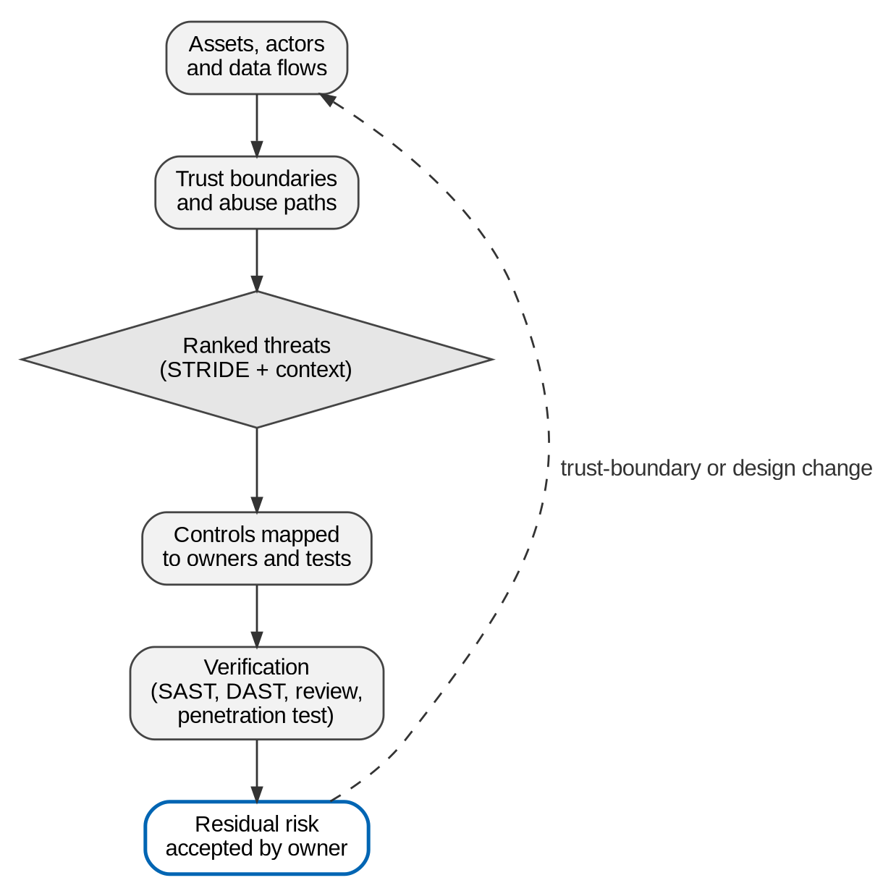
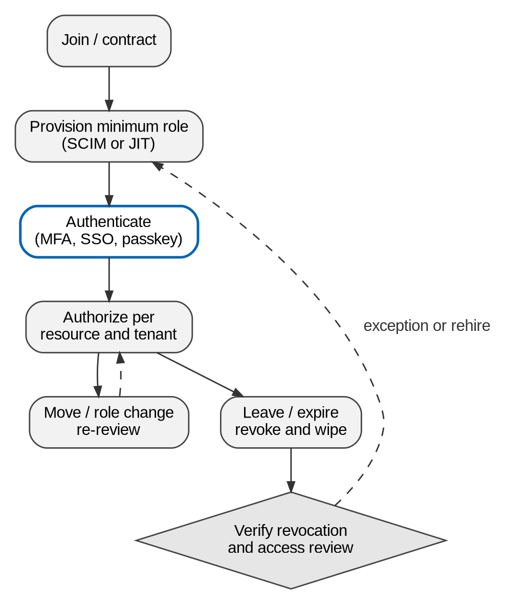
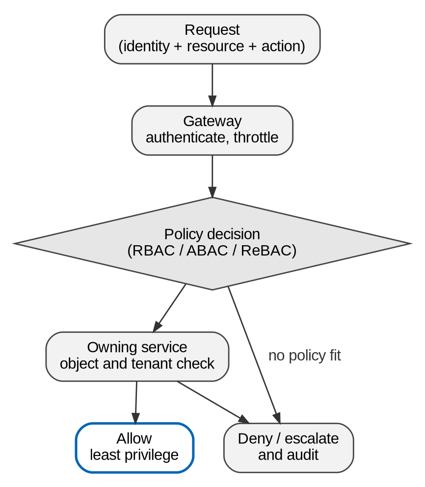
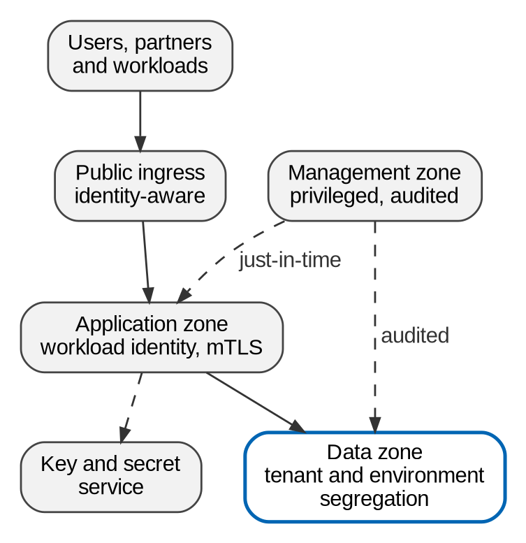
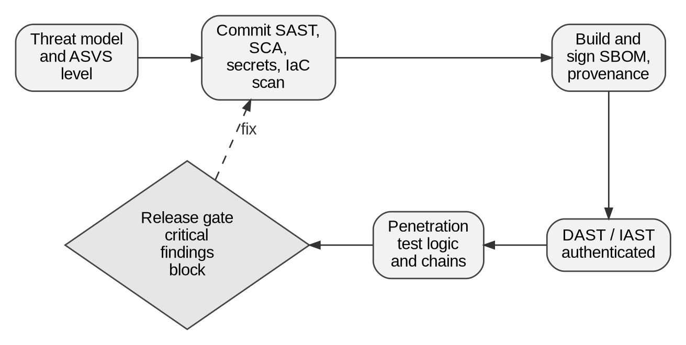
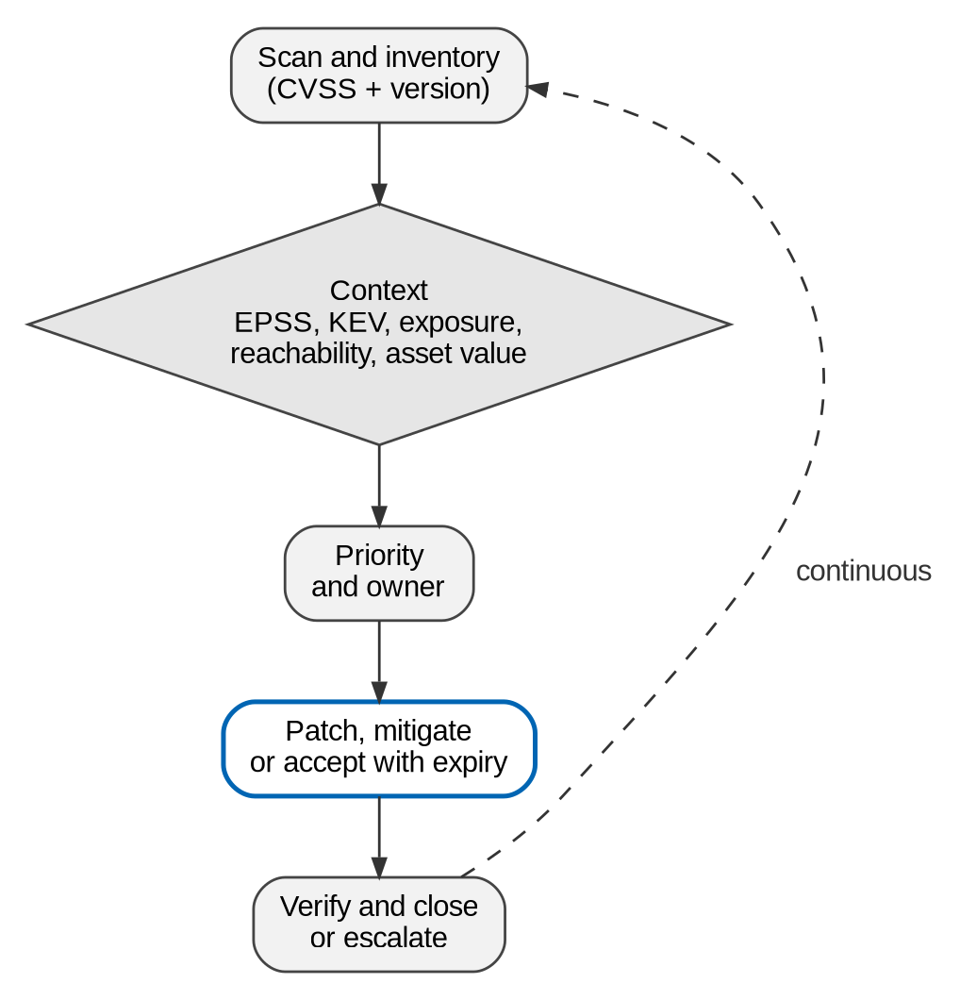
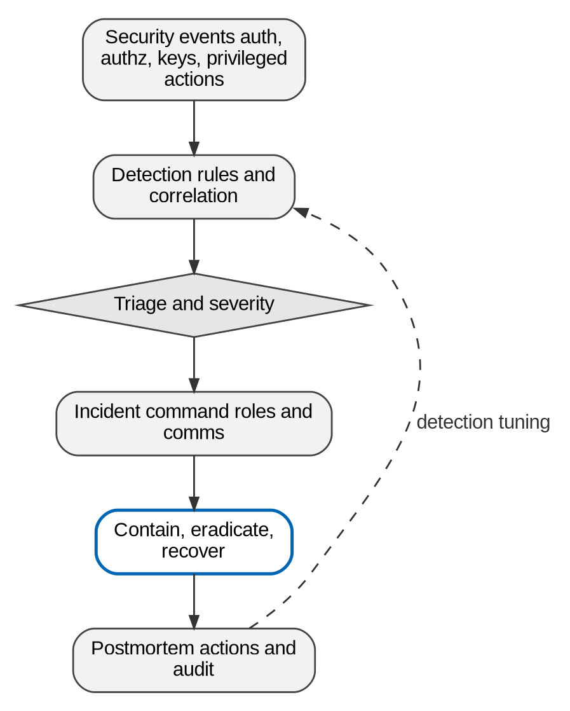
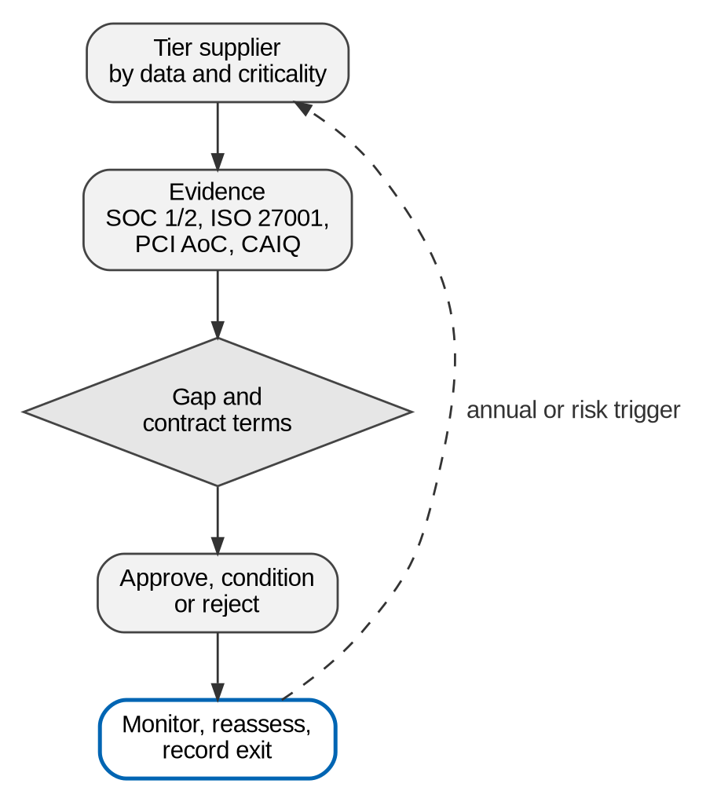
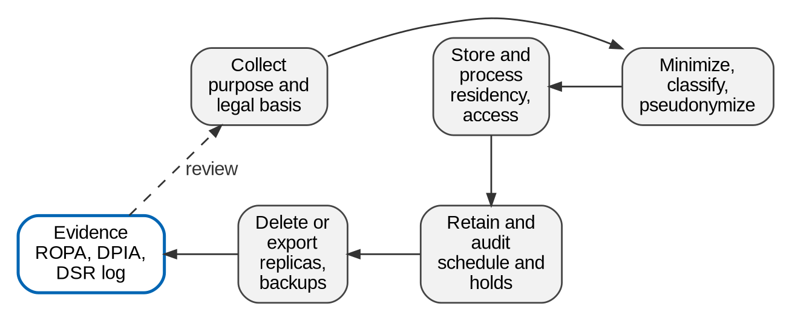
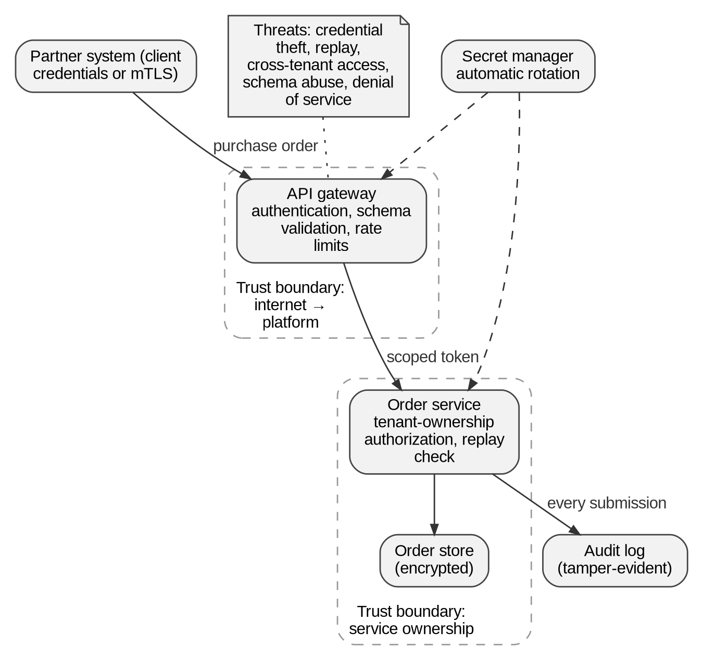

# 10. Security Architecture

Security architecture starts with assets, trust boundaries, threat actors and misuse paths. Controls are chosen against plausible threats and verified in the deployed topology rather than copied from a checklist. The architect designs controls into the solution, specifies how they will be verified and makes residual risk visible to an accountable owner. Appendix F holds the detailed reference tables; Appendix E holds a baseline of common security requirements.

::: {.callout-note appearance="simple" icon=false title="When to Use This Chapter"}
- Defining security requirements or a control baseline for a new or changed solution.
- A design crosses a trust boundary: a new partner, tenant, external API or administrative path.
- Choosing an ASVS level, a security test strategy or remediation objectives for vulnerabilities.
- Personal data is collected, shared across borders or retained, and privacy obligations must be designed in.
- A customer, auditor or supplier assessment asks for security evidence.
:::

::: {.callout-tip appearance="simple" icon=false title="Key Takeaway"}
Security is designed against specific threats and proven with evidence in the deployed topology. Every control should trace to a threat or obligation, have an owner and a verification method. Residual risk is accepted explicitly by an accountable owner rather than left implicit in a checklist.
:::

## 10.1 Threat Modeling and Security Requirements

Security requirements are only credible when they trace to an asset, an abuse path or an external obligation. This section turns both into verifiable design inputs.

### 10.1.1 Threat Modeling

**Definition.** Threat modeling is a structured examination of how a design can be abused, who could do it and which controls reduce the risk.

**Purpose.** It finds plausible abuse before build, ranks the threats that matter and gives every mitigation an owner and a verification method.

**What it includes.** Draw the data flows and trust boundaries, mark sensitive data, and enumerate abuse paths with a method such as STRIDE: spoofing, tampering, repudiation, information disclosure, denial of service and elevation of privilege. Rank threats by likelihood and impact in the deployed context, then map each mitigation to a control and a test. Model early, and repeat the exercise after a material trust-boundary change, a new partner or a new administrative path. Chapter 19 (19.5.1) extends the same method to prompt injection, untrusted retrieval, model supply chain and tool or agent actions.

{#fig-10-1 width="100%"}

Table 10.1 turns the six STRIDE categories into the question each one asks and the evidence a review should expect.

| STRIDE category | Question to ask | Expected evidence |
| :--- | :--- | :--- |
| Spoofing | Can an actor claim another identity? | Authentication design; MFA coverage; credential revocation test |
| Tampering | Can data or messages be changed in transit or at rest? | Integrity controls; signed artifacts; tamper test |
| Repudiation | Can an actor deny an action? | Audit trail; synchronized timestamps; retrieval test |
| Information disclosure | Can data reach an unauthorized party? | Classification; encryption; access review; redaction test |
| Denial of service | Can one actor exhaust a shared resource? | Quotas; timeouts; load shedding; capacity test |
| Elevation of privilege | Can a low-privilege actor gain more authority? | Authorization tests; privileged-access review; negative tests |

: Threat categories and expected evidence

**Why it is needed.** Without a threat model, controls are copied from a checklist and miss the abuse paths specific to this design; the gap usually appears as an incident or an audit finding. The evidence is a current model with ranked threats, named owners and control-to-test links.

**Evidence.** a data-flow diagram with trust boundaries; a ranked threat register; a control-to-test mapping; and a dated review after the last material change.

### 10.1.2 Security Requirements and Control Frameworks

**Definition.** Security requirements are verifiable statements of what the solution must protect, detect or recover, derived from threats, policy and external obligations.

**Purpose.** They convert threats and obligations into design criteria that can be tested, accepted or deferred explicitly. A framework supplies vocabulary and coverage; it does not prove that a specific control works.

**What it includes.** Sources include the threat model, security policy, regulation, customer contracts and supplier obligations. Common frameworks are ISO/IEC 27001:2022 and 27002:2022, NIST CSF 2.0 and SP 800-53 Rev. 5, OWASP ASVS for applications (10.5.2), the CSA Cloud Controls Matrix and PCI DSS v4.0.1 for card data. Express each requirement in verifiable form with the evidence that will satisfy it, and map it to a control, owner and test. ISO/IEC 27001:2013 certificates lost validity when the transition period ended on 31 October 2025; treat 2013 claims as historical evidence, not current assurance.

**Why it is needed.** Requirements without evidence become a policy library that nobody can audit. The evidence is a requirement register with source, owner, verification method and current status.

**Evidence.** a requirements register mapped to controls and tests; framework applicability statements; and current certification or attestation scope.

**Example.** A partner purchase-order API is modeled with STRIDE. Spoofing leads to scoped machine credentials, tampering to signed requests, repudiation to an audit record and elevation to tenant-ownership checks. Each control is linked to a test in the release pipeline.

::: {.callout-warning appearance="simple" icon=false title="Common Pitfall"}
Running threat modeling once at design time and filing the result. The model goes stale as soon as a partner, tenant boundary or administrative path changes, and the team keeps trusting controls that no longer match the design. Re-run it on a named trigger and record the review date.
:::

::: {.callout-important appearance="simple" icon=false title="Decision & Trade-off"}
How much threat-modeling depth does this change justify?

| Option | Choose when | Consequences |
| :--- | :--- | :--- |
| Lightweight abuse-path review | Reversible change inside one trust boundary | Fast; may miss cross-boundary or chained attacks |
| STRIDE workshop on the changed flow | New interface, partner, tenant or administrative path | Covers the main categories; needs a facilitator and a current diagram |
| Full attack-tree or abuse-case study | High-impact, regulated or hard-to-reverse design | Deep evidence; slower and easy to over-produce for small changes |
:::

## 10.2 Identity and Authentication

Authentication establishes who or what is making a request; authorization (10.3) decides what that identity may do. Keeping the two separate avoids a common class of errors, such as treating a valid login as permission to access any record.

### 10.2.1 Identity Types and Lifecycle

**Definition.** An identity is a durable representation of a person, workload or external party that a system can authenticate and authorize.

**Purpose.** Separate identity types so that provisioning, assurance and revocation match the risk of each population. A single model for employees, customers and services usually over-privileges one of them.

**What it includes.** Design separately for **workforce**, **customer** (CIAM) and **workload** identities. Each needs a joiner–mover–leaver lifecycle with timely revocation; SCIM 2.0 automates provisioning and deprovisioning between an identity provider and applications, without which leavers often keep SaaS access. Define the authoritative source for each identity, the identifier that survives a name change, the approval for privileged roles and the evidence that revocation completed.

{#fig-10-2 width="100%"}

Table 10.2 lists the source and lifecycle evidence for each identity type.

| Identity type | Typical source | Lifecycle evidence |
| :--- | :--- | :--- |
| Workforce | HR system or corporate IdP | Joiner–mover–leaver record; access review; revocation test |
| Customer | CIAM registration or partner onboarding | Consent record; recovery flow; deletion and export test |
| Workload | Platform identity or certificate authority | Credential inventory; rotation record; federation trust review |

: Identity types and lifecycle evidence

**Why it is needed.** Orphaned accounts and shared credentials are a direct path to unauthorized access. The evidence is an identity inventory, a tested revocation path and a lifecycle record for each population.

**Evidence.** an identity inventory with source and owner; provisioning and deprovisioning records; access-review results; and tested revocation for users, tokens and certificates.

### 10.2.2 Authentication Methods and Assurance

**Definition.** Authentication proves that a claimed identity controls a credential; the method determines how much assurance that proof carries.

**Purpose.** Match the authenticator to the risk of the action and the exposure of the population. A password may be acceptable for a low-risk profile; it is not acceptable for an administrator or a payment approval.

**What it includes.** Multi-factor authentication (MFA) combines factors the user knows, has or is. SMS codes and app codes can be relayed by a real-time phishing proxy, and push approvals are vulnerable to MFA fatigue unless number matching is enforced; FIDO2/WebAuthn security keys and passkeys bind the credential to the site and resist phishing. NIST SP 800-63-4 (2025) defines authentication assurance levels AAL1 to AAL3, with AAL3 requiring a phishing-resistant authenticator whose key cannot be exported. Require phishing-resistant MFA for administrators and privileged operations, and prefer passkeys for customers where possible (Appendix F.1).

**Why it is needed.** A weak authenticator turns every other control into a formality. The evidence is the IdP policy, MFA coverage by population and a tested recovery path that does not bypass the factor.

**Evidence.** IdP policy; MFA coverage report; phishing-resistant method for privileged access; recovery and revocation tests.

### 10.2.3 Federation and Single Sign-On

**Definition.** Federation delegates authentication to an identity provider so that users can reach several applications with one trusted login.

**Purpose.** Centralize MFA, access policy and revocation, and meet enterprise customers that require their own IdP. Federation reduces credential sprawl but adds a dependency on the IdP and on correct attribute mapping.

**What it includes.** **SAML 2.0** (XML assertions) remains widespread in enterprise and SaaS integrations; **OpenID Connect** (OIDC), built on OAuth 2.0, is the modern choice for web, mobile and single-page applications. **OAuth 2.0 is not authentication:** an access token tells an API that the bearer may perform certain operations; it does not tell the client who the user is. Use OIDC, whose ID token is intended for the client, when the application needs the user’s identity. Enterprise customers commonly require SaaS products to integrate with their own IdP through SAML 2.0 or OIDC. Design per-tenant IdP configuration, SCIM or just-in-time provisioning, and mapping of IdP groups to application roles (Appendix F.2).

**Why it is needed.** Treating a token as proof of identity creates authorization gaps and confusing failures after a tenant changes its IdP. The evidence is a per-tenant configuration, a tested login and a tested revocation.

**Evidence.** per-tenant IdP configuration; SAML metadata or OIDC discovery; group-to-role mapping; SSO and revocation test results.

### 10.2.4 OAuth 2.0 Flows and Tokens

**Definition.** OAuth 2.0 delegates authorization to an access token; the flow determines which client can obtain a token and under what constraints.

**Purpose.** Choose a flow that fits the client and limits token theft, then validate every token at the API. The flow is a security decision, not a library default.

**What it includes.** Use the authorization code flow with PKCE for applications acting for a user and client credentials for service-to-service calls; RFC 9700 (2025) deprecates the implicit and password flows. APIs validate each token’s signature, issuer, audience, expiry and scopes. Keep access tokens short-lived, rotate refresh tokens and support revocation; where token theft is a significant risk, use sender-constrained tokens (mTLS or DPoP). Appendix F.2 lists the flows.

**Why it is needed.** A token accepted without issuer, audience or scope checks can be replayed against another service. The evidence is the validated configuration and negative tests for expired, wrong-audience and revoked tokens.

**Evidence.** token-validation configuration; negative tests; refresh and revocation records; sender-constrained token configuration where used.

### 10.2.5 Workload and Machine Authentication

**Definition.** Workload authentication proves the identity of a service, job or agent rather than a person.

**Purpose.** Replace stored secrets with short-lived, automatically rotated credentials so that a compromise has a bounded lifetime and a clear owner.

**What it includes.** Services use cloud-managed identities, workload identity federation (exchanging a platform-issued token for cloud credentials without a stored key) or mutual TLS with automatically issued certificates. Long-lived API keys and shared service accounts enlarge the blast radius of a compromise. Inventory every non-human identity, its credential type, issuer, scopes and rotation path, and test revocation as part of the deployment pipeline.

**Why it is needed.** A leaked static key can outlive the incident response that discovered it. The evidence is an inventory with no long-lived workload secrets where federation is available, plus a tested revocation.

**Evidence.** identity inventory with credential types and an owner per type; federation or mTLS configuration; rotation and revocation tests.

### 10.2.6 Workforce Security Lifecycle

**Definition.** The workforce security lifecycle covers the controls applied to people before, during and after their access to systems and data.

**Purpose.** Reduce the risk of unsuitable access, phishing, insider misuse and orphaned accounts across employees and contractors. It complements the digital identity lifecycle in 10.2.1.

**What it includes.** Screen personnel and contractors before granting access, subject to local law, and record the decision and any conditions. Onboarding grants the minimum role, requires security-awareness training and an acceptable-use acknowledgement, and registers devices and credentials before first use. Role changes are a higher-risk moment than joiners: review access when someone moves teams, not only when they leave. Offboarding revokes workforce, customer and workload credentials, returns or wipes devices, transfers data ownership and removes physical access. Contractors follow the same lifecycle with sponsor accountability and expiry dates. Training is role-aware: developers need secure coding (10.5.1), administrators need phishing and privileged-access content (10.3.2), and everyone needs incident reporting (10.7.1).

**Why it is needed.** A leaver who retains a SaaS session or a contractor with expired sponsorship is a common audit finding. The evidence is a tested joiner–mover–leaver process, not a policy statement.

**Evidence.** screening and training records; joiner–mover–leaver checklist; acceptable-use acknowledgements; access-review and revocation tests; contractor register with sponsors and expiry.

**Example.** A B2B SaaS platform uses a corporate IdP for its workforce, a separate CIAM tenant for customers and workload identities for its services. The customer’s IdP is configured per tenant with SAML 2.0 and SCIM; a deprovisioning test proves that a removed customer administrator loses access within the agreed window.

::: {.callout-warning appearance="simple" icon=false title="Common Pitfall"}
Treating a valid OAuth access token as proof of user identity. The token may be valid for an API scope without telling the application who the user is, so the application authorizes the wrong principal. Use OIDC for identity and validate issuer, audience and scopes at the API.
:::

::: {.callout-important appearance="simple" icon=false title="Decision & Trade-off"}
Which identity model fits this population?

| Option | Choose when | Consequences |
| :--- | :--- | :--- |
| Corporate workforce IdP | Employees and contractors under central HR control | Strong lifecycle and SSO; customer and partner populations need a separate model |
| CIAM platform | External customers with self-service registration | Scale and customer journeys; consent, recovery and fraud controls add complexity |
| Workload identity federation | Service-to-service and cloud access | Short-lived credentials and no stored keys; requires trust-policy and issuer management |
:::

## 10.3 Authorization and Privileged Access

Authentication establishes the caller; authorization decides what that caller may do to a specific resource. Most serious access failures occur in the second step.

### 10.3.1 Authorization Models and Least Privilege

**Definition.** Authorization is the decision that a principal may perform a specific action on a specific resource in a specific context.

**Purpose.** Enforce least privilege at the resource, not only at the gateway, so that a valid caller cannot read another customer’s data or perform an action outside its role.

**What it includes.** RBAC (roles) suits stable job functions, ABAC (attributes) contextual rules, and ReBAC (relationships) sharing models. Policy engines can externalize rules, but enforcement stays in the service that owns the resource. Check every sensitive operation and resource identifier server-side, including tenant and object ownership; a role check alone does not prevent one customer reading another customer’s order (broken object-level authorization, also called IDOR). Grant only the permissions needed, review access periodically and record the decision for privileged or cross-tenant operations.

{#fig-10-3 width="100%"}

Table 10.3 compares the authorization models and the evidence each one leaves for review.

| Model | Best fit | Main risk |
| :--- | :--- | :--- |
| RBAC | Stable job functions and broad roles | Role explosion; weak object-level checks |
| ABAC | Contextual rules such as region, time or classification | Policy complexity and attribute quality |
| ReBAC | Sharing and relationship-driven access | Traversal cost and relationship drift |

: Authorization models

**Why it is needed.** A gateway-only check authenticates the caller but leaves every object and tenant exposed. The evidence is a negative test that proves cross-tenant and privilege-escalation attempts fail.

**Evidence.** authorization design; negative tests for object and tenant access; access-review records; policy-version history.

### 10.3.2 Privileged Access

**Definition.** Privileged access is authority that can change security controls, infrastructure, data or other users’ permissions.

**Purpose.** Constrain the highest-value accounts so that a single compromised credential cannot become a persistent, invisible takeover.

**What it includes.** Use separate privileged accounts, phishing-resistant MFA, just-in-time elevation with expiry and a logged, reviewed break-glass procedure. Engineers’ access to production data is an approved and audited exception (10.7.2). Remove standing access where the platform supports it, record the reason and ticket for each elevation, and review privileged roles on a defined cadence.

**Why it is needed.** Standing administrator access is the shortest path from phishing to a full environment compromise. Review the break-glass procedure after every use. The evidence is the elevation record, the session log and the review that closed stale privileges.

**Evidence.** negative tests for cross-tenant access, privilege escalation and confused-deputy behavior; access-review records; privileged session logs; break-glass test; a dated review of privileged roles.

**Example.** A customer support agent can read an order only when the user’s tenant matches the agent’s tenant and the order belongs to that customer. A negative test attempts the same request with a valid token from another tenant and expects a denial and an audit record.

::: {.callout-warning appearance="simple" icon=false title="Common Pitfall"}
Relying on a role check at the API gateway. The caller is authenticated, but the gateway rarely knows whether this order belongs to this customer, so a valid user can read another tenant’s data. Enforce ownership in the service that owns the resource.
:::

::: {.callout-important appearance="simple" icon=false title="Decision & Trade-off"}
Where should resource-level authorization live?

| Option | Choose when | Consequences |
| :--- | :--- | :--- |
| Coarse checks at the gateway only | Internal, low-risk APIs where every authorized caller may access every resource of a type | Simple and fast; no object- or tenant-level protection |
| Central policy decision point, enforced in each service | Many services share rules that change often, or policy decisions must be audited centrally | Consistent and auditable; adds a runtime dependency and policy-versioning discipline |
| Authorization logic in the owning service | Rules depend on domain state, ownership or workflow status | Precise and resilient; risk of divergent rules unless documented and tested |
:::

## 10.4 Trust Boundaries and Cryptography

A trust boundary is a place where the identity, privilege or data classification of a request changes. Cryptography protects data and credentials as they cross those boundaries, and physical controls protect the same data where it meets facilities, hardware and media.

### 10.4.1 Zero Trust and Segmentation

**Definition.** Zero Trust is an access model that verifies every request explicitly and grants the least privilege needed, without trusting network location.

**Purpose.** Replace the assumption that “inside the network” means trusted with identity-aware policy at each boundary. Segmentation remains useful defense in depth, but it is not a substitute for authentication and authorization.

**What it includes.** NIST SP 800-207 describes the model: explicit verification, least privilege and assumed breach. Apply it to users, services and administrative paths. Segment public ingress, application, data and management zones; authenticate service-to-service calls; and log cross-zone access. Private networking does not replace authorization, and a shared control plane can still become a single point of failure.

{#fig-10-4 width="100%"}

**Why it is needed.** A flat network turns one compromised workload into lateral movement across the estate. The evidence is a current trust-boundary view, policy tests and logs that show cross-zone access is authenticated and authorized.

**Evidence.** trust-boundary and data-flow views; segmentation policy; cross-zone access tests; workload-identity configuration.

### 10.4.2 Cryptography, Keys and Secrets

**Definition.** Cryptography protects confidentiality, integrity and authenticity by transforming data with keys that only authorized parties hold.

**Purpose.** Use proven protocols and managed key custody so that encryption remains effective after deployment, not only in the design document.

**What it includes.** Encryption protects confidentiality only as well as key custody, access policy, rotation and recovery allow. Use managed key services and proven protocols, never custom cryptography; require TLS 1.2 as a minimum and prefer 1.3. A key-service outage can become an availability incident. Secrets live in a managed secret store, are short-lived, never appear in code, images or logs, and rotate without downtime. Classify data before choosing encryption, and record where keys are generated, stored, backed up and recovered (10.4.5).

**Why it is needed.** Encryption with weak key custody or leaked secrets gives a false sense of assurance. The evidence is configuration evidence plus a rotation and recovery test.

**Evidence.** TLS configuration scan; at-rest encryption configuration; secret-scanning results; key-access audit; rotation drill.

### 10.4.3 Tenant and Environment Segregation

**Definition.** Segregation separates customers, tenants and environments so that data and privileges cannot leak across a boundary.

**Purpose.** Prevent one customer from reaching another customer’s data and prevent production data or credentials from leaking into test and development.

**What it includes.** Customer data is separated between tenants, and production from test and development; lower environments use masked or synthetic data and cannot reach production. Enterprise contracts commonly require this. Choose the isolation mechanism — separate accounts, separate databases, row-level tenant keys or dedicated infrastructure — from the threat model, regulatory obligations and cost. Test the boundary with a cross-tenant request and a network-path test, not only with a configuration review. Section 7.7 covers the tenancy model and how isolation is enforced in the application.

**Why it is needed.** A shared table or a shared administrator path turns a small application bug into a cross-customer incident. The evidence is an isolation test and a data-flow view that shows every copy.

**Evidence.** tenancy and environment design; cross-tenant isolation tests; masked or synthetic test data; network and access separation evidence.

### 10.4.4 Remote Access and Endpoint Controls

**Definition.** Remote access extends the trust boundary to devices and networks that the organization may not control.

**Purpose.** Make access depend on user identity, device posture and least privilege rather than on the location of the device.

**What it includes.** Decide whether the organization manages the device or permits BYOD; that choice determines which controls are credible. Managed devices enforce disk encryption, patching, endpoint detection and response (EDR), screen lock and posture attestation. BYOD requires containerization or mobile application management, selective wipe and an acceptable-use agreement, and should not be used for the most privileged operations. A zero-trust network access (ZTNA) or VPN design authenticates the user and device, checks posture, applies least privilege per application and logs the session. Avoid broad split tunneling that bypasses inspection; privileged remote access needs a separate path, phishing-resistant MFA, just-in-time elevation and session recording (10.3.2). MDM and MAM enforce encryption, OS version, app allowlists and remote wipe; EDR covers malware and anomalous behavior but does not replace patching or least privilege. Define a remote-work policy, train the workforce and test lost-device wipe.

**Why it is needed.** A healthy VPN concentrator does not prove that the connecting device is patched or that the user is authorized for the application. The evidence is a posture test, an EDR coverage report and a lost-device wipe test.

**Evidence.** access design covering ZTNA or VPN, posture and split tunneling; MDM/MAM policy; EDR coverage; BYOD terms; remote-work training; lost-device and unhealthy-device tests.

### 10.4.5 Key Management Lifecycle

**Definition.** Key management is the set of controls that govern how cryptographic keys are generated, stored, used, rotated, recovered and destroyed.

**Purpose.** Keep keys usable by the intended service and unusable by everyone else for the whole life of the data they protect.

**What it includes.** Define a key hierarchy that separates root, key-encryption and data-encryption keys, and state where each is generated, stored and used. Prefer a managed key service or hardware security module (HSM) with documented access policy, and keep keys out of code, images, configuration files and logs. Separate duties so that the team that operates a service cannot export or destroy its keys without a second approval. Cover generation, distribution, rotation, retirement, recovery and destruction. Rotation periods, backup custody and recovery objectives are set by contract, regulation or risk assessment; record the chosen interval and the reason. For long-lived confidentiality, plan crypto-agility and assess post-quantum migration using NIST FIPS 203, FIPS 204 and FIPS 205 (2024), with hybrid pilots where supported.

| Stage | Control question | Expected evidence |
| :--- | :--- | :--- |
| Generate | Approved algorithm, key length and source? | Key inventory; generation record |
| Store | KMS/HSM, access policy and separation of duties? | Configuration; access review |
| Use | Least privilege and audit of key operations? | Key-access log; application configuration |
| Rotate | Interval and zero-downtime path? | Rotation record; service test |
| Recover | Restore after key loss? | Recovery exercise result |
| Destroy | Retirement and proof of destruction? | Destruction record; crypto-shredding evidence |

: Key lifecycle stages and evidence

**Why it is needed.** A key that cannot be rotated or recovered becomes an outage; a key that can be exported becomes a breach. The evidence is a lifecycle record, not only an encryption setting.

**Evidence.** key inventory and hierarchy; KMS/HSM policy; rotation, recovery and destruction records; separation-of-duties evidence; crypto-agility plan.

### 10.4.6 Physical Security and Media Handling

**Definition.** Physical security protects facilities, hardware and media from unauthorized access, and media handling controls data through storage, transport and destruction.

**Purpose.** Evidence the controls that cloud customers often assume are inherited, and prevent restricted data from escaping through media or disposal.

**What it includes.** For each facility and service, state whether the organization operates the controls or relies on a provider attestation, and name the report that covers the relevant data center and period. A provider’s general certification does not prove that a specific region or service is in scope. For owned or colocated facilities, cover perimeter and visitor access, badge and key management, camera retention, environmental controls, fire suppression and power. For media, define handling from receipt to destruction: labeling, chain of custody, encryption, transport, sanitization and certificates. NIST SP 800-88 Rev. 2 (2025) is the reference for sanitization methods; choose clear, purge or destroy according to the media type and confidentiality requirement. Do not resell or return media without verified sanitization. Restricted data does not belong on removable media or in unapproved third-party cloud services; record any approved exception and its compensating controls.

**Why it is needed.** A provider certificate that excludes the region in use, or a retired disk that was not sanitized, is a data breach with a paper trail. The evidence is a facility matrix and media destruction records.

**Evidence.** facility and provider-control matrix; current attestations with scope and period; visitor and access logs; media chain-of-custody and destruction certificates.

**Example.** The payment service uses a provider KMS for data-encryption keys and an HSM-backed root key. Keys are rotated on a schedule set by the contract, a recovery drill restores an encrypted backup, and a second approver is required to export or destroy a key.

::: {.callout-warning appearance="simple" icon=false title="Common Pitfall"}
Encrypting data and treating key custody as an implementation detail. If the key is in the application configuration or one team can export it, encryption does not protect against the most likely compromise. Put keys in a managed service with separated duties and a tested recovery path.
:::

::: {.callout-important appearance="simple" icon=false title="Decision & Trade-off"}
Where should keys live?

| Option | Choose when | Consequences |
| :--- | :--- | :--- |
| Provider KMS | Cloud-native workload with standard rotation and audit needs | Low operational burden; provider dependency and quota limits |
| Managed HSM | Regulated data, strict separation of duties or custom key control | Strong custody and audit; higher cost and operational discipline |
| Self-managed key server | Sovereignty or legacy constraints require it | Full control; patching, backup and recovery become your responsibility |
:::

## 10.5 Secure Development and Security Testing

Security testing is evidence that the development lifecycle produced the controls it claimed. The section moves from requirements to code, build, runtime and supply chain.

### 10.5.1 Secure Development Lifecycle and OWASP

**Definition.** A secure development lifecycle builds security into requirements, design, coding, testing, release and operations rather than adding it after a penetration test.

**Purpose.** Make the secure path the default path for developers and give each phase an artifact that can be reviewed.

**What it includes.** NIST SP 800-218 (SSDF) and OWASP SAMM describe such programs. OWASP provides widely used references: the **Top 10:2025** and **API Security Top 10 (2023)** for awareness, **ASVS** for verifiable requirements, the **Web Security Testing Guide** and the **Cheat Sheet Series** (Appendix F.3). Embed threat modeling (10.1.1), ASVS selection (10.5.2), secure coding standards, dependency policy and security gates in the pipeline. Train developers and measure adoption, not attendance. Appendix F.7 lists common web vulnerabilities and their primary defenses.

**Why it is needed.** A late security review finds design problems that are expensive to change. The evidence is a lifecycle with security requirements, gates and training records, not a policy PDF.

**Evidence.** SDLC policy; secure-coding standards; developer training; security requirements in the PRD or SRS; pipeline gate results.

### 10.5.2 Using OWASP ASVS

**Definition.** The OWASP Application Security Verification Standard (ASVS) is a catalog of verifiable security requirements for web applications and APIs.

**Purpose.** Give the team a named assurance level and a requirement-to-test mapping that a customer, auditor or supplier can inspect.

**What it includes.** Where the Top 10 says what commonly goes wrong, ASVS says what must be true and how it can be checked. Version 5.0.0 (2025) organizes its requirements into 17 chapters, from encoding and validation to authentication, authorization, tokens, OAuth and OIDC, cryptography, data protection and security logging (Appendix F.3). Requirements are assigned to three cumulative levels — each includes all requirements below it.

| Level | Intent | Typical use |
| :--- | :--- | :--- |
| L1 — Basic | First-layer defenses against commonly exploited weaknesses | Minimum baseline for any web application or API |
| L2 — Standard | Protection against less common and more complex attacks | Most business applications, especially those handling sensitive or personal data |
| L3 — Advanced | Defense in depth for high-assurance contexts | Critical systems in finance, healthcare or critical infrastructure |

: ASVS levels

Select the level from data sensitivity, exposure, regulatory obligations and the threat model, and record the choice in an ADR. A higher level can be applied to the riskiest parts, such as L3 for authentication in an otherwise L2 system; requirements that do not apply are marked not applicable with a rationale.

**Why it is needed.** An unstated level makes coverage impossible to judge. The evidence is the selected level, the requirement-to-verification mapping and coverage reported per release.

**Evidence.** ADR recording the ASVS level; requirement-to-test mapping; not-applicable rationale; coverage report per release.

### 10.5.3 Security Testing Techniques

**Definition.** Security testing is a portfolio of techniques, each of which sees a different part of the attack surface.

**Purpose.** Combine techniques so that a gap in one is covered by another, and place each at the point in the lifecycle where it gives the earliest useful signal.

**What it includes.** A security test strategy combines **SAST** (static analysis of source code) and **SCA** (known vulnerabilities in dependencies, producing an SBOM) on every change; secret, infrastructure-as-code and container scanning in the pipeline; **DAST** (testing the running application) and **IAST** (instrumented testing) per release; and penetration testing for logic flaws and chained attacks. Pipeline gates are calibrated to severity, so new critical findings block a release while backlog findings follow the remediation process (10.6). Appendix F.4 compares the techniques and their limits.

{#fig-10-5 width="100%"}

Table 10.6 maps each testing technique to what it finds and where it stops being sufficient.

| Technique | Finds well | Main limit | Typical cadence |
| :--- | :--- | :--- | :--- |
| SAST | Injection patterns, unsafe APIs, hard-coded secrets | False positives; no runtime context | Every change |
| SCA | Known vulnerable dependencies; SBOM | Reachability often unknown | Every build and advisory update |
| Secret and IaC scanning | Committed credentials; open configuration | Policy coverage limits | Pre-commit and CI |
| DAST / IAST | Runtime and authorization flaws | Limited code-path coverage; needs good tests | Per release |
| Penetration test | Logic flaws and chained attacks | Point-in-time; depends on scope | Before major release and at the contracted cadence |

: Security testing techniques

**Why it is needed.** No single technique finds every class of weakness; static-only or unauthenticated dynamic testing misses most business-logic and authorization flaws. The evidence is the combination and the gate decisions it produced.

**Evidence.** pipeline security gates with results; SBOM; DAST and IAST reports; penetration-test report with retest.

### 10.5.4 Authenticated Dynamic Testing

**Definition.** Authenticated dynamic testing exercises the running application with real roles and sessions rather than only its public pages.

**Purpose.** Reach the business functionality and authorization paths that sit behind login, where most high-impact flaws live.

**What it includes.** An unauthenticated DAST scan sees only login pages and public content; most business functionality and most authorization flaws sit behind authentication. An **authenticated dynamic web application security scan** logs in with real roles: it needs dedicated test accounts per role and tenant (to attempt privilege escalation), configured session handling, API definitions so that APIs are covered, a production-like environment with synthetic data, and agreed scope and rate limits (checklist in Appendix F.4).

**Why it is needed.** A clean unauthenticated scan is not evidence that authenticated users cannot escalate privileges. The evidence is a scan report that names the roles, tenants and API definitions used.

**Evidence.** authenticated scan report; per-role and per-tenant accounts; API definitions; scope and rate-limit agreement.

### 10.5.5 Penetration Testing

**Definition.** A penetration test is a scoped, time-boxed exploitation attempt by skilled testers that looks for logic flaws and chained attacks.

**Purpose.** Test the design as an adversary would, including combinations that automated tools miss, and produce reproducible findings with a retest.

**What it includes.** Define scope, approach and rules of engagement, follow the cloud provider’s policy, and require reproducible findings with CVSS ratings and a retest. Externally accessible systems are typically tested at least annually and after significant changes; the actual cadence is set by contract, regulation or risk assessment. Share enough design context to test business logic without handing over production data, and track remediation to closure.

**Why it is needed.** A point-in-time test that is never retested leaves the organization unsure whether the fix worked. The evidence is the report, the remediation tracker and the retest.

**Evidence.** scoped test plan and rules of engagement; report with CVSS ratings; remediation tracker; retest evidence.

### 10.5.6 API and Supply-Chain Security

**Definition.** API and supply-chain security protects the interfaces and build inputs that an application depends on, not only its own code.

**Purpose.** Prevent an attacker from entering through an API contract, a dependency, a build identity or a tampered artifact.

**What it includes.** Secure APIs combine authentication, object-level authorization, schema validation, rate limiting, replay resistance and safe errors; a gateway does not replace authorization in the owning service. For the supply chain, generate an SBOM (CycloneDX or SPDX), pin dependencies, protect build identities, sign artifacts, reference images by digest and admit only verified artifacts; SLSA defines levels of build-provenance assurance.

**Why it is needed.** A verified application built from an unverified dependency or artifact is still a supply-chain risk. The evidence is provenance from source to deployed digest and a policy that rejects unverified artifacts.

**Evidence.** API security tests; SBOM; dependency and image policy; signed artifacts; provenance from commit to deployed digest.

### 10.5.7 Hardening Baselines

**Definition.** A hardening baseline is a versioned decision about the configuration of an asset class.

**Purpose.** Build and maintain systems from a known secure configuration, then detect drift before it becomes an exploit path.

**What it includes.** Choose the benchmark or provider baseline that fits the platform and threat model, record its name and version, and state which deviations are approved. Benchmarks such as the CIS Benchmarks are living documents; an unversioned reference cannot be audited. Prefer immutable images or infrastructure as code so that the baseline is built once and tested, rather than applied by hand after deployment. Define the baseline owner and exception route, scan images, containers, operating systems, middleware and managed services, and detect drift continuously. Hardening complements patching (10.6.4) and network segmentation (8.5.2).

**Why it is needed.** A passing build scan does not prove that production still matches the baseline. The evidence is a baseline register, drift alerts and approved exceptions with expiry.

**Evidence.** baseline register with benchmark name and version; image and configuration scan results; drift alerts; exceptions with owners and expiry.

**Example.** A checkout API is assessed at ASVS L2. Authentication uses OIDC with the corporate IdP, authorization is enforced per order and tenant, and security logging excludes card data. The team maps the selected requirements to unit, SAST, authenticated DAST and penetration tests, and reports coverage per release.

::: {.callout-warning appearance="simple" icon=false title="Common Pitfall"}
Relying on an unauthenticated DAST scan as the security test. It sees login pages and public content while the business logic and authorization flaws sit behind authentication. Add authenticated scans with per-role and per-tenant accounts.
:::

::: {.callout-important appearance="simple" icon=false title="Decision & Trade-off"}
Which ASVS level should this application target?

| Option | Choose when | Consequences |
| :--- | :--- | :--- |
| L1 | Low-sensitivity internal application with limited exposure | Fast baseline; may not satisfy customer or regulatory expectations |
| L2 | Business application handling sensitive or personal data | Broad assurance; requires requirement mapping and per-release coverage |
| L3 | Critical or high-assurance system, or the riskiest authentication path | Deep defense; higher cost and more evidence |
:::

## 10.6 Vulnerability Management

Vulnerability management turns scan output into prioritized, owned remediation decisions. It is a process, not a report.

### 10.6.1 Severity Scoring with CVSS

**Definition.** The Common Vulnerability Scoring System (CVSS) rates the technical severity of a vulnerability on a 0.0–10.0 scale.

**Purpose.** Give a consistent, comparable severity signal and a vector that others can reproduce, without pretending that severity equals business risk.

**What it includes.** CVSS is maintained by FIRST and rates severity from 0.0 to 10.0 (None, Low, Medium, High, Critical; Appendix F.5). Version 4.0 (2023) organizes metrics into Base, Threat, Environmental and Supplemental groups; version 3.1 remains widely used, so always state the version and vector string. **CVSS measures severity, not risk:** a base score ignores whether the vulnerability is exploited, whether the code is reachable and how important the asset is.

**Why it is needed.** A score without context produces either panic or neglect. The evidence is the score, the vector and the asset context that changed the decision.

**Evidence.** vulnerability record with CVSS version and vector; asset and exposure context; triage decision.

### 10.6.2 Risk-Based Prioritization

**Definition.** Risk-based prioritization combines technical severity with exploitation likelihood, exposure and business context.

**Purpose.** Fix the most consequential vulnerabilities first, even when a lower-scored issue is more likely to be exploited on an exposed system.

**What it includes.** Combine **EPSS** (probability of exploitation in the next 30 days), the **CISA KEV** catalog (vulnerabilities exploited in the wild) and context — exposure, reachability, data sensitivity, asset criticality. Anything in KEV on an exposed system is urgent regardless of its CVSS score. Record the priority, owner and due date, and route disagreements through the exception process (4.5).

{#fig-10-6 width="100%"}

Table 10.7 lists the priority signals and the response each one justifies.

| Signal | What it adds | How to use it |
| :--- | :--- | :--- |
| CVSS base score | Technical severity | Initial triage; always record the version and vector |
| EPSS | Probability of exploitation in the next 30 days | Raise priority when exploitation is likely |
| CISA KEV | Confirmed exploitation in the wild | Treat as urgent on an exposed system |
| Exposure and reachability | Whether an attacker can reach the flaw | Lower priority for unreachable test-only assets |
| Data and asset criticality | Business impact of compromise | Raise priority for regulated or customer-facing systems |

: Vulnerability priority signals

**Why it is needed.** A CVSS-only queue leaves exploitable flaws behind a high score on an unreachable asset. The evidence is a priority that shows the signals used.

**Evidence.** vulnerability register with CVSS, EPSS, KEV status, exposure and owner; priority decision; exception record where deferred.

### 10.6.3 Remediation and Disclosure

**Definition.** Remediation is the action that removes or reduces a vulnerability; disclosure is the communication that lets affected parties respond.

**Purpose.** Close the risk on a defined timeline and give customers, regulators and operators the information they need without exposing them to avoidable harm.

**What it includes.** Track remediation time objectives per priority (Appendix F.5); patch on a risk basis with testing and rollback; route overdue items through the exception process (4.5). Notify affected customers with the CVSS vector, affected versions and status, use VEX statements to say whether a product is actually affected, and publish a disclosure contact such as `security.txt` (RFC 9116). Keep the remediation evidence with the vulnerability record, and verify closure rather than trusting a ticket status.

**Why it is needed.** An unverified fix or an undisclosed affected version shifts risk to the customer. The evidence is a closed record with a verification result and, where required, a customer notification.

**Evidence.** remediation record; test or scan verification; customer advisory with CVSS vector; VEX statement; disclosure contact.

### 10.6.4 Patch Management

**Definition.** Patch management is the controlled application of firmware, operating-system, middleware, runtime and application updates.

**Purpose.** Reduce the exploitable window without breaking compatibility or losing the ability to roll back.

**What it includes.** Maintain an inventory of firmware, operating systems, middleware, runtimes, applications and managed-service dependencies, and map each asset to an owner and business criticality. Use the vulnerability process in 10.6 to prioritize, but do not let a scan backlog replace a patch plan: a known exploitable flaw on an exposed system needs an emergency path. Define risk tiers and the approval route; normal patches follow a maintenance window with testing and rollback, while emergency patches use a smaller authority and a post-change review. Test in a production-like environment and verify contract and data compatibility (12.2.2). When a patch cannot be applied, record a time-bound exception with a compensating control (4.5). Where a contract requires the latest available patch, define “available” as the latest supported release and record why a later release is not applied.

**Why it is needed.** A high patch rate with unmanaged exceptions is not evidence of control. The evidence is coverage, overdue age and a closed exception record.

**Evidence.** patch policy with risk tiers; asset and coverage report; emergency-patch record; test and rollback evidence; exceptions with owners and expiry.

**Example.** A payment service has a KEV-listed library on an internet-facing endpoint. The team patches outside the normal window, runs contract and regression tests, deploys to a canary, and verifies the vulnerable version is absent before closing the record.

::: {.callout-warning appearance="simple" icon=false title="Common Pitfall"}
Prioritizing only by CVSS base score. A medium-severity flaw that is exploited in the wild on an exposed system is more urgent than a critical score on an unreachable test asset. Add EPSS, KEV and context before setting the queue.
:::

::: {.callout-important appearance="simple" icon=false title="Decision & Trade-off"}
How should this vulnerability be handled?

| Option | Choose when | Consequences |
| :--- | :--- | :--- |
| Patch or upgrade | A supported fix exists and compatibility can be tested | Removes the flaw; requires a window, test and rollback path |
| Mitigate with a compensating control | No fix is available or the fix is not yet safe | Reduces exposure; the underlying flaw remains and needs an expiry |
| Accept with an exception | Impact is low, the asset is unreachable or remediation cost is disproportionate | Needs an accountable owner, evidence and a review date |
:::

## 10.7 Detection, Response and Audit

Security operations need three kinds of evidence: detection and response records, audit trails that survive an investigation, and proof that contractual notices were sent on time. Privacy records are covered with the rest of privacy engineering in 10.9.

### 10.7.1 Security Monitoring and Incident Response

**Definition.** Security monitoring detects and explains security events; incident response contains and recovers from them.

**Purpose.** Reduce time to detect, decide and revoke, and produce a record that supports the incident, the customer and the regulator.

**What it includes.** Security events — authentication failures, authorization denials, privilege changes, key access — are logged with actor, action, resource, outcome and correlation identifier, without sensitive payloads. Detection rules have owners, and incident playbooks cover credential revocation, key rotation and partner notification (11.3). Notification deadlines are short: the GDPR requires supervisory-authority notification within 72 hours of awareness, NIS2 requires an early warning within 24 hours, and customer contracts commonly require 24–48 hours. Design detection and escalation so that those deadlines are achievable, and test the path.

{#fig-10-7 width="100%"}

**Why it is needed.** A logged event that nobody detects is not monitoring, and a detected incident without a tested notification path becomes a compliance failure. The evidence is measured detection and revocation time.

**Evidence.** log-source inventory; detection rules with owners; incident playbook; tabletop report with measured time to detect and revoke.

### 10.7.2 Audit Trails

**Definition.** An audit trail is the protected record that establishes who did what, to which resource, when, from where and with what result.

**Purpose.** Support accountability, investigation, disputes and regulatory or contractual evidence, independently of ordinary operational logs.

**What it includes.** Audit records are not ordinary logs: operational logs may be sampled, rotated or discarded, while audit records are evidence and must be complete, protected and retained. Scope follows regulation, contracts and the threat model: authentication events; changes to permissions and security configuration; privileged actions; changes to regulated or financially significant records, and reads of sensitive data where required; exports and deletion requests; and changes to the audit configuration. Each record holds a synchronized UTC timestamp, actor, action, target resource and tenant, outcome, source and correlation identifier. Appendix B.9 provides a catalog template.

| Requirement | Design approach |
| :--- | :--- |
| Completeness | Write the audit record in the same transaction as the business change, or through a transactional outbox (6.3.1) |
| Integrity | Append-only or write-once (WORM) storage, cryptographic chaining or signing, periodic integrity verification |
| Segregation of duties | Separate account or subscription; administrators of the audited system cannot modify or delete audit records |
| Retention | Per regulation and contract — commonly at least one year, often much longer for financial records — with legal holds (5.2.4) |
| Privacy | Record identifiers rather than full personal data; never record secrets or card numbers; audit access to the audit trail itself |
| Usability | Search by actor, resource and time; export or stream to customers and auditors where agreed |

: Audit record requirements

Cloud control-plane logs — for example AWS CloudTrail, Azure Activity Log, Google Cloud Audit Logs — record actions on cloud resources, not business actions, which the application must audit itself. Record-level data history is covered in 5.3.9. For cloud services, export the customer’s access logs at the latency agreed in the contract and protect them like other audit evidence; real-time streaming is a contract term, not a universal default.

**Why it is needed.** An auditor or dispute asks who changed a record and when; sampled operational logs cannot answer. The evidence is a complete record, a tamper test and a retrieval test.

**Evidence.** audit-event catalog; completeness and tamper tests; retrieval test; retention and legal-hold configuration; customer log-export test.

### 10.7.3 Contractual Notification Obligations

**Definition.** Contractual notification obligations are the incident notices a customer or regulator requires, with their own deadlines, recipients and content.

**Purpose.** Separate regulatory clocks from customer clocks so that neither is missed and each notice has an owner and an approved template.

**What it includes.** Build a clause register from customer, supplier and partner contracts: who must be notified, within what period, through which channel, with what content, and who may authorize the message. Give each customer a named security contact for inquiries and incident follow-up. The periods are contract-specific; a common 24–48-hour window is a market default, not a universal rule. Keep regulatory clocks visible where they apply, such as the GDPR 72-hour breach notification or the NIS2 24-hour early warning, and record the legal basis for each. Test the path with a tabletop exercise that starts from detection, measure time to identify the obligation and send the notice, and retain the record with the incident file. Define the post-incident corrective plan, the customer approval point and the assistance provided during the customer’s response; the plan deadline is set by contract or regulation.

**Why it is needed.** A missed or late notice turns an incident into a contractual and regulatory breach. The evidence is a tested notification matrix, not a clause buried in a contract.

**Evidence.** contract clause register; notification matrix; approved templates; tested notification record with measured times; corrective plan with owners and verification.

**Example.** A payment provider incident affects a customer’s order data. The team detects it at 09:10, opens the contract register, confirms the 24-hour customer notice and the 72-hour regulatory assessment, sends the approved template at 10:05, and records the times and recipients with the incident file.

::: {.callout-warning appearance="simple" icon=false title="Common Pitfall"}
Treating operational logs as an audit trail. Logs may be sampled, rotated or deleted, so they cannot prove who changed a regulated record or support a dispute. Write audit records transactionally to protected storage and test retrieval.
:::

::: {.callout-important appearance="simple" icon=false title="Decision & Trade-off"}
How should audit evidence be stored?

| Option | Choose when | Consequences |
| :--- | :--- | :--- |
| Standard log platform with retention | Low-risk operational events | Cheap and searchable; weak tamper evidence and separate access control |
| Append-only or WORM store | Regulated or financially significant records | Strong integrity; retention and deletion need legal-hold handling |
| Cryptographic chaining or signing | Evidence must survive an untrusted administrator | Verifiable integrity; key management and verification tooling add cost |
:::

## 10.8 Third-Party and Supplier Security

Security requirements between organizations are set by contract and verified with evidence, in both directions. This section covers supplier assessment and the evidence a solution must produce when it is the supplier.

### 10.8.1 Supplier Risk Assessment and Lifecycle

**Definition.** Supplier risk management classifies each third party by the data and service it touches, and applies proportionate controls from selection to exit.

**Purpose.** A supplier extends the solution's attack surface and failure domain beyond direct control. Tiering focuses assessment effort where a supplier's failure would matter, and a lifecycle keeps that assessment from ending when the contract is signed.

**What it includes.** Tier suppliers by data sensitivity, operational criticality, privileged access and replaceability. Before selection, assess the supplier in proportion to its tier and record the findings. In the contract, state security requirements, incident notification (10.7.3), audit rights, data location, subprocessor disclosure and return or deletion of data at termination. During the service, review assurance evidence at each renewal (10.8.2), watch for changes in ownership, subprocessors and service scope, and track open findings to closure. Plan the exit before it is needed: data export, credential revocation, and the fallback or replacement path for critical services (16.2.4). The same discipline applies in reverse when the solution is the supplier: keep the answers, evidence and subprocessor list current, so a customer questionnaire draws on maintained records.

**Why it is needed.** A supplier that was assessed once can change its subprocessors, lose a certification or be acquired without anyone on the customer side noticing, and an unplanned exit from a critical service becomes an availability incident. The evidence is a tiered supplier register with an owner per entry, dated assessments, contract clauses mapped to tier, tracked findings and a tested exit path for critical suppliers.

**Evidence.** supplier register with tier and owner; assessment records; contract-clause map; subprocessor list; findings tracker; exit plan for critical suppliers.

### 10.8.2 Certification and Assurance Evidence

**Definition.** Assurance evidence is the independent report or certificate that shows a supplier’s controls were designed and operated for a defined scope and period.

**Purpose.** Match the evidence to the obligation and read its scope, period and exceptions rather than accepting a logo.

**What it includes.** A SOC 1 Type II report covers controls relevant to the customer’s financial reporting; a SOC 2 Type II report covers controls over a period against the AICPA Trust Services Criteria; an ISO/IEC 27001:2022 certificate covers the management system within a stated scope and is supported by a Statement of Applicability; a PCI DSS Attestation of Compliance covers cardholder-data scope. None substitutes for another, and a provider’s certificate does not prove that the solution’s own configuration is compliant. Maintain an assurance inventory with report or certificate, scope, period, issuer, expiry, exceptions and services covered. For SOC 1 and SOC 2, check complementary user-entity controls, subservice organizations and any bridge letter; for ISO/IEC 27001, check the SoA; for PCI DSS, check the AoC and responsibility matrix.

{#fig-10-8 width="100%"}

Table 10.9 matches each assurance route to the obligation it can evidence.

| Evidence | Answers | Watch for |
| :--- | :--- | :--- |
| SOC 1 Type II | Financial-reporting controls operated over a period | Scope, period and complementary user-entity controls |
| SOC 2 Type II | Security, availability or other trust-services criteria over a period | Trust-services categories and subservice organizations |
| ISO/IEC 27001:2022 certificate | Management system within a defined scope | SoA coverage and certification scope |
| PCI DSS AoC | Cardholder-data controls and responsibility split | Responsibility matrix and assessed scope |

: Assurance evidence by obligation

**Why it is needed.** A certificate with the wrong scope or an expired report gives false assurance. The evidence is an inventory that shows scope, period and the obligation each item satisfies.

**Evidence.** assurance inventory with scope, period and expiry; current reports or certificates; SoA and AoC; customer-obligation-to-evidence map; renewal plan.

**Example.** A SaaS supplier provides a SOC 2 Type II report and an ISO/IEC 27001:2022 certificate whose scope covers the platform. The customer checks the report period, the trust-services categories, the subservice organizations and the SoA before accepting the evidence; a gap in the subprocessor list becomes a contract condition.

::: {.callout-warning appearance="simple" icon=false title="Common Pitfall"}
Accepting a certification logo without reading its scope and period. The certificate may exclude the service, region or subprocessor that handles the customer’s data, so the evidence does not cover the obligation. Read the scope, the period and the exceptions.
:::

::: {.callout-important appearance="simple" icon=false title="Decision & Trade-off"}
Which assurance route fits this supplier?

| Option | Choose when | Consequences |
| :--- | :--- | :--- |
| SOC 2 Type II | Security or availability controls over a period are the concern | Broad control evidence; read the trust-services scope |
| ISO/IEC 27001:2022 certificate | A management-system certification is required or accepted | Strong governance evidence; verify the SoA and scope |
| PCI DSS AoC | Cardholder data is stored, processed or transmitted | Specific card-data evidence; use the responsibility matrix |
:::

## 10.9 Privacy Engineering

Privacy obligations restrict which personal data a solution may collect, how it may be used, where it may go and how long it may exist. They are architectural because they shape data flows, storage, replication and logging, and they are expensive to retrofit. This section is jurisdiction-neutral; applicability is confirmed with privacy or legal counsel. Where a term needs a reference vocabulary, the GDPR (Regulation (EU) 2016/679) is used.

### 10.9.1 Privacy by Design and by Default

**Definition.** Privacy by design shapes the data model and flows around a stated purpose; privacy by default starts with the least-revealing setting.

**Purpose.** Reduce the data collected, the number of copies and the retention period before those choices become expensive to reverse.

**What it includes.** Collect only the fields a stated purpose needs, separate direct identifiers from content, and record the purpose and legal basis for each data set. Privacy by default means optional data is off, visibility is restricted and retention is the shortest that serves the purpose (GDPR Article 25). Observability needs care: logs and traces must not become an uncontrolled copy of personal data (Chapter 11). Design deletion and export paths at the same time as collection, and record where every copy lives.

{#fig-10-9 width="100%"}

**Why it is needed.** Data that is never collected cannot leak, and data with a short retention period limits the impact of a breach. The evidence is a data inventory, a purpose record and a tested deletion path.

**Evidence.** data inventory and flow map; purpose and legal-basis record; retention schedule; deletion and export tests.

### 10.9.2 Privacy Risk Assessment

**Definition.** A privacy risk assessment identifies how a processing activity could harm individuals and which controls reduce that harm.

**Purpose.** Decide whether a data protection impact assessment (DPIA) is required and make the residual risk visible to an accountable owner.

**What it includes.** A DPIA is required where processing is likely to result in high risk, for example large-scale processing of sensitive data, systematic monitoring or automated decisions with significant effects (GDPR Article 35). It produces a data inventory, the risks to individuals, mitigations and a residual-risk owner. Privacy threat modeling with LINDDUN (linkability, identifiability, non-repudiation, detectability, disclosure of information, unawareness, non-compliance) complements STRIDE (10.1.1).

**Why it is needed.** A DPIA performed after launch cannot prevent the harm it was meant to identify. The evidence is a current assessment, mitigations and a named risk owner.

**Evidence.** DPIA or screening record; risk register; mitigations; residual-risk acceptance; review date; retained screening decision.

### 10.9.3 Data-Subject Rights

**Definition.** Data-subject rights are the access, correction, deletion, restriction and portability rights that a privacy regime grants to individuals.

**Purpose.** Translate each right into an architectural capability that can be located, executed and evidenced across every copy of the data.

**What it includes.** Access and portability require locating every store by a stable subject identifier and exporting it in a structured, machine-readable format. Rectification must propagate corrections to replicas, caches, search indexes and derived data sets. Erasure must delete across operational stores, analytics, logs and caches; for backups, expire by retention or record the erasure and re-apply it after any restore. Restriction and objection require a processing flag that downstream consumers honor, including event subscribers. Automated decision-making with legal or similarly significant effects needs human review and an explanation path (GDPR Article 22; Chapter 19). Track each request with its deadline and completion evidence; the request log is part of the audit trail (10.7.2).

| Right | Architectural implication |
| :--- | :--- |
| Access and portability | Locate every store holding a subject’s data by a stable identifier and export it in a structured format |
| Rectification | Propagate corrections to replicas, caches, search indexes and derived data sets |
| Erasure | Delete across operational stores, analytics, logs and caches; re-apply after a restore |
| Restriction and objection | Carry a processing flag that downstream consumers honor, including event subscribers |
| Automated decision-making | Provide human review and an explanation path; log inputs and model version (Chapter 19) |

: Data-subject rights and architectural implications

**Why it is needed.** A right that cannot be executed across replicas and backups is not a capability. The evidence is a tested request with a completion record.

**Evidence.** subject-data locator; export and erasure tests; request log with deadlines and completion evidence; restore re-application test.

### 10.9.4 Minimization, Pseudonymization and Anonymization

**Definition.** Minimization reduces the data collected; pseudonymization replaces identifiers with tokens; anonymization aims to make re-identification impossible.

**Purpose.** Reduce the sensitivity and volume of data while preserving the utility the purpose requires, and avoid claiming anonymity that the data does not support.

**What it includes.** Pseudonymization replaces identifiers with tokens whose mapping is stored and protected separately; pseudonymized data is still personal data. Anonymization must be irreversible considering all reasonably available means, which is hard to achieve for rich data sets — aggregation, generalization and, where justified, differential privacy reduce re-identification risk. Non-production environments use synthetic or masked data rather than production copies.

**Why it is needed.** Treating pseudonymized data as anonymous removes the controls that still apply. The evidence is the technique, its residual re-identification risk and the approval for each data set.

**Evidence.** data-minimization record; pseudonymization design; anonymization assessment; masked or synthetic test-data evidence; residual re-identification risk; the approval for each data set.

### 10.9.5 Residency and International Transfers

**Definition.** Residency is the location where data is stored and processed; an international transfer moves data or access across a jurisdiction.

**Purpose.** Keep data within the required jurisdiction or establish a lawful transfer mechanism and the evidence that supports it.

**What it includes.** Map where personal data is stored, processed and accessed, including support access, telemetry and subprocessors. Transfers out of a jurisdiction need a legal mechanism — under the GDPR an adequacy decision, standard contractual clauses or binding corporate rules — and a transfer risk assessment. Architectural options include regional deployments, data partitioned by jurisdiction and encryption keys held and managed in-region (10.4.2).

**Why it is needed.** A support engineer or a telemetry pipeline can create a transfer that the data-flow diagram never showed. The evidence is a transfer register and a tested regional boundary.

**Evidence.** data-location map; transfer register; legal mechanism; transfer risk assessment; regional access test; support-access test.

### 10.9.6 Privacy Evidence

**Definition.** Privacy evidence is the set of records that shows the processing was designed, approved and operated within its stated purpose and retention.

**Purpose.** Make privacy auditable without reconstructing decisions from memory or scattered tickets.

**What it includes.** Expected evidence includes a record of processing activities (GDPR Article 30), DPIAs, a data inventory and flow map, the retention schedule with deletion evidence, the data-subject request log, a transfer register and a named privacy owner or data protection officer. The compliance record must cover minimization, purpose limitation, retention, residency and access decisions across stores, replicas, logs, files and backups (5.2.4), with the deletion and export results that show each one operates. A provider’s certification does not prove that the solution itself is compliant. Appendix E lists the corresponding baseline requirements.

**Why it is needed.** A privacy program that cannot produce evidence is indistinguishable from one that did not operate. Review the set when the processing, vendor or jurisdiction changes. An unowned record set cannot answer an auditor or a regulator.

**Evidence.** record of processing activities; DPIAs; data inventory and flow map; retention and deletion evidence; request log; transfer register; named privacy owner; owner and review date per record.

**Example.** A customer-analytics feature is assessed before build. The team records the purpose and legal basis, minimizes the fields, pseudonymizes the customer identifier, keeps raw events in-region, sets a retention period, and tests export and erasure across the warehouse, search index and backups.

::: {.callout-warning appearance="simple" icon=false title="Common Pitfall"}
Treating pseudonymized data as anonymous. The mapping table still allows re-identification, so access, retention and deletion controls continue to apply. Record the technique and the residual risk instead of dropping the controls.
:::

::: {.callout-important appearance="simple" icon=false title="Decision & Trade-off"}
How should residency be satisfied?

| Option | Choose when | Consequences |
| :--- | :--- | :--- |
| Regional deployment | The jurisdiction requires data and processing to stay local | Strong boundary; duplicated operations and regional cost |
| Transfer mechanism | A lawful transfer is available and the risk is acceptable | Reuses a global platform; needs transfer assessment and supplementary controls |
| In-region keys and access | Data may be stored globally but access must be local | Limits exposure; key custody and support access need careful design |
:::

## 10.10 Worked Example: Threat-Modeling a Partner API

*In practice:* This example shows how a threat model turns abuse paths into owned controls and verifiable tests before go-live.

A partner submits purchase orders through an API gateway. The threat model identifies assets (customer data, order integrity), actors, trust boundaries and abuse paths: credential theft, replay, cross-tenant access, schema abuse and denial of service.

Controls: scoped machine credentials (mTLS or OAuth client credentials); tenant-ownership authorization at the resource; request identifiers against replay; rate limits; automatic secret rotation; and audit records for every submission. Verification combines SAST and SCA, ASVS L2 requirements mapped to tests, authenticated DAST with one account per partner role, and a penetration test before go-live; a compromised credential is rehearsed in a tabletop exercise. Figure 10.10 places these controls on the two trust boundaries.

{#fig-10-10 width="100%"}

**Deliverables:** data-flow diagram with trust boundaries, threat register, ICD security annex, control-to-test mapping and penetration-test report with retest.

::: {.callout-warning appearance="simple" icon=false title="Common Pitfall"}
Assuming TLS and an API gateway are sufficient. They authenticate the connection and throttle traffic, but they do not provide object-level authorization or a response to compromised identities. The result is broken object-level authorization: a valid partner reads another partner’s orders. Enforce ownership at the resource and rehearse credential compromise.
:::

::: {.callout-note .review appearance="minimal" icon=false title="Architecture Review Checklist — Security"}

☐  Are trust boundaries, assets and ranked threats documented and current?

☐  Are authentication methods phishing-resistant where risk requires, with SSO and automated deprovisioning?

☐  Is authorization enforced per resource and tenant in the owning service?

☐  Are credentials short-lived, stored in a secret manager and rotatable?

☐  Is an ASVS level selected, with each applicable requirement mapped to a verification method?

☐  Does the security test strategy combine static, composition, dynamic (authenticated) and penetration testing?

☐  Are vulnerabilities prioritized by exploitation and context, not CVSS alone, with tracked remediation objectives?

☐  Do auditable actions produce complete, tamper-evident audit records retained for the required period?

☐  Are critical suppliers assessed with current evidence and contractual commitments?

☐  Are privacy decisions recorded — minimization, retention, transfers, data-subject requests — with a DPIA where one is required?
:::

## 10.11 Further Reading

- Shostack (2014), *Threat Modeling: Designing for Security* — STRIDE and threat-modeling practice.
- NIST (2025), *SP 800-63-4: Digital Identity Guidelines*, and IETF RFC 9700, *OAuth 2.0 Security Best Current Practice*.
- OWASP, *Top 10:2025*, *API Security Top 10 (2023)*, *ASVS 5.0* and *Web Security Testing Guide*.
- FIRST, *CVSS v4.0 Specification* and *EPSS*; CISA, *Known Exploited Vulnerabilities Catalog*.
- NIST (2022), *SP 800-218: Secure Software Development Framework*; OpenSSF, *SLSA*.
- NIST (2020), *SP 800-207: Zero Trust Architecture*.
