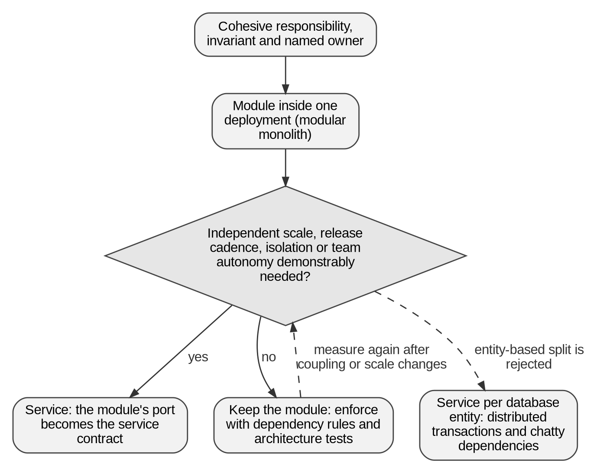
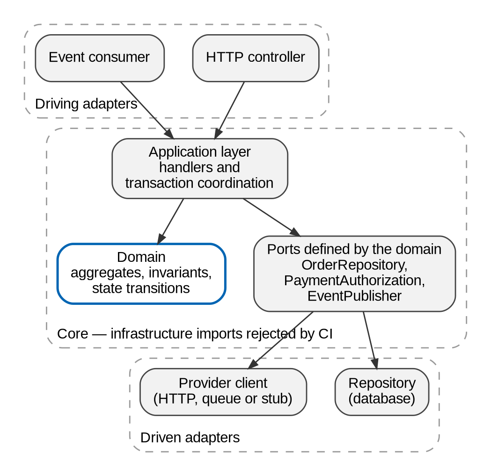
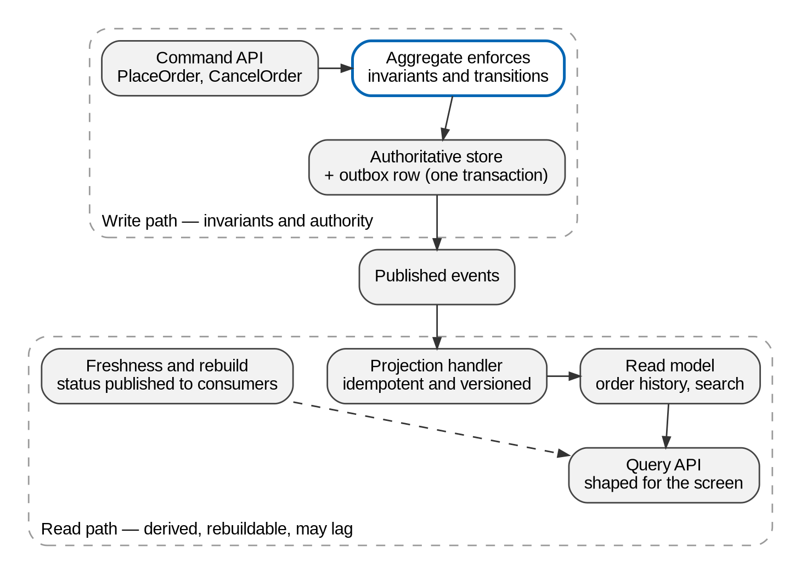
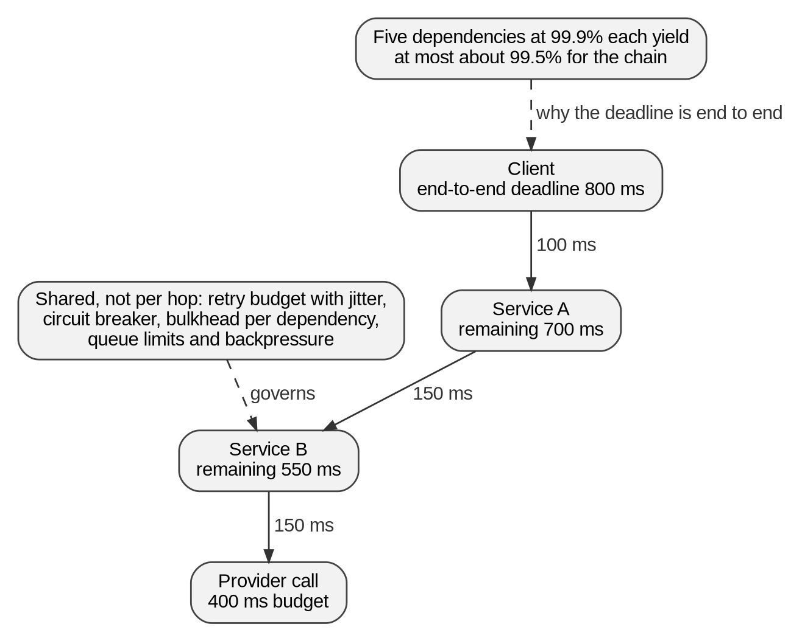
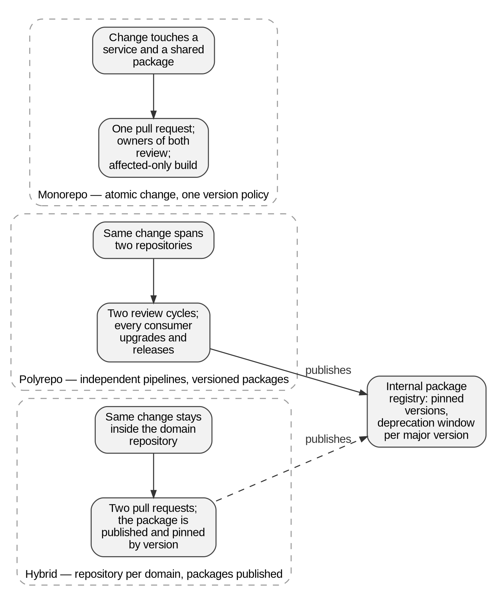
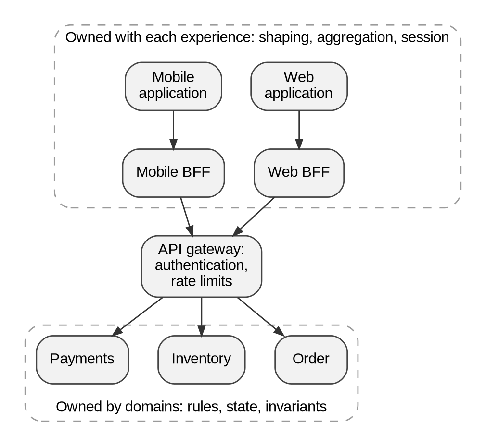
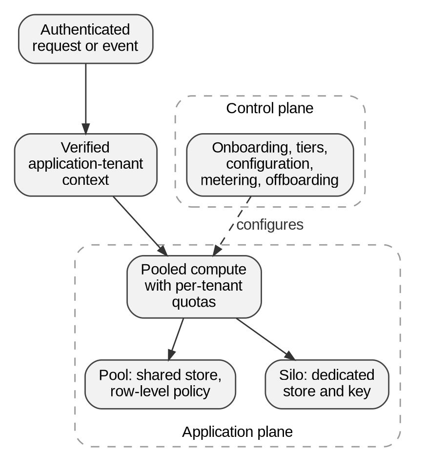

# 11. Application Architecture

Application architecture translates domain responsibilities into modules, components and deployable units. A bounded context defines a consistent language and model; it is not automatically a microservice. A modular monolith can enforce boundaries through visibility rules, explicit interfaces and architecture tests, allowing an organization to defer distributed operational complexity until it is justified.

Evaluate state ownership, synchronous call chains, failure propagation and deployment independence together, and validate boundaries with dependency rules and integration-level failure tests.

::: {.callout-note appearance="simple" icon=false title="When to Use This Chapter"}
- Choosing application boundaries and a deployment style.
- Designing internal structure, state, workflows or caching.
- Reviewing resilience, scalability, security or code organization.
- Deciding whether a modular monolith, services, serverless or event-driven design is justified.
- Designing web and mobile clients, backends for frontends or a multi-tenant application.
- Choosing caching patterns or event sourcing, or planning for several languages and regions.
:::

::: {.callout-tip appearance="simple" icon=false title="Key Takeaway"}
Application architecture is the discipline of keeping boundaries meaningful as deployment and state choices change. A service boundary is useful only when it protects an invariant and an ownership boundary, not merely because it is deployable.
:::

## 11.1 Decomposition and Architectural Styles

Decomposition decides where one deployable unit ends and another begins, and therefore which changes require coordination.

### 11.1.1 Application Boundaries

**Definition.** An application boundary is the line around a cohesive set of responsibilities that share a model, an owner and a set of invariants.

**Purpose.** Boundaries determine what can change independently, what must be tested together and who must be consulted. They are the most expensive decision in the chapter to reverse, because every later choice — transactions, deployment, team structure — inherits them.

**What it includes.** Decompose around cohesive business responsibilities, invariants and ownership. Event storming, capability maps and change-coupling history (which files change together) help identify modules. In the reference checkout, Order owns order transitions, Payments owns provider attempts and Pricing owns quote calculation; each can start as a module in one deployment.

A service per database entity creates distributed transactions and chatty dependencies. Validate a decomposition by tracing workflows and counting changes that cross boundaries.

**Why it is needed.** A boundary drawn around an entity or a framework layer produces the two failures this chapter exists to prevent: transactions that must span services, and changes that must be released together. Both are visible only after the first year. The evidence is a decomposition rationale that traces each workflow to an owner and an invariant, names the boundaries that were considered and rejected, and measures how many changes cross each boundary per quarter.

### 11.1.2 Monolith, Modular Monolith and Microservices

**Definition.** The deployment style is the packaging decision that follows decomposition: one deployable unit, several modules in one unit, or independently deployable services.

**Purpose.** The style sets the operational cost of the solution and the independence its teams can have. Choosing it after the boundaries are understood — rather than before — keeps distribution a response to a demonstrated need instead of a default.

**What it includes.** Table 11.1 compares the styles, and Figure 11.1 shows when a module becomes a service.

| Style | Strengths | Costs | Consider when |
| :--- | :--- | :--- | :--- |
| Monolith | Simple deployment, local transactions | Boundaries erode without discipline | Small scope, one team |
| Modular monolith | Enforced module APIs, local transactions, one pipeline | Shared release cadence and runtime | Boundaries known, operational maturity limited |
| Microservices | Independent deployment, scaling and isolation | Network failures, distributed tracing, eventual consistency, contract governance | Demonstrated need for independent change, scale or isolation |

: Deployment styles

Figure 11.1 draws the boundary between a module and a service, including the split that adds distribution without adding autonomy.

{#fig-11-1 width="100%"}

A modular monolith is not an interim failure state. Extract a service when independent scaling, release cadence, regulatory isolation or team autonomy outweighs the distributed costs, and compare deployment frequency, change coupling and incident cost before and after extraction (see 3.6). Chapter 19 (19.2) extends application composition to model orchestration, retrieval workflows and bounded agent actions.

**Why it is needed.** Premature distribution turns code dependencies into network failures and makes every transaction, test and incident harder to reason about; refusing to distribute at all forces unrelated teams into one release train. The evidence is a recorded decision with the alternative and its rejected reason, plus measurements — deployment frequency, change failure rate, incident cost — taken before and after any extraction.

### 11.1.3 Serverless and Event-Driven Applications

**Definition.** Serverless execution delegates capacity management to the platform; event-driven design reacts to asynchronous facts or commands.

**Purpose.** These are separate decisions that are often combined, and separating them keeps each one justified. Serverless answers "who manages capacity"; event-driven answers "how do components learn about change".

**What it includes.** A function consuming OrderAccepted to update a projection must handle redelivery, concurrency spikes and downstream rate limits. Long-running work such as payment resolution needs durable workflow state rather than an in-memory invocation (10.6.4). Evaluate execution duration limits, cold-start contribution to the latency budget, concurrency quotas, state handling and cost under realistic bursts.

**Why it is needed.** A serverless choice justified by cost at low volume becomes expensive at steady high volume, and an event-driven choice made without idempotency produces duplicates that only appear under retry. The evidence is a cost model at realistic burst shape, a latency budget that includes cold starts, and a test that replays and duplicates events against the handler.

**Example.** The reference checkout starts as a modular monolith with Order, Inventory reservation and Payment coordination modules in one deployment. When payment volume justifies its own scaling and release cadence, Payment coordination is extracted behind its existing port, and the port becomes the service contract; nothing else in the monolith changes.

::: {.callout-warning appearance="simple" icon=false title="Common Pitfall"}
Choosing microservices before the boundaries and ownership are understood. Premature distribution turns code dependencies into network failures and makes every transaction, test and incident harder to reason about. Start modular and extract only where independent deployment, scaling or isolation buys something measurable.
:::

::: {.callout-important appearance="simple" icon=false title="Decision & Trade-off"}
Decide when a module becomes a service.

| Option | Choose when | Consequences |
| :--- | :--- | :--- |
| Keep the module in the monolith | Boundaries are stable and one release train fits the teams | Cheapest operations; shared runtime and release cadence |
| Extract one service behind its port | Independent scaling, isolation or release cadence is measured and needed | Clear contract and autonomy; network failure modes, tracing and versioning work |
| Extract several services at once | A regulatory or platform constraint forces full separation | Fast separation; hardest to reverse, and the boundary errors are multiplied |
:::

## 11.2 Internal Structure and Domain Modeling

Internal structure decides how dependencies run inside a unit; domain modeling decides what the unit protects.

### 11.2.1 Layered, Hexagonal and Clean Architecture

**Definition.** These styles organize code so that business rules do not depend on frameworks, databases or providers.

**Purpose.** The dependency direction is what makes a domain testable and a technology replaceable. It also localizes the effect of an upgrade: when the provider SDK changes, only the adapter changes.

**What it includes.** Layered architecture separates presentation, application and persistence responsibilities. Hexagonal (ports and adapters) and Clean Architecture additionally make dependencies point inward: the domain defines ports such as `OrderRepository` and `PaymentAuthorization`, and HTTP controllers, databases and provider SDKs are adapters (Figure 11.2). The core does not know whether the provider is reached by HTTP, a queue or a test double.

| Layer | May depend on | Enforced by |
| :--- | :--- | :--- |
| Domain | Nothing outside the language runtime | Build configuration; review |
| Application | Domain and its own ports | Dependency check in CI |
| Adapters | Application, domain and their frameworks | None needed; adapters are the edge |
| Infrastructure wiring | Everything, in one composition root | Single module allowed to import all |

: Dependency rules and how they are enforced

Place transaction coordination in the application layer and invariants in the domain. Add a port when it isolates real volatility, a business boundary or a test seam — not mechanically for every helper. Enforce the dependency rule with static checks that reject infrastructure imports in domain modules.

{#fig-11-2 width="100%"}

**Why it is needed.** A domain that imports a framework cannot be tested without it, and an upgrade becomes a rewrite of business logic. The failure is gradual: the first convenient import is followed by a hundred. The evidence is a passing dependency check in CI, domain tests that run without a database or a network, and a provider change that touched only adapter code.

### 11.2.2 Domain Model and State Transitions

**Definition.** A domain model expresses business concepts and invariants, not database rows; its state machine defines which transitions are legal and which must be refused.

**Purpose.** An explicit state machine makes the business rule reviewable and testable, and it prevents the failures that appear when a timeout, a retry or a late event is interpreted as a state change.

**What it includes.** Model order states as an explicit transition system — ACCEPTED → PAYMENT\_PENDING → CONFIRMED or REJECTED — and reject illegal transitions (Table 11.3). A provider timeout must never move an order directly to REJECTED.

| From | Event | To | Rule |
| :--- | :--- | :--- | :--- |
| (new) | PlaceOrder with a new idempotency key | ACCEPTED | Reject a repeated key with the original result |
| ACCEPTED | Inventory reserved | PAYMENT\_PENDING | Reservation is idempotent per order |
| ACCEPTED | Reservation refused | REJECTED | No payment attempt is made |
| PAYMENT\_PENDING | Authorization authorized | CONFIRMED | Ledger entry recorded |
| PAYMENT\_PENDING | Authorization declined | REJECTED | Reservation released |
| PAYMENT\_PENDING | Provider timeout | PAYMENT\_PENDING | Unknown outcome; resolve before any new attempt |

: Order state transitions in the reference checkout

Translate external error codes into stable domain outcomes inside adapters, and test concurrent updates with expected-version checks.

**Why it is needed.** Without an explicit model, illegal transitions are prevented by scattered conditionals that diverge between entry points, and a replay or a duplicate event can move an order backwards. The evidence is a state-transition model in the repository, tests for every illegal transition, and version checks that reject stale updates.

**Example.** A duplicate AuthorizePayment command arrives after the order is CONFIRMED. The domain refuses the transition, records the duplicate, and returns the current state; the ledger keeps one posting. Had the model allowed CONFIRMED → PAYMENT\_PENDING, the customer would see an order regress because of a broker redelivery.

::: {.callout-warning appearance="simple" icon=false title="Common Pitfall"}
Letting adapters decide business outcomes: a provider client that maps a timeout to "declined", or a controller that sets an order to REJECTED when validation fails. The domain then loses the ability to distinguish an unknown outcome from a decision, and reconciliation becomes impossible. Translate technical results into domain outcomes inside the adapter, and let the domain own every transition.
:::

::: {.callout-important appearance="simple" icon=false title="Decision & Trade-off"}
Choose where transaction coordination and validation live.

| Option | Choose when | Consequences |
| :--- | :--- | :--- |
| Application layer handler | A use case spans several domain objects or ports | One place per use case; the domain stays free of infrastructure |
| Domain aggregate method | The invariant is entirely inside one aggregate | Strongest guarantee; the aggregate must not need external reads |
| Adapter or controller | Never for business rules; only for input mapping | Fast to write; duplicates rules across entry points and drifts |
:::

## 11.3 Application State and Workflows

State and workflow design decides where authoritative data lives, how long a business process can run and what a read is allowed to assume.

### 11.3.1 CQRS and Read Models

**Definition.** Command Query Responsibility Segregation (CQRS) separates operations that change state from those that read it, and a read model is a projection built for one read pattern.

**Purpose.** CQRS lets a read shape be optimized without complicating the write model, and lets heavy reads stop competing with writes. It does not require two databases or event sourcing; those are separate choices.

**What it includes.** Use CQRS when read patterns or scale differ materially from writes — for example, an order-history search view derived from authoritative order state (Table 11.4). A read model is derived and may lag; expose freshness where it affects user decisions (Figure 11.3). Prove that projections can be rebuilt by replay and that duplicates and reordering do not corrupt them.

| Signal | Suggests | Alternative first |
| :--- | :--- | :--- |
| Read shape differs from the write model | A projection per screen or query | Database view or query object |
| Read volume competes with writes | Separate read store | Replica or cache |
| Several consumers need different shapes of the same data | Materialized views with published freshness | API composition in a backend-for-frontend |
| Reads must survive a write-side outage | Independently available read store | Read replica with a documented lag |

: When a read model is justified

Figure 11.3 separates the command path from the read path and marks the freshness a projection publishes, the condition the table says must justify a read model.

{#fig-11-3 width="100%"}

**Why it is needed.** A projection that cannot be rebuilt is a second source of truth with no owner, and one whose freshness is undisclosed makes users distrust correct data. The evidence is a replay test that rebuilds the read model to the same state, a freshness metric published with the read API, and handler tests for duplicate and out-of-order events.

### 11.3.2 Long-Running Workflows

**Definition.** A long-running workflow is a business process whose steps span several local transactions, may wait on external parties and may need compensation.

**Purpose.** Such workflows need durable progress, not an in-memory call stack: a process that survives a deployment, a restart and an operator's intervention. The design question is where the state lives and who may advance it.

**What it includes.** Long-running workflows span several local transactions and need durable progress, timeouts and compensation (see 10.4.3). In the reference checkout, if inventory is reserved and payment is declined, the workflow releases the reservation with an idempotent command. If payment is UNKNOWN, compensation is deferred until reconciliation resolves the outcome. Test repeated messages, failed compensations and operator intervention against the documented state machine.

**Why it is needed.** A workflow held in memory loses its place on the first deployment, and one without timeouts leaves orders pending forever. The evidence is persisted workflow state with a visible current step, timeouts per step, an escalation path, and tests for repeated messages and failed compensations.

### 11.3.3 Caching Strategies and Invalidation

**Definition.** A cache is a disposable copy of state kept for latency or cost, and it is only safe when its invalidation and staleness are designed; a caching strategy states who reads and writes the copy, and when.

**Purpose.** Caching buys latency and protects a dependency, at the price of a second place where data can be wrong. Deciding explicitly where authoritative state lives keeps that price visible.

**What it includes.** Decide explicitly where authoritative state lives; caches are disposable derivatives unless durability is deliberately designed. Table 11.5 compares the common strategies, which can be combined, such as cache-aside for reads with write-around for writes. Invalidate by TTL, by an event from the owning service, or with versioned keys that make old entries unreachable; a fixed TTL limits how long an entry survives a lost event. Include tenant and user scope in keys so one customer can never read another's entry. For an order-status cache define TTL, invalidation and acceptable staleness; never authorize a financial transition from cache alone. Protect against stampedes, in which many requests rebuild the same missing entry, with request coalescing, randomized expiry and serving stale data while one caller refreshes. Cache negative results briefly, and test behavior when the cache is unavailable.

| Strategy | How it works | Benefit | Risk or limit | Fits when |
| :--- | :--- | :--- | :--- | :--- |
| Cache-aside (lazy loading) | The application reads the cache; on a miss it loads from the store and fills the cache | Only requested data is cached; the application can survive losing the cache | Staleness window; the first read is slow; each caller owns the logic | Reads dominate and some staleness is acceptable |
| Read-through | The cache layer loads from the store on a miss | Simple callers; loading logic in one place | The cache layer needs data-access logic and becomes a dependency | Many callers share the same loading rules |
| Write-through | Each write updates the cache and the store before it is acknowledged | Reads see recent writes | Slower writes; the two writes are not atomic, so a partial failure can leave them different; rarely read data is cached | Data is usually read soon after it is written |
| Write-behind (write-back) | The write is acknowledged after updating the cache, and the store is updated later | Fast writes that can be batched | A cache failure loses acknowledged data; ordering and retries must be designed | Loss is tolerable, or the cache is durable and replicated |
| Write-around | Writes go only to the store, and the cache is filled by later reads | Rarely read data does not occupy the cache | The first read after a write misses; any older cached entry must be invalidated | Written data is seldom read soon afterwards |

: Cache read and write strategies

**Why it is needed.** A cache used as a source of truth produces decisions on stale data that nobody can reproduce afterwards, and an unprotected expiry produces a stampede that takes down the dependency it was protecting. The evidence is a documented strategy, TTL and invalidation rule per cached item, a stampede control such as request coalescing or jitter, and a test with the cache unavailable.

### 11.3.4 Cache Tiers, Eviction and Effectiveness

**Definition.** Cache tiering keeps copies at several distances from the caller; eviction removes entries to free capacity; effectiveness measures whether the cache reduces latency and load enough to justify it.

**Purpose.** Each tier trades latency against scope and consistency. Sizing and measurement show whether a cache is paying for the staleness it introduces.

**What it includes.** Table 11.6 compares the locations. A multi-level cache checks a local tier (L1, in process), then a shared or larger tier (L2, distributed or on disk), then the store. These labels are logical and differ from processor caches of the same name. Each instance holds its own L1, so instances can disagree: keep the L1 TTL short or broadcast invalidation events. Independent fixed TTLs can accumulate when each tier restarts expiry on refill, so set a maximum age from the originating version and keep the remaining freshness on promotion. Sliding expiry alone bounds nothing, serving stale needs its own limit, and HTTP caches count upstream time through `Age`. Eviction frees capacity; invalidation removes wrong data. Common eviction policies are least recently used (LRU), a sound default; least frequently used (LFU), for stable popular items; and first in, first out (FIFO), which ignores use. A large scan can flush an LRU cache. A hit finds the entry and a miss goes to the next tier. Measure hit ratio per class of key, eviction rate, latency per tier and origin load, because a high ratio on cheap items proves little. Decide how a cold cache is warmed after a release or restart, and confirm that the origin survives it. Session data is not disposable, because losing it signs users out (11.4.3).

| Location | Scope | Main consistency concern | Fits |
| :--- | :--- | :--- | :--- |
| Client (browser or device) | One user | The server cannot purge it; rely on cache directives and versioned URLs (10.2.6) | Static assets and per-user reads |
| CDN or edge | Users in a region | Do not shared-cache personalized responses by default; an exception needs explicit permission, identity-scoped keys and isolation tests | Public content |
| API gateway or reverse proxy | All clients of an API | Keys must vary by consumer where responses differ, and `private` or `no-store` directives still apply | Expensive idempotent reads |
| In-process (L1) | One instance | Instances disagree; memory is repeated in each | Small, hot reference data |
| Distributed (L2) | All instances | A network hop and an availability dependency | Data shared across instances |
| Local disk | One host | Slower than memory; may survive restarts and return old data | Objects too large for memory |
| Database results | The database | Engine-managed; some engines dropped query caches because invalidation limited write throughput | Expensive aggregates, as materialized views |

: Cache locations and their consistency concerns

**Why it is needed.** Tiers added one at a time multiply staleness in ways that no single owner sees, and a cache that is too small evicts entries before they are reused, adding cost and a dependency with little benefit. The evidence is a tier map with the worst-case staleness per item, an invalidation test across instances, hit-ratio and eviction measurements under production-shaped load, and a cold-start test.

### 11.3.5 Event Sourcing

**Definition.** Event sourcing stores each change to an entity as an immutable, ordered event and derives current state by replaying those events, so that the event stream is the system of record.

**Purpose.** It preserves the complete history of how state was reached. That history supports audit, temporal questions and new read models built from past facts, in domains where these are worth their considerable cost.

**What it includes.** Each aggregate has a stream written with an expected version, which gives optimistic concurrency for that aggregate. Snapshots shorten replay. Projections build read models, usually with the CQRS separation (11.3.1), although either pattern can be used without the other. Events are published facts of the domain, and they outlive the code that wrote them: evolve them through versioned schemas and upcasting at read time, and never rewrite history. Keep internal events separate from the integration events other teams consume, which should have their own contracts (10.2.2). Publish reliably using the store's change feed or an outbox (10.3.1). Immutable history conflicts with erasure, so keep personal data outside the stream or encrypt it per subject and destroy the key (9.2.5). Plan how long a full rebuild of the projections takes, and how to run a new projection beside the old one. Use event sourcing for the aggregates where history is a business requirement, such as ledgers or regulated case records, and not as a system-wide default.

**Why it is needed.** Teams that adopt the pattern for its novelty inherit schema evolution, eventual consistency and rebuild costs across their domain, while a domain that truly needs history cannot recover it after state has been overwritten. The evidence is a recorded business driver, a replay from an empty store, tests that read every historical event version, a measured projection rebuild and a tested erasure procedure.

**Example.** The order-history screen reads from a projection, not from the order store, and shows "updated 12 seconds ago". When a customer cancels an order, the command path commits to the authoritative store and publishes an event; the projection catches up within its published lag, and a stale screen never authorizes a refund.

::: {.callout-warning appearance="simple" icon=false title="Common Pitfall"}
Adding a projection or a cache to solve a performance problem that is actually a query or index problem. The system gains a second copy, a freshness problem and a rebuild procedure, while the original query remains slow for the next consumer. Measure the query first; add a derived store only when the read shape or the load genuinely differs.
:::

::: {.callout-important appearance="simple" icon=false title="Decision & Trade-off"}
Choose how the application will serve reads before adding a projection or cache.

| Option | Choose when | Consequences |
| :--- | :--- | :--- |
| Direct query of the source | The read shape is simple, freshness matters and load is bounded | Simpler, but couples read latency and availability to the source |
| CQRS projection | Read shapes or load differ materially and eventual consistency is acceptable | Autonomy and performance; rebuild, replay and freshness obligations |
| Shared cache | A hot read can tolerate bounded staleness and invalidation is understood | Lower latency; invalidation and authorization risks |
:::

## 11.4 Communication, Resilience and Scalability

Communication choices decide how failure propagates between components; resilience and scalability decide what the application does about it.

### 11.4.1 Communication Between Components

**Definition.** Communication design is the choice between an in-process call, a synchronous network call and an asynchronous message, made per interaction rather than per organization.

**Purpose.** Each choice moves a different risk: in-process calls move coupling, synchronous calls move availability, asynchronous messages move consistency. Naming the risk per interaction is what keeps a call chain from becoming the product's availability.

**What it includes.** Use in-process calls between modules of a modular monolith. Crossing a network boundary requires explicit contracts, deadlines, authentication and tracing. Avoid long synchronous call chains, because checkout availability then becomes the product of every dependency’s availability: five dependencies at 99.9% each yield at most about 99.5% (Figure 11.4). Publish facts only after committing authoritative state.

| Option | Choose when | Main consequence |
| :--- | :--- | :--- |
| In-process call | Both sides deploy together and share a transaction | Cheapest and fastest; no isolation, so a failure is shared |
| Synchronous network call | The caller needs the result to continue | Coupled availability and latency; needs deadline and idempotency |
| Asynchronous message or event | Work can complete later and the caller can proceed | Eventual consistency, duplicates and pending states to design |

: Communication options between components

Figure 11.4 shows one deadline divided across the call chain, so a slow hop consumes the remaining budget instead of extending it.

{#fig-11-4 width="100%"}

**Why it is needed.** A chain of synchronous calls converts one slow dependency into a total outage, and the arithmetic is unforgiving: availability multiplies. The evidence is an end-to-end deadline with per-hop budgets, a stated retry budget, and a measured p99 for the whole chain rather than per service.

### 11.4.2 Application Resilience

**Definition.** Application resilience is the set of controls that keep a failure contained: deadlines, retries, circuit breakers, bulkheads and backpressure.

**Purpose.** The controls exist to bound blast radius and recovery time, not to eliminate failure. Composing them against one deadline and one capacity model is what prevents them from amplifying the failure they were meant to contain.

**What it includes.** Compose resilience controls by failure mode: a deadline first; retries only for idempotent operations; a circuit breaker for persistent failure; a bulkhead for resource isolation; queue limits for backpressure (10.4.1). A circuit breaker cannot establish whether a timed-out charge succeeded — persist PAYMENT\_PENDING and reconcile instead of returning false success. Decide the degraded mode for each journey in advance, such as serving a cached price, hiding recommendations or accepting an order for later processing, so that graceful degradation is a designed behavior and not an accident. Test the controls together under a provider outage and measure p99 latency, amplification, backlog and correctness.

**Why it is needed.** Individually sensible settings multiply under stress: retries at two levels turn one call into nine, and a bulkhead sized for normal load strands capacity during an incident. The evidence is a combined fault-injection result — provider outage, slow dependency, queue saturation — with measured amplification and a documented degradation per journey.

### 11.4.3 Application Scalability

**Definition.** Application scalability is the property that throughput grows with the resource that actually limits it, at a cost the business accepts.

**Purpose.** Scaling the wrong component adds cost without adding capacity. Identifying the measured bottleneck first is what turns a scaling exercise into an engineering decision rather than a purchase.

**What it includes.** Scale the measured bottleneck (Table 11.8). Stateless handlers scale horizontally, but database contention, hot keys and provider quotas often dominate throughput. Define target throughput, p95/p99 latency, saturation and cost per completed order, and load-test with realistic write contention and burst patterns before choosing caching, partitioning or asynchronous buffering.

| Signal | Likely bottleneck | First lever |
| :--- | :--- | :--- |
| CPU saturated, latency flat | Compute per request | More instances or a cheaper code path |
| Latency rises with concurrency, CPU idle | Lock contention or connection pool | Shorter transactions, pool sizing, partitioning |
| One key or tenant dominates | Hot partition | Key redesign or tenant isolation |
| Provider rate limits reached | External quota | Queueing, batching or a negotiated quota |
| Queue age grows while consumers idle | Downstream saturation | Backpressure and capacity, not more consumers |

: Bottleneck signals and the first lever

*Vertical or horizontal.* Scaling vertically adds resources to one instance. It is simple and needs no code change, and it reaches a hardware limit, keeps a single failure domain and often needs a restart. Scaling horizontally adds instances. Stateless handlers make those instances interchangeable, while stateful ones need explicit placement, coordination and recovery.

*Session state.* Keep sessions out of the instance so that any instance can serve a request, using signed tokens with short lifetimes or an external session store. Token-based sessions avoid a shared store and make immediate revocation harder (13.2.4). Sticky sessions tie a user to an instance, unbalance load and lose the session when that instance fails, so use them only as a temporary measure for software that cannot be changed.

**Why it is needed.** Horizontal scaling hides contention until the database is the only thing left, and a load test with uniform keys never reproduces the tenant that dominates production traffic. The evidence is a load test with realistic skew, a recorded bottleneck with its measurement, and a cost per completed order before and after the change.

**Example.** Checkout p99 doubles at peak. CPU is idle, so the team measures lock waits on the stock table: every order for a popular product updates the same row. The fix is a reservation table keyed by product and warehouse with a short transaction, not more application instances.

::: {.callout-warning appearance="simple" icon=false title="Common Pitfall"}
Adding retries and instances to a system whose bottleneck is a shared resource. Both increase pressure on the contended database or provider, so latency worsens and the incident lasts longer. Measure saturation and lock waits before adding capacity, and add backpressure where the queue is the honest signal.
:::

::: {.callout-important appearance="simple" icon=false title="Decision & Trade-off"}
Choose how a dependency failure is isolated.

| Option | Choose when | Consequences |
| :--- | :--- | :--- |
| Bulkhead per dependency | One dependency can exhaust shared workers or connections | Contained blast radius; idle capacity in normal operation |
| Queue with bounded limits | Work can wait and the producer can slow down | Smooths bursts; visible backlog and a rejection policy |
| Asynchronous step with pending state | The journey can continue without the result | Best availability; the user-visible pending state must be designed |
:::

## 11.5 Application Security and Evolution

Security and evolution decide whether the application can be changed safely and by whom.

### 11.5.1 Application Security

**Definition.** Application security is the set of controls that authenticate callers, authorize each requested resource, validate input and protect secrets inside the application.

**Purpose.** The application is where object-level decisions are made: whether this user may read this order. Platform controls — gateway authentication, network policy, WAF — cannot make that decision, so the application must.

**What it includes.** Authenticate callers and authorize each requested resource: possession of an `order_id` does not grant access to the order. Validate input at adapters in addition to domain invariants, keep secrets out of code and configuration files, and scan dependencies (see Chapter 13). Appendix F.7 lists common web vulnerabilities and their primary defenses.

| Control | Enforced at | Test that proves it |
| :--- | :--- | :--- |
| Authentication | Gateway and application | Expired and revoked token attempts |
| Object-level authorization | Application service, using the caller's identity | Cross-tenant and cross-user access attempts |
| Input validation | Adapter, then domain invariant | Malformed, oversized and boundary payloads |
| Secret handling | Configuration and secret store | Scan of the repository and build artifacts |
| Dependency risk | Build pipeline | Failing build on a known vulnerable version |

: Application security controls and their tests

**Why it is needed.** An application that trusts an identifier from the request leaks other customers' data through its own correct-looking API, and one that validates only at the edge accepts invalid state through internal callers. The evidence is authorization tests per endpoint and per object, a secret scan in the pipeline, and a dependency policy that fails the build.

### 11.5.2 Evolving Code and Contracts

**Definition.** Evolution is the practice of changing an application and its contracts without breaking the consumers that depend on them.

**Purpose.** Applications outlive the frameworks and providers they were built on, and their contracts outlive the teams that wrote them. Designing for change keeps upgrades routine instead of heroic.

**What it includes.** Evolve public contracts additively, test old clients against new versions and keep a documented rollback path. Keep domain logic isolated from framework upgrades so that runtime or provider changes are contained in adapters.

**Why it is needed.** A framework upgrade that reaches into domain code becomes a rewrite with a business risk, and a contract change without an old-client test breaks a consumer that nobody remembered. The evidence is a contract test suite that runs old client versions against the new build, a rollback path that was exercised, and an upgrade history showing that framework changes stayed inside adapters.

### 11.5.3 Code Organization and Repositories

**Definition.** Repository structure is an architectural decision because it shapes ownership, dependency management, build and release independence.

**Purpose.** The repository model decides who must coordinate to change code, how a shared library reaches its consumers and how independently a component can be released. Chosen badly, it recreates the coupling the service boundaries were meant to remove.

**What it includes.** Four decisions, usually made together.

*Repository topology.* A monorepo holds many components in one repository; a polyrepo gives each component its own; a hybrid keeps one repository per domain and publishes shared packages. Table 11.10 compares them, and Figure 11.5 shows what the same cross-cutting change costs in each.

| Aspect | Monorepo | Polyrepo | Hybrid (repository per domain) |
| :--- | :--- | :--- | :--- |
| Structure | Many components in one repository | One repository per component or service | One repository per domain, with services and shared packages inside it |
| Strengths | Atomic cross-component changes; one dependency version policy; easy discovery and refactoring | Clear ownership and access boundaries; independent pipelines and release cadence | Domain-level atomic change without a single estate-wide repository |
| Costs | Needs build tooling that builds and tests only what changed; access control is coarser; CI scales with the repository | Cross-repository changes need coordination; dependency versions drift; shared code must be published and versioned | Two models to operate; package publication discipline inside each domain |
| Fits | One team or closely coordinated teams; a modular monolith; shared libraries evolving together | Independent teams and services; external or open-source components | Several domains with independent roadmaps and some shared code |

: Repository topologies

*Code ownership.* A code-owners file makes changes to a component require its owners' review. Ownership is not write access: a team may write across a monorepo while reviews stay with component owners. **Inner source** — open-source practices inside the organization — lets teams contribute to components they do not own through reviewed pull requests.

*Internal modules and packages.* Boundaries are enforced by dependency rules (11.2.1) and architecture tests, not by folder layout. A shared package is a published interface: owner, version, tests and a deprecation policy, and no domain logic, which recreates coupling between services.

*Versioning of shared libraries.* Use **semantic versioning** (MAJOR.MINOR.PATCH, MAJOR signals a breaking change), state what each increment means for consumers (Table 11.11), pin versions and upgrade deliberately.

| Change | Version increment | Consumer action |
| :--- | :--- | :--- |
| Additive, backward-compatible interface | MINOR | None required; upgrade when convenient |
| Fix with no interface or behavior change | PATCH | None |
| Breaking interface or observable behavior | MAJOR | Migrate within the published support window |
| Semantic change with no wire change | MAJOR — treat as breaking | Review usage and retest, because no validator detects it |
| Removal of a deprecated major version | None — announcement and date | Must have migrated, or the build breaks deliberately |

: Versioning decisions for a shared library

Figure 11.5 compares what the same cross-cutting change costs in each topology, which is the evidence the versioning decision in the table depends on.

{#fig-11-5 width="100%"}

How a change reaches a shared main branch — trunk-based development, GitHub flow, GitFlow or release branches — is a separate decision, owned by 15.1.3. The repository model only determines how many repositories and review cycles a change has to cross; the branching strategy determines how often code integrates and how a release is cut.

**Why it is needed.** A topology chosen by preference produces either a repository nobody can build in ten minutes or a cross-repository change that takes a week and drifts versions. The evidence is a documented topology decision with its alternative, a code-owners file enforced by the platform, a dependency check in CI, and a registry where every shared library carries a version and a deprecation window.

**Example.** In the reference checkout, Order, Payments and Pricing start in one repository with affected-only builds and a code-owners file per module. When Pricing gains its own roadmap, its package moves to a domain repository and is published as a versioned library; Order pins the version, and a MAJOR increment starts a migration rather than breaking the build overnight.

::: {.callout-warning appearance="simple" icon=false title="Common Pitfall"}
Publishing a shared library that contains domain logic — an `order-utils` package with pricing rules and state transitions — because it avoids duplicating a few functions. Every consumer now depends on another team's model, changes require a coordinated release, and the service boundaries become decorative. Share technical capabilities with a stable contract; keep domain logic inside the owning service.
:::

::: {.callout-important appearance="simple" icon=false title="Decision & Trade-off"}
Choose how code is shared between services.

| Option | Choose when | Consequences |
| :--- | :--- | :--- |
| Versioned package in a registry | Several services need the same technical capability | Explicit contract and upgrade path; publication and deprecation work |
| Module inside a monorepo | The consumers release together and the code changes often | Atomic change; couples the consumers to one build and release train |
| Deliberate duplication | The shared code is small, stable and domain-specific | No coupling; duplicated defects must be fixed in every copy |
:::

## 11.6 Client Application Architecture

The client is the part of the solution that runs on hardware the team does not control, at a version it cannot always force and over a network it cannot rely on. Those conditions make client decisions architectural: they affect contracts, security boundaries, release independence and the way a pending business state is presented to a person.

### 11.6.1 Client Types and Rendering Strategies

**Definition.** A rendering strategy decides where and when a user interface is produced: ahead of time, on the server per request, in the browser or on the device.

**Purpose.** The strategy sets first-content time, search visibility, offline behavior, infrastructure cost and how quickly a defect can be withdrawn. Choosing it per experience prevents one decision from being applied to a marketing page, an authenticated dashboard and a field application that have little in common.

**What it includes.** Table 11.12 compares the main approaches. Decide against named scenarios: first-content time on the slowest supported device and network, whether content must be indexable, whether the user keeps working offline and how fast a release must reach every user. Web approaches can be mixed per route, so a public catalog can be pre-rendered while checkout runs as an interactive application.

| Approach | Fits when | Main cost |
| :--- | :--- | :--- |
| Static or pre-rendered pages | Content changes on a known schedule and must load fast and be indexable | Build-time regeneration; personalization needs another path |
| Server-side rendering | Content is dynamic and first-content time or search visibility matters | Server capacity per request; a server failure is a page failure |
| Single-page application | Long, highly interactive sessions behind authentication | Initial bundle weight; tokens and routing in the browser |
| Native mobile | Deep device integration, background work or the best platform fidelity is required | Separate code per platform; store review and long-lived versions |
| Cross-platform mobile | One team must serve several platforms and the fidelity trade-off is acceptable | Dependency on the framework's support for new platform features |

: Client rendering and delivery approaches

**Why it is needed.** A rendering choice made by framework preference often appears as a slow first page on low-end devices, content that cannot be indexed or a mobile defect that remains installed for months. The evidence is a rendering decision per experience with its target scenarios, plus field measurements from real users on the slowest supported tier.

### 11.6.2 Backends for Frontends and API Composition

**Definition.** A backend for frontend (BFF) is a server component owned with one client experience that adapts internal APIs to that experience's needs.

**Purpose.** Different clients need different data shapes, payload sizes and call patterns. Newman's pattern gives that adaptation a home other than a general-purpose API that accumulates client-specific options, or a client that must make many calls over a slow network.

**What it includes.** A BFF aggregates and reshapes; it does not decide. Eligibility, pricing and state transitions stay in the owning services. Give each BFF to the team that owns its client, one per distinct user experience. Bound fan-out against the page's latency budget and share a single deadline across downstream calls (11.4.1). Define what the client receives on partial failure: a page section can be marked unavailable, while a payment step must fail visibly. A BFF differs from an API gateway, which applies uniform cross-cutting policy (10.5), and from a schema-based aggregation layer such as GraphQL (10.2.5), which moves query flexibility to the client and with it the need for query-cost limits.

Figure 11.6 shows how the experience-owned components sit in front of the domain services and which responsibilities stay behind that line.

{#fig-11-6 width="100%"}

**Why it is needed.** Without a composition layer, either clients become chatty and fragile or a shared API collects options that no single owner can remove. With a poorly bounded one, domain logic leaks into a component that only one client can use, so another channel re-implements it differently. The evidence is a named owner per BFF, a review rule that rejects domain decisions, a deadline budget for each aggregated view and a test of the partial-failure response.

### 11.6.3 Micro-Frontends and UI Composition

**Definition.** Micro-frontends divide a user interface into parts that independent teams build and deploy separately and that are composed into one experience.

**Purpose.** Like service decomposition, this is primarily an organizational tool: it buys independent release for teams that are otherwise blocked by one front-end pipeline. It should be justified by that delay, not by the existence of a pattern.

**What it includes.** Composition can happen at build time, on the server or edge, or at run time in the browser. Build-time composition is simplest but restores release coupling; run-time composition gives the most independence and the highest cost in payload and failure handling. Split along business journeys rather than visual widgets, so a change rarely spans teams. State the shared contracts explicitly: design system, routing, authentication session, telemetry and the limited channel through which parts communicate. Govern duplicate dependencies and total payload with a budget, and test accessibility across composition seams, because focus order and landmarks are properties of the whole page (1.2.11).

**Why it is needed.** Applied too early, micro-frontends turn one deployment problem into several integration problems and make every user download the difference. Applied along the wrong seams, they require coordinated releases anyway. The evidence is a measured release bottleneck that justifies the split, a payload budget enforced in the pipeline, independent deployment of each part and an end-to-end accessibility test of the composed page.

### 11.6.4 Client State, Offline and Synchronization

**Definition.** Client state is the data a client holds between interactions: interface state, cached server state and any durable local data that has not yet reached the server.

**Purpose.** Separating these kinds of state decides what can be discarded, what must be revalidated and what must never be lost. It also determines whether a person sees what the system knows or what the client hopes will happen.

**What it includes.** Treat cached server state as stale by default and state its freshness (11.3.3). Show pending work as pending: in the reference checkout, the page displays that payment is being confirmed while the order is PAYMENT\_PENDING, and never reports success before the server does. An optimistic update needs a defined rollback and message. Every submitted command carries a client-generated idempotency key, so a double tap, a retry after a lost response or a replay from an offline queue is safe (10.3.2). Offline-capable clients need an ordered durable queue and a conflict rule per data type: reject with a version check, merge by field or ask the user. Local data is an additional copy, so apply data classification, encryption and remote-wipe rules, and include it in deletion design (13.9.3).

**Why it is needed.** A client that assumes the network is reliable loses work and duplicates submissions, and one that shows success early creates support cases that the server's logs cannot explain. The evidence is a state inventory by type and sensitivity, tests that drop the response after the server commits, and an offline replay test that produces no duplicate business effect.

### 11.6.5 Client Security, Release and Performance

**Definition.** Client security, release and performance are the controls that account for code running in an untrusted environment, at versions that coexist, on devices of varying capability.

**Purpose.** These three concerns share a root: the team does not control the runtime. Designing for that keeps a compromised page, an old installed version or a slow device from becoming a server-side incident.

**What it includes.** Treat all client code as readable and modifiable: embed no secrets, and authorize every request on the server (13.3). In browsers, reduce token exposure to script; a BFF that holds tokens server-side and issues a hardened session cookie is the stronger option where cross-site scripting is a concern, supported by a content security policy. Native applications use the authorization code flow with PKCE through the system browser (RFC 8252; Appendix F.2). Version skew is permanent: a browser tab can outlive a deployment, and mobile releases pass store review and may remain installed for years. Keep APIs compatible across a declared support window (10.2.4), publish a minimum supported version, and hold a remote control to disable a faulty feature (15.2.3). Set a performance budget in user-centered terms, measure it with real-user monitoring by device tier (Chapter 14) and verify accessibility against the agreed baseline (1.2.11).

**Why it is needed.** A token readable by injected script gives an attacker the session, and an API change that ignores installed versions breaks users the team cannot immediately update. The evidence is a client threat model, a tested content security policy, a compatibility matrix of supported versions, an enforced payload budget and field performance by device tier.

### 11.6.6 Internationalization and Localization

**Definition.** Internationalization prepares a solution to support several languages, regions and formats without code changes; localization supplies the content and conventions for one specific locale.

**Purpose.** Retrofitting these concerns touches the data model, every interface and the release process. Deciding early costs little and leaves later markets a matter of configuration and translation.

**What it includes.** Externalize all user-visible text, identify locales with BCP 47 language tags (RFC 5646), and define a fallback chain. Use a maintained locale data source such as the Unicode CLDR for plurals, dates, numbers and sorting; string concatenation fails on word order and plural rules. Allow for text expansion and for right-to-left layout. Use UTF-8 throughout, and decide normalization, collation and search per language. Store instants in UTC. For future civil events such as appointments, store the local time and the IANA time zone name, because the offset for a future date can change. Store money as an amount with its ISO 4217 currency code and use decimal types, because minor units differ by currency. Do not assume name or address structures. APIs should return stable error codes and data rather than display strings, and let the client format for its locale. Plan translation as a pipeline with owners, context for translators and a release path independent of code. Regional legal text and data rules are requirements in their own right (13.9.5).

**Why it is needed.** Defects in this area reach users as wrong prices, appointments an hour off and truncated screens, and they are hard to detect in single-locale testing. The evidence is a list of supported locales, a pseudo-localization test across the interface, time-zone tests that span a daylight-saving change and currency tests with differing minor units.

**Example.** The reference checkout pre-renders the catalog, uses an interactive application for the basket and payment steps, and gives the mobile application its own BFF that returns a compact order summary. The BFF holds tokens, shares one 1,500 ms deadline across Order and Inventory reads (an illustrative budget) and marks recommendations unavailable when that service is slow; a failed PlaceOrder is never hidden. Each submission carries a client idempotency key, and the mobile team keeps three released versions supported by contract tests.

::: {.callout-warning appearance="simple" icon=false title="Common Pitfall"}
Letting a BFF become a second domain layer. A rule added there because the client team can release it faster works until a second channel needs the same behavior and implements it differently. Keep BFFs to aggregation, shaping and session handling, and move any decision that a business owner would recognize into the owning service.
:::

::: {.callout-important appearance="simple" icon=false title="Decision & Trade-off"}
Choose how clients obtain data shaped for their experience.

| Option | Choose when | Consequences |
| :--- | :--- | :--- |
| One general-purpose API | Clients have similar needs and one team can own the contract | Simplest to run; client-specific options accumulate |
| One BFF per experience | Experiences differ materially and client teams can operate a service | Fitted responses and token isolation; more services and possible duplicated aggregation |
| Schema-based aggregation layer | Many consumers need flexible reads over a shared graph | Client flexibility; query-cost limits, authorization per field and a central schema to govern |
:::

## 11.7 Multi-Tenant Architecture

Multi-tenancy serves several customer organizations from one solution while keeping each one's data, performance and lifecycle separate. Section 13.4.3 owns the security requirement that tenants are segregated; this section covers the application design that makes the requirement achievable and affordable. The tenancy choice is recorded in a Tenancy Decision Record (Appendix B.6), and Section 17.6 applies the same isolation reasoning to the teams and workloads that share an internal platform.

### 11.7.1 Tenancy Models

**Definition.** A tenancy model states which resources each tenant has to itself and which it shares; the common terms are silo for dedicated resources, pool for shared resources and bridge for a mix of the two across layers.

**Purpose.** The model is the largest single determinant of isolation strength, unit cost, operational effort and onboarding speed, and it is expensive to change after tenant data exists. Making it explicit per layer avoids an all-or-nothing debate.

**What it includes.** Table 11.13 compares the models. Decide per layer, because compute, storage, messaging and encryption keys can differ: a solution can pool stateless compute and give regulated tenants separate databases. Commercial tiers can map to models, as long as the tier is a designed path and not a one-off deployment. Deployment stamps (12.4.1), independent copies of the whole stack that each host a group of tenants, limit the blast radius of a pool and provide a unit of regional placement and scale.

| Model | Isolation | Cost and operations | Fits when |
| :--- | :--- | :--- | :--- |
| Silo (dedicated stack or data store per tenant) | Strongest and simplest to demonstrate | Highest unit cost; many instances to deploy and upgrade | Few large or regulated tenants with contractual isolation |
| Pool (shared resources, tenant key on the data) | Enforced in software and needs continuous proof | Lowest unit cost; one fleet to operate | Many tenants with similar needs and modest individual load |
| Bridge (mix per layer or per tier) | Varies by layer and must be documented | Moderate; two operating patterns to support | Tenant segments differ, or only some layers need separation |

: Tenancy models compared

Figure 11.7 follows one request through tenant resolution and shows that the same context reaches both shared and dedicated resources, with the control plane operating alongside the request path.

{#fig-11-7 width="100%"}

**Why it is needed.** A default of one shared database becomes a contract problem at the first customer who requires separation, and a default of a stack per tenant becomes a margin and upgrade problem at the hundredth customer. The evidence is an ADR stating the model per layer, with projected tenant count, unit cost at that count and the isolation requirement each layer satisfies.

### 11.7.2 Tenant Context and Isolation Enforcement

**Definition.** Tenant context is the verified identity of the tenant on whose behalf work runs, carried with that work and enforced wherever data is accessed.

**Purpose.** In a pool, isolation is only as strong as the least careful query. A context established once and enforced by shared mechanisms removes the need for every developer to remember a filter on every path.

**What it includes.** Resolve a verified application tenant before any work runs (13.3.1). Accept a tenant claim from a token only after validating how it maps to the application's own tenant, because identity-provider tenants and application tenants are different namespaces. Where a user belongs to several tenants and selects one, check the request against authoritative membership data; never trust a caller-supplied identifier without that check. Propagate the context across calls and in event metadata, because background jobs, consumers and scheduled tasks have no user session to read it from, and authenticate each producer and validate its authority for the tenant it declares. Enforce it below the application code where the store allows, using row-level policies or tenant-scoped credentials, so that a missed filter fails closed. Treat every other shared structure as a possible leak: cache keys, search indexes, object-storage paths, generated files, dead-letter queues, and retrieval indexes used by AI features (19.3.5). Telemetry needs the tenant identifier for operations, without carrying tenant content. Support access is cross-tenant by nature, so it is time-bound, approved and audited (13.7.2).

**Why it is needed.** A cross-tenant exposure is often the most serious defect a multi-tenant product can have, and it typically comes from an ordinary path: a cache key without a tenant, or a report job that runs unscoped. The evidence is an automated suite that attempts cross-tenant access on every path and store, including asynchronous ones, and a review showing that a query without tenant context fails rather than returns data.

### 11.7.3 Noisy Neighbors and Fair Capacity

**Definition.** A noisy neighbor is a tenant whose workload degrades the service other tenants receive from shared resources.

**Purpose.** Pooling is economical because peaks do not usually coincide, and it fails when they do or when one tenant dominates. Fairness controls turn an unpredictable shared outcome into a stated per-tenant capacity.

**What it includes.** Apply quotas and rate limits per tenant at the entry point and on expensive operations, and return a clear rejection rather than letting the shared resource saturate (11.4.3). Partition work so that a single tenant's backlog cannot hold up others, using per-tenant queues or fair scheduling. Bulkheads protect critical paths (11.4.2). Move heavy exports and reports to asynchronous off-peak work with their own capacity. Provide ways to separate a tenant that outgrows the pool: rebalancing across shards or stamps, or promotion to a dedicated tier. Measure latency, errors and saturation per tenant, because a healthy fleet average can hide one tenant's outage or one tenant's excess. Include tenant-mix scenarios in load tests, not only total volume (16.3.1).

**Why it is needed.** Without per-tenant limits, the largest customer's batch job becomes everyone's incident, and aggregate dashboards show nothing unusual. The evidence is a documented limit per tier, per-tenant SLIs, and a load test in which one tenant exceeds its quota while the others stay within their objectives.

### 11.7.4 Control Plane and Tenant Lifecycle

**Definition.** The control plane is the set of services that manage tenants, such as onboarding, configuration, tier changes and offboarding; the application plane is the set that serves tenant workloads.

**Purpose.** Separating them makes tenant management repeatable and keeps a management failure from interrupting running tenants. It also turns the tenant into a managed object with a defined lifecycle rather than a sequence of manual steps.

**What it includes.** Automate onboarding as an idempotent workflow that creates identity configuration, resources, keys, quotas and default settings, and that can resume after a partial failure (11.3.2). Store tenant configuration as versioned data, and restrict per-tenant behavior to declared options, because every custom branch multiplies the test matrix. Prefer one release for all pooled tenants; version pinning is a commercial exception with an explicit cost. Roll changes out by tenant ring so a defect reaches a small population first (15.1.2). Design tier migration as a tested data move. Offboarding must complete contract-end export, then deletion or crypto-shredding across operational data, backups by retention and derived stores (9.2.5, 13.9.3). The application plane must continue serving existing tenants when the control plane is unavailable.

**Why it is needed.** Manual onboarding limits growth and produces tenants that differ in undocumented ways, and an offboarding that was never designed leaves data the contract requires removed. The evidence is an onboarding run from an empty state, a tier-migration test, a completed offboarding record and a test that takes the control plane down while tenant traffic continues.

### 11.7.5 Tenant Data Placement, Recovery and Cost

**Definition.** Tenant data placement decides where each tenant's data is stored and how it is recovered; tenant cost attribution measures what each tenant consumes.

**Purpose.** Residency, recovery and margin are commitments made per customer even when the resources are shared. The design must be able to honor them at that granularity.

**What it includes.** Map tenants to regions or stamps where residency applies, including backups, telemetry and support access (13.9.5). Decide what a single-tenant restore means: in a pool, restoring a shared database rewinds every tenant, so a per-tenant recovery path needs logical export, point-in-time extraction into a side store or a data model that supports a scoped replay. State per-tenant RTO and RPO only where that path has been tested (12.4.2). Encryption keys per tenant can limit exposure and support erasure, at the cost of key-management scale (13.4.5). Meter consumption per tenant at the level that drives cost, such as requests, storage, tokens or job minutes, and compare it with revenue per tier (18.2.2).

**Why it is needed.** Contracts commonly promise recovery and residency per customer, while shared infrastructure delivers them only for the fleet unless designed otherwise. Without attribution, a small number of tenants can consume the margin of the rest without anyone noticing. The evidence is a single-tenant restore exercise with measured times, a data-location record per tenant and a cost report by tenant and tier.

**Example.** A B2B SaaS platform (Appendix A.7) pools stateless compute and stores standard tenants in a shared database with row-level policies, while regulated tenants receive separate databases and keys in their required region. A per-tenant limit caps report generation, and exports run on a separate worker pool. A quarterly exercise restores one tenant from point-in-time extraction, and the test suite attempts cross-tenant reads through the API, event consumers and the search index.

::: {.callout-warning appearance="simple" icon=false title="Common Pitfall"}
Relying on an application-level tenant filter as the only isolation control. It works until one query, report or background job omits it, and the failure returns another customer's data without raising an error. Enforce tenant scope in a layer that fails closed and test it on asynchronous paths as well as APIs.
:::

::: {.callout-important appearance="simple" icon=false title="Decision & Trade-off"}
Choose how tenant data is separated in the store.

| Option | Choose when | Consequences |
| :--- | :--- | :--- |
| Shared tables with a tenant key and row-level policies | Many tenants of similar size and no contractual need for separation | Lowest cost and simplest upgrades; single-tenant restore and noisy-neighbor control are harder |
| Separate schema or database per tenant on shared servers | Tenants need independent backup, migration or customization | Clearer boundary; schema migrations and connection management multiply |
| Dedicated data stack per tenant or stamp | Contract, regulation or scale requires physical or regional separation | Strongest and easiest to evidence; highest cost and operational fleet |
:::

## 11.8 Worked Example: Internal Design of the Order Service

*In practice:* This example shows how internal modules, state ownership, ports and dependency rules keep a service boundary meaningful.

The Order service of the reference checkout starts as a module of a modular monolith with three internal modules: Order, Inventory reservation and Payment coordination. The Order module follows a hexagonal structure:

- **Domain:** the Order aggregate enforces the state machine ACCEPTED → PAYMENT\_PENDING → CONFIRMED or REJECTED, rejects illegal transitions and uses an expected version for concurrent updates.
- **Application layer:** the PlaceOrder handler checks the client idempotency key against a table with a unique constraint, saves the order and its OrderAccepted outbox record in one transaction, and returns the existing result for a repeated key.
- **Ports:** `OrderRepository`, `InventoryReservation`, `PaymentAuthorization` and `EventPublisher`, defined by the domain.
- **Adapters:** the database repository, the outbox relay, the provider client (which translates provider errors and timeouts into AUTHORIZED, DECLINED or UNKNOWN) and the HTTP controller.

Domain tests run without infrastructure; adapter tests run against real dependencies or contract stubs; a dependency rule in CI rejects imports of infrastructure packages into the domain. If Payment coordination later needs independent scaling or a separate release cadence, its port boundary becomes the service contract, which keeps extraction incremental (3.6).

**Deliverables:** component view of the service, state-transition model, port definitions, dependency rules and test strategy.

::: {.callout-note .review appearance="minimal" icon=false title="Architecture Review Checklist — Application"}

☐  Do deployable boundaries follow ownership and invariants rather than entities or fashion?

☐  Are dependencies directed inward and enforced by automated checks?

☐  Are state transitions explicit, including pending and unknown outcomes?

☐  Are resilience controls composed against one deadline and tested together?

☐  Does the repository structure support the intended ownership and release independence?

☐  Are client rendering, composition, state and supported versions decided per experience, with domain decisions kept out of client-facing components?

☐  Is the tenancy model decided per layer, with tenant isolation enforced so that a failure closes access, and tested on every path?

☐  Does every cache have a stated strategy, invalidation rule, worst-case staleness and measured hit ratio?
:::

## 11.9 Further Reading

- Newman (2021), *Building Microservices* — service boundaries, communication and deployment independence.
- Cockburn (2005), “Hexagonal Architecture” and Martin (2017), *Clean Architecture* — dependency direction and ports.
- Evans (2003), *Domain-Driven Design* and Vernon (2013), *Implementing Domain-Driven Design* — bounded contexts and aggregates.
- Nygard (2018), *Release It\!* — stability patterns: timeouts, circuit breakers, bulkheads.
- Newman (2015), “Backends For Frontends” — client-specific composition.
- Jackson (2019), “Micro Frontends” — composition approaches and their costs.
- IETF RFC 9111 (2022), *HTTP Caching* — cache directives and freshness for HTTP.
- Fowler (2005), “Event Sourcing” and Young (2010), *CQRS Documents* — storing state as a sequence of events.
- IETF RFC 5646 (2009), *Tags for Identifying Languages*; Unicode Consortium, *Common Locale Data Repository* — locale identification and data.
- Microsoft, *Architect multitenant solutions on Azure*; Amazon Web Services, *SaaS Tenant Isolation Strategies* and the *SaaS Lens* — provider guidance on tenancy models, labeled as examples.
