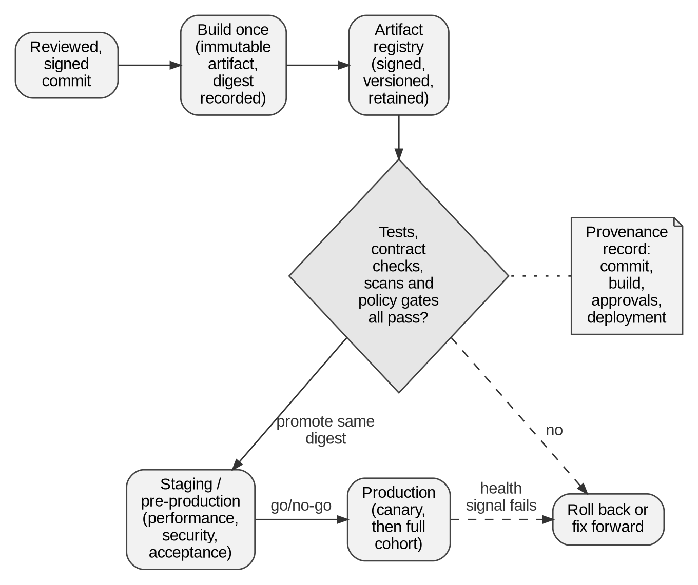
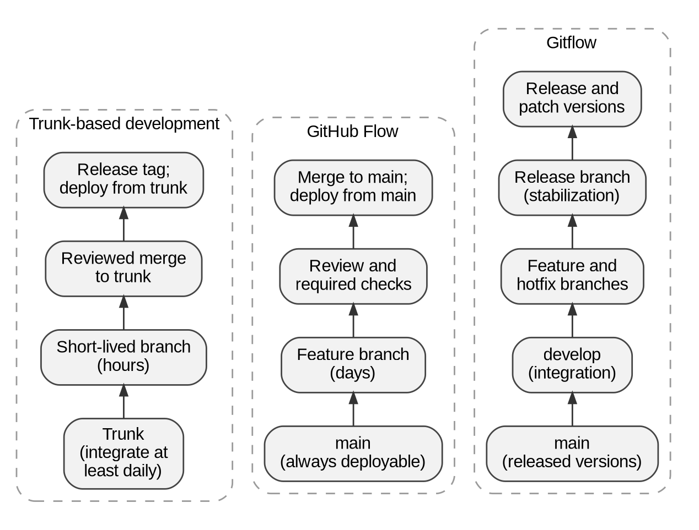
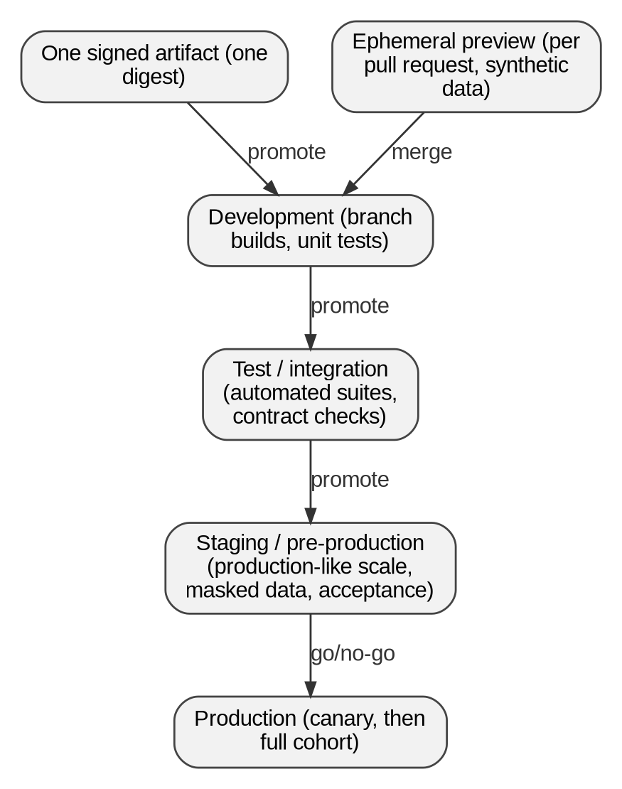
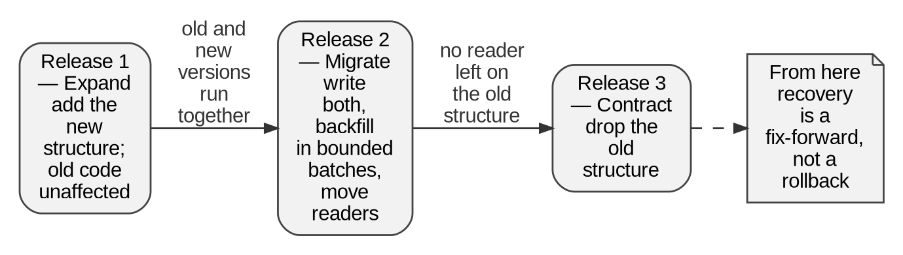
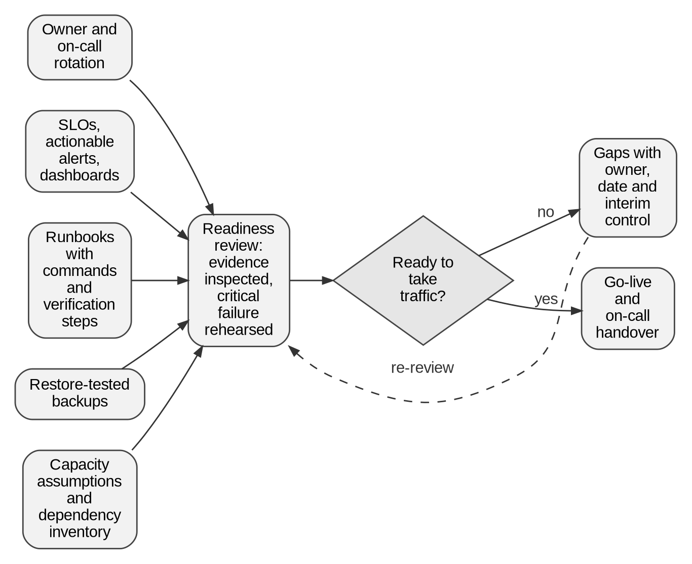
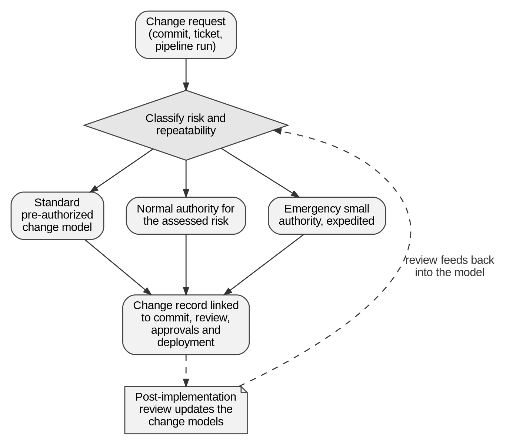
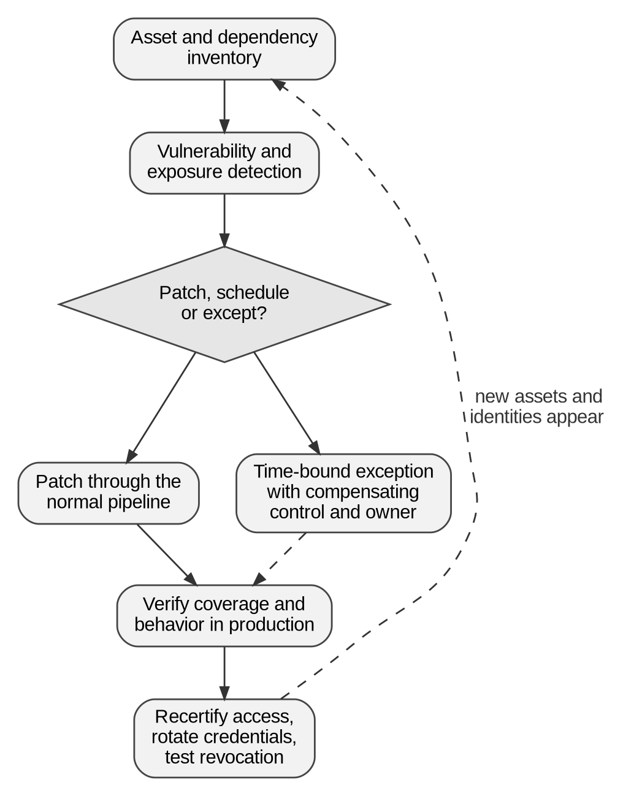

# 11. Deployment and Operations

Deployment architecture determines how changes reach production safely and how teams reverse them. Continuous integration validates code and contracts; continuous delivery makes releasable artifacts routine. Progressive strategies reduce blast radius but do not remove the need for compatible schema changes, observability and an explicit rollback decision.

::: {.callout-note appearance="simple" icon=false title="When to Use This Chapter"}
- Designing a delivery pipeline, branching strategy or release strategy for a solution.
- Planning a change that touches data schemas, configuration or several services at once.
- Deciding how production changes are approved, including in regulated environments.
- Checking that a service is ready to be operated before go-live.
:::

::: {.callout-tip appearance="simple" icon=false title="Key Takeaway"}
Safe change comes from small, reversible, well-evidenced releases, not from heavier approval. Promote one signed artifact, keep schemas backward compatible across a release, decide in advance how a change is rolled back or fixed forward, and move control into the pipeline where evidence is produced automatically.
:::

## 11.1 Delivery Pipelines and Release Strategies

A delivery pipeline is the path a change follows from commit to production, and release strategy is how much of production that path exposes at once. Both are architectural decisions, because they set the batch size, the evidence and the reversibility the team will have when something goes wrong.

### 11.1.1 CI/CD and Release Governance

**Definition.** Continuous integration is the practice of merging every change into a shared mainline and verifying it with automated builds and tests. Continuous delivery keeps the result permanently releasable, and release governance is the set of gates, records and authorities that decide when a verified artifact may move forward.

**Purpose.** The pipeline and its gates decide how much risk a change carries into production and how much of the release evidence is produced automatically rather than assembled by hand. They also fix the boundary between what a team may deploy on its own authority and what needs a further approval, which is the input that 11.4 assumes.

**What it includes.** A pipeline builds the artifact once and promotes that same immutable artifact through environments, because rebuilding per environment breaks provenance. It runs unit and integration tests, contract checks against consumers, static analysis, dependency and image scanning and policy checks, and it records each result against the artifact digest. Figure 11.1 places those gates on the promotion path.

{#fig-11-1 width="100%"}

**Why it is needed.** Without a single artifact and a recorded trail, "tested" and "deployed" describe different binaries and the audit trail cannot be reconstructed. Without gates that fail closed, a scan finding or a broken contract reaches production as an exception nobody recorded, and separation of duties proportionate to risk becomes a signature on a change the approver cannot inspect. The evidence is an audit trail from a production artifact digest back to its commit, build and approvals. Chapter 18 (18.6.3) extends release provenance to model, prompt, index, tool-policy and evaluation-set versions.

### 11.1.2 Progressive Delivery

**Definition.** Progressive delivery is the practice of exposing a release to a controlled and growing share of traffic while comparing its behavior with the version it replaces.

**Purpose.** It bounds how much of the user base a defect can reach before it is detected, and it shortens the time to return traffic to the previous version. It also turns "this release is safe" from an assertion made before deployment into a measurement made during it.

**What it includes.** The common strategies trade capacity for switch-over speed and control (Table 11.1). Around the strategy itself, specify the cohorts, the health signals including business metrics rather than only error rates, the abort thresholds, who may abort and the rollback authority.

| Strategy | How it works | Best for | Caution |
| :--- | :--- | :--- | :--- |
| Rolling | Replace instances gradually | Stateless services with compatible versions | Old and new versions run together |
| Blue-green | Switch traffic between two full environments | Fast cut-over and fast switch-back | Double capacity; shared database must suit both versions |
| Canary | Route a small cohort to the new version and compare | Detecting regressions with real traffic | Needs meaningful metrics and automated abort criteria |

: Progressive delivery strategies

**Why it is needed.** A rolling deployment of incompatible versions replaces a short outage with a longer one; a canary without meaningful metrics is a slow rollout with no decision criterion, and an abort wired only to error rate misses a business metric that falls while errors stay flat. Validate the rollback path, including stateful changes and messages already queued by the new version, and record the cohort, the signal that triggered the decision and the time taken to restore traffic.

### 11.1.3 Source Control and Branching Strategies

**Definition.** The branching strategy determines how often code is integrated, and therefore how fast and how safely it can be released.

**Purpose.** It sets the size of the batches under review, how long code lives outside the mainline and how much merge risk accumulates before a release. Choosing it deliberately aligns the repository with the release frequency the product needs, rather than the one the team inherited.

**What it includes.** Three models dominate, and release branches remain useful where several versions must be supported (Table 11.2, Figure 11.2).

| Strategy | How it works | Fits | Costs |
| :--- | :--- | :--- | :--- |
| Trunk-based development | Everyone integrates into one main branch at least daily, with very short-lived branches; unfinished features are hidden behind flags | Continuous delivery of services and web applications | Requires strong automated tests, feature flags and review discipline |
| GitHub flow | Short-lived feature branches merged to main through reviewed pull requests; main is always deployable | Most teams deploying frequently | Branches that live too long recreate merge problems |
| GitFlow | Long-lived develop and main branches, with feature, release and hotfix branches | Versioned products with scheduled releases or several supported versions | Slow integration, merge overhead, delayed feedback |
| Release branches | Main stays current; a branch is cut per release for stabilization and patches | Products that must maintain released versions | Fixes must be applied to several branches |

: Source control and branching models compared

Figure 11.2 shows where a change lives in each model, the practical difference behind the table’s comparison of integration frequency and branch lifetime.

{#fig-11-2 width="100%"}

**Why it is needed.** Long-lived branches postpone integration, so conflicts, contract drift and untested version combinations arrive together at the end, when the schedule has no room for them. The research summarized in *Accelerate* associates trunk-based development with higher delivery performance, and the author of GitFlow has himself recommended simpler workflows for continuously delivered software; GitFlow remains reasonable where software is shipped as versioned releases to customers. Common controls apply to every strategy: protected main branches, reviewed pull requests, required pipeline checks, signed commits or verified build provenance (9.5.6), and release tags using semantic versioning (7.5.3). The evidence that the choice works is branch age, integration frequency and pull-request size, not a diagram of the model.

### 11.1.4 Environments and Promotion

**Definition.** An environment is a configured instance of the system with a stated purpose, its own data and access model, and a defined gate for entering it. Promotion is the act of moving one artifact between environments on evidence.

**Purpose.** Environments separate risk, they make "it works" a testable claim by fixing what each environment represents, and they give each audience — developers, testers, acceptors, operators — a place to work without sharing production access. The promotion path turns those places into a controlled sequence.

**What it includes.** Most solutions need development, test or QA, staging or pre-production and production, plus ephemeral environments for review and demonstration and, where partners or customers must trial the product, an isolated sandbox or partner-preview environment (Table 11.3, Figure 11.3). Parity is held on the dimensions that change behavior — the same artifact digest, the same infrastructure definition, the same configuration schema and the same dependency versions — while scale, data, credentials and network reach differ deliberately and on the record. Test data is synthetic or a masked subset; placing production data in a lower environment is a privacy and legal decision, not a convenience. Access follows least privilege, with production reached through logged, time-bound elevation.

| Environment | Purpose | Data | Gate to enter |
| :--- | :--- | :--- | :--- |
| Development | Build and unit-level feedback per branch | Synthetic fixtures | Branch build and unit tests |
| Test / integration | QA: integration, contract, end-to-end and regression testing; UAT where business users sign off | Synthetic, seeded per test run | Integration, contract and scan results; UAT sign-off where used |
| Staging / pre-production | Production-like verification and business acceptance | Masked subset at representative volume | Performance, security and acceptance results |
| Sandbox / partner preview | External clients or partners trial the product, isolated from pre-production and production | Synthetic, tenant-scoped | Partner onboarding, access review and isolation tests |
| Production | Serve real traffic under SLOs | Real data | Go/no-go, change record and canary criteria |
| Ephemeral | Review, demonstration and debugging per pull request | Synthetic | Branch build; destroyed on merge |

: Environment purposes, data and promotion gates

The sandbox is a parallel environment, not a promotion stage: it exists so external users can exercise the product without production data and without depending on the internal staging path.

{#fig-11-3 width="100%"}

**Why it is needed.** Environments configured by hand drift, and the drift surfaces during an incident rather than during the change that caused it. A staging environment patched differently from production invalidates every result it produces, and a staging database that no longer resembles production hides exactly the migration that will fail on the day. Evidence is a parity matrix that states the intended differences, a drift report and promotion records showing the same digest in each environment.

### 11.1.5 Activities by Environment

**Definition.** An environment operating model states, for each environment, how changes reach it, which tests run there, which operational practices apply, who owns it and how it is refreshed and retired.

**Purpose.** Table 11.3 says what each environment is for; this unit says what happens in it. Writing the activities down tells delivery teams where a test belongs, tells operations which environments they must monitor and back up, and stops lower environments from silently acquiring production duties or production data.

**What it includes.** Table 11.4 sets out deployment, testing and operations for each environment. Deployments everywhere use the same pipeline and the same digest (11.1.1); what changes is who may trigger them and which evidence the gate requires. Testing follows the levels in Chapter 14: fast checks run early, and the tests that need realistic scale, data or dependencies run in staging and, through canaries and synthetic probes, in production (14.2.2). Operational practices scale with the environment's role: production carries SLOs, alerting and on-call (10.2.1, 10.3.1), backups and recovery drills (8.2.2) and change records; staging carries monitoring that mirrors production so that alerts and dashboards are tested before they are needed; lower environments carry cost controls and automatic expiry. Each environment has a named owner, a data-refresh rule, a patching cadence and a retirement rule, and lives in its own account or subscription with the network and identity separation of 9.4.3, established by the landing zone (8.1.1). A disaster-recovery site is part of production, not another stage: it receives the same digest and is exercised on a schedule.

| Environment | Deployment | Testing | Operations | Owner |
| :--- | :--- | :--- | :--- | :--- |
| Development | Developer or branch pipeline, on every push | Unit, static and component checks | Cost limits and automatic expiry; no on-call | Delivery team |
| Test / integration | Pipeline after merge | Integration, contract, end-to-end and regression tests; UAT where used | Data reseeded per run; failures go to the owning team | Delivery team or QA |
| Staging / pre-production | Pipeline on promotion, same digest as production | Performance, security, migration rehearsal and acceptance | Production-like monitoring and alerting during business hours; masked data refreshed on a schedule | Platform or SRE with delivery |
| Sandbox / partner preview | Pipeline on a release schedule announced to partners | Partner integration and isolation tests | Support desk for partners; tenant isolation monitored | Product and partner team |
| Production | Pipeline after go/no-go, with canary or flag | Smoke tests, synthetic probes and canary analysis | SLOs, alerting, on-call, backups, patching, capacity, change and incident records | Service owner and SRE |
| Disaster-recovery site | Same digest as production, replicated or deployed on failover | Recovery drills against RTO and RPO | Replication lag and readiness monitored; failover runbook | SRE |
| Ephemeral | Created per pull request; destroyed on merge | Review, demonstration and exploratory tests | Time-to-live and cost limits | Author of the change |

: Deployment, testing and operations in each environment

**Why it is needed.** When activities are not written down, staging becomes a second production that nobody pages for, a shared test environment becomes a bottleneck nobody owns, and production data leaks downward one export at a time. Incidents then expose gaps such as an alert that was never exercised outside production or a backup that only production had. The evidence is the activities table kept with the infrastructure definitions, an owner and refresh rule per environment, monitoring parity between staging and production, and drill records for the recovery site.

**Example.** A checkout service changes how tax is calculated. The pull request deploys an ephemeral preview for review; the merged commit is built once, and that digest is promoted through test and staging, where the old and new tax components run together against the same contract tests; production receives the digest as a 5 percent canary compared on conversion and on error rate, with a two-point conversion drop over thirty minutes as the abort threshold (illustrative figures). When the canary is aborted, the previous digest is still registered, so the rollback is a routing change rather than a rebuild.

::: {.callout-warning appearance="simple" icon=false title="Common Pitfall"}
Building a different artifact for each environment. The pipeline rebuilds from the branch at every stage, or an operator patches a configuration file by hand in staging, so the artifact that was tested is not the artifact that is deployed and the provenance record points at a build nobody released. The defect appears in the audit that needed the record, months later. Build once, promote the digest, and treat every environment difference as versioned configuration with a stated reason.
:::

::: {.callout-important appearance="simple" icon=false title="Decision & Trade-off"}
How much environment separation the delivery path needs depends on the risk of the change and on how faithfully a lower environment can represent production.

| Option | Choose when | Consequences |
| :--- | :--- | :--- |
| Ephemeral previews plus one production-like environment | Cloud-native services, a small platform team, strong observability and fast rollback | Lowest fixed cost and isolation per change; little load realism, so capacity and data-volume risk moves to production |
| Development, test, staging and production | Several teams, regulated change records, migrations and business acceptance | Clear audiences and gates; four environments to keep in parity, and drift becomes a real operating cost |
| Production plus a shared pre-production | Low-risk SaaS changes, canary rollout, automated rollback | Smallest footprint; acceptance happens on production cohorts, so the model depends on progressive delivery |
| Blue-green production pair | Switch-back time is the dominant risk | Double production capacity and a schema that must suit both versions at once |
:::

## 11.2 Safe Change and Configuration

Configuration, schema and exposure change independently of code, and each of them can break a release that the pipeline reported as green. This section treats them as deployable artifacts with their own compatibility rules.

### 11.2.1 Configuration Management

**Definition.** Configuration is every value that varies between deployments: endpoints, resource sizes, timeouts, feature settings, credential references and environment identity.

**Purpose.** Managing configuration as a versioned input keeps environments reproducible and makes the difference between them an explicit decision rather than an accident of who edited what. It also keeps secrets out of the artifact and emergency edits inside the audit trail.

**What it includes.** Separate configuration from code, version non-secret configuration, keep secrets in a managed store, detect drift and define which differences between environments are allowed (Table 11.5). Emergency configuration changes remain auditable: they either travel the normal pipeline or use a break-glass path that writes the same record.

| Class | Examples | Where it belongs | Change route |
| :--- | :--- | :--- | :--- |
| Build-time defaults | Timeouts, retry counts, log levels | Repository, reviewed with the code | Pull request and pipeline |
| Environment settings | Endpoints, resource sizes, scaling bounds | Versioned configuration repository | Pipeline promotion |
| Secrets | Keys, passwords, tokens | Managed secret store | Rotation process; never in the repository |
| Runtime toggles | Feature exposure, kill switches | Flag service with owner and expiry (11.2.3) | Flag change record |

: Configuration classes and where each belongs

**Why it is needed.** Unversioned configuration drifts silently: a value changed by hand during an incident is invisible to the next deployment, which reverts it, and the person who changed it has no record to point at. A secret committed into an image leaks to everyone who can pull that image, and an emergency edit made outside the process makes the next audit unreconcilable. Evidence is a clean drift report, a configuration history that matches the deployments and a rotation record for every secret.

### 11.2.2 Database Schema Evolution

**Definition.** A schema changes safely when each release is compatible with the version before it and with the one after it; expand–migrate–contract is the pattern that makes that compatibility explicit.

**Purpose.** It lets application releases and data changes proceed independently, so a deployment can be rolled back without restoring a backup, and it removes the most common cause of a rollback that makes an incident worse.

**What it includes.** Expand adds a backward-compatible structure. Migrate deploys code that works with both old and new structures, backfills and moves readers and writers while observing data quality. Contract removes the old structure in a later release (Figure 11.4). Each step names its compatibility window, who still reads the old structure and how the backfill is verified in bounded batches.

{#fig-11-4 width="100%"}

**Why it is needed.** Dropping a column, rewriting data or emitting events that consumers have already processed are forward-only steps: once a migration does any of them, redeploying the previous version no longer restores the previous state, so recovery is a fix-forward. Deploying a binary against an incompatible schema can make rollback impossible even when the deployment tool supports instant reversal. Evidence is old and new application versions tested together against production-like data, and migration idempotency verified.

### 11.2.3 Feature Flags

**Definition.** A feature flag is a runtime switch that decouples deployment from exposure, letting a change reach a chosen set of users, accounts or requests before it reaches everyone.

**Purpose.** Flags let code ship dark, they support progressive delivery without a separate release train, and they give an operator a kill switch during an incident. They turn exposure into a decision that is observable and reversible.

**What it includes.** Each flag has an owner, an expiry date, a safe default and a defined behavior when the flag service is unavailable. Distinguish the categories, because their lifetimes and risks differ (Table 11.6). Flags that gate authorization-sensitive behavior must be enforced server-side and treated as security controls.

| Category | What it controls | Typical lifetime | Risk if left behind |
| :--- | :--- | :--- | :--- |
| Release | Exposure of new code to users | Days to weeks | Dead paths and an untested combination of states |
| Experiment | A measured comparison between variants | Weeks | Abandoned variants that still receive traffic |
| Operational | Degradation and kill switches | Permanent, drilled | A switch nobody has tested when it is needed |
| Permission | Entitlement of accounts to a capability | Permanent, audited | A client-side check that becomes an authorization bypass |

: Feature flag categories and lifetimes

**Why it is needed.** Stale flags multiply test combinations and hide dead code paths, so the flag set becomes an undocumented configuration layer nobody dares remove. A flag evaluated in the client becomes a bypass for any server-side check it was meant to gate. Evidence is a flag inventory with age and owner, tests that exercise both states of every release flag and a reviewed list of the long-lived ones.

**Example.** A checkout service introduces a new tax provider behind a release flag. The change ships dark, is enabled for the internal account first and then for the canary cohort; when the provider starts returning timeouts, the operational kill switch returns traffic to the old provider in one configuration change, without a deployment. The release flag is removed in the following release, together with the old provider path.

::: {.callout-warning appearance="simple" icon=false title="Common Pitfall"}
Keeping every flag forever. Flags accumulate because removal is nobody's task, so the test matrix grows with combinations, dead code paths stay reachable and an old flag becomes a permanent configuration layer with no owner. A permission flag left in the client is worse: it becomes the authorization bypass it was meant to guard. Give every flag an owner and an expiry at creation, review the inventory, and delete flags in the release that deletes the code they gate.
:::

::: {.callout-important appearance="simple" icon=false title="Decision & Trade-off"}
How a change should be exposed depends on whether it needs reversibility, selective reach, or both.

| Option | Choose when | Consequences |
| :--- | :--- | :--- |
| Release flag | The change must ship before it is visible, or be disabled fast | Needs an owner and expiry; every flag state is a test case |
| Canary cohort by traffic | The risk is behavioral and measurable in production | Needs meaningful metrics and abort automation; slower than a switch |
| Deploy-time configuration | The variation is per environment, not per user | Simplest to reason about; changing it needs a deployment or config release |
| No switch; deploy off-peak | The change is small, reversible and not user-visible | Lowest overhead; exposure cannot be limited once it starts |
:::

## 11.3 Production Readiness and Service Management

A deployed service is not an operable one. Readiness is demonstrated by evidence the team produced before go-live, and service management keeps that evidence current afterwards.

### 11.3.1 Operational Readiness

**Definition.** A production-ready service is one that a named team can detect, diagnose, restore and verify without discovering its dependencies during an incident.

**Purpose.** The readiness review decides whether a service may take production traffic and what must be true before it does. It moves the conversation from "the feature works" to "we can operate this at three in the morning", and it gathers the evidence the operations team needs rather than the delivery team.

**What it includes.** A production-ready service has an owner and on-call rotation, SLOs, actionable alerts, dashboards, runbooks with concrete commands and verification steps, verified backups, access procedures, capacity assumptions and a dependency inventory. Figure 11.5 shows how that evidence feeds a go/no-go decision.

{#fig-11-5 width="100%"}

Table 11.7 pairs each evidence type with the failure it prevents.

| Evidence | What it demonstrates | Failure it prevents |
| :--- | :--- | :--- |
| Named owner and on-call rotation | Someone is accountable when the alert fires | Pages that turn into a search for whoever remembers the service |
| SLOs, actionable alerts and dashboards | The team knows what healthy means and which signal means act | Alert storms and silent degradation |
| Runbooks with commands and verification | Recovery is repeatable by someone who did not build the service | Runbooks that say only "restart the service" |
| Restore-tested backups | Data can be recovered, not merely copied | A backup that fails on the day it is used |
| Capacity assumptions and dependency inventory | Limits and upstreams are known before saturation | Discovering a dependency during an incident |

: Readiness evidence and the failure it prevents

**Why it is needed.** Deployment success does not prove operability. A service without an owner turns every page into a search for someone who remembers it, a backup that was never restored is a hope, and a runbook that says only "restart the service" fails this review. Evidence is an operational readiness review, an on-call handover and a rehearsed failure of the critical path.

### 11.3.2 Incident and Problem Management

**Definition.** Incident management restores service as quickly as possible; problem management finds and removes the underlying causes of recurring or significant incidents.

**Purpose.** Keeping the two distinct stops the pressure to restore service from ending the investigation, and it gives recurring failure an owner and a budget. It also determines what the organization learns from operations, which is the input to architectural change.

**What it includes.** On the incident side, severity definitions, incident command roles, a communication cadence and the authority to roll back or degrade; the mechanics of response are covered in 10.3. On the problem side, records that link to the architectural changes they trigger (10.5.2), and a review path that feeds the error-budget policy pausing risky releases when burn is high (10.2.2). Change approval is covered in 11.4, because an emergency fix is still a change and needs a record.

**Why it is needed.** Incidents closed without a problem record become normal: the same failure returns, the workaround becomes the design and the error budget pays for it repeatedly. Evidence is time to restore service and recurrence of known problems, not the number of tickets closed.

**Example.** A new payment provider goes live. The readiness review finds that the runbook has no step for reconciling authorizations stuck in a pending state, so go-live is conditional on adding the step and rehearsing a failover of the provider connection. Two weeks later an incident is restored in eleven minutes by following exactly that step, and the problem record links to the ADR that later adds a second provider.

::: {.callout-warning appearance="simple" icon=false title="Common Pitfall"}
Treating go-live as a deployment milestone. Readiness evidence is assembled after the date is fixed, from a template copied from the previous service, and signed off by people who will not be on call. The review then confirms that documents exist rather than that the team can operate, and the first real failure exposes the gap. Name the evidence and the person who produced it, rehearse one critical failure, and let the date move when the evidence is missing.
:::

::: {.callout-important appearance="simple" icon=false title="Decision & Trade-off"}
The strength of the readiness gate should match the cost of being wrong in the first week of operation.

| Option | Choose when | Consequences |
| :--- | :--- | :--- |
| Review with a rehearsed critical failure | Customer-facing service with a critical path and an on-call rotation | Highest confidence; costs preparation time and a real exercise |
| Evidence review without rehearsal | Internal or low-traffic service with fast rollback | Faster to schedule; a runbook error is found in production |
| Progressive exposure with automatic rollback | The change sits behind a canary and the team is experienced | Low ceremony; requires observability and a tested abort path |
| No formal gate; rely on rollback | Throwaway or experimental workloads only | Minimal overhead; the first incident becomes the readiness review |
:::

## 11.4 Change Enablement and Approval

Every change to production carries risk, and organizations control that risk through change approval. The architect needs to understand the approval models in use, because they constrain release frequency, batch size and pipeline design — and because a poorly chosen model can increase the risk it is meant to reduce.

### 11.4.1 Architecture Review versus Change Approval

**Definition.** Architecture review asks whether a design is suitable and its risks are understood; change approval asks whether it is safe to deploy this specific change now.

**Purpose.** Separating the two decisions keeps each authority judging evidence it can actually inspect, and stops a design approval from being read as permission to deploy anything, or a deployment approval from being read as validation of the design.

**What it includes.** The two differ in question, timing, owner and evidence (Table 11.8), and they are complementary rather than substitutable.

| Aspect | Architecture review (Chapter 4) | Change approval |
| :--- | :--- | :--- |
| Question | Is the design suitable and are its risks understood? | Is it safe to deploy this specific change now? |
| Timing | Design time, before significant commitments | Release time, before each production change |
| Owner | Decision owner and architecture governance | Change authority defined by the change process |
| Evidence | Requirements, ADRs, views, validation plan | Test results, deployment plan, rollback plan, risk assessment |

: Architecture review and change approval compared

**Why it is needed.** Conflating them produces one of two failures: a design board that signs off deployments it cannot inspect, or a pipeline that deploys a design nobody reviewed. Evidence is an ADR for the design and a change record for the deployment, each with its named approver and the evidence that approver saw. Keep the two records separate and never substitute one for the other.

### 11.4.2 Change Types

**Definition.** Change enablement classifies changes by risk and repeatability so that each one is authorized by the lightest authority that controls it.

**Purpose.** The classification is what lets routine work proceed without individual approval while keeping control of changes that can hurt. It also decides lead time more than tooling does, because the route determines how long a change waits.

**What it includes.** ITIL, a widely used service-management framework, calls the practice **change enablement** in ITIL 4 (2019). ITIL Version 5, released progressively from 2026, retains the term, together with the idea of a **change authority** — the person, group or automated process empowered to authorize a type of change — instead of a single mandatory committee. It distinguishes three types (Table 11.9), and the classification drives a routing decision (Figure 11.6).

| Type | Definition | Typical approval |
| :--- | :--- | :--- |
| Standard | Low-risk, repeatable, well-understood change with an approved procedure | Pre-authorized once as a change model; executed without further approval |
| Normal | Any change that is not standard or emergency; risk varies | Assessed and authorized by the change authority appropriate to its risk |
| Emergency | Must be implemented as soon as possible, for example to resolve an incident or a critical vulnerability | Expedited authorization by a small emergency authority; full review afterwards |

: Change types and typical approval

Figure 11.6 routes each change type to the lightest authority that still controls its risk, which is how the classification in the table becomes an approval decision.

{#fig-11-6 width="100%"}

**Why it is needed.** Without classification every change takes the heaviest route or the lightest one, and neither is a control. A mature practice moves as many changes as possible into the standard category by making them repeatable, tested and automated; the evidence is the share of changes executed as standard, the number of emergency changes and whether post-implementation reviews were completed.

### 11.4.3 Approval Models

**Definition.** An approval model is the mechanism that decides who authorizes a change and what evidence they see before deciding.

**Purpose.** The model proportions control to risk and change volume. It sets batch size and lead time, and therefore how much automation is possible before an approval becomes the bottleneck.

**What it includes.** The change advisory board is one model among several (Table 11.10). Most organizations combine them: automated or peer-reviewed approval for most changes, delegated authority for high-risk ones, and an emergency route.

| Model | How it works | Fits |
| :--- | :--- | :--- |
| Change advisory board (CAB) | A committee reviews and authorizes changes, usually in scheduled meetings | High-risk changes affecting several teams; organizations with little automation |
| Pre-approved standard changes | A catalog of repeatable low-risk changes approved once as models | Routine deployments, patches, scaling |
| Delegated, risk-based authority | The assessed risk determines the approver: team, service owner, or CAB | Organizations with many changes of varying risk |
| Peer review (four-eyes, maker–checker) | A second qualified person reviews and approves, for example by approving the pull request that becomes the change record | Teams with CI/CD; satisfies segregation of duties |
| Automated, policy-based approval | The pipeline approves when defined evidence is present: passing tests and security scans, approved review, progressive rollout with automated rollback | Mature continuous delivery, including regulated environments when the evidence is auditable |
| Automated risk assessment | A tool scores each change and routes it to the appropriate approver | High change volume with variable risk |
| Emergency change authority (ECAB) | A small group authorizes urgent changes quickly; formal review follows | Incidents and critical vulnerabilities |
| Go/no-go release review | A readiness meeting with business, support and operations before a major release | Large releases, release trains, migrations and cut-overs |
| Business acceptance (UAT sign-off) | The business owner validates functionality before release | User-visible functional changes |

: Approval models

**Why it is needed.** An approval that arrives after the fact is a record, not a control, and a committee reviewing a large batch cannot inspect what it authorizes. A model with no exception route pushes urgent work outside the process. Evidence is lead time by change type, the share approved automatically and change failure rate per route. Publish the model and its exception route so teams can route work without asking.

### 11.4.4 Choosing an Approval Model

**Definition.** Choosing an approval model means mapping the assessed risk of a change class onto the lightest authority that can control it.

**Purpose.** The mapping is how an organization gets both speed and safety instead of trading one for the other, and it gives reviewers a criterion, so a rejected change has a stated reason.

**What it includes.** Assess risk by blast radius, reversibility, data impact, customer impact, security exposure, timing and the team's track record with similar changes. The research in *Accelerate* found that approval by an external body such as a CAB was associated with lower delivery performance and showed no association with lower change failure rates, whereas lightweight peer review combined with automated testing supported both speed and stability.

**Why it is needed.** Over-control spends review capacity on changes that cannot hurt while the risky ones are still batched beyond inspection, and under-control exposes production to changes nobody assessed. The architectural lesson is not to remove control but to move it into the pipeline: small changes, automated evidence, progressive delivery and fast rollback reduce risk more than a meeting that reviews a large batch it cannot inspect in depth.

### 11.4.5 Regulated Environments

**Definition.** In a regulated environment the control must be demonstrable: the organization can show who approved a change, on what evidence, and when.

**Purpose.** Demonstrability is what turns a practice into a control an auditor accepts, and it protects the organization when a change fails, because the record shows the decision was made on evidence and within an authority.

**What it includes.** Regulated sectors require demonstrable control of changes:

- **Segregation of duties** — the person who writes a change does not approve and deploy it alone; peer review and pipeline controls can satisfy this when they are enforced and logged.
- **Traceability** — each production change links its record, requirement or ticket, commits, review, pipeline run, approvals and deployment, ideally generated automatically by the pipeline.
- **Change windows and freeze periods** — limits on when changes may be made, with documented exceptions.
- **Evidence retention** — change records kept for audit.

Relevant references include ISO/IEC 27001:2022 (control 8.32, change management), ISO/IEC 20000-1:2018, COBIT 2019 (BAI06, managed IT changes), PCI DSS v4.0.1 (requirement 6.5) and, for financial entities in the European Union, the ICT change-management requirements of the Digital Operational Resilience Act (DORA). Enterprise customers also commonly require suppliers to operate a formal change control process (Appendix E).

**Why it is needed.** A control that exists but cannot be evidenced fails an audit, and a freeze period without an exception path pushes changes into an unrecorded channel. Evidence is a documented change process with change types and authorities, change records generated from the pipeline, and metrics for change failure rate, lead time and share of emergency changes.

**Example.** A base-image patch affects a customer-facing service. It is a standard change: the change model was approved once, the pipeline verifies the scan result and the review, and the deployment proceeds without a further meeting while the change record is generated from the pipeline run. A zero-day vulnerability in the same image the following month takes the emergency route: a small authority approves within the hour, the patch ships, and the post-implementation review adds the check that would have caught it earlier.

::: {.callout-warning appearance="simple" icon=false title="Common Pitfall"}
Using the emergency route to hit a deadline. Once the expedited path is known to be faster, it becomes the default, the emergency authority approves work it never has time to inspect, and the post-implementation review is skipped because the next deadline is already close. The controls that justify the fast path stop operating. Measure the share of emergency changes, review every one, and treat a rising share as a signal about batching or lead time rather than about the team.
:::

::: {.callout-important appearance="simple" icon=false title="Decision & Trade-off"}
The right approval model is the lightest one whose evidence an auditor or an incident review would accept.

| Option | Choose when | Consequences |
| :--- | :--- | :--- |
| Automated, policy-based approval | The pipeline produces auditable evidence and rollback is fast | Highest throughput; every gate must fail closed and be monitored |
| Peer review with required checks | Teams without mature automation, or changes to shared code | Cheap and proportionate; quality depends on the reviewer's context |
| Delegated, risk-based authority | Change volume is high and risk varies widely | Risk reaches the right owner; needs a maintained risk assessment |
| Change advisory board | High-risk, cross-team changes, or low automation | Broad visibility; batching delays and shallow review of large changes |
:::

## 11.5 Operational Security

**Definition.** Operational security is the recurring work that keeps a running estate as hardened as its design intended: patching, vulnerability response, privileged access, audit retention and access revocation.

**Purpose.** It closes the gap between the architecture that was approved and the system that is running months later, after staff have changed and exceptions have accumulated. It informs patch intervals, credential lifetimes and the design of break-glass access, and it produces the evidence auditors ask for after the fact.

**What it includes.** Patching and vulnerability response follow the risk-based prioritization in 9.6, with a maintenance window for normal patches and a smaller authority for emergency ones; privileged access uses least-privilege deployment identities, short-lived credentials and controlled break-glass access that is logged and reviewed (9.3.2). Artifacts are signed and verified before deployment (9.5.6), audit records are retained for the period the obligations require (9.7.2), and access is revoked when a person leaves a role, not when someone notices. Figure 11.7 shows the loop.

{#fig-11-7 width="100%"}

Table 11.11 gives each control a cadence and an evidence artifact.

| Control | Cadence | Evidence |
| :--- | :--- | :--- |
| Asset and dependency inventory | Continuous, reconciled with billing and discovery | Coverage against known hosts and services |
| Patch coverage | Per severity target, with an emergency path | Patch levels by asset and open exceptions |
| Privileged access recertification | Periodic and on role change | Approved access list and removed entitlements |
| Credential and key rotation | On schedule and on suspicion of exposure | Rotation record with no standing credentials |
| Break-glass revocation test | After every use, plus a scheduled drill | A failed authentication for the old credential |
| Audit record retention | Continuous, aligned with obligations | Retained records retrievable for the required period |

: Operational security controls, cadence and evidence

**Why it is needed.** An incomplete asset inventory leads to missed patches, because a host nobody knows about is a host nobody scans. An orphaned credential outlives the project that created it, and a break-glass account that is never revoked becomes standing administrative access. Evidence is patch coverage, access recertification and a revocation test after a break-glass event.

**Example.** An engineer needs production database access during an incident. The break-glass path grants a two-hour elevation, requires a stated reason and notifies the service owner; the session is recorded, and the access is removed automatically when the window closes. The post-incident check confirms that the credential no longer works, which is the revocation test an auditor will ask about.

::: {.callout-warning appearance="simple" icon=false title="Common Pitfall"}
Standing break-glass access. The account that exists for emergencies keeps its administrative rights between incidents, often because removing and regranting them looks like work, and its credentials are shared by whoever was on call when it was created. It is then both the fastest route in an incident and the least monitored privileged identity in the estate. Grant it just in time with an expiry, log and review each use, and test that revocation actually works.
:::

::: {.callout-important appearance="simple" icon=false title="Decision & Trade-off"}
The production access model trades speed during an incident against the standing exposure it creates.

| Option | Choose when | Consequences |
| :--- | :--- | :--- |
| Just-in-time elevation with approval and expiry | Production access is needed occasionally | Strong default; adds a wait during incidents unless pre-authorized for on-call |
| Standing named accounts with session recording | A team operates production continuously | No delay; standing privilege is a permanent target and must be recertified |
| Two-person break-glass | The system is regulated or high-impact | Strong segregation; slower, and needs rehearsal to be usable under pressure |
:::

## 11.6 Worked Example: A Breaking Schema Change without Downtime

*In practice:* This example applies the expand-and-contract pattern to a breaking column change, with the point of no return made explicit.

A service replaces a single `customer_name` column with `given_name` and `family_name`. The team adds the new columns; deploys code that writes both representations and reads the new one when present; backfills historical rows in bounded, verified batches; migrates all consumers; and only then removes the old column in a separate release. Feature flags and canary analysis control exposure.

The rollback decision tree distinguishes reversible application changes from forward-only data repairs: after the old column is dropped, recovery is a fix-forward, not a rollback.

**Deliverables:** migration plan, compatibility matrix, release runbook and rollback decision tree.

::: {.callout-warning appearance="simple" icon=false title="Common Pitfall"}
Assuming every release can be rolled back. Once a migration drops a column, rewrites data or emits events that consumers have processed, redeploying the previous version no longer restores the previous state. Mark each release step as reversible or forward-only, keep destructive steps in a later release, and rehearse the fix-forward path for the steps that cannot be undone.
:::

::: {.callout-note .review appearance="minimal" icon=false title="Architecture Review Checklist — Deployment and operations"}

☐  Is the same signed artifact promoted through every environment?

☐  Can old and new versions coexist with the current schema and messages?

☐  Are rollback limits stated, including irreversible data changes?

☐  Has operational readiness been demonstrated, not just documented?

☐  Is the branching strategy consistent with the intended release frequency?

☐  Is each change type routed to the lightest approval model that controls its risk, with auditable evidence?

☐  Is each environment's deployment, testing, operational coverage, owner and data-refresh rule written down, with production data kept out of lower environments?
:::

## 11.7 Further Reading

- Humble and Farley (2010), *Continuous Delivery* — deployment pipelines and release strategies.
- Forsgren, Humble and Kim (2018), *Accelerate* — delivery performance research.
- Kim et al. (2021), *The DevOps Handbook* — flow, feedback and learning practices.
- Ambler and Sadalage (2006), *Refactoring Databases* — expand-and-contract schema evolution.
- Hodgson (2017), “Feature Toggles” — categories and lifecycle of feature flags.
- Hammant, *Trunk Based Development* (trunkbaseddevelopment.com); Driessen (2010), “A successful Git branching model”.
- PeopleCert, *ITIL* (ITIL 4 and Version 5) — change enablement practice.
