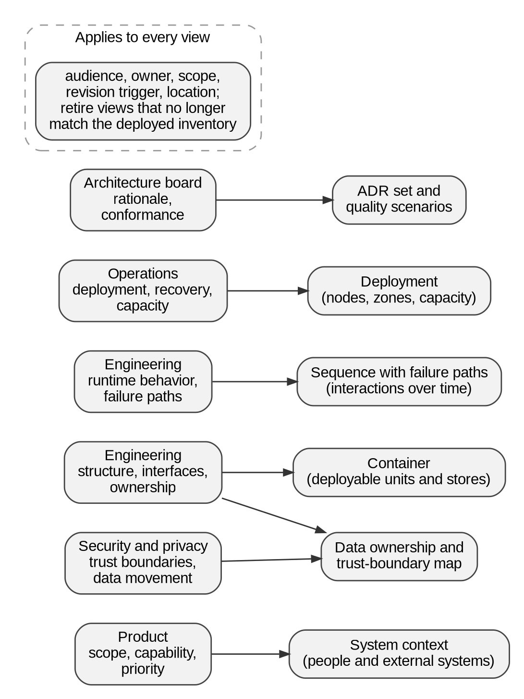
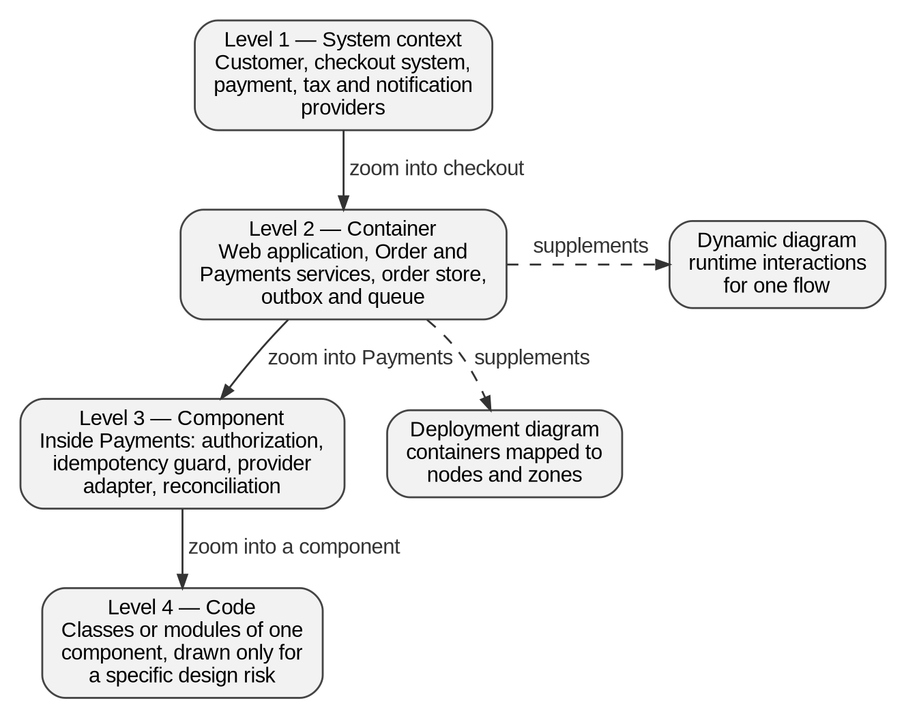
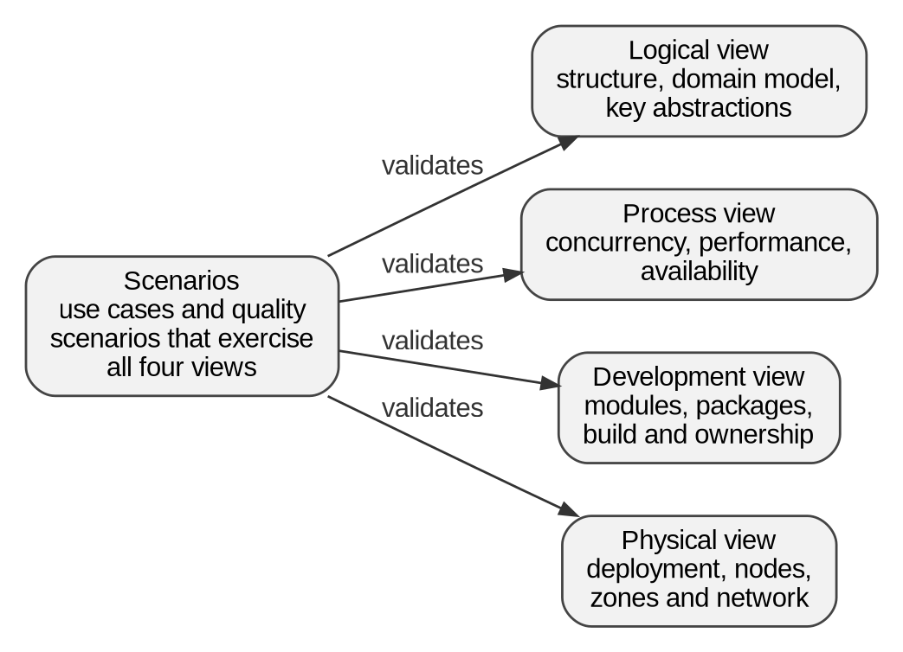
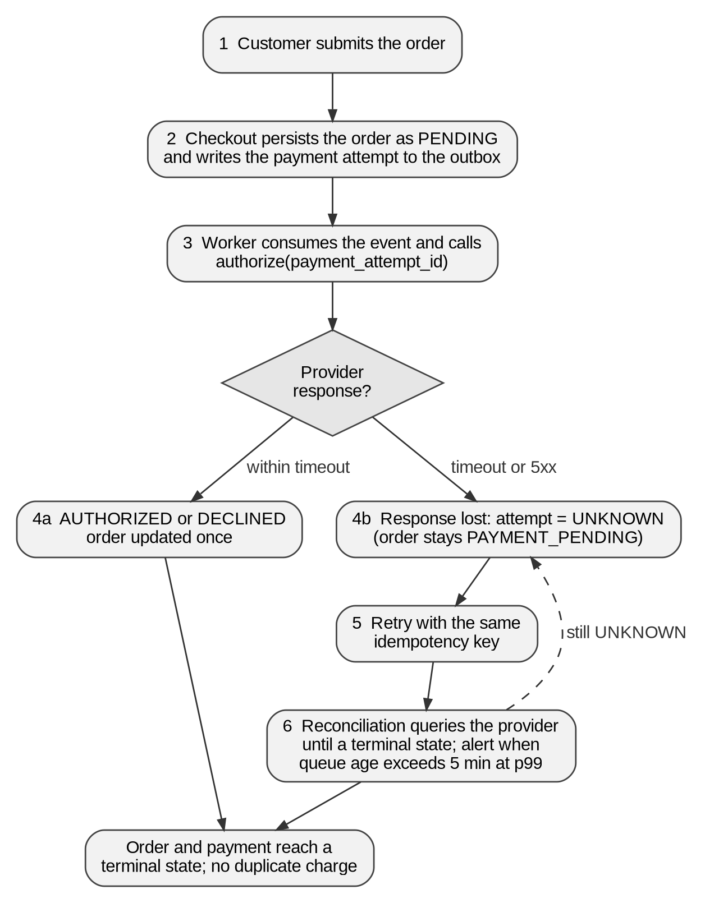
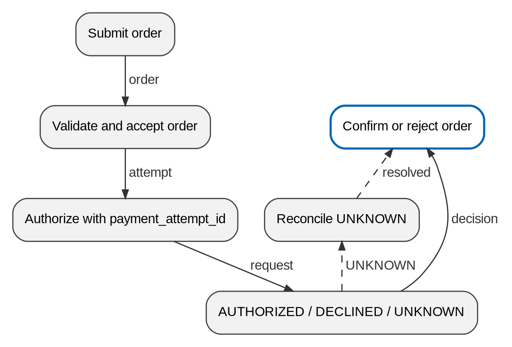
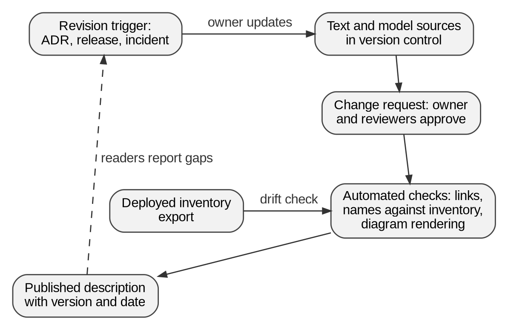

# 12. Architecture Documentation

Architecture documentation answers stakeholder concerns with the smallest coherent set of views, and keeps those views true while the system changes. A diagram describes intent: evaluation (Chapter 13) judges whether the intent is sound, and testing (Chapter 14) demonstrates that the built system meets it. This chapter covers static views, dynamic and process views, and the practice that keeps a description useful: its structure, docs as code, communication to different audiences and currency. Chapter 16 catalogs the artifacts and Chapter 17 positions the frameworks.

::: {.callout-note appearance="simple" icon=false title="When to Use This Chapter"}
- Deciding which views a solution needs and for which stakeholders.
- Structuring an architecture description and choosing where it lives.
- Presenting an architecture to sponsors, boards, delivery teams or operations.
- Keeping diagrams consistent with the deployed system over time.
:::

::: {.callout-tip appearance="simple" icon=false title="Key Takeaway"}
Document for decisions, not for completeness. A small set of owned views with consistent names, reviewed with the changes that alter them and checked against the deployed system, is worth more than a complete catalog that nobody trusts.
:::

## 12.1 Architecture Views and Communication

### 12.1.1 Views and Stakeholders

**Definition.** An architecture view is a representation of the system that answers one set of stakeholder concerns; the view set is the smallest collection of views that covers the concerns of the decisions at hand.

{#fig-12-1 width="100%"}

**Purpose.** Views exist to inform decisions and answer questions, not to record every diagram the notation allows. Product needs capability context, engineers need structure and interfaces, operations needs deployment and recovery, security needs trust boundaries and data flows. One infrastructure diagram rarely explains ownership or data correctness, and a view that nobody consults is maintenance cost without value.

**What it includes.** For each view, record its audience, concern, owner, revision trigger and authoritative location, and give every diagram a title, scope, legend and, where relevant, trust or ownership boundaries. The view set for most solutions stays small:

| View | Concern it answers | Primary audience |
| :--- | :--- | :--- |
| System context | Scope: who and what the system exchanges value with | Product, architecture board |
| Container | Deployable units, responsibilities and interfaces | Engineering, operations |
| Dynamic (sequence, data flow) | Runtime behavior, failure paths, data movement | Engineering, security, SRE |
| Deployment | Nodes, zones, capacity and recovery topology | Operations, security |
| Data ownership | Which component owns which data, retention and boundary crossings | Data, security, product |
| ADR set and quality scenarios | Why the design is as it is, and what it must achieve | Architecture board, all teams |

: Views, the concerns they answer and their primary audiences

**Why it is needed.** The consistency gate is the point: the same names and identifiers for actors, services, data stores and interfaces must hold across context, container, sequence, deployment and trust-boundary views, and views must be verified against the deployed inventory and retired when they no longer represent the system. Without that discipline each reader reconciles conflicting diagrams privately, and a decision taken from a stale diagram is a defect discovered in production. The evidence is a named owner per view, a review date inside its revision window, and no view that contradicts the inventory export.

### 12.1.2 The C4 Model

**Definition.** The C4 model describes software structure at four levels of detail — **system context** (people and external systems), **container** (deployable applications and data stores), **component** (major parts of a container) and **code** — with supplementary dynamic and deployment diagrams for runtime interactions and infrastructure mapping.

**Purpose.** C4 supplies a conventional ladder of detail and a shared vocabulary, so that a diagram’s level is explicit and two teams can compare descriptions without negotiating notation. It is a diagramming approach, not a complete methodology: it says nothing about evaluation, decision records or test evidence, which is why it complements the rest of this chapter rather than replacing it.

**What it includes.** Each level zooms into one box of the level above and uses a defined element type — person, software system, container, component — with a defined set of allowed relationships. The **context** level shows the system, the people who use it and the external systems it depends on, with no internal detail. The **container** level shows the deployable applications, data stores and their interactions. The **component** level shows the major parts inside one container, their responsibilities and their interfaces. The **code** level shows classes or modules and is worth drawing only where a specific design risk needs that detail. Maintain context and container views by default; add component views where design risk justifies them; code-level diagrams rarely survive a sprint. Label each relationship with its meaning and, where relevant, its protocol. The supplementary dynamic and deployment views carry the runtime and infrastructure facts that the four static levels deliberately omit. Table 12.2 lists the question each level answers and when to maintain it.

| C4 diagram | Question it answers | Primary audience | Maintain when |
| :--- | :--- | :--- | :--- |
| Level 1: system context | Who uses the system and what does it exchange with? | Product, architecture board | Scope or an external dependency changes |
| Level 2: container | What deployable units and stores exist, and how do they interact? | Engineering, operations | A deployable unit or store changes |
| Level 3: component | What are the major parts inside one container? | Engineering, security | Design risk in that container justifies the detail |
| Level 4: code | How is a component implemented? | Implementing engineers | A specific design risk needs class or module detail |
| Dynamic (supplementary) | How do elements collaborate in one flow at runtime? | Engineering, SRE | The flow, its ordering or its failure handling changes |
| Deployment (supplementary) | On which nodes, zones and platforms do containers run? | Operations, security | Topology, capacity or recovery changes |

: C4 levels and supplementary diagrams: the question each answers

Figure 12.2 shows the zoom path for the reference checkout: each level opens one box of the level above, while the dynamic and deployment diagrams reuse the container-level elements rather than introducing new ones.

{#fig-12-2 width="100%"}

**Why it is needed.** Without a declared level, reviewers argue about boxes that belong at different zoom levels, and a single diagram tries to serve product, engineering and operations at once. Over-detailed diagrams are also the main reason documentation is abandoned: the cost of keeping them true exceeds the value they return, so they decay silently and are then trusted less than no diagram at all. The evidence is a level in every title or legend, each container in the container view appearing exactly once in the deployment view, and a component view existing only for containers with an accepted design risk.

### 12.1.3 The 4+1 View Model

**Definition.** The 4+1 view model, introduced by Kruchten, organizes an architecture description into four views — logical, development, process and physical — plus scenarios that exercise and connect them.

**Purpose.** The model gives each stakeholder concern a named view and makes the scenarios, rather than one diagram, the test of whether the views agree. It is older and more general than C4: 4+1 names the concerns a description must cover, while C4 names the zoom levels at which structure is drawn.

**What it includes.** The **logical** view describes structure, the domain model and key abstractions; the **development** view describes modules, packages, build and ownership; the **process** view describes concurrency, performance, availability and runtime behavior; the **physical** view describes deployment, nodes, zones and network. The **scenarios** view — use cases and quality scenarios — exercises all four and exposes where they disagree. Table 12.3 maps each view to the question it answers and to the nearest C4 diagram (12.1.2), which is how a team using C4 checks that no 4+1 concern is left without a view; Figure 12.3 places the four views around scenarios.

| 4+1 view | Question it answers | Primary audience | Nearest C4 diagram | Maintain when |
| :--- | :--- | :--- | :--- | :--- |
| Logical | What is the structure and domain model? | Architects, domain experts | Component level, plus a domain model C4 does not draw | A domain boundary or key abstraction changes |
| Development | How is the work organized into modules, packages and build units? | Engineering leads, release managers | Component and code levels, partly | Module, package or ownership boundaries change |
| Process | How does the system behave at runtime under concurrency and failure? | Engineering, SRE, security | Dynamic diagram | Concurrency, performance or failure behavior changes |
| Physical | Where does it run, on which nodes and zones? | Operations, security | Deployment diagram | Topology, capacity or recovery changes |
| Scenarios | Which use cases and quality scenarios exercise the views? | All stakeholders | Dynamic diagrams of the priority flows | A priority scenario or its measure changes |

: The 4+1 views: the question each answers and the nearest C4 diagram

Figure 12.3 places the four views around the scenarios that exercise them, so the mapping in the table becomes a consistency check rather than a list of descriptions.

{#fig-12-3 width="100%"}

**Why it is needed.** A description with only a logical model or only a deployment diagram hides the concerns that fail together: a logical boundary that cannot be deployed, or a process design that cannot meet its latency budget. Scenarios are the consistency test, because a use case crosses all four views and exposes the mismatch. The evidence is a view set that names its audience, a scenario walkthrough that reaches every view, and no contradictory element names across views.

**Example.** For the reference checkout the description uses both lenses. In C4, the context view names the customer, payment provider, tax service and notification provider; the container view shows the checkout web application, Order service, Payments service, order store and outbox. In the 4+1 model, the logical view holds the Order and Payments domain model, the development view shows the services, modules and outbox library, the process view shows asynchronous confirmation, retry and reconciliation, and the physical view places both services in two zones behind a managed queue. The duplicate-charge scenario walks all four views and exposed the missing UNKNOWN branch before release. The consistency check found the payment provider named three different ways across context, sequence and deployment; the names were fixed in the diagrams and in the interface contract rather than explained away in prose.

::: {.callout-warning appearance="simple" icon=false title="Common Pitfall"}
Documenting every view the notation allows. The description grows into a second, stale system that no one updates and no one trusts, so the expensive diagrams are ignored while the one whiteboard sketch everyone understands becomes the real architecture. Choose views from the decisions at hand, give each a named owner and a revision trigger, and retire it when it stops answering a live concern.
:::

::: {.callout-important appearance="simple" icon=false title="Decision & Trade-off"}
The size of the view set is a decision with a cost on both sides: too few views leave concerns unaddressed, and too many make staleness likely.

| Option | Choose when | Consequences |
| :--- | :--- | :--- |
| Minimum set: context, container and one dynamic view per critical flow | Small team, single deployable, low regulatory or safety exposure | Cheapest to keep true; leaves deployment, data ownership and trust boundaries implicit |
| Risk-driven set: minimum plus deployment, data ownership and trust-boundary views where those risks exist | Distributed system, regulated data, or shared infrastructure | Covers the concerns that fail expensively; each added view needs an owner and a review date |
| Full catalog of every element and view | Contractual or certification obligation to describe the whole system | Complete on paper; high maintenance cost and a real risk that most views rot between audits |
:::

## 12.2 Dynamic Views and Quality Scenarios

### 12.2.1 Sequence and Data-Flow Diagrams

**Definition.** A sequence diagram shows interactions between participants in time order; a data-flow diagram shows where data moves, is transformed and crosses a trust boundary.

{#fig-12-4 width="100%"}

**Purpose.** Sequence diagrams are the best way to review failure paths — timeouts, retries, duplicate delivery and compensation — because the failure is a branch in time that a static diagram cannot show. Data-flow diagrams are the basis for privacy and threat reviews: they make the stores, transformations and boundary crossings explicit, which is exactly what a reviewer needs to ask who may read what.

**What it includes.** A sequence view names its participants, orders synchronous and asynchronous messages, and shows each timeout, retry and idempotency key that governs a repeated call, plus the compensation or terminal state that ends each branch. A data-flow view shows sources, stores, transformations, retention and every trust boundary crossed, including the third parties that receive data. Both should mark which steps the system performs and which the customer or an operator performs.

**Why it is needed.** Happy-path-only diagrams hide the behavior that most often fails, so a design is approved on the strength of the case that never causes incidents. The omission is invisible in review: the reviewer sees a complete-looking diagram and concludes the design is complete. The evidence that the gap is closed is narrow and checkable — every priority scenario with a failure mode has a branch, and every branch ends in a recorded terminal state or a compensation.

### 12.2.2 Decisions and Scenarios in Documentation

**Definition.** Documentation connects a view to the decision that produced it and the scenario that judges it, rather than restating either.

**Purpose.** The link is what makes a description usable under pressure. A reviewer should be able to start from a quality scenario and move to the view, ADR, contract and test that address it, or start from a diagram and find out why it looks that way and what it is expected to achieve.

**What it includes.** The description keeps stable identifiers and one trace row per priority scenario. ADRs (Chapter 3) keep the rationale, quality scenarios (1.4) keep the measurable requirement, and the description keeps only the reference, so each fact has one authoritative home. Where a diagram and a requirement disagree, the trace makes the conflict visible instead of leaving two documents that quietly contradict each other.

| Scenario | View | ADR | Test evidence |
| :--- | :--- | :--- | :--- |
| Acknowledge an order within 2 s at p99 under peak load | Container and deployment | Asynchronous authorization decision | Load test at 120% of peak |
| Accept orders through a 10-minute provider outage | Payment sequence, failure branch | Outbox and reconciliation decision | Fault injection blocking the provider |
| Never charge twice for one payment attempt | Payment sequence, retry branch | Idempotency-key decision | Forced-timeout contract run |

: Trace from a quality scenario to the evidence that judges it

**Why it is needed.** Orphan diagrams and undocumented rationale are the norm in systems that were delivered under pressure: the diagram survives, the reasoning does not, and the next team re-litigates a settled decision or preserves a workaround long after its cause disappeared. Duplicated rationale is worse, because two copies drift and the reader cannot tell which is current. The evidence is that every priority scenario has a complete trace row and that a reviewer can move between any two cells without asking a person.

### 12.2.3 Swimlane and Activity Views

**Definition.** A swimlane or activity diagram (BPMN) shows a business process as a sequence of activities partitioned into lanes by role or system, with events, gateways, hand-offs and exception paths.

**Purpose.** It gives business stakeholders a view they can follow without knowing the protocol: who does what, where a case waits, which approval or gateway changes the path, and who owns an exception. A sequence diagram explains message order to engineers; an activity diagram explains the process to the people who own it.

**What it includes.** Define one pool for the process and one lane per accountable role or system, with a start and end event, activities in business language, exclusive and parallel gateways, timers and message flows across lanes. Keep it at business level: a technical retry belongs in a sequence diagram, not in the lane. Figure 12.5 shows the order-to-payment process across customer, checkout, payments and provider lanes, including the UNKNOWN branch that returns to reconciliation.

{#fig-12-5 width="100%"}

Figure 12.5 uses the handbook’s simplified lane notation; a BPMN tool adds the event and gateway symbols while keeping the same lanes and hand-offs.

**Why it is needed.** A sequence diagram that satisfies engineering can still leave the business unable to see who owns a delayed case, and a process that exists only in prose hides its hand-offs and waiting time. The evidence is a process view with every lane owned, every gateway labelled with its condition, and every exception ending in a named state or queue.

**Example.** The first payment sequence for the reference checkout showed only authorize and AUTHORIZED. Building the trace against the duplicate-charge scenario exposed the gap: no timeout branch, no retry key, and no row in any test plan. Adding the UNKNOWN path produced the retry and reconciliation steps in Figure 12.4 and the idempotency ADR. The swimlane in Figure 12.5 then showed that reconciliation sits with Payments while the customer-facing decision sits with Checkout, which is why the runbook names both owners.

::: {.callout-warning appearance="simple" icon=false title="Common Pitfall"}
Drawing the success path and calling the dynamic view done. Timeouts, duplicate delivery and partial failure are the behaviors that produce incidents, and they are invisible in a diagram that only shows the happy path. Walk each priority scenario through the sequence, add a branch for every step that can fail, and end each branch in a terminal state or a named compensation.
:::

::: {.callout-important appearance="simple" icon=false title="Decision & Trade-off"}
How much dynamic behavior to model is a scope decision: each branch is cheap to draw and expensive to keep current.

| Option | Choose when | Consequences |
| :--- | :--- | :--- |
| One sequence per critical flow, success path only | Prototype or a flow with no external dependency and no state transition | Fast to produce; cannot support a failure or recovery review |
| Sequence with failure branches plus a data-flow view | Any flow crossing a trust boundary, holding money or state, or depending on a third party | Covers the reviews that matter; the diagram must be re-checked when retry or timeout policy changes |
| Executable interaction model or formal state machine | Protocol design, safety-critical coordination, or repeated ambiguity between teams | Unambiguous and testable; high cost and a steep learning curve for the audience |
:::

## 12.3 Documentation Practice

A view set is useful only while readers can find it, trust it and act on it. This section covers how the description is organized and which standards and templates shape it, where it lives, how it reaches each audience and how it stays true.

### 12.3.1 Structure of an Architecture Description

**Definition.** An architecture description is the organized set of views, decisions, scenarios and correspondences that together explain a system’s architecture to its stakeholders; its structure is the outline that tells a reader where each answer lives.

**Purpose.** A predictable outline lets a reader find the deployment view or the open risks without reading everything, and lets a reviewer notice what is missing. It also separates what the description owns from what it only references, so each fact has one authoritative home.

**What it includes.** Standards and templates contribute different things and combine rather than compete (Table 12.5). ISO/IEC/IEEE 42010 (17.2.2) supplies the vocabulary and the conformance rules: stakeholders and their concerns, viewpoints that define how a kind of view is built, the views themselves, correspondences between elements of different views, and the rationale for decisions. A template supplies the outline: arc42 (12.3.2) is the most widely used open template, and Views and Beyond adds guidance on documenting each view and the information that spans views. A viewpoint catalog, such as the viewpoints and perspectives of Rozanski and Woods, tells the author which views a kind of system usually needs. C4 and 4+1 (12.1.2, 12.1.3) are view sets that fill a template's view sections; they are not outlines. Use the chosen template as a checklist, keep the sections that carry risk for this solution, and mark the others as not applicable with a reason instead of deleting them silently. Keep one description per solution, with a short overview page on top, and derive audience-specific material from it (12.3.4) rather than writing one document per audience.

| Standard or template | What it contributes | Use it when |
| :--- | :--- | :--- |
| ISO/IEC/IEEE 42010 | Vocabulary and conformance rules: concerns, viewpoints, views, correspondences, rationale | A regulator, contract or enterprise method asks for a conformant description |
| arc42 | A twelve-section outline from goals to glossary, freely available | Most solution descriptions; the default when nothing else is mandated |
| Views and Beyond | How to document each view, its element catalog and the information beyond views | Large or long-lived systems with many views to keep consistent |
| Viewpoints and perspectives (Rozanski and Woods) | A catalog of viewpoints and of quality perspectives applied across them | Deciding which views a kind of system needs and how quality cuts across them |
| C4 and 4+1 | View sets and levels of detail that fill the view sections | Always, inside whichever outline is chosen |

: Description standards and templates and what each contributes

**Why it is needed.** Without a common outline each author invents one, readers cannot tell whether a missing deployment view means “not needed” or “forgotten”, and the same rationale is written in three places and drifts. Mixing up standards and templates causes the opposite failure: a team adopts 42010 expecting a table of contents, or adopts C4 expecting it to hold decisions. The evidence is a named standard or template, an outline in which every part is filled, referenced or marked not applicable with a reason, and a correspondence check showing that elements named in one view match the other views (12.1.1).

### 12.3.2 Documenting with arc42

**Definition.** arc42 is an open template that structures an architecture description into twelve sections, from introduction and goals to glossary; Chapter 17 positions it among the frameworks (17.2.3), and this unit shows how to fill it.

**Purpose.** It gives every solution description the same table of contents, so a reader who knows one description can navigate the next, and it tells the author where each view, decision and scenario from this chapter belongs.

**What it includes.** Table 12.6 lists the sections, what each holds and what it references instead of restating. The view sections take the views from 12.1 and 12.2: the C4 context diagram goes in context and scope, the container and component levels in the building-block view, sequence diagrams in the runtime view and the deployment diagram in the deployment view. Decisions stay in ADRs and the section links to them; quality requirements hold the utility tree and priority scenarios (13.1.2); risks and technical debt hold the open findings of the last evaluation (13.1.1). Write the first three sections and the solution strategy early, because they frame every later decision, and grow the rest as the design matures. A short description can merge sections, but it keeps the numbering so readers can still find them.

| arc42 section | What it holds | What it references rather than restates |
| :--- | :--- | :--- |
| 1. Introduction and goals | Purpose, top three to five quality goals, stakeholders | Business case and PRD (16.2) |
| 2. Constraints | Technical, organizational and regulatory constraints | Standards and policies (Chapter 4) |
| 3. Context and scope | C4 context diagram, external interfaces | Interface specifications (16.4.1) |
| 4. Solution strategy | The main approaches and why they were chosen | ADRs (Chapter 3) |
| 5. Building-block view | C4 container and component levels | Contracts and module boundaries (7.2.1) |
| 6. Runtime view | Sequence and dynamic diagrams for priority flows | Quality scenarios (12.2.2) |
| 7. Deployment view | Nodes, zones and recovery topology | Infrastructure as code (8.3.1) |
| 8. Cross-cutting concepts | Security, observability, data ownership, error handling | Chapters 9, 10 and 5 |
| 9. Architecture decisions | Index of the decisions that shape the architecture | ADR log (3.4) |
| 10. Quality requirements | Utility tree and priority scenarios | Evaluation record (Chapter 13) and test evidence (Chapter 14) |
| 11. Risks and technical debt | Open risks and debt with owners | Findings register (13.3.4) |
| 12. Glossary | Domain terms used in the views | The domain model |

: arc42 sections, what each holds and what each references

**Why it is needed.** A template filled from top to bottom produces a long document that repeats the ADRs and the requirements and is stale within a release. A template used as a map — views in the view sections, links to decisions, scenarios and evidence elsewhere — stays short and true. The evidence is a description in which each section is filled, linked or marked not applicable with a reason, and in which no decision or requirement is written twice.

### 12.3.3 Docs as Code and Diagrams as Code

**Definition.** Docs as code keeps architecture documentation as plain-text sources in version control, changed through the same review and automation as the code; diagrams as code generates diagrams from text or from a model instead of drawing them by hand.

**Purpose.** It lets documentation change in the same flow as the system, with history, review and automated checks, so the description is updated in the change that alters the behavior instead of in a separate effort that rarely happens.

**What it includes.** Keep the sources — prose, diagram text and ADRs — beside the code or in a repository the teams already use, and publish them to a portal with a version and a date (Figure 12.6). Choose between a diagram language, which is quick to edit but repeats element names in every diagram, and a model, in which each element is defined once and many views are generated from it, so a rename reaches every view. Automate what can be checked: broken links, missing owners or review dates, diagrams that fail to render, and element names that do not match the deployed inventory or the service catalog. Add a documentation update to the definition of done for changes that alter an interface, a deployment or a decision, so the reviewer of the code also reviews the view. Where the enterprise keeps a modeling repository (17.3.2), export its views into the same portal so readers have one place to look.

{#fig-12-6 width="100%"}

The drift check in Figure 12.6 compares names and relationships in the views with an export of what is deployed; any difference is either fixed or explained in the change.

**Why it is needed.** Documentation kept in a separate tool with separate approvals falls behind at the first release after it is written, and readers learn to distrust it. Hand-drawn diagrams also multiply small inconsistencies: the same service ends up with three names because three people drew it. The evidence is documentation changes in the same review history as the code, a passing documentation build and a drift report with no unexplained differences.

### 12.3.4 Communicating Architecture to Different Audiences

**Definition.** Architecture communication adapts the content, level of detail and format of the description to what a given audience must decide or do, without creating a second version of the facts.

**Purpose.** Sponsors decide on investment and risk, boards on conformance, delivery teams on implementation and operations on readiness. The same architecture must reach each of them in a form they can act on, which is usually much shorter than the description.

**What it includes.** Table 12.7 matches audiences to formats. Lead with the decision or the request, then the options, consequences and risks, and only then the structure. Explain the architecture through one or two scenarios that cross it, such as an order placed during a provider outage, because a walkthrough exposes behavior that a static picture hides. Reuse the views from the description instead of redrawing them, and simplify by leaving detail out, never by renaming elements. Check understanding by asking the audience to restate the decision or walk a scenario back, and feed the questions that reveal gaps into the description. Working with stakeholders is covered in The Solutions Architect Role; this unit concerns the material.

| Audience | What they decide or do | Format | Leave out |
| :--- | :--- | :--- | :--- |
| Sponsor or executive | Fund, accept risk, set priority | One-page brief: decision, options, cost, risk and timeline | Component and protocol detail |
| Architecture board | Approve against principles and standards | Decision brief with ADRs, scenarios and requested exceptions | Implementation detail that does not affect the decision |
| Delivery teams | Build and test | Container, component and dynamic views, contracts and quality scenarios | Business case beyond the goals |
| Operations and SRE | Run, recover and support | Deployment view, SLOs, runbooks and dependency map | Domain model detail |
| Security, risk and audit | Assess risk and evidence | Data-flow and trust-boundary views, threat model, control mapping | Feature lists |

: Audiences, what they need and the format that serves them

**Why it is needed.** A description presented the same way to every audience fails all of them: the sponsor cannot find the decision and the engineers cannot find the interface. When teams redraw the architecture for each meeting, the slides become the real architecture and diverge from the description. The evidence is briefs that cite the description version they were derived from, the decisions recorded at each review, and questions from presentations that led to changes in the description.

### 12.3.5 Keeping Documentation Current

**Definition.** Documentation currency is the degree to which the description still matches the system and the decisions in force; documentation debt is the gap that accumulates when it does not.

**Purpose.** A stale view is more dangerous than a missing one, because readers act on it. Currency turns the owner and revision trigger recorded for each view (12.1.1) into a routine with measurable signals.

**What it includes.** Give every view and page an owner, a last-reviewed date and revision triggers such as a new ADR, a release that changes an interface or a topology, an incident, or a periodic review. Track freshness signals: time since review, differences between documented and deployed elements, broken links and reader reports. Review the description at the governance points that already exist (4.4) instead of in a separate documentation review, and update it after incidents whose analysis exposed a wrong assumption (10.5.2). Archive superseded views with a pointer to their successor (16.5.3) so past decisions remain explainable, and retire a view that no longer answers a live concern. Keep the known gaps as documentation debt with owners, and pay it down when the affected area next changes.

**Why it is needed.** Documentation written once at design time describes the system that was approved, not the one that runs, and the gap is found during an incident or an audit. The evidence is a dated owner per view, a drift report checked at each release, a documentation-debt list with owners, and post-incident actions that changed the description.

**Example.** The checkout team keeps its description in the service repository. A change that renamed the payment queue failed the documentation build because the deployment view still used the old name, and the author fixed the view in the same change. For the quarterly business review, the architect derived a one-page brief from the same sources, leading with the decision to add a second payment provider, its cost and the risk it removes, and citing the description version it came from.

::: {.callout-warning appearance="simple" icon=false title="Common Pitfall"}
Treating documentation as a phase deliverable. The description is written for the design gate, approved and never touched again, so within a few releases it describes a different system and teams fall back on tribal knowledge. Store it with the changes that alter it, attach revision triggers to the events that change the architecture, and check it against the deployed inventory at each release.
:::

::: {.callout-important appearance="simple" icon=false title="Decision & Trade-off"}
Where the description lives decides who can keep it current and how.

| Option | Choose when | Consequences |
| :--- | :--- | :--- |
| Wiki or shared documents | Small audience, few changes, editors who do not use version control | Easy to edit; no review or drift check, and pages age without anyone noticing |
| Docs as code beside the services | Teams own their services and already review code | Reviewed and versioned with the change; cross-team overviews need a publishing step |
| Modeling tool with a shared repository | Enterprise view across many systems, impact analysis or regulated reporting | One model and consistent names; needs licenses, training and a modeling owner |
:::

## 12.4 Worked Example: Right-Sizing the Checkout Description

*In practice:* This example shows the architecture description of the reference checkout, how it is kept consistent and how it reaches two audiences.

For the reference checkout, the architecture description contains a context diagram, a container view, the payment sequence including the UNKNOWN path, a deployment view, a data-ownership map, the key ADRs and the priority quality scenarios. It follows the arc42 structure (12.3.2), selecting only the sections that carry risk, and marks the remaining sections not applicable with a reason. Each diagram has a scope, legend, owner and review date.

| View | Owner | Revision trigger | How consistency is checked |
| :--- | :--- | :--- | :--- |
| System context | Solutions architect | New external dependency or change of scope | Walkthrough at the design gate |
| Container | Checkout lead | New deployable unit or data store | Documentation build compares names with the service catalog |
| Payment sequence, including UNKNOWN | Payments lead | Change to retry, timeout or idempotency policy | Contract tests reference the same identifiers |
| Deployment | SRE lead | Topology, zone or capacity change | Drift check against infrastructure as code at each release |
| Data ownership | Data steward | New store, new consumer or retention change | Privacy review (9.9) |

: Checkout view set with owners, triggers and consistency checks

**1. Consistency.** The documentation build compares the container and deployment views with the service catalog and the infrastructure definitions. It found the payment provider named three different ways across context, sequence and deployment; the names were fixed in the diagrams and in the interface contract rather than explained away in prose.

**2. Communication.** The sponsor receives a one-page brief derived from the description. New engineers get a 45-minute walkthrough of the duplicate-charge scenario across the context, sequence and deployment views, which is also how the team checks that the views still agree.

**3. Currency.** The last two incidents each changed one view: the reconciliation job was added to the deployment view, and the payment sequence gained a branch for a provider response that arrived after the timeout.

**Evidence.** stakeholder walkthrough, documentation build and drift report, consistency review and the post-incident changes.

::: {.callout-note .review appearance="minimal" icon=false title="Architecture Review Checklist — Documentation"}

☐  Does each view address a named stakeholder concern?

☐  Are names and boundaries consistent across views and with the deployed system?

☐  Do failure paths appear in sequence diagrams?

☐  Does every view have an owner, a revision trigger and a last-reviewed date, with drift checked at each release?

☐  Is the description reviewed with the changes that alter it, and are audience briefs derived from it rather than redrawn?

☐  Does the description follow a named template, such as arc42, with every section filled, linked or marked not applicable with a reason?
:::

## 12.5 Further Reading

- Clements et al. (2010), *Documenting Software Architectures: Views and Beyond*.
- ISO/IEC/IEEE 42010:2022, *Software, systems and enterprise — Architecture description*.
- Brown, *The C4 Model* (c4model.com) and Starke and Hruschka, *arc42* (arc42.org).
- Kruchten (1995), “The 4+1 View Model of Architecture,” *IEEE Software* 12(6).
- Rozanski and Woods (2011), *Software Systems Architecture*, 2nd ed. — viewpoints and perspectives.
- Gentle (2017), *Docs Like Code*.
