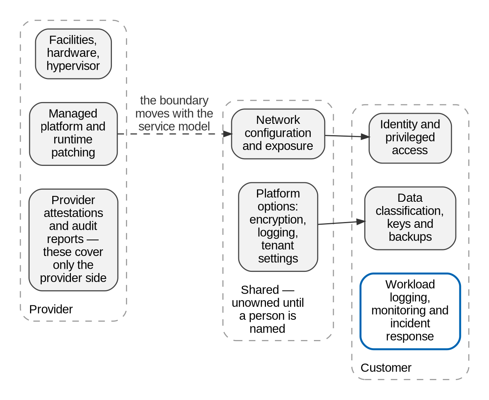
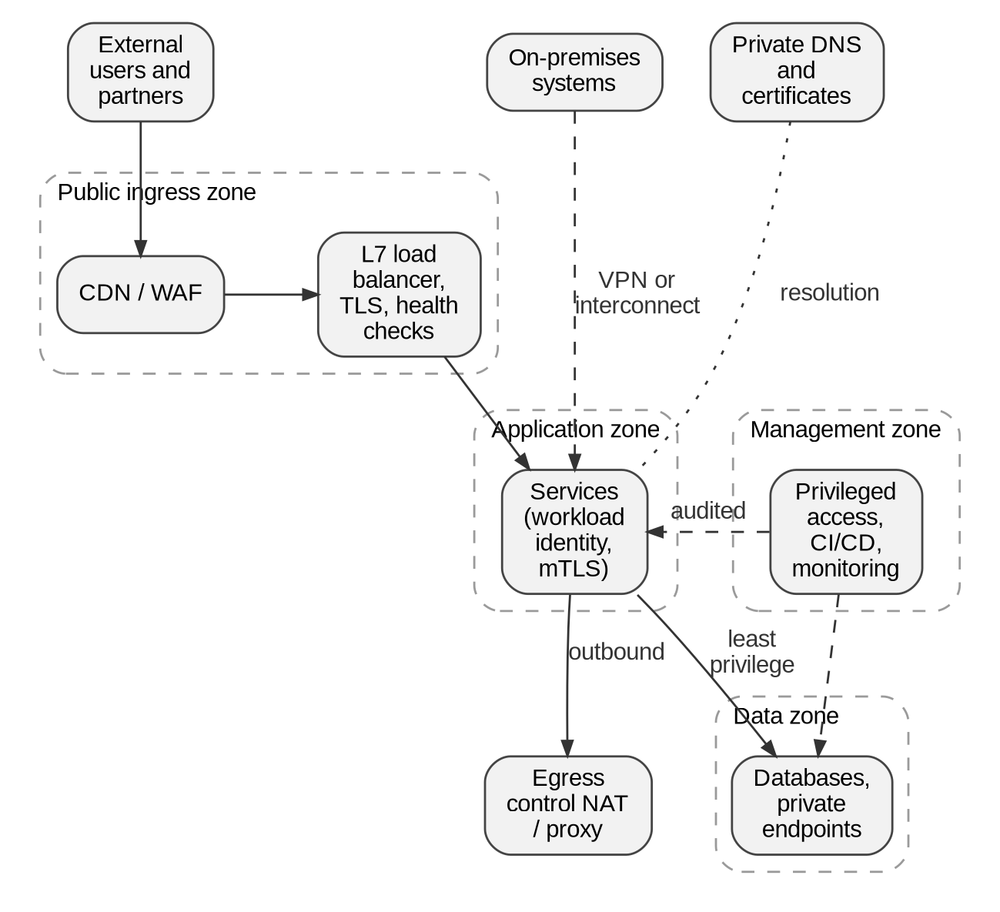
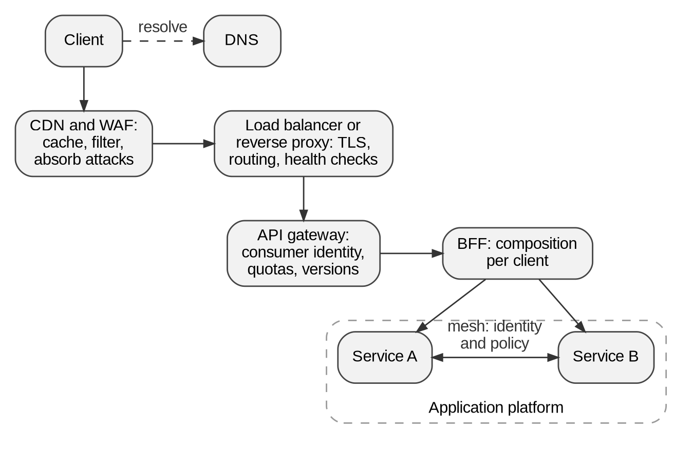
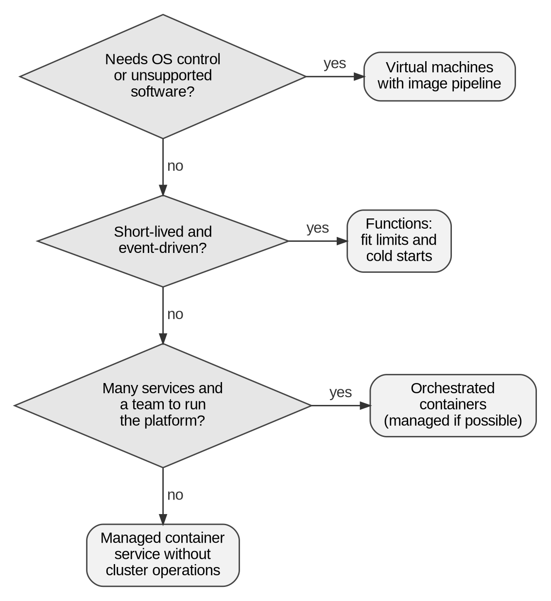
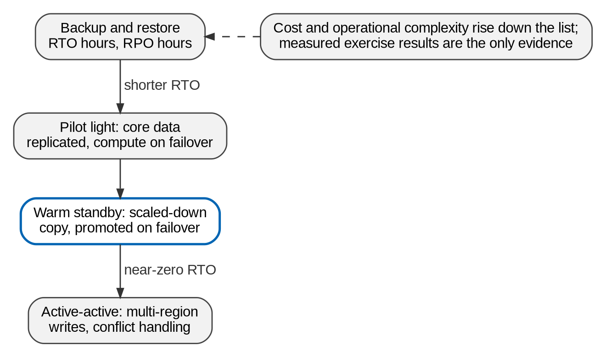
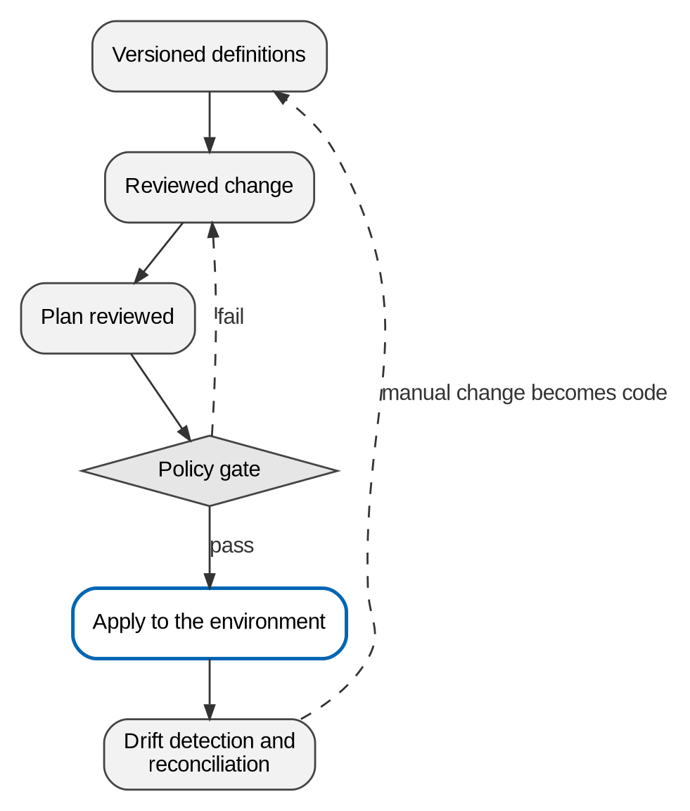
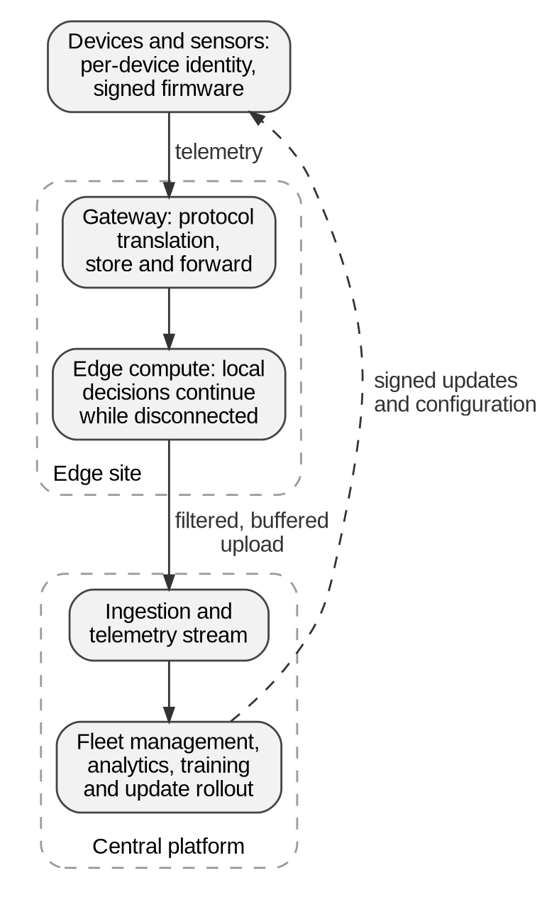
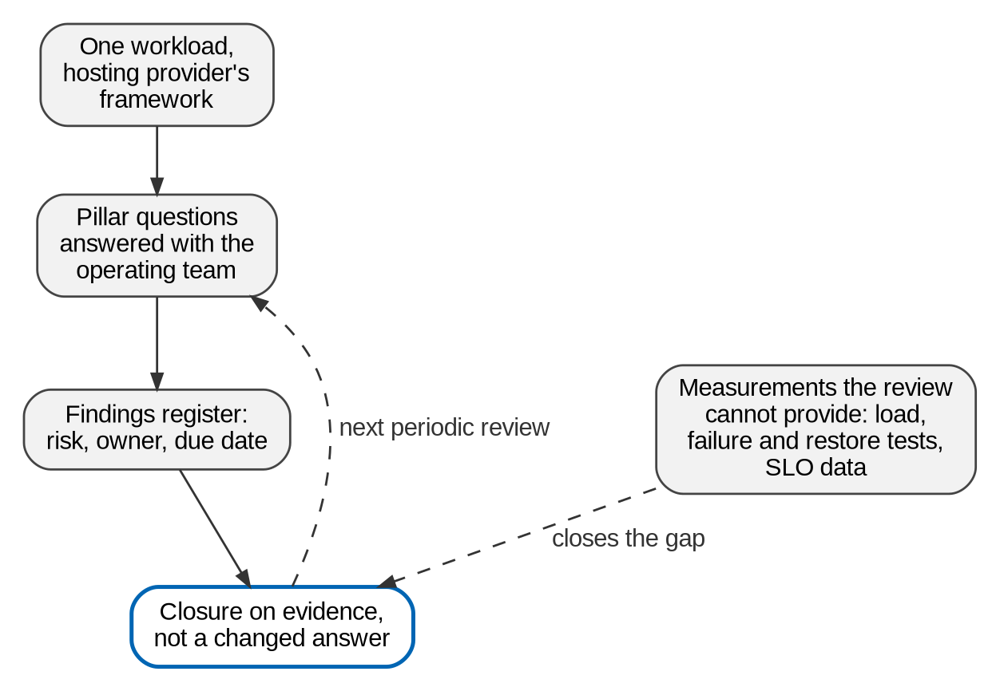

# 12. Infrastructure and Cloud Architecture

Cloud architecture is a set of reliability, security and economic decisions, not a diagram of managed services. The **shared responsibility model** must be mapped to specific controls: a managed database transfers patching and hardware failure handling to the provider, but not schema design, data classification, access control or backup verification.

High availability and disaster recovery answer different questions. Redundant instances within a region protect against node or zone failure but not against regional loss or corrupted data. Recovery objectives (defined in 1.2.10) shape replication, backup, failover and testing.

::: {.callout-note appearance="simple" icon=false title="When to Use This Chapter"}
- Placing workloads and choosing hosting, isolation and recovery models.
- Designing high availability, disaster recovery or business continuity.
- Reviewing network exposure, connectivity, segmentation and trust boundaries.
- Comparing infrastructure automation, capacity, cloud well-architected reviews or hybrid/multicloud options.
- Selecting a container or runtime platform, a service mesh or GitOps delivery.
- Placing processing at the edge or designing an IoT device fleet.
- Selecting block, file, object or archive storage.
- Deciding between a load balancer, a reverse proxy and an API gateway.
:::

::: {.callout-tip appearance="simple" icon=false title="Key Takeaway"}
Infrastructure architecture maps workload requirements to isolation, recovery and connectivity decisions. Redundancy without recoverable state, DNS, identity and operational access is not resilience.
:::

## 12.1 Cloud Foundations and Workload Placement

Foundations are the decisions made before the first workload lands: where it lives, what isolates it, who is responsible for which control and how it is reached.

### 12.1.1 Landing Zones

**Definition.** A landing zone is the governed foundation for workloads: account or subscription hierarchy, identity, network, policy, logging, budgets and deployment baselines, established before workloads proliferate.

**Purpose.** The landing zone decides what a workload inherits for free and what it must implement itself. It also fixes the isolation and audit boundary, which is expensive to change once several workloads and their data live inside it.

**What it includes.** Separate workloads and environments by isolation, compliance and ownership needs; Section 15.1.5 sets out what each environment is used for and who operates it. Ad hoc subscriptions and shared credentials create invisible trust boundaries: two workloads in one subscription share quotas, role assignments and often a network, whether or not anyone intended it.

**Why it is needed.** A workload created in an ungoverned subscription inherits no logging, no budget alerts and no policy, and the gap is found during an audit rather than at design time. The evidence is deny-by-default policies tested against a deliberately non-compliant deployment, with logging, budget alerts and identity controls verified, and every exception recorded with an approver and an expiry.

### 12.1.2 Compute and Hosting Selection

**Definition.** Compute selection is the choice of execution model — virtual machine, container platform, managed application platform or function — for a defined workload.

**Purpose.** The model determines who patches the runtime, how the workload scales, how it fails and how portable it is. Choosing from the workload's behavior rather than from team preference keeps the operational burden where it can be carried.

**What it includes.** Virtual machines, containers, managed application platforms and functions trade operational control against abstraction and runtime constraints (Table 12.1). Choose from workload duration, statefulness, scaling behavior, portability, patching ownership, compliance and team skills. Section 12.3 covers the limits, orchestration and delivery of the chosen runtime.

| Model | Control you keep | What you give up | Fits |
| :--- | :--- | :--- | :--- |
| Virtual machine | Operating system, runtime, networking | Provider manages hardware only; you patch everything | Legacy software, specialized agents, full control |
| Container platform | Images, scheduling policy, network policy | Cluster operations and upgrades, unless managed | Many services with steady traffic and platform skills |
| Managed application platform | Application configuration and code | Runtime and scaling internals | Web applications and APIs without unusual runtime needs |
| Function | Code and its configuration | Duration limits, cold starts, execution model | Event-driven, short, spiky work |

: Execution models and their trade-offs

**Why it is needed.** Adopting Kubernetes without a platform operating model creates avoidable toil, and functions chosen for cost at low volume become expensive or impossible at steady high volume with long-running work. The evidence is a prototype comparing at least two realistic platforms on deployment, scaling, patching, recovery and total cost, with the rejected option and its measured reason recorded. Chapter 19 (19.4.4) applies hosting and shared-responsibility decisions to managed and self-hosted model endpoints.

### 12.1.3 Networking and Connectivity

**Definition.** Network architecture covers address planning, segmentation, routing, DNS, ingress, egress, private connectivity and hybrid links.

**Purpose.** The network is where trust boundaries become enforceable and where most "cloud" outages actually happen. Treating it as a set of owned decisions rather than a product diagram keeps exposure, reachability and failure domains visible.

**What it includes.** At foundation level the questions are which zones exist, what may cross them, how names resolve and how administrative access is separated from workload traffic. The table is a scope map: it names what the network view covers, who owns each area and where the decision is made. The options, the decision detail and the test that proves each one are in Section 12.2, which takes the exposure and routing halves in turn.

| Area | What it covers | Owner | See |
| :--- | :--- | :--- | :--- |
| Addressing and routing | Address plan, CIDRs, route tables, NAT and return paths | Platform network owner | 12.2.2 |
| Segmentation and identity | Trust zones, east-west policy and workload identity | Security architect with the platform owner | 12.2.2 |
| Naming and certificates | Private DNS, split-horizon behavior, TTLs and renewal | Platform owner | 12.2.1 |
| Ingress and egress | Public entry, load balancing, outbound paths and their cost | Security and platform owners | 12.2.1 |
| Private and hybrid connectivity | Private endpoints, peering, VPN or dedicated interconnect | Network owner with the on-premises counterpart | 12.2.2 |

: Networking scope map

**Why it is needed.** A workload that resolves names only from an administrator workstation works in the design review and fails in production, and an undocumented peering or NAT path becomes an unowned exposure. The evidence is name resolution and connectivity tested from each execution environment, not only from an administrator workstation, plus a network view with named owners.

### 12.1.4 Shared Responsibility

**Definition.** The shared responsibility model is the per-service split of security and operational duties between the provider and the customer.

**Purpose.** It prevents two opposite errors: assuming the provider secures everything above the hardware, and duplicating controls the provider already operates. It also assigns a person to every customer-side duty, which is the only way a duty is actually performed.

**What it includes.** Every hosting model splits security and operational duties between provider and customer, and the split moves with the service model (Figure 12.1). Map it explicitly for each service the solution uses, then assign each customer-side duty to a named control owner (4.1.1).

| Duty | IaaS | PaaS / managed service | SaaS |
| :--- | :--- | :--- | :--- |
| Physical facilities, hardware, hypervisor | Provider | Provider | Provider |
| Operating system and runtime patching | Customer | Provider | Provider |
| Network configuration, segmentation and exposure | Customer | Shared: provider platform, customer configuration | Provider; customer configures tenant options |
| Identity, access and privileged roles | Customer | Customer | Customer |
| Data classification, encryption keys and backups | Customer | Customer, using provider features | Customer configures; provider operates |
| Logging, monitoring and incident response | Customer for workloads; provider for platform | Shared | Provider operates; customer consumes logs and responds |

: Shared responsibility by service model

Figure 12.1 draws the responsibility boundary itself, so the table’s rows can be read as duties on one side or the other rather than as a generic checklist.

{#fig-12-1 width="100%"}

The table is a starting point: providers publish their own matrices, which differ by service and change over time. Record the version consulted, and treat any duty marked "shared" as unowned until a person is named.

**Why it is needed.** The provider's attestations (13.8.2) cover only the provider's side, so a review that stops there proves nothing about the workload. The evidence is a per-service responsibility matrix with control owners, the provider matrix version consulted, and provider attestations mapped to the provider-side duties.

### 12.1.5 Storage Selection

**Definition.** Storage selection matches block, file, object and archive services to a workload's access pattern, durability needs and cost.

**Purpose.** Each storage class has a different performance, sharing and cost profile. The right choice avoids paying for performance that is unused, or discovering a retrieval limit during a recovery.

**What it includes.** Block storage gives attached volumes with low latency, and it suits databases and single-writer workloads. File storage gives a shared file system to several hosts, which suits existing software that expects one. Object storage scales to very large volumes of unstructured data through an HTTP interface, with high durability and no in-place partial update. Archive tiers lower the cost of rarely read data in exchange for retrieval delays and fees. For each store, state the required throughput and operations per second, consistency, durability, replication scope, encryption and key ownership. Add lifecycle rules that move or delete data (9.2.4), and account for data transfer and request charges. Database engine selection belongs to 9.2.2, and recovery design to 12.4.2.

**Why it is needed.** Storage defaults often fit the first test and fail under production volume, while an archive tier chosen only for its price can miss the recovery objective because of retrieval time. The evidence is a measured performance test at expected volume, a lifecycle rule for each store, a timed retrieval from each archive tier and a cost estimate that includes requests and data transfer.

**Example.** The reference checkout runs on a managed container platform and a managed database. The team maps both matrices, keeps patching and platform logging with the provider, and names owners for identity, key management, backup verification and workload incident response — the four duties that a PaaS matrix still leaves on the customer side.

::: {.callout-warning appearance="simple" icon=false title="Common Pitfall"}
Treating "managed" as "secured". A managed service removes patching and hardware work, not the obligation to classify data, scope identities, verify backups and respond to incidents in your own workload. Map the provider matrix per service and name a person for every customer-side duty.
:::

::: {.callout-important appearance="simple" icon=false title="Decision & Trade-off"}
Choose the foundation before choosing products.

| Option | Choose when | Consequences |
| :--- | :--- | :--- |
| New account or subscription in the landing zone | Default for any workload with its own data or compliance scope | Clean isolation and quotas; onboarding work up front |
| Shared subscription with policy and tagging | Small, related workloads under one owner | Faster start; shared quotas and a wider blast radius |
| Separate landing zone or tenant | Regulatory, residency or contractual separation is required | Strongest isolation; duplicated platform and operations cost |
:::

## 12.2 Network and Connectivity Decisions

Network architecture is a set of decisions about exposure, segmentation, naming, identity and failure domains, not a product diagram. The workload's trust boundaries and data flows determine the design; the hosting model only constrains how it is implemented. Documenting the decisions as an owned network view is what makes exposure reviewable and failures diagnosable, because many outages attributed to “the cloud” are actually DNS, routing, identity, certificate or egress failures.

Figure 12.2 shows a typical zoning: traffic enters only through the public ingress zone, services reach data through least-privilege policy, and administration uses a separate, audited path.

{#fig-12-2 width="100%"}

The zoning is only half the design; the other half is the decisions it encodes. The table lists each decision area, what must be decided and the test that proves it, and sections 12.2.1 and 12.2.2 take the exposure and routing halves in turn.

| Decision area | What must be decided | Evidence |
| :--- | :--- | :--- |
| DNS and certificates | Private zones, split-horizon behavior, TTLs, renewal ownership | Failover and expiry tests |
| Routing, subnetting and NAT | Address plan with an IPAM owner, non-overlapping CIDRs, return paths | Route and ACL review; asymmetric-routing test |
| Egress | Which paths are allowed, through which endpoint, at what cost | Egress policy test and cost estimate |
| Proxies and firewalls | Deny-by-default ingress and egress, inspection points, management allowlist | Policy test against a non-compliant workload |
| Load balancing and health checks | L4 or L7, health-check path, draining and cross-zone behavior | Health-check and draining test |
| Segmentation and identity | Trust zones, east-west policy, workload identity, hybrid directory | Cross-zone access attempt results |
| Hybrid and private connectivity | VPN, interconnect or peering ownership, encryption, failover | Connectivity failover results |
| Latency and bandwidth | Per-journey budgets on the real path | Measured latency and bandwidth against budget |

: Network decision areas and their evidence

### 12.2.1 Naming, Exposure and Traffic Entry

**Definition.** Naming, exposure and traffic entry decide how a request finds the workload and which controls it passes before it reaches an application.

**Purpose.** These decisions determine what is reachable from the internet, what the workload can resolve, and which failure modes an operator can diagnose. They are the first place to look when a service is "up" but unreachable.

**What it includes.** *DNS and certificates.* Treat DNS as a production dependency: use private zones where possible, document split-horizon behavior, set TTLs that balance failover and churn, and test failover rather than assuming it. Certificates, private keys and trust stores have owners and renewal paths; an expired certificate is an outage with a known date.

*Proxies and firewalls.* Use deny-by-default ingress and egress, L4/L7 load balancing and inspection where required, and an explicit allowlist for management paths. A firewall or network location does not replace application authentication and authorization; east-west traffic still needs identity and least privilege. Record which controls are preventive, detective or advisory (4.3).

*Edge protection.* A content delivery network reduces latency and origin load for cacheable content; define cache keys and invalidation, and do not shared-cache personalized responses by default. An exception requires explicit permission, identity-scoped keys and isolation tests, and `private` or `no-store` directives still apply (11.3.3, 11.3.4). Distributed denial-of-service protection absorbs volumetric attacks at the network edge, while application-layer attacks also need rate limits and a web application firewall. Keep the origin reachable only through the edge, otherwise the protection can be bypassed.

*Load balancing and health checks.* Choose L4 or L7 by protocol and routing need (12.2.3); define health checks that test the real dependency path, not just process liveness; configure connection draining, cross-zone behavior and limits.

**Why it is needed.** A health check that tests only process liveness keeps a broken instance in rotation, and an unowned certificate expires on a date everyone knew in advance. The evidence is DNS and certificate failover and expiry tests, a health-check and draining test against a real dependency failure, and a policy test that shows a non-compliant workload being refused.

### 12.2.2 Routing, Segmentation and Capacity

**Definition.** Routing and segmentation decide which networks and services may reach each other; capacity decides whether the path can carry the traffic that arrives.

**Purpose.** Segmentation turns a trust boundary into an enforceable rule, and address planning is what makes a migration or an acquisition possible without renumbering. Network capacity planning prevents the outage that compute metrics never show.

**What it includes.** *Routing, subnetting, NAT and egress.* Plan address space with an IP address management (IPAM) owner and avoid overlapping CIDRs across cloud, on-premises and acquired networks. State where IPv6 is required or already enabled, because dual-stack networks need equivalent firewall rules, monitoring and DNS records for both protocols. Define public and private subnets, route tables, NAT egress and return paths. Egress is both a security boundary and a cost driver; prefer private endpoints where the service supports them, and test asymmetric routing and overlapping ranges before a migration rather than during cut-over.

*Segmentation and hybrid identity.* Separate trust zones for public ingress, application, data and management, and enforce east-west policy with workload identity where the platform supports it. Hybrid identity needs a deliberate directory, conditional-access and workload-credential design; shared credentials between on-premises and cloud defeat both audit and least privilege. For VPN, dedicated interconnect and peering, define who owns routing, encryption and failover.

*Latency, bandwidth and capacity.* Measure round-trip latency and bandwidth on the real path, set budgets per journey, and account for cross-region replication and egress cost. Capacity planning includes NAT ports, connection limits and DNS query volume, not only compute.

**Why it is needed.** Overlapping address ranges discovered during a cut-over stop a migration, shared hybrid credentials defeat audit, and NAT port exhaustion looks like an application outage until someone measures the network. The evidence is a route and ACL review, cross-zone access attempts that are refused, hybrid-connectivity failover results, and measured latency and bandwidth against per-journey budgets.

### 12.2.3 Load Balancers, Reverse Proxies and API Gateways

**Definition.** A load balancer distributes traffic among healthy instances; a reverse proxy receives client requests on behalf of servers and forwards them; an API gateway is a reverse proxy specialized in managing APIs per consumer.

**Purpose.** The names overlap and one product often fills several roles. Deciding by responsibility places each control once and avoids stacked layers that repeat the same work.

**What it includes.** Table 12.5 compares the components. A layer 4 balancer distributes TCP connections or UDP flows, according to the transports it supports, without interpreting application messages; an HTTP-aware layer 7 balancer can route by host or path, and so also acts as a reverse proxy. A reverse proxy terminates client connections and can route, compress, cache and hide the servers behind it. An API gateway adds consumer identity, quotas, plans, versions and transformations. Business decisions and object-level authorization stay in the services (13.5.6). An ingress controller, in Kubernetes or a platform with an equivalent ingress API, turns declared routes into configuration for the proxy, load balancer or API gateway that forwards the traffic; a service mesh governs east-west traffic (12.3.3), and a BFF is application code for one client (11.6.2). Keep a layer only if it has a distinct responsibility, since each hop adds latency, a failure domain and configuration. Timeouts should shorten at each inner hop, and only one layer should retry (11.4.2). State where TLS terminates and whether traffic is re-encrypted (13.4.2). Accept client-address headers such as `Forwarded` only from known proxies. Confirm that each hop supports long-lived connections where needed (10.1.9).

| Role | Main responsibility | Typical controls | Should not own | Choose when |
| :--- | :--- | :--- | :--- | :--- |
| Layer 4 load balancer | Distribute connections or flows | Health checks, connection draining, zone spread | Content-based routing | Non-HTTP protocols or very high connection volume |
| Layer 7 load balancer | Distribute requests | Host and path routing, TLS, health checks | Per-consumer API policy | Several HTTP services share an entry point |
| Reverse proxy | Stand in front of servers | TLS, routing, compression, caching, request limits | Business rules | Servers need a controlled entry point |
| API gateway | Manage APIs per consumer | Authentication, quotas, versions, transformations, usage reporting | Business logic and object-level authorization | APIs serve many consumers or external partners |
| Ingress controller | Configure cluster entry routing | Reconciles declared host, path and TLS routes into the forwarding data plane | Forwarding itself, unless bundled with a proxy | Kubernetes or a platform with an equivalent ingress API |

: Load balancer, reverse proxy and API gateway compared

Figure 12.3 shows a common request path; many solutions need only some of these hops.

{#fig-12-3 width="100%"}

**Why it is needed.** Without clear responsibilities, retries and timeouts stack across layers, a gateway accumulates business rules that no team owns, and a forged client-address header can defeat a rate limit or an audit record. The evidence is a request-path view stating each hop's responsibility, a timeout budget per hop, a test that removes each hop's instance and a test that shows forged forwarding headers being ignored.

**Example.** A partner integration is added through the public ingress zone. The review rejects a route table change that would have exposed the data subnet, adds a private endpoint for the partner's object storage, and records a certificate renewal owner. The failover test resolves the partner hostname from the application subnet, not from an administrator workstation — the step that fails in most first attempts.

::: {.callout-warning appearance="simple" icon=false title="Common Pitfall"}
Testing connectivity from an administrator workstation or a jump host and concluding the workload can reach the dependency. The execution environment has a different DNS view, route table and egress policy, so the test proves the wrong path. Run name resolution and connectivity tests from each execution environment as part of the pipeline.
:::

::: {.callout-important appearance="simple" icon=false title="Decision & Trade-off"}
Choose the connectivity and exposure model before selecting network products.

| Option | Choose when | Consequences |
| :--- | :--- | :--- |
| Public ingress with WAF and CDN | External users need a public endpoint and managed DDoS/WAF protection | Broad exposure; requires TLS, authentication, authorization and egress control |
| Private endpoint, private link or peering | Workloads or PaaS services must avoid the public path across accounts or networks | Private DNS, route-table and ownership complexity; cross-account coordination |
| Hybrid VPN or dedicated interconnect | On-premises systems need predictable connectivity and latency | Cost, routing/BGP, shared responsibility and failure testing |
| Internal segmentation with service identity | Many services need east-west control and least-privilege access | Operational maturity, mTLS/policy management and observability |
:::

## 12.3 Container and Runtime Platforms

The runtime platform decides how workloads are packaged, placed, scaled and replaced. It also decides how much of that work the organization operates for itself. Section 12.1.2 compares the execution models. This section covers the limits and architectural obligations that come with the chosen runtime; release mechanics are covered in 15.1.

A platform is the set of reusable capabilities — delivery pipelines, workload identity and secrets, observability, service templates and a support model — that a workload team consumes as an internal product, so that each team does not rebuild them and a control is implemented once. Infrastructure must provide what the platform composes: capacity and placement, network segmentation and traffic entry, storage, runtime isolation, workload identity and the landing-zone controls that make shared tenancy safe. Chapter 17 designs the platform itself: its product model, interfaces, tenancy, guardrails, reliability, measures and economics.

### 12.3.1 Runtime Limits and Isolation

**Definition.** Runtime limits are the constraints an execution model places on a workload, such as duration, memory, connections and concurrency; runtime isolation is the strength of the boundary between workloads that share hosts.

**Purpose.** Section 12.1.2 compares the execution models. Once a candidate is chosen, its limits and its isolation boundary decide whether the workload really fits, and they are what most often invalidates a choice late in delivery.

**What it includes.** Figure 12.4 gives a selection path based on the criteria of Section 12.1.2, and Table 12.6 lists the limits to validate before committing. Treat each limit as a design input and find out whether it is fixed or can be raised. Standardize on a small number of models so that security baselines, observability and deployment paths stay shared. Workflows that need durable waits belong in an orchestrator and not in a long-running function (10.6.4). Containers on a shared kernel isolate less than virtual machines do, so add sandboxed runtimes or dedicated nodes where workloads are mutually untrusted, as in multi-tenant code execution (11.7).

| Limit | Typical failure | How to validate |
| :--- | :--- | :--- |
| Execution time | A long job is terminated partway through | Run the largest job; split it or move it to a workflow |
| Memory and CPU | Eviction or throttling at peak | Load test at peak with limits enforced |
| Startup time | Cold starts or slow scale-out break the latency objective | Measure from zero instances and during a burst |
| Connections | Many small instances exhaust a database | Test at maximum concurrency with the pooling design |
| Concurrency and rate quotas | Throttling shared across an account or region | Confirm the quota and the process to raise it |
| Payload and local storage | Large requests or files fail | Test with the largest expected item |

: Runtime limits to validate before committing

Figure 12.4 applies the selection criteria of Section 12.1.2 in order, stopping at the first constraint that decides the model.

{#fig-12-4 width="100%"}

**Why it is needed.** Runtime choices are often inherited from the previous project or adopted for their popularity, and the cost appears later as unfunded platform work or a workload that hits a provider limit in production. The evidence is a recorded selection (12.1.2), a named operating owner, and a load test that reaches the model's relevant limits.

### 12.3.2 Container Orchestration

**Definition.** A container orchestrator schedules containers across a pool of machines and continuously replaces, reschedules and scales them to match a declared state.

**Purpose.** It automates placement and recovery for many workloads. This automation helps only when the workloads declare what they need and tolerate being moved.

**What it includes.** Each workload declares resource requests and limits, readiness and liveness checks with different meanings, a graceful shutdown that drains work, and a disruption budget that keeps enough replicas during maintenance. Spread replicas across fault domains (12.4.1). Autoscale on a signal that reflects load, and account for the time required to add nodes. Separate workloads with namespaces, quotas, network policies and workload identities, and restrict privileged containers through admission control (13.5.7). Pin images by digest from a trusted registry. Prefer provider-managed data stores for state; running a database on the cluster makes the team responsible for storage, failover and backup. Decide the number of clusters on blast radius, compliance and upgrade risk: a single large cluster is simpler and concentrates failure, while many clusters isolate failure and multiply fleet operations. Plan the upgrade cycle, because orchestrator versions go out of support on a fixed schedule, and test workloads and add-ons against each new version.

**Why it is needed.** An orchestrator restarts a failing container, but it cannot compensate for missing health checks, unbounded resources or a workload that loses data when terminated. The evidence is declared resources and probes for each workload, a node-drain test without user impact, a tested version upgrade and a recorded rationale for the cluster topology.

### 12.3.3 Service Mesh and Workload Networking

**Definition.** A service mesh is an infrastructure layer of proxies and a control plane that applies identity, encryption, traffic policy and telemetry to service-to-service communication without changing application code.

**Purpose.** It provides these controls uniformly across languages and teams. The question for the architect is whether that uniformity justifies a further distributed system to run.

**What it includes.** A mesh typically provides workload identity with mutual TLS (13.2.5), authorization between services, traffic splitting for progressive delivery (15.1.2), and uniform request telemetry (14.1). Compare it with simpler alternatives: network policies give segmentation at the connection level, and a shared library or gateway may cover retries and telemetry for a small, homogeneous estate. Coordinate retries and timeouts with the application, because retries at both layers multiply load and break the deadline budget (11.4.2). Account for the added latency, the resource cost of the proxies and the upgrade path, whether the mesh places a proxy beside each workload or shares one per node. The control plane must not be needed for traffic already flowing, so test its failure. Service discovery, whether through platform DNS or a registry, lets clients find healthy instances without fixed addresses; account for record caching, which can keep traffic on instances that have gone. Adopt incrementally, starting with the workloads that need the control, and define how traffic crosses the mesh boundary.

**Why it is needed.** A mesh adopted for a single feature leaves a team operating a critical data-path component without the capacity to debug it, while its absence on a large polyglot estate leaves encryption and policy inconsistent. The evidence is a list of the controls the mesh is expected to deliver, measured latency overhead, a control-plane failure test and an upgrade owner.

### 12.3.4 GitOps and Runtime Configuration

**Definition.** GitOps manages a runtime from desired state held in version control, where software agents pull that state and continuously reconcile the running system toward it; the OpenGitOps principles describe this state as declarative, versioned and immutable, pulled automatically and continuously reconciled.

**Purpose.** It makes the repository the reviewable record of what should be running, and it turns unauthorized changes into detectable drift.

**What it includes.** Keep application and platform configuration declarative. Separate the repository or path that holds environment state from application source, so that promotion (15.1.4) is a reviewed change to that state. Reference secrets rather than storing them, using an external secret store or encrypted values (13.4.2). Automatic correction of manual change is the normal behavior under these principles. Alerting without correction is a limited adoption stage, or a recorded and temporary suspension during break-glass work, with an owner and a condition for returning to reconciliation. Commit break-glass changes back to the repository afterwards. Roll out through progressive stages and define rollback as restoring the previous revision, while recognizing that database changes do not roll back in the same way (15.2.2). Protect the reconciling agent, because it holds broad deployment authority. Pull-based delivery removes the need for the build system to hold cluster credentials.

**Why it is needed.** Direct changes to a running platform leave the recorded state wrong, which makes recovery unreliable and audits speculative. The evidence is a change history linking each deployed state to a reviewed commit, a drift-detection test, a rebuild of an environment from its repository and a record of break-glass use.

**Example.** A payments group runs forty services in four languages. Stateless services use a managed orchestrator with two clusters per region, split by compliance scope; databases stay on managed services. A mesh provides mutual TLS and traffic shifting, after tests showed an added latency of a few milliseconds within the journey budget. A short-lived statement generator runs as a function. Reconciling agents apply environment state from a reviewed repository, and an emergency change made during an incident is recorded and committed back the same day.

::: {.callout-warning appearance="simple" icon=false title="Common Pitfall"}
Adopting a container orchestrator as a default for a small number of services. The team then spends its capacity on cluster upgrades, networking add-ons and security policies instead of the product. Choose the orchestrator when the number of services and an available platform team justify it; otherwise use a managed service that removes the cluster from the team's responsibilities.
:::

::: {.callout-important appearance="simple" icon=false title="Decision & Trade-off"}
Where should service-to-service traffic policy be enforced?

| Option | Choose when | Consequences |
| :--- | :--- | :--- |
| Application libraries | Few languages and strong shared engineering | No extra data-path component; upgrades depend on every team and policy can diverge |
| Network policies and a gateway | Segmentation and north-south control are the primary needs | Simple and well understood; no per-request identity or uniform service telemetry |
| Service mesh | Many services or languages need uniform identity, encryption and traffic control | Consistent policy without code changes; additional latency, cost and a critical component to run |
:::

## 12.4 Availability, Recovery and Continuity

Availability protects a service against component failure; recovery and continuity protect the business against the loss of a region, a dataset or a whole capability.

### 12.4.1 High Availability and Fault Domains

**Definition.** High availability is the property that a service continues to meet its objective when an individual component fails, because every component and dependency has a redundant path.

**Purpose.** Availability design is about fault domains, not instance counts. Identifying which failures the architecture survives — and which it does not — is what makes an availability claim testable.

**What it includes.** Availability zones and regions are fault domains; redundancy is effective only when every dependency and the failover path are also redundant. Build a fault-domain matrix covering compute, databases, queues, identity, DNS, secrets and third-party services (Table 12.7). A multi-zone front end does not remove a single-zone database or a shared control-plane dependency.

| Layer | Failure domain it survives | Remaining single point of failure | Evidence |
| :--- | :--- | :--- | :--- |
| Compute | Node and zone | Regional control plane | Zone-failure exercise |
| Database | Node, with automatic failover | Single-region storage | Failover test with measured interruption |
| Queue | Node and zone | Cross-region replication lag | Broker failover test |
| Identity | Node and zone | Directory or tenant dependency | Sign-in test with a zone removed |
| DNS and certificates | Provider redundancy | Registrar and renewal ownership | Failover and expiry test |
| Third-party services | Provider's own zones | Provider-wide outage | Documented degradation per journey |

: Fault-domain matrix for a workload

Cell-based architecture carries fault isolation into the workload itself. Each cell is a complete, independent instance of the workload that serves a subset of customers or keys, and a thin routing layer sends each request to its cell. Cells share no data stores and do not call each other, so a failure, a defective deployment or a poison input stays within one cell. Keep the router as simple as possible and independent of the control plane, roll changes out cell by cell, and grow by adding cells up to a tested maximum cell size. The deployment stamps of 11.7.1 apply the same idea to tenancy. The costs are spare capacity per cell, cell-level operations, moving customers between cells, and reporting across cells.

**Why it is needed.** Redundancy that is not exercised is a diagram: the database failover that has never run, the DNS record that still points at the old zone. The evidence is zone-failure exercises with measured user-visible impact, per layer, not a count of instances.

### 12.4.2 Disaster Recovery and Data Protection

**Definition.** Disaster recovery is the capability to restore service and data after a loss that exceeds the fault domains of normal operation.

**Purpose.** Recovery design converts business tolerance into a topology: how much data may be lost, how long the business can wait and what it costs to shorten either. It also protects against the failure that redundancy cannot: corruption and deletion.

**What it includes.** Backup, replication and failover serve different needs. Replication reduces RPO but also replicates corruption and accidental deletion; only isolated, ideally immutable, backups protect against those. Define recovery tiers per business capability, with restore order, key recovery and external dependencies. Table 12.8 compares the strategies and Figure 12.5 shows the trade-off between recovery time and cost.

| Strategy | Typical RTO / RPO | Cost and complexity | Notes |
| :--- | :--- | :--- | :--- |
| Backup and restore | Hours / hours | Lowest | Restore time grows with data volume |
| Pilot light | Tens of minutes to hours / minutes | Low–medium | Core data replicated; compute provisioned on failover |
| Warm standby | Minutes / seconds to minutes | Medium | Scaled-down copy running; promoted on failover |
| Active-active | Near zero / near zero | Highest | Multi-region writes require conflict handling |

: Recovery strategies

Figure 12.5 orders the recovery strategies by the disruption they survive, from restore to active-active, the spectrum the table’s ranges describe.

{#fig-12-5 width="100%"}

The ranges are indicative only; measured exercise results are the evidence. Backups that have never been restored are unverified recovery plans.

**Why it is needed.** A replicated environment that also replicates a bad migration is not a recovery plan, and a restore that takes three times the RTO is discovered during the incident. The evidence is a restore exercise with measured duration and data loss, an isolated backup copy with an immutability or retention control, and a documented restore order that includes identity, keys and secrets.

### 12.4.3 Business Continuity and Disaster Recovery Planning

**Definition.** Business continuity planning keeps critical business services running during a disruption; disaster recovery planning restores the technology that supports them.

**Purpose.** The two plans answer different questions and have different owners, and separating them prevents the common failure of a technology recovery plan that restores systems the business cannot operate without its people and suppliers.

**What it includes.** Disaster recovery is one part of business continuity (Table 12.9).

|  | Business Continuity Plan (BCP) | Disaster Recovery Plan (DRP) |
| :--- | :--- | :--- |
| Question | How does the business keep delivering critical services during a disruption? | How are the technology services and data restored? |
| Scope | People, processes, facilities, suppliers, communications, manual workarounds | Infrastructure, applications, data, credentials, dependencies |
| Typical owner | Business continuity or risk function with service owners | Service owner, platform and operations teams |
| Main inputs | Business impact analysis (BIA) | BIA-derived RTO and RPO per capability |
| Typical test | Tabletop and simulation exercises | Restore, failover and failback exercises |

: Business continuity and disaster recovery compared

The **business impact analysis** identifies critical processes, the impact of their interruption over time and the **maximum tolerable period of disruption (MTPD)**. RTO must be shorter than the MTPD, and RPO follows from the data loss the business can absorb. ISO 22301 is the common reference standard for business continuity management.

The architect’s contribution is to make technology recovery match the BIA: recovery tiers per capability, dependency-aware restore order, recovery of identity, keys and secrets, and supplier recovery commitments. Both plans are reviewed and tested at the interval set by contract, regulation or risk assessment, and after major changes; an annual cycle is the common contractual default, and the service agreement should state the documented RTO and RPO (see Appendix E).

**Why it is needed.** A DRP written without a BIA recovers systems in the wrong order, and a BCP written without the technology view promises workarounds that depend on the systems that are down. The evidence is a current BIA, BCP and DRP with owners, dated exercise reports with measured results, and closed follow-up actions.

**Example.** The reference checkout needs a 30-minute RTO and a five-minute RPO for order capture. The BIA shows the MTPD is two hours, so the technology objective is achievable with warm standby; the plan lists the restore order — identity, secrets, database, queue, then the order service — and a quarterly exercise records the measured result.

::: {.callout-warning appearance="simple" icon=false title="Common Pitfall"}
A second region is provisioned, but DNS, identity, secrets and operational access are not replicated, so the first failover test fails at the first step and the region turns out to be a diagram rather than a recovery capability. Test promotion of the second region end to end, including those dependencies, and record the measured RTO and RPO.
:::

::: {.callout-important appearance="simple" icon=false title="Decision & Trade-off"}
Choose how recovery will be proven.

| Option | Choose when | Consequences |
| :--- | :--- | :--- |
| Restore drill from backup | Data loss or corruption is the credible scenario | Proves the backup, not the failover; needs a target environment |
| Failover exercise to a second region | Regional loss is in the business impact analysis | Proves the topology and the dependencies; disruptive and costly |
| Tabletop with the business and suppliers | Plans, roles and dependencies need review | Cheap and frequent; proves nothing about the technology |
:::

## 12.5 Infrastructure Automation and Economics

Automation makes infrastructure reproducible; economics makes it affordable. Both are architecture decisions because both constrain what the solution can change safely.

### 12.5.1 Infrastructure as Code

**Definition.** Infrastructure as Code (IaC) defines provisioning and configuration in reviewed, versioned definitions that are applied by a pipeline rather than by hand.

**Purpose.** IaC makes an environment reproducible, reviewable and revertible. It turns infrastructure change into a reviewed change with a diff, which is the only practical way to keep several environments consistent.

**What it includes.** Use reusable modules, plan/apply separation, protected state, policy-as-code gates, drift detection, secret separation and environment promotion (Table 12.10, Figure 12.6). Manual changes after deployment cause drift and unreproducible environments.

| Control | What it prevents | Evidence |
| :--- | :--- | :--- |
| Versioned modules | Divergent environments built from copied templates | Repository history and module reuse |
| Plan before apply | Unreviewed destructive change | Plan output attached to the change record |
| Protected state and locking | Concurrent applies corrupting state | State backend configuration |
| Policy-as-code gate | Non-compliant resources reaching production | Policy test results per pipeline run |
| Drift detection | Manual changes silently diverging | Drift report with an owner |
| Secret separation | Credentials in repositories and state | Secret scan and references to a secret store |

: Infrastructure as Code controls

Figure 12.6 follows an infrastructure change from definition through apply to drift detection, where the controls in the table are exercised.

{#fig-12-6 width="100%"}

**Why it is needed.** An environment that cannot be rebuilt cannot be recovered, audited or scaled, and a manual change made during an incident is invisible to the next reviewer. The evidence is an isolated environment rebuilt from source without undocumented manual steps, a policy gate that has blocked a real change, and a drift report that is acted on.

### 12.5.2 Cost and Capacity

**Definition.** Cost architecture is the design of consumption, capacity and unit economics so that the solution's cost is predictable and attributable.

**Purpose.** Cost is a quality attribute with the same shape as latency: it is decided by architecture, measured per unit of business value and degraded by unowned variation. Designing it makes trade-offs explicit instead of arriving as a monthly surprise.

**What it includes.** Cost architecture covers consumption models, reservations, storage tiers, data transfer, licensing and operational labor (Table 12.11). Tag resources for allocation, set budgets and track unit economics such as cost per processed order (see 18.2). Low unit prices can conceal high egress or operational cost, and reservations save money only if utilization stays high.

| Driver | Why it grows | Lever |
| :--- | :--- | :--- |
| Compute consumption | Idle capacity and over-provisioning | Right-sizing, autoscaling, reservations against measured baseline |
| Data transfer and egress | Chatty cross-zone or cross-region traffic | Locality, private endpoints, payload design |
| Storage tiers and retention | Copies kept beyond their purpose | Lifecycle rules tied to the retention schedule (9.2.4) |
| Managed service tiers | Premium features used by default | Feature-by-feature justification |
| Operational labor | Manual toil and incident load | Automation and platform paths (12.5.1, 12.3) |

: Cost drivers and levers

**Why it is needed.** A cost model built on list prices at average load misses both the peak and the egress, and an untagged estate cannot attribute cost to a capability or a customer. The evidence is forecast versus actual cost per transaction at normalized demand, with tags that resolve to a capability and a named owner. Environment promotion is a separate decision, covered in 15.1.4.

**Example.** Cost per completed order is tracked monthly. A rise traces to cross-zone traffic after a failover change, not to compute: the new routing sends every database read across zones. The fix is a read locality rule, and the unit cost returns to baseline without changing capacity.

::: {.callout-warning appearance="simple" icon=false title="Common Pitfall"}
Optimizing the invoice line that looks largest instead of the unit economics. A discount on compute is worthless if egress, storage retention or operational labor dominates the cost of an order, and a reservation on a workload that is about to be re-platformed locks in the wrong shape. Measure cost per business unit before choosing a lever.
:::

::: {.callout-important appearance="simple" icon=false title="Decision & Trade-off"}
Choose how capacity is bought before comparing unit prices.

| Option | Choose when | Consequences |
| :--- | :--- | :--- |
| On-demand, autoscaled | Demand is spiky or cannot be forecast | Highest unit price; no commitment risk and no idle capacity |
| Reserved or committed use against a measured baseline | The baseline is stable and measured over several months | Lower unit price; unused commitment becomes waste |
| Provision for the peak and shed or queue the excess | The peak is short and the work can be deferred | Lowest capacity cost; explicit degradation, queue limits and an owner |
:::

## 12.6 Edge and IoT Architecture

Some workloads must run close to where data is produced because of latency, bandwidth, autonomy or data location. Edge and Internet of Things (IoT) architectures extend the solution into locations that the team does not physically control, which are often disconnected. This section covers placement, device connectivity and fleet security.

### 12.6.1 Edge Placement

**Definition.** Edge computing places processing near the source of data or the user, for example on a device, a site gateway, a local server or a provider's metropolitan location, instead of only in a central region.

**Purpose.** Placement responds to constraints a central design cannot meet, and it should be justified by those constraints because every additional location increases the operational surface.

**What it includes.** Table 12.12 compares the tiers. Identify the driving constraint for each function: control-loop latency, the cost of moving raw data, continued operation during disconnection, or a requirement to keep data on site (13.9.5). Split responsibilities so that the edge handles local decisions and buffering, and the central platform handles fleet management, cross-site analysis and model training. State what the site can do while disconnected, how long it can stay disconnected, and how conflicting changes are reconciled when connectivity returns (11.6.4). Design for constrained and heterogeneous hardware, unattended sites and physical access by others. Treat each location as a fault domain (12.4.1). Deploy to sites with staged rollouts, and manage software and models from a central control plane with a declared state, as in 12.3.4.

| Tier | Typical processing | Choose when | Limits |
| :--- | :--- | :--- | :--- |
| Device | Sensing, control loops, basic validation | Response must be immediate or connectivity cannot be assumed | Scarce compute, energy and update opportunities |
| Site gateway or server | Protocol translation, local rules, buffering, inference | A site must keep working while disconnected | Unattended hardware and physical exposure |
| Provider or metropolitan edge | Content delivery, request routing, low-latency services | Users are widely distributed and need short round trips | Limited state and consistency options |
| Central region | Fleet management, analytics, training, system of record | Latency and connectivity permit | Round trip, data transfer cost and dependency on connectivity |

: Processing tiers from device to central region

Figure 12.7 shows the flow between tiers, including the update path back to devices.

{#fig-12-7 width="100%"}

**Why it is needed.** Treating an edge site as a remote part of the central platform produces systems that stop at the first network loss, and moving all raw data centrally can make the solution uneconomic. The evidence is a placement record per function, a disconnection exercise measured against the stated autonomy period and a data-transfer cost estimate.

### 12.6.2 Device Connectivity and Telemetry Ingestion

**Definition.** Device connectivity is the set of protocols and services that carry telemetry and commands between devices and the platform over constrained or intermittent networks.

**Purpose.** Devices reconnect, buffer, send late data and appear in very large numbers. Designing ingestion for this behavior prevents a fleet event from becoming a platform outage.

**What it includes.** Lightweight publish-subscribe protocols such as MQTT (OASIS, 2019) suit constrained devices; define a topic hierarchy that encodes tenant, site and device, so that authorization can be applied per topic. Choose delivery guarantees per message class, and make consumers idempotent because at-least-once delivery produces duplicates (10.3.2). Use store-and-forward at the device or gateway with a defined buffer size and an eviction rule. Timestamp at the source, tolerate clock drift, and process by event time so that late data is placed correctly (9.4.6). Spread reconnection with randomized backoff, since a regional network recovery otherwise reconnects the fleet at once. Keep a stored representation of each device's reported and desired state, so that commands and configuration reach devices that were offline. Give commands an expiry and a safety check, because a command delivered late can be dangerous. Convert legacy industrial protocols at the gateway, and keep them off the wide-area network.

**Why it is needed.** Laboratory tests with a few connected devices reveal little about what happens when thousands reconnect, or when a day of buffered data arrives out of order. The evidence is a fleet-scale reconnection test, a late-data test showing correct results, a measured buffer duration and a command-expiry test.

### 12.6.3 Device Identity, Security and Lifecycle

**Definition.** Device lifecycle management covers a device from manufacture or enrollment through provisioning, operation, update and decommissioning, with a verifiable identity for each device.

**Purpose.** Devices are numerous, long-lived and physically exposed, so a shared secret or an update process that cannot be recovered puts the whole fleet at risk.

**What it includes.** Give each device a unique identity, preferably protected in hardware, and revoke it individually (13.2.5). Automate provisioning, and bind each device to its tenant and site at enrollment. Do not ship universal default passwords. Sign software, verify the signature on the device and use an update mechanism that keeps a known-good image and falls back after a failed boot. Roll updates out in rings with health-based stops, and allow for devices that stay offline for months. Segment device networks and allow only the required outbound paths. State the support period and what happens when it ends, then plan decommissioning to revoke credentials and erase local data. ETSI EN 303 645 sets out baseline provisions for consumer devices and NIST IR 8259 Rev. 1 describes foundational activities for manufacturers; check which obligations apply to the product and market (13.1.2). Include firmware and third-party components in the software bill of materials (13.5.6).

**Why it is needed.** A single extracted key or a defective update can affect the entire fleet, and devices in remote locations are expensive to recover by hand. The evidence is a per-device identity register, an individual revocation test, a failed-update recovery test on real hardware, a stated support period and a decommissioning record.

**Example.** A cold-chain operator monitors refrigerated warehouses. Each sensor has its own certificate and publishes to a site gateway, which raises temperature alarms locally and buffers seventy-two hours of readings. Filtered readings go to the central stream, stamped at source so that a reconnecting site does not distort the compliance report. Firmware moves through three rollout rings and returns to the previous image after a failed boot. A quarterly exercise disconnects one site and verifies that alarms keep working.

::: {.callout-warning appearance="simple" icon=false title="Common Pitfall"}
Designing the fleet as if devices were always connected and always current. Commands queue up and arrive too late, updates reach only the devices online at that moment, and old firmware versions remain in the field indefinitely. Treat disconnection and version spread as normal states, and test both at fleet scale.
:::

::: {.callout-important appearance="simple" icon=false title="Decision & Trade-off"}
How much intelligence should run at the site?

| Option | Choose when | Consequences |
| :--- | :--- | :--- |
| Thin devices, central processing | Connectivity is reliable and response time is not critical | Simple fleet and fast change; depends on the network and costs more in data transfer |
| Local rules and buffering at a gateway | Sites must stay safe and useful during outages | Continued operation with little local state; gateway fleet to patch and secure |
| Full local application and inference | Latency, data location or long disconnection rules out a central path | Strong autonomy; highest hardware, deployment and version-management burden |
:::

## 12.7 Cloud Well-Architected Frameworks

A well-architected framework is a provider's structured set of design principles, best practices and review questions for workloads on its platform. The major cloud providers publish them, and they are useful as review checklists and as a shared vocabulary with provider teams. They are provider guidance, not standards, and passing a review does not prove that a solution meets its business SLOs. Using one deliberately — a primary framework, findings recorded as risks — turns a vendor questionnaire into an architecture review with evidence. Section 8.3.4 positions these frameworks among the evaluation methods and contrasts them with scenario-based evaluation; this section covers their pillars and their use in a cloud review.

### 12.7.1 Pillars by Provider

**Definition.** Each provider groups its guidance into pillars, and the grouping differs enough that a mapping is needed before comparing them.

**Purpose.** Knowing the pillars prevents two errors: treating one provider's grouping as universal, and running several overlapping reviews of the same workload.

**What it includes.** Table 12.13 summarizes the frameworks and their pillars.

| Provider | Framework | Pillars |
| :--- | :--- | :--- |
| Amazon Web Services | AWS Well-Architected Framework | Operational excellence; Security; Reliability; Performance efficiency; Cost optimization; Sustainability |
| Microsoft | Azure Well-Architected Framework | Reliability; Security; Cost optimization; Operational excellence; Performance efficiency |
| Google Cloud | Google Cloud Well-Architected Framework | Operational excellence; Security, privacy and compliance; Reliability; Cost optimization; Performance optimization; Sustainability |
| Oracle | Well-Architected Framework for Oracle Cloud Infrastructure | Security and compliance; Reliability and resilience; Performance and cost optimization; Operational efficiency; Distributed cloud |

: Pillars by provider

All four share the same core concerns — security, reliability, performance, cost and operations — with differences in grouping and emphasis. AWS and Google add sustainability as a pillar; Oracle groups performance with cost and adds distributed (hybrid and multicloud) deployment.

Each framework is extended for specific workloads or industries: AWS publishes **lenses** (for example serverless, SaaS and financial services), Google publishes **perspectives** (AI and ML, financial services), and Microsoft publishes workload guidance (for example AI and mission-critical workloads). Providers also offer self-assessment tools, such as the AWS Well-Architected Tool and the Azure Well-Architected Review.

**Why it is needed.** A review that mixes pillars from three frameworks produces findings that cannot be compared or closed, and a lens chosen without a workload fit adds questions that do not apply. The evidence is a recorded choice of framework and lens per workload, with the reason and the provider matrix version.

### 12.7.2 Mapping Pillars to This Handbook

**Definition.** The mapping connects provider vocabulary to the sections of this handbook where each concern is actually decided.

**Purpose.** It lets a team answer a framework question by pointing at a design decision and its evidence, instead of producing a narrative that satisfies the questionnaire.

**What it includes.** Table 12.14 maps each pillar theme to the owning sections.

| Pillar theme | Where it is covered in this handbook |
| :--- | :--- |
| Security (including privacy and compliance) | Chapter 13; 1.4.3; 9.2.4; Appendix E |
| Reliability and resilience | 1.2.1–1.2.4; 1.2.10; 12.4; Chapter 14 |
| Performance | 1.2.5–1.2.6; 11.4.3; 14.4.2; 16.3.1 |
| Cost optimization | 1.4.5; 12.5.2; 18.2 |
| Operational excellence | Chapters 14 and 15; 12.5.1 |
| Sustainability | 18.3.1 |
| Distributed and hybrid cloud | 12.1.2–12.1.3; 12.7.3; 12.2 |

: Pillar themes and where they are covered

**Why it is needed.** Without the mapping, the same concern is answered three times with three different levels of evidence, and reviewers cannot tell whether a pillar is satisfied or merely described.

A worked mapping shows what the answer looks like. Asked "How does the workload behave when a zone fails?", the architect does not write a paragraph about resilience: the question maps to 12.4.1 for the fault-domain matrix, to 1.2.10 for the RTO and RPO that bound the answer, and to the recovery topology ADR for the chosen warm standby, and it is settled by the dated zone-failure exercise rather than by the design diagram. The evidence is a review record where each finding cites a section, an ADR or a measurement in that form.

### 12.7.3 Using a Framework Review

**Definition.** A framework review is a facilitated assessment of one workload against a framework's questions, producing findings that are tracked as risks.

**Purpose.** Run well, the review surfaces design gaps before they become incidents and gives the operating team a voice in the design. Run badly, it becomes a documentation exercise that closes findings by changing answers.

**What it includes.** Run a well-architected review at design time for a new workload and periodically for running workloads, using the framework of the hosting provider. Scope it to one workload, involve the operating team, and record findings as risks with owners and due dates, linked to ADRs where they change a decision (Figure 12.8). For multicloud solutions, use one framework as the primary checklist and map the others to it rather than running several overlapping reviews.

Treat high-risk findings like any other governance condition (4.4): they are closed with evidence, not with a changed answer in the questionnaire. Pair the review with the measurements it cannot provide — load and failure tests, restore exercises and SLO data.

{#fig-12-8 width="100%"}

**Why it is needed.** A review without owners and dates produces a list nobody closes, and one closed by editing answers produces false assurance. The evidence is a dated review report per workload, a findings register with owners, and evidence of closure — a test result, a configuration change or a measurement.

**Example.** The checkout workload is reviewed against the hosting provider's framework at design time. Two high-risk findings — an unowned certificate renewal and a single-zone queue — enter the risk register with owners and dates. Both are closed with evidence: a renewal automation test and a zone-failure exercise.

::: {.callout-warning appearance="simple" icon=false title="Common Pitfall"}
Closing framework findings by editing the questionnaire answer. The report turns green, the single-zone database is still single-zone, and the next reviewer inherits a false assurance. Record findings as risks with owners and dates, and close them only with a test result, a configuration change or a measurement.
:::

::: {.callout-important appearance="simple" icon=false title="Decision & Trade-off"}
Choose how many frameworks to apply.

| Option | Choose when | Consequences |
| :--- | :--- | :--- |
| One primary framework per workload | The workload runs mainly on one provider | Comparable findings and one vocabulary; other providers' concerns mapped in |
| One framework plus provider lenses | The workload has a specific profile such as serverless or AI | Deeper relevant questions; more findings to triage |
| Several frameworks in parallel | A contractual obligation names each provider's review | Maximum coverage; duplicated findings and conflicting vocabulary |
:::

## 12.8 Worked Example: Selecting a Recovery Topology

*In practice:* This example compares recovery topologies against explicit RTO/RPO, operational cost and tested evidence.

A business-critical API requires a 30-minute RTO and a five-minute RPO. The team compares single-region multi-zone, warm standby in a second region and active-active. Single-region cannot meet the requirement for regional loss; active-active would satisfy it but adds multi-writer conflict handling the domain does not need. Warm standby is selected.

Infrastructure is defined as code, replication lag is monitored against the RPO, and DNS TTLs, certificates, secrets, queue state and recovery credentials are included in the plan. A quarterly exercise promotes the standby, validates key journeys and records measured RTO, RPO and manual interventions. A separate exercise restores from backup, because replicated corruption is not a backup.

**Deliverables:** HLD deployment view, DR runbook, dependency map, cost model and signed exercise report.

::: {.callout-note .review appearance="minimal" icon=false title="Architecture Review Checklist — Infrastructure"}

☐  Is the shared responsibility model mapped to named controls and owners?

☐  Does the fault-domain matrix cover data, identity, DNS and third-party dependencies?

☐  Do RTO and RPO come from business impact and match measured exercise results?

☐  Can every environment be rebuilt from code?

☐  Are BCP and DRP derived from a business impact analysis and tested at the interval the contract, regulation or risk assessment sets?

☐  Has a well-architected review been completed, with findings owned and closed on evidence?

☐  Is the network and trust-boundary view owned, covering DNS, certificates, routing, NAT, proxies, firewalls, load balancing and private connectivity?

☐  Are hybrid identity, private connectivity and egress failure modes tested against the latency and capacity budgets?

☐  Is the runtime model selected against workload characteristics, with a named operating owner and a tested platform upgrade path?

☐  Where edge or IoT components exist, are disconnected operation, per-device identity and recoverable signed updates designed and tested?

☐  Does each hop in the request path have one stated responsibility, a timeout budget and trusted handling of forwarded headers?
:::

## 12.9 Further Reading

- Amazon Web Services, *Disaster Recovery of Workloads on AWS* — backup and restore, pilot light, warm standby and multi-site strategies.
- Morris (2020), *Infrastructure as Code* — practices for defining and evolving infrastructure.
- Storment and Fuller (2023), *Cloud FinOps* — cost allocation, optimization and unit economics.
- AWS, Microsoft, Google Cloud and Oracle well-architected framework documentation — pillars, review questions, lenses and perspectives.
- ISO 22301:2019 — business continuity management systems.
- IETF RFC 7239 (2014), *Forwarded HTTP Extension* — conveying client information through proxies.
- Amazon Web Services, *Reducing the Scope of Impact with Cell-Based Architecture* — cell design, routing and deployment, labeled as an example.
- OpenGitOps, *OpenGitOps Principles* — the principles of pull-based, reconciled delivery.
- OASIS (2019), *MQTT Version 5.0* — publish-subscribe messaging for constrained devices.
- ETSI EN 303 645 and NIST IR 8259 Rev. 1 (2026) — baseline security for IoT devices and foundational activities for their manufacturers.
