# 12. Platform Architecture

An internal platform is architecture that other solutions stand on. A solution architect meets it in three ways: as a consumer, who must know what the platform provides, what it limits and what remains the solution's responsibility; as a decision maker, who decides whether a capability belongs in the solution, in a shared platform or with a provider; and sometimes as its designer, because a platform is itself a solution with requirements, decisions, governance, evaluation and cost.

This chapter treats the platform in all three roles. Section 11.3 introduces platform engineering as a shared infrastructure capability, Section 2.13 sets the principle of standardization and reuse, and Section 4.10 describes the team types and interaction modes around it. Here the platform is designed as an architecture of its own: its product model, responsibilities, reference structure, interfaces, tenancy, guardrails, reliability, measures, economics and sourcing.

::: {.callout-note appearance="simple" icon=false title="When to Use This Chapter"}
- Deciding whether a capability belongs in a solution, in a shared platform or with a provider.
- Designing or reviewing an internal developer platform, its golden paths and its interfaces.
- Mapping what a solution inherits from a platform and what its team still owns.
- Choosing how teams share a platform: tenancy, isolation, quotas and upgrades.
- Setting guardrails, measures, funding and the lifecycle of platform capabilities.
- Choosing whether to build, buy or compose a platform capability.
:::

::: {.callout-tip appearance="simple" icon=false title="Key Takeaway"}
A platform is a product with users, a contract and an owner, not a collection of shared tools. Design it like any other solution: from measured demand, with an explicit responsibility boundary, interfaces that can evolve, isolation that matches risk, and evidence that it makes delivery faster and safer than the alternative.
:::

## 12.1 Platform Foundations

Before a platform is designed, it needs a definition that separates it from other shared assets, a scope, and evidence that it is needed at all.

### 12.1.1 What a Platform Is

**Definition.** An internal platform is a curated set of capabilities — such as delivery pipelines, runtime environments, identity, secrets, data stores and observability — offered to the teams that build and run solutions through self-service interfaces, with a named owner, a documented contract and a support path.

**Purpose.** The definition decides what the organization funds, what it holds to a service level and what a solution may rely on. Calling every shared asset a platform hides the difference between a capability with an owner and an objective and a script that someone once shared.

**What it includes.** Table 12.1 separates a platform from the shared assets it is often confused with. The distinguishing properties are self-service consumption, an accountable owner, a published contract and a lifecycle that consumers can plan around. A platform usually composes the other assets: it packages infrastructure, provider services and libraries behind one supported interface. It does not replace application design; each solution still owns its domain logic, data and quality attributes.

| Asset | How it is consumed | Who owns its behavior | What the consumer can rely on |
| :--- | :--- | :--- | :--- |
| Internal platform | Self-service interface: portal, command line, API or declarative file | A platform team with a product owner | A capability contract with objectives, limits and support |
| Shared service | Calls to a running service owned by another team | The owning team | The service interface and its service level |
| Library or framework | Code compiled or imported into the solution | The consuming team after each upgrade | The version it imports and its documentation |
| Infrastructure | Resources provisioned directly | Whoever provisioned them | The provider's service terms only |

: Platform, shared service, library and infrastructure compared

**Why it is needed.** Without a definition, solutions depend on shared assets that nobody operates as a product, and the dependency is discovered when the asset changes or fails. The evidence is a capability inventory that names, for each shared asset, its owner, its interface, its contract and its consumers.

### 12.1.2 Platform Types and Scope

**Definition.** A platform type is the class of work a platform serves: delivery, runtime, data, integration or AI; its scope is the set of capabilities and consumers it covers.

**Purpose.** Naming the type keeps each platform focused on one class of consumer need and makes overlaps between platforms visible before two teams build the same capability.

**What it includes.** Table 12.2 lists the common types and where this handbook treats their specific design. Most organizations start with a delivery and runtime platform, because every team builds, deploys and operates software, and add data, integration or AI platforms when demand for them becomes broad. All types stand on the same foundation: the landing zone, identity and network decisions of 11.1. Scope grows by demand: the thinnest viable platform (Skelton and Pais, 2019) — sometimes only documented conventions and templates — is the starting point, and a capability is added when several teams need it and the platform can offer it faster than they can build it.

| Type | Typical capabilities | Where the specific design is covered |
| :--- | :--- | :--- |
| Delivery | Source control, pipelines, artifact registry, environments, release controls | Chapter 15 |
| Runtime | Container or function platforms, service networking, configuration | 11.3 |
| Data | Ingestion, storage, processing, governed data products | 8.2.6 |
| Integration | Messaging, API management, managed integration flows | 9.6 |
| AI | Model access, retrieval, evaluation, guardrails, cost controls | 18.4 |

: Platform types and where their design is covered

Figure 12.1 shows the types as consumers of the shared foundation and as providers to the solutions above them: each type is a separate scope decision, while the landing zone, identity, network and policy beneath them are shared.

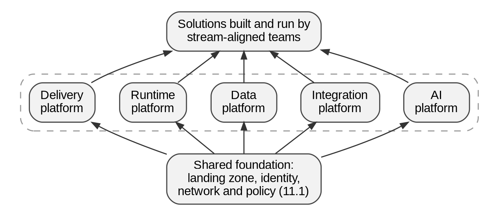{#fig-12-1 width="100%"}

**Why it is needed.** A platform without a stated scope tends to absorb every request, grows slowly in all directions and serves none of its consumers well. The evidence is a scope statement per platform with its consumers, its capabilities and the capabilities it deliberately excludes.

### 12.1.3 When a Platform Is Not Needed

**Definition.** The platform threshold is the point at which the cost of building, operating and supporting a shared capability is lower than the cost of each team providing it separately, including the risk of inconsistent controls.

**Purpose.** A platform is an investment with a permanent operating cost. Testing the threshold prevents an organization with a few teams from building an internal product that it then has to staff indefinitely.

**What it includes.** Count the teams that repeat the same work, measure how long that work takes and how often its controls differ, and compare the result with the cost of a team that would own the capability. Below the threshold, prefer provider-managed services with documented conventions, shared templates and an enabling team (4.10.2). Signals that the threshold has been crossed include long onboarding for new services, repeated security findings of the same kind across teams, several pipelines doing the same job differently and specialists who are needed by every team at once. Workloads that differ materially — a regulated payment system next to an experimental analytics sandbox — may need different platforms or none.

**Why it is needed.** A platform built too early competes with provider services that are already good enough; one built too late arrives after each team has its own variant and must migrate them all. The evidence is a demand analysis with the number of consuming teams, the measured duplicated effort and the expected operating cost.

**Example.** The reference checkout is built by four stream-aligned teams — Checkout, Order, Payments and Inventory — and an analytics team. Each maintains its own pipeline, secret handling and dashboards; onboarding a new service takes about three weeks, and the last two security reviews found the same missing log retention in three teams. The demand analysis shows five consuming teams with the same need, so a delivery and runtime platform crosses the threshold, while data and AI platforms do not yet.

::: {.callout-warning appearance="simple" icon=false title="Common Pitfall"}
Calling every shared asset a platform. A shared database cluster, a wiki of scripts or a folder of templates is labeled a platform, so nobody owns its interface, its objectives or its support, and solutions depend on it as if they did. Name an owner, a contract and a support path before anything is called a platform, and treat the rest as shared assets with their actual guarantees.
:::

::: {.callout-important appearance="simple" icon=false title="Decision & Trade-off"}
What scope should the first platform have?

| Option | Choose when | Consequences |
| :--- | :--- | :--- |
| Thinnest viable platform: conventions, templates and provider services | Few teams, or demand not yet measured | Low cost and fast to start; consistency depends on teams following the conventions |
| Curated provider services with guardrails and self-service | Several teams on one provider with common needs | Strong controls with little custom code; bound to the provider's model and limits |
| Full internal developer platform | Many teams, measured duplication and a funded platform team | Highest consistency and speed at scale; permanent product and operating cost |
:::

## 12.2 Platform as a Product

A platform succeeds when teams choose it because it is the easiest correct way to work. That requires the practices of product management applied to internal users.

### 12.2.1 Users, Value and Roadmap

**Definition.** Platform as a product is the practice of running a platform with identified users, a value proposition, a roadmap based on their needs and measures of whether they use it and benefit from it.

**Purpose.** Product practice keeps the platform aligned with the work its users actually do, rather than with the technology its builders find interesting. It also gives the platform a way to decide what not to build.

**What it includes.** Identify the user groups — product engineers, data engineers, operators, security reviewers — and map their journeys, such as creating a service, adding a data store or responding to an incident. Measure where those journeys lose time or introduce risk, and state the value of each capability in those terms. Table 12.3 relates the product practices to their platform form and to the evidence each produces. A product owner prioritizes the roadmap from user demand, risk reduction and cost, publishes it, and records the requests that were declined and why.

| Product practice | Platform form | Evidence |
| :--- | :--- | :--- |
| User research | Interviews, journey maps and observed onboarding of a new service | Journey map with measured waiting time |
| Value proposition | Time or risk removed per capability | Stated target per capability, such as onboarding time |
| Roadmap | Published, prioritized capabilities with dates and declined requests | Roadmap with a decision record for each priority |
| Release notes and documentation | Changelog, migration guides and examples | Documentation coverage per capability |
| Feedback | Surveys, support analysis and office hours | Trend of satisfaction and top support themes |

: Product practices applied to a platform

Figure 12.2 shows the loop from discovery to measured adoption, in which declined requests and adoption measures feed the next round of prioritization instead of ending in a backlog.

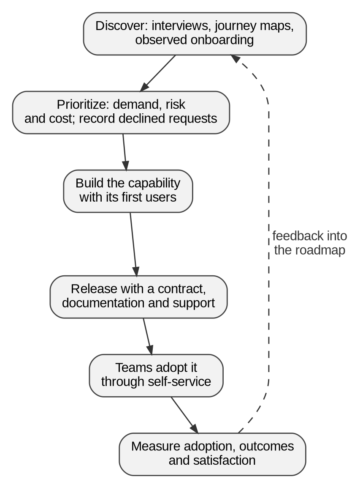{#fig-12-2 width="100%"}

**Why it is needed.** A platform designed without its users becomes a set of capabilities that teams route around, and the organization pays for both the platform and the workarounds. The evidence is a journey map, a published roadmap with its decision records, and adoption and satisfaction measured per capability.

### 12.2.2 Adoption Policy: Voluntary or Mandated

**Definition.** An adoption policy states, for each platform capability, whether teams must use it, may use it or must achieve an outcome that it is one way of achieving.

**Purpose.** The policy separates the controls the organization cannot leave to choice from the conveniences that must earn their place. It prevents both a mandated platform that nobody would choose and an optional one that leaves mandatory controls uneven.

**What it includes.** Mandate the outcome where a control is non-negotiable — audit logging, workload identity, encryption, retention — and let the platform be the cheapest way to meet it; teams that meet the outcome another way provide equivalent evidence through the exception process (4.5). Keep conveniences voluntary and measure their adoption, because voluntary adoption is the clearest signal that a capability is worth what it costs. Mandate a specific capability only when a second implementation would itself be a risk, such as a single secrets store or a single identity provider. State the policy in the capability contract (12.5.2) and review it when adoption data changes the picture.

**Why it is needed.** A mandate without a better path makes the platform a gate, and teams experience it as a cost imposed on them; no mandate at all leaves the controls that matter most to each team's priorities. The evidence is a stated policy per capability, the adoption trend of voluntary capabilities and the exceptions granted against mandated outcomes.

**Example.** The checkout platform team interviews the five teams and observes two service launches. Waiting for credentials and building dashboards account for most of the three weeks of onboarding. The first roadmap offers a service template with a pipeline, workload identity and dashboards; audit logging and workload identity are mandated outcomes, and the template itself is voluntary. Within two quarters four teams adopt it, and the Payments team, which keeps its own pipeline for its card-data scope, shows the mandated outcomes through equivalent evidence.

::: {.callout-warning appearance="simple" icon=false title="Common Pitfall"}
Mandating a platform before it is better than the alternative. Teams lose capability on the day of migration, workarounds appear and the mandate turns adoption into a measure of compliance rather than of value. Mandate outcomes for the controls that matter, keep conveniences voluntary until adoption proves them, and fix the path before requiring it.
:::

::: {.callout-important appearance="simple" icon=false title="Decision & Trade-off"}
Should the use of a platform capability be mandatory?

| Option | Choose when | Consequences |
| :--- | :--- | :--- |
| Voluntary, with measured adoption | The capability is a convenience or its value is not yet proven | Honest demand signal; controls can stay uneven while adoption grows |
| Mandatory outcome, any compliant implementation | The control is required but several implementations are acceptable | Consistent controls with room for special cases; equivalence must be reviewed |
| Mandatory capability | A second implementation would itself create risk | One controlled path; the platform must meet every consumer's needs or become a bottleneck |
:::

## 12.3 Responsibilities and Team Interactions

A platform moves work from many teams to one. The architecture must state which work moved, which did not, and how the teams interact around the boundary.

### 12.3.1 The Platform Responsibility Model

**Definition.** The platform responsibility model is the explicit division of duties, for each platform capability, between the platform team and the teams whose workloads use it.

**Purpose.** The model does for an internal platform what the shared responsibility model does for a cloud provider (11.1.4): it shows each consuming team what it inherits and what it still has to design, operate and prove.

**What it includes.** For each capability, state who owns availability, patching and upgrades, baseline security controls, backup and restore, capacity, cost, incident response and the evidence an auditor will ask for. Table 12.4 gives a typical split for a runtime capability. The platform team owns the capability and its baseline; the workload team owns everything specific to its solution, including authorization, data classification, application configuration, its own service levels and the decision to accept a platform default. Publish the model in the capability contract (12.5.2), and review it whenever a capability changes what it provides.

| Concern | Platform team | Workload team |
| :--- | :--- | :--- |
| Runtime availability and upgrades | Owns, within the published objective | Tests its workload against announced versions |
| Baseline controls: encryption, network policy, logging | Provides and enforces by default | Configures what is specific to the workload |
| Identity and authorization | Provides workload identity and the policy engine | Defines who may do what in its domain |
| Backup and restore | Provides the mechanism and its tests | Defines retention and runs restore exercises for its data |
| Service levels | Objectives for the capability itself | Objectives for the solution, including platform dependency |
| Incident response | Platform incidents and their communication | Application incidents and their communication |

: Typical responsibility split for a runtime capability

Figure 12.3 places the boundary between the two layers: the capability contract sits on the line, and every responsibility above it stays with the workload team even when the platform supplies a default.

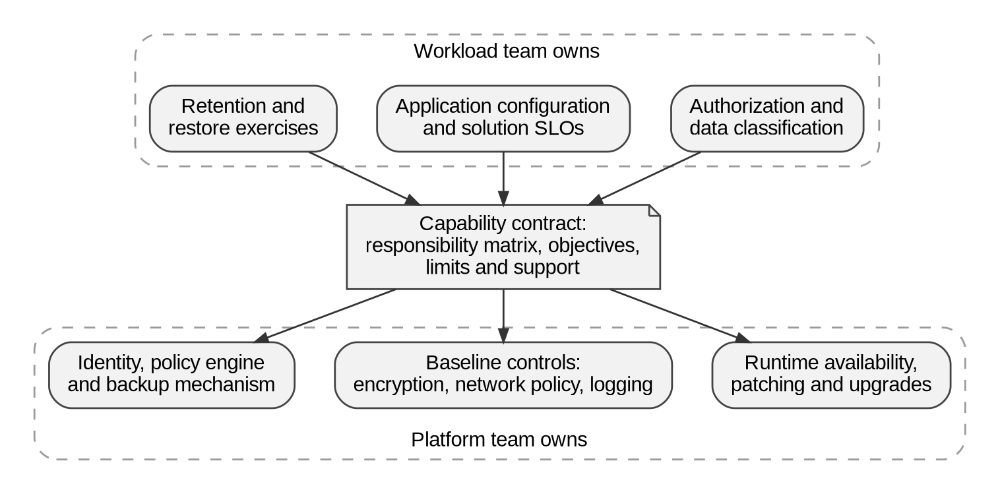{#fig-12-3 width="100%"}

**Why it is needed.** When the boundary is implicit, each side assumes the other covers the gap: the workload team assumes the platform backs up its data, and the platform team assumes the workload team restores it. The evidence is a published responsibility matrix per capability, confirmed by each consuming team during onboarding.

### 12.3.2 Interaction Modes and Support

**Definition.** A platform interaction model states how the platform team and each consuming team work together over time — through collaboration, self-service consumption or facilitation — and how consumers get help.

**Purpose.** The model keeps the platform from becoming either a ticket queue or a consultancy, and sets expectations for how quickly a consumer is helped and through which channel.

**What it includes.** Use the interaction modes of Team Topologies (4.10.2) around the platform boundary. X-as-a-service is the default for mature capabilities. Collaboration suits a new capability built with its first consumers and should end on a stated date. Facilitation suits adoption, when a team needs help to move onto a capability rather than a new feature. Embedding platform engineers in each consuming team fits domains whose needs differ materially, but it duplicates capability building and lets implementations drift, so use it as a time-boxed adoption mode rather than as the operating model. Define support tiers: documentation and examples first, then a community channel, office hours, a request path for changes to the platform itself, and on-call response for platform incidents. Give each tier an objective, such as a response time, and analyze support requests: a recurring question is a defect in the documentation or the interface, not a training need.

**Why it is needed.** Without a stated model, every request becomes a ticket and the platform team spends its capacity on work the consumer could have done through self-service. The evidence is the support tiers with their objectives, the share of requests resolved through self-service and an end date for every collaboration.

**Example.** The Payments team needs a runtime that keeps card data in a separate scope. The platform team collaborates with it for one quarter to build an isolated runtime offering (12.6.1), then publishes the offering as a self-service capability with its responsibility matrix. Payments owns tokenization and the card-data controls of its service; the platform owns the isolated cluster, its patching and its audit logs, and the next regulated team adopts the offering without a collaboration.

::: {.callout-warning appearance="simple" icon=false title="Common Pitfall"}
Leaving the responsibility boundary implicit. The platform patches the runtime but nobody restores the data; the workload team believes alerts are configured because dashboards exist. The gap appears during an incident or an audit. Publish a responsibility matrix for each capability, have each consuming team confirm it at onboarding, and test the shared steps, such as restore, together.
:::

::: {.callout-important appearance="simple" icon=false title="Decision & Trade-off"}
Who operates a workload that runs on the platform?

| Option | Choose when | Consequences |
| :--- | :--- | :--- |
| The workload team builds and runs it on platform capabilities | Teams have operational skills and own their service levels | Fast feedback and clear ownership; each team carries on-call load |
| Platform operates the runtime; the workload team operates the application | Runtime complexity is high and shared across teams | Specialized runtime operations; incident handoffs need clear routing |
| A central operations team operates both | Regulation or scale requires a separate operating function | Consistent operations; slower feedback and weaker ownership of the code |
:::

## 12.4 Reference Architecture of an Internal Platform

A reference architecture names the parts every internal platform has, whatever products implement them, so that a design can be reviewed for gaps and a consumer can find where each capability lives.

### 12.4.1 Planes and Capabilities

**Definition.** The platform reference architecture divides an internal platform into planes — the developer interface, orchestration, delivery, resource, security and observability planes — each grouping capabilities with one kind of responsibility.

**Purpose.** The planes give the platform a structure that survives product changes. A team can replace its portal or its pipeline engine without redesigning the platform, and a reviewer can check that each plane has an owner and an interface.

**What it includes.** Table 12.5 describes each plane. The developer interface plane is where consumers state what they need: a portal, a command line, an API or a declarative file in their repository. The orchestration plane turns those requests into configured resources and records what exists and who owns it. The delivery, resource, security and observability planes provide the capabilities themselves, mostly by composing provider services. In the security plane, the platform wires workload identity and short-lived credentials into every path, so that a new component starts without a long-lived secret to rotate by hand. The CNCF Platforms White Paper (2023) describes a comparable set of capability areas; use any such model as a checklist, not as a mandate to build every capability.

| Plane | Responsibility | Typical capabilities |
| :--- | :--- | :--- |
| Developer interface | Where consumers discover and request capabilities | Portal, command line, API, declarative specifications, documentation |
| Orchestration | Turning requests into configured resources and recording state | Provisioning workflows, reconciliation, service catalog, environment management |
| Delivery | Building, verifying and releasing changes | Source control integration, pipelines, artifact registry, release controls |
| Resource | Running workloads and holding their data | Compute, data stores, messaging, networking |
| Security | Identity, secrets and policy for every other plane | Workload identity, secrets store, policy engine, signing, audit log |
| Observability | Signals about workloads and about the platform itself | Telemetry collection, dashboards, alerting, cost reporting |

: Planes of an internal platform

Figure 12.4 shows the planes and the path of one request through them, from the developer interface through orchestration to the capability planes that provide the resources.

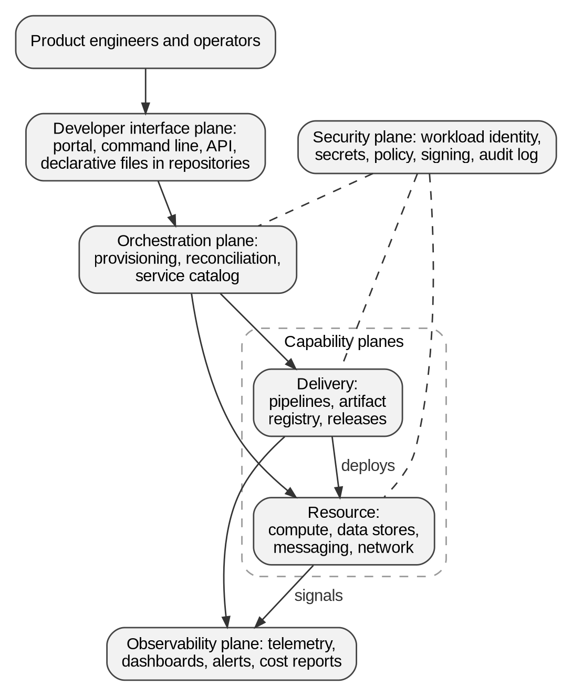{#fig-12-4 width="100%"}

**Why it is needed.** Platforms assembled tool by tool have capabilities without an interface and interfaces without automation behind them, and the gaps appear as manual steps in every request. The evidence is a plane map of the platform with an owner, an interface and the automation behind each capability.

### 12.4.2 Service Catalog and Ownership Metadata

**Definition.** A service catalog is the platform's inventory of software components — services, data stores, pipelines, APIs and libraries — with their owners, lifecycle state, dependencies and operational metadata.

**Purpose.** The catalog answers the questions an incident, an audit or a change asks first: who owns this, what depends on it, what data it holds and how to reach the people responsible. It also lets the platform apply a policy to every component of a kind.

**What it includes.** Record for each component its owning team, lifecycle state, dependencies, interfaces, data classification, service level objective, on-call route, repository and documentation. Keep the metadata in the component's repository and let the catalog collect it, so that it changes with the code rather than in a separate spreadsheet. Generate scorecards from the metadata — for example, the share of services with an SLO, a current threat model or a supported runtime version — and use them to direct work, not to rank teams. Link the catalog to the architecture repository (4.6) so that decisions and reviews point to the components they concern. Open-source and commercial developer portals, such as Backstage, offer catalogs; they are examples, and the metadata model matters more than the product.

**Why it is needed.** Without a catalog, ownership lives in people's memory, and a vulnerability or an outage starts with a search for the owner. The evidence is catalog coverage of running components, metadata freshness and the time to identify the owner during incidents.

### 12.4.3 Golden Paths and Templates

**Definition.** A golden path is a supported, opinionated route for a common task — creating a service, adding a data store, exposing an API — that produces a result conforming to the organization's standards by default.

**Purpose.** The golden path turns the paved road principle (2.13) into a working mechanism. It makes the compliant way the fastest way, so that standards are met because they are convenient rather than because they are reviewed.

**What it includes.** Implement each path as a template or a declarative capability that creates the repository, pipeline, identity, policies, dashboards, alerts and documentation in one step. Decide how a created component receives later improvements: a one-time template leaves each copy to drift, while versioned shared modules or platform-managed abstractions let improvements reach existing components through upgrades. State what the consuming team owns after creation, and keep a documented route off the path for requirements it does not cover, with the exception process of 4.5. Measure each path by the time to complete its task and by how many components still conform after a year.

**Why it is needed.** Without golden paths, every team rediscovers the same configuration, and reviews repeat the same findings. With paths that cannot be left, unusual requirements are forced into a bad fit. The evidence is the time to complete each task on the path, the conformance of components created from it, and the exceptions recorded against it.

**Example.** The checkout platform maps its planes. A developer opens the portal, chooses the service path and names the service; the orchestration plane creates a repository with a pipeline, requests a workload identity, applies the network and logging policies, registers the service in the catalog with its owner and on-call route, and creates its dashboards. The service template is published as a versioned module, so a later change to log retention reaches every service through a dependency update rather than a migration project.

::: {.callout-warning appearance="simple" icon=false title="Common Pitfall"}
Building the portal first. The developer portal is the visible part of the platform, so it is built before the automation behind it, and each catalog entry or button opens a ticket for someone to do the work by hand. Build the automated capability and its interface first, add the portal as a way to discover and use it, and measure the manual steps that remain in each path.
:::

::: {.callout-important appearance="simple" icon=false title="Decision & Trade-off"}
How should a golden path deliver its standards to the components it creates?

| Option | Choose when | Consequences |
| :--- | :--- | :--- |
| One-time scaffolding template | Components diverge quickly and teams own them fully after creation | Simple and flexible; improvements do not reach existing components |
| Versioned shared modules referenced by components | Standards change and should reach many components | Improvements arrive through upgrades; teams must keep their versions current |
| Platform-managed abstraction | Most of the component's infrastructure is standard | Consistency without upgrades by each team; less control and a heavier platform contract |
:::

## 12.5 Platform Interfaces and Contracts

The interface is what consumers depend on. Like any interface between teams (7.4.1), it needs a defined style, a contract and a policy for change.

### 12.5.1 Interface Styles and Abstraction Level

**Definition.** A platform interface style is the way consumers request and change capabilities — a portal, a command line, an API or a declarative specification — and its abstraction level is how far that interface hides the underlying resources.

**Purpose.** The style decides how platform requests fit into delivery: whether they are reviewed and versioned like code, or performed by hand. The abstraction level decides how much each consumer must know and how much freedom it keeps.

**What it includes.** Table 12.6 compares the styles. Declarative specifications kept in the component's repository suit most capabilities, because they are reviewed, versioned and reconciled like the rest of the system (11.3.4); a portal and a command line are convenient entry points onto the same API. On abstraction, choose between provider resources exposed with guardrails, composed building blocks such as "a database with backups and monitoring", and application-level abstractions such as "a web service with a database". Higher abstractions reduce cognitive load (4.10.3) but leak when a requirement falls outside them, so provide an escape hatch: a documented way to use the layer below, with the responsibilities that move to the consumer when it is used.

| Style | Suits | Strength | Limitation |
| :--- | :--- | :--- | :--- |
| Portal | Discovery, occasional tasks and people new to the platform | Easy to learn and visible | Changes are hard to review and repeat |
| Command line | Frequent tasks by engineers | Fast and scriptable | Local state and versions can diverge |
| API | Automation and integration with other tools | The contract every other style can use | Requires client code and versioning |
| Declarative specification in the repository | Components whose configuration should be reviewed and versioned | Reviewed, versioned and reconciled with the code | Needs a reconciliation engine and good error reporting |

: Platform interface styles compared

Figure 12.5 shows the range, from provider resources with guardrails to application-level abstractions, and the escape hatch that moves the stated responsibilities to the team that uses a lower layer.

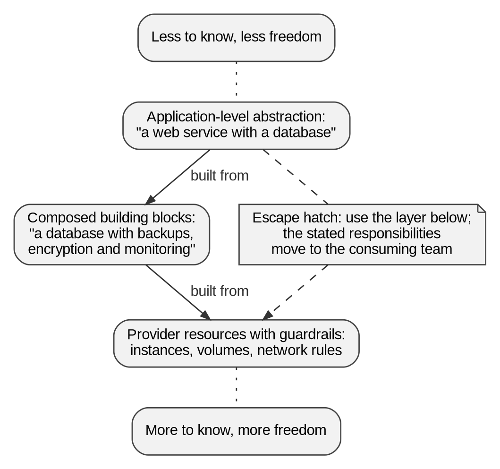{#fig-12-5 width="100%"}

**Why it is needed.** An interface chosen for the platform team's convenience pushes work and knowledge onto every consumer, and an abstraction without an exit forces unusual requirements around the platform instead of through it. The evidence is the interface style and abstraction level per capability, with the escape hatch and its responsibilities documented.

### 12.5.2 Capability Contracts

**Definition.** A capability contract is the published agreement between the platform and its consumers for one capability: what it provides, the objectives it meets, its limits, the responsibilities on each side and how it changes.

**Purpose.** The contract lets a solution architect design on the platform without reverse-engineering it. It turns the platform's guarantees into inputs for the solution's requirements, risk register and service levels.

**What it includes.** State the interface and its versions, the service level objectives of the capability, quotas and limits, data location, the security controls the consumer inherits, the responsibility matrix (12.3.1), the support tiers (12.3.2), the adoption policy (12.2.2), the cost model and the deprecation policy (12.5.3). Write it as a short versioned document next to the capability, using the schema in Appendix B.12. A solution design references the contracts it relies on, so that a change to a contract identifies the solutions to review. Where the platform cannot meet a solution's requirement, the gap is recorded as a decision (3.4) rather than discovered in production.

**Why it is needed.** Without a contract, each consumer infers the platform's guarantees from experience, and different teams design against different assumptions about the same capability. The evidence is a current contract for every capability in use, and solution designs that cite the contract versions they depend on.

### 12.5.3 Versioning, Compatibility and Deprecation

**Definition.** Platform versioning is the policy that identifies each version of a capability's interface and behavior, states which versions are supported and governs how an old version is withdrawn.

**Purpose.** A platform serves many consumers who cannot all change at once. The policy lets the platform evolve while each consumer plans its upgrades rather than discovering them.

**What it includes.** Version interfaces, modules and runtime images, and state what counts as a breaking change. Support a stated window of versions, such as the current and the previous one, and publish the end-of-support date of each. Announce a deprecation with a notice period proportionate to the migration effort, provide a migration guide and, where possible, automated migration. Record which consumers use which version, so that the platform knows whom a change affects and can follow up with those who have not moved. Apply the same compatibility discipline as for any public interface: additive changes first, removal last (9.2.4).

**Why it is needed.** Platform changes that break consumers without notice turn every upgrade into an incident and teach teams to pin old versions indefinitely, which leaves the platform supporting versions it no longer tests. The evidence is a version support table, deprecation notices with dates and the usage of each version by consumer.

**Example.** The checkout platform offers its database capability as a declarative specification in each service repository, at the building-block level: a managed relational database with backups, encryption, monitoring and a restore test. Its contract states a monthly availability objective, a maximum size, the regions where data may be stored, and that the consumer owns schema migrations and retention. When the platform replaces its backup mechanism, version 2 of the module is announced with a three-month notice, a migration guide and a report of the services still on version 1.

::: {.callout-warning appearance="simple" icon=false title="Common Pitfall"}
Offering an abstraction without an escape hatch. The platform hides the provider so completely that a team with an unusual requirement — a database extension, a network path, a scaling behavior — cannot meet it on the platform, and builds a parallel environment outside it. Document how to use the layer below, which responsibilities move to the team when it does, and treat each use as a demand signal for the platform.
:::

::: {.callout-important appearance="simple" icon=false title="Decision & Trade-off"}
What abstraction level should a platform capability expose?

| Option | Choose when | Consequences |
| :--- | :--- | :--- |
| Provider resources with guardrails | Teams are experienced and needs vary | Full flexibility and provider documentation; higher cognitive load per team |
| Composed building blocks | Needs are common within a resource type | Standard configuration with room to combine; a moderate contract to maintain |
| Application-level abstraction | Many similar workloads and limited platform skills in the teams | Lowest load and highest consistency; leaks for unusual needs and binds teams to the platform |
:::

## 12.6 Tenancy and Isolation on a Shared Platform

The teams and workloads that share a platform are its tenants. Their isolation is designed in the same terms as customer tenancy in a product (10.7), with the platform team as the operator.

### 12.6.1 Isolation Models

**Definition.** A platform isolation model is the way workloads of different teams, environments or risk classes are separated on a shared platform: by namespace in a shared runtime, by a dedicated runtime or by a dedicated cloud account or subscription.

**Purpose.** The model decides the blast radius of a failure, a compromise or a mistake, and whether a regulated workload can share infrastructure with others at all. It also drives a large part of the platform's cost.

**What it includes.** Table 12.7 compares the models across the dimensions that matter: compute, network, identity, data, the control plane and cost visibility. Separate production from non-production environments in every model (13.4.3). Choose the model per risk class rather than once for the whole platform: most workloads can share a runtime with namespace isolation and network policy, while a workload with a regulatory scope, such as card data, or with a materially different trust level gets a dedicated runtime or account. Account and subscription boundaries come from the landing zone design (11.1.1), and the runtime limits from 11.3.1.

| Model | Isolation provided | Shared with other tenants | Typical use |
| :--- | :--- | :--- | :--- |
| Namespace in a shared runtime | Separate quotas, network policy, identities and access per namespace | Control plane, nodes unless dedicated, cluster upgrades | Most workloads of one environment and risk class |
| Dedicated runtime per team or domain | A separate cluster or platform instance | Account, network and organization-level services | Domains with distinct scaling, upgrade or operational needs |
| Dedicated account or subscription | Separate identity, billing and policy boundary | Only the organization's foundation | Regulated scopes, separate legal entities or high-risk workloads |

: Platform isolation models compared

Figure 12.6 shows a mixed arrangement for the reference checkout: namespaces on a shared production runtime for most services, a separate runtime for non-production environments and a dedicated account for the card-data scope.

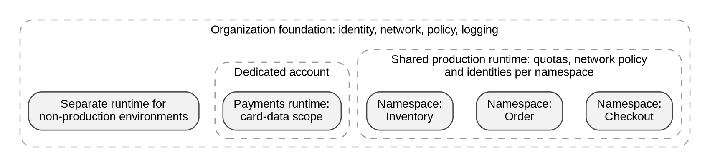{#fig-12-6 width="100%"}

**Why it is needed.** One isolation model for everything is either too weak for the riskiest workload or too expensive for the rest. The evidence is an isolation decision per risk class, with tests that show one tenant cannot reach another's network, identities or data.

### 12.6.2 Quotas, Noisy Neighbors and Blast Radius

**Definition.** Tenant fairness controls are the quotas, limits, priorities and rate limits that keep one tenant from consuming capacity or platform services that others need.

**Purpose.** A shared platform concentrates risk: one runaway workload, one misconfigured pipeline or one failed upgrade can affect every tenant at once. Fairness controls and blast-radius design keep a local problem local.

**What it includes.** Set resource quotas and limits per tenant and require each workload to declare its requests, so that capacity planning has real inputs (14.4.2). Rate-limit the platform's own APIs and pipelines per tenant, and give production work priority over batch and non-production work. Watch for noisy neighbors in shared data stores, caches and message brokers, where quotas are often missing. Limit the blast radius of the platform itself: split large shared runtimes into several smaller ones, upgrade them in rings (12.8.2) and consider cells for the most critical paths (11.4.1). Report each tenant's consumption, which also feeds cost allocation (12.10.1).

**Why it is needed.** Without fairness controls, the platform's reliability is set by its least careful tenant, and a shared control plane makes every failure a platform-wide incident. The evidence is quotas defined for every tenant, rate limits on platform interfaces, and tested ring or cell boundaries.

**Example.** The checkout platform runs one shared production runtime with namespace isolation for Checkout, Order and Inventory, a separate runtime for non-production environments, and a dedicated account for the Payments card-data scope. Each namespace has quotas and network policies denying cross-namespace traffic by default; the shared message broker gets per-tenant connection and throughput limits after a load test showed that an Inventory reindex delayed order events.

::: {.callout-warning appearance="simple" icon=false title="Common Pitfall"}
Sharing one control plane across risk classes and environments. A single large runtime hosts production, testing and a regulated workload, so one upgrade, one administrator error or one compromised credential reaches all of them. Separate environments and risk classes at the level their risk requires, keep each shared runtime small enough to upgrade in rings, and test the isolation rather than assume it.
:::

::: {.callout-important appearance="simple" icon=false title="Decision & Trade-off"}
How should workloads share the platform?

| Option | Choose when | Consequences |
| :--- | :--- | :--- |
| Namespaces in a shared runtime | Workloads have a similar risk class and environment | Efficient use of capacity and one runtime to operate; shared blast radius |
| Dedicated runtime per team or domain | Domains need different scaling, upgrades or operations | Contained failures and independent upgrades; more runtimes to operate |
| Dedicated account or subscription per regulated scope | Regulation, legal separation or trust level requires it | Strongest boundary and simpler audit scope; highest fixed cost and duplication |
:::

## 12.7 Guardrails and Compliance by Default

A platform is the most effective place to enforce standards, because one control reaches every workload. Guardrails (4.3) implemented in the platform make the controls part of the path rather than a review afterwards.

### 12.7.1 Policy as Code

**Definition.** Policy as code is the expression of organizational rules — security, compliance, cost and operational standards — as versioned, tested code that the platform evaluates automatically.

**Purpose.** Executable policy applies the same rule to every workload, at the moment of change, and produces evidence as a side effect. It replaces review checklists for the rules a machine can check, and leaves people to review what it cannot.

**What it includes.** Classify each control by when it acts. Preventive controls stop a non-compliant change: in the template, in the pipeline or at admission into the runtime. Detective controls find drift and non-compliance in running resources. Corrective controls repair a known deviation automatically. Table 12.8 compares them. Give each policy an owner, a rationale, tests with compliant and non-compliant examples, a version history and a stated mode — warn first, then enforce. Report policy results to the owning team in the pipeline and in the catalog (12.4.2), and keep them as audit evidence.

| Control type | Acts | Example | Evidence produced |
| :--- | :--- | :--- | :--- |
| Preventive in the template | When a component is created | Encryption and logging enabled by default | Template version per component |
| Preventive in the pipeline | Before a change is released | Infrastructure change rejected for a public storage bucket | Pipeline policy report |
| Preventive at admission | When a workload is deployed | Image without a signature refused by the runtime | Admission log |
| Detective | Continuously, on running resources | Drift from the approved network policy reported | Findings with owners and ages |
| Corrective | After detection, automatically | Missing retention tag restored | Remediation log |

: Policy control types and their evidence

Figure 12.7 shows how a policy moves from proposal to enforcement, in the same lifecycle as other guardrails (4.3): it is tested, runs in warn mode, is enforced and is reviewed, with each exception recorded in a register.

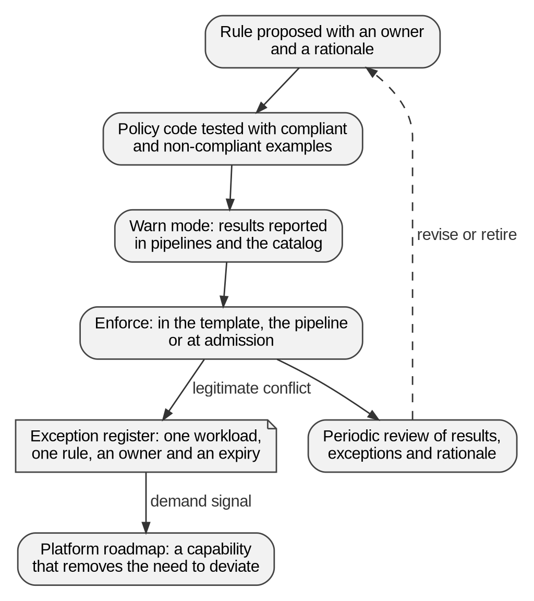{#fig-12-7 width="100%"}

**Why it is needed.** Rules that exist only in documents are applied unevenly and checked late, often in an audit. The evidence is a policy inventory with owners, tests and modes, and enforcement results per workload.

### 12.7.2 Exceptions to Platform Policy

**Definition.** A platform policy exception is a recorded, time-limited permission for a workload not to meet a platform policy, with an owner, a reason, compensating controls and an expiry.

**Purpose.** Exceptions keep enforced policies usable when a legitimate requirement conflicts with them, without weakening the policy for everyone or encouraging teams to leave the platform.

**What it includes.** Implement the exception process of 4.5 in the platform itself: the exception is a versioned record that the policy engine reads, scoped to one workload and one rule, with an expiry after which the policy enforces again. Require a risk owner in the consuming team and, for high-risk rules, the approval of the policy owner. Report open exceptions per policy and per team. Treat the exception data as product feedback: a rule with many exceptions is either wrong, too coarse, or missing a capability that would let teams comply, and the platform roadmap (12.2.1) should address it.

**Why it is needed.** Without a recorded exception path, teams either wait for a policy change or bypass the platform, and permanent informal exceptions accumulate where nobody can see them. The evidence is an exception register read by the policy engine, with owners, expiry dates and the trend per rule.

### 12.7.3 Secure Supply Chain by Default

**Definition.** A secure supply chain by default is the set of platform capabilities that make every built artifact traceable, verified and minimal without each team configuring it: approved base images, dependency scanning, signing, provenance and a software bill of materials.

**Purpose.** Supply-chain controls are effective only when they are universal; one unsigned image path or one unscanned pipeline is enough to bypass them. The platform is the place where they can be applied to every component at once.

**What it includes.** Provide maintained base images and hardening baselines (13.5.7), dependency and image scanning in every pipeline, an artifact registry that accepts only artifacts built by the platform pipeline, signing and provenance for each artifact, and a software bill of materials stored with it. Enforce signature and provenance at admission (12.7.1). Rebuild base images on a schedule and on critical advisories, and report which components run outdated images. Section 13.5.6 covers the threats and the security requirements; this unit is about making the controls the default path.

**Why it is needed.** When each team configures its own supply-chain controls, coverage is uneven and the weakest pipeline becomes the attacker's route. The evidence is the share of running artifacts that are signed, have provenance and a bill of materials, and the age of base images in production.

**Example.** The checkout platform applies policies in three places. The service template enables encryption, logging and retention; the pipeline rejects infrastructure changes that open public endpoints without an approved gateway; and the runtime admits only images signed by the platform pipeline. The Inventory team requests an exception for a vendor image that cannot be rebuilt; it is granted for ninety days with a network restriction as a compensating control, and the platform adds a mirrored, scanned vendor-image path to its roadmap.

::: {.callout-warning appearance="simple" icon=false title="Common Pitfall"}
Enforcing policy only at the last gate. A rule is checked for the first time at deployment, so a team learns about a violation after the work is done and under release pressure, and asks for an exception instead of a fix. Put the default in the template, report the rule in the pipeline in warning mode first, and enforce at admission only what must never run.
:::

::: {.callout-important appearance="simple" icon=false title="Decision & Trade-off"}
Where should a platform control be enforced?

| Option | Choose when | Consequences |
| :--- | :--- | :--- |
| In the template, as a default | The control is a sensible default that teams rarely need to change | Compliance with no friction; existing components and later changes are not covered |
| In the pipeline, as a gate | The control can be checked before release | Early feedback and evidence per change; bypassed by changes outside the pipeline |
| At admission or at runtime | The control must hold for everything that runs | Universal enforcement; late feedback and a risk of blocking urgent changes |
:::

## 12.8 Reliability and Operations of the Platform

Every solution on the platform inherits its reliability. The platform therefore needs its own service levels, a design that limits its failures and a change process that does not break its tenants.

### 12.8.1 Platform Service Levels and Dependencies

**Definition.** Platform service levels are the objectives the platform sets for its own capabilities — for example, the availability of the deployment path, the time to provision an environment or the availability of the runtime — measured from the consumers' point of view.

**Purpose.** Consumers need these objectives to set their own. A solution with a 99.9% objective cannot be designed on a runtime whose objective is unknown, and a platform without objectives cannot tell whether an incident or a slow quarter matters.

**What it includes.** Define service level indicators and objectives for each capability (14.2.1), as Table 12.9 illustrates. Separate the control plane, which creates and changes resources, from the data plane, which serves running workloads: design so that running workloads continue when the control plane is unavailable, a property sometimes called static stability. Map the platform's own dependencies — identity provider, provider control planes, registries, DNS — and show which capability each one can stop. Publish the objectives in each capability contract (12.5.2), alert on their error budgets (14.2.2) and report them to consumers.

| Capability | Indicator | Example objective |
| :--- | :--- | :--- |
| Runtime, data plane | Share of successful requests reaching healthy workloads | 99.95% per month |
| Deployment path | Share of pipeline runs completing without platform failure | 99.5% per month |
| Provisioning | Time from request to a ready environment | 95% within 15 minutes |
| Secrets and identity | Share of successful token and secret requests | 99.95% per month |
| Support | Time to first response for platform incidents | 15 minutes, at all hours |

: Example platform service level objectives

Figure 12.8 shows the separation: when the control plane is unavailable, no new changes are applied, but workloads in the data plane keep serving with their cached configuration and credentials.

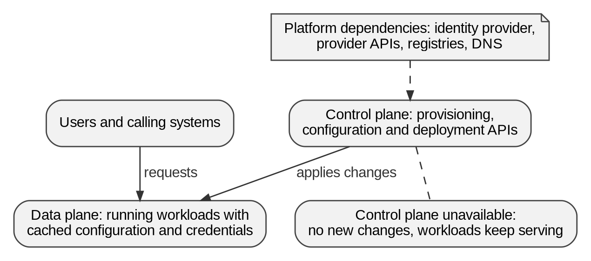{#fig-12-8 width="100%"}

**Why it is needed.** A platform without objectives is a hidden dependency in every solution's availability calculation, and a platform whose control plane can stop running workloads turns a provisioning problem into an outage. The evidence is published objectives per capability, a dependency map, and a test showing that workloads keep serving when the control plane is down.

### 12.8.2 Upgrades and Change on a Shared Platform

**Definition.** Platform change management is the way the platform introduces new versions of runtimes, modules, policies and its own components without breaking the workloads that run on it.

**Purpose.** Platform changes reach every tenant. Planning them as progressive, tested and reversible releases keeps one defect from becoming an incident for every solution at once.

**What it includes.** Release platform changes progressively, using the techniques of 15.1.2: first to the platform's own test tenants, then to rings of consumers ordered by risk, with production and regulated tenants last. Before each ring, run consumer workloads or their contract tests against the new version, and stop the rollout on a regression. Publish an upgrade calendar, announce changes that need consumer action with the notice of the deprecation policy (12.5.3), and keep a rollback path for every change. Keep runtime versions within the provider's support window (11.3.2), because an unsupported version is a security risk that the platform transfers to every tenant.

**Why it is needed.** Platform-wide changes applied at once make every defect a shared outage, and changes that are postponed until versions fall out of support become emergency migrations. The evidence is an upgrade calendar, ring definitions, compatibility results before each ring and the version currency of each runtime.

### 12.8.3 Platform Incidents and Support

**Definition.** Platform incident management is the detection, response and communication for failures of platform capabilities, and the learning that follows them.

**Purpose.** A platform incident affects several teams at once, each of which sees only its own symptoms. A single response with a shared status lets the teams stop investigating their own systems and act on accurate information.

**What it includes.** Staff platform on-call for the capabilities that have objectives. Set severity by the number of tenants and the service levels affected, and use the incident roles and communication practice of 14.3. Publish platform status to consumers, with the capabilities affected and the expected next update. Make it easy for a workload team to tell whether a symptom comes from the platform: shared dashboards of platform health, correlation of platform changes with consumer alerts, and a known route to declare a suspected platform incident. Share postmortems with consumers (14.5.2), including the actions that affect them.

**Why it is needed.** Without a platform response, each team investigates the same failure separately, and the root cause is found late by whichever team has the most context. The evidence is platform on-call coverage, a consumer-facing status channel and postmortems shared with affected teams.

**Example.** The checkout platform sets objectives for the runtime, the deployment path and provisioning, and its runtime keeps serving with cached configuration when the provider's management API is unavailable. A runtime upgrade goes first to the platform's test tenants, then to the analytics namespace, then to Inventory and Order, and finally to Checkout; at the second ring a contract test fails on a changed default timeout, the rollout stops, and the change is reissued with the old default and a deprecation notice.

::: {.callout-warning appearance="simple" icon=false title="Common Pitfall"}
Coupling running workloads to the platform's control plane. Workloads fetch their configuration, secrets or routes from a platform service on every start or request, so an outage of that service stops every solution, including those that did not change. Design the data plane to keep serving with cached state, test the platform with its control plane down, and state the behavior in the capability contract.
:::

::: {.callout-important appearance="simple" icon=false title="Decision & Trade-off"}
How should platform upgrades reach tenants?

| Option | Choose when | Consequences |
| :--- | :--- | :--- |
| Platform-wide upgrade in a maintenance window | Few tenants and changes that cannot run side by side | Simple to plan; every defect affects all tenants at once |
| Progressive rollout by tenant ring | Many tenants and changes that can coexist | Defects contained to early rings; longer rollouts and versions in parallel |
| Tenant-scheduled upgrade within a support window | Tenants have release freezes or regulatory change controls | Tenants control their timing; several supported versions and slower currency |
:::

## 12.9 Measuring a Platform

Measures show whether the platform makes delivery faster and safer than the alternative. They also decide its roadmap and its funding, so they must be chosen and used with care.

### 12.9.1 Adoption and Developer Experience Measures

**Definition.** Platform adoption and experience measures describe how many teams use each capability, how quickly they can do common tasks with it, and how they judge it.

**Purpose.** For voluntary capabilities, adoption is the clearest evidence of value; for every capability, the time to complete a common task and the users' judgment show where the platform helps and where it adds friction.

**What it includes.** Table 12.10 lists useful measures. Track adoption per capability and per team, the time for a new service to reach production, the time for a new engineer to make a first production change and the share of requests completed through self-service. Survey users periodically about each capability, and combine the results with the cognitive load review of 4.10.3 and the dimensions of the SPACE framework (Forsgren et al., 2021). Report trends rather than single values, and segment by team, because averages hide the teams for which the platform does not work.

| Measure | What it shows | Caution |
| :--- | :--- | :--- |
| Adoption per capability | Whether teams choose the capability | Meaningless for mandated capabilities |
| Time from new service to production | How much the golden path removes from onboarding | Measure the whole path, not only the platform steps |
| Time to first production change for a new engineer | How learnable the platform is | Affected by team practices as well |
| Share of requests completed through self-service | Whether the platform or its team does the work | Rises if requests are simply discouraged |
| User satisfaction per capability | Perceived value and friction | Small samples; combine with behavior |

: Platform adoption and experience measures

Figure 12.9 groups the measures by what they show — adoption and experience, delivery outcomes, and risk and cost — and links them to the roadmap and funding decisions they inform.

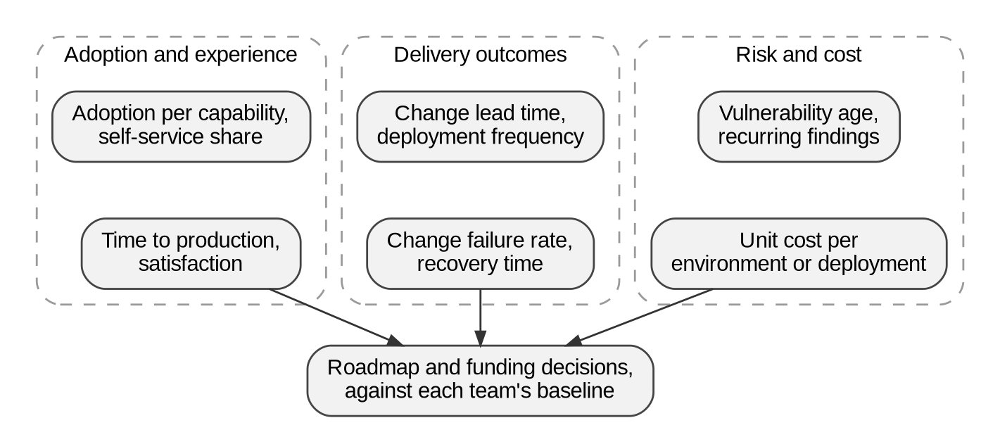{#fig-12-9 width="100%"}

**Why it is needed.** Without measures, the platform team cannot tell a valued capability from an ignored one, and decisions about the roadmap and funding are made on opinion. The evidence is a measure set per capability with a baseline taken before adoption and a reported trend.

### 12.9.2 Delivery and Outcome Measures

**Definition.** Platform outcome measures describe the effect of the platform on the delivery, reliability, security and cost of the solutions that use it.

**Purpose.** Adoption shows that teams use the platform; outcomes show that it improves what the organization cares about. They are the basis of the business case for continued investment.

**What it includes.** Use the software delivery performance measures of the DevOps Research and Assessment program — change lead time, deployment frequency, change failure rate and failed deployment recovery time (Forsgren et al., 2018; Google Cloud, 2024) — for teams before and after adoption. Add reliability outcomes, such as service level attainment of solutions on the platform, security outcomes, such as the age of critical vulnerabilities, the number of recurring review findings and the number of long-lived credentials, and cost outcomes, such as the cost per environment or per deployment (12.10.1). Compare teams on the platform with their own baseline rather than with each other, and allow for other changes happening at the same time.

**Why it is needed.** A platform can be well adopted and still not improve delivery, for example when it adds steps that offset the time it saves. Without outcome measures, that is invisible until funding is questioned. The evidence is a before-and-after comparison of delivery, reliability, security and cost for the teams that adopted the platform.

### 12.9.3 Using Measures Without Gaming Them

**Definition.** Measurement governance is the set of rules for how platform measures are collected, reported and used, so that they inform decisions without becoming targets that distort behavior.

**Purpose.** A measure used as a target tends to stop measuring what it was meant to measure. Governance keeps platform measures useful for learning and for the funding decisions that depend on them.

**What it includes.** Report at the team and capability level and never rank individuals (4.10.3). Use several measures together, so that improving one at the cost of another is visible: deployment frequency with change failure rate, self-service share with satisfaction. Prefer measures collected from systems over self-reported ones, and publish how each is calculated. Review the measure set yearly, retire measures that no longer inform a decision, and do not tie a team's performance assessment to a single platform number. Combine the numbers with qualitative evidence from support analysis and interviews (12.2.1).

**Why it is needed.** When teams are judged on a platform measure, they optimize that measure: deployments are split to raise frequency, and requests are discouraged to raise the self-service share. The evidence is a published definition for each measure, paired measures in every report and a yearly review of the set.

**Example.** Before the checkout platform launched, the five teams recorded their baselines: about three weeks from new service to production, deployments weekly, and the same log-retention finding in three reviews. A year later, a new service reaches production in two days, the four teams on the template deploy daily with an unchanged change failure rate, and the finding has not recurred. Satisfaction is high for the template and low for provisioning, which moves provisioning up the roadmap.

::: {.callout-warning appearance="simple" icon=false title="Common Pitfall"}
Measuring the platform team's activity instead of its consumers' outcomes. Reports count templates published, tickets closed and features shipped, so the platform looks productive while onboarding time and delivery performance stay where they were. Measure what changes for the consuming teams, against their own baseline, and pair every speed measure with a quality measure.
:::

::: {.callout-important appearance="simple" icon=false title="Decision & Trade-off"}
Which evidence should decide the platform's continued funding?

| Option | Choose when | Consequences |
| :--- | :--- | :--- |
| Adoption and experience measures | The platform is young and outcomes are not yet measurable | Early and cheap to collect; shows use rather than benefit |
| Delivery and outcome measures against baselines | Baselines exist and enough teams have adopted | Shows real benefit; slower to collect and affected by other changes |
| Cost avoided versus the duplicated alternative | Funding is contested and costs are measurable | Speaks the language of budgets; misses risk reduction and speed |
:::

## 12.10 Platform Economics and Capability Lifecycle

A platform is a long-lived investment whose capabilities are introduced, changed and eventually retired. Its economics and its lifecycle are two sides of the same decision: what to keep paying for.

### 12.10.1 Funding Models and Cost Allocation

**Definition.** A platform funding model is the way the platform's costs are paid — centrally, through allocation to consuming teams for visibility (showback) or through charges to their budgets (chargeback) — and how each tenant's consumption is measured.

**Purpose.** The model decides who feels the cost of a capability and therefore who makes cost decisions. It also determines whether the platform competes fairly with the alternatives available to a team.

**What it includes.** Table 12.11 compares the models. Central funding suits a young platform and capabilities with mandated outcomes, because charging for a control the organization requires only encourages teams to avoid it. Showback makes consumption visible without moving budgets and suits most shared capabilities. Chargeback suits capabilities with variable, team-driven consumption, provided the unit prices are stable and understandable. In every model, attribute consumption to tenants through tags and quotas (12.6.2), report unit costs such as cost per environment or per deployment, and apply the FinOps practices of 17.2.2.

| Model | How costs reach teams | Suits | Risk |
| :--- | :--- | :--- | :--- |
| Central funding | They do not; the platform has its own budget | Young platforms and mandated controls | Consumption grows without a visible cost |
| Showback | Reported consumption and unit costs, no budget transfer | Most shared capabilities | Reports are ignored without targets |
| Chargeback | Consumption charged to each team's budget | Variable, team-driven consumption with stable unit prices | Teams avoid the platform to save cost, or dispute the prices |

: Platform funding models compared

Figure 12.10 shows the flow from tenant consumption, through attribution and unit costs, to a showback report or a chargeback, so that cost decisions rest with the team that controls the consumption.

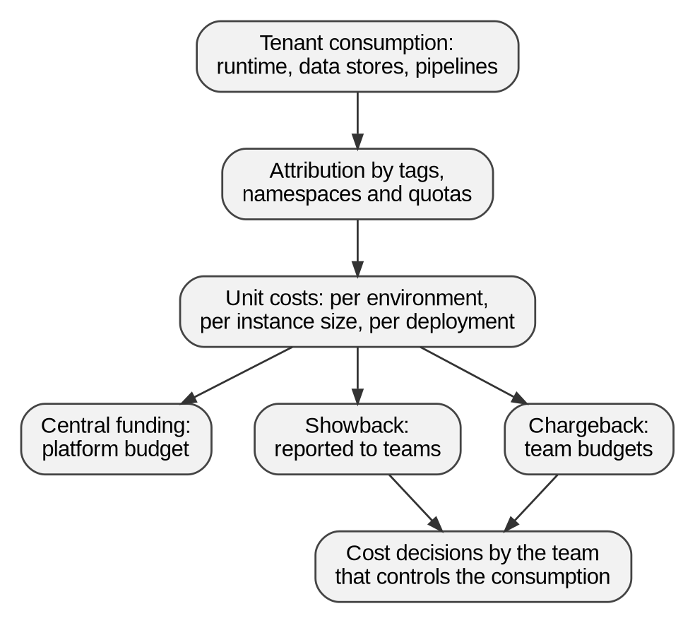{#fig-12-10 width="100%"}

**Why it is needed.** Without attribution, platform cost appears as one growing line in the infrastructure budget, and nobody can say which solutions cause it or whether the platform is cheaper than the duplicated alternative. The evidence is consumption attributed to tenants, published unit costs and the comparison of total cost of ownership with the alternative (17.2.3).

### 12.10.2 Introducing, Evolving and Retiring Capabilities

**Definition.** The capability lifecycle is the sequence of stages a platform capability passes through — experimental, generally available, deprecated and retired — each with entry criteria and a support commitment.

**Purpose.** The lifecycle tells consumers what they may depend on. It also lets the platform stop paying for capabilities that are no longer worth their cost, which is the only way to keep a platform's scope in proportion to its team.

**What it includes.** Publish each capability's stage in the catalog and in its contract. An experimental capability has named early users, no availability commitment and an evaluation date. General availability requires documentation, objectives, on-call support and a responsibility matrix. Deprecation starts when a replacement exists or the cost exceeds the value; it announces an end date, a migration path and the support that remains until then. Retirement follows usage data, not the calendar alone: confirm that no consumer remains, then remove the capability and its documentation. Review the portfolio of capabilities yearly against adoption, outcomes and cost, and record retirements in the architecture roadmap (17.3.2).

**Why it is needed.** A platform that only adds capabilities accumulates old versions and rarely used features that still need patching and support, until its team spends most of its time maintaining them. The evidence is a stage for every capability, deprecations with dates and migration paths, and a yearly portfolio review.

**Example.** The checkout platform is centrally funded in its first year, with showback reports of runtime and database consumption per team. In the second year, database consumption is charged back at a published price per instance size, while the deployment path and audit logging stay centrally funded. A self-hosted message broker that only two teams still use is deprecated in favor of a managed service, with a six-month migration window; the usage report shows the last consumer leaving in month five, and the broker is retired.

::: {.callout-warning appearance="simple" icon=false title="Common Pitfall"}
Charging back before the platform is cheaper than the alternative. Teams see the platform's full cost, including its team, next to the provider price of doing it themselves, and leave; the platform's fixed cost is then spread over fewer teams and its price rises further. Fund the platform centrally until its unit costs are competitive, use showback to build cost awareness, and charge back only consumption the team controls.
:::

::: {.callout-important appearance="simple" icon=false title="Decision & Trade-off"}
How should platform costs reach the consuming teams?

| Option | Choose when | Consequences |
| :--- | :--- | :--- |
| Central funding | The platform is young or the capability enforces a mandated control | Removes cost as a barrier to adoption; consumption needs other limits |
| Showback | Consumption should be visible but budgets are central | Cost awareness without disputes; depends on teams acting on reports |
| Chargeback | Consumption is variable, team-driven and priced per unit | Strong incentive to optimize; teams may avoid the platform or contest prices |
:::

## 12.11 Build, Buy or Compose

Few organizations need to build a platform from parts. The sourcing question is asked for each capability: what to build, what to buy and what to compose from provider services and open-source components.

### 12.11.1 Sourcing Options

**Definition.** Platform sourcing is the choice, per capability, between building it in-house, buying a commercial product or managed platform, and composing it from provider services and open-source components with internal integration.

**Purpose.** The choice decides where the platform team spends its capacity. Capacity spent rebuilding what a provider offers is not available for the integration and the standards that only the organization can supply.

**What it includes.** Apply the build, buy and managed-service analysis of 17.2.3 to each capability, and Table 12.12 to the platform as a whole. Most platforms compose: provider services for runtime, data and identity; open-source or commercial products for the portal, the policy engine or the pipelines; and internal code only for the integration, the golden paths and the organization-specific policies. Build only what differentiates the organization or what no product does acceptably, and count the cost of operating and upgrading it for its whole life, not only the cost of writing it.

| Option | Strength | Cost profile | Main risk |
| :--- | :--- | :--- | :--- |
| Build in-house | Fits the organization exactly | High initial and permanent engineering cost | Becomes a product the organization must staff indefinitely |
| Buy a commercial platform or product | Fast to adopt, with vendor support and roadmap | License or subscription, plus integration | Product model and roadmap set by the vendor; lock-in |
| Compose provider and open-source components | Uses mature parts with internal glue | Moderate integration and upgrade cost | Integration work grows with each component and its versions |

: Platform sourcing options compared

Figure 12.11 shows a typical split: the organization builds the golden-path templates, policy set and integration that only it can supply, composes the portal and policy engine from open-source components, and uses provider services for pipelines, managed runtimes and identity.

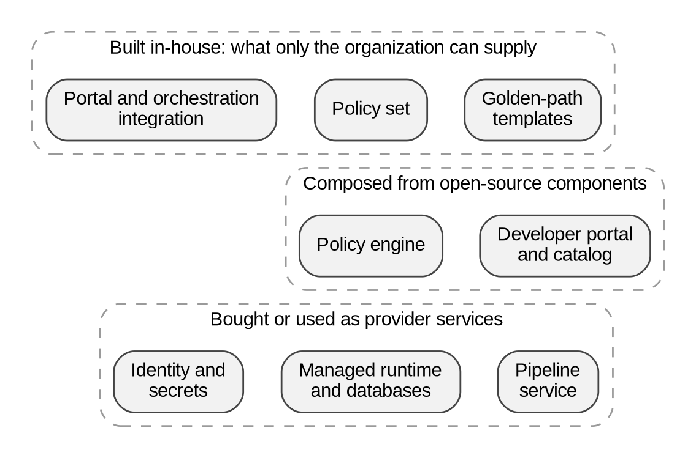{#fig-12-11 width="100%"}

**Why it is needed.** A platform team that builds commodity capabilities spends its time on maintenance and falls behind the providers it imitates, while the organization-specific work — golden paths, policies, integration — waits. The evidence is a sourcing decision per capability with its lifetime cost and the reason for any capability built in-house.

### 12.11.2 Selection, Lock-In and Exit

**Definition.** Platform selection is the evaluation of candidate products and services against the platform's requirements; lock-in is the cost of leaving the chosen option, and an exit plan states how it would be left.

**Purpose.** Platform choices last longer than most solution choices, because every workload comes to depend on them. Evaluating them with explicit criteria and an exit plan keeps that dependency a decision rather than an accident.

**What it includes.** Assess each candidate with the platform assessment schema (Appendix B.13) and compare vendors with the evaluation matrix (B.8) and the method of 17.2.6. Include the capability contract the candidate allows the platform to offer, its fit with the existing foundation, its upgrade cadence and the skills it requires. Identify the assets that would be hard to move — workflow definitions, policy code, catalog metadata, custom plugins — and prefer open formats and standard interfaces for them. Write an exit plan with its estimated effort and test a small part of it, such as exporting the catalog or running a policy set in another engine (17.2.4).

**Why it is needed.** A platform product chosen on features alone can become the most expensive dependency in the estate, because leaving it means changing every workload. The evidence is a completed assessment, a recorded decision with its rejected alternatives, and an exit plan with a tested step.

**Example.** The checkout platform composes managed container, database and identity services from its cloud provider, an open-source developer portal for the catalog and documentation, the provider's pipeline service, and an open-source policy engine. The team builds only the golden-path templates, the policy set and the integration between the portal and the orchestration workflows. The exit plan keeps policies and catalog metadata in open formats in source control, and a yearly exercise runs the policy set against a second engine.

::: {.callout-warning appearance="simple" icon=false title="Common Pitfall"}
Building a commodity capability because it seems simple. The team writes its own pipeline engine, secrets store or portal, and the cost of keeping it secure, scalable and current grows each year while the provider's version improves for free. Build only what differentiates the organization, compose the rest, and review each in-house capability against what the market now offers.
:::

::: {.callout-important appearance="simple" icon=false title="Decision & Trade-off"}
How should a platform capability be sourced?

| Option | Choose when | Consequences |
| :--- | :--- | :--- |
| Build in-house | The capability differentiates the organization or no product fits | Exact fit; permanent engineering and operating cost |
| Buy a product or managed platform | A mature product fits most requirements | Fast start and vendor support; lock-in and a roadmap set by others |
| Compose provider and open-source parts | Mature parts exist and integration skills are available | Flexibility with less custom code; integration and upgrade work |
:::

## 12.12 Platform Anti-Patterns

**Definition.** A platform anti-pattern is a recurring way of designing, running or governing a platform that seems reasonable when it is chosen and predictably produces a worse result than the alternative.

**Purpose.** Naming the anti-patterns lets a review recognize them early, from their symptoms, before the platform has absorbed years of investment in the wrong direction.

**What it includes.** Table 12.13 lists the anti-patterns that recur most often, with the symptom by which a review can recognize each and the section that describes the remedy. Several are described as Common Pitfalls in this chapter; the table gathers them, with others, in one place for a platform review. Appendix H lists every pitfall of the handbook by chapter.

| Anti-pattern | Symptom | Remedy |
| :--- | :--- | :--- |
| Ticket-operated platform | Tickets are the normal way to consume capabilities | Self-service interfaces and support tiers (12.3.2) |
| Platform nobody asked for | Low adoption of voluntary capabilities; workarounds | Product practice and measured demand (12.1.3, 12.2.1) |
| Mandate before value | Adoption only where required; many exceptions | Mandate outcomes, earn voluntary adoption (12.2.2) |
| Portal without automation | Portal actions open tickets for manual work | Automated capabilities before the portal (12.4.3) |
| Golden cage | Unusual requirements cannot be met on the platform | Escape hatches with stated responsibilities (12.5.1) |
| Implicit responsibility | Each side assumes the other restores, patches or monitors | Responsibility matrix per capability (12.3.1) |
| One control plane for all risks | One upgrade or credential reaches every workload | Isolation by risk class and rings (12.6) |
| Last-gate policy | Violations found at deployment under release pressure | Defaults in templates, warnings in pipelines (12.7.1) |
| Activity metrics | Reports of output; consumer outcomes unchanged | Outcome measures against baselines (12.9) |
| Capabilities that never retire | Old versions and rarely used features consume the team | Lifecycle stages and yearly review (12.10.2) |

: Platform anti-patterns, symptoms and remedies

**Why it is needed.** Platform anti-patterns are expensive to reverse, because by the time their effect is visible, many workloads depend on the design that caused it. The evidence is a periodic platform review that checks each anti-pattern against its symptom and records the result.

**Example.** At the end of its first year, the checkout platform team reviews the table with the five consuming teams. Two symptoms are present: provisioning still opens a ticket for database access grants, and the shared broker has no retirement date for its old version. Both become roadmap items with owners, and the review is scheduled again for the following year.

::: {.callout-warning appearance="simple" icon=false title="Common Pitfall"}
Treating the platform review as a one-off launch gate. The platform is reviewed when it is created and never again, so anti-patterns that develop with growth — ticket queues, unretired capabilities, shared blast radius — go unnoticed. Review the platform against its anti-patterns and measures at least yearly, with its consumers present.
:::

::: {.callout-important appearance="simple" icon=false title="Decision & Trade-off"}
Who should review the platform's design and operation?

| Option | Choose when | Consequences |
| :--- | :--- | :--- |
| The platform team itself | The platform is small and its consumers few | Low cost and deep knowledge; blind spots stay hidden |
| The architecture review with consuming teams | The platform serves many teams | Consumer evidence and independent challenge; review effort for several teams |
| An external or independent review | The platform is critical, regulated or contested | Strongest independence; cost and less context |
:::

## 12.13 Worked Example: A Platform for the Reference Checkout

*In practice:* This example follows the reference checkout from five teams with separate tooling to a measured platform, with the decisions recorded at each step. Figures are illustrative.

The starting point is the situation of 12.1.3: five teams, three weeks to launch a service, repeated findings in reviews. The demand analysis justifies a delivery and runtime platform and rejects, for now, a data platform. An ADR records the scope as curated provider services with guardrails and self-service, a platform team of five with a product owner, and central funding for the first year.

Discovery with the teams sets the first roadmap: the service golden path, workload identity, dashboards and audit logging. The capability contracts state objectives, limits, responsibilities and a deprecation policy; Payments keeps its pipeline for the card-data scope and receives a dedicated account, after one quarter of collaboration. Policies start in warning mode in the pipeline, and admission control enforces only image signatures. Platform changes roll out in four rings, and the runtime keeps serving with cached configuration when the provider's management API is unavailable.

After a year, the measures are compared with the baselines: a new service reaches production in two days, the four teams on the template deploy daily with an unchanged change failure rate, and no review has repeated the log-retention finding. The yearly review finds two anti-patterns and moves database provisioning and the broker retirement up the roadmap.

**Deliverables:** demand analysis, platform scope ADR, capability contracts with responsibility matrices, isolation decision per risk class, policy inventory, platform service level objectives, measure baselines and reports, sourcing decisions with an exit plan, and the yearly platform review.

::: {.callout-note .review appearance="minimal" icon=false title="Architecture Review Checklist — Platform"}

☐  Is the platform's scope justified by measured demand, with its consumers and excluded capabilities stated?

☐  Does each capability have an owner, a published contract and a lifecycle stage?

☐  Is the responsibility split between the platform and each consuming team documented and confirmed?

☐  Is the adoption policy stated per capability, with mandated outcomes for required controls?

☐  Do platform interfaces support review and versioning, with an escape hatch and its responsibilities documented?

☐  Is the isolation model chosen per risk class and environment, with quotas and tested tenant boundaries?

☐  Are platform policies versioned, tested and owned, with an exception register that has expiry dates?

☐  Does the platform have its own service level objectives, and do running workloads keep serving when its control plane is unavailable?

☐  Do platform changes roll out progressively, with compatibility checks before each ring?

☐  Are adoption, outcome and cost measures reported against baselines, without ranking teams?

☐  Is each capability's sourcing decision recorded with its lifetime cost and an exit plan?
:::

## 12.14 Further Reading

- Skelton and Pais (2019), *Team Topologies* — platform teams, the thinnest viable platform and interaction modes.
- Fournier and Nowland (2024), *Platform Engineering* — building and running platforms as products, from the leader's point of view.
- CNCF TAG App Delivery (2023), *CNCF Platforms White Paper* — platform capabilities, attributes and the case for platform engineering.
- CNCF TAG App Delivery (2023), *Platform Engineering Maturity Model* — a model for assessing platform investment, adoption, interfaces, operations and measurement.
- Google Cloud (2024), *Accelerate State of DevOps Report 2024* — software delivery performance measures and research findings on platform engineering.
- Forsgren, Humble and Kim (2018), *Accelerate* — the research basis of the delivery performance measures.
- Kubernetes Documentation, *Multi-tenancy* — isolation options for teams and workloads sharing a cluster, as an example of a runtime platform.
