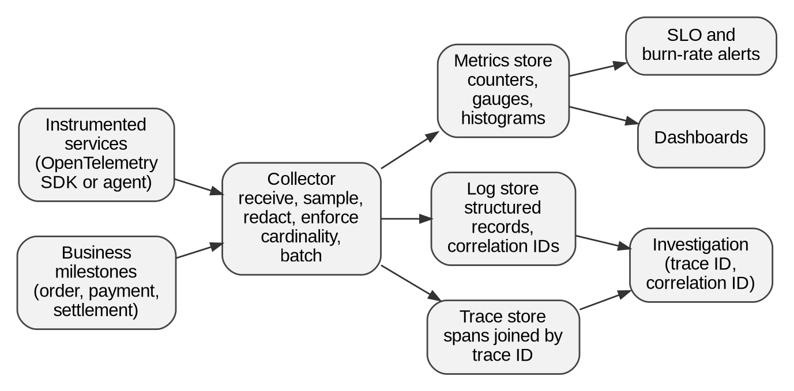
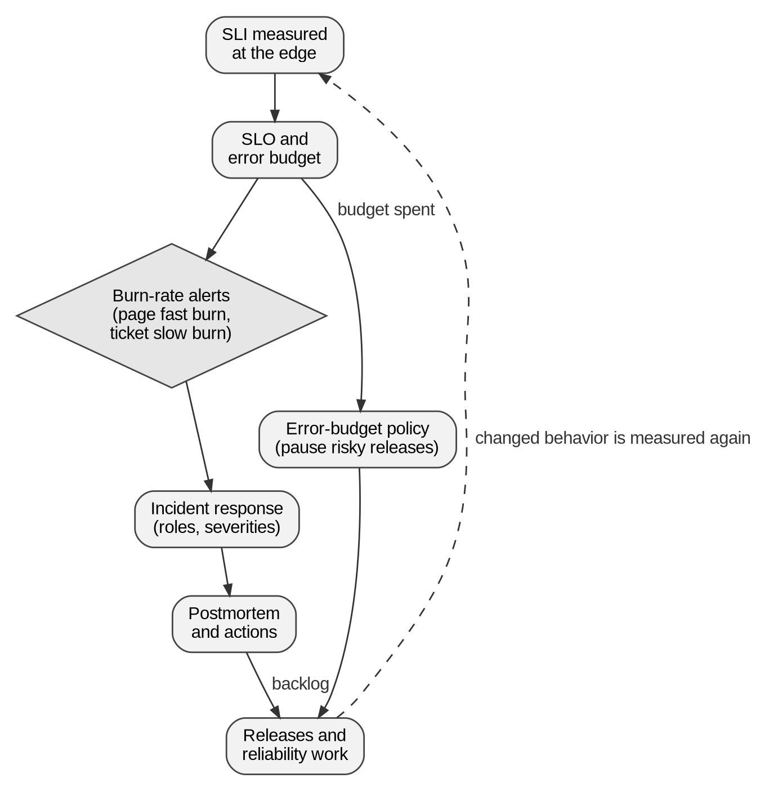
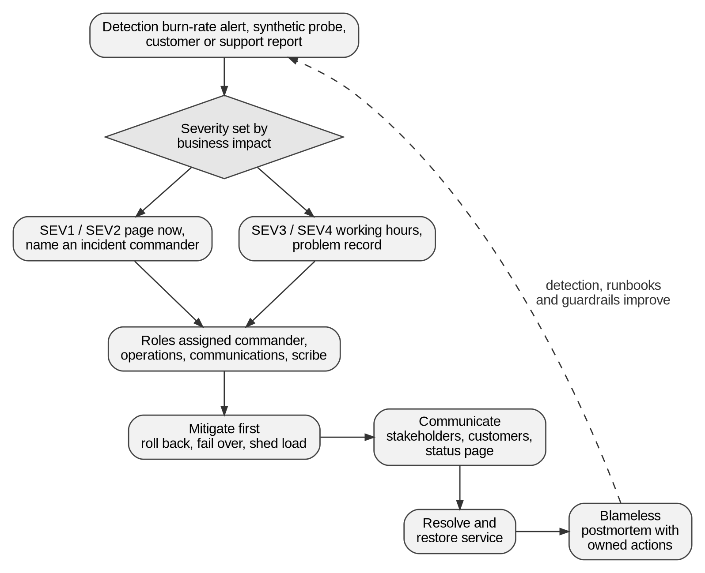
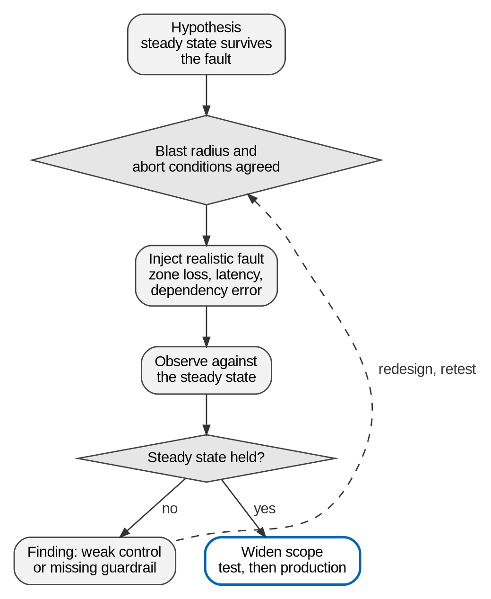
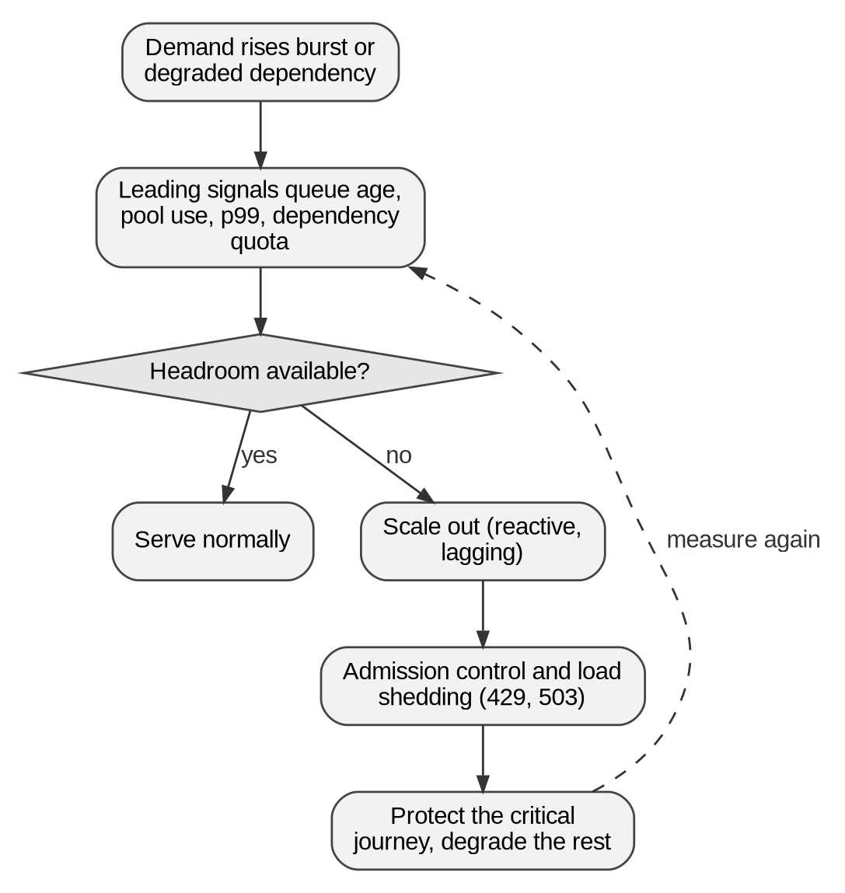
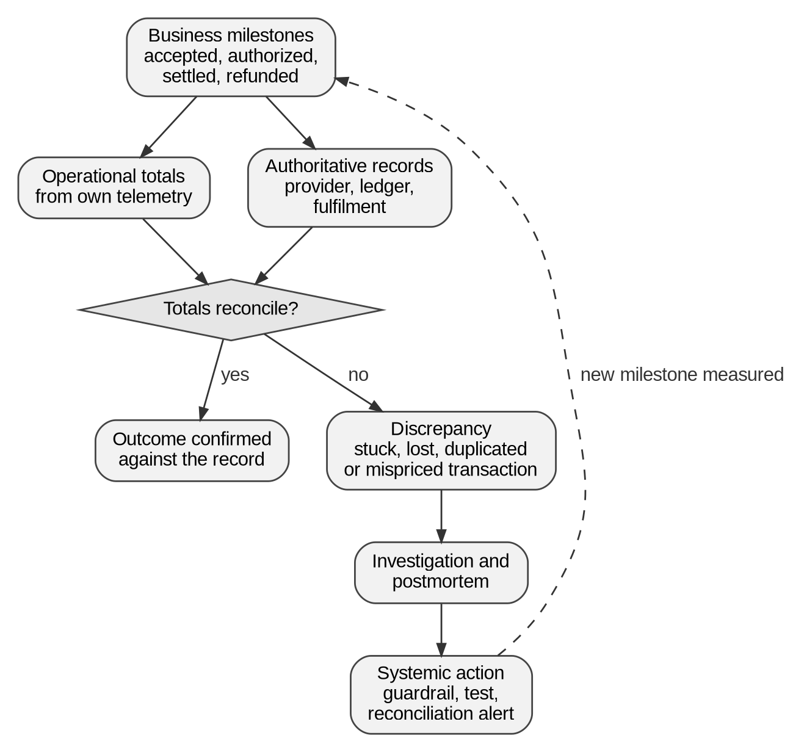

# 14. Observability, Reliability and SRE

Observability helps operators infer internal behavior from telemetry; reliability engineering turns business expectations into measurable objectives and operates the system against them. Site Reliability Engineering (SRE) combines the two with engineering practices: service-level objectives, error budgets, incident response, capacity planning and learning from failure. A green infrastructure dashboard does not prove that customers can complete an order.

::: {.callout-note appearance="simple" icon=false title="When to Use This Chapter"}
- Defining SLIs, SLOs and an error-budget policy for a critical user journey.
- Designing telemetry, alerting and dashboards for a new or changed service.
- Preparing incident response, game days or capacity plans before a release or peak event.
- Reviewing whether an availability or latency claim is measured where customers experience it.
- Setting latency budgets or finding a performance constraint.
:::

::: {.callout-tip appearance="simple" icon=false title="Key Takeaway"}
Reliability is managed through a small number of user-centric objectives, not component health. Measure the journey at the edge, alert on error-budget burn rather than resource thresholds, and let the budget decide when reliability work takes priority over new releases.
:::

## 14.1 Telemetry Architecture

Telemetry is the evidence a running system emits about itself: instrumented code produces signals, a collector reduces and routes them, and signal-specific stores make them queryable. Figure 14.1 follows that path from the service to the alert, the dashboard and the investigation.

{#fig-14-1 width="100%"}

### 14.1.1 Signal Types

**Definition.** Each signal type answers a different question about the same request, so the choice decides which questions an investigation can still ask. Metrics, logs and traces are the three core types.

**Purpose.** Signal types decide what the architecture can explain: whether a trend is drifting from its objective, why one request failed, or where in a call chain the time went. They also set most of the telemetry cost, because volume and cardinality are properties of the signal, not of the back end.

**What it includes.** The three core signals:

- A **metric** is a numeric measurement recorded over time, identified by a name and a set of labels. *Counters* only increase (requests served), *gauges* go up and down (queue depth), and *histograms* record the distribution of values (request durations), which is what allows percentiles such as p99 to be computed.
- A **log** is a timestamped record of a discrete event. **Structured logs** use consistent key-value fields — such as service, severity level, message, correlation and trace identifiers — so that they can be queried, unlike free-text lines.
- A **trace** records the journey of one request through the system as a tree of **spans**; each span is one unit of work, such as an HTTP call, a database query or a message being processed, with its start time, duration, attributes and status. **Trace context**, propagated in headers and message metadata, links the spans created by different services into one trace.

| Signal | What it captures | Best for | Caution |
| :--- | :--- | :--- | :--- |
| Metrics | Numeric measurements aggregated over time | Trends, SLIs, alerting, capacity | Cardinality: unbounded labels such as user IDs make them expensive and unstable |
| Logs | Discrete, structured records of events | Explaining individual failures | Volume and cost; sensitive data must be redacted |
| Traces | The path and timing of one request across components | Locating latency and failures in distributed flows | Sampling decisions; propagation through asynchronous boundaries |
| Events | Significant state changes, such as deployments or configuration changes | Correlating incidents with changes | Need consistent sources and timestamps |
| Profiles | Resource use by code location over time | Finding CPU and memory hot spots | Emerging standards; overhead must be controlled |

: Telemetry signals, what each captures and where it misleads

Events and profiles complete the set: events correlate incidents with changes, and profiles attribute resource use to code locations.

Audit records (13.7.2) are not telemetry: they are evidence of who did what, must be complete rather than sampled, and are retained and protected under different rules.

**Why it is needed.** A single signal type leaves a characteristic blind spot. Metrics show that p99 latency rose but not which dependency caused it; traces locate the slow span but not why the request was rejected; logs explain one rejection but not how widespread it is. Correlated by trace and correlation identifiers, the three turn partial answers into one explanation.

### 14.1.2 Instrumentation Standards

**Definition.** An instrumentation standard is the set of conventions every service follows so that telemetry from different teams can be joined into one query and one trace.

**Purpose.** A standard makes signals comparable across services and keeps the analysis back end replaceable: a query written for one team's data still works for another's, an incident that crosses three services produces one trace instead of three fragments, and a migration between vendors does not require rewriting every service. It also bounds cost, because sampling, cardinality and retention become policy decisions rather than per-team accidents.

**What it includes.** One standard, applied to every signal:

- consistent service names and **semantic attributes**, following published conventions for HTTP, databases and messaging rather than local naming;
- **trace-context propagation** (W3C Trace Context, `traceparent`) through HTTP calls, messages and scheduled jobs, so that spans produced by different processes join into one trace;
- a sampling policy and a retention period per signal, and a named owner for each dashboard and each alert;
- redaction of sensitive fields before ingestion, and a cardinality budget for label values;
- one transport path. OpenTelemetry is the common vendor-neutral standard for instrumentation and transport, which keeps the choice of analysis back end reversible: services emit once and a collector exports to whichever stores the organization operates.

**Why it is needed.** Without conventions the data exists but cannot be joined: two services name the same dependency differently, a message consumer starts a new trace instead of continuing one, and the investigation falls back to comparing timestamps across dashboards. Inconsistent attribute names also defeat reuse of dashboards and alert rules later.

**Evidence.** one representative transaction traced across synchronous and asynchronous boundaries, with logs and metrics correlated by identifier.

**Example.** In the reference checkout, one order submission is a single trace across the checkout API, the Order service, inventory reservation and the payment provider call. When p99 acknowledgment approaches the 2-second objective, the trace identifies the reservation call as the slow span, a metric shows that the shift began with a release, and the structured log line for the same trace identifier carries the order and correlation identifiers. Support can then answer a customer's question from one identifier instead of a time range.

::: {.callout-warning appearance="simple" icon=false title="Common Pitfall"}
Collecting everything and controlling nothing. Enabling default instrumentation for every library, with user identifiers or request paths as label values, produces a bill that grows with traffic and metrics whose cardinality makes queries slow or the store unstable. The usual reaction is to sample blindly at the edge, which discards exactly the rare traces an incident needs. Decide per signal what is retained: keep labels to bounded dimensions, redact before ingestion, sample errors and slow requests on the complete trace rather than at random, and set retention from how far back investigations actually look.
:::

::: {.callout-important appearance="simple" icon=false title="Decision & Trade-off"}
Sampling decides which telemetry is thrown away, and the default discards what an incident needs most.

| Option | Choose when | Consequences |
| :--- | :--- | :--- |
| Head-based sampling in the SDK | Volume is uniform, cost is the binding constraint and traffic is high | Cheap and simple, and the decision is made before the outcome is known, so rare errors and slow outliers are usually dropped |
| Tail-based sampling at the collector | Errors and latency outliers matter more than volume, and the collector can buffer whole traces | Keeps every interesting trace; needs collector capacity and an explicit policy for traces that never complete |
| Keep everything on critical journeys, sample elsewhere | A small number of journeys carry the SLO and the rest are diagnostic | Predictable cost for the journeys that matter; requires a maintained list of critical journeys and per-journey policy |
:::

## 14.2 Service-Level Management

### 14.2.1 SLIs, SLOs and SLAs

**Definition.** A **service level indicator** (SLI) measures behavior users care about, as a ratio of good events to valid events; a **service level objective** (SLO) is the target for that ratio over a window, and a **service level agreement** (SLA) is the contractual commitment behind it.

**Purpose.** The three turn "the system is available" into a measurement the organization can act on: which shortfall is worth paging for, how much unreliability has been promised, and how much margin exists between the internal objective and the contract. They inform release decisions, alerting and the wording of customer commitments.

**What it includes.** An SLI is defined as good events divided by valid events, measured where users experience the service. Table 14.2 lists the common types; each has a natural numerator, denominator and set of exclusions.

| SLI type | Good event | Example |
| :--- | :--- | :--- |
| Availability | Request answered successfully | Valid checkout requests not failing with server errors |
| Latency | Request answered within a threshold | Order acknowledged within 2 s |
| Correctness | Result is right | Orders whose payment state matches the provider's record |
| Freshness | Data is recent enough | Search index updated within 5 minutes of a change |
| Throughput or completion | Work completed in time | Batch files processed before the cut-off |

: Common SLI types

The SLO adds a target and a window; the SLA is usually looser than the internal SLO, so that the SLO gives early warning rather than sharing a date with the contract. For the reference checkout, the SLI is valid checkout requests that return a durable `order_id` within 2 s divided by all valid checkout requests, measured at the edge, and the SLO is 99.9% over a rolling 28 days. Specify numerator, denominator, exclusions, data source and behavior when data is missing. Choose SLIs per critical user journey, and keep their number small enough that each one drives a decision.

Chapter 18 (18.6.7) extends SLIs and SLOs to AI quality, groundedness, latency and cost, with evaluation gates and fallback.

**Why it is needed.** Without a defined ratio, availability claims come from component health and cannot be checked against the experience that customers pay for. Teams then optimize what is easy to measure — CPU headroom, host counts, error counts — and discover the difference only when a customer reports a journey that was failing while every dashboard stayed green. An SLO with a stated window also makes "better" and "worse" comparable across releases, which is what allows a slow degradation to be seen at all.

### 14.2.2 Error Budgets and Burn-Rate Alerting

**Definition.** The error budget is the permitted unreliability implied by an SLO; the **burn rate** is how fast that budget is being consumed relative to the SLO window.

**Purpose.** The budget converts an objective into a quantity that can be spent and defended: how much change a period can absorb and when reliability work outranks new features. Burn rate makes that number actionable as a rate.

**What it includes.** A 99.9% SLO allows 0.1% of valid requests to fail; over 28 days, that is about 40 minutes of full outage. A burn rate of 1 uses the whole budget over the window, so a rate of 15.4 consumes 2% in an hour.

Alerting on burn rate over several windows detects both sudden outages and slow degradation while ignoring brief noise. Google's *Site Reliability Workbook* documents a commonly cited configuration, reproduced in Table 14.3.

| Budget consumed | Long window | Burn rate | Action |
| :--- | :--- | :--- | :--- |
| 2% | 1 hour | 15.4 | Page |
| 5% | 6 hours | 6 | Page |
| 10% | 3 days | 1 | Ticket |

: Multi-window burn-rate alerting

Each alert also uses a short window, typically one twelfth as long, so it stops firing quickly once the problem is fixed. The figures assume a 30-day SLO window: burn rate = budget fraction × SLO window ÷ alert window. For the 28-day example the same fractions give about 13.4, 5.6 and 0.93.

Figure 14.2 shows the loop: the SLI feeds the error budget, alerts drive response, and the policy decides what the next releases contain.

{#fig-14-2 width="100%"}

An **error-budget policy** states what happens when the budget is exhausted — for example, prioritizing reliability work over risky releases until the SLI recovers. Without an agreed policy, the budget is only a report.

**Why it is needed.** A budget with no policy changes nothing: the same releases continue, and the first argument happens during an incident. Alerting on thresholds instead of burn pages for causes with no customer impact while slow degradation stays under every threshold. Writing the policy in advance moves both decisions out of the incident.

**Evidence.** an SLO specification with numerator, denominator and window; alert rules with their windows; a recorded decision when the budget was exhausted.

**Example.** For the reference checkout's 99.9% SLO over 28 days, the budget is about 40 minutes of full outage. A payment-provider slowdown that consumes 10% of the budget over three days opens a ticket; a spike that consumes 2% in an hour pages. Because the policy was agreed in advance, the team pauses risky checkout releases and spends the next iteration on provider timeout handling instead of negotiating priority during an incident.

::: {.callout-warning appearance="simple" icon=false title="Common Pitfall"}
Setting the SLO equal to the SLA, or at 100%. With no margin, the first breach of the internal objective is already a contractual breach, and an objective of 100% leaves no error budget to spend on change, so every release becomes a risk to argue about. Set the SLO tighter than the SLA but below 100%, at the level users actually notice, and agree in advance what happens when the budget is spent.
:::

::: {.callout-important appearance="simple" icon=false title="Decision & Trade-off"}
What should page a person?

| Option | Choose when | Consequences |
| :--- | :--- | :--- |
| Multi-window burn-rate alerts on SLOs | User-facing journeys with an agreed SLO and enough traffic for stable ratios | Pages track customer impact with few false alarms; requires well-defined SLIs and does not explain the cause |
| Component threshold alerts (CPU, queue depth, error count) | Known saturation limits with a reliable, automated or documented response | Early warning for specific failure modes; noisy and often disconnected from user impact, so better as tickets than pages |
| Synthetic probes of critical journeys | Low or uneven traffic where real-user ratios are unstable, or dependencies outside your telemetry | Detects outages without traffic; probes test a narrow path and can pass while real users fail |

Page on symptoms that threaten the SLO; route cause-level signals to dashboards and tickets.
:::

## 14.3 Incident Response

Incident response is the rehearsed path from detecting a disruption to mitigating it, communicating about it, and turning it into a change the system keeps.

### 14.3.1 Detection and On-Call

**Definition.** Detection is the path from a signal to a person who is able and allowed to act on it.

**Purpose.** Detection design decides how long a disruption stays invisible and whether the first responder has what is needed to start work. It informs which signals page, who receives them and what each alert carries with it.

**What it includes.** Alert on symptoms that require human action — SLO burn, stalled workflows, growing backlog — and route each alert to an owner with a runbook; alerting on every internal error produces fatigue and masks critical incidents. Each alert carries the journey affected, the current value, the threshold it crossed and a link to the runbook. A **runbook** is the procedure for a known task or failure; a **playbook** is the decision guide for an unfolding incident that is not a single procedure — which escalation to invoke, what to communicate and when (7.5.2). Track alert noise and on-call load per engineer, because a rota that pages for noise stops reading pages.

**Why it is needed.** An alert that nobody can act on trains the team to ignore the channel, and the one that matters arrives in the same noise. Detection quality is measured, not assumed: the evidence is a game day that records time to detect and time to acknowledge, an alert-to-incident ratio with an owner, and runbooks that were exercised rather than merely written.

### 14.3.2 Severity, Roles and Mitigation

**Definition.** Severity is the business-impact classification that decides who is engaged, how fast and with what authority.

**Purpose.** Severity turns a technical event into a response with a known shape, so that mitigation starts before the debate about how bad it is. It also protects the organization from the opposite failure: treating every event as a crisis until the scale means nothing.

**What it includes.** Define severity by business impact, with response expectations for each level (Table 14.4). For major incidents, separate the roles: an **incident commander** coordinates and decides, an **operations lead** works on mitigation, a **communications lead** informs stakeholders and customers, and a **scribe** keeps the timeline. Mitigate first — roll back, fail over, shed load — and diagnose afterwards. Security incidents follow the same structure with the notification obligations in 13.7.1. Figure 14.3 shows the path from detection to a postmortem that improves detection.

| Severity | Example impact | Typical response |
| :--- | :--- | :--- |
| SEV1 | Critical journey unavailable or data at risk for many customers | Immediate page, incident commander, executive and customer communication |
| SEV2 | Significant degradation or a critical function unavailable for some customers | Immediate page, incident commander |
| SEV3 | Minor degradation with a workaround | Handled in working hours |
| SEV4 | No customer impact | Tracked as a problem or task |

: Incident severity and expected response

Figure 14.3 maps the severity levels to the escalation path, so the response expectations in the table become a sequence of decisions rather than a static classification.

{#fig-14-3 width="100%"}

**Why it is needed.** Without agreed severity and roles, the loudest person in the channel decides, mitigation competes with diagnosis, and each stakeholder asks the same questions of the person trying to fix the fault. The evidence is a declared severity that matches the customer impact in a sample of incidents, an incident commander named at declaration, and a measured time from declaration to first mitigation.

### 14.3.3 Communication During Incidents

**Definition.** Incident communication is the rehearsed flow of accurate, consistent updates to stakeholders and customers while the incident is still unfolding.

**Purpose.** Communication decides what customers learn, when, and from whom. It keeps the responders working on mitigation instead of answering the same question in five channels, and it leaves a record that the postmortem and any notification obligation can use.

**What it includes.** One channel of record and one voice, with the communications lead publishing at a fixed cadence even when there is nothing new. Separate internal updates from customer-facing ones, state what is known, what is not and when the next update will come, and keep the language free of internal system names. Where regulation or contract sets a notification deadline, it is triggered by the declared severity, not by the discovery of the cause (13.7.1).

**Why it is needed.** Improvised communication is how customers learn about an outage from someone else, and how a regulator hears about it late. The evidence is a status page or customer message published within the declared window, a timeline the scribe can reconstruct, and a postmortem (14.5.2) whose actions have owners and dates.

**Example.** A provider-latency spike pages on burn rate for the reference checkout. The on-call engineer sets SEV2 because order acceptance is degraded for many customers, names an incident commander and routes the status update to support. The operations lead holds new orders in `PAYMENT_PENDING` with reconciliation rather than failing them, and the communications lead publishes one message that support reuses. The postmortem adds a provider-latency probe and rewrites the runbook step that assumed a fast failure.

::: {.callout-warning appearance="simple" icon=false title="Common Pitfall"}
Setting severity from the technical cause instead of customer impact. A database failover is declared SEV1 although users see nothing, while a wrong-price defect stays at SEV4 because no alarm fired; severity loses its meaning, and the organization learns to discount it. Define each level by the customer and business effect, give one example per level, and review the assignments in game days so that the scale stays calibrated.
:::

::: {.callout-important appearance="simple" icon=false title="Decision & Trade-off"}
How much response structure to invoke on a given day decides both speed and overhead.

| Option | Choose when | Consequences |
| :--- | :--- | :--- |
| Single responder, escalation on request | Small systems, low incident volume, one team that owns the whole path | Fast and inexpensive; coordination and communication depend on that person noticing the need to escalate |
| Named incident commander and role split at declaration | Customer-facing services with dependencies across teams and communication obligations | Clear decision-making and consistent updates; requires trained people and enough volume to keep the roles practised |
| A standing operations team owns every incident | Many services, 24×7 obligations and a platform group that can carry the practice | Consistent response and reusable runbooks; distances product teams from their own failures |

The role split usually starts at SEV2; what matters is that the trigger is written down.
:::

## 14.4 Reliability and Capacity Engineering

### 14.4.1 Reliability Engineering and Chaos Experiments

**Definition.** Reliability engineering designs a system to keep its promises while components fail; chaos engineering tests those promises by injecting realistic failures on purpose.

**Purpose.** The two decide which failures are designed for, which mechanisms are worth their cost — isolation, redundancy, retry budgets, reconciliation — and how much confidence exists before a peak or a release. They inform where redundancy is justified, which dependency needs a fallback, and whether a recovery procedure works outside a diagram.

**What it includes.** Reliability combines correct behavior, failure isolation, redundancy, recovery and data integrity. For critical workflows, define failure modes, idempotency, retry budgets and reconciliation, then test the assumptions. **Chaos engineering** does this deliberately: state a hypothesis about steady-state behavior ("checkout keeps its SLO if one zone fails"), agree the blast radius and abort conditions, inject a realistic fault, and observe against the steady state. Start in test environments and move to production only with mature monitoring and abort controls, as Figure 14.4 shows.

{#fig-14-4 width="100%"}

Resilience mechanisms are means; the measured SLO is the outcome. A standby replica that has never been failed over to, or a retry budget that has never been exceeded, is an argument rather than evidence.

**Why it is needed.** An untested failover is a hypothesis, and the first test of a hypothesis tends to happen during the incident it was meant to survive. Experiments convert assumptions into measured behavior while the blast radius is still small: they expose missing idempotency before duplicates reach customers, and they show whether detection and abort actually work. They also keep failure handling honest, because a mechanism that only appears in a design document tends to rot as the system changes around it.

**Evidence.** results of game days with measured time to detect, mitigate and recover; findings that produced a design or guardrail change.

### 14.4.2 Capacity Planning and Load Management

**Definition.** Capacity planning sizes a system for its busiest and most degraded hours; load management decides what to refuse when demand exceeds what the system can serve.

**Purpose.** They inform instance counts, pool sizes, queue bounds and dependency quotas, and set the priority order used when work must be dropped. They decide whether a peak slows everyone or fails the customers who matter least.

**What it includes.** Capacity management tracks throughput, queue age, CPU, memory, storage, pools and dependency quotas, and plans headroom for bursts and recovery, not averages. **Little's law** relates the three basic quantities of any stable system: average concurrency equals arrival rate multiplied by average time in the system (L = λW). At 500 requests per second and 200 ms average service time, about 100 requests are in progress at once, which sizes thread and connection pools and instance counts; if a dependency slows to one second, the same arrival rate implies about 500 in flight, which is the case to size for.

Autoscaling reacts with a lag and often after queues or database connections have saturated. Protect the system with **load shedding** (rejecting lower-priority work early, for example with `429` or `503`), admission control and bounded queues, so that overload degrades gracefully instead of collapsing. Figure 14.5 places those decisions in order.

{#fig-14-5 width="100%"}

Table 14.5 lists the signals that show capacity pressure and the action each triggers.

| Signal | What it indicates | Action it triggers |
| :--- | :--- | :--- |
| Throughput against provisioned capacity | Headroom and the direction of saturation | Add capacity or shed lower-priority work before queues grow |
| Queue depth and age | Work already waiting and the latency it has committed | Alert on age rather than depth alone; scale, shed or drain |
| Pool and connection use | Contention that appears before CPU saturation | Raise limits, reduce concurrency or find the leak |
| Error and timeout rate | A retry storm or a degrading dependency | Trip the circuit breaker, back off retries and degrade deliberately |
| Dependency quota consumption | Headroom before a hard provider limit | Throttle, request an increase or move the load elsewhere |

: Capacity and load signals, what they indicate and the action they trigger

**Why it is needed.** Sizing to the average leaves no room for the burst that follows a retry storm or a cold cache, and the failure is not linear: queues grow, timeouts multiply, and retries add demand to a system that is already saturated. The result is a collapse that outlasts its trigger, because recovery itself needs capacity. Load shedding decided in advance also prevents the worst outcome of overload, where equal treatment of every request starves the journey the business depends on.

**Evidence.** p99 latency and backlog drain time measured at peak and during recovery; a capacity model with stated assumptions.

### 14.4.3 Performance Engineering

**Definition.** Performance engineering sets latency and throughput objectives for a system, distributes them across its components, and finds and removes what limits them, using measurement.

**Purpose.** Performance is a quality attribute (1.2.5) that erodes through small additions unless it has a budget and an owner. Measuring before changing directs effort at the real constraint.

**What it includes.** Allocate each journey's target as a latency budget per hop, including network and serialization time. Report percentiles and not averages, and take care that a load tool which waits for slow responses does not hide queueing delay. In fan-out designs the slowest dependency sets the response time, so tail latency grows with the number of calls (Dean and Barroso, 2013); reduce fan-out, set deadlines, and consider hedged requests only for idempotent reads. Find the constraint using utilization, saturation and errors per resource (Gregg, 2020), and rate, errors and duration per service, then profile the code under realistic load. Frequent causes are repeated queries within a loop, missing indexes, lock contention, oversized payloads, chatty calls, connection-pool exhaustion and garbage-collection pauses. Apply the fix with the lowest lasting cost: remove work, then batch it, cache it (10.3.3), make it asynchronous, partition it (10.4.3) and, last, add hardware. Gate releases on regression (16.3.1).

**Why it is needed.** Average response time can look healthy while the slowest requests go to the most valuable customers, and tuning without a measured constraint adds complexity without improving the result. A budget also shows which team must give way when a new dependency is added to a journey.

**Evidence.** per-journey latency budget; percentile measurements under realistic load; recorded constraint with before and after results; regression gate in the pipeline.

**Example.** A game day slows the payment provider from 200 ms to one second. Little's law predicts in-flight work rising from about 100 to 500 requests, so connection pools and queue limits are sized for the degraded case rather than the average. During the peak that follows, checkout sheds browse traffic with `429` and keeps order acceptance inside its SLO: throughput falls for a non-critical journey and the critical one survives.

::: {.callout-warning appearance="simple" icon=false title="Common Pitfall"}
Sizing for the average and trusting autoscaling to cover the peak. Instances start after the queue has already grown, pools saturate first, and retries from timed-out clients add load to a system that was already short of capacity, so recovery takes longer than the burst itself. Plan headroom for burst plus recovery, watch leading indicators such as queue age and pool use, and decide in advance which work is shed so that the protection is exercised before it is needed.
:::

::: {.callout-important appearance="simple" icon=false title="Decision & Trade-off"}
How to meet a known peak, such as a seasonal sale or a migration cut-over.

| Option | Choose when | Consequences |
| :--- | :--- | :--- |
| Provision headroom for the peak | The peak date is known and capacity can be added in advance | Predictable latency without new failure modes; the capacity sits idle outside the peak and costs money |
| Autoscale on leading indicators | Load is variable and hard to forecast, and scaling is fast relative to the burst | Pay for what is used; lagging signals and slow starts still need a shedding backstop |
| Shed and degrade deliberately | Demand can exceed capacity whatever is provisioned, or the critical journey must always survive | Protects the journey that matters and fails fast for the rest; requires priority classes and a product decision about who is refused |
:::

## 14.5 Business Observability and Learning

### 14.5.1 Business Observability

**Definition.** Business observability applies telemetry to the outcome the business sells — an order accepted, a payment settled, a refund paid — rather than only to the components that produce it.

**Purpose.** It reveals failures that infrastructure metrics cannot express: transactions that complete technically but produce the wrong business result. It informs which milestones are instrumented, which totals are reconciled against authoritative records, and which discrepancies are worth waking someone for.

**What it includes.** Business signals — completed orders, `PAYMENT_PENDING` age, settlement lag, reconciliation mismatches — are emitted at the same milestones the business already tracks, with privacy-aware identifiers so that a customer can be traced without personal data entering the telemetry store.

| Business signal | What it detects | Authoritative comparison |
| :--- | :--- | :--- |
| Completed orders per interval | Orders that stopped advancing | Order database and fulfillment record |
| `PAYMENT_PENDING` age | Payments stuck after an unknown outcome | Provider status inquiry and settlement file |
| Settlement lag | Money authorized but not captured or paid out | Provider or ledger settlement totals |
| Reconciliation mismatch count | Duplicates, losses and mispriced transactions | Ledger and provider records |
| Refund and void rate | Compensation loops, such as repeated retries | Payment provider reports |

: Business signals and the record they are checked against

Compare operational totals with the authoritative record for the same period rather than trusting either alone: the telemetry shows what the system believed, the record shows what happened. Figure 14.6 places that comparison inside the learning loop.

{#fig-14-6 width="100%"}

**Why it is needed.** A technically healthy system can silently produce incorrect transactions: every request returns 200, every dependency is fast, and a subset of orders never receives a durable outcome. Without business signals the first detection comes from a customer, a finance reconciliation or an auditor, which is later and more expensive than an alert on stuck milestones.

**Evidence.** a reconciliation report with an agreed tolerance, alerting on age and mismatch thresholds, and a named owner for each discrepancy class.

### 14.5.2 Postmortems and Continuous Improvement

**Definition.** A postmortem is a blameless written account of an incident that ends in owned, dated changes to the system.

**Purpose.** The postmortem converts an incident into improvement: it informs which guardrails, tests or design changes are funded, and it records the reasoning so that the next team does not rediscover the failure. It also feeds the architecture decision record when the fix changes a structural choice, and it measures whether the response itself worked.

**What it includes.** Document the timeline, the customer and business impact, the contributing factors and the corrective actions, each with an owner and a deadline. Prefer systemic changes — guardrails, tests, design changes — over reminders to individuals, because a reminder decays while a guardrail keeps working. Link recurring findings to ADRs (Chapter 3) so that the reasoning survives staff changes, and track recurrence and action closure rather than the number of documents written.

**Why it is needed.** Without a written account, the same failure returns with a new trigger: the fix addressed the symptom, the contributing factors were never named, and the knowledge left with the people who were on call. Actions without owners and dates do not close, which turns the postmortem into a record of good intentions. Recurrence and closure rates are the evidence that the practice is working.

**Evidence.** postmortems with dated actions; action closure rate; recurrence of the same contributing factor; runbook or guardrail changes traced back to incidents.

**Example.** Weekly reconciliation for the reference checkout matches the week's orders against the provider's settlement file and finds a dozen authorized but never captured, while the business dashboard had shown a healthy service. The trace identifies a retry path that skipped capture after a timeout, and the postmortem produces two systemic actions: a contract test for the capture step and a reconciliation alert on the age of authorized-but-unsettled payments.

::: {.callout-warning appearance="simple" icon=false title="Common Pitfall"}
Treating the postmortem as the end of the incident: the document is filed, the actions have no owner or date, and the team moves to the next release. The same contributing factor then returns with a different trigger, and the second incident is investigated as if it were new. Limit each postmortem to a few systemic actions with named owners and dates, put them in the same backlog as features, and review closure and recurrence until the guardrail exists.
:::

::: {.callout-important appearance="simple" icon=false title="Decision & Trade-off"}
How far to take business instrumentation, given that each step adds both detection and cost.

| Option | Choose when | Consequences |
| :--- | :--- | :--- |
| Operational metrics only | Early product, or a journey whose business outcome is already checked manually | Cheap and quick to build; silent wrongness is found by customers or finance, not by the team |
| Milestone counters and ages | The business already tracks the milestone and the team owns its journey | Detects stuck and abandoned work with modest effort; counts what the system believes and cannot prove the outcome |
| Milestones reconciled against authoritative records | Money, entitlements or regulated data move, and an auditor or customer will ask for proof | Detects loss, duplication and mispricing close to the event; needs an owner, a tolerance and a process for discrepancies |
:::

## 14.6 Worked Example: An SLO that Changes Behavior

*In practice:* This example uses an SLO with an error-budget policy that pauses risky releases, tested with a game day on the payment dependency.

For order acceptance, the team adopts the SLI and SLO in 14.2.1. Edge measurement reflects user experience; traces locate dependency latency; logs explain individual failures. Burn-rate alerts page on fast budget consumption and open a ticket on slow consumption. When the budget is exhausted, risky releases pause until reliability work restores it.

A game day injects payment-provider latency. The dashboard must distinguish orders correctly held in PAYMENT\_PENDING from lost or duplicated orders; HTTP 200 counts alone would hide a broken journey. Capacity is checked with Little's law: longer provider latency increases in-flight work, so connection pools and queue limits are sized for the degraded case, not the average. Business reconciliation against the provider's settlement file then confirms that every held order was either captured or released.

**Deliverables:** SLO specification, alert policy, dashboard, incident playbook, capacity model, reconciliation report and error-budget policy.

::: {.callout-note .review appearance="minimal" icon=false title="Architecture Review Checklist — Observability and reliability"}

☐  Do SLIs measure user-visible outcomes with a defined numerator, denominator and exclusions?

☐  Are alerts based on burn rate or symptoms, each with an owner, a runbook and a clear action?

☐  Is there an agreed policy for error-budget exhaustion?

☐  Are incident roles, severities and communication paths defined and rehearsed?

☐  Is capacity planned for bursts and degraded dependencies, with load shedding?

☐  Are business outcomes reconciled against authoritative records?
:::

## 14.7 Further Reading

- Beyer et al. (2016), *Site Reliability Engineering* and (2018) *The Site Reliability Workbook* — SLIs, SLOs, error budgets, burn-rate alerting and incident management.
- Majors, Fong-Jones and Miranda (2022), *Observability Engineering*.
- W3C (2021), *Trace Context* and the OpenTelemetry project — interoperable telemetry.
- Rosenthal and Jones (2020), *Chaos Engineering: System Resiliency in Practice*.
- Gregg (2020), *Systems Performance*, 2nd ed. — performance methodology and analysis.
- Dean and Barroso (2013), “The Tail at Scale” — tail latency in large fan-out systems.
