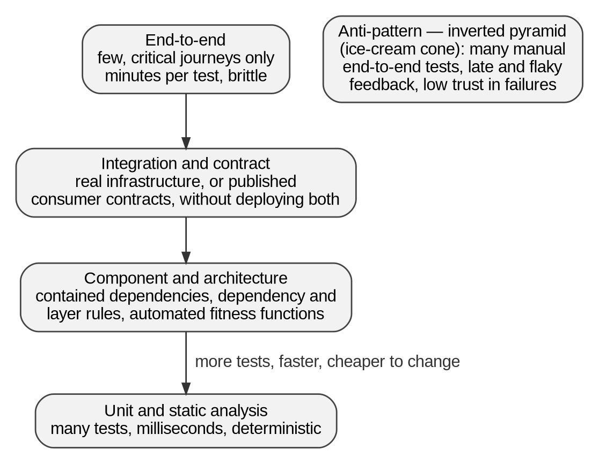
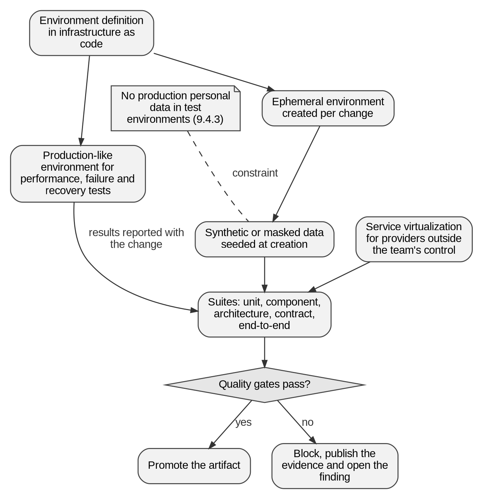
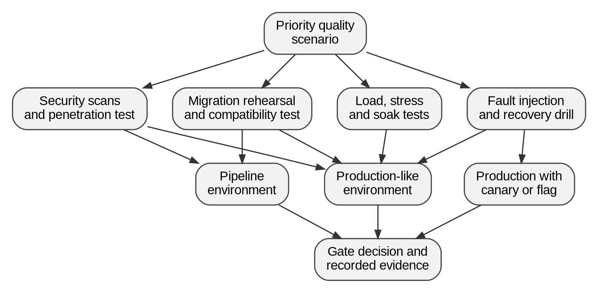
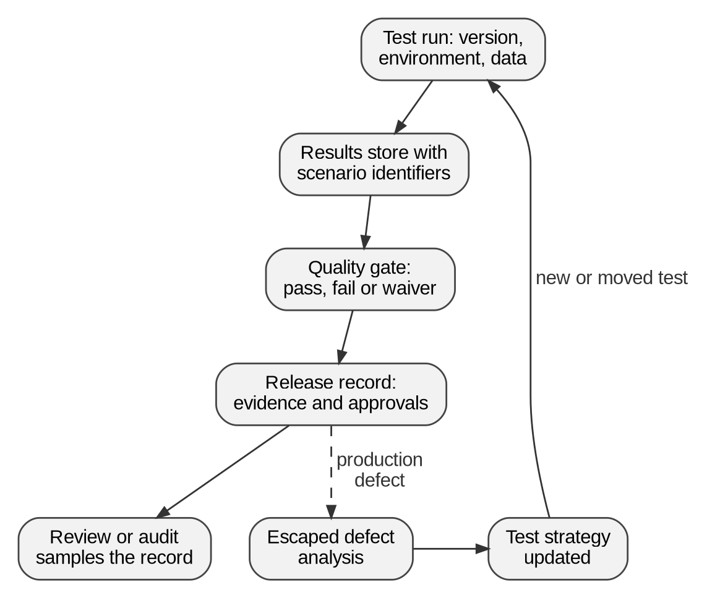

# 14. Testing and Quality Verification

A test strategy states how the solution will be shown to meet its functional and quality requirements, at what cost and with which feedback speed. Defining it is an architectural responsibility: the shape of the architecture determines what can be tested cheaply, and the test strategy determines whether the architecture’s claims can be trusted. This chapter covers the strategy and its levels, the environments, data and gates that run it, the testing of quality attributes, and the effectiveness and evidence of the suite. Chapter 13 decides which claims matter most; Section 16.5.1 describes the test artifacts.

::: {.callout-note appearance="simple" icon=false title="When to Use This Chapter"}
- Writing or reviewing a test strategy for a new solution or a major change.
- Choosing test levels, environments, test data and quality gates.
- Planning performance, failure, security, data-migration and accessibility testing.
- Judging whether the suite is effective and whether its evidence can support a release or an audit.
:::

::: {.callout-tip appearance="simple" icon=false title="Key Takeaway"}
Tests are the evidence behind every architectural claim. Derive them from the priority quality scenarios, run each at the cheapest level that can see the defect, keep the suite reliable enough that a red result is believed, and record results so that a release decision or an audit can rely on them.
:::

## 14.1 Test Strategy

The strategy is the plan for verification. The units below cover what it contains, the levels it uses, their proportions and how quality scenarios become tests.

### 14.1.1 Contents of a Test Strategy

**Definition.** A test strategy is a short living document that fixes what is verified, at which level, with which environments and data, and against which gate — proportionate to risk, and far shorter than a catalog of test cases.

**Purpose.** The strategy exists so that verification is designed rather than improvised. It sets how much risk each quality attribute carries and therefore how much testing it earns, and it names who decides when evidence is sufficient. Proportionality is the whole point: a payment path and a marketing page do not deserve the same gate.

**What it includes.** At a minimum: scope and quality objectives; test levels and the proportion between them; how quality scenarios map to tests; test environments and test data; tooling and automation in the pipeline; quality gates and exit criteria; non-functional and security testing; responsibilities; and how results are reported and kept. Each element is short — a paragraph or a table — and each names an owner, so the document stays usable after the author moves on.

**Why it is needed.** Without a strategy, coverage of quality attributes is accidental, the suite grows wherever testing is easy, and release decisions rest on opinion and the confidence of the loudest person in the room. A strategy that has grown into a catalog of test cases has failed differently: nobody reads it, so it describes a system that no longer exists. The evidence is a current strategy, gate results in the pipeline, and a scenario-to-test mapping that a reviewer can check.

### 14.1.2 Test Levels

**Definition.** A test level is a scope at which verification runs; each level trades fidelity for speed and cost, and no single level proves a system.

**Purpose.** Levels exist so that each defect is caught at the cheapest scope that can see it. A logic error should fail in milliseconds on a developer’s machine, not in a staging environment a day later, and a cross-service compatibility break should fail in the provider’s pipeline rather than in production.

**What it includes.** The strategy defines the levels in Table 14.1, each with a typical owner and a runtime budget. **Contract testing** deserves particular attention in distributed architectures: in consumer-driven contract testing, each consumer publishes the interactions it relies on and the provider’s pipeline verifies them, so incompatible changes are caught before deployment without a shared integration environment. Section 6.2.4 defines the compatibility rules these tests enforce.

| Level | What it proves | Speed and cost | Typical owner |
| :--- | :--- | :--- | :--- |
| Unit | A function or class behaves correctly in isolation | Milliseconds; cheapest | Developers |
| Component | A service or module works with its own dependencies replaced or contained | Seconds | Development team |
| Architecture | The code obeys the agreed dependency and layer rules and the pipeline fails when it does not | Seconds; runs in every pipeline | Architecture owner and development team |
| Integration | Components work with real infrastructure such as a database or broker | Seconds to minutes | Development team |
| Contract | A provider still satisfies what its consumers expect, without deploying both | Seconds; runs in each pipeline | Provider and consumer teams |
| End-to-end | A critical user journey works across the deployed system | Minutes; brittle and expensive | Shared or quality team |
| Exploratory | Unexpected behavior that scripted tests miss | Manual, time-boxed | Testers and product |

: Test levels, what they prove and what they cost

**Why it is needed.** Without declared levels the same behavior is tested three times at the most expensive scope, or a critical path is tested nowhere because everyone assumed another team owned it. Architecture tests are the level most often missing: dependency and layering rules are documented, reviewed and then enforced by nobody, so the diagram and the code diverge quietly. The evidence is an owner and a runtime budget per level, and a suite where a failure at one level is not duplicated at the next.

### 14.1.3 Shape of the Test Portfolio

**Definition.** Portfolio shape is the distribution of tests across levels and the feedback each level gives.

**Purpose.** Shape is the lever on feedback speed and trust. A portfolio weighted toward fast, deterministic levels tells a developer within minutes whether a change is sound; one weighted toward slow, shared tests tells them the next morning, and usually about someone else’s change.

{#fig-14-1 width="100%"}

**What it includes.** The **test pyramid** recommends many fast unit tests, fewer integration tests and very few end-to-end tests. Variants adapt the balance to the architecture: the testing trophy emphasizes integration tests, and the honeycomb emphasizes service-level integration and contract tests for microservices. All of them reject the inverted pyramid — or “ice-cream cone” — of many slow, manual end-to-end tests. The proportions are illustrative rather than prescribed; what matters is that the cheap levels carry the volume and the expensive levels carry only the journeys whose failure would be severe.

**Why it is needed.** The inverted pyramid gives late, unreliable feedback, and an unreliable suite is worse than a small one because it teaches the team to ignore red builds. End-to-end tests also fail for reasons unrelated to the change — shared data, environment drift, a peer team’s deployment — so their failures stop carrying information. The evidence is the distribution of suite runtime, a measured flake rate per level (14.2.3), and escaped defects attributed to the level that should have caught them (14.4.2).

### 14.1.4 Deriving Tests from Quality Scenarios

**Definition.** Deriving tests from scenarios maps each priority quality scenario (1.4) to at least one verification method with a measurable pass criterion.

**Purpose.** This is where evaluation and execution meet: the scenarios ranked during evaluation (13.1.2) become the acceptance criteria for testing, so effort follows risk instead of whatever is easiest to automate. It also makes coverage of quality attributes visible, which functional coverage metrics never do.

**What it includes.** The mapping has one row per priority scenario: the verification method and the section that defines how to run it. Table 14.2 is a starting point rather than a rule — a scenario may need more than one method, and a method may serve several scenarios.

| Quality attribute | Verification method | Section |
| :--- | :--- | :--- |
| Performance and scalability | Load, stress and soak tests at the stated workload | 14.3.1 |
| Availability and resilience | Fault injection and zone-failure exercises | 10.4.1; 14.3.1 |
| Recoverability | Timed restore and failover exercises | 8.2 |
| Security | ASVS-mapped tests, SAST, SCA, authenticated DAST, penetration tests | 9.5; 14.3.2 |
| Data correctness and compatibility | Migration rehearsals, reconciliation and contract tests | 14.3.3 |
| Maintainability and modularity | Architecture tests and other fitness functions | 14.3.5, 13.3.1 |
| Usability and accessibility | Assistive-technology and user testing | 1.2.11; 14.3.4 |
| Interface compatibility | Contract tests | 14.1.2 |

: Quality attributes and the verification method that produces evidence

**Why it is needed.** A scenario with no test is a claim, and a test with no scenario is effort of unknown value. When the mapping is missing, the untested attributes are exactly the ones that are hard to test — availability, recovery, security — which are also the ones whose failure is most expensive. The evidence is a scenario-to-test matrix with a recorded result per priority scenario, which is the artifact the review checklist asks for.

**Example.** When the checkout team added the order-history endpoint, the strategy changed by two rows rather than two pages: a consumer-driven contract test for the mobile client and a performance scenario at the expected query rate. The endpoint’s unit and component tests followed the existing proportions, and no new end-to-end journey was added, because the journey was already covered and the risk sat in the contract.

::: {.callout-warning appearance="simple" icon=false title="Common Pitfall"}
Optimizing for a coverage number instead of for evidence. A team raises line coverage while the untested attributes — recovery, security, failure behavior — stay untested, and the dashboard reports success until the first outage. Tie gates to priority scenarios and critical paths, not to a global percentage, and review which scenarios still have no result.
:::

::: {.callout-important appearance="simple" icon=false title="Decision & Trade-off"}
The portfolio shape should follow where the architecture’s risk sits, not a fixed picture.

| Option | Choose when | Consequences |
| :--- | :--- | :--- |
| Pyramid: most tests at unit level | Logic-heavy components with few integrations | Fast, cheap feedback; misses wiring and configuration faults |
| Trophy or honeycomb: emphasis on integration and contract tests | Services whose risk lies in interactions with stores, brokers and other services | Catches integration faults early; slower tests need contained dependencies |
| Heavy end-to-end suite, as a transitional state | Legacy system without seams for lower-level tests | Some protection where nothing else is possible; slow, flaky and expensive, so plan to add seams |
:::

## 14.2 Environments, Data and Pipelines

Tests are only as meaningful as the conditions they run in and only as useful as the trust their results earn. The units below cover environments and data, the gates that act on results, and the reliability that makes those gates credible.

### 14.2.1 Test Environments and Data

**Definition.** A test environment is the deployed configuration in which a test runs; test data is the state it starts from.

**Purpose.** Results are meaningful only when the environment and data resemble the conditions the claim is about. A latency target measured on an idle environment, or a recovery drill against an empty database, produces a number that cannot support a decision.

{#fig-14-2 width="100%"}

**What it includes.** Prefer short-lived environments created on demand from infrastructure as code over long-lived shared test environments, which drift and become bottlenecks (11.1.4); Section 11.1.5 sets out which tests and operational practices belong to each environment. Use service virtualization or contained dependencies for components outside the team’s control, and contract tests instead of large shared integration environments. Test data is synthetic or masked; production personal data is not copied into test environments (9.4.3). Keep the environments that validate performance and recovery close enough to production to make their results meaningful, and document the differences that remain.

**Why it is needed.** Shared environments accumulate undocumented changes until nobody can explain a failure, and they serialize teams behind a single booking calendar. Copying production data is worse than slow: it turns a test convenience into a privacy incident with a regulatory consequence. The evidence is environment definitions held as code, a recorded provenance for test data, and a written difference between the performance environment and production.

### 14.2.2 Quality Gates, Shift-Left and Shift-Right

**Definition.** A quality gate is an automated decision point that blocks promotion when defined evidence is missing or failing.

**Purpose.** Gates enforce the strategy without a meeting. They make the agreed threshold the path of least resistance, so quality does not depend on who is reviewing at 6 p.m. before a release.

**What it includes.** Gates run fast tests on every change and broader suites before promotion, with explicit thresholds for coverage of critical paths, security findings and performance regressions. **Shift-left** moves verification earlier — design reviews, threat modeling, test-driven development (TDD) and behavior-driven development (BDD) with executable specifications. **Shift-right** continues verification in production through canary analysis, synthetic monitoring, feature flags and controlled chaos experiments (10.4.1, 11.1.2). Neither replaces the other: shift-left cannot reproduce production traffic, and shift-right cannot tell you before merge that the change is wrong.

**Why it is needed.** A gate that only warns is a gate that is ignored, and a gate that blocks on flaky tests is bypassed within weeks — after which every gate is suspect, including the ones that work. Gates also concentrate risk when they are the only defense: a threshold on coverage of critical paths says nothing about whether those paths are the right ones. The evidence is gate results per change, bypass records with an owner and an expiry, and trends in escaped defects and test reliability.

### 14.2.3 Test Reliability and Flaky Tests

**Definition.** A flaky test passes and fails on the same code and configuration; test reliability is the share of runs whose result reflects the change under test.

**Purpose.** A suite is useful only while its red results are believed. Reliability decides whether gates (14.2.2) can block promotion and whether developers investigate a failure or simply run the suite again.

**What it includes.** Table 14.3 lists the common causes. Measure the flake rate per test and per level by re-running failures on unchanged code. Quarantine a flaky test out of the blocking gate with an owner and an expiry date, and fix or delete it before that date. Automatic retries may keep the pipeline moving, but report them, because a retry that passes can hide a real intermittent defect as easily as a flaky test. Remove the causes by design: data created per test, controlled clocks, waits on conditions instead of fixed sleeps, contained dependencies and ephemeral environments (14.2.1). Watch suite runtime as well, because a slow suite runs less often and its failures arrive too late to help.

| Cause | Symptom | Remedy |
| :--- | :--- | :--- |
| Timing and asynchronous waits | Fails under load or on slow runners | Wait for a condition with a timeout; control the clock |
| Shared or leftover test data | Result depends on other tests or earlier runs | Create data per test; isolate and clean up |
| Order dependence | Passes alone, fails in the suite | Randomize the order in the pipeline; remove shared state |
| External dependencies | Fails when a third-party sandbox is slow or down | Service virtualization or contract tests; run real-dependency checks on a schedule |
| Environment drift | Fails in only one shared environment | Ephemeral environments from code; record environment versions |
| Concurrency and resource leaks | Intermittent failures late in long runs | Isolate resources, detect leaks and run soak tests separately |

: Common causes of flaky tests and their remedies

**Why it is needed.** A flaky suite trains the team to ignore red builds, and a real failure is then merged along with the noise. Quarantine without an expiry turns into a permanent hole in the suite. The evidence is a measured flake rate per level, a quarantine list with owners and dates, retry counts in the pipeline report, and suite runtime within its budget.

**Example.** After the payment provider moved its sandbox to another region, the checkout contract suite failed about one run in thirty. Re-runs on unchanged code showed that the failures were sandbox timeouts, not contract breaks. The team replaced the sandbox call in the pipeline with a virtualized provider driven by the published contract, and kept one scheduled nightly run against the real sandbox, so a genuine provider change is still detected within a day.

::: {.callout-warning appearance="simple" icon=false title="Common Pitfall"}
Re-running the pipeline until it turns green. Each re-run seems harmless, but the habit hides intermittent defects, wastes runner time and makes every red build ambiguous. Measure the flake rate, quarantine flaky tests with an owner and an expiry, report retries, and treat a test that cannot be made reliable as a defect in the suite.
:::

::: {.callout-important appearance="simple" icon=false title="Decision & Trade-off"}
Environment strategy trades feedback speed against fidelity, and the right answer differs by test type.

| Option | Choose when | Consequences |
| :--- | :--- | :--- |
| Long-lived shared test environment | A small number of teams, stable dependencies, and no acceptable way to script the environment | Familiar and always available; drifts, serializes teams and produces failures nobody can explain |
| Ephemeral environment per change from infrastructure as code | Most application testing with scriptable infrastructure | Fast, isolated and reproducible; needs investment in infrastructure code and test-data seeding |
| Ephemeral environments plus a production-like environment for performance and recovery | Claims about load, failover or restore time are part of the release decision | Evidence that can support the claim; the production-like environment is expensive and must be kept honest with a documented difference |
:::

## 14.3 Quality-Attribute Testing

Functional tests show that features work; the tests in this section show that the system meets its quality scenarios under load, failure, attack, change and diverse use, and that its structure still matches the intended architecture. Figure 14.3 maps scenarios to methods and to the environments where each runs.

{#fig-14-3 width="100%"}

### 14.3.1 Performance and Failure Testing

**Definition.** Performance and failure testing measures how a system behaves at and beyond its expected load, and when a dependency or component fails.

**Purpose.** These tests validate the quality scenarios that only appear under load or failure, and they are the ones most often replaced by an opinion. They answer two different questions: whether the system meets its targets at the expected peak, and how it degrades when a target is exceeded or a dependency disappears.

**What it includes.** Testing covers the types in Table 14.4, run against a realistic workload and representative data with explicit pass and fail criteria. Record the tested version, environment, limitations and follow-up actions, because a performance result without those four facts cannot be reproduced or trusted later. Performance engineering (10.4.3) explains how to find the constraint once a test shows one.

| Test type | Answers | Example |
| :--- | :--- | :--- |
| Load | Does it meet targets at expected peak? | 500 submissions/s, p99 ≤ 2 s |
| Stress | Where and how does it fail beyond peak? | Ramp until saturation; observe degradation |
| Soak | Does it degrade over time? | 24 h at typical load; watch memory and backlog |
| Fault injection (chaos) | Does it tolerate dependency or component failure? | Provider timeout; zone loss |
| Disaster recovery | Can it be restored within RTO/RPO? | Regional failover; restore from backup |
| Contract | Do producers and consumers remain compatible? | Consumer-driven tests in CI |

: Test types for performance, resilience and compatibility

**Why it is needed.** A short benchmark under ideal conditions cannot validate resilience, and a soak test at a tenth of the expected load proves only that the environment is stable. Worse, a single green performance run is often treated as a permanent property, so the next release ships a regression nobody measures. The evidence is a report stating p99 at the stated load, the observed saturation point and degradation mode, recovery times against RTO and RPO, and the follow-up actions with owners.

### 14.3.2 Security Testing in the Strategy

**Definition.** Security testing verifies that security requirements and controls hold against the threats in the threat model, using automated analysis in the pipeline and targeted manual testing.

**Purpose.** The strategy decides which techniques run where and which findings block a release, so security verification is part of every change rather than a late event before launch. Chapter 9 owns the controls and the techniques (9.5.3); this unit places them in the test portfolio.

**What it includes.** Derive tests from the threat model (9.1.1) and the security requirements, using ASVS (9.5.2) as the requirement catalog where it fits. Run static analysis, dependency and container scanning and secret detection on every change; run authenticated dynamic testing (9.5.4) and API fuzzing against a deployed environment before promotion; and schedule penetration tests (9.5.5) for major releases, new external surfaces and high-risk changes. Write security regressions as ordinary tests, such as an authorization test showing that one customer cannot read another customer’s order. Set gates by severity and exploitability, with fix deadlines and exceptions that carry an owner and an expiry (9.6.2, 9.6.3). Keep test credentials and data synthetic, and test the pipeline’s own security as part of the supply chain (9.5.6).

**Why it is needed.** A defect found only by the annual penetration test arrives months after it was introduced, when fixing it is expensive, and gates that fail on every low-severity finding get switched off. The evidence is security tests mapped to threats and requirements, scan results and gate decisions per change, penetration-test findings tracked to closure, and exceptions with expiry dates.

### 14.3.3 Data, Migration and Compatibility Testing

**Definition.** Data, migration and compatibility testing verifies that schema changes, data migrations and interface changes preserve correctness for existing data and existing consumers.

**Purpose.** Some of the most damaging releases change no visible feature: a migration that truncates a column, an event schema that breaks a consumer, or a backfill that doubles totals. These tests catch changes whose consequences are invisible to functional tests.

**What it includes.** Test schema migrations forward and, where a rollback is promised, backward, on masked data of production size, and time them, because a migration that locks a table for an hour is an outage. Use the expand-and-contract sequence so that old and new versions run side by side, and test both versions against the expanded schema (11.2.2). For data migrations, reconcile counts, sums and samples between source and target, and rehearse the cut-over and the rollback (15.1.3). For interfaces and events, run consumer-driven contract tests and schema-compatibility checks in the producer’s pipeline (14.1.2, 6.2.4). In data pipelines, check completeness, validity, uniqueness and freshness, with thresholds that stop publication (5.3.4).

**Why it is needed.** A migration tested on an empty database proves only that the script runs, and a reconciliation skipped to meet a cut-over date becomes months of customer disputes. The evidence is migration timings on representative volumes, reconciliation reports accepted by the data owner, a rehearsed rollback, and compatibility checks that ran in the producer’s pipeline.

### 14.3.4 Accessibility and Usability Testing

**Definition.** Accessibility testing verifies that people with disabilities can use the solution, against a standard such as WCAG 2.2; usability testing observes representative users completing real tasks.

**Purpose.** Both are quality attributes with legal, commercial and ethical weight (1.2.11), and both fail late and expensively when they are left to a final review. The strategy decides which checks are automated and where people must test.

**What it includes.** Run automated accessibility checks on every change to catch detectable issues such as missing text alternatives, insufficient contrast and unlabeled controls. Automated tools find only part of the problems, so add keyboard-only and screen-reader testing of the critical journeys before release, and an expert or user review for major changes. Build accessibility into the shared component library so that most screens inherit it (7.6.5). Run usability sessions on the critical journeys with a few representative users per iteration, measuring task completion, time and errors, and track the findings like defects with owners. Where regulation requires a conformance statement (17.4.1), keep the test evidence behind it.

**Why it is needed.** An inaccessible checkout excludes customers and can breach regulation, and a conformance claim without test evidence fails its first audit. The evidence is automated check results per change, manual test records for the critical journeys, usability findings with owners and a dated conformance statement.

### 14.3.5 Architecture Tests

**Definition.** An architecture test is an automated check that the built system conforms to its intended architecture: dependency direction, module and service boundaries, interface compatibility, runtime topology and deployment rules.

**Purpose.** Functional tests prove behavior and quality tests prove load or failure handling, but neither notices that the domain layer now imports a database driver or that one service reads another's tables. Architecture tests turn the dependency rules of 7.2.1 and the decisions in ADRs into failing builds, so erosion is caught in the change that causes it rather than in the next evaluation. They are the most common kind of fitness function (4.7); Section 13.3.1 decides which evaluation findings become one, and this unit decides how they run in the test portfolio.

**What it includes.** Table 14.5 lists the rule types, how each is checked and when it runs. Structural rules run on every build with a rule library in the build language or a dependency-graph tool: layer direction, forbidden imports, cycles between modules and access to another module's data. Interface rules compare a changed API or event schema with the published version and fail on a breaking change, alongside the consumer-driven contract tests of 14.1.2. Runtime rules compare the service graph observed in distributed traces with the intended container view, for example to detect a new synchronous call chain or a direct call to an external provider that should go through an adapter. Deployment rules are policy as code on the infrastructure definitions (8.3.1). Each rule names the ADR or principle it protects, has an owner, and fails with a message that says what to do; an accepted exception is recorded with an expiry, not by deleting the rule.

| Rule type | Example rule | How it is checked | When it runs |
| :--- | :--- | :--- | :--- |
| Layering and dependency direction | The domain does not import infrastructure | Import analysis with a rule library in the build language | Every build |
| Module and service boundaries | No cycles between modules; Order never reads Payments tables | Dependency graph and data-access checks | Every build |
| Interface compatibility | Public API and events stay backward compatible | Schema diff against the published version, plus contract tests | Every change to a contract |
| Runtime topology | No synchronous chain longer than three services; providers reached only through adapters | Service graph from traces compared with the container view | Scheduled, in staging and production |
| Deployment and infrastructure | Data stores are not publicly reachable; every service spans two zones | Policy as code on infrastructure definitions | Every infrastructure change |
| Conventions | Every service declares an owner and propagates correlation IDs | Catalog and configuration checks | Every build |

: Architecture test types, how each is checked and when it runs

**Why it is needed.** Architecture erodes one reasonable change at a time; reviews see a sample of changes and evaluations happen months apart, so a boundary can be gone before anyone looks. A rule that only exists in a document is advice. The evidence is a set of architecture tests linked to the ADRs they protect, failures that blocked or changed a merge, and an exception list with owners and expiry dates.

**Example.** Before the second payment provider went live, the checkout team ran the methods of Figure 14.3 against its scenarios: a load test at 120% of peak, a fault-injection run blocking each provider in turn, an authorization test showing that one customer cannot read another’s payment attempts, and a rehearsal of the migration that adds a provider column to the payment records, timed on a masked copy of production size. A keyboard-only test of the new provider choice found a control that could not be reached without a mouse, which was fixed before release, and a new architecture test rejected a change that called the second provider's client library directly from the Order service instead of through the payment adapter.

::: {.callout-warning appearance="simple" icon=false title="Common Pitfall"}
Testing quality attributes once, before the first launch. The load test, penetration test and accessibility review are run for go-live and never repeated, so later releases regress silently. Schedule each quality test by trigger — every release, every new external surface, every schema change — and keep its result as release evidence.
:::

::: {.callout-important appearance="simple" icon=false title="Decision & Trade-off"}
Where a quality attribute is tested trades realism against risk to users and data.

| Option | Choose when | Consequences |
| :--- | :--- | :--- |
| Pre-production only, in a production-like environment | Regulated or safety-critical systems; tests that could harm data or users | Safe and repeatable; differences from production limit what the results prove |
| Production with controls: canary, feature flags and bounded fault injection | Mature observability, fast rollback and tolerant users | The most realistic evidence; needs blast-radius limits, abort conditions and approval |
| Pre-production for gates and production for confirmation | The most consequential services | The strongest evidence; the highest cost in tooling and coordination |
:::

## 14.4 Test Effectiveness and Evidence

A suite earns trust when it finds the defects that matter and when its results can be shown later. The units below measure the first and preserve the second.

### 14.4.1 Test Effectiveness and Mutation Testing

**Definition.** Test effectiveness is the degree to which a suite detects the defects that matter; mutation testing, surveyed by Jia and Harman, measures it by injecting small faults into the code or configuration and checking whether the suite fails.

**Purpose.** Coverage counts what the suite executes, not what it would catch. Mutation testing answers the harder question — whether an assertion would notice a wrong result — and it gives the team a way to invest in the tests that protect critical behavior instead of raising a percentage.

**What it includes.** Line and branch coverage show which code ran; mutation testing seeds small changes (mutants), runs the suite and counts a mutant as killed when a test fails. The mutation score is killed mutants divided by all non-equivalent mutants; equivalent mutants are syntactically different but behave identically, so no test can kill them, and they are triaged out of the score. The cost is real: each mutant runs the suite, so use it selectively on critical modules, changed code or a nightly job rather than on every commit. Set thresholds by risk, review surviving mutants with the owner and keep the runtime inside the pipeline budget. AI-assisted tools can propose mutants, prioritize the ones likely to survive and help classify equivalent mutants; treat their output as a draft for human review, not as a verdict.

| Measure | Question it answers | Cost | When to use |
| :--- | :--- | :--- | :--- |
| Line and branch coverage | Which statements or branches ran? | Low; every build | Find unexecuted code; it is not proof of detection |
| Mutation testing | Would a test fail if the behavior changed? | High; the suite runs once per mutant | Critical modules, changed code or a nightly job |

: Coverage and mutation testing compared

**Why it is needed.** A suite can execute every line and assert almost nothing, so a coverage target can rise while the defects it was meant to catch pass through. Mutation testing exposes those weak assertions and gives a defensible answer to “are these tests good enough for this module?”. The evidence is a mutation score on the critical modules, a triaged list of surviving mutants with owners, and a recorded runtime that fits the gate.

### 14.4.2 Test Metrics and Escaped Defects

**Definition.** Test metrics describe whether the suite finds defects early, runs fast enough and stays reliable; an escaped defect is one found after the stage that should have caught it.

**Purpose.** Metrics show where to invest in testing and where tests cost more than they return. Escaped defects are the most honest signal, because they count what the suite missed rather than what it executed.

**What it includes.** Track a small set of measures, each with an owner and a question it answers (Table 14.7). Analyze each serious escaped defect: identify the cheapest level that could have caught it, and add or move a test there. Read change failure rate and time to restore, the delivery measures of Chapter 11, beside the test measures, because a suite that passes while releases fail is testing the wrong things. Report trends rather than single values, and do not rank teams by these numbers: a metric used for comparison is soon optimized for appearance.

| Metric | Question it answers | How it is gamed |
| :--- | :--- | :--- |
| Escaped defects by level | Where does the suite miss defects? | Counting only severe incidents hides frequent small escapes |
| Change failure rate | How often does a release need remediation? | Lowered by releasing less often, which raises the risk of each release |
| Flake rate per level | Can failures be trusted? | Hidden by automatic retries |
| Suite runtime per level | Is feedback fast enough to be used? | Cut by deleting slow but valuable tests |
| Mutation score on critical modules | Would the tests notice a wrong result? | Raised by testing trivial code |
| Scenario coverage | Does every priority scenario have a current result? | Old results reported as current |

: Test metrics, the question each answers and how it is gamed

**Why it is needed.** Without metrics, test investment follows habit; with the wrong ones, coverage climbs while incidents continue. The evidence is a trend report reviewed by the teams that own the tests, escaped-defect analyses that led to new or moved tests, and metric definitions with owners.

### 14.4.3 Test Evidence for Release and Audit

**Definition.** Test evidence is the recorded result of a test run — what was tested, which version, in which environment and with what outcome — kept so that a release decision, a review or an audit can rely on it.

**Purpose.** A green pipeline is evidence only while someone can show what it ran. Release approvals, regulated changes and audits need results tied to requirements and versions, not a statement that testing happened.

**What it includes.** For each run, record the version or artifact digest, the environment and its differences from production, the provenance of the test data, the results with their scenario or requirement identifiers, waivers with owners and expiries, and the gate decision (Figure 14.4). Attach the evidence to the release record (11.1.1) and to the architecture review record where a decision depended on a test (16.5.4). Keep evidence for the period that regulation or contract requires, and protect it from editing (9.7.2). Close the loop: each escaped defect updates the strategy, which changes the next run.

{#fig-14-4 width="100%"}

**Why it is needed.** Evidence that cannot be found or reproduced is a claim, a waiver without expiry becomes a permanent exception, and in a regulated audit missing records count as missing tests. The evidence of the practice is release records that link to test results by version, sampled audits that find complete records, and an escaped-defect loop that changes tests.

**Example.** An internal audit of payment changes sampled ten checkout releases. Each release record linked the artifact digest to its pipeline results, the load-test report with its environment differences, and any waivers. One waiver had expired without a fix, which became a finding and a new rule: an expired waiver blocks the next release until it is renewed by its owner or closed.

::: {.callout-warning appearance="simple" icon=false title="Common Pitfall"}
Turning test metrics into targets for teams. When escaped defects or coverage become performance targets, teams reclassify defects, test trivial code and stop reporting flaky tests, so the numbers improve while quality does not. Use metrics to decide where to invest in tests, review them with the teams that own them, and pair each with the question it answers.
:::

::: {.callout-important appearance="simple" icon=false title="Decision & Trade-off"}
How much test evidence to keep trades audit readiness against storage and effort.

| Option | Choose when | Consequences |
| :--- | :--- | :--- |
| Pipeline logs only, kept for a short period | Low-risk internal systems | Cheap; cannot answer questions about older releases |
| Structured results per release, linked to scenarios and requirements | Most production systems | Supports review and incident analysis; needs result formats and a store |
| Immutable, signed evidence retained as regulation requires | Regulated or contractual obligations | Ready for audit; costs storage, tooling and access control |
:::

## 14.5 Worked Example: The Checkout Test Strategy

*In practice:* This example shows the test strategy of the reference checkout and how it handled one release. Numbers are illustrative.

The reference checkout’s strategy is small and explicit: roughly 2,000 unit and static checks, 300 component and architecture checks, 40 consumer-driven contract tests and nine end-to-end journeys covering search, checkout and refund; the pull-request pipeline finishes in about twelve minutes. A nightly soak runs at typical load, a load test runs at 120% of peak before each release, and a quarterly drill restores the order store and fails over a zone. Table 14.8 links the priority scenarios to their tests and gates.

| Scenario | Test | Where and when | Gate |
| :--- | :--- | :--- | :--- |
| QAS-PERF-01: acknowledgment within 2 s at p99 | Load test at 120% of peak | Production-like environment, before each release | Blocks the release if p99 exceeds 2 s |
| QAS-AVL-02: 10-minute provider outage | Fault injection blocking the provider | Production-like environment, monthly and after payment changes | Blocks the release if any order is lost |
| QAS-INT-03: no second charge after a timeout | Forced-timeout contract run on 10,000 attempts | Pipeline, every payment change | Blocks the merge on any duplicate |
| Customer isolation | Authorization tests across customers | Pipeline, every change | Blocks the merge |
| Accessible checkout | Automated checks and a keyboard-only journey | Pipeline; manual before each release | Blocks the release on a critical issue |

: Checkout scenarios, tests and gates

**1. The regression.** The load test before one release showed p99 acknowledgment 40 ms slower than the previous run, still within the target. Because every run records the version and the environment differences, the team traced the regression to a connection-pool change rather than to the provider, and fixed it before it consumed the margin.

**2. The flaky contract.** The contract suite’s flake rate rose after the provider moved its sandbox (14.2.3). The flaky test was quarantined with an owner and a one-week expiry, and replaced by a virtualized provider plus a nightly real-sandbox run.

**3. The evidence.** The release record linked the artifact digest, the gate results, the load-test report and one waiver for a low-severity scanner finding with a two-week expiry.

**Evidence.** strategy document, scenario-to-test matrix, gate results per change, flake and runtime trends, release records.

::: {.callout-note .review appearance="minimal" icon=false title="Architecture Review Checklist — Testing"}

☐  Is every priority quality scenario linked to test evidence?

☐  Does the test strategy define levels, contract testing, environments, test data and quality gates proportionate to risk?

☐  Are flaky tests measured, quarantined with an owner and an expiry, and kept out of blocking gates?

☐  Are security, data-migration and accessibility tests scheduled by trigger rather than run only before the first launch?

☐  Can each release show its test results by version, with environment differences and waivers recorded?

☐  Do architecture tests enforce dependency, boundary, interface and deployment rules in the pipeline, each linked to the decision it protects?
:::

## 14.6 Further Reading

- Crispin and Gregory (2008), *Agile Testing*.
- Vocke (2018), “The Practical Test Pyramid” (martinfowler.com).
- Humble and Farley (2010), *Continuous Delivery*.
- Meszaros (2007), *xUnit Test Patterns: Refactoring Test Code*.
- Jia and Harman (2011), “An Analysis and Survey of the Development of Mutation Testing,” *IEEE Transactions on Software Engineering* 37(5).
- Luo, Hariri, Eloussi and Marinov (2014), “An Empirical Analysis of Flaky Tests,” *Proceedings of the 22nd ACM SIGSOFT International Symposium on Foundations of Software Engineering*.
- ISO/IEC/IEEE 29119-1:2022, *Software and systems engineering — Software testing — Part 1: General concepts*.
- Rosenthal and Jones (2020), *Chaos Engineering: System Resiliency in Practice*.
- OWASP *Web Security Testing Guide*; W3C *Web Content Accessibility Guidelines (WCAG) 2.2*.
- Pact documentation (docs.pact.io) — consumer-driven contract testing.
