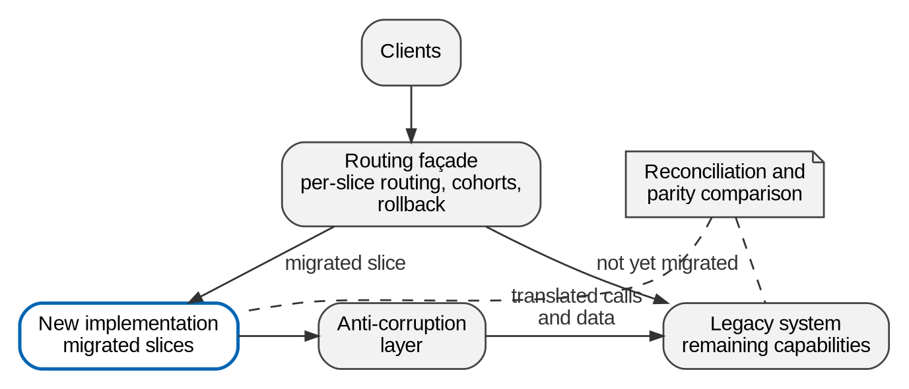
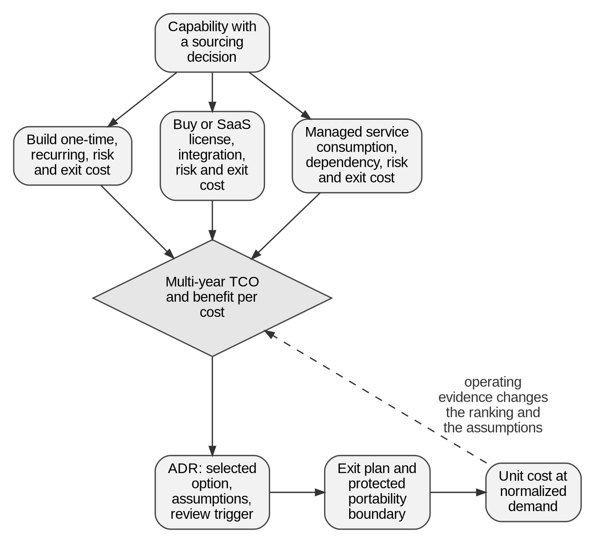
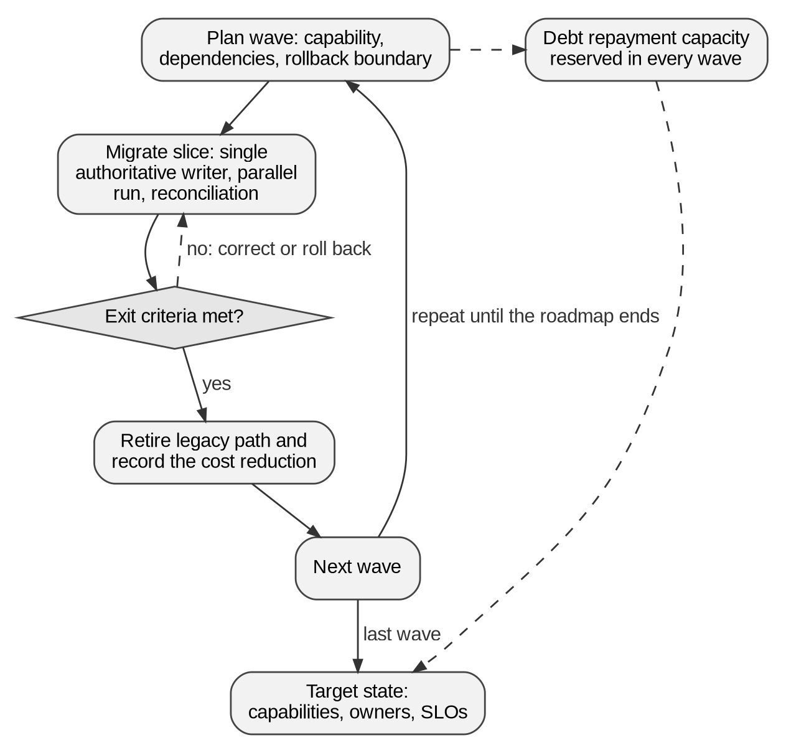

# 16. Architecture Evolution and Economics

Evolutionary architecture makes the cost of change visible and manageable. A modernization plan identifies which capability changes, which interfaces remain stable and which risks can be reduced incrementally. Economic reasoning — lifecycle cost, risk exposure, organizational capacity and the value of reversibility — is part of every significant architecture decision, not a separate finance exercise.

::: {.callout-note appearance="simple" icon=false title="When to Use This Chapter"}
- Planning the modernization or migration of a legacy capability or data store.
- Comparing build, buy and managed-service options, or architecture alternatives that differ in cost.
- Deciding how much technical debt to accept, and when to repay it.
- Preparing an exit plan or roadmap for a critical dependency.
- Evaluating vendors and products through an RFP or a proof of concept.
- Assessing a portfolio before a cloud migration.
:::

::: {.callout-tip appearance="simple" icon=false title="Key Takeaway"}
Change is cheapest when it is incremental, reversible and measured. Modernize in slices that each have one authoritative writer, reconciliation and a rollback path, and compare options on multi-year cost and benefit — including operations, risk and exit — rather than on license or build price.
:::

## 16.1 Modernization and Migration

Modernization is a portfolio of small, reversible moves rather than a single replacement program. The section covers the options available per capability, the pattern that lets old and new implementations coexist safely, and the data work that usually decides whether a migration succeeds.

### 16.1.1 Modernization Options

**Definition.** Modernization options are the standard ways of changing how a capability is delivered and operated, usually summarized as the “Rs” of migration; naming varies between sources, and the set below follows a widely used seven-option version that originated in cloud migration guidance.

**Purpose.** The options give a shared vocabulary for the first architectural decision of any modernization: what kind of change is this capability worth? They inform the investment case, the sequencing of a roadmap and the boundary between architectural work and pure infrastructure work, and they prevent a single preferred answer — usually “rebuild” or “lift and shift” — from being applied to an entire estate.

**What it includes.** Each option describes a different depth of change and a different expected benefit (Table 16.1). Applying them requires a capability-level assessment of business value, technical condition, change drivers, dependencies and risk, plus an explicit statement of the benefit the chosen option is expected to deliver.

| Option | What it means | Fits when |
| :--- | :--- | :--- |
| Retire | Decommission the capability | It no longer delivers enough value |
| Retain | Keep as is for now | Change would cost more than it returns, or another dependency must move first |
| Rehost | Move to new infrastructure with minimal change (“lift and shift”) | Speed matters, for example a data-center exit; benefits are limited |
| Relocate | Move to another platform of the same type, for example between virtualization platforms | Infrastructure change without application change |
| Repurchase | Replace with a commercial or SaaS product | The capability is not differentiating |
| Replatform | Adopt managed services with limited code change | Operational burden is the main problem |
| Refactor | Restructure or rebuild to change architectural characteristics | Scalability, agility or cost needs cannot be met otherwise |

: Modernization options and when each fits

**Why it is needed.** A migration that reproduces the old system in the new environment without changing its constraints may raise cost without delivering the intended benefit, and big-bang replacement concentrates integration and cut-over risk in one window. The evidence that the choice was sound is a capability-level options analysis naming the value, the change drivers, the selected option and the rejected alternatives with the reason each was rejected.

### 16.1.2 Strangler Fig Migration

**Definition.** The Strangler Fig pattern places a routing façade in front of the legacy system and moves capabilities to a new implementation one slice at a time while both coexist, with an anti-corruption layer translating between the legacy model and the new domain model.

**Purpose.** The pattern converts a high-risk replacement into a sequence of bounded, reversible releases. It lets the organization learn from production behavior, retire legacy functions only when evidence supports it, and keep serving customers throughout — which is why it is the default choice for capabilities whose business rules are poorly documented or whose replacement cannot be paused.

**What it includes.** A routing façade that decides which implementation serves each request; an anti-corruption layer that isolates the legacy model; one authoritative writer for each data domain during coexistence; and a defined cut-over point, rollback boundary and migration gate per slice (Figure 16.1). Each gate routes a bounded cohort to the replacement, compares outputs with the legacy path through a shadow or parallel run, confirms rollback ownership and stop conditions, and retires the legacy path only when correctness and operational readiness are demonstrated.

{#fig-16-1 width="100%"}

**Why it is needed.** Dual writes without reconciliation create divergent records that nobody can safely merge, and a façade without a single authoritative writer simply moves the ambiguity. Without slice gates, coexistence becomes permanent and the organization pays for two systems indefinitely. The evidence is a per-slice record of authoritative writer, reconciliation frequency and thresholds, cohort size, rollback window and legacy endpoints retired.

### 16.1.3 Data Migration Strategies

**Definition.** A data migration strategy is the planned movement and transformation of persistent data from a source system to a target system while both must remain correct; data is usually the hardest part of a migration because it must stay correct while the systems around it change.

**Purpose.** The strategy determines downtime, risk exposure and the evidence available before cut-over. Choosing it early lets the architect size the coexistence period, the reconciliation effort and the rollback plan, and it exposes data-quality problems while there is still time to fix them.

**What it includes.** The main approaches differ in how much downtime and coexistence they require (Table 16.2). Whatever the approach, the plan covers early profiling and cleansing of source data, transformation rules agreed with business owners, validation by record counts, checksums, business totals and sampled field comparison, a rehearsal with production-like volumes and measured duration, and an explicit rollback point including how data written after cut-over would be carried back.

| Strategy | How it works | Trade-offs |
| :--- | :--- | :--- |
| Big bang | Migrate all data in one cut-over window | Simple to reason about; long downtime and high risk if the cut-over fails |
| Incremental (trickle) | Move data in batches by entity, tenant or time range | Lower risk per step; both systems must coexist and stay consistent |
| Continuous synchronization | Replicate changes from old to new, often with change data capture, until cut-over | Minimal downtime; requires careful handling of conflicts and ordering |
| Parallel run | Run both systems on the same inputs and compare outputs before switching | Strong evidence of correctness; doubles operating effort for a period |

: Data migration strategies and their trade-offs

**Why it is needed.** Unvalidated transformation silently corrupts records, and the failure usually surfaces weeks later as a reconciliation break or a regulatory report that does not add up. A migration without a rehearsal cannot state how long cut-over takes or whether the rollback actually works. The evidence is a data migration plan with profiling results, business-owned transformation rules, validation criteria, a measured rehearsal and a tested rollback point.

### 16.1.4 Cloud Migration Assessment

**Definition.** A cloud migration assessment establishes what a portfolio contains, how its parts depend on each other and which modernization option suits each, before any workload moves.

**Purpose.** It replaces a single migration decision with an evidence-based plan per workload, and it reveals the dependencies that decide which systems must move together.

**What it includes.** Discover applications, data, infrastructure, licenses, owners and support dates, using automated discovery as well as interviews, because undocumented dependencies are the main source of surprises. Map dependencies to form migration groups, and pay special attention to latency-sensitive paths and to large data sets that are slow and costly to move. Classify each workload against the options in 16.1.1 using its business value, technical condition, compliance limits and remaining life, and name those to retire or retain. Check licensing terms in the target environment. Confirm that the landing zone (8.1.1), identity, connectivity (8.6.2) and operating model are ready. Build the business case on multi-year cost (16.2.3), including the period of running both estates. Sequence the work in waves, beginning with a low-risk workload that exercises the whole path, and define the rollback point and acceptance criteria for each wave.

**Why it is needed.** Migrations planned from an inventory spreadsheet tend to split systems that depend on each other, and they discover the licensing or latency constraint during cut-over. The evidence is a discovery record with named owners, a dependency map, a recorded option per workload, a readiness review of the landing zone and a completed pilot wave with measured results.

**Example.** The reference checkout scenario keeps payment data in a regulated store while order data moves to a new platform. The team profiles the source, agrees transformation rules with finance, runs continuous synchronization, and validates business totals daily against the provider’s settlement reports before retiring the old store.

::: {.callout-warning appearance="simple" icon=false title="Common Pitfall"}
Treating a migration plan as a schedule rather than a risk-reduction sequence. Teams announce a cut-over date, skip the parallel run to protect it, and discover the reconciliation gap in production. Plan the evidence first — profiling, business-owned rules, validation criteria and a rehearsal — and let the date follow from the evidence, not the other way around.
:::

::: {.callout-important appearance="simple" icon=false title="Decision & Trade-off"}
How should a legacy capability be modernized?

| Option | Choose when | Consequences |
| :--- | :--- | :--- |
| Rehost or replatform the whole capability | The main driver is infrastructure exit or operational burden and the business rules are stable | Fastest route out of the data center and least business change; architectural constraints travel with the code and cost may rise |
| Strangler Fig, slice by slice | Business rules are poorly documented, the capability is business-critical, or delivery must continue throughout | Bounded risk and continuous learning; prolonged coexistence, reconciliation effort and disciplined retirement gates |
| Rebuild and replace in one release | The capability is small, well understood, and a short outage is acceptable | Clean target design and no coexistence cost; concentrated risk and a long feedback gap before the first real evidence |
:::

## 16.2 Architecture Economics and Sourcing

Economic reasoning turns architecture options into comparable propositions: what the organization pays over the life of the solution, what risk it carries, what it can reverse, and what each unit of delivered value costs.

{#fig-16-2 width="100%"}

### 16.2.1 Technical Debt

**Definition.** Technical debt is the future cost or constraint created by a design choice; it is not the same as old technology.

**Purpose.** The metaphor gives teams a way to discuss shortcuts as decisions with a price rather than as moral failings. It informs prioritization of remediation work, the capacity reserved for repayment in each delivery cycle, and the conversation with business owners about why a shortcut that saves a sprint may cost several later.

**What it includes.** Fowler’s technical debt quadrant distinguishes debt by whether it was deliberate or inadvertent and prudent or reckless. A deliberate, prudent shortcut with a known repayment trigger can be rational; reckless debt and unowned coupling that repeatedly delays releases are not. A debt register records, for each item, the concrete consequence — the “interest” in slower changes, incidents, cost or risk — the evidence for it, the remediation and its cost, the owner, and the trigger or date for repayment.

**Why it is needed.** Debt without a recorded consequence, owner or repayment trigger accumulates silently until it blocks delivery, and blanket rewrites often create more risk than they remove. Prioritizing by interest paid — using incident contribution, change lead time and the number of teams affected — keeps remediation proportional. The evidence is a register entry with interest, supporting evidence, remediation cost, owner and trigger, reviewed in the same cycle as feature work.

### 16.2.2 FinOps and Unit Economics

**Definition.** FinOps links cloud consumption to accountable teams and business value through cost allocation, optimization and forecasting; unit economics expresses that cost per unit of business output rather than per invoice line.

**Purpose.** Unit economics makes architecture and product decisions comparable. It answers whether a design is affordable at real demand, which tenant or journey consumes the margin, and whether an optimization actually improved the service or merely moved cost. It informs sizing, caching and tenancy decisions, and it gives finance and engineering a shared measure.

**What it includes.** Allocation of shared cost to the teams that can influence it, a small set of unit measures — cost per transaction, tenant or capability — tracked at normalized demand, forecasts with stated assumptions, and a review cadence with anomaly alerts. Cost is always read alongside performance and reliability so that a saving is not achieved by consuming recovery headroom.

**Why it is needed.** Cost reduction without service-level context can degrade customer outcomes, and aggressive right-sizing can remove the capacity that absorbs a failure. Without unit measures, a cheaper platform can look better while quietly increasing retries, support load or incident cost. The evidence is a unit-cost trend at normalized demand, with the drivers of change explained rather than merely plotted.

Chapter 19 (19.7) applies unit economics to token, retrieval, evaluation and human-review costs for AI workloads.

### 16.2.3 Build, Buy and Managed Services

**Definition.** A build, buy or managed-service decision is the choice of who designs, operates and evolves a capability over its life; it weighs differentiation, control, integration cost, lifecycle support, security responsibilities and exit cost, not license price alone.

**Purpose.** The decision determines where the organization spends scarce engineering capacity and which risks it retains. It informs the sourcing strategy, the contract terms and the operating model, and it sets expectations about how quickly the capability can change when the business does.

**What it includes.** A multi-year total cost of ownership (TCO), commonly over three to five years, using the same categories for every option (Table 16.3). The comparison also states the differentiation argument, the integration and data-egress effort, the security responsibilities that stay with the organization, and the exit cost that would be incurred if the choice were reversed.

| Cost category | Examples |
| :--- | :--- |
| One-time | Build or implementation, licenses, migration, integration, training |
| Recurring | Infrastructure or subscription, support contracts, operations staff, upgrades |
| Risk | Expected cost of outages, security incidents and compliance gaps |
| Exit | Data extraction, re-implementation, parallel running and retraining |

: Total cost of ownership categories for sourcing comparisons

**Why it is needed.** Comparing license or build price alone systematically favors the option that hides operations, risk and exit costs, and those costs return later as budget overruns and lock-in. A managed service reduces operational toil but increases provider dependency, so the trade-off must be stated rather than assumed. The evidence is a three-to-five-year TCO with the same categories for every option and assumptions explicit enough to be challenged.

Buy what is not differentiating; build what creates competitive advantage or where no product fits the constraints.

### 16.2.4 Portability and Vendor Lock-in

**Definition.** Portability is the degree to which a solution can move between providers or platforms without redesign; it has degrees across data, APIs, runtime and operations.

**Purpose.** Portability is an insurance decision. It informs which boundaries deserve abstraction, how much provider-specific value the organization is willing to forgo, and what an exit would cost in time and risk. It matters most where a dependency supports a critical function, where regulation requires an exit strategy, or where provider terms can change the economics of the solution.

**What it includes.** A deliberate choice of the boundaries to protect — typically data formats and core domain contracts — and an exit plan for each critical dependency: data export formats and a tested export, contractual terms for termination and data return, a candidate alternative, and the estimated migration effort. Some regulations require such plans: the EU Digital Operational Resilience Act (DORA, Regulation (EU) 2022/2554) requires financial entities to have exit strategies for ICT services that support critical or important functions (Article 28(8)), backed by contractual exit provisions (Article 30).

**Why it is needed.** Avoiding all provider-specific features can sacrifice significant value and produce a costly lowest-common-denominator platform, while assuming portability without testing the export produces a plan that fails at the moment it is needed. The evidence is an exercised export and a named alternative, not a design principle.

### 16.2.5 Comparing Options by Cost and Benefit

**Definition.** Comparing options by cost and benefit is the practice of ranking alternatives on the utility they deliver per unit of cost, so that a difference in quality is weighed explicitly rather than treated as an unarguable preference.

**Purpose.** Many architecture decisions trade cost against quality: a more expensive design may meet a latency target, reduce incidents or shorten recovery. This comparison makes that exchange visible and gives decision owners a defensible basis for choosing, and it exposes options that cost more without improving any prioritized scenario.

**What it includes.** The Cost Benefit Analysis Method (CBAM), from the Software Engineering Institute, builds on ATAM results (14.1.1, 14.2.1): stakeholders assign utility to the response levels of the priority quality scenarios, estimate how much each architectural strategy improves those responses, and rank strategies by benefit divided by cost. A lightweight version is often enough — a table of options, scenarios improved, estimated utility gain, multi-year cost and the resulting ratio (Table 16.4 illustrates the shape).

| Option | Priority scenarios improved | Estimated utility gain | Three-year cost | Benefit per cost |
| :--- | :--- | :--- | :--- | :--- |
| A: extend current platform | Recovery time only | 20 | 1.0 (index) | 0.20 ratio |
| B: managed queue with replay | Recovery time, peak throughput | 55 | 1.6 | 0.34 ratio |
| C: redesign with regional failover | Recovery time, throughput, residency | 80 | 3.2 | 0.25 ratio |

: Lightweight cost-benefit comparison (illustrative figures)

**Why it is needed.** Comparing cost and quality without explicit utility assumptions turns a trade-off into an opinion, and the option with the loudest advocate usually wins. The value of the method is that assumptions become visible and can be challenged, not that the numbers are precise. The evidence is a comparison stating scenarios improved, utility gain, multi-year cost and ratio, with assumptions recorded and the chosen option captured in an ADR.

### 16.2.6 Vendor and Product Evaluation

**Definition.** Vendor and product evaluation is a structured comparison of candidate products or suppliers against weighted requirements, ending in a recorded recommendation backed by evidence.

**Purpose.** It separates a product's fit from its marketing and from the preferences of those involved, and gives procurement and the decision makers a defensible basis for commitments that last for years.

**What it includes.** Begin with requirements and decision drivers (3.2) and not with a product list. Use a request for information to learn the market, and a request for proposal (RFP) when formal, comparable bids are needed or procurement rules require them. Apply mandatory criteria first as gates, such as security, data location and regulatory fit (10.8.1), and agree weighted criteria before any bid is opened. Score independently, then moderate the differences, and keep technical scoring separate from price so that price does not color the assessment. Normalize bids to multi-year total cost (16.2.3), including integration, migration, operations and exit. Treat vendor demonstrations and answers as claims to verify. Run a time-boxed proof of concept on the riskiest claims with exit criteria agreed in advance, using production-shaped data and your own team at the controls; a proof of concept does not validate operability, which needs a pilot. Check references chosen for similarity to your case, and record conflicts of interest. Appendix B.13 provides a scoring template.

**Why it is needed.** Criteria written after a preferred product has emerged only justify a decision already made, and a proof of concept without exit criteria always succeeds. The evidence is criteria and weights dated before the bids were opened, individual and moderated scores, proof-of-concept results against exit criteria and an architecture decision record of the outcome (3.4).

**Example.** A team comparing two integration designs finds that the cheaper option meets the throughput target but doubles the recovery time, which is the scenario the business cares about most. The comparison shows the utility gain of the second option outweighs its cost, and the ADR records both the ratio and the assumption that would reverse it.

::: {.callout-warning appearance="simple" icon=false title="Common Pitfall"}
Comparing options on the number that is easiest to obtain. License price, build estimate or monthly cloud bill are visible, while operations, risk and exit are estimated; the comparison then silently assumes the hard parts are free. Use one cost framework for every option, state the confidence of each estimate, and treat an option whose exit cost is unknown as unquantified rather than cheap.
:::

::: {.callout-important appearance="simple" icon=false title="Decision & Trade-off"}
How should a capability be sourced?

| Option | Choose when | Consequences |
| :--- | :--- | :--- |
| Build | The capability differentiates the business or no product fits its constraints | Full control and fit; the organization owns delivery, security fixes, operations and lifecycle cost |
| Buy a product (licensed or SaaS) | The capability is common and a product covers most requirements | Faster delivery and vendor-maintained features; customization limits and exposure to the vendor roadmap and pricing |
| Managed platform service | The capability is undifferentiated infrastructure, such as a database or queue, with demanding operations | Less operational toil and built-in resilience; provider dependency, quotas and an exit plan to maintain (16.2.4) |
:::

## 16.3 Sustainable Evolution and Roadmaps

Evolution is sustainable when each change leaves the estate easier to change than before, and when the sequence of changes is planned rather than discovered.

{#fig-16-3 width="100%"}

### 16.3.1 Efficiency and Sustainability

**Definition.** Efficient architecture aligns resource consumption with useful work; sustainability extends the same reasoning to energy, hardware and the environmental cost of running the solution.

**Purpose.** Efficiency reduces cost and environmental impact without reducing the service the system delivers. It informs capacity decisions, storage tiering, data-retention design and the choice between precomputed and on-demand work, and it gives a defensible answer when an estate is asked to reduce consumption.

**What it includes.** Less idle capacity, less unnecessary data movement and duplication, appropriate storage tiers, right-sized instances and schedules that match demand. These measures reduce both cost and environmental impact, but must not remove reliability or recovery headroom: a system without spare capacity cannot absorb a zone loss or a demand spike.

**Why it is needed.** Efficiency work that ignores reliability trades a visible saving for an invisible risk, and sustainability claims without measurement are marketing. The evidence is consumption at normalized demand, with the headroom retained for failure and peak stated explicitly, and with each saving linked to a scenario that still passes.

### 16.3.2 Architecture Roadmaps

**Definition.** An architecture roadmap is a sequenced plan of target-state capabilities, transition states, dependencies, risk retirement and measurable milestones, including explicit retirement criteria for legacy assets.

**Purpose.** The roadmap turns a target-state diagram into an executable plan. It informs investment timing, staffing and dependency management, and it lets governance check progress against outcomes rather than activity. It is also the place where the organization decides what it will stop doing, which is usually the harder decision.

**What it includes.** Transition states with the capabilities delivered in each, migration dependencies between them, the risk retired at each step, measurable milestones, retirement criteria and dates for legacy assets, and capacity reserved for technical debt repayment (Figure 16.3). Progress is reviewed against capability outcomes and decommissioned assets, not against documents produced or meetings held. The table below states the question each roadmap element answers and the evidence of progress.

| Roadmap element | Question it answers | Evidence of progress |
| :--- | :--- | :--- |
| Transition state | What is true after this step, and what still depends on the legacy path? | Capabilities live and legacy paths still in use |
| Capability milestone | Which outcome can the business use? | Measured outcome, not delivered activity |
| Dependency | What must move first? | Dependency closed or explicitly deferred |
| Retirement criterion | When can the legacy asset be switched off? | Recorded criteria, date and owner |
| Risk retired | Which exposure is reduced? | Risk-register entry closed |
| Debt capacity | What improvement is funded alongside delivery? | Repayment items completed per wave |

: Roadmap elements and the questions they answer

**Why it is needed.** A target-state diagram without migration sequencing is not an executable plan, and a roadmap without retirement criteria produces permanent coexistence and rising operating cost. The evidence is a roadmap with transition states, dependencies, milestones and explicit retirement criteria, tracked by legacy endpoints retired.

**Example.** The ERP order capability from 16.4 is planned in three waves. Each wave names the slices it moves, the dependency it clears, the legacy functions it retires and the milestone evidence; the debt lane reserves capacity in every wave so that the anti-corruption layer does not become permanent.

::: {.callout-warning appearance="simple" icon=false title="Common Pitfall"}
A migration that never retires old paths is accumulation, not modernization. Both systems keep running, reconciliation becomes permanent and operating cost rises instead of falling. Give every slice retirement criteria and a date, and track legacy endpoints retired as a primary progress measure.
:::

::: {.callout-important appearance="simple" icon=false title="Decision & Trade-off"}
How should the roadmap be sequenced?

| Option | Choose when | Consequences |
| :--- | :--- | :--- |
| Capability-by-capability, highest value first | Value is uneven and early wins fund the program | Early benefit and visible progress; shared dependencies may be deferred and become blockers |
| Dependency-first, shared platform early | Many capabilities depend on a common platform, identity or data model | Removes the main blocker once; little visible business value for several months |
| Risk-first, fragile assets early | Regulatory, security or resilience exposure is concentrated in a few assets | Reduces the largest exposure quickly; may spend capacity on low-value assets and delay differentiating work |
:::

## 16.4 Worked Example: Modernizing a Legacy ERP Order Capability

*In practice:* This example applies a strangler-fig migration that keeps one authoritative writer per slice and measures progress by legacy paths retired.

A 20-year-old ERP exposes batch files and undocumented business rules, and a single replacement release would carry unacceptable risk. A new order-validation capability is placed behind a routing façade; the ERP remains authoritative for fulfillment. An anti-corruption layer maps legacy status codes to the new domain model.

One slice moves at a time. Each slice has entry criteria, a data-ownership decision, a parallel-run comparison, a rollback window and an exit criterion for retiring the legacy function. The business case includes the cost of running both systems during coexistence and the risk of maintaining two models indefinitely.

**Evidence.** Parity defects, reconciliation drift trend, share of traffic migrated, rollback exercise and legacy endpoints retired.

::: {.callout-note .review appearance="minimal" icon=false title="Architecture Review Checklist — Evolution and economics"}

☐  Is the modernization option justified by capability value and change drivers?

☐  Does each migration slice have a single authoritative writer, reconciliation and rollback?

☐  Are cost comparisons multi-year, including operations and exit costs?

☐  Is there a data migration strategy with validation, rehearsal and a rollback point?

☐  Is technical debt recorded with its interest, owner and repayment trigger?

☐  Does the roadmap include retirement criteria for legacy assets?

☐  Where options differ in cost and quality, are they compared on benefit per cost with utility and cost assumptions recorded?

☐  Does each critical dependency have a tested exit plan that meets applicable regulatory requirements?

☐  Are products selected using mandatory criteria and weights agreed before bids are opened, with the riskiest claims proven against exit criteria?
:::

## 16.5 Further Reading

- Fowler (2004), “Strangler Fig Application” and Newman (2019), *Monolith to Microservices* — incremental migration.
- Cunningham (1992), “The WyCash Portfolio Management System” — origin of the technical debt metaphor.
- Storment and Fuller (2023), *Cloud FinOps* — unit economics and cost accountability.
- Fowler (2009), “Technical Debt Quadrant” (martinfowler.com).
- Kazman, Asundi and Klein (2002), *Making Architecture Design Decisions: An Economic Approach* (CMU/SEI-2002-TR-035) — CBAM.
