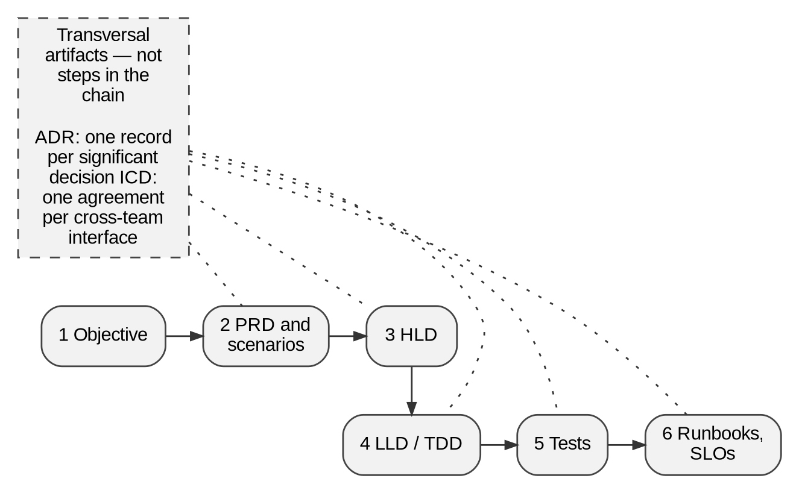
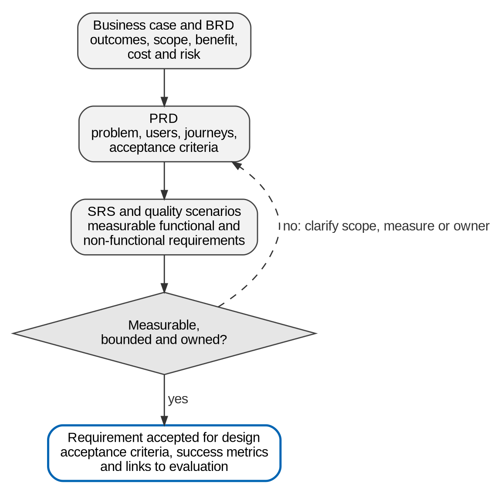
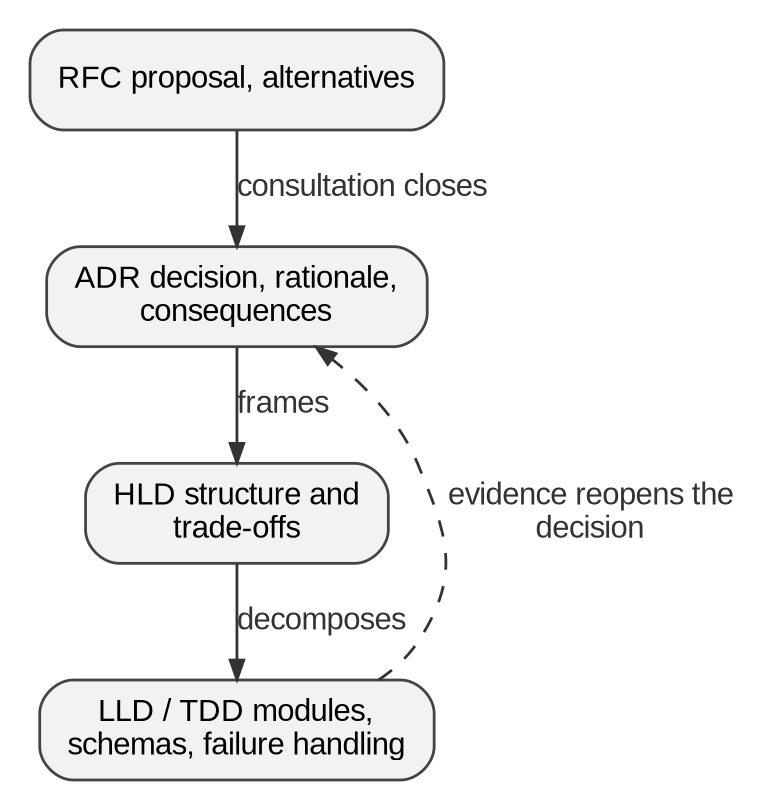
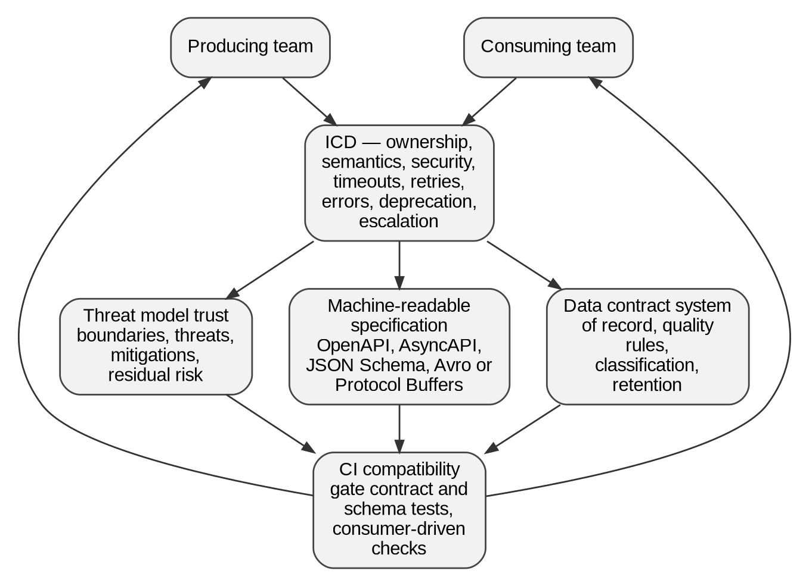
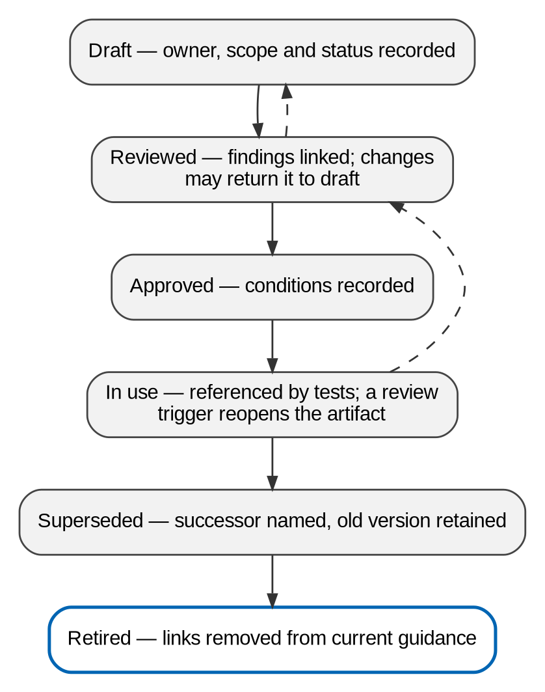

# 17. Software Engineering and Architecture Artifacts

Engineering artifacts serve different decisions and audiences. They are living evidence, not approvals in themselves, and they should be right-sized. A low-risk change inside one team may need only tests and a short design note — plus an ADR if it involves an architecturally significant decision — while a cross-organization integration needs an ICD, contract tests and a runbook. This chapter defines each artifact in the catalog, gives it a fiche that states its audience, owner, mandatory trigger and quality criteria, and shows how the artifacts link together.

::: {.callout-note appearance="simple" icon=false title="When to Use This Chapter"}
- Deciding which artifacts a change, project or integration actually needs.
- Setting up traceability from business objectives to tests and operational evidence.
- Reviewing artifacts for consistency before a governance decision or release.
- Defining the lifecycle, ownership and retirement of living documents.
:::

::: {.callout-tip appearance="simple" icon=false title="Key Takeaway"}
Artifacts are evidence for decisions, not deliverables in themselves. Size them to the risk of the change, link them by identifier instead of copying content, and treat a contradiction between two artifacts as a defect.
:::

## 17.1 Artifact Catalog and Traceability

The catalog is the inventory; traceability is what turns an inventory into evidence. The section defines the chain that carries intent from an objective to production behavior, and the transversal artifacts that are written whenever a decision or an interface appears.

### 17.1.1 The Artifact Chain

**Definition.** The artifact chain is the ordered set of artifacts that carries intent from a business objective to operational evidence: objective, requirements and quality scenarios, high-level design, detailed design, tests, and runbooks with telemetry.

**Purpose.** The chain shows what must exist for a claim to be traceable, and in what order the artifacts can be created without guessing. It informs the artifact set for a change, the questions a reviewer asks, and the impact analysis when a requirement or decision changes: everything downstream of the changed link must be re-checked.

**What it includes.** Each link refers to the previous one by identifier rather than copying its content. Two artifacts are transversal rather than sequential: the Architecture Decision Record (ADR) and the Interface Control Document (ICD) are written whenever a significant decision or a cross-team interface arises — during high-level design, detailed design or later — and are referenced by every artifact they constrain (Figure 17.1).

{#fig-17-1 width="100%"}

Table 17.1 makes the chain operational: it states what each link carries forward and the failure that appears when the link is missing or ignored.

| Link | Carries forward | Fails when |
| :--- | :--- | :--- |
| Objective → requirements | Scope, outcome and measurable success | The requirement set does not name the outcome it serves |
| Requirements → design | Priority quality scenarios and constraints | Design decisions answer unstated or unranked needs |
| Design → tests | Structure, interfaces and failure behavior | Tests verify components but not the scenario |
| Tests → operations | Measured limits, failure modes and recovery evidence | Runbooks assert limits that were never measured |
| ADR → every stage | Chosen option, rejected alternatives and consequences | Downstream artifacts contradict the recorded decision |
| ICD → design, tests, operations | Ownership, semantics, timeouts and error behavior | Producer, consumer and tests disagree on the contract |

: Links in the artifact chain and what each one carries

**Why it is needed.** Consistency between artifacts matters as much as their content: an ICD that allows a three-second timeout contradicts an end-to-end requirement of two seconds, and the conflict is a defect even though each document is internally valid. Without identifier links, the same fact is copied into several documents and drifts. The evidence is a sampled end-to-end trace from a priority scenario to the decision, contract, test and operational check that address it. Appendix D lists the main consistency checks.

### 17.1.2 Artifact Catalog

**Definition.** The artifact catalog is the complete list of artifacts a solution may produce, each with an owner, a mandatory trigger and a fiche that defines its content and quality criteria.

**Purpose.** The catalog turns “which documents do we need?” into a decision with criteria. It informs the artifact set chosen at the start of a change, the evidence a review expects for a given risk tier, and the conversation about what will deliberately not be produced.

**What it includes.** Fourteen artifacts across requirements, design and decisions, interfaces, data and security, and verification and operations (Table 17.2). Each artifact has a fiche later in this chapter with its purpose, audience, owner, mandatory trigger, minimum content, quality criteria, related artifacts and a short example. Chapter 19 extends this set for AI solutions: evaluation reports (19.6.1–19.6.2), release manifests (19.6.3) and the model card and impact assessment named in the artifact list of 19.9 (item 10).

| Artifact | Typical owner | Mandatory when |
| :--- | :--- | :--- |
| BRD and business case (Table 17.3) | Business sponsor; architect advises | New investment or significant scope change |
| PRD (Table 17.4) | Product manager | New product capability |
| SRS and quality scenarios (Table 17.5) | Architect with product and QA | Quality attributes drive design |
| HLD (Table 17.6) | Solutions Architect | Change spans components or teams |
| LLD / TDD (Table 17.7) | Lead engineer | Component is complex or carries failure risk |
| RFC (Table 17.8) | Proposer | Change is contested or crosses team boundaries |
| ADR (Table 17.9) | Decision owner | Every architecturally significant decision |
| ICD (Table 17.10) | Interface owners on both sides | Interface between teams or organizations |
| API / event specification (Table 17.11) | Producing team | Every published interface |
| Data model, dictionary, lineage (Table 17.12) | Data owner and steward | Shared, regulated or replicated data |
| Threat model and risk register (Table 17.13) | Architect with security | New trust boundary or sensitive data |
| Test strategy and reports (Table 17.14) | QA and engineering | Every release with quality obligations |
| Runbook, SLOs, DR plan (Table 17.15) | Service owner and SRE | Before first production use |
| Architecture review record (Table 17.17) | Reviewers and decision owner | Changes in higher risk tiers |

: Artifact catalog, fiche and mandatory trigger

**Why it is needed.** A catalog without triggers produces document theater: everything is requested, nobody reads it, and the artifacts that matter lose credibility with the ones that do not. A catalog without owners produces documents that are accurate on the day they are written and wrong three months later. The evidence is a recorded artifact decision — the set chosen, the risk that justifies it and the artifacts deliberately excluded — plus an owner for each artifact produced.

**Example.** A payments team opening a new capability uses the catalog to select a PRD, HLD, ADR for the asynchronous confirmation decision, an ICD with the provider, contract tests and a runbook. A later change that adds a field to an internal report selects a contract update and tests only, and records that decision in the change ticket.

::: {.callout-warning appearance="simple" icon=false title="Common Pitfall"}
Producing every artifact for every change. Teams spend effort on documents nobody reads, the documents drift from the code, and reviewers lose trust in all of them — including the few that matter. Decide the artifact set by risk at the start of the work (17.1.2), and retire or update an artifact whenever the decision it records changes.
:::

::: {.callout-important appearance="simple" icon=false title="Decision & Trade-off"}
How much design documentation should precede implementation?

| Option | Choose when | Consequences |
| :--- | :--- | :--- |
| Tests and a short design note | Reversible change inside one team’s boundary | Minimal overhead; rationale may be lost if a significant decision was made without an ADR |
| ADRs plus updated views and contracts | A significant decision or an interface change | Durable rationale and compatibility evidence; needs discipline to keep views current |
| Full chain: PRD, HLD, ADRs, ICD, LLD, test strategy, runbook | New capability, cross-organization integration or regulated scope | Complete traceability and audit evidence; slowest to produce, and wasteful if applied to small changes |
:::

## 17.2 Requirements Artifacts

Requirements artifacts record what the solution must achieve and how success will be recognized. They are the only artifacts whose audience includes the business, which makes clarity and testability their dominant quality criteria.

{#fig-17-2 width="100%"}

### 17.2.1 BRD and Business Case

**Definition.** A Business Requirements Document (BRD) captures business outcomes, scope, stakeholders, benefits and constraints, while the business case compares expected value, cost, alternatives and risk over a stated time horizon.

**Purpose.** Together they justify the investment and define what “success” means in business terms. They inform the funding decision, the scope boundary and the benefit that later architecture trade-offs are measured against, and they give the architect the change drivers that a modernization or sourcing decision must serve.

**What it includes.** Quantified benefits separated from assumptions, a named decision owner, the alternatives considered and the consequence of not proceeding (Table 17.3). A BRD that dictates implementation prematurely restricts viable designs; the document should state the outcome and the constraints, not choose the technology. The fiche gives the minimum content and the quality test for both the requirement document and the business case; attach the case as an annex when the funding decision and the requirement document are separate.

| Field | Content |
| :--- | :--- |
| Purpose | Justify the investment and fix the business outcome, scope and benefit |
| Audience | Sponsor, finance, steering group, architecture and delivery leads |
| Owner | Business sponsor; the architect advises and reviews feasibility |
| Mandatory when | New investment, significant scope change or a regulated commitment |
| Minimum content | Outcomes, scope, stakeholders, quantified benefits, costs, alternatives, risks, constraints, decision owner |
| Quality criteria | Benefits quantified and dated; assumptions separated from facts; cost horizon stated; alternatives compared; scope exclusions explicit |
| Related artifacts | PRD (17.2.2), quality scenarios (17.2.3), ADRs funding architectural constraints, review record (17.5.4) |
| Example | Checkout replacement: 18-month horizon, cost per order reduced by a stated amount, provider fees and migration cost included, do-nothing option priced |

: Artifact fiche: BRD and business case

**Why it is needed.** A business case that counts only build cost, or a BRD whose benefits are adjectives, cannot support a later trade-off: every option appears equally justified and the cheapest-looking one wins. The evidence is a funded decision whose benefit, cost and risk assumptions can be re-read when the architecture changes, and a scope statement that names what is excluded.

### 17.2.2 PRD

**Definition.** The Product Requirements Document (PRD) specifies the product problem, target users, journeys, functional requirements with acceptance criteria, success metrics, priorities, accessibility needs, assumptions and exclusions.

**Purpose.** The PRD connects business intent to something a design and a test can act on. It informs journey design, prioritization and acceptance, and it is the artifact product, engineering and design use to agree what is in scope before architecture commits to a shape.

**What it includes.** User journeys with acceptance criteria, prioritized functional requirements, success metrics, accessibility and localization needs, dependencies, assumptions and explicit exclusions (Table 17.4). It links to, rather than restates, the quality scenarios that make non-functional requirements measurable.

| Field | Content |
| :--- | :--- |
| Purpose | Define the product problem, users, journeys and acceptance criteria |
| Audience | Product, engineering, design, QA, business owners |
| Owner | Product manager; engineering and design contribute |
| Mandatory when | A new product capability or a material change to an existing journey |
| Minimum content | Problem, users and jobs, journeys, functional requirements with acceptance criteria, success metrics, priorities, accessibility, assumptions, exclusions |
| Quality criteria | Every requirement has an acceptance criterion; scope boundaries explicit; priorities justified; metrics measurable and owned |
| Related artifacts | BRD (17.2.1), quality scenarios (17.2.3), HLD (17.3.1), test strategy (17.5.1) |
| Example | Payment confirmation: journeys for pay-now and pay-later, acceptance criteria for pending state, metric for confirmation conversion |

: Artifact fiche: PRD

**Why it is needed.** Unbounded scope and ambiguous acceptance criteria cause architecture churn: design starts, the requirement moves, and the work is re-planned instead of reviewed. A PRD without exclusions invites every stakeholder to assume their need is included. The evidence is a requirement set where each item can be accepted or rejected by a test, and a scope boundary the sponsor has seen.

### 17.2.3 SRS and Quality Attribute Scenarios

**Definition.** A Software Requirements Specification (SRS) states externally observable functional and quality requirements, and quality attribute scenarios make the non-functional ones measurable; the scenario format and its use in prioritization are defined in 1.4.

**Purpose.** The SRS is the requirements artifact the architecture is evaluated against. It informs which quality attributes drive design, which trade-offs are acceptable and which tests must exist before a release, and it gives reviewers a stable definition of “meets the requirement” that is independent of the chosen design.

**What it includes.** Functional requirements at the system boundary, quality attribute scenarios with stimulus, response and measure, constraints, and links to the tests and monitoring that will demonstrate each one (Table 17.5). Numeric thresholds are illustrative until the business and operations owners confirm them.

| Field | Content |
| :--- | :--- |
| Purpose | State externally observable functional and measurable quality requirements |
| Audience | Architect, engineering, QA, operations, security, business owner of each scenario |
| Owner | Architect, with product and QA; each scenario has a named owner |
| Mandatory when | Any quality attribute drives a design decision or a release gate |
| Minimum content | Functional requirements at the boundary; scenarios with source, stimulus, environment, response and measure; constraints; verification links |
| Quality criteria | Measures are numeric and testable; workload and failure conditions stated; priorities agreed; each scenario maps to a test or measurement |
| Related artifacts | PRD (17.2.2), HLD (17.3.1), ADRs (17.3.3), test strategy (17.5.1), SLOs (17.5.2) |
| Example | “Under 500 submissions/s, p99 acknowledgment ≤ 2 s, measured at the edge over a 10-minute window” |

: Artifact fiche: SRS and quality attribute scenarios

**Why it is needed.** A quality requirement such as “must be fast” cannot justify a design, a cost or a test, and it cannot be shown to be met. Scenarios that are measurable but unowned drift when the business changes. The evidence is a scenario set traced to load, security, resilience and recovery tests, with the measured result recorded against each threshold.

**Example.** The checkout capability states five priority scenarios: p99 acknowledgment, durability of an acknowledged order, no duplicate charge for one attempt, no loss of a committed event during a broker outage, and recovery within the stated objective. Each is traced to a test and to the SLO that monitors it in production.

::: {.callout-warning appearance="simple" icon=false title="Common Pitfall"}
Treating the PRD as the requirements baseline and leaving quality attributes to the architect. The product document describes features, the architecture is then optimized for them, and latency, recovery and privacy arrive as late constraints that force redesign. Write the measurable quality scenarios alongside the functional requirements, with named owners, and gate design entry on both.
:::

::: {.callout-important appearance="simple" icon=false title="Decision & Trade-off"}
How should requirements artifacts be maintained?

| Option | Choose when | Consequences |
| :--- | :--- | :--- |
| One combined requirements document | Small solution, one team, stable scope | Fewer artifacts and faster reading; functional and quality requirements blur and traceability is weak |
| Separate PRD and SRS with linked identifiers | Product and architecture evolve at different speeds | Clear ownership and testable quality requirements; two documents to keep aligned |
| Requirements in the backlog with scenarios in the architecture repository | Continuous delivery with a stable product owner | Requirements stay close to delivery; the architectural view needs a curated index to remain reviewable |
:::

## 17.3 Design and Decision Artifacts

Design artifacts describe the intended structure; decision artifacts explain why it is that structure. Separating them keeps the description current while preserving the reasoning that a later change must respect or deliberately overturn.

{#fig-17-3 width="100%"}

### 17.3.1 HLD — High-Level Design

**Definition.** The High-Level Design (HLD) communicates system context, major containers, data stores, integration paths, trust boundaries, deployment topology and quality trade-offs, with references to the principal ADRs.

**Purpose.** The HLD is the shared design artifact for everyone who must agree on the shape of the solution: engineering, operations, security, data and the business. It informs reviews, estimation, interface planning and the deployment model, and it is the artifact a new team member reads to understand how the system fits together.

**What it includes.** Context and container views, trust boundaries, data ownership, priority quality scenarios, deployment and recovery assumptions, principal ADRs, open risks and approval responsibilities (Table 17.6). At handoff to detailed design, each major component has an accountable team, an interface owner and a deployment boundary, and assumptions that must be validated are marked and linked to ADRs or time-boxed spikes.

| Field | Content |
| :--- | :--- |
| Purpose | Describe the system shape, boundaries and trade-offs at a level stakeholders can review |
| Audience | Engineering, operations, security, data, architecture review, delivery management |
| Owner | Solutions Architect |
| Mandatory when | The change spans components, teams or a trust boundary |
| Minimum content | Context and container views, data ownership, integration paths, trust boundaries, deployment and recovery, priority scenarios, principal ADRs, open risks |
| Quality criteria | Every container has a responsibility and an owner; no product list without data flow; trade-offs name the alternative; assumptions marked and owned |
| Related artifacts | Requirements (17.2), ADRs (17.3.3), ICDs (17.4.1), threat model (17.4.3), runbook (17.5.2) |
| Example | Checkout HLD: context and container views, order and payment ownership, async payment path, zone failure assumption, links to three ADRs |

: Artifact fiche: HLD

**Why it is needed.** An HLD that lists cloud products without responsibilities and data flows is not a design; it cannot be reviewed for failure behavior or ownership, and it cannot be used to plan work. A design without trade-offs invites re-litigation of settled decisions in every review. The evidence is a design package in which each component has an owner, each boundary is drawn, and each significant choice points to its ADR.

### 17.3.2 LLD / TDD — Low-Level or Technical Design Document

**Definition.** The Low-Level Design (LLD), also called Technical Design Document (TDD), details modules, interfaces, schemas, algorithms, state transitions, error handling, concurrency, idempotency, observability, configuration and rollout.

**Purpose.** The LLD turns an approved high-level design into something an engineer can implement and a reviewer can check for failure behavior. It informs implementation sequencing, test design and operational readiness, and it records the decisions that are too local for an ADR but too consequential to leave in a code review comment.

**What it includes.** Component responsibilities and sequence flows, data schemas and state transitions, failure modes with timeouts, retries and idempotency, deployment configuration and secret handling, test strategy and observability instrumentation, and migration, rollout and rollback (Table 17.7). The acronym TDD also means Test-Driven Development, so expand it on first use.

| Field | Content |
| :--- | :--- |
| Purpose | Make the implementation plan reviewable, especially its failure behavior |
| Audience | Implementing engineers, reviewers, QA, operations |
| Owner | Lead engineer for the component |
| Mandatory when | The component is complex, stateful, concurrent or carries material failure risk |
| Minimum content | Responsibilities, sequence flows, schemas and states, error and timeout behavior, retries and idempotency, configuration and secrets, tests, observability, rollout and rollback |
| Quality criteria | Every external call has a timeout and an unknown-outcome path; state transitions enumerated; duplicates and ordering handled; rollback stated |
| Related artifacts | HLD (17.3.1), ADR (17.3.3), ICD and schemas (17.4.1), threat model (17.4.3), tests (17.5.1) |
| Example | Payment-attempt state machine with idempotency key, provider timeout path and reconciliation job |

: Artifact fiche: LLD / TDD

**Why it is needed.** Over-detailed design too early constrains discovery, and undocumented complexity slows review: a reviewer cannot see the failure paths in a diagram that only shows the happy path. The evidence is a document in which each external dependency has a defined timeout, each state has an exit, and the rollback is described in operational terms.

### 17.3.3 RFC and ADR

**Definition.** A Request for Comments (RFC) solicits structured feedback on a proposal, and an Architecture Decision Record (ADR) records a decision with its context, options and consequences; ADR content and lifecycle are defined in 3.4.

**Purpose.** The pair separates consultation from commitment. The RFC informs a decision that is still open, collecting objections while they can still change the design; the ADR informs everyone who later depends on the choice, preserving why the option was selected and what was traded away.

**What it includes.** An RFC states the problem, the proposed change, alternatives, compatibility and migration impact, security and operational implications, reviewers and open questions (Table 17.8). An ADR states identifier, status, date, decision owner, context and drivers, options with criteria, the decision and rationale, consequences with mitigations, acceptance evidence and review triggers (Table 17.9).

| Field | Content |
| :--- | :--- |
| Purpose | Collect structured feedback before a cross-team or contested change is committed |
| Audience | Peer architects, affected teams, security, operations, platform owners |
| Owner | Proposer; a named reviewer set |
| Mandatory when | The change crosses team boundaries, is contested or is hard to reverse |
| Minimum content | Problem, proposal, alternatives, compatibility and migration impact, security and operational implications, reviewers, open questions, outcome |
| Quality criteria | Options are genuinely comparable; impact on existing consumers stated; comment period and decision date explicit; outcome recorded |
| Related artifacts | ADR (17.3.3), HLD (17.3.1), ICD (17.4.1) |
| Example | RFC for moving payment confirmation to an asynchronous workflow, with three options and a two-week comment window |

: Artifact fiche: RFC

| Field | Content |
| :--- | :--- |
| Purpose | Preserve the rationale, alternatives and consequences of one significant decision |
| Audience | Future maintainers, reviewers, governance, dependent teams |
| Owner | Decision owner; the architect usually drafts |
| Mandatory when | A decision is architecturally significant: hard to reverse, cross-cutting, or constraining a quality attribute |
| Minimum content | Identifier and status, date, owner, context and drivers, options and criteria, decision, consequences, acceptance evidence, review triggers |
| Quality criteria | Rejected options and reasons recorded; consequences include the bad ones; review trigger is an event or date, not “periodically” |
| Related artifacts | RFC (17.3.3), HLD (17.3.1), LLD (17.3.2), tests that validate the decision |
| Example | “ADR-014: asynchronous payment confirmation” — context, options, chosen option, pending-state consequence, revisit if provider SLA changes |

: Artifact fiche: ADR

**Why it is needed.** Treating an RFC as an approved decision, or an ADR as meeting minutes, obscures accountability: readers cannot tell whether a choice is open, proposed or binding. An ADR that records only the winner loses the reasoning that would let a successor decide whether the original conditions still hold. The evidence is a decision log in which each significant choice has a status, an owner, the alternatives considered and a review trigger.

**Example.** A team proposes a synchronous payment call in an RFC. Reviewers raise provider degradation and the two-second budget; the RFC closes with the asynchronous option. The ADR records the rejected synchronous option, the pending-state consequence and the trigger — a provider SLA below the target — that would reopen the decision.

::: {.callout-warning appearance="simple" icon=false title="Common Pitfall"}
Writing the ADR after the work is done, as a summary that justifies what was built. The alternatives are reconstructed from memory, the uncomfortable consequences are omitted, and the record cannot help the next team decide whether the context still applies. Write the ADR when the decision is made, keep it short, and include the consequences that will hurt.
:::

::: {.callout-important appearance="simple" icon=false title="Decision & Trade-off"}
Which design and decision artifacts should a change produce?

| Option | Choose when | Consequences |
| :--- | :--- | :--- |
| ADR plus updated views in the existing description | Incremental change inside an existing architecture | Low effort and continuous rationale; assumes the architecture description is current enough to update |
| HLD, ADR and LLD for the affected area | New component, new integration or a change to failure behavior | Reviewable design and implementation guidance; slower start and a document to maintain |
| RFC, HLD, ADRs and LLD | Contested, cross-team or hard-to-reverse change | Objections surface before commitment and the decision is durable; heaviest process, justified only by coordination risk |
:::

## 17.4 Interface, Data and Security Specifications

These artifacts describe the boundaries where independent teams, systems and trust domains meet. Their quality is measured by whether two parties can work independently and still interoperate.

{#fig-17-4 width="100%"}

### 17.4.1 ICD and API/Event Specifications

**Definition.** The Interface Control Document (ICD) is the authoritative agreement on an interface between two parties, and the API or event specification is its machine-readable expression in OpenAPI, AsyncAPI, JSON Schema, Avro or Protocol Buffers; the integration semantics are defined in 6.2.3.

**Purpose.** The ICD informs the commercial and operational relationship between teams or organizations: who owns what, what the other party may rely on, how failures and changes are handled. The machine-readable specification informs tooling — code generation, validation and contract tests — and gives CI something to enforce. Together they let two teams ship independently without a shared integration environment.

**What it includes.** Ownership, business semantics, security, timeouts, retry eligibility, idempotency, versioning, error codes, observability, deprecation and escalation (Table 17.10), with the machine-readable surface linked rather than restated (Table 17.11). A syntactically valid schema does not prove business interoperability; the ICD carries the meaning the schema cannot.

| Field | Content |
| :--- | :--- |
| Purpose | Agree ownership, semantics and failure behavior for an interface between parties |
| Audience | Producer and consumer teams, security, operations, procurement for external parties |
| Owner | Interface owners on both sides, with one named as authoritative |
| Mandatory when | An interface crosses a team, organizational or trust boundary |
| Minimum content | Parties and owners, purpose and interaction, protocol and auth, payload semantics and schema reference, compatibility policy, errors, timeouts, retries, idempotency, service levels, observability, escalation, change control |
| Quality criteria | Both parties have signed the semantics; unknown outcomes defined; compatibility and deprecation rules stated; escalation path tested |
| Related artifacts | API/event specification (17.4.1), data contract (17.4.2), threat model (17.4.3), contract tests (17.5.1) |
| Example | PAYMENT-AUTH-v1 clauses in Appendix A.4, covering idempotency key and unknown-outcome handling |

: Artifact fiche: ICD

| Field | Content |
| :--- | :--- |
| Purpose | Express the interface contract in a form tools and pipelines can enforce |
| Audience | Producer and consumer engineers, API gateway and platform teams |
| Owner | Producing team |
| Mandatory when | An interface is published to another team, a partner or the public |
| Minimum content | Schema, operations or event types, errors, examples, authentication scheme, version; generated or validated in CI |
| Quality criteria | Spec is the single source for generated artifacts; compatibility checks run on every change; examples are executable; breaking change requires a major version |
| Related artifacts | ICD (17.4.1), data contract (17.4.2), contract tests (17.5.1) |
| Example | OpenAPI document for the payment authorization endpoint, validated and contract-tested in the provider pipeline |

: Artifact fiche: API and event specification

**Why it is needed.** Interfaces fail at the semantics, not the syntax: both sides accept the same JSON and disagree about whether a timeout means “declined”, whether retries are safe, or who owns the duplicate. The evidence is a pair of artifacts that agree, a compatibility test that runs on every change, and a negative test showing that an incompatible change is blocked before deployment.

### 17.4.2 Data Artifacts

**Definition.** Data artifacts are the models, dictionaries, data contracts, lineage maps, classification matrices and retention schedules that make the meaning, ownership and obligations of data explicit; Chapter 5 defines the data architecture they describe.

**Purpose.** These artifacts let data be shared without losing its meaning or its constraints. They inform integration design, privacy and retention decisions, analytics correctness and the response to a data-subject request, and they establish which system is authoritative for each attribute.

**What it includes.** The system of record, authoritative attributes, quality rules, classification, lineage, retention and deletion obligations (Table 17.12). They are written for the consumers of the data — other teams, analytics, regulators — not only for the database administrator.

| Field | Content |
| :--- | :--- |
| Purpose | Make data meaning, ownership, quality and obligations explicit across systems |
| Audience | Data consumers, analytics, privacy and compliance, integration teams |
| Owner | Data owner, with a data steward for definitions and quality rules |
| Mandatory when | Data is shared, replicated, regulated or used for decisions |
| Minimum content | Entities and keys, system of record, attribute definitions, classification, quality rules, lineage, retention and deletion obligations |
| Quality criteria | Every attribute has one authoritative definition and owner; lineage current; retention justified by a legal or business driver; deletion tested end to end |
| Related artifacts | Data contract (5.3.3), ICD (17.4.1), retention schedule (Appendix B.11), privacy assessment (17.4.3) |
| Example | Customer entity: party identifier, system of record, classification, retention, lineage to the analytics store, deletion propagated to backups |

: Artifact fiche: data model, dictionary and lineage

**Why it is needed.** Unowned replicated data causes reconciliation and compliance failures: two systems hold different values, neither is authoritative, and a deletion request cannot be completed because a copy is unaccounted for. The evidence is an attribute-level map with owners, a lineage that includes derived and cached copies, and a deletion test that reaches every one of them.

### 17.4.3 Security and Risk Artifacts

**Definition.** Security and risk artifacts record security reasoning: threat models, trust-boundary diagrams, data protection impact assessments where legally required, risk registers and control mappings, with threats, mitigations, residual risk, owners and verification evidence; Chapter 10 defines the controls.

**Purpose.** They inform which threats are credible, which controls are justified, what risk remains and who accepts it. They give security reviewers a structured basis for challenge and give auditors traceability from a requirement to a control and to evidence that it operates.

**What it includes.** Trust boundaries, threat scenarios with likelihood and impact, controls with owners, residual risk with an accepting owner, and the test or monitoring that demonstrates each control (Table 17.13). Distinguish regulatory obligations from design preferences so that the register does not mix “required by law” with “we would prefer”.

| Field | Content |
| :--- | :--- |
| Purpose | Record credible threats, chosen controls, residual risk and its owner |
| Audience | Security, architecture review, risk and compliance, service owner |
| Owner | Architect with security; residual risk accepted by a named business owner |
| Mandatory when | A new trust boundary, sensitive data, external exposure or a regulated scope |
| Minimum content | Data flow and trust boundaries, threats and attack paths, controls and verification, residual risk and acceptance, review trigger |
| Quality criteria | Threats tied to the actual data flow; every control has evidence; residual risk has an owner and an expiry; assumptions about attacker capability stated |
| Related artifacts | HLD (17.3.1), ICD (17.4.1), test strategy (17.5.1), review record (17.5.4) |
| Example | Payment provider boundary: spoofed callback, replayed authorization and leaked credentials, each with a control and a test |

: Artifact fiche: threat model and risk register

**Why it is needed.** A threat list without a data flow produces generic controls that miss the path an attacker would actually use, and residual risk without an owner is risk accepted by nobody. The evidence is a model whose boundaries match the deployed system, whose controls are verified by tests or monitoring, and whose residual risk has a named owner and a review date.

**Example.** An integration with an external payment provider produces a threat model before implementation. It identifies callback spoofing, replay of an authorization and credential leakage across the boundary; each maps to mutual authentication, idempotency keys and secret rotation, and each has a test in the security suite.

::: {.callout-warning appearance="simple" icon=false title="Common Pitfall"}
Maintaining the ICD as prose while the OpenAPI file evolves independently. The schema changes, the agreement does not, and the two teams discover the divergence during an incident rather than in CI. Link the artifacts explicitly, make the machine-readable specification the source for generated code, and fail the build when the contract tests and the ICD disagree.
:::

::: {.callout-important appearance="simple" icon=false title="Decision & Trade-off"}
Where should the interface contract live?

| Option | Choose when | Consequences |
| :--- | :--- | :--- |
| ICD owned by the producer | One team provides a service to many consumers | Clear accountability and fast change; consumers must negotiate through the producer’s roadmap |
| ICD co-owned with a consumer-driven contract | A few significant consumers with distinct needs | Requirements are explicit and tested both ways; coordination cost and a shared review cadence |
| ICD owned by an integration or platform team | Many consumers, regulated interfaces or a shared gateway | Consistent standards and central enforcement; distance from both business domains and a potential bottleneck |
:::

## 17.5 Verification and Operational Artifacts

An architecture is only as good as the evidence that it works and the instructions that keep it working. These artifacts turn design claims into measurements and measurements into operating practice.

{#fig-17-5 width="100%"}

### 17.5.1 Test and Verification Artifacts

**Definition.** Test and verification artifacts are the test strategy, plans, acceptance criteria, performance baselines, resilience reports and fitness functions that provide evidence that the design meets its requirements.

**Purpose.** They inform release decisions and architecture reviews by showing which claims have been demonstrated and under what conditions. They also inform design: a requirement that cannot be tested cheaply is a signal that the architecture is hard to verify.

**What it includes.** A strategy that maps priority quality scenarios to test types and gates, test data and environments, performance and resilience baselines with workload and limits, and fitness functions that run continuously (Table 17.14). Each test records the version, environment, workload and result so that a green result can be reproduced.

| Field | Content |
| :--- | :--- |
| Purpose | Demonstrate that functional and quality requirements are met, and at what cost |
| Audience | Engineering, QA, architecture review, release approval, operations |
| Owner | QA lead with engineering; the architect owns the scenario-to-test mapping |
| Mandatory when | Every release with quality obligations, and every architecture review claiming a quality attribute |
| Minimum content | Scope, levels and portfolio shape, scenario-to-test map, environments and data, tooling and automation, gates and exit criteria, non-functional and security testing, responsibilities, reporting |
| Quality criteria | Every priority scenario has a test; pass criteria numeric; workload and failure conditions realistic; results reproducible; limitations stated |
| Related artifacts | Quality scenarios (17.2.3), ADRs (17.3.3), ICD (17.4.1), SLOs (17.5.2) |
| Example | Checkout: load at 500 submissions/s, duplicate-event injection, provider-timeout test and a fitness function for contract compatibility |

: Artifact fiche: test strategy and verification reports

**Why it is needed.** Green unit tests do not establish end-to-end reliability, and a benchmark under ideal conditions does not establish resilience. Test evidence without workload, environment and limits is not evidence, because nobody can tell what was actually demonstrated. The evidence is a strategy with a scenario-to-test map, and reports that name the version, conditions, results and unverified claims.

### 17.5.2 Operational Artifacts

**Definition.** Operational artifacts are the runbooks, playbooks, SLOs, dashboards, alert catalogs, deployment and rollback plans, DR plans and support handover material that define how the service is operated; Chapters 11 and 12 own the practices they encode.

**Purpose.** They inform the operating team’s ability to detect, diagnose, recover and change the service without the architects present. They also inform design: a service that cannot be described in a runbook is usually a service whose failure behavior is not understood.

**What it includes.** Runbooks for routine and failure procedures, SLOs with error budgets, dashboards and alerts with owners, deployment and rollback steps, DR assumptions and tested recovery times, and the support handover record (Table 17.15). The operations team accepts the artifacts before first production use, not after.

| Field | Content |
| :--- | :--- |
| Purpose | Make the service operable, recoverable and supportable by a named team |
| Audience | On-call engineers, SRE, support, incident management |
| Owner | Service owner, with SRE for SLOs and recovery |
| Mandatory when | Before first production use, and whenever a failure mode or dependency changes |
| Minimum content | Runbook procedures, escalation, SLOs and error budget, dashboards and alerts, deploy and rollback, backup and restore, RTO/RPO, DR exercise record, known failure modes |
| Quality criteria | Every alert names an action; recovery steps tested; SLO measures a user outcome; RTO/RPO demonstrated rather than asserted; on-call can execute without the author |
| Related artifacts | HLD (17.3.1), design failure modes (17.3.2), test reports (17.5.1), review record (17.5.4) |
| Example | Payment service runbook: provider-degradation procedure, pending-payment reconciliation query, restore drill result and error-budget policy |

: Artifact fiche: runbook, SLOs and DR plan

**Why it is needed.** A technically complete application is not ready for production without them: incident response becomes improvisation, and recovery objectives remain claims. Runbooks written by the author and never exercised fail at the moment they are needed. The evidence is a runbook exercised by someone other than its author, an SLO measured from a user-visible signal, and a restore or failover result with a measured time.

### 17.5.3 Artifact Lifecycle

**Definition.** The artifact lifecycle is the set of states an artifact passes through — draft, reviewed, approved where required, in use, superseded and retired — together with the owner, location and review trigger that keep it trustworthy.

**Purpose.** The lifecycle informs how a reader knows whether an artifact can be relied on, and how an organization keeps a large document set from becoming a set of contradictory historical layers. It also informs the review process: an artifact whose trigger has fired is stale evidence until it is revisited.

**What it includes.** A status for every artifact, an authoritative location, an owner, review triggers and a successor pointer for superseded versions (Table 17.16). Superseded documents are retained where audit or history requires it, but every current reference must resolve to the current version. Define lightweight schemas (Appendix B) and risk-based minimum evidence; avoid mandatory documents that nobody reads.

| State | Entered when | What must be recorded |
| :--- | :--- | :--- |
| Draft | Work starts | Owner, scope, status, location |
| Reviewed | Reviewers have commented and comments are resolved or deferred | Reviewers, findings, open items |
| Approved | Policy requires approval and the decision owner accepts | Approver, date, conditions |
| In use | Implementation and tests reference the artifact | Current version, links from code and tests |
| Superseded | A newer version or a different artifact replaces it | Successor identifier, effective date |
| Retired | The capability or obligation ends and links are removed | Retention decision and archive location |

: Artifact states, entry criteria and required fields

**Why it is needed.** Document theater produces stale files that no team trusts, and a superseded design that still looks current becomes a source of wrong decisions. The evidence is a catalog in which each artifact has an owner, a status, an authoritative location and a review trigger, and in which a sampled reference resolves to the current version.

**Example.** The payment HLD is superseded when the asynchronous workflow replaces the synchronous design. The new version is approved, the old one is retained with a successor pointer for audit, and the ICD, tests and runbook are updated in the same change so that no current reference points to the retired design.

### 17.5.4 Architecture Review Record

**Definition.** An architecture review record is the artifact that documents what a review examined, what it found, which exceptions it accepted and on what conditions the change may proceed.

**Purpose.** The record informs the decision owner, the delivery team and any later auditor. It makes the review reproducible — the scope, the evidence and the findings are all named — and it is the artifact that turns a meeting into an accountable decision (Chapter 4, 4.4).

**What it includes.** Scope and risk tier, requirement and decision inventory, findings by domain, SLO and capacity evidence, exceptions with owners and expiry, the outcome with its conditions and follow-up actions (Table 17.17). The review lead records the outcome; the decision owner signs it.

| Field | Content |
| :--- | :--- |
| Purpose | Evidence an architecture decision with findings, conditions and accepted exceptions |
| Audience | Decision owner, delivery leads, governance, auditors |
| Owner | Reviewers with the decision owner; the review lead records the outcome |
| Mandatory when | The change falls in a risk tier that requires review |
| Minimum content | Scope and risk tier, requirement and decision inventory, findings by domain, SLO and capacity evidence, exceptions with owners and expiry, outcome and conditions, follow-up actions |
| Quality criteria | Findings cite evidence; each exception has an owner and an expiry date; conditions are verifiable; the decision owner signs the outcome |
| Related artifacts | HLD (17.3.1), ADRs (17.3.3), threat model (17.4.3), test reports (17.5.1) |
| Example | Payment capability review: no critical findings, two conditions on reconciliation evidence, one exception expiring after the first quarter |

: Artifact fiche: architecture review record

**Why it is needed.** A review without a record cannot be audited and cannot be appealed: nobody can tell which evidence was considered or which conditions were accepted. The record also protects the reviewers, because it separates a documented condition from an undocumented assumption. The evidence is a signed record whose findings cite artifacts and whose exceptions carry owners and expiry dates.

**Example.** The payment capability review records no critical findings, two conditions on reconciliation evidence and one exception expiring after the first quarter. The decision owner signs it, and the conditions become tracked actions in the delivery plan.

::: {.callout-warning appearance="simple" icon=false title="Common Pitfall"}
Treating approval as the end of an artifact’s life. The document is signed, filed and never revisited while the system, the provider and the requirements move on; the next review reads a design that no longer exists. Make the review trigger an event — a decision, a dependency change, a failed test — and store the artifact where the people who change the system will see it.
:::

::: {.callout-important appearance="simple" icon=false title="Decision & Trade-off"}
How should artifact status and location be managed?

| Option | Choose when | Consequences |
| :--- | :--- | :--- |
| Artifacts in the code repository, reviewed with the change | Engineering-owned artifacts such as ADRs, ICDs and runbooks | Versioned with the code and visible in review; poor fit for business documents and requires writing discipline |
| A document management system with a catalog | Regulated scope with formal approvals and audit | Controlled versions and access; distance from daily engineering work and risk of becoming a filing cabinet |
| A wiki with a maintained index and owners | Mixed audiences and rapidly evolving content | Easy contribution and linking; weak enforcement, so status and owners must be reviewed explicitly |
:::

## 17.6 Worked Example: Right-Sizing Artifacts for a Payment Capability

*In practice:* This example shows that the same capability needs a full artifact chain at creation and almost none for a later low-risk change.

A new payment capability starts with a PRD stating outcomes, actors and acceptance conditions. The HLD defines boundaries, quality scenarios and deployment topology. An ADR records why confirmation is asynchronous. An ICD agrees the provider contract, error behavior, authentication and versioning, with OpenAPI as its machine-readable part. An LLD explains the payment-attempt state machine and idempotency. Contract tests, a fault-injection report and a runbook complete the chain.

A later change that only adds a field to an internal report needs none of the new design documents — only a contract update and tests.

::: {.callout-note .review appearance="minimal" icon=false title="Architecture Review Checklist — Artifacts"}

☐  Is the artifact set proportional to the change’s risk and cross-team impact?

☐  Does each artifact have an owner, status, location and review trigger?

☐  Are artifacts linked by identifier rather than duplicated?

☐  Do linked artifacts agree on thresholds, contracts and decisions?
:::

## 17.7 Further Reading

- ISO/IEC/IEEE 29148:2018 — requirements engineering processes and information items.
- Clements et al. (2010), *Documenting Software Architectures: Views and Beyond* — documentation packages and views.
- Nygard (2011), “Documenting Architecture Decisions”.
