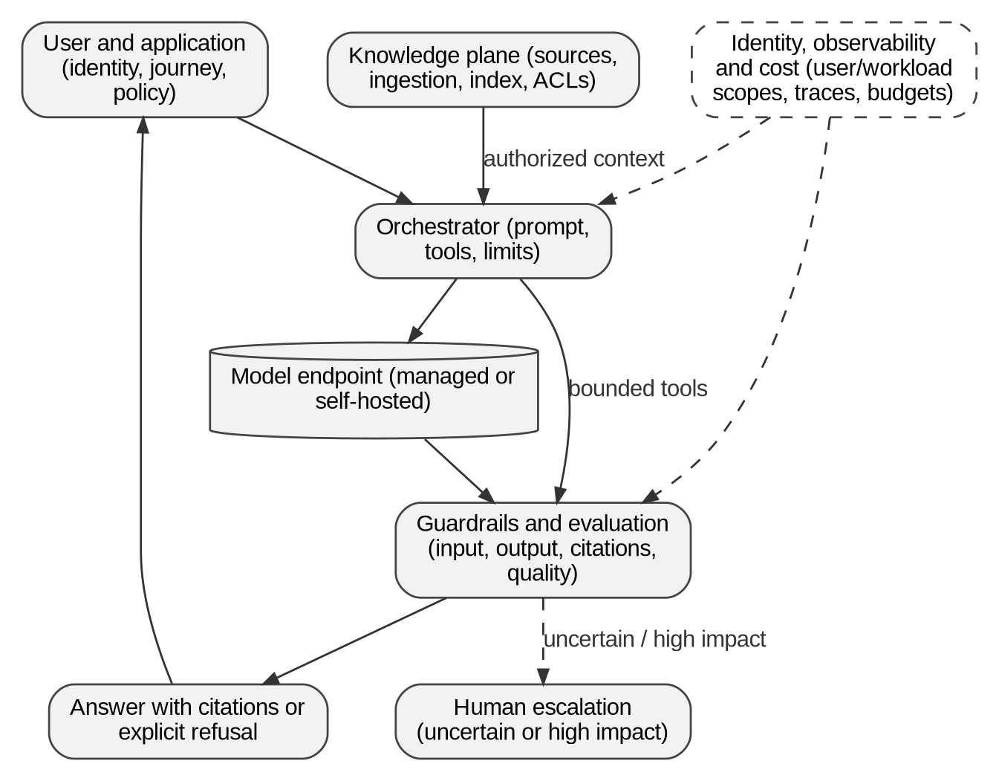
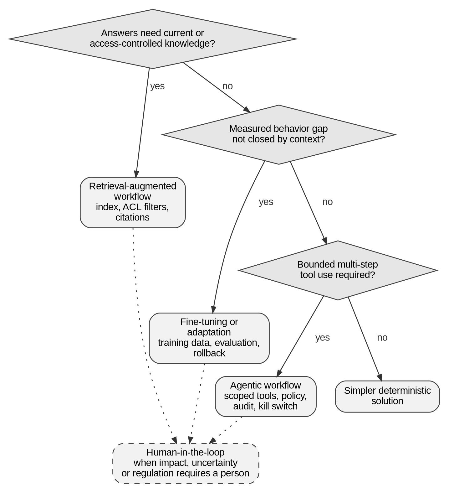
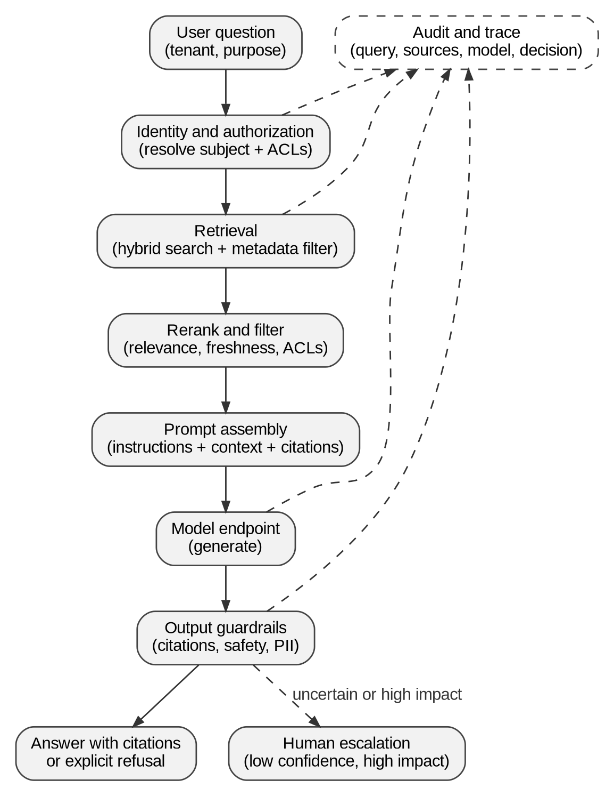
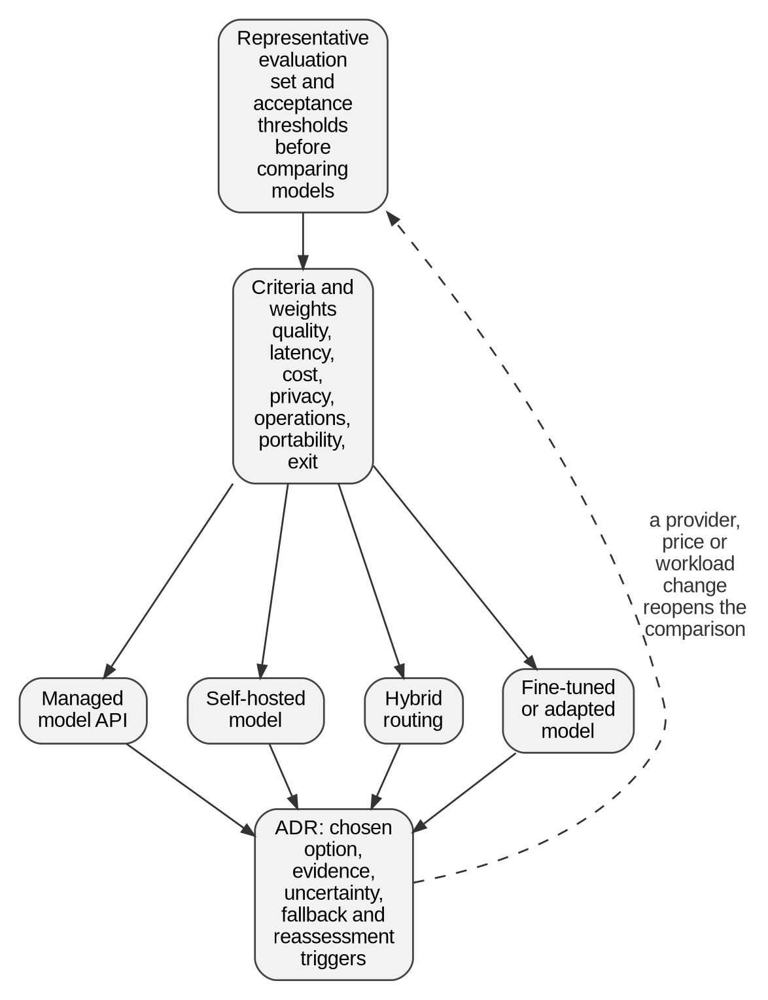
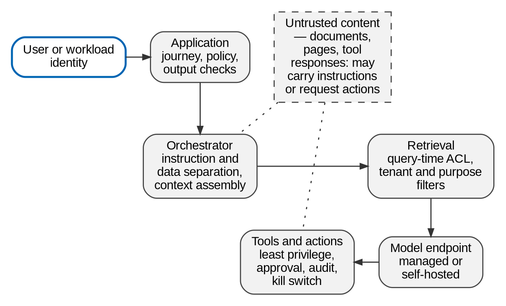
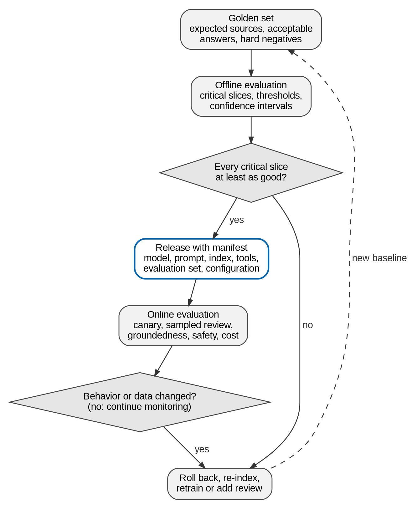
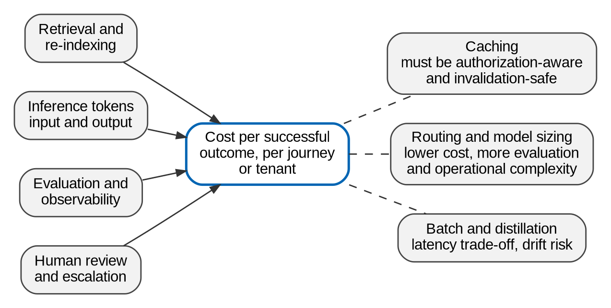
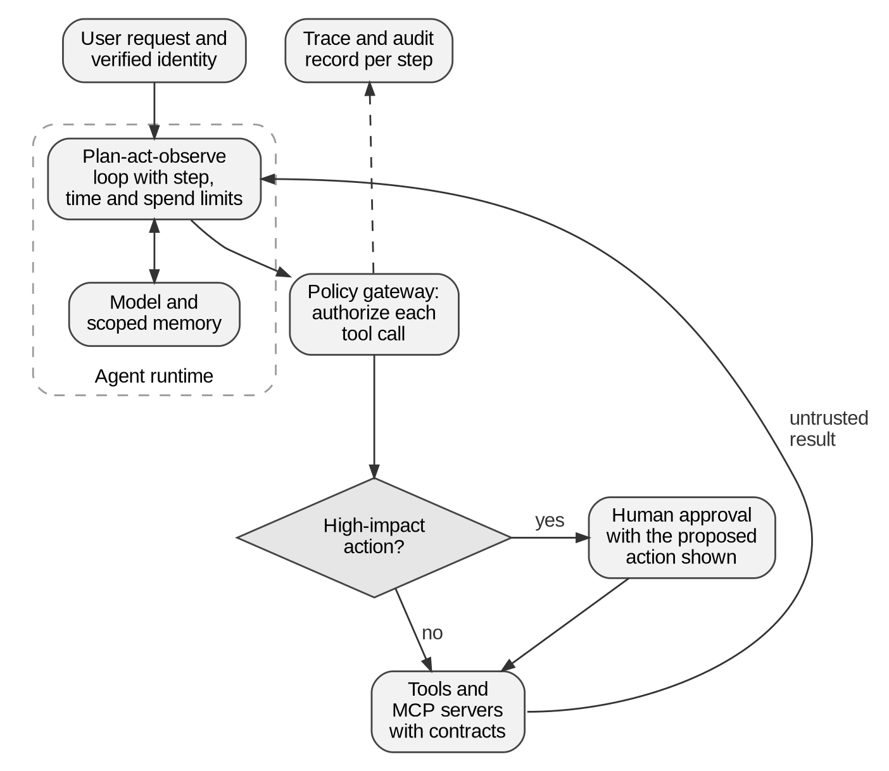

# 18. AI and Machine Learning Architecture

AI architecture is the design of a socio-technical system that uses models to produce predictions, recommendations, generated content or actions. The model is one component; the architecture also decides which data may be used, what context is retrieved, who may ask, how output is verified, what happens when the model is uncertain, and how quality and cost are observed. An impressive demonstration is not evidence that those decisions are safe or operable.

Behavior is probabilistic, data- and context-dependent, and can change when a model, prompt, index or provider changes. Evaluation, versioning, authorization and fallback are design concerns, not testing afterthoughts.

::: {.callout-note appearance="simple" icon=false title="When to Use This Chapter"}
- Introducing a model, generative AI capability, retrieval system, agent or human-in-the-loop workflow.
- Choosing between a managed model API, a self-hosted model, fine-tuning, retrieval augmentation or a simpler deterministic solution.
- Assessing AI security, privacy, evaluation, reliability, oversight or cost before production.
- Reviewing an AI solution or supplier against evidence rather than a demonstration.
- Designing agentic systems, including tool contracts, human approval and run limits.
:::

::: {.callout-tip appearance="simple" icon=false title="Key Takeaway"}
An AI architecture is only as trustworthy as its data provenance, authorization, evaluation and fallback. Model quality is one attribute; the system around the model determines whether the capability is safe, affordable and operable.
:::

## 18.1 AI Architecture Fundamentals

The fundamentals define the vocabulary, the component map and the quality attributes that the rest of the chapter assumes. They also explain why an AI solution cannot be reviewed with the methods of a deterministic system alone.

### 18.1.1 Definitions and Boundaries

**Definition.** AI architecture is the design of the system around a model: the data it may use, the context it receives, the authority it exercises and the evidence that its behavior is acceptable; artificial intelligence is the broad field, machine learning learns patterns from data, deep learning uses multi-layer networks, and generative AI produces text, images, code or other content.

**Purpose.** The definitions inform scoping, procurement and review. They let a team say precisely what it is building — a classifier, a retrieval assistant, an agent with tools — and therefore which risks, evidence and controls apply. They also keep the model in its place: a model is an artifact, an application is the software around it, and an agent can choose and invoke tools.

**What it includes.** Foundation models are large pre-trained models adapted to many tasks; training creates or adapts a model, and inference uses it. A deterministic rule can be tested exhaustively; a generative answer must be evaluated on representative data, monitored for drift and constrained by authorization and output checks. Do not call a system autonomous when a human or policy engine still decides.

**Why it is needed.** Scope inflation is the most common early failure: a request for “an AI strategy” becomes an agent with production access before anyone has defined the task, the data rights or the acceptance evidence. Clear boundaries also prevent the opposite error, rejecting a suitable deterministic solution because it is not called AI. The evidence is a one-page scope statement naming the task, the model role, the data, the decision authority and the acceptance criteria.

### 18.1.2 Components of an AI Solution

**Definition.** An AI solution is composed of data sources, ingestion, a retrieval index, a model endpoint, orchestration, tools, guardrails, evaluation, identity, observability, cost control and human oversight, arranged around the journey the user is trying to complete.

**Purpose.** The component map informs design reviews, threat modeling and cost allocation. It shows where authorization, provenance and evaluation must live, and it prevents the model endpoint from being treated as the whole system — the usual cause of a prototype that cannot be operated.

**What it includes.** The application owns the journey and policy; the orchestrator assembles context and invokes tools or the model. The knowledge plane owns sources, ingestion and the index; access control must survive both. Guardrails validate input and output; evaluation closes the loop (Figure 18.1). The map is a component map, not a product stack: several components may be one managed service, and one component may span several products.

{#fig-18-1 width="100%"}

**Why it is needed.** A design that names only a model and a prompt leaves the expensive and risky parts unspecified: who filters retrieval by permission, where citations come from, what happens on timeout, and who reviews a low-confidence answer. The evidence is a component map in which each component has an owner, a data classification and a failure behavior.

### 18.1.3 What Changes for Architecture

**Definition.** What changes for architecture is the set of properties that make an AI solution behave differently from a deterministic one and therefore require different design evidence.

**Purpose.** The list informs which conventional architecture practices need extension. It tells a team where to spend design effort — provenance, non-determinism, supply chain, latency and cost, drift and attack surface, oversight — rather than adding AI-specific ceremony everywhere.

**What it includes.** Six differences:

- **Data provenance.** Quality is bounded by source rights, freshness and lineage.
- **Non-determinism.** The same request may differ; acceptance needs distributions and samples.
- **Supply chain.** Model, prompt, index, tool policy and evaluation set all affect behavior.
- **Latency and cost.** Each stage has a different budget and a different unit cost.
- **Drift and attack surface.** Data, indexes and hosted models change without deployment; untrusted content can become instructions.
- **Human oversight.** High-impact decisions need review and an accountable owner.

These extend Chapter 1, 1.2 and 1.4: an AI requirement names outcome, workload, measure, boundary and evidence.

**Why it is needed.** Treating non-determinism as a testing problem produces release criteria that cannot be met; treating the provider as a stable dependency produces silent behavior change. The evidence is a design record that names, for each difference, the mechanism that addresses it — for example a manifest for the supply chain, or a query-time ACL for provenance and authorization.

### 18.1.4 AI-Specific Quality Attributes

**Definition.** AI-specific quality attributes are the measurable properties that decide whether an AI capability is acceptable: task quality and groundedness, latency, cost, safety, privacy, reproducibility and freshness.

**Purpose.** They inform model and platform selection, release gates and the SLOs that run in production. Naming them as scenarios prevents a benchmark score from standing in for evidence about the actual workload, and it gives business owners a way to state how good is good enough.

**What it includes.** Each attribute with its scenario question and typical evidence (Table 18.1). Map decision-driving attributes to measurable scenarios; a benchmark score is not a proxy for task quality on your data, and a percentile latency is not a user experience.

| Attribute | Scenario question | Typical evidence |
| :--- | :--- | :--- |
| Task quality and groundedness | Does output meet acceptance criteria and cite supporting sources? | Golden-set results; citation checks and human adjudication |
| Latency | Is the response within the journey budget? | p50/p95/p99; time to first token |
| Cost | What does a successful outcome cost? | Cost per resolved request or journey |
| Safety, privacy, reproducibility and freshness | Are harmful, leaked or unauthorized outputs prevented, releases reproducible and knowledge current? | Adversarial and privacy evidence; versioned manifest; index lag |

: AI quality attributes, scenario questions and evidence

**Why it is needed.** Without measurable attributes, “the model is good” becomes an unfalsifiable claim and every release is a matter of opinion. A single aggregate score hides the slice that matters: a model can improve on average while degrading the refusal behavior that protects users. The evidence is a scenario set with thresholds, owners and links to the evaluation and monitoring that produce the numbers.

**Example.** A knowledge assistant states four scenarios: 95% of reviewed answers grounded in cited sources, p95 first token under two seconds, no unauthorized document shown in cross-tenant tests, and a measured cost per resolved question. Each has an owner and a test.

::: {.callout-warning appearance="simple" icon=false title="Common Pitfall"}
Reviewing an AI design as if the model were the system. The review examines model choice and prompt quality, approves the architecture, and leaves retrieval authorization, provenance, fallback and cost unspecified. The capability then fails on representative data or leaks content, and the remediation is a redesign rather than a fix. Review the component map (18.1.2), not the model card alone.
:::

::: {.callout-important appearance="simple" icon=false title="Decision & Trade-off"}
How should an AI capability be scoped at the start?

| Option | Choose when | Consequences |
| :--- | :--- | :--- |
| One critical journey with a defined acceptance set | First AI capability, uncertain data quality or high visibility | Fast, measurable learning and contained risk; value limited to one journey until extended |
| A platform with shared retrieval, evaluation and guardrails | Several journeys, common sources and a platform team | Reuse and consistent controls; platform decisions become constraints for every journey |
| A vendor-supplied capability with configuration only | The capability is not differentiating and the vendor meets assurance requirements | Fastest delivery and least operational burden; limited control, dependency and exit cost to manage |
:::

## 18.2 AI Solution Architecture Patterns

**Definition.** An AI solution architecture pattern is a reusable composition of model, knowledge, tools and human oversight that fits a class of problem; patterns describe composition, not products, and are chosen from risk, data boundaries, latency and operating model.

**Purpose.** Patterns inform the first structural decision: should the solution retrieve knowledge, adapt the model, take actions, or stay deterministic? Choosing deliberately prevents the two expensive defaults — building an agent for a task a fixed workflow solves, and fine-tuning to compensate for missing context.

**What it includes.** Six patterns, each with its fit and its main cost or risk: managed model API, self-hosted model, retrieval-augmented generation, fine-tuning or adaptation, agentic workflow, and human-in-the-loop. Selection follows the smallest intervention that closes the measured gap (Figure 18.2).

{#fig-18-2 width="100%"}

Table 18.2 lists the six patterns with the condition that justifies each one and its main cost or risk; the figure shows the order in which they are usually considered.

| Pattern | Choose when | Main cost or risk |
| :--- | :--- | :--- |
| Managed model API | Fast path, variable demand, provider terms are acceptable | Egress and residency, dependency, per-token cost, version changes |
| Self-hosted model | Residency or control requirements, predictable volume, specialized or air-gapped operation | GPU capacity, utilization, patching, evaluation, scarce skills |
| Retrieval-augmented generation | Answers depend on current, proprietary or access-controlled knowledge | Retrieval quality, freshness, authorization and citations |
| Fine-tuning or adaptation | Measured behavior cannot be achieved by context | Training data, regression, versioning and rollback |
| Agentic workflow | Bounded multi-step tool use is required and permissions can be scoped | Action risk, loops, cost, authorization, audit and kill switch |
| Human-in-the-loop | Impact, uncertainty or regulation requires a person to decide | Queue design, reviewer context, service level, feedback and cost |

: AI solution patterns, fit and main risk

**Why it is needed.** A demo prompt is not a production architecture: it lacks an evaluation baseline, retrieval authorization, provenance, cost and latency budgets, fallback and bounded tool permissions. Use batch inference for offline enrichment and streaming for interactive journeys. RAG changes what the model sees; fine-tuning changes learned behavior. Agents are justified only when a fixed workflow cannot express the task and tools can be tightly scoped. Integration contracts and reconciliation apply (Chapter 6, 6.2.3 and 6.4.4); application boundaries remain Chapter 7 concerns (7.1.2 and 7.3.1).

**Example.** A support assistant first improves retrieval and reranking — a context change — before considering fine-tuning. Only when evaluation shows a format or reasoning gap that context cannot close does the team evaluate adaptation, and it records the decision with a rollback plan.

::: {.callout-warning appearance="simple" icon=false title="Common Pitfall"}
Starting with the most capable pattern. A team builds an agent with broad tool access because the demonstration was impressive, then discovers that most requests need a fixed sequence and a cited answer. The agent adds latency, cost and an authorization surface for no measured benefit. Start with the simplest pattern, measure the gap, and justify each escalation with evaluation evidence.
:::

::: {.callout-important appearance="simple" icon=false title="Decision & Trade-off"}
Where should the model run?

| Option | Choose when | Consequences |
| :--- | :--- | :--- |
| Managed model API | Fast path, variable demand, provider terms and residency are acceptable | Least operational burden; egress, dependency and per-token cost exposure |
| Self-hosted model | Residency, control or predictable volume justify the platform | GPU capacity, utilization, patching, evaluation and scarce skills |
| Hybrid routing | Journeys differ in sensitivity, latency or cost and need a fallback | Two contracts and routing policy; consistent evaluation across both paths |
:::

## 18.3 Data and Knowledge Architecture for AI

For retrieval-based AI, the knowledge plane is the architecture: what may be indexed, how it is chunked, how authorization survives retrieval, and how the index changes when a source changes.

{#fig-18-3 width="100%"}

### 18.3.1 Ingestion and Preparation

**Definition.** Ingestion and preparation is the process that inventories sources, establishes their rights and quality, and produces normalized content for indexing.

**Purpose.** It informs whether the assistant is allowed to use a source at all, how fresh the answer can be, and what a citation will point to. It is where data protection, licensing and quality are decided, long before a user asks a question.

**What it includes.** Source inventory with owners, rights, classification, refresh and quality; validation and deduplication before indexing; preservation of source identifiers for citations; and a stated freshness and replay policy. Exclude sources without rights or adequate quality rather than indexing them and filtering later.

**Why it is needed.** AI output is bounded by its data: unclear rights, stale content or missing provenance makes an answer unsafe and unauditable, and no amount of model quality compensates. The evidence is a source inventory with owners, rights and refresh cadence, plus quality tests that run on ingestion.

### 18.3.2 Chunking and Embeddings

**Definition.** Chunking is the division of source content into retrievable units, and an embedding is the vector representation that makes semantic search possible; both are versioned design decisions, not preprocessing details.

**Purpose.** Chunking and embedding choices inform retrieval quality, citation precision and re-indexing cost. They determine whether an answer can cite the paragraph that supports it, and whether a change to the embedding model can be rolled back.

**What it includes.** Chunk boundaries aligned to structure and meaning, retaining headings and metadata; an embedding model and dimension recorded as a versioned artifact; and propagation of edits, deletions and access changes to the index. A change to the embedding model requires re-embedding, evaluation and rollback capability.

**Why it is needed.** Fixed-size chunks split a table from its heading and a policy from its exception, and the answer then cites text that does not support it. Unversioned embeddings make a re-index impossible to compare with the previous behavior. The evidence is a chunking specification, a recorded embedding version, and a re-index that was evaluated before promotion.

### 18.3.3 Vector, Hybrid and Metadata Retrieval

**Definition.** Retrieval is the selection of content for the model’s context; vector search uses embeddings, keyword search uses lexical matching, hybrid retrieval combines them, and metadata filters apply constraints such as tenant, classification, date and source.

**Purpose.** Retrieval design informs answer quality and the authorization boundary. It decides what the model can see, which is both the largest quality lever and the largest leakage risk, and it determines whether exact identifiers, codes and names can be found at all.

**What it includes.** Vector search, hybrid retrieval and metadata filters, reranking of candidates, deliberate thresholds, and evaluation of recall and precision on representative and stale-content queries (Figure 18.3). Vector search can miss exact identifiers or codes; keyword matching covers that gap, and filters enforce constraints that must not depend on the model.

**Why it is needed.** A retrieval system optimized only for semantic similarity returns plausible but wrong passages for identifiers, and a system without filters can return content the user may not see. The evidence is a retrieval evaluation with positive, negative and stale cases, and a filter test that proves unauthorized content is excluded before the model sees it.

### 18.3.4 Provenance and Knowledge Authority

**Definition.** Provenance is the record of where a piece of content came from, who owns it, which version it is and what access label it carries; knowledge authority is the rule that decides which source wins when sources disagree.

**Purpose.** Provenance informs citation, audit and deletion. It lets a user judge an answer, lets an auditor reconstruct it, and lets the organization find every copy when a source must be removed. Authority rules prevent the model from silently choosing between a current policy and a superseded one.

**What it includes.** For every chunk, a source identifier, owner, version, timestamp and access label (Table 18.3). Distinguish retrieved content from generated text and require citations where the user will act. Conflicting sources need an authority rule, not a ranking. Chapter 16, 16.4.1 describes interface specifications; an index manifest is not a data contract.

| Field | Purpose |
| :--- | :--- |
| Source identifier and canonical location | Citation and deletion |
| Owner and authoritative status | Knowledge authority and escalation |
| Version and ingestion timestamp | Reproducibility and freshness |
| Access label and tenant scope | Query-time filtering |
| Content hash and chunk position | Deduplication and citation precision |
| Classification and retention | Privacy and lifecycle |

: Minimum provenance fields for an indexed chunk

**Why it is needed.** An answer without provenance cannot be trusted or corrected, and an index without authority rules will confidently mix versions. The evidence is a citation that resolves to a current source, a tested deletion path, and an authority rule that names the owner of each contested topic.

### 18.3.5 Access-Controlled Retrieval

**Definition.** Access-controlled retrieval applies the requesting user’s permissions at query time, so that the model only receives content the user is entitled to see.

**Purpose.** It informs the security design of any enterprise assistant, where the index contains documents from many teams and tenants. It protects against the most damaging failure mode: a valid user receiving content they may not see, through retrieval, a summary or a citation.

**What it includes.** User, group, tenant and purpose filters applied during retrieval and output assembly; authorization at the resource rather than only at ingestion; tests for cross-tenant and restricted prompts; and audit records of retrieval decisions. Do not rely on a summary to hide restricted content. Chapter 9, 9.9 covers privacy; here the concern is retrieval.

**Why it is needed.** Ingest-time permissions do not survive replication into a shared index, and a filter applied after generation is too late: the content is already in the context and may appear in the answer. The evidence is a negative test showing that a restricted document is never retrieved for an unauthorized user, plus retrieval audit records that can be reviewed after an incident.

### 18.3.6 Evaluation and Quality Data

**Definition.** Evaluation data is the curated set of questions, expected sources, acceptable answers and hard negatives used to measure whether the AI capability works.

**Purpose.** It informs release decisions and retrieval tuning. It is the only way to compare a prompt, model, index or retriever change on the actual workload, and it makes regression visible when a provider updates a model silently.

**What it includes.** A golden set covering typical, ambiguous, outdated, conflicting and unauthorized cases; expected sources and acceptable answer forms; hard negatives that a naive retriever would return. Synthetic data supplements but does not replace reviewed examples, and the evaluation set is versioned as test data.

**Why it is needed.** An evaluation set built from the same examples used to tune the prompt measures memorization, not quality, and a set without hard negatives rewards a retriever that returns something plausible. The evidence is a versioned set with provenance and adjudication, and a report that separates aggregate from critical-slice results.

### 18.3.7 Lifecycle and Retention

**Definition.** The AI data lifecycle is the set of retention, deletion and retirement rules that apply to sources, indexes, embeddings, caches, prompts, outputs, traces and evaluation sets.

**Purpose.** It informs privacy compliance, cost control and the ability to retire a model or index without leaving copies behind. It also informs incident response: after a leak or a bad source, the organization must know where every derived copy lives.

**What it includes.** Retention periods per data type, deletion propagation to every copy including backups, cache expiry and re-application, and retirement criteria for indexes and models. Chapter 5, 5.2.4 provides the retention schedule and deletion tests that an AI solution extends.

**Why it is needed.** Deletion requests fail when a vector index, an embedding cache and a trace store are outside the deletion path, and stale indexes keep serving retired content. The evidence is a deletion test that covers every derived store, with a recorded result and a named owner.

**Example.** A document is withdrawn from the source repository. The ingestion job marks it deleted, the index removes its chunks, the cache entry is invalidated by key, and a test query confirms it is no longer retrievable or citable.

::: {.callout-warning appearance="simple" icon=false title="Common Pitfall"}
Indexing everything and filtering at answer time. The index contains documents from every tenant and classification, retrieval returns them, and a prompt instruction asks the model not to reveal restricted content. One injection or one careless summary defeats it. Filter at query time, before content reaches the model, and test the negative case.
:::

::: {.callout-important appearance="simple" icon=false title="Decision & Trade-off"}
How should the knowledge index be scoped?

| Option | Choose when | Consequences |
| :--- | :--- | :--- |
| One shared index with query-time filters | Many users and sources, mature identity and metadata | Efficient and simpler to operate; correctness depends entirely on filter quality and metadata discipline |
| Per-tenant or per-classification indexes | Strong isolation requirements or few large tenants | Clear isolation and simpler deletion; duplicated content, higher cost and more indexes to maintain |
| Per-source or per-team indexes with federation | Sources have distinct owners, refresh and quality | Ownership is clear and freshness varies naturally; federation logic and inconsistent ranking across sources |
:::

## 18.4 Model and Platform Selection

Model and platform selection is the choice of which model, hosted where, with which adaptation and fallback, based on evidence from the actual workload rather than on public benchmarks or vendor preference.

{#fig-18-4 width="100%"}

### 18.4.1 Capability and Quality

**Definition.** Capability and quality is the degree to which a model meets the task’s acceptance criteria on representative, failure and adversarial inputs.

**Purpose.** It informs the first filter in selection: which models are even candidates. It also informs the evaluation design, because a criterion that cannot be measured on the workload cannot rank the options.

**What it includes.** Task-level acceptance criteria and an evaluation set defined before comparison; representative, failure, format and adversarial cases; and results reported per slice with uncertainty. A public benchmark is a screening signal, not evidence for your workload: it uses different prompts, a different data distribution and a different notion of an acceptable answer.

**Why it is needed.** Benchmarks measure tasks nobody in the organization performs, and a model that leads a leaderboard can fail on the domain vocabulary, the output format or the refusal behavior the solution requires. The evidence is an evaluation report on the organization’s own set, with the criteria and weights recorded before the comparison.

### 18.4.2 Latency and Throughput

**Definition.** Latency is the time a request takes to reach a useful response, and throughput is the volume the system sustains; both are measured per stage, because retrieval, orchestration and generation have different budgets.

**Purpose.** They inform the journey design and the hosting choice. A streaming interface changes perceived latency without changing completion time, and a per-journey budget tells the team where to optimize rather than letting the model absorb all the time.

**What it includes.** Time to first token, tokens per second, p95 and p99, queueing time and retrieval time, measured at peak. Set per-journey budgets, test at expected and peak load, and record the workload and environment with the result.

**Why it is needed.** An average latency measured on a laptop hides the queueing that appears at peak, and a streaming demo hides a completion time that exceeds the user’s patience. The evidence is a latency profile per stage at stated load, with the budget and the measured result side by side.

### 18.4.3 Cost

**Definition.** Cost is the total expense of producing a successful outcome, not the price of one model call.

**Purpose.** It informs model sizing, hosting and caching decisions, and it makes the capability comparable with alternatives, including a deterministic one. It also informs the business case: cost per resolved question is a number a sponsor can evaluate.

**What it includes.** Inference cost compared with retrieval, embedding, evaluation, human review, observability and egress. Compute cost per successful outcome; a cheaper model that increases retries or escalation may cost more, and a price list that omits review time understates the unit cost by a wide margin. Section 18.7 develops the economics.

**Why it is needed.** Per-call pricing hides retries, retrieval and human review, and a model that is cheap per token can double the number of interactions or shift cost into support. The evidence is a cost model per successful outcome with its assumptions, validated against observed usage and reviewed when the workload mix changes.

### 18.4.4 Data Protection and Operational Responsibility

**Definition.** Data protection and operational responsibility is the allocation of privacy obligations and operational duties between the organization and the model or platform provider.

**Purpose.** It informs contract terms, the shared-responsibility boundary and the controls the organization must implement itself. It also informs residency and retention decisions that may disqualify an otherwise better model.

**What it includes.** Processing terms, retention and training use of inputs, residency, subprocessors, access, incident notification, and the controls that remain with the organization. For self-hosting, the organization owns patching, capacity, isolation and supply chain (Chapter 8, 8.1.2).

**Why it is needed.** A provider that trains on submitted data, or stores it in an unacceptable region, creates an obligation the architecture cannot fix later, and the same content may be resident in logs, caches and backups that the agreement does not cover. The evidence is a reviewed agreement with the mapping from each obligation to a control and an owner.

### 18.4.5 Portability and Dependency

**Definition.** Portability is the ability to change model or provider without redesigning the solution, and dependency is the degree to which behavior, cost or availability is controlled by a third party.

**Purpose.** It informs how much abstraction is worth building and which assets must be portable. It also informs the fallback design: a second endpoint is useful only if prompts, evaluation and orchestration can run against it.

**What it includes.** Data export, prompt and evaluation portability, orchestration coupling, candidate-model re-evaluation and a secondary endpoint. Prompts, evaluation sets and orchestration often couple more tightly than the API, so protect the boundaries most expensive to change.

**Why it is needed.** A provider change or price increase without a tested alternative becomes an unplanned migration, and an abstraction layer that hides model-specific behavior can cost more than the dependency it avoids. The evidence is an exercised re-evaluation of a second model and a documented exit estimate.

### 18.4.6 Evaluation Criteria and Decision Record

**Definition.** The evaluation criteria and decision record are the weighted criteria, evidence and uncertainty used to choose a model and platform, captured as an Architecture Decision Record (ADR).

**Purpose.** They inform the selection decision and every later reassessment. The record matters more than the score: it states why this option won, what was uncertain and which change would reopen the decision.

**What it includes.** A weighted or qualitative matrix with criteria, weights, evidence and uncertainty — quality, latency, cost, privacy, security, operations, portability and exit effort — recorded as an ADR (Chapter 3, 3.4) with reassessment triggers. Weights are agreed before scoring to prevent the result from being reverse-engineered. The table below names the evidence each criterion is scored on.

| Criterion | Question it answers | Evidence used to score |
| :--- | :--- | :--- |
| Quality and groundedness | Does the model meet the acceptance criteria on our workload? | Evaluation set results per slice, adjudicated samples |
| Latency and throughput | Does each journey stay within its time budget at peak? | Time to first token, p95 and p99 at stated load |
| Cost | What does a successful outcome cost, including retrieval and review? | Cost model per resolved question or action |
| Privacy and residency | May this data go to this provider, and where is it stored? | Processing terms, residency, DPIA outcome |
| Security | Can the model, its tools and the retrieval path be abused, and are those actions bounded and auditable? | Threat model with prompt-injection and tool-permission tests; redaction results |
| Operations | Who patches, monitors and carries the incident? | Shared-responsibility mapping, on-call ownership |
| Portability and exit | What would a change of model or provider cost? | Exercised re-evaluation, export and exit estimate |

: Model selection criteria and the evidence that answers them

**Why it is needed.** Without recorded criteria, selection debates repeat at every review and the loudest preference wins; without triggers, a decision taken for last year’s price and workload is never revisited. The evidence is an ADR that names the rejected options, the evidence behind each score and the conditions that would change the choice.

**Example.** A team compares three managed models and one self-hosted option. Quality is weighted highest, latency and residency next; the self-hosted option loses on quality and skills, and the selected managed model is recorded with a trigger: a residency requirement from a new customer reopens the decision.

::: {.callout-warning appearance="simple" icon=false title="Common Pitfall"}
Selecting a model from a public leaderboard or a single impressive demo. The evaluation uses examples that resemble the demo, the real workload contains different formats and ambiguous questions, and the chosen model fails where it matters. Define the criteria and the evaluation set first, score every candidate on the same set, and record the slices where the winner is weak.
:::

::: {.callout-important appearance="simple" icon=false title="Decision & Trade-off"}
Which selection criterion should dominate?

| Option | Choose when | Consequences |
| :--- | :--- | :--- |
| Quality first | Task accuracy or groundedness is the binding constraint | Best answers; higher latency and cost, and a risk of over-serving easy requests |
| Residency and control first | Regulation, customer contract or data classification requires it | Acceptable compliance posture; narrower model choice, more operations and possibly lower quality |
| Cost and latency first | High-volume, low-risk tasks with clear acceptance criteria | Affordable at scale; needs strong fallback and monitoring for quality regressions |
:::

## 18.5 AI Security, Privacy and Governance

AI security extends conventional security with threats that arrive through content and actions: instructions hidden in retrieved documents, tools invoked on the user’s behalf, and models that change without a deployment.

{#fig-18-5 width="100%"}

### 18.5.1 Threat Model

**Definition.** An AI threat model is the structured analysis of how an AI system can be made to misbehave, leak data, take unauthorized actions or consume resources, mapped to the controls that reduce each risk.

**Purpose.** It informs which controls are necessary and where they belong. It extends Chapter 9’s threat modeling with direct and indirect prompt injection, untrusted retrieved content, leakage through prompts or outputs, model inversion, training-data poisoning, insecure tool actions, supply-chain compromise, cost exhaustion and unsafe output.

**What it includes.** A data-flow and action-path model, not only the endpoint: what content enters the context, what the model can call, what credentials those calls use, and what a user sees (Table 18.5). Each threat has a control, an owner and a test that demonstrates the control.

| Threat | Control point | Evidence |
| :--- | :--- | :--- |
| Direct prompt injection | Application input handling and instruction/data separation | Injection test suite results |
| Indirect injection through retrieved content | Content treatment as data; output checks | Adversarial document tests |
| Cross-tenant or restricted leakage | Query-time authorization and output assembly | Negative retrieval and cross-tenant tests |
| Unsafe tool action | Least-privilege scopes, policy decision, approval | Tool-call audit and approval records |
| Training-data or model poisoning | Verified artifacts and provenance | Supply-chain inventory and verification |
| Cost exhaustion | Quotas, budgets, circuit breakers | Load and abuse test results |

: AI threats, control points and evidence

**Why it is needed.** A threat model that covers only the model endpoint misses the paths that actually carry risk: a document, a web page or a tool response can carry instructions, and an agent can act on them. The evidence is a model whose threats map to controls and tests, and a residual-risk statement with an owner.

### 18.5.2 Identity, Authorization and Tool Permissions

**Definition.** Identity, authorization and tool permissions define who the system is, what it may do on whose behalf, and which credentials each action uses.

**Purpose.** They inform the authority boundary of the solution, especially when it can change state. They also inform the audit design: every consequential action must be attributable to a user, an agent and a policy decision.

**What it includes.** A workload identity for the application and for each agent or tool; propagation of end-user and tenant context; authorization enforced at the resource; tool credentials scoped to the minimum action; a policy decision point for tool and parameter access; approval and an audit record for consequential actions. A system prompt is not an authorization boundary.

**Why it is needed.** An agent with broad credentials converts a prompt error into an unauthorized business action, and a missing user context makes an action unattributable. The evidence is a scoped credential inventory, a policy test showing a forbidden action is refused, and an audit record for each tool call.

### 18.5.3 Prompt and Content Controls

**Definition.** Prompt and content controls are the handling rules that keep instructions separate from data and constrain what the system accepts and returns.

**Purpose.** They inform the input and output path: how retrieved content is treated, what the model is allowed to emit, and which content is redacted. They are the practical defense against indirect injection, not a wording trick in the system prompt.

**What it includes.** Separation of instructions from untrusted data; validation of retrieved content; output format constraints; secret and personal-data redaction; allowlists for tools and destinations; and output checks for citations and unsafe content. Test injection through documents, pages and tool responses.

**Why it is needed.** Retrieved text is data, but a model reads it as potential instruction, and a page can contain text designed to redirect the assistant. The evidence is a test set of direct and indirect injection attempts, the observed behavior, and the control that stopped each one.

### 18.5.4 Privacy

**Definition.** Privacy in AI is the application of purpose limitation, minimization, residency, retention and data-subject rights to prompts, context, logs, indexes and evaluation data.

**Purpose.** It informs what may be sent to a model or provider, how long it is kept, and how a deletion or access request is satisfied across derived stores. It also informs the decision to use a self-hosted model for sensitive content.

**What it includes.** Purpose limitation and minimization for prompts, context, logs and evaluation data; data-subject rights; residency and transfers; retention and deletion across indexes, caches and traces; pseudonymization where useful. A DPIA may be required for systematic monitoring, sensitive data or automated decisions with significant effects; see Chapter 9, 9.9.2.

**Why it is needed.** Prompts and retrieved context create copies of personal data in places that are outside the original system of record, and those copies are easy to forget. The evidence is a data inventory covering every derived store, a tested deletion, and a transfer assessment where content leaves a jurisdiction.

### 18.5.5 Supply Chain and Model Provenance

**Definition.** Supply chain and model provenance is the record of where the model and its artifacts came from, which version is deployed, and what evidence supports its use.

**Purpose.** It informs incident response and audit: when a provider discloses a vulnerability or a model is deprecated, the organization must know which solutions are affected. It also informs licensing and acceptable-use obligations.

**What it includes.** Model source and license, version, artifacts and evaluation evidence; verified artifacts; an ML bill of materials for critical components; pinned versions; and monitoring of provider notices. Dataset provenance is part of the chain, because a model can be licensed acceptably while its training data is not.

**Why it is needed.** A model update without a manifest changes behavior without a deployment, and a license restriction discovered after launch can force a redesign. The evidence is a release manifest that names every component and version, and a supply-chain record that an auditor can follow.

### 18.5.6 Human Oversight and Governance

**Definition.** Human oversight and governance is the allocation of decision authority: which decisions may be automated, which need review, who is accountable and how a person can contest an outcome.

**Purpose.** It informs the design of approval thresholds, reviewer context and escalation, and it satisfies obligations that require a human in the loop. It also informs the evidence an auditor will ask for: who decided, with what information, and on what basis.

**What it includes.** A decision-rights matrix, approval thresholds, reviewer context and workload, contestability and escalation, and audit evidence of human decisions. ISO/IEC 42001:2023, the NIST AI Risk Management Framework and the EU AI Act can organize the work but are not interchangeable; applicability is a legal and compliance decision. Chapter 17, 17.4 provides the regulatory matrix; Chapter 4, 4.1.1–4.4 provides decision rights and evidence.

**Why it is needed.** A review queue without context becomes rubber-stamping, and an automated decision with no contestability path leaves the affected person without recourse. The evidence is a decision-rights record, a sample of reviewed decisions with their rationale, and an escalation path that has been exercised.

**Example.** A recruitment assistant ranks candidates but never rejects them: a recruiter reviews the shortlist, sees the criteria and the evidence, and can override with a recorded reason. The decision rights and the audit record are part of the solution design.

::: {.callout-warning appearance="simple" icon=false title="Common Pitfall"}
Treating the system prompt as the security boundary. Instructions are added to the prompt telling the model to ignore injected commands and never reveal restricted content, and the review accepts that as the control. Content with a conflicting instruction still reaches the model, and the wording is not enforced anywhere. Enforce authorization in retrieval and tools, and validate output independently of the prompt.
:::

::: {.callout-important appearance="simple" icon=false title="Decision & Trade-off"}
Where should authorization be enforced?

| Option | Choose when | Consequences |
| :--- | :--- | :--- |
| At ingestion, with a filtered index per audience | Few, stable audience groups and simple content | Simple runtime; permission changes require re-indexing and deletion is harder to prove |
| At query time, using source permissions | Enterprise content with changing access and many groups | Correct at the moment of use and auditable; depends on metadata quality and filter performance |
| At both, with defense in depth | Regulated content or a history of leakage incidents | Strongest assurance; duplicated logic and a risk of filters disagreeing, so tests must compare them |
:::

## 18.6 Reliability, Evaluation and Operations

Reliability for AI is the ability to keep producing acceptable outcomes as models, data, prompts and providers change; it is measured by evaluation and monitoring, not by uptime alone.

{#fig-18-6 width="100%"}

### 18.6.1 Offline Evaluation

**Definition.** Offline evaluation is the measurement of a candidate release against a versioned golden set before it reaches users.

**Purpose.** It informs the release decision and the comparison between model, prompt, retrieval and index changes. It is the only place where a regression can be caught cheaply, before a user sees a wrong or unsafe answer.

**What it includes.** A versioned evaluation set, task-specific metrics for correctness, groundedness, relevance, completeness, refusal and safety, confidence intervals, and a gate that blocks release when a critical slice degrades even if the aggregate improves. Human adjudication covers subjective quality, and the report records the set version and the manifest it evaluated.

**Why it is needed.** A model change that improves the average can degrade the slice that matters, and an evaluation run once before launch stops being evidence after the first index update. The evidence is a reproducible report naming the manifest, the set version, the metrics per slice and the gate decision.

### 18.6.2 Online Evaluation

**Definition.** Online evaluation is the measurement of behavior in production, using canaries, sampled review, user feedback, groundedness checks and safety events.

**Purpose.** It informs whether the offline evidence holds for real queries, which the golden set cannot anticipate. It also informs the next evaluation set: production failures become hard negatives.

**What it includes.** Canary releases, sampled human review, feedback signals, groundedness and safety monitoring, refusal and escalation rates, and citation quality. Ratings are biased by presentation and audience, so treat them as one signal among several.

**Why it is needed.** Offline evidence does not prove production behavior: queries, sources and providers change continuously, and a canary on a small share of traffic is the cheapest way to observe a regression before it reaches everyone. Feedback ratings alone are not enough, because users rate the interface as much as the answer. The evidence is a monitoring dashboard with thresholds and owners, and a sampled review with an adjudication record.

### 18.6.3 Versioning and Release Manifests

**Definition.** A release manifest is the record that binds the model, prompt, index, tool policy, evaluation set and configuration that together produce a release.

**Purpose.** It informs rollback, audit and reproduction. Because a prompt or index change alters behavior without a code deployment, the manifest is the only reliable answer to “what was running when this answer was produced?”.

**What it includes.** Version identifiers for every component (Table 18.6), the evaluation report that justified promotion, and a known-good bundle to roll back to. A prompt or index change is a release even without code changes, because it can alter every answer the service returns.

| Component | Version identifier | Why it matters |
| :--- | :--- | :--- |
| Model and provider | Model name and immutable version or pin | Behavior changes with provider updates |
| Prompt and templates | Prompt repository revision | Wording changes alter output |
| Retrieval index and embeddings | Index build identifier and embedding model version | Knowledge and ranking change together |
| Tool policy and scopes | Policy configuration revision | Authority changes silently otherwise |
| Evaluation set | Golden-set version | Results are comparable only within a set version |
| Configuration | Retrieval thresholds, reranking, limits | Tuning changes behavior without code |

: Release manifest contents

**Why it is needed.** Without a manifest a release cannot be reproduced or rolled back, and an incident review cannot establish which component changed. The gap is not theoretical: a routine provider update or a re-index produces a different system with the same code. The evidence is a manifest attached to every promotion, a known-good bundle, and an incident record that names the manifest in use.

### 18.6.4 Monitoring and Observability

**Definition.** AI observability is the tracing and measurement of a request across authorization, retrieval, reranking, model, tools and output.

**Purpose.** It informs diagnosis and cost control, and it provides the data for online evaluation. It answers which stage added latency, which retrieval returned nothing, and which safety event fired.

**What it includes.** End-to-end traces, token and latency metrics, retrieval hits and misses, quality samples, safety events, fallback and cost, with sensitive content redacted before storage. Audit records have separate retention rules (Chapter 9, 9.7.2; retention in 5.2.4).

**Why it is needed.** A single latency number cannot tell whether the model or the index is slow, and prompt and response logs without redaction become a privacy liability. Tracing also provides the evidence for cost allocation, because it attributes retrieval, generation and review to the same request. The evidence is a trace that reconstructs one request end to end without storing sensitive content, and dashboards with owners.

### 18.6.5 Drift and Changing Behavior

**Definition.** Drift is a change in the distribution of inputs, sources, index freshness or model behavior that degrades outcomes without any code change.

**Purpose.** It informs when to re-evaluate, re-index, retrain or roll back. It is the operational consequence of non-determinism: the system that passed evaluation last quarter is not necessarily the system running today.

**What it includes.** Monitoring of query distribution, source changes, index freshness, provider version notices and evaluation results; re-running the golden set after any model, prompt or provider change; and thresholds for rollback, retraining, index rebuild or added human review.

**Why it is needed.** A silent provider update can change tone, refusal or format, and a stale index silently answers from last quarter’s policy. Without a baseline the change is invisible, because there is no earlier measurement to compare against. The evidence is a scheduled re-evaluation, an alert on freshness or quality, and a record of the last drift response.

### 18.6.6 Fallback and Incident Response

**Definition.** Fallback is the designed degraded behavior when the model, index, provider or tool fails or returns something unacceptable, and AI incident response is the playbook for injection, leakage, unsafe output and cost events.

**Purpose.** It informs the user experience under failure and the operational response. It decides whether the user sees a smaller model’s answer, a cached answer, a retrieval-only result, an explicit refusal or a human queue.

**What it includes.** Degraded modes, timeout and cost circuit breakers, a kill switch for tools or agents, and a playbook for injection, leakage and unsafe output. Test the fallback, not only the happy path, and update the evaluation set after an incident.

**Why it is needed.** Without a tested fallback the user receives a false confident answer or no service, and without a kill switch an agent can keep taking actions during an incident. The evidence is an exercised fallback, a kill-switch test and an incident record that names the manifest and the response.

### 18.6.7 MLOps, LLMOps and SLOs

**Definition.** MLOps and LLMOps are the practices that automate evaluation, release, registry and monitoring for model-based systems, and SLOs are the service-level objectives that make their reliability measurable.

**Purpose.** They inform how change is promoted safely and how reliability is balanced against it. They extend conventional delivery and reliability practice to artifacts that change without a code deployment.

**What it includes.** Automated evaluation gates and release approval; model, prompt and index registries with owners; SLOs for availability, latency, quality and cost; and error budgets that balance reliability against change. Registry entries name the manifest they belong to, so a deployed behavior can be traced to a version. These extend Chapter 10, 10.2 and Chapter 11, 11.1–11.2; Chapters 13 and 14 provide evaluation and testing.

**Why it is needed.** A model can be available but inaccurate or unaffordable, so availability alone is not a sufficient objective. The evidence is SLOs measured from user-visible signals, an error-budget policy, and a registry that shows what is deployed and who owns it.

**Example.** The assistant sets SLOs for availability, p95 first token, groundedness on sampled review and cost per resolved question. When the error budget for groundedness is exhausted, model and index changes require an additional review until the budget recovers.

::: {.callout-warning appearance="simple" icon=false title="Common Pitfall"}
Shipping prompt and index changes as configuration rather than as releases. There is no manifest, no evaluation gate and no rollback, so a wording change degrades answers and nobody can tell when it happened. Treat every behavior-changing artifact as part of the release, bind it in the manifest, and evaluate it like code.
:::

::: {.callout-important appearance="simple" icon=false title="Decision & Trade-off"}
How strict should the release gate be?

| Option | Choose when | Consequences |
| :--- | :--- | :--- |
| Offline gate plus sampled online review | Internal, low-impact assistant with reversible answers | Fast iteration and low cost; regressions are found after some users are affected |
| Offline gate, canary and quality SLOs | Customer-facing or decision-supporting capability | Early detection and bounded blast radius; requires monitoring, review capacity and rollback discipline |
| Additional human sign-off per release | Regulated, safety-related or high-impact decisions | Strong accountability and documented judgment; slow release cadence and reviewer dependency |
:::

## 18.7 AI Economics and Trade-offs

**Definition.** AI economics is the analysis of what a successful AI outcome costs and which design levers change that cost without degrading quality beyond its acceptance threshold.

{#fig-18-7 width="100%"}

**Purpose.** The analysis informs model sizing, hosting, caching and staffing decisions, and it makes an AI capability comparable with the deterministic alternative it replaces. It gives the sponsor a number — cost per resolved question or successful action — and it shows which stage of the journey dominates that number, so that optimization effort goes where it changes the outcome.

**What it includes.** AI cost is driven by input and output tokens, model size, context length, retrieval, embedding and re-indexing, evaluation, human review, GPU utilization, egress and observability storage (Table 18.7). Measure cost per successful outcome and per tenant or journey; a per-call price hides retries, escalation and idle capacity.

Model sizing is a quality-cost decision. A smaller model may suffice for classification or extraction; a larger model may be justified for complex reasoning. Routing, distillation and adaptation can reduce cost but add evaluation and operational complexity. Caching reduces latency and cost only with authorization-aware keys, staleness rules and invalidation.

Hosting versus API consumption is a utilization and risk decision, not only a unit-price comparison. Include reserved capacity, operations headcount, patching, evaluation, exit cost and demand uncertainty. Link the analysis to Chapter 15, 15.2 and the FinOps practices in 15.2.2.

| Cost driver | How to measure it | Trade-off when you reduce it |
| :--- | :--- | :--- |
| Input and output tokens | Tokens per request and per successful outcome | Shorter context or output can remove grounding and detail |
| Retrieval and re-indexing | Cost per query plus amortized index builds | Fewer or staler chunks reduce quality and citation accuracy |
| Evaluation | Cost per evaluation run and human adjudication hour | Less evaluation lowers confidence and hides slice regressions |
| Human review | Review minutes per escalated case | Higher thresholds reduce queue cost and increase undetected errors |
| Observability and egress | Storage and transfer per request | Less telemetry weakens diagnosis, audit and drift detection |

: Cost drivers, measurement and the trade-off each one carries

**Why it is needed.** Cost optimization without quality context trades a visible saving for an invisible regression, and a per-call comparison systematically favors the option that hides retries and review. Idle GPU capacity, over-provisioned context and unmeasured human review are the usual sources of an unaffordable unit cost. The evidence is a cost model per successful outcome with its assumptions, tested against observed usage, and an explicit statement of which quality threshold the saving must preserve.

**Example.** A team reduces context length to cut token cost, then observes a fall in groundedness on questions that need a full policy section. It restores selective context expansion only for those queries, and measures cost per resolved question before and after.

::: {.callout-warning appearance="simple" icon=false title="Common Pitfall"}
Optimizing the invoice line that is easiest to see. Token spend is visible and drops when context is shortened, while retrieval, evaluation and human review quietly absorb the quality loss. Attribute cost to the successful outcome, and check the quality slice that the saving was supposed to leave untouched.
:::

::: {.callout-important appearance="simple" icon=false title="Decision & Trade-off"}
Which cost lever should be pulled first?

| Option | Choose when | Consequences |
| :--- | :--- | :--- |
| Retrieval and prompt efficiency | Context is longer than the answer needs | Lower token cost and latency; requires evaluation of groundedness after each change |
| Model routing and sizing | Request difficulty varies widely | Cheaper per easy request; routing errors and a second evaluation path to maintain |
| Caching and batching | Repeated questions or offline workloads | Lower cost and latency; authorization-aware keys, staleness rules and invalidation effort |
:::

## 18.8 Agentic AI Systems

An agentic system lets a model choose and sequence actions toward a goal, usually by calling tools. The added authority changes the failure mode: a wrong answer can be read and ignored, while a wrong action can change a system of record. This section builds on the pattern comparison in Table 18.2, and on the threat model and tool permissions (18.5.1, 18.5.2).

### 18.8.1 Agent Architecture and Autonomy Levels

**Definition.** An AI agent is a system in which a model repeatedly plans, invokes tools, observes the results and decides the next step until a goal or a limit is reached.

**Purpose.** Agents handle tasks whose steps cannot be known in advance. Stating the level of autonomy fixes how much of that open-endedness the solution accepts and which controls it must carry.

**What it includes.** The building blocks are the loop, the model, the tools, working memory for the current task, optional long-term memory and a stop condition. Use a deterministic workflow with model steps wherever the sequence is known, because it is cheaper to test and explain; reserve agents for the parts that truly need dynamic planning. Table 18.8 defines autonomy levels. Set the level per action class rather than per product, so that the same agent can read freely and need approval to pay. Hold task state outside the model so that a run can pause, resume and be inspected, and treat a run as a durable workflow when it spans waits or approvals (7.3.2). Scope long-term memory by user and tenant, give it a retention rule (18.5.4), and treat its contents as untrusted, since a poisoned memory persists across sessions.

| Autonomy level | The agent can | Human role | Minimum controls |
| :--- | :--- | :--- | :--- |
| Recommend | Propose an action; execute nothing | Decides and acts | Evaluation, source display, trace |
| Act with approval | Prepare an action and execute after approval | Approves each high-impact action | Approval gate showing the exact action; audit record |
| Act within limits | Execute reversible or low-value actions alone | Reviews samples and exceptions | Scoped tools, budgets, rollback, monitoring, kill switch |
| Act broadly | Plan and execute across systems with few checks | Sets goals and audits | Justified only by specific risk acceptance; all controls above and continuous evaluation |

: Autonomy levels and minimum controls

**Why it is needed.** A demonstration tends to set autonomy by default, and the first production incident then reveals that nobody decided what the agent was allowed to do. The evidence is an action inventory with an autonomy level for each class, a stop condition and a successful pause-and-resume test.

### 18.8.2 Tool Contracts and the Model Context Protocol

**Definition.** A tool contract is the specification of an action available to an agent, including its input schema, effects, authorization and failure behavior; the Model Context Protocol (MCP) is an open protocol through which host applications connect to servers exposing tools, resources and prompts.

**Purpose.** Tools are where a model's output becomes a real effect. A precise contract makes the action testable and allows a control outside the model to decide whether it may run.

**What it includes.** Specify the name, a strict input schema, whether the tool reads, writes or is irreversible, the idempotency key, timeouts, error types the agent can act on, and data classification. Validate arguments outside the model. Prefer narrow, task-specific tools to general ones such as arbitrary query or shell execution. Run each call with the end user's delegated authority where possible, under a distinct agent identity, so that an agent never exceeds what its user may do (18.5.2). Treat tool results and tool descriptions as untrusted input, because they are a route for indirect prompt injection (18.5.3). MCP standardizes the connection, and it does not decide what is safe: approve and pin servers as you would any supplier or dependency (18.5.5), restrict which tools are exposed to each agent and put authorization, logging and rate limits in a gateway. Version tools as integration contracts (6.2), since a changed description can change the agent's behavior without a code release.

Figure 18.8 shows the control points around the agent loop; each is enforced outside the model.

{#fig-18-8 width="100%"}

**Why it is needed.** Broad tools turn any manipulation of the model into a high-impact action, and unvetted servers add supply-chain exposure at the point of greatest authority. The evidence is a tool catalog with effect classes and owners, an approved server list, an authorization test at the gateway and an injection test through a tool result.

### 18.8.3 Multi-Agent Orchestration

**Definition.** Multi-agent orchestration divides a task among several agents with different instructions, tools or models, coordinated by a supervisor, a handoff protocol or a shared workflow.

**Purpose.** Separation can narrow each agent's permissions and context, and can allow independent parallel work. It is a cost to be justified, since each boundary adds latency, spend and another way to fail.

**What it includes.** Begin with one agent and add another only where a measured need exists: distinct permissions, a context too large for one agent, or work that truly runs in parallel. Choose the coordination style explicitly. A supervisor gives a single place for policy and tracing, while peer handoffs reduce the central bottleneck and make the overall path harder to bound. Define a contract for what passes between agents, typically a structured task and result, and avoid sharing an unbounded conversation. Authorize each agent separately and do not let one agent's message grant authority to another, so that a compromised agent cannot escalate through a more privileged peer. Propagate a run identifier and the original user's identity through all agents (18.6.4). Bound total depth, fan-out and retries, because loops between agents and cascading errors are the characteristic failures of this design. Keep shared state in a store with defined writers, and apply the concurrency rules that any distributed system needs (5.4.4).

**Why it is needed.** Multi-agent designs are easy to assemble and difficult to debug, and they can multiply cost without improving results. The evidence is an evaluation comparing the multi-agent design with a single-agent baseline, a trace that follows one run end to end and a test that stops a loop at its limit.

### 18.8.4 Human Approval and Accountability

**Definition.** Human approval is a designed gate in which a named person, with enough information to decide, authorizes a specific action before the agent performs it.

**Purpose.** It places human judgment where the impact justifies it, and it preserves a clear line of accountability for what the system does.

**What it includes.** Define which actions need approval from their effect, value, reversibility and data sensitivity, and enforce the requirement outside the model. Show the approver the exact action and its parameters, the source of the request and the agent's evidence, not a model-written summary alone, since a manipulated agent can describe a harmful action favorably. Bind the approval to that action through a signed or hashed record, so that a changed action needs a new approval. Set an expiry, a behavior for timeout (normally not to proceed), and an escalation route. Watch approval rates and decision times, because near-universal approval at high volume indicates fatigue and a control that has stopped working. Assign an accountable owner for each agent, and connect its controls to human oversight (18.5.6), incident response and the kill switch (18.6.6). Prefer reversible actions, and define a compensating action where a change cannot simply be undone (7.3.2).

**Why it is needed.** Approval that appears in a process diagram offers no protection if people approve whatever is shown, or if the agent can route around the gate. The evidence is an approval policy by action class, a test in which the agent attempts a gated action without approval, a tamper test on an approved action and a review of approval-rate trends.

### 18.8.5 Agent Evaluation and Cost Limits

**Definition.** Agent evaluation measures whether a run achieves its goal through acceptable steps; cost limits are enforced ceilings on the resources one run, user or tenant can consume.

**Purpose.** An agent's result depends on a sequence of decisions, so checking only the final answer misses unsafe or wasteful paths. Limits keep an unbounded loop from becoming an unbounded bill.

**What it includes.** Build a task suite with realistic goals and record task success, correct tool selection and arguments, policy violations, steps and cost per task. Assess the trajectory as well as the outcome, because an agent can reach a correct answer through a forbidden action. Run deterministic tests with simulated tools, then end-to-end tests in a sandbox with synthetic data. Repeat each task, since runs vary, and report a distribution. Include adversarial cases such as goal hijacking and tool misuse, using the OWASP Top 10 for Agentic Applications as a checklist. Gate releases of the model, prompt or tool set on regression (18.6.1, 18.6.3). In production, enforce limits on steps, wall-clock time, tool calls, tokens and spend per run, plus budgets per user and tenant (18.7). Define behavior at a limit: stop, preserve state and report. Record every step for replay and incident analysis, redacting sensitive data (18.6.4).

**Why it is needed.** Agents can fail silently through wasteful or unsafe paths that still end in a plausible answer, and a loop can consume a monthly budget in hours. The evidence is a versioned task suite with trend results, trajectory checks in the release gate, an enforced limit test and a cost report per successful task.

**Example.** An IT service desk deploys an agent that diagnoses access problems and resets permissions. Reading directory data runs at the Act within limits level, using the requesting employee's delegated authority. Changing a group membership needs approval from the resource owner, who sees the exact change and its source request. Tools come from an approved internal server and pass through a gateway. Each run stops at twelve steps or a fixed spend, and the release gate replays 200 tasks, including tickets containing injected instructions, before any change of model or tool.

::: {.callout-warning appearance="simple" icon=false title="Common Pitfall"}
Giving an agent a service account with the combined permissions of everyone it serves. Any successful prompt injection or planning error then acts with the broadest authority in the system, and the audit log cannot show on whose behalf it acted. Use delegated, per-user authority with narrow tools, and enforce it outside the model.
:::

::: {.callout-important appearance="simple" icon=false title="Decision & Trade-off"}
How much dynamic planning should the solution allow?

| Option | Choose when | Consequences |
| :--- | :--- | :--- |
| Deterministic workflow with model steps | The sequence is known and only some steps need language understanding | Predictable, testable and cheap; less adaptable to unexpected cases |
| Single agent with narrow tools | Steps vary per request within one domain and permission set | Handles variety; requires trajectory evaluation, budgets and approval gates |
| Multi-agent system | Permissions or context must be separated, or work is truly parallel, and evaluation shows a gain | Isolation and specialization; highest cost, latency and debugging effort |
:::

## 18.9 Worked Example: Enterprise Knowledge Assistant

*In practice:* This example designs an access-controlled retrieval assistant and shows how requirements, data, security, evaluation, operations and cost decisions fit together.

An enterprise wants employees to ask questions across policies, procedures and product documentation. Answers must cite sources, respect document permissions and escalate uncertain or high-impact cases to a human expert. The figures are illustrative and must be calibrated.

1. **Requirements and quality scenarios.** A user receives a cited answer or explicit refusal; 95% of reviewed answers are grounded; p95 first token is under two seconds; no unauthorized document is shown; confidential content is not used for training; cost per resolved question is measured; a human queue handles uncertain or high-impact cases. These extend Chapter 1, 1.4.
2. **Data boundaries and provenance.** Identify authoritative repositories, owners, rights, classification, freshness and retention; exclude sources without rights or quality. Record source IDs and versions, and propagate edits and deletions. Chapter 5, 5.3.1 and 5.2.4 define the evidence.
3. **Identity and authorization.** Authenticate through the enterprise identity provider, propagate tenant and group claims, and apply document ACLs during retrieval and before output. Give the orchestration service a workload identity and read-only tool scopes; audit the query and decision. Chapter 9, 9.4 and 9.9 provide the controls.
4. **Retrieval architecture.** Chunk documents with headings and metadata; embed and index; combine vector and keyword retrieval; apply ACL filters; rerank; assemble citations. Figure 18.3 shows the path. Test stale documents, exact identifiers and cross-tenant queries.
5. **Model selection.** Compare managed, self-hosted and hybrid fallback options against quality, latency, cost, residency and operations. Start managed only if terms and residency are acceptable; record the decision as an ADR (Chapter 3, 3.4) and preserve a fallback and exit path.
6. **Evaluation strategy.** Build a golden set with expected sources, acceptable answers, refusals and adversarial prompts. Use offline gates before release and sampled online review after. Chapters 13 and 14 describe evaluation and testing.
7. **Security controls.** Treat retrieved content as untrusted, separate instructions from data, validate tool calls, redact secrets and personal data, and check citations and output. Use read-only retrieval tools; no arbitrary actions. Test injection, exfiltration and cost exhaustion; MITRE ATLAS and OWASP LLM guidance are threat references.
8. **Operational design.** Define SLOs for availability, latency, groundedness and cost; trace retrieval, model and tools; monitor freshness, refusal, escalation and quality. Version model, prompt, index and evaluation set together, and fall back to a smaller model, cache, retrieval-only response or human queue. Chapter 10, 10.2 and Chapter 11, 11.1–11.2 provide the practices.
9. **Costs and trade-offs.** Estimate cost per resolved question across retrieval, generation, evaluation and review. Compare caching, batching, model sizing and hosting options. State what would change the decision — residency, quality or demand. Chapter 15, 15.2 and 15.2.2 provide the method.
10. **Expected artifacts.** Requirements and quality scenarios; ADR; data-flow and trust-boundary view; index design; evaluation report; model card; privacy impact assessment if triggered (Chapter 9, 9.9.2); runbook; cost model; checklist. Chapter 16, 16.1.2 and 16.4.1 describe the artifacts.

::: {.callout-note .review appearance="minimal" icon=false title="Architecture Review Checklist — AI and machine learning"}

☐  Are the business outcome, users, quality scenarios and risk tolerance measurable and owned?

☐  Are data sources, rights, classification, provenance, freshness and quality evidenced?

☐  Is retrieval authorized per user and tenant at query time, with leakage tests?

☐  Is the model/platform choice justified against quality, latency, cost, privacy and portability criteria, and recorded as an ADR?

☐  Are model, prompt, index, tool policy and evaluation-set versions bound in a release manifest?

☐  Are prompt injection, untrusted retrieved content and output handling tested and controlled?

☐  Do agents and tools have least-privilege scopes, explicit authorization and audited actions?

☐  Are minimization, purpose limitation, residency/transfers, retention/deletion and DPIA triggers addressed?

☐  Are high-impact actions gated by human approval, with contestability and escalation?

☐  Is there an offline golden-set evaluation with acceptance thresholds and regression gates?

☐  Are online quality, groundedness, safety, drift and feedback monitored with owners?

☐  Are timeout, fallback, degraded mode, kill switch and incident response defined and tested?

☐  Are latency, availability, quality and cost SLOs defined with traces, metrics and alerts?

☐  Are cost per successful outcome, caching/batching and model-sizing trade-offs understood?

☐  Is the applicable regulatory and governance mapping documented with jurisdiction and applicability caveats?

☐  Are model/index retirement, vendor exit, data deletion and post-deployment review planned?

☐  For agentic systems, does each action class have an autonomy level, a tool contract and authorization enforced outside the model?

☐  Are agent runs evaluated on their trajectory and bounded by enforced limits on steps, time and spend?
:::

## 18.10 Further Reading

- OWASP Foundation (2025), *OWASP Top 10 for LLM Applications 2025* — application security risks for LLM systems.
- NIST (2023), *Artificial Intelligence Risk Management Framework (AI RMF 1.0)*, NIST AI 100-1.
- NIST (2024), *Artificial Intelligence Risk Management Framework: Generative AI Profile*, NIST AI 600-1.
- ISO/IEC 42001:2023 — artificial intelligence management systems.
- Regulation (EU) 2024/1689 (Artificial Intelligence Act) — applicability and obligations depend on role and risk class.
- Huyen (2022), *Designing Machine Learning Systems* — data, deployment, monitoring and operations.
- Lewis et al. (2020), “Retrieval-Augmented Generation for Knowledge-Intensive NLP Tasks,” *NeurIPS 2020*; arXiv:2005.11401.
- MITRE ATLAS — adversarial threat landscape and techniques for AI systems.
- OWASP GenAI Security Project (2025), *OWASP Top 10 for Agentic Applications for 2026* — risks specific to agents.
- *Model Context Protocol Specification*, modelcontextprotocol.io — hosts, clients and servers exposing tools, resources and prompts.
