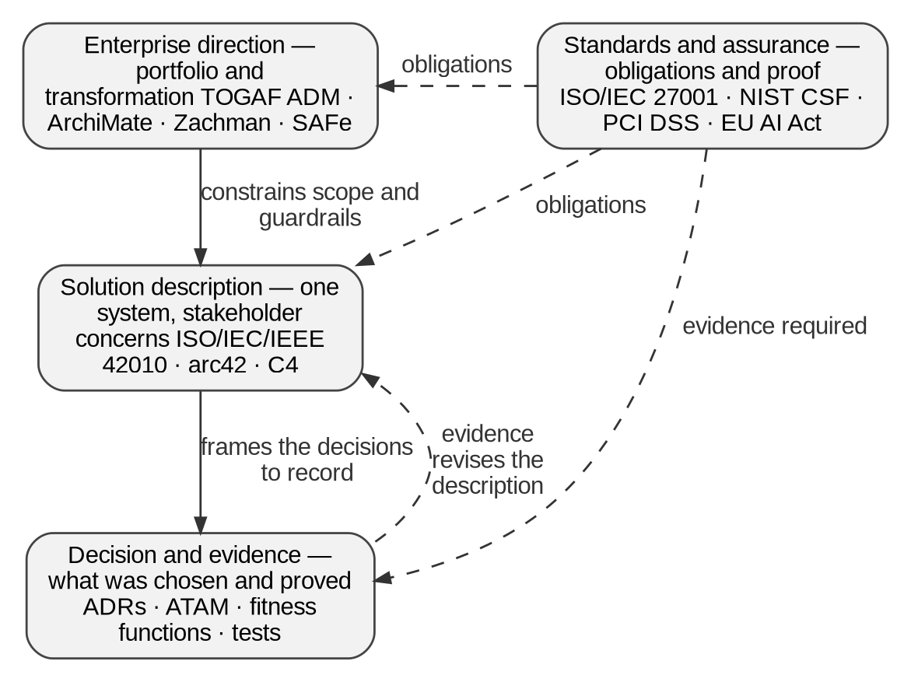
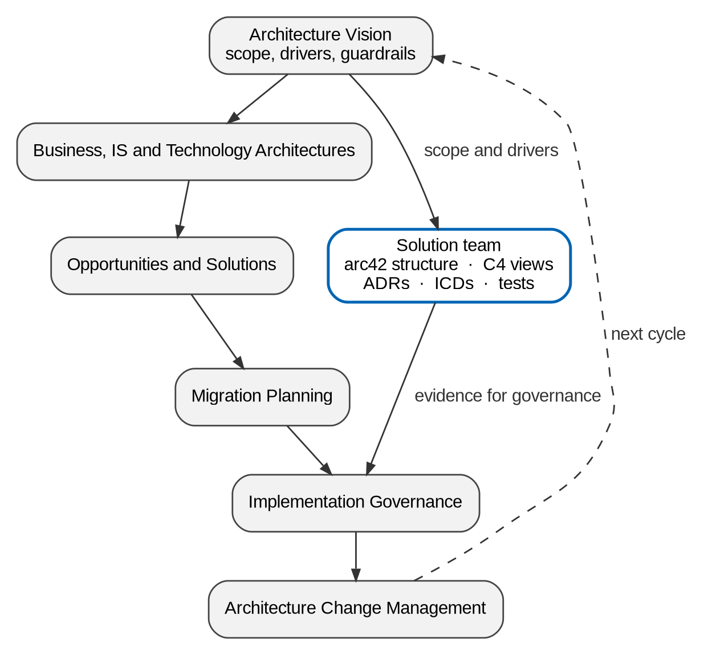
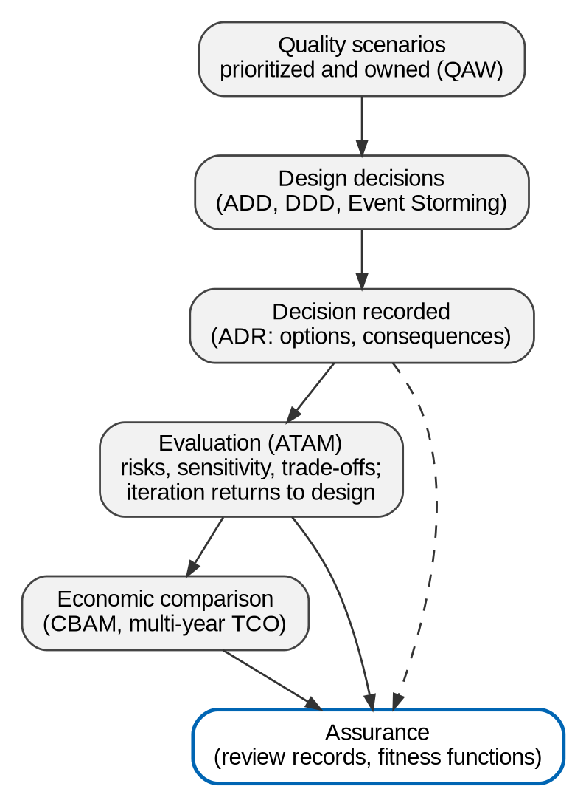
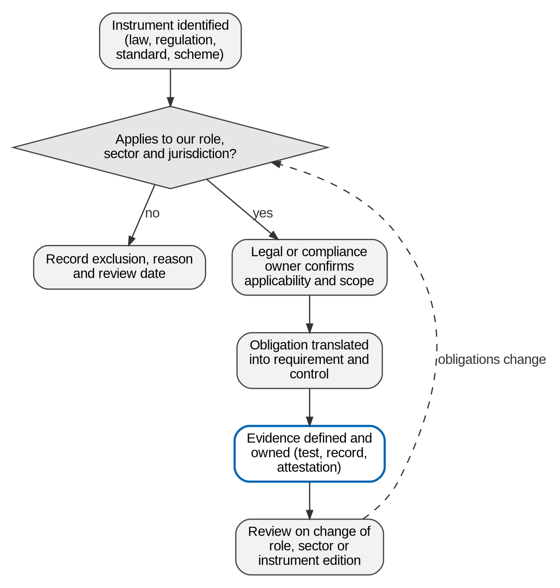

# 18. Architecture Frameworks, Methods and Standards

Frameworks, methods, templates, notations and standards operate at different levels and are complementary, not interchangeable. Their value lies in improving decisions, shared understanding and assurance with proportionate effort. Applying every element of every framework mechanically produces redundant artifacts.

::: {.callout-note appearance="simple" icon=false title="When to Use This Chapter"}
- Choosing which frameworks, methods and notations a program or solution will use, and for which concern.
- Selecting an evaluation, design or economic method for a decision.
- Checking which laws, regulations, standards and assurance schemes may apply to a solution.
- Aligning a solution with an industry reference model or an enterprise architecture practice.
:::

::: {.callout-tip appearance="simple" icon=false title="Key Takeaway"}
Frameworks are tools for specific concerns, not a production checklist. Choose each one for a concern no other artifact covers, keep one authoritative source per concern, and treat regulatory instruments as applicability questions to be confirmed — never assume that every regulation applies to every solution.
:::

## 18.1 Positioning the Main Frameworks

**Definition.** Frameworks, methods, notations and standards are tools that answer different questions at different levels of an organization, and positioning them means deciding which question each one answers for this program or solution.

**Purpose.** Positioning prevents the two common failures: adopting an enterprise framework to solve a documentation problem, and using a diagramming notation to make a governance decision. It informs the framework selection record, the tailoring rationale and the artifact set — because a framework that produces an artifact nobody consumes is cost without assurance.

**What it includes.** Four layers that constrain each other (Figure 18.1): enterprise direction, which sets scope, capability and guardrails; solution description, which addresses stakeholder concerns for one system; decision and evidence practice, which records what was chosen and demonstrates that it works; and standards and assurance, which impose obligations and define acceptable proof. The selection test is simple: for each framework activity, identify its consumer, the decision it supports, the artifact it produces and who maintains that artifact. Remove the activity if it adds no unique evidence.

{#fig-18-1 width="100%"}

Table 18.1 places each framework at one of these layers and states its primary scope, so that overlapping names can be assigned to a single layer before adoption is discussed.

| Framework or practice | Type and layer | Primary scope | Use it for |
| :--- | :--- | :--- | :--- |
| TOGAF Standard (ADM) | Enterprise architecture method and governance framework | Enterprise transformation | Capability planning, target and transition architectures, governance |
| ArchiMate | Modeling language | Enterprise landscape | Relating business, application and technology elements |
| ISO/IEC/IEEE 42010 | International standard | Architecture descriptions | Organizing descriptions by stakeholders, concerns, viewpoints and views |
| arc42 | Documentation template | One software system | Structuring a system architecture description |
| C4 model | Diagramming approach | Software structure | Context, container and component views |
| ADRs | Architecture decision record practice | Individual decisions | Recording rationale and consequences |
| DDD and Event Storming | Design approach and workshop technique | Domain boundaries | Bounded contexts, language and domain events |
| ATAM | Evaluation method | Consequential designs | Scenario-based trade-off and risk analysis |
| Well-architected frameworks | Provider review guidance | Cloud workloads | Structured review across reliability, security, cost and related pillars (8.5) |
| Zachman Framework | Enterprise ontology | Classification of descriptions | Checking completeness of enterprise descriptions |
| SAFe | Scaled agile delivery framework | Large programs | Architectural runway and enablers in program planning |
| Industry reference models | Domain vocabularies and interface standards | One industry | Starting point for capability maps and partner interfaces |

: Positioning the main frameworks by layer, scope and use

**Why it is needed.** Frameworks overlap in vocabulary and artifact names, and an organization that adopts several without positioning them gets two capability maps, three decision logs and no agreement about which one governs. The evidence is a selection record naming, for each adopted framework, the concern it covers, its consumer and the artifact it produces — plus the activities deliberately not adopted and why.

**Example.** A single solution adopts quality scenarios, C4 views, ADRs and automated tests as its core set, and uses ISO/IEC/IEEE 42010 only as a checklist for stakeholder concerns. It does not adopt an enterprise framework, because the enterprise practice already owns capability and transition planning.

::: {.callout-warning appearance="simple" icon=false title="Common Pitfall"}
Positioning frameworks by reputation rather than by concern. A team adopts an enterprise framework because it is the organizational standard, spends months on capability models that no delivery decision consumes, and then documents the actual solution in slides. Start from the decisions that need support, choose the smallest set that supports them, and record why each larger framework was not adopted.
:::

::: {.callout-important appearance="simple" icon=false title="Decision & Trade-off"}
How much framework should a program adopt?

| Option | Choose when | Consequences |
| :--- | :--- | :--- |
| Lightweight set: quality scenarios, C4, ADRs, tests | A single solution or a small group of teams | Low overhead and fast feedback; little support for portfolio-level planning |
| Solution set plus arc42 and a review method | Several teams, external interfaces or regulated evidence | Consistent descriptions and auditable decisions; needs templates and review discipline |
| Enterprise framework (TOGAF ADM, ArchiMate) on top | Portfolio transformation, many dependent programs | Shared capability and transition planning; significant modeling effort and tooling, which pays back only at enterprise scale |
:::

## 18.2 Enterprise and Description Frameworks

Enterprise frameworks set direction and guardrails; description frameworks make one system understandable to its stakeholders. This section positions the main ones and shows how they hand work to each other.

{#fig-18-2 width="100%"}

### 18.2.1 TOGAF Standard and the ADM

**Definition.** The TOGAF Standard, published by The Open Group, provides enterprise architecture concepts, governance guidance and the Architecture Development Method (ADM), an iterative cycle that runs from an architecture vision through business, information systems and technology architectures to migration planning and implementation governance, with requirements management at its center.

**Purpose.** The ADM informs enterprise-level capability planning, target states, transition architectures and the governance checkpoints between them. It gives a large organization a shared sequence for deciding what to change, in what order, and who approves the transition, and it provides the vocabulary in which solution work is scoped.

**What it includes.** The cycle (Preliminary; Architecture Vision; Business, Information Systems and Technology Architectures; Opportunities and Solutions; Migration Planning; Implementation Governance; Architecture Change Management) and the artifacts each phase produces, tailored to the organization’s scale. It does not prescribe service decomposition and does not replace system-specific engineering detail such as interface contracts or failure sequences (Figure 18.2).

**Why it is needed.** Without a shared enterprise cycle, programs optimize locally and produce transition plans that conflict over funding, dependencies and sequencing. The consequence is duplicated investment and migrations that block each other. The evidence is a tailored ADM with named phase outputs, gate criteria and a requirements-management log — not a certificate or a full set of templates.

### 18.2.2 ISO/IEC/IEEE 42010

**Definition.** ISO/IEC/IEEE 42010 defines what an architecture description should contain: identified stakeholders and their concerns, viewpoints that frame those concerns, views that apply the viewpoints, and correspondences that keep views consistent.

**Purpose.** The standard informs how a description is organized so that each stakeholder can find the view that answers their concern, and how consistency between views is maintained. It is the reference an architect uses when reviewing whether a document set is a description or a pile of diagrams.

**What it includes.** Stakeholders and concerns, viewpoints with their model kinds, views, correspondences and the rationale for architectural decisions. It does not prescribe a method or a notation, so it composes with arc42 and C4 rather than competing with them.

**Why it is needed.** Descriptions grow by accretion: a context diagram here, a deployment diagram there, each with different names for the same service. The practical lesson is to choose views by concern — operations needs deployment, security needs trust boundaries, product needs capability context — and to record correspondences. The evidence is a description whose views name their audience and concern and whose element names agree across views.

### 18.2.3 arc42

**Definition.** arc42 is a pragmatic, freely available template for documenting a software architecture, structured in twelve sections from introduction and goals through building blocks, runtime and deployment views to risks, technical debt and glossary.

**Purpose.** arc42 informs the structure of a solution architecture description. It gives a team a shared table of contents so that a reader knows where to find goals, constraints, building blocks, decisions and quality requirements, and it makes gaps visible: an empty section is a question, not a blank page.

**What it includes.** Introduction and goals, constraints, context and scope, solution strategy, building-block view, runtime view, deployment view, cross-cutting concepts, architecture decisions, quality requirements, risks and technical debt, and glossary. Fill sections selectively according to risk. Section 13.3.2 shows what each section holds and what it references instead of restating.

**Why it is needed.** Completing every section without purpose produces a large but unhelpful document, and skipping the ones that matter leaves reviewers without the context to judge the design. The evidence is a description that uses the template as a checklist of concerns, states which sections are intentionally light, and links decisions and quality requirements to their own artifacts rather than restating them.

### 18.2.4 C4 Model

**Definition.** The C4 model is a four-level diagramming approach for software structure, defined in 13.1.2.

**Purpose.** Among the frameworks in this chapter, C4 answers one narrow question: which structural views to draw, at which level of detail and for whom. It is positioned here so it is not mistaken for a method that covers decisions or evaluation.

**What it includes.** Only diagram levels and their vocabulary. It pairs naturally with arc42 (18.2.3), which supplies the document structure C4 lacks, and with an ADR log and an evaluation method from 18.3 for what diagrams cannot record.

**Why it is needed.** Adopting C4 as if it were the whole documentation approach leaves decisions, quality scenarios and evidence unrecorded even though the diagrams look complete. The evidence is a documentation set in which C4 views sit alongside decision records and quality scenarios. Section 13.1.2 gives the levels and their review evidence.

### 18.2.5 Zachman Framework and SAFe

**Definition.** The Zachman Framework is an ontology for classifying enterprise architecture descriptions, and the Scaled Agile Framework (SAFe) defines roles and practices for agile delivery across many teams.

**Purpose.** Zachman informs completeness checking: it asks whether the description answers what, how, where, who, when and why from each perspective, from executive to implementer. SAFe informs how architecture work enters program planning, through the architectural runway and enabler work. Each answers a different question, and neither replaces a solution method.

**What it includes.** Zachman’s matrix of questions against perspectives, which prescribes no method, and SAFe’s roles, events and artifacts, revised regularly by Scaled Agile, Inc. Its architectural concepts include the architectural runway — existing technical foundations that let near-term features be delivered without excessive redesign — and enabler work to extend it.

**Why it is needed.** Zachman used as a production template generates cells nobody reads; used as a completeness check it exposes missing perspectives cheaply. SAFe adopted without an architecture practice produces enablers that are not tied to decisions. The evidence is a completeness review that names the cells deliberately left empty, and a program plan in which enablers trace to recorded architecture decisions.

### 18.2.6 Industry Reference Models

**Definition.** Industry reference models are published vocabularies, capability maps and interface standards that a sector shares, such as BIAN for banking or HL7 FHIR for healthcare.

**Purpose.** Reference models inform design reuse and partner integration. Adopting a common vocabulary reduces mapping effort, shortens integration projects and makes a capability map comparable with peers and products. They are a starting point, not a mandate.

**What it includes.** A reference model with a versioned release: BIAN’s service landscape for banking; TM Forum Open Digital Architecture and Open APIs for telecommunications; HL7 FHIR for health data; ACORD for insurance; ISA-95 for manufacturing integration (Table 18.2).

| Industry | Reference model | Provides |
| :--- | :--- | :--- |
| Banking | BIAN (Banking Industry Architecture Network) | Service landscape and service-domain definitions for banking capabilities |
| Telecommunications | TM Forum Open Digital Architecture and Open APIs | Component architecture and standardized APIs |
| Healthcare | HL7 FHIR | Resource model and APIs for exchanging health data |
| Insurance | ACORD standards | Data and messaging standards |
| Manufacturing | ISA-95 (IEC 62264) | Integration model between enterprise and control systems |

: Industry reference models and what they provide

**Why it is needed.** Reference models are versioned — HL7 FHIR, for example, has Release 4 (2019) and Release 5 (2023), with materially different resources — so a design that does not record its release can silently mix incompatible vocabularies. Following a model rigidly where it does not fit the business recreates the problems of a universal canonical model (5.3.2). The evidence is the release adopted, the deviations chosen and their reason.

**Example.** A bank maps its payment and account capabilities to BIAN service domains, records the release, and documents two deviations where the product organization is structured differently. Partner interfaces use the industry API definitions rather than a bespoke schema.

::: {.callout-warning appearance="simple" icon=false title="Common Pitfall"}
Using an enterprise framework to document a single solution. The team produces capability maps, governance registers and metamodel entities for one system, while the interfaces that actually need agreement remain undescribed. Match the framework to the level of the question: enterprise frameworks set direction, and solution frameworks describe the system.
:::

::: {.callout-important appearance="simple" icon=false title="Decision & Trade-off"}
Which description framework should a solution use?

| Option | Choose when | Consequences |
| :--- | :--- | :--- |
| C4 views plus ADRs | Small team, reversible change, internal stakeholders | Fast to produce and easy to keep current; weaker support for formal stakeholder-concern traceability |
| arc42 with C4 views and ADRs | Multiple teams, external interfaces or regulated evidence | Complete concern structure and reviewable decisions; more sections to maintain and a risk of template filling |
| ISO/IEC/IEEE 42010 viewpoints on top of arc42 | Formal review, safety or regulated contexts | Explicit stakeholders, concerns and correspondences; additional modeling effort that pays back only where assurance is required |
:::

## 18.3 Modeling, Design and Evaluation Methods

Methods answer different questions: elicitation, design, decision, evaluation, economic comparison and assurance. Naming the purpose first is what prevents using an evaluation method to design or a documentation template to decide.

{#fig-18-3 width="100%"}

### 18.3.1 ATAM

**Definition.** The Architecture Tradeoff Analysis Method (ATAM), developed at the Software Engineering Institute, evaluates an architecture against prioritized quality attribute scenarios.

**Purpose.** ATAM informs a consequential design decision by exposing where the architecture is sensitive and where attributes trade against each other. It gives stakeholders a structured way to challenge the design against their own scenarios, and it produces a risk list that governance can act on rather than a pass-or-fail verdict.

**What it includes.** Its outputs distinguish risks, non-risks, sensitivity points (where a property depends strongly on one decision) and trade-off points (where one decision affects several attributes in opposite directions). Chapter 14 applies the method step by step (14.2.1) and decides when its weight is justified (14.1.3).

**Why it is needed.** ATAM reveals architectural uncertainty; it does not certify that a system meets its production SLOs. A design reviewed only by its authors tends to confirm its own assumptions, and the trade-off points surface later as incidents. The evidence is a documented scenario set, a ranked risk list with owners, and the sensitivity and trade-off points recorded in the review.

**Example.** Comparing synchronous with asynchronous payment authorization exposes sensitivity points such as provider latency, duplicate-charge risk, recovery complexity and business tolerance for pending orders.

### 18.3.2 ArchiMate

**Definition.** ArchiMate, also from The Open Group, is a modeling language for relationships among business, application and technology elements.

**Purpose.** ArchiMate informs enterprise landscapes, capability-to-application traceability and transformation roadmaps. It gives a precise vocabulary for relationships — serving, realizing, accessing — so that an impact question (“what applications support this capability?”) can be answered from a model rather than from interviews.

**What it includes.** A metamodel with business, application, technology and implementation layers; viewpoints that select the elements relevant to a concern; and a notation for relations. It is a language, not a method, and it depends on a modeling discipline that keeps the repository current.

**Why it is needed.** Using enterprise notation for every small design can overwhelm engineering teams, and an unmaintained model becomes confidently wrong. A practical test is whether a concrete question — “which applications serve this capability, and which are being retired?” — can be answered from the model without interviews; if it cannot, the model is either incomplete or drawn at the wrong level. The evidence is a model scoped to the questions it must answer, with an owner, a review cadence and a stated level of abstraction.

### 18.3.3 Domain-Driven Design and Event Storming

**Definition.** Domain-Driven Design (DDD) provides strategic patterns such as bounded contexts, ubiquitous language and context maps, and Event Storming is a collaborative workshop for discovering domain events, commands, policies and boundaries.

**Purpose.** DDD and Event Storming inform ownership and language before services are decomposed. They reveal where the business uses one word for different things, where a process crosses an organizational boundary, and where a transaction must be consistent. That is exactly the information a service boundary decision needs.

**What it includes.** Bounded contexts with explicit relationships (shared kernel, customer-supplier, anti-corruption layer), a ubiquitous language per context, and a domain model; Event Storming’s timeline of events, commands, policies and hotspots, run with domain experts. Section 7.1 covers decomposition.

**Why it is needed.** Decomposing by technical layer or by team structure produces services that share a database and a vocabulary, and every change then requires coordination. Not every discovered domain event should become a published integration event, however: the evidence is a context map with owners and a small set of published events justified by a consumer need (6.1).

### 18.3.4 Well-Architected Frameworks

**Definition.** Cloud providers publish well-architected frameworks that structure workload reviews around pillars such as security, reliability, performance, cost, operations and sustainability.

**Purpose.** The frameworks inform a structured review of a workload against provider best practice. They are useful as a checklist for concerns a team may have under-weighted — cost allocation, quota limits, recovery — and as a shared vocabulary for a review with platform and security teams.

**What it includes.** Pillars, design principles, questions and recommended practices per service, plus review tooling in some providers. Their pillars, extensions and use in reviews are described in 8.5.

**Why it is needed.** They complement, rather than replace, the evaluation methods above: a framework review checks a workload against provider best practice, while ATAM-style evaluation tests a design against the solution’s own quality scenarios. A review that only applies the provider checklist can pass while the business scenario is unmet. The evidence is the review output mapped to the scenarios it did and did not cover.

### 18.3.5 Choosing Methods by Purpose

**Definition.** Choosing methods by purpose is the practice of naming the question first — elicit, design, decide, evaluate, compare economics, assure or describe — and then selecting the method whose output answers it.

**Purpose.** It informs the method selection for each stage of the work and prevents method theater: a workshop that produces no decision, an evaluation that recommends a design, a template that is asked to justify a trade-off. It also makes the cost of each method visible, because every method consumes stakeholder time.

**What it includes.** A mapping from purpose to method to output (Table 18.3), with the section that owns each method. Naming the purpose first avoids using an evaluation method to design, or a documentation template to decide.

| Purpose | Methods | Output | See |
| :--- | :--- | :--- | :--- |
| Elicit and prioritize quality requirements | Quality Attribute Workshop (QAW) | Prioritized quality attribute scenarios | 1.4 |
| Design | Attribute-Driven Design (ADD), Domain-Driven Design | Design decisions tied to drivers | Chapter 3, 18.3.3 |
| Record decisions | Architecture Decision Records | ADRs with context, options and consequences | 3.4 |
| Evaluate | ATAM, scenario-based workshop, lightweight review | Risks, sensitivity and trade-off points | 14.2, 18.3.1 |
| Compare economics | CBAM, multi-year TCO | Benefit-per-cost ranking of options | 16.2 |
| Assure continuously | Review checklists, fitness functions, audits | Evidence that decisions hold | 4.4, 14.3.1 |
| Describe | ISO/IEC/IEEE 42010, arc42, C4, ArchiMate | Views addressing stakeholder concerns | 13.1, 13.3, 18.2 |

: Methods by purpose and their outputs

**Why it is needed.** Methods borrowed without a purpose create activity without evidence: a design workshop substitutes for a decision, or an ATAM is run after the architecture is irreversible and becomes a ratification. The evidence is a method-to-purpose record for the work, naming the output each method produced and who consumed it.

**Example.** For a contested integration design, the team runs a QAW to rank scenarios, uses ADD to propose two designs, records the choice as an ADR, and runs a lightweight ATAM on the top three scenarios. It does not run CBAM, because the options do not differ materially in cost.

::: {.callout-warning appearance="simple" icon=false title="Common Pitfall"}
Running an evaluation method as a ratification ritual. The design is already built, the scenarios are chosen to match it, and ATAM produces a risk list nobody acts on. Choose the method before the design is committed, let stakeholders bring their own scenarios, and record what would have to change for the evaluation to fail.
:::

::: {.callout-important appearance="simple" icon=false title="Decision & Trade-off"}
How much evaluation does a design need?

| Option | Choose when | Consequences |
| :--- | :--- | :--- |
| Peer review against a checklist | Reversible change with familiar technology | Cheap and fast; misses cross-attribute trade-offs and stakeholder disagreement |
| Scenario workshop on the top scenarios | Material change with a few uncertain quality attributes | Focused evidence in a day or two; covers only the chosen scenarios, so their ranking must be right |
| Full ATAM, with CBAM where options differ in cost | Hard-to-reverse, cross-organizational or high-impact architecture | Systematic risks, sensitivity and trade-off points with stakeholder buy-in; days of stakeholder time and trained facilitation |
:::

## 18.4 Regulatory and Compliance Landscape

Laws, regulations, contractual standards and assurance schemes differ in legal force and scope, and none applies to every solution: legal, privacy and compliance owners decide applicability, while the architect translates applicable obligations into requirements, decisions, controls and evidence (4.1.1).

{#fig-18-4 width="100%"}

### 18.4.1 Laws and Regulations

**Definition.** Laws and regulations are instruments with legal force that create obligations on organizations meeting their scope conditions, enforced by a regulator or court.

**Purpose.** They inform which obligations become requirements, which evidence an auditor or regulator will expect, and which architectural choices are constrained — data location, retention, logging, accessibility, incident notification. They also inform the record of what does not apply, which is as important as the list of what does.

**What it includes.** The instruments in Table 18.4, each with its nature and scope, architectural implications, and the evidence and handbook section that elaborates it. The matrix is a starting point for the applicability conversation, not legal advice; confirm the current version of each instrument before relying on it.

| Instrument | Nature and scope | Architectural implications | Evidence and see |
| :--- | :--- | :--- | :--- |
| GDPR (Regulation (EU) 2016/679) | EU law; processing of personal data of people in the EU | Privacy by design, minimization, data-subject rights, transfers, breach notification | Record of processing, DPIA; 10.9, 5.2.4 |
| ePrivacy Directive (2002/58/EC) | EU law, transposed nationally; electronic communications, cookies and device storage | Consent before non-essential tracking; confidentiality of communications | Consent records; 10.9 |
| NIS2 (Directive (EU) 2022/2555) | EU law; essential and important entities in listed sectors | Cyber risk management, supply-chain security, incident reporting within tight deadlines | Risk assessments, incident reports; 10.7.1, 10.8 |
| DORA (Regulation (EU) 2022/2554) | EU law, applicable from January 2025; financial entities and critical ICT providers | ICT risk management, resilience testing, incident reporting, third-party risk and exit strategies | Test results, register of ICT contracts; 8.2, 16.2.4 |
| EU AI Act (Regulation (EU) 2024/1689) | EU law, phased application; obligations scale with an AI system’s risk class | Risk management, data governance, logging, transparency and human oversight for high-risk systems | Technical documentation, logs; Chapter 19 |
| European Accessibility Act (Directive (EU) 2019/882) | EU law, applicable from June 2025; listed products and services such as e-commerce and banking | Accessible user interfaces and documents, usually demonstrated against EN 301 549 | Accessibility conformance reports; 1.2.11 |
| HIPAA | US federal law; covered entities and business associates handling protected health information | Administrative, physical and technical safeguards; business associate agreements | Risk analysis, audit logs; 10.7.2 |
| CCPA as amended by CPRA | California law; businesses meeting statutory thresholds | Consumer rights to know, delete, correct and opt out of sale or sharing | Request handling records; 10.9.3 |
| LGPD (Law 13,709/2018) | Brazilian law; processing of personal data in Brazil | Legal bases, data-subject rights, transfers, incident reporting | Processing records; 10.9 |

: Laws and regulations with typical architectural implications

**Why it is needed.** Assuming that every regulation applies, or that none does, misdirects effort in both directions: unnecessary controls consume budget, while an unaddressed obligation becomes a finding, a fine or a blocked release. Applicability depends on role, sector, jurisdiction and data, and it changes when any of them changes. The evidence is an applicability assessment with a legal or compliance owner, an exclusion record with reasons, and obligations traced to requirements, controls and evidence (Figure 18.4).

### 18.4.2 Standards, Frameworks and Assurance Schemes

**Definition.** Standards, frameworks and assurance schemes are instruments without direct legal force that define controls, good practice or a way to demonstrate conformity; they become binding through contract, regulation or organizational policy.

**Purpose.** They inform control selection, supplier assessment and the evidence a customer or auditor will accept. They also inform the difference between a certification of a management system and an attestation that controls operated over a period — a distinction customers frequently blur and contracts sometimes require precisely.

**What it includes.** The instruments in Table 18.5, each with its nature, architectural implications and evidence. Chapter 19 (19.5.6) applies the AI governance frameworks in this matrix to model lifecycle, human oversight and evidence.

| Instrument | Nature and scope | Architectural implications | Evidence and see |
| :--- | :--- | :--- | :--- |
| PCI DSS v4.0.1 | Contractual industry standard; entities storing, processing or transmitting card data | Minimize scope through segmentation and tokenization; strong access control and logging | Report on Compliance or SAQ, AoC; 10.8 |
| ISO/IEC 27001:2022 and 27002:2022 | Certifiable information security management system; control guidance | Risk-based control selection and Statement of Applicability | Certificate scope, SoA; 4.9, 10.8 |
| ISO/IEC 27017:2026 and 27018:2025 | Cloud security controls; protection of personal data in public-cloud processing | Shared-responsibility mapping; processor controls for personal data | Certification or attestation scope; 10.8 |
| ISO 22301:2019 | Certifiable business continuity management system | Business impact analysis, recovery objectives and exercises | BIA, exercise reports; 8.2 |
| ISO/IEC 42001:2023 | Certifiable AI management system | Governance, risk and lifecycle controls for AI systems | AI policy, impact assessments; Chapter 19 |
| NIST CSF 2.0 (2024) and SP 800 series | Voluntary framework (Govern, Identify, Protect, Detect, Respond, Recover); SP 800-53 controls, SP 800-207 Zero Trust, SP 800-218 secure development | Common vocabulary for security outcomes; detailed control and engineering guidance | Profiles and gap analyses; 10.1.2, 10.4.1, 10.5.1 |
| SOC 1 and SOC 2 (AICPA) | Independent attestation reports; financial-reporting controls and Trust Services Criteria | Type II reports evidence controls operating over a period | Reports with bridge letters; 10.8 |
| CSA Cloud Controls Matrix | Cloud control framework with the CAIQ questionnaire | Cloud control mapping for providers and customers | CAIQ responses; 10.8 |
| CIS Benchmarks | Consensus hardening configurations | Baseline configurations enforced as code | Compliance scans; 8.3, 12.3 |
| OWASP ASVS 5.0.0 (2025) | Application security verification standard | Selected level becomes verifiable requirements and tests | Requirement-to-test mapping; 10.5.2 |
| WCAG 2.2 and EN 301 549 | W3C accessibility guidelines; European harmonized accessibility standard | Accessible interaction design, verified by automated and manual testing | Conformance reports; 1.2.11 |

: Standards, frameworks and assurance schemes

**Why it is needed.** A certificate is not a control, and an attestation period is not a guarantee for today: treating them as equivalent leads to accepting assurance that does not cover the service or the period in question. Conversely, refusing to map to any framework makes every customer questionnaire a fresh project. The evidence is a control-to-instrument mapping whose scope, edition and period match the claim being made.

**Example.** A payment platform combines PCI DSS scope reduction through tokenization, an ISO/IEC 27001 certificate whose scope names the service, and SOC 2 Type II reports for the period a customer asks about. The architecture review checks that the certificate scope and the deployed service are the same.

::: {.callout-warning appearance="simple" icon=false title="Common Pitfall"}
Citing a regulation by name in a design document without confirming applicability or the current edition. A paragraph on the EU AI Act appears in a solution that has no AI system, the real obligation in a sector regulation is missed, and readers learn to skip the compliance section. Record applicability, edition and owner, and date the assessment so it can be re-checked.
:::

::: {.callout-important appearance="simple" icon=false title="Decision & Trade-off"}
How should regulatory obligations be tracked?

| Option | Choose when | Consequences |
| :--- | :--- | :--- |
| Obligations in the requirements register | Small set of applicable instruments, one owner | Obligations are delivered like requirements; weak visibility of evidence and audit history |
| A control and evidence matrix per solution | Several instruments, regulated scope or customer assurance | Traceable from obligation to control to evidence; needs maintenance and a named owner |
| Enterprise compliance platform with solution mappings | Many solutions, shared controls and an audit function | Reuse and consistent reporting; integration cost and a risk that solution specifics are flattened |
:::

## 18.5 Worked Example: Combining Frameworks in Practice

*In practice:* This example shows an enterprise modernization program that uses the TOGAF ADM for direction, then documents each solution with arc42, C4 views and ADRs.

For a typical solution, a proportionate combination is: PRD and quality scenarios for intent; an arc42-structured HLD with C4 views for description; ADRs for decisions; ICDs and API/event specifications for interfaces; tests and fitness functions for evidence; runbooks for operations. Enterprise programs add TOGAF-based capability and transition planning, and ArchiMate where enterprise modeling governance warrants it.

Designate one authoritative source per concern so that overlapping artifacts do not drift (Table 18.6).

| Concern | Authoritative source | Frameworks and templates that feed it |
| :--- | :--- | :--- |
| Enterprise capability and transition | Capability and transition roadmap | TOGAF ADM, ArchiMate |
| Solution intent and scope | PRD and quality scenarios | Product practice, QAW |
| System structure and behavior | arc42 description with C4 views | ISO/IEC/IEEE 42010 viewpoints, C4 |
| Significant decisions | ADR log | ADR practice, ATAM outputs |
| Interfaces | ICD with machine-readable specification | arc42 cross-cutting concepts, API standards |
| Evidence of quality | Test reports, fitness functions, SLOs | ATAM risks, well-architected reviews |
| Applicable obligations | Control and evidence matrix | Regulatory applicability assessment, ISO and NIST mappings |

: Concern-to-source map for a combined framework set

**Worked example.** An enterprise modernization program uses ADM activities to frame business drivers, target capabilities, transition architectures and governance checkpoints. Each solution team documents its system with arc42 and C4, records decisions as ADRs linked to enterprise constraints, and retains authority within approved guardrails. ISO/IEC/IEEE 42010 informs how stakeholder concerns map to views. The frameworks are adapted to the organization rather than followed as a document-production checklist.

::: {.callout-note .review appearance="minimal" icon=false title="Architecture Review Checklist — Frameworks, methods and standards"}

☐  Is each framework used for a concern no other artifact covers?

☐  Is there one authoritative source per concern?

☐  Are framework activities tailored to the scale and risk of the work?

☐  Has a relevant industry reference model been considered for vocabulary and interfaces, with its release recorded?

☐  Is each method chosen for its purpose — elicitation, design, decision, evaluation, economics, assurance or description?

☐  Have legal and compliance owners confirmed which regulatory instruments apply, and are their obligations traced to requirements and evidence?
:::

## 18.6 Further Reading

- The Open Group (2022), *The TOGAF Standard*, 10th Edition, and *ArchiMate 3.2 Specification*.
- ISO/IEC/IEEE 42010:2022 — architecture description.
- Kazman, Klein and Clements (2000), *ATAM* — scenario-based architecture evaluation.
- Brandolini, *Introducing EventStorming*; Evans (2003), *Domain-Driven Design*.
- Zachman International, *The Zachman Framework*; Scaled Agile, Inc., *SAFe* (scaledagileframework.com).
- Barbacci et al. (2003), *Quality Attribute Workshops (QAWs), Third Edition*; Cervantes and Kazman (2016), *Designing Software Architectures* — ADD 3.0.
- Official texts: EUR-Lex for EU regulations and directives; PCI Security Standards Council; ISO; NIST; W3C *WCAG 2.2*; ETSI *EN 301 549*.
